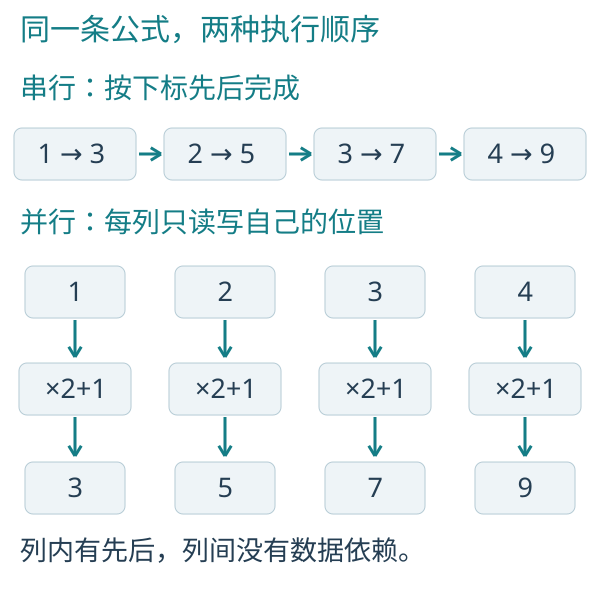
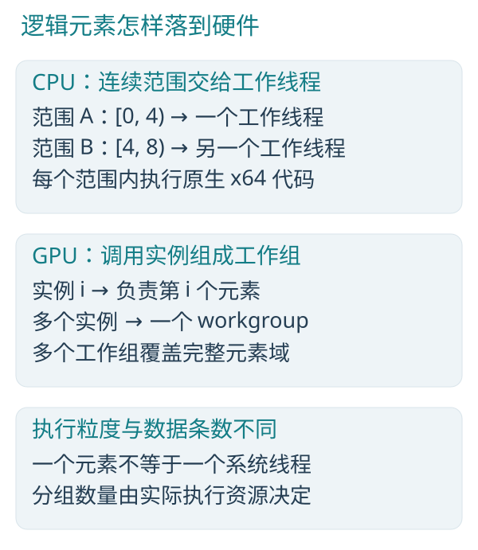
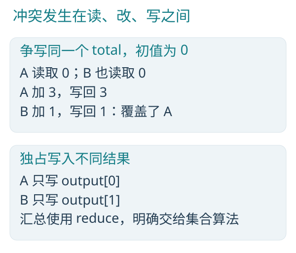
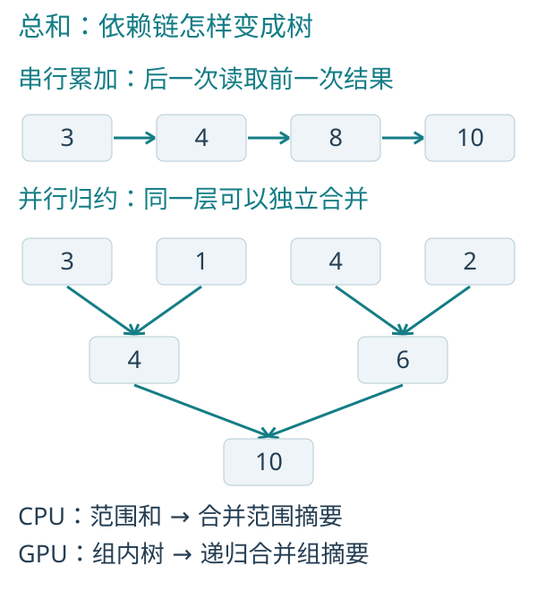

# Parallel programming: the first three chapters

[Product home](../README.en.md) · [Installation and tools](GettingStarted.en.md) · [Complete Chinese book](../sample/并行编程的艺术.md)

Before running examples, install the formal Blink tools, Rust MSVC, and Windows build tools as described in the installation guide. Source hosts and performance drivers with the default compiler feature also need the stable seed in `%ProgramFiles%/Blink`. The teaching text and existing measurements are retained below; reproduce performance with your chosen version and device.

<a id="parallel-programming"></a>

## Begin with The Art of Parallel Programming

This primer follows the first three chapters of [The Art of Parallel Programming](../sample/并行编程的艺术.md), retaining the theory, C/B comparisons, figures and existing measurements. Run sections now show complete standalone programs; links and capability descriptions follow the current implementation. Figures retain translated captions from the Chinese edition.

[Chapter 1: element-wise parallelism](#map) · [Chapter 2: ownership of reads and writes](#ownership) · [Chapter 3: sum reduction](#reduction)

The examples use the current language rules and formal Release tools. Historical build, hardware and measurement records are kept in the P4 ledgers; run the supplied programs to obtain measurements for the current build.

To reproduce them, build the additional measurement program as described in [Appendix A.5](../sample/并行编程的艺术.md). A normal workspace build does not produce `bperf.exe`:

```powershell
cargo build --release --manifest-path sample/performance/Cargo.toml --target-dir target
```

<a id="map"></a>

## 1 · The first beauty: many things can happen together

### 1.1 · Start with a loop you already know

The array `values` contains four numbers, `[1,2,3,4]`. Multiplying each by two and adding one takes only a short C loop:

```cpp
for (size_t i = 0; i < n; ++i) {
    values[i] = values[i] * 2.0f + 1.0f;
}
```

The computation written in the B language is just as short:

```c
parallel (value in values) {
    value = value * 2.0 + 1.0;
}
```

`values` denotes all the numbers. `value` is an exclusive position for the current element, corresponding to C's `values[i]`; assigning to it updates that element directly. `parallel` describes what each element does and permits the invocations to advance independently.

Both forms produce `[3,5,7,9]`. Each update depends only on its own previous value, so the updates can be computed separately. The serial order comes from the loop's form; the problem itself does not require it.

### 1.2 · Look at dependencies before hardware



*Figure 1-1: serial order and a parallel element domain for the same formula. Steps represent logical dependencies, not measured time.*

In a serial execution, the processor reads one number, multiplies, adds, writes it back, and advances to the next item. The parallel form exposes four independent read-modify-write operations. Within each invocation, reading still precedes calculation, which precedes writing.

This pattern, with one input corresponding to one output, is called a map: an element-wise transformation.



*Figure 1-2: logical elements, CPU work ranges, and GPU workgroups are different levels.*

The current CPU framework assigns contiguous index ranges to worker threads. One thread processes many elements. Suitable straight-line computations can also use four SSE2 lanes at once; vector execution and work across multiple CPU cores are two levels of parallelism.

On a GPU, element instances map to compute invocations, which are grouped into workgroups. Workgroups are scheduled onto hardware in batches. Four logical elements are not guaranteed to execute at precisely the same instant, and one million elements do not mean one million operating-system threads.

C/C++ compilers may also vectorize simple loops automatically. B expresses independence between elements directly through the work domain.

### 1.3 · Concurrency and parallelism are different

Concurrency concerns how multiple activities remain in progress, such as handling another request while waiting for a file read. Parallelism concerns whether computations can advance simultaneously on multiple execution resources.

Concurrent tasks can take turns on one core. A parallel array computation uses multiple execution resources to divide the work. B primarily develops data parallelism and connects stages through producer-consumer relationships.

### 1.4 · Ask three questions first

When looking at a loop, ask: what does each iteration read? What does it write? Does it need a result just written by another iteration?

If the answers are shared read-only inputs, exclusive outputs, and no waiting for another element, you have found a shape well suited to parallelism. Finding that shape before discussing core or thread counts makes the problem easier to understand.

### 1.5 Run the complete program

The CPU program below contains all allocation, initialization, arithmetic and output. It uses only built-in operations. Each index produces its input `index() + 1`, then multiplies it by two and adds one. No teaching module or CPU target wrapper is needed.

**parallel.h**

```c
module parallel;

u32 main() on cpu;
```

**parallel.b**

```c
module parallel;

u32 main() on cpu {
    dataset<f32> values = dataset<f32>(4);

    parallel (value in values) {
        value = f32(index() + 1) * 2.0 + 1.0;
    }

    for (value in values) {
        println(value);
    }
    return 0;
}
```

The checked-in files are in [sample/hello](../sample/hello/README.md). With the installed 0.14.1.1 tools and prerequisites from the [installation guide](GettingStarted.en.md), run these commands from the repository root:

```powershell
& "$env:ProgramFiles/Blink/bin/bc.exe" -c sample/hello/parallel.b -o target/book-apps/parallel.obj
& "$env:ProgramFiles/Blink/bin/blink.exe" target/book-apps/parallel.obj -o target/book-apps/parallel.exe
.	argetook-apps\parallel.exe
```

The output is `3`, `5`, `7`, `9`, one number per line. The [complete GPU counterpart](GettingStarted.en.md#the-same-loop-can-run-on-the-gpu) shows both files, the same formula, and every upload, GPU call and download. A GPU call currently needs a function boundary; that function is defined in the same file. A normal CPU call to the same `on compute` function needs no `target(cpu, ...)` wrapper.

Ship the EXE with any `blink_app_*.dll` generated by the linker. Running the result does not require B source, a compiler or a module runner; GPU execution still needs the Vulkan capabilities listed in the guide.

### 1.6 · Let scale expose the benefit

Four numbers are easy to check by hand. To compare efficiency, apply the same formula to one hundred million numbers. Both serial and parallel versions perform one array transformation with the same formula, data type, and amount of work. A sufficiently large input gives parallel resources room to contribute.

The book's performance comparisons use Release builds throughout. The Blink compiler, CPU/GPU execution framework, and measurement program use Rust release optimizations. The compute library written in the B language in Chapter 14 is also built in Release mode. Debug builds are used for investigation; their timings are excluded from these comparisons.

Three real implementations are compared: single-threaded C++ optimized with `/O2 /arch:AVX2`, native CPU range parallelism from B-language programs, and native GPU execution of the same B-language program. C++ retains compiler auto-vectorization. The B-language CPU version uses the machine's available worker threads.

To reduce incidental variation, the program warms up, repeats measurements, and reports the median. Each measurement executes the algorithm once. C++ and B-language CPU timing starts before the algorithm call and ends after completion. B-language GPU timing starts before submission and ends after actual device completion, including command organization, submission, and waiting. Speedup is serial C++ time divided by B-language parallel execution time.

Code generation, initial allocation, and data preparation are outside the compute timing. In the main GPU comparison, code and data are already resident, and one submission performs one algorithm execution. Upload-execute-download costs are measured separately so that execution can be chosen according to where the data lives.

Build the measurement program as described in [Appendix A.5](../sample/并行编程的艺术.md), then run from the Blink root:

```powershell
.\target\release\bperf.exe `
    map 100000000
```


### 1.7 · Put computation where it belongs


*Figure 1-3: compare equivalent computation first, then include the real cost of delivering the data.*


<a id="ownership"></a>

## 2 · The second beauty: give reads and writes clear ownership

### 2.1 · A syntax bridge for C/C++ readers

| Familiar concept | B-language syntax | Important difference |
|---|---|---|
| `float`, 32-bit integers | `f32`, `u32`, `i32` | Do not carry assumptions about C's `int` size into the program |
| Three floating-point components | `float3` | A native vector value, not three system threads |
| A structure | `struct Cell { f32 value; };` | Organizes ordinary values |
| Array plus length | `dataset<T>` | Also carries resource identity, access mode, and an execution domain |
| A read-only parameter | `read dataset<T>` | Explicitly restricts shared mutation |
| An output parameter | `write T` | Must be written before reading; does not imply automatic zeroing |
| Updating an existing value | `inout T` | Borrows an exclusive position, rather than an arbitrary raw pointer |
| An ordinary function | `f32 f(f32 x)` | CPU applications have native calls/recursion; compute-target calls remain subject to implementation limits |
| An entry with compute stages | An ordinary definition such as `void f(...)` | Can contain parallel domains and collectives; no separate `program` category is needed |
| CPU/GPU versions of one algorithm | `on compute` | Permits both backends; the caller explicitly selects the execution device |

`.h` describes a module's types, signatures, access permissions, and execution targets; `.b` provides implementations. Module declarations locate both files without C-style `#include` preprocessing.

### 2.2 · Put the computation in an entry point

The first chapter's compute entry is in [map.b](../sample/lessons/map.b):

```c
void scale(inout dataset<f32> values) on compute {
    parallel (value in values) {
        value = value * 2.0 + 1.0;
    }
}
```

`dataset<f32>` denotes a collection of 32-bit floating-point values. `inout` permits reading and updating them. The compute entry uses an ordinary `void` function definition. `on compute` permits CPU and GPU code generation; the caller explicitly chooses the execution device.

The function above is the complete transformation: its caller provides the input values. It has no hidden initialization. Splitting a public algorithm into a module is useful when teaching reuse or library interfaces; the standalone first program keeps all of its logic visible. Module declarations and interfaces are explained in [Appendix A of the book](../sample/并行编程的艺术.md).

### 2.3 · Why exclusive writes matter

A common mistake when parallelizing C/C++ is to let many workers execute the following operation. `total` has just one output record, so they all write to `total[0].value`:

```cpp
// Conceptual parallel body: this is a data race.
total[0].value += input[i].value;
```

Several workers read the old value, each adds its own number, and their final writes overwrite one another. Even when addition is simple, the whole read-compute-write sequence is not indivisible.

An ordinary `parallel` domain in the B language gives each invocation exclusive write access to its current element. Shared mutation uses explicit atomics; collective summation uses reduction. Independent updates and shared modification are therefore distinguishable in the source.

Access permissions constrain conflicting reads and writes. The algorithm still determines the formula, numerical precision, and business rules.



*Figure 2-1: conflicting writes lose updates; exclusive outputs separate writing responsibilities.*

Both workers in the figure read 0, calculate independently, and write back, overwriting an update. A reduction first forms independent summaries and then combines them, resolving shared accumulation for a collective sum.

### 2.4 · What write, inout, and read actually mean

Think of `write` as producing a new result, `inout` as reading and updating an existing value exclusively, and `read` as allowing shared reading.

`write` declares write access; the algorithm or host handles initialization. The application uses `dataset<f32>(4)` to allocate four zero-initialized records in main.

CPU application functions now support whole-dataset read/write/inout borrowing. Explicit atomic resources use atomic access. Individual exclusive positions can be borrowed through `inout T` or `write T`. Compute functions pass the required permissions between stages, but none of these capabilities permits one parallel invocation to arbitrarily access the entire dataset being modified by other invocations.

### 2.5 · Different jobs for parallel and for

`parallel (value in values)` establishes a set of element invocations. `for (item in data)` performs a bounded sequential traversal inside the current invocation; it does not create another layer of parallel tasks.

If each of N outputs traverses N inputs, the result is O(N²) work. Parallelism does not remove redundant computation. Eliminate unnecessary work first.

<a id="reduction"></a>

## 3 · The third beauty: many results can become one

### 3.1 · Turn an accumulation chain into a tree

Consider the sum of `[3,1,4,2]`. To make the result available to later stages, `total` stores the number in one `Count` record. Inputs also use `Count { u32 value; }`.

The serial C core is:

```cpp
total[0].value = 0;
for (size_t i = 0; i < n; ++i) {
    total[0].value += input[i].value;
}
```

The parallel version written in the B language is:

```c
reduce_sum(input.value, total.value);
```

`input.value` denotes the value fields of all input records. `total.value` is the result field in a dataset of length one. This expresses the collective intent; the compiler expands the collective algorithm.



*Figure 3-1: a linear accumulation chain and a hierarchical reduction. Summaries at the same level can be computed independently.*

Each serial accumulation step uses the preceding result. A tree computes `3+1=4` and `4+2=6` first, then `4+6=10`. Three necessary binary combinations occupy two dependency levels. A balanced tree over n inputs has O(log n) levels but still performs O(n) work.

### 3.2 · One line of source, several execution levels

The accompanying [scan.b](../sample/lessons/scan.b) provides a complete entry:

```c
void sum(read dataset<Count> input,
            write dataset<Count, 1> total) on compute {
    reduce_sum(input.value, total.value);
}
```

The CPU first computes partial sums independently over ranges and then combines the range summaries. The GPU forms partial sums in workgroup shared storage. For larger inputs, it continues reducing workgroup summaries until one result remains. Synchronization within a workgroup coordinates that group only; the execution framework organizes stages between groups.

From this reduction statement, the compiler can organize local sums and hierarchical combination. Collective intent, resource permissions, and stage dependencies determine the CPU/GPU execution structure together.

### 3.3 · Understand associativity first

For ideal integer addition, `(a+b)+c` and `a+(b+c)` agree, so parentheses can be rearranged into a tree. Subtraction does not have this property. An interface that appears to combine two values is not sufficient justification for an arbitrary tree reduction.

Associativity permits regrouping; commutativity permits exchanging left and right operands. They are different properties. Later chapters show parallel reductions and scans that preserve operand order.

The B language's u32 addition retains the low 32 bits, giving overflow defined modular semantics. A business count that must not overflow still needs an appropriate scale; a truncated result is not an arbitrary-precision integer.

### 3.4 · Floating-point values are not mathematical real numbers

f32 has finite precision. Different groupings can change rounding. A small value can disappear when added to a large one; canceling large terms first may preserve it.

CPU and GPU reductions can group operations differently and therefore have rounding differences. Evaluate floating-point computation in terms of input scale, acceptable error, special values, and algorithmic stability.

### 3.5 Run the complete reduction

Save both files below in an empty directory. The release compiler requires this collective in an `on compute` function. Its complete body is shown in the same file; CPU main initializes the input and calls it normally, without a CPU target wrapper.

**reduce.h**

```c
module reduce;

struct Count { u32 value; };
u32 main() on cpu;
```

**reduce.b**

```c
module reduce;

void sum_values(read dataset<Count> input, write dataset<Count, 1> total) on compute {
    reduce_sum(input.value, total.value);
}

u32 main() on cpu {
    dataset<Count> input = dataset<Count>(4);
    dataset<Count, 1> total = dataset<Count>(1);

    parallel (item in input) {
        let k = index() % 4;
        item.value = k == 0 ? 3 : (k == 1 ? 1 : (k == 2 ? 4 : 2));
    }

    sum_values(input, total);
    println(total[0].value);
    return 0;
}
```

Build with the installed formal tools; the output is `10`.

```powershell
& "$env:ProgramFiles/Blink/bin/bc.exe" -c reduce.b -o target/reduce.obj
& "$env:ProgramFiles/Blink/bin/blink.exe" target/reduce.obj -o target/reduce.exe
.\target\reduce.exe
```

<details>
<summary>Complete GPU counterpart</summary>

Keep the same `reduce.h` and replace `reduce.b` with the complete source below. The same reduction is fully shown in `sum_values`; initialization remains in CPU main. Rebuild with the same commands.

```c
module reduce;

void sum_values(read dataset<Count> input, write dataset<Count, 1> total) on compute {
    reduce_sum(input.value, total.value);
}

u32 main() on cpu {
    dataset<Count> input = dataset<Count>(4);
    dataset<Count, 1> total = dataset<Count>(1);

    parallel (item in input) {
        let k = index() % 4;
        item.value = k == 0 ? 3 : (k == 1 ? 1 : (k == 2 ? 4 : 2));
    }

    upload(input);
    upload(total);
    target(gpu, sum_values(input, total));
    download(total);
    println(total[0].value);
    return 0;
}
```

</details>

### 3.6 · Turn many summaries into throughput

The performance input contains ten million elements. The comparison measures one complete algorithm execution, using the scope defined in Section 1.6.

```powershell
.\target\release\bperf.exe `
    reduce 10000000
```


Each input contributes one integer addition, and the optimized serial implementation is already compact. B-language CPU divides ten million items into parallel ranges and combines their summaries. GPU submission and waiting account for a larger share of this lightweight computation. Inputs repeat `[3,1,4,2]`; the sum is twenty-five million, and all three implementations produce the same integer result.
