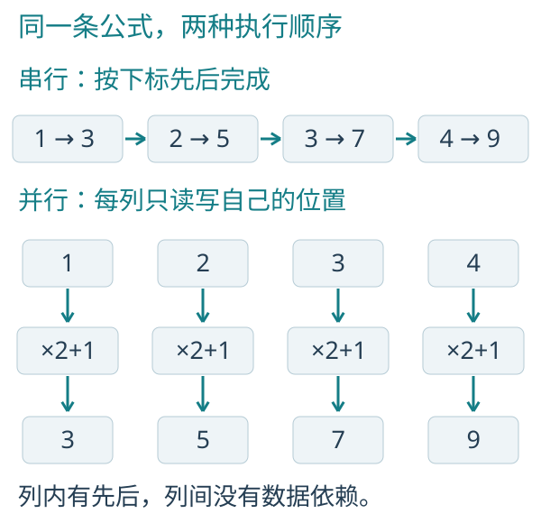
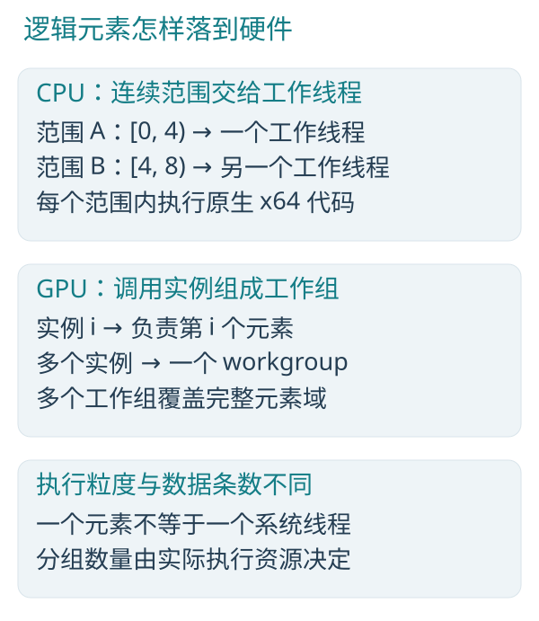
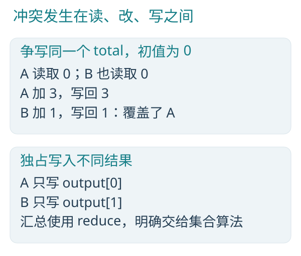
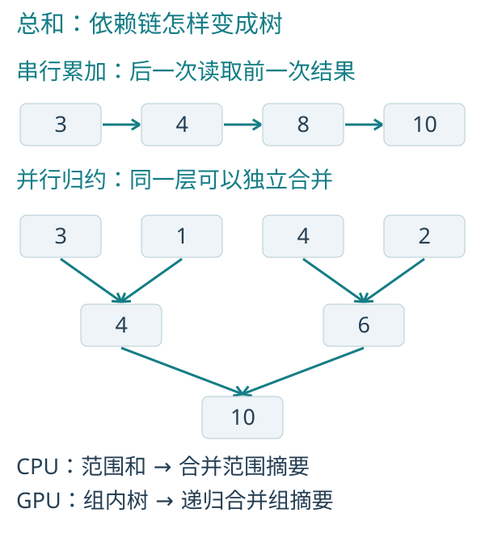
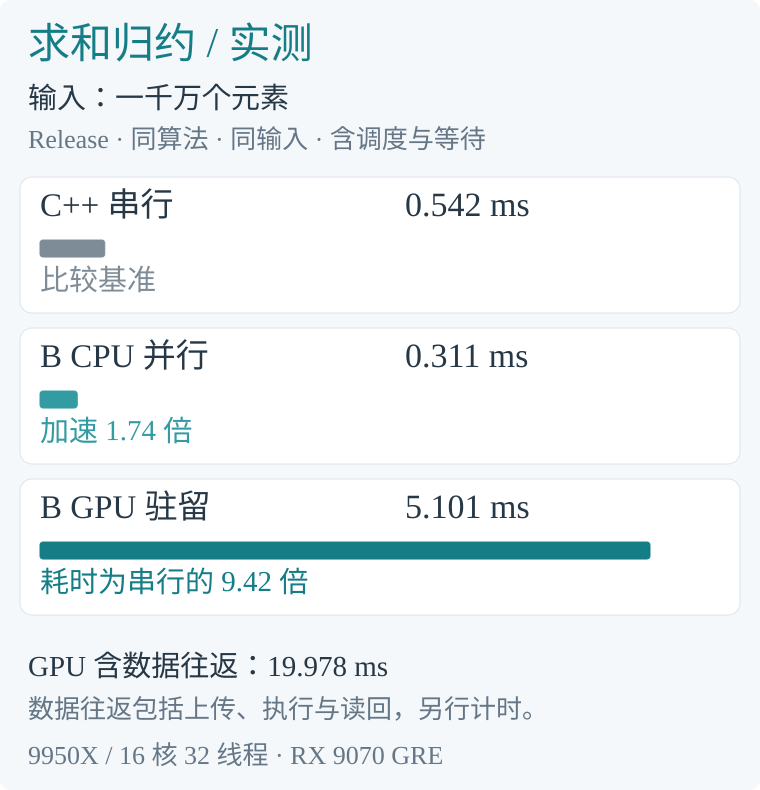

# 并行编程入门：前三章导读

[产品主页](../../README.md) · [安装与工具指南](GettingStarted.md) · [完整书稿](../../sample/并行编程的艺术.md)

动手前先按安装指南准备 Blink 正式版、Rust MSVC 和 Windows 构建工具；源码宿主及性能对照的默认编译器构建还需要 `%ProgramFiles%/Blink` 中的稳定种子。下文保留教学正文和既有测量记录，实际性能应按所用版本与设备复测。

<a id="parallel-programming"></a>

## 从《并行编程的艺术》开始

下面依据[《并行编程的艺术》](../../sample/并行编程的艺术.md)前三章展开：理论、C／B 对照、图示和既有测量记录均保留；运行节改为完整可见的独立程序，链接与能力说明按当前实现校订。

[第一章：逐元素并行](#map) · [第二章：读写归属](#ownership) · [第三章：求和归约](#reduction)

示例按当前语言规则和正式工具入口编写；源码、构建、实际执行与交付历史只在P4双台账记录。

如需复测，先按[原书附录 A.5](../../sample/并行编程的艺术.md)构建额外的性能对照工具；普通工作区构建不生成 `bperf.exe`：

```powershell
cargo build --release --manifest-path sample/performance/Cargo.toml --target-dir target
```

<a id="map"></a>

## 1　第一种美：许多事情原本就能一起做

### 1.1　从一段你已经会写的循环开始

数组 `values` 里有四个数 `[1,2,3,4]`。把每个数乘二再加一，C 的写法很短：

```cpp
for (size_t i = 0; i < n; ++i) {
    values[i] = values[i] * 2.0f + 1.0f;
}
```

B 语言的计算正文同样简短：

```c
parallel (value in values) {
    value = value * 2.0 + 1.0;
}
```

`values` 是全部数字，`value` 表示当前元素的独占位置，相当于 C 的 `values[i]`，赋值会直接更新它。`parallel` 描述每个元素要做什么，允许各个实例独立推进。

两种写法的结果都是 `[3,5,7,9]`。每个数的更新只依赖自己的旧值，因此可以分别计算。串行循环中的先后顺序来自写法，问题本身并不需要它。

### 1.2　先看顺序，再看硬件



*图 1-1　同一公式的串行顺序与并行元素域。步骤表示逻辑依赖，不是实测耗时。*

按串行过程理解，处理器读取一个数，完成乘法、加法和写回，再推进到下一项。并行过程把四次互不依赖的读改写展开；每个实例内部仍先读值，再计算，最后写回。

这种一条输入对应一条输出的模式叫 map，即逐元素变换。



*图 1-2　逻辑元素、CPU 工作范围和 GPU 工作组属于不同层次。*

在当前 CPU 执行框架中，连续下标范围交给工作线程，一个线程处理许多元素。适合的直线计算还可以一次使用四个 SSE2 lane；这与多个 CPU 核心分工是两层并行。

在 GPU 上，元素实例映射到计算调用，再组成工作组。工作组分批调度到硬件；四个逻辑元素不保证在物理上恰好同一时刻执行，一百万个元素也不等于一百万个操作系统线程。

C/C++ 编译器也可能自动向量化简单循环；B 语言则通过工作域直接表达元素之间的独立性。

### 1.3　并发和并行，不必混为一谈

并发关注多件工作如何同时处于进行中，例如等待文件读取时处理另一个请求。并行关注多份计算是否能在多个执行资源上同时推进。

并发的多个任务可以在一个核心上轮流推进；并行的数组计算则利用多个执行资源分担工作。B 语言主要围绕数据并行展开，并用生产消费关系连接计算阶段。

### 1.4　先问三个问题

面对一个循环，先问：每次迭代读什么？写什么？是否需要另一次迭代刚写出的结果？

如果答案是“共享只读输入，修改自己的输出，不等待其他元素”，你已经找到了最适合并行的形状。先找到这个形状，再讨论核心数和线程数，会轻松得多。

### 1.5　运行与结果

为便于直接对比 CPU／GPU，两版都在各自文件中完整展示逐字相同的 `fill_numbers`。每个下标先产生输入 `index() + 1`，再乘二加一。CPU 主流程分配四条数据、普通调用函数并打印结果；GPU 对照保持相同分配与计算，仅显式增加传输和 GPU 调用。

**parallel.h**

```c
module parallel;

u32 main() on cpu;
```

**parallel.b**

```c
module parallel;

void fill_numbers(write dataset<f32> values) on compute {
    parallel (value in values) {
        value = f32(index() + 1) * 2.0 + 1.0;
    }
}

u32 main() on cpu {
    dataset<f32> values = dataset<f32>(4);

    fill_numbers(values);

    for (value in values) {
        println(value);
    }
    return 0;
}
```

完整文件位于 [sample/hello](../../sample/hello/README.md)。按[安装指南](GettingStarted.md)准备正式版 0.14.1.1 工具与构建前提后，在仓库根目录执行：

```powershell
& "$env:ProgramFiles/Blink/bin/bc.exe" -c sample/hello/parallel.b -o target/book-apps/parallel.obj
& "$env:ProgramFiles/Blink/bin/blink.exe" target/book-apps/parallel.obj -o target/book-apps/parallel.exe
.	argetook-apps\parallel.exe
```

结果逐行输出 `3、5、7、9`。[完整 GPU 对照](GettingStarted.md#同一段循环也能用于-gpu)展示两份文件、同一公式以及每一步上传、GPU 调用与下载。当前 GPU 调用需要函数边界，该函数就在同一文件完整定义；同一个 `on compute` 函数在 CPU 上普通调用即可，无需 `target(cpu, ...)` 包装。

部署时把 EXE 与链接器生成的 `blink_app_*.dll` 一起复制，运行无需 B 源码、编译器或模块运行器；GPU 仍需要安装指南列出的 Vulkan 能力。

### 1.6　让数据规模把优势展现出来

四个数适合手算。要比较效率，把同一个乘二加一扩展到一亿个数。串行与并行都只完成一次数组变换，公式、数据类型与工作量保持相同；足够大的数据规模让并行资源有了发挥的空间。

本书的性能对照统一使用 Release 正式构建。Blink 编译器、CPU/GPU 执行框架和测量程序都开启 Rust 发布优化；第十四章用 B 语言编写的计算库（DLL） 也由 Release 构建生成。调试版只用于排查问题，其耗时不进入本书的效率对照。

性能对照使用三个真实执行版本：开启 `/O2 /arch:AVX2` 优化的单线程 C++、B 原生 CPU 范围并行、B 原生 GPU。C++ 保留编译器自动向量化；B 语言 CPU 版本 使用本机可用的工作线程。

为减小偶然波动，程序先预热，再重复测量并取中位数；每次测量只执行一次算法。C++ 与 B 语言 CPU 版本 从算法调用前计时到计算完成；B 语言 GPU 版本 从提交前计时到设备实际完成，包含命令组织、提交与等待。加速比为“C++ 串行时间 ÷ B 语言程序的并行执行时间”。

代码生成、初始分配与数据准备放在计算计时之外。GPU 主对照中，代码和数据已经驻留设备；一次提交完成一次算法。重新上传、执行与读回的完整费用另行测量，便于根据数据所在位置选择执行方式。

先按[原书附录 A.5](../../sample/并行编程的艺术.md) 编译配套测量程序，再在 Blink 根目录执行：

```powershell
.\target\release\bperf.exe `
    map 100000000
```


### 1.7　把计算放到合适的位置


*图 1-3　先比较同样的计算，再把真实的数据交付成本加回来。*


<a id="ownership"></a>

## 2　第二种美：让读写各有归属

### 2.1　C/C++ 读者的语法桥梁

| 你熟悉的概念 | B 语言中的表达 | 需要注意的区别 |
|---|---|---|
| `float`、32 位整数 | `f32`、`u32`、`i32` | 不把 C 的 `int` 大小假设带进来 |
| 三个浮点分量 | `float3` | 原生向量值，不是系统线程组三个线程 |
| 结构体 | `struct Cell { f32 value; };` | 同样用于组织普通值 |
| 数组加长度 | `dataset<T>` | 还具有资源身份、访问模式与执行域 |
| 参数只读 | `read dataset<T>` | 语言显式限制共享修改 |
| 输出参数 | `write T` | 必须先写再读，不表示自动清零 |
| 修改已有值 | `inout T` | 借用独占位置，不是任意裸指针 |
| 普通函数 | `f32 f(f32 x)` | CPU 应用已有普通原生调用／递归；计算目标的调用范围仍受当前实现限制 |
| 一组计算阶段的入口 | `void f(...)` 等普通函数定义 | 可以包含并行域和集合操作，无需独立的 program 类别 |
| 同一算法的 CPU/GPU 版本 | `on compute` | 表示两端可执行，设备由调用者明确选择 |

`.h` 描述模块的类型、签名、访问权限与执行目标，`.b` 提供实现。编译器通过模块声明定位二者，无需 C 式的 `#include` 预处理。

### 2.2　把计算放进一个入口

第一章的计算入口位于 [map.b](../../sample/lessons/map.b)：

```c
void scale(inout dataset<f32> values) on compute {
    parallel (value in values) {
        value = value * 2.0 + 1.0;
    }
}
```

`dataset<f32>` 是一组 32 位浮点数；`inout` 允许读取并更新；这里使用普通 `void` 函数定义计算入口。`on compute` 表示这份实现可生成 CPU 与 GPU 代码，执行时由调用者明确选择设备。

上面的函数就是完整变换，输入由调用者提供，没有隐藏初始化。讲解复用或库接口时，可以把公开算法拆成模块；第一个独立程序则把全部逻辑直接展示出来。模块声明和接口文件的作用见[原书附录 A](../../sample/并行编程的艺术.md)。

### 2.3　独占写为什么重要

下面是一个 C/C++ 并行化时常见的错误思路。`total` 是只有一条记录的结果数组；若让许多执行者同时运行这条语句，就会争写同一个 `total[0].value`：

```cpp
// Conceptual parallel body: this is a data race.
total[0].value += input[i].value;
```

许多执行者同时读取旧的 `total[0].value`，各自加上自己的数，最后互相覆盖。即使每次加法都很简单，整个“读取、计算、写回”也不是一个不可分割的动作。

B 语言的普通 `parallel` 为每个实例分配当前元素的独占写权限。共享位置的修改使用显式原子操作；集合求和则用归约表达。这样，独立更新与共享修改在源码中就有了清楚的区别。

访问权限约束读写冲突；公式、数值精度和业务规则仍由算法决定。



*图 2-1　争写会丢失更新；独占输出把写入责任分开。*

图中两个执行者都读到 0，各自计算后写回，导致一次更新被覆盖。归约会先形成独立摘要，再合并这些摘要，解决集合求和中的共享累加问题。

### 2.4　write、inout 和 read 的实际含义

把 write 理解为“我要生产新结果”，把 inout 理解为“我要读取并更新自己已有的值”，把 read 理解为“大家可以共同阅读”。

`write` 声明写入权限，初始化由算法或宿主负责。示例 main 中的 `dataset<f32>(4)` 申请四条全零记录。

当前 CPU 应用函数已有整份 read／write／inout dataset 借用，显式原子资源使用 atomic 模式；修改单个独占位置可用 `inout T` 或 `write T`。计算函数可以在阶段组合中传递所需权限，但这些能力不允许一个并行实例任意读写其他实例正在修改的整份数据。

### 2.5　parallel 和 for，各自负责什么

`parallel (value in values)` 建立一群元素实例；`for (item in data)` 则是当前实例内部的有界顺序遍历。后者不会再创建一层并行任务。

若 N 个输出各自遍历 N 项材料，就会产生 O(N²) 的工作。并行不会消除重复计算，应先消除无用工作。

<a id="reduction"></a>

## 3　第三种美：许多结果可以汇成一个

### 3.1　把累加链变成一棵树

计算 `[3,1,4,2]` 的总和。为了让结果供后续阶段使用，`total` 用一条 `Count` 记录保存数值；输入也使用 `Count { u32 value; }`。

C 串行核心：

```cpp
total[0].value = 0;
for (size_t i = 0; i < n; ++i) {
    total[0].value += input[i].value;
}
```

用 B 语言编写的并行核心：

```c
reduce_sum(input.value, total.value);
```

`input.value` 表示全部输入记录的 value 字段；`total.value` 是长度为一的结果字段。这里写的是集合意图，编译器负责展开集合算法。



*图 3-1　线性累加链与分层归约。上行中的同层摘要可以独立计算。*

串行累加每一步都使用上一步的结果。树形组织先算 `3+1=4` 与 `4+2=6`，再算 `4+6=10`；三个必要的二元合并被放到两层依赖中。n 个输入的平衡树有 O(log n) 层，但仍要完成 O(n) 工作。

### 3.2　源码是一句，执行有层次

配套源码 [scan.b](../../sample/lessons/scan.b) 提供完整入口：

```c
void sum(read dataset<Count> input,
            write dataset<Count, 1> total) on compute {
    reduce_sum(input.value, total.value);
}
```

CPU 先让各个范围独立求部分和，再合并范围摘要。GPU 先在工作组内用共享存储形成部分和；输入较大时，继续归约工作组摘要，直到得到一个结果。组内同步只协调本组，跨组的阶段由执行框架组织。

从这一句归约，编译器就能组织局部求和与逐层合并。归约意图、资源权限和阶段依赖共同决定 CPU 与 GPU 的执行结构。

### 3.3　先理解结合律

对理想整数加法，`(a+b)+c` 与 `a+(b+c)` 相同，因此可以改括号组成树。减法不满足这个性质，不能因为接口看起来像“合并两个数”就拿来任意树形归约。

结合律允许改变括号；交换律允许交换左右顺序。它们是两件事。后面会看到，即使不能交换顺序，也能构造优美的并行归约和扫描。

B 语言的 u32 加法按 32 位保留低位，溢出具有确定的模运算语义。但如果你要的是业务上不能溢出的计数，仍要选择合理规模，不能把取低位结果当作完整大整数。

### 3.4　浮点不是纸上的实数

f32 只有有限精度。不同分组可能改变舍入，例如很大的数和很小的数相加，小数可能消失；先让大数抵消再加小数，又可能保留它。

CPU 与 GPU 的归约分组可能不同，结果也可能存在舍入差异。评价浮点计算时，需要结合数据尺度、允许误差、特殊值和算法稳定性。

### 3.5　运行与结果

将下面两份文件保存到空目录。正式编译器要求这项集合运算位于 `on compute` 函数中；函数正文在同一文件完整展示。CPU 主流程初始化输入并普通调用，无需 CPU target 包装。

**reduce.h**

```c
module reduce;

struct Count { u32 value; };
u32 main() on cpu;
```

**reduce.b**

```c
module reduce;

void sum_values(read dataset<Count> input, write dataset<Count, 1> total) on compute {
    reduce_sum(input.value, total.value);
}

u32 main() on cpu {
    dataset<Count> input = dataset<Count>(4);
    dataset<Count, 1> total = dataset<Count>(1);

    parallel (item in input) {
        let k = index() % 4;
        item.value = k == 0 ? 3 : (k == 1 ? 1 : (k == 2 ? 4 : 2));
    }

    sum_values(input, total);
    println(total[0].value);
    return 0;
}
```

使用安装好的正式工具构建，输出为 `10`。

```powershell
& "$env:ProgramFiles/Blink/bin/bc.exe" -c reduce.b -o target/reduce.obj
& "$env:ProgramFiles/Blink/bin/blink.exe" target/reduce.obj -o target/reduce.exe
.\target\reduce.exe
```

<details>
<summary>展开完整 GPU 对照</summary>

保留相同的 `reduce.h`，将 `reduce.b` 完整替换为下列源码；同一句归约在 `sum_values` 中完整展示，初始化仍在 CPU 主流程。使用相同命令重新构建。

```c
module reduce;

void sum_values(read dataset<Count> input, write dataset<Count, 1> total) on compute {
    reduce_sum(input.value, total.value);
}

u32 main() on cpu {
    dataset<Count> input = dataset<Count>(4);
    dataset<Count, 1> total = dataset<Count>(1);

    parallel (item in input) {
        let k = index() % 4;
        item.value = k == 0 ? 3 : (k == 1 ? 1 : (k == 2 ? 4 : 2));
    }

    upload(input);
    upload(total);
    target(gpu, sum_values(input, total));
    download(total);
    println(total[0].value);
    return 0;
}
```

</details>

### 3.6　让大量摘要汇成吞吐

性能输入为一千万个元素。下面比较完成一次算法的用时，计时范围与第 1.6 节相同。

```powershell
.\target\release\bperf.exe `
    reduce 10000000
```


每个输入只做一次整数累加，优化后的串行版本已经很紧凑。B 语言 CPU 版本 将一千万项分成范围并行求和，再合并摘要；GPU 的提交与等待开销在这种轻计算中占比更大。初始数据循环为 [3,1,4,2]，总和为两千五百万；三种版本的整数结果相同。



