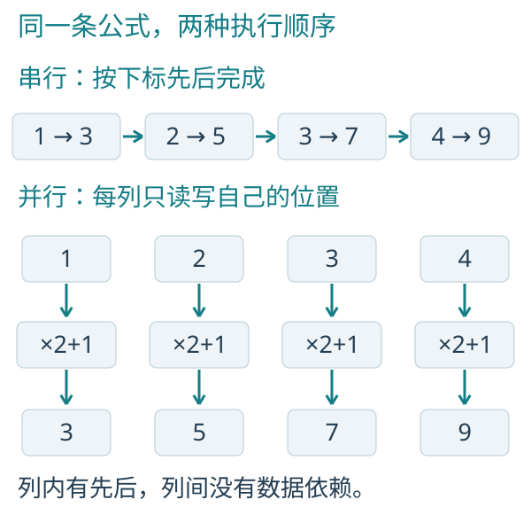
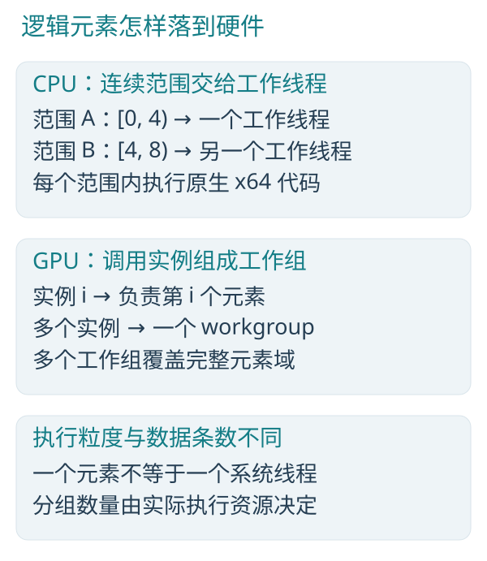
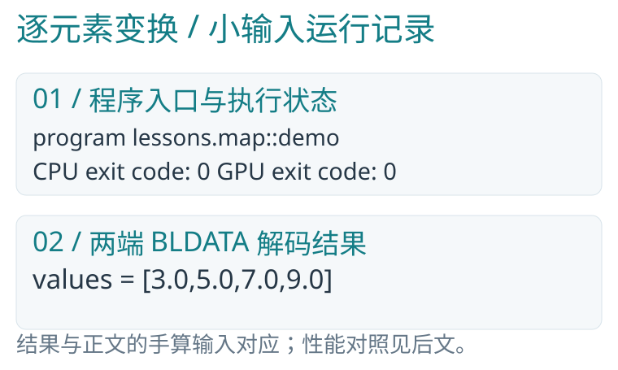
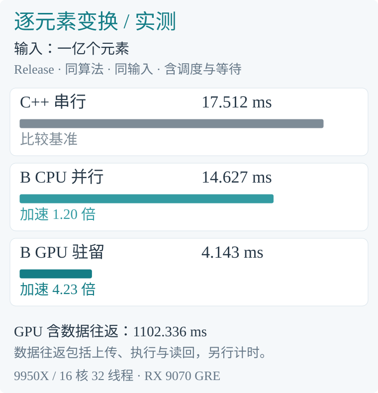
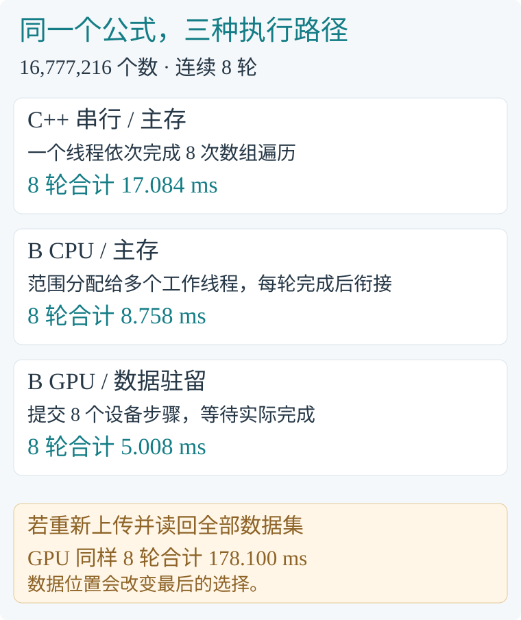
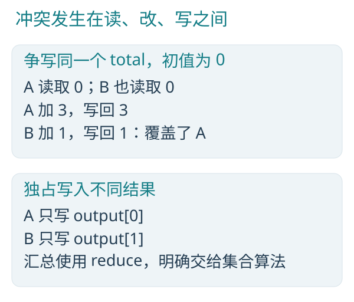
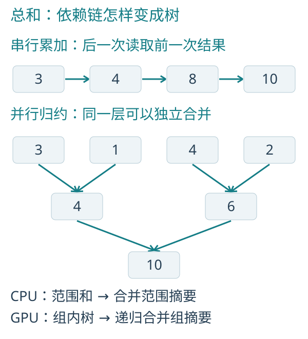
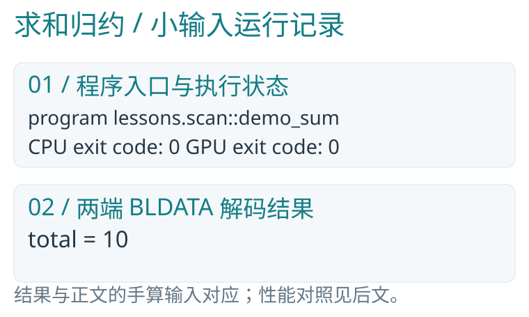
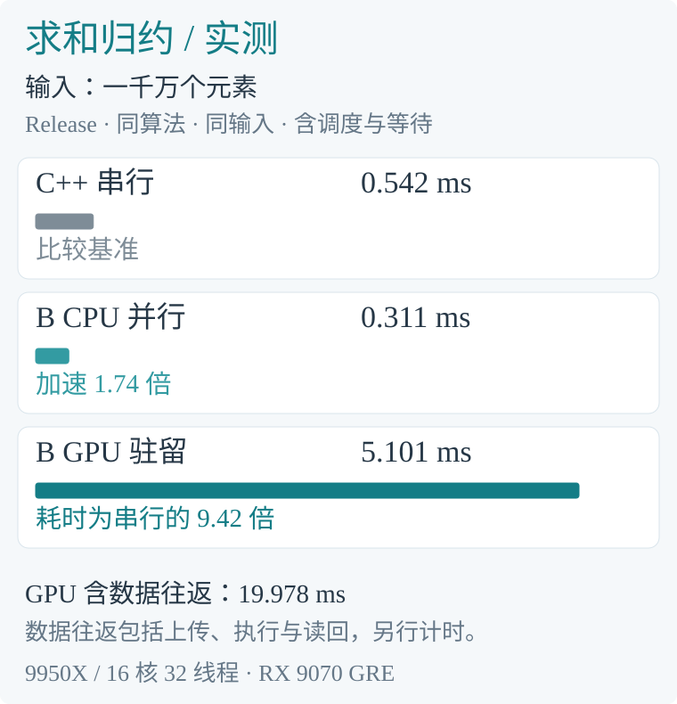

<div align="center">

<h1>Blink</h1>

<p><strong>原生并行 · 统一 CPU／GPU 编程 · 原生域编译与域运行</strong></p>
<p>面向 AI 超算时代的基础语言</p>

<p><strong>简体中文</strong> | <a href="README.en.md">English</a></p>
<p><a href="#快速开始">快速开始</a> · <a href="#parallel-programming">读前三章</a> · <a href="Docs/BLanguage.md">语言规范</a> · <a href="#学习与文档">学习资料</a> · <a href="Docs/Architecture.md">架构</a></p>

</div>

Blink，简称 **B**，是一门自研原生并行计算语言。B 也寓意 **Base**：让并行、数据关系与协作成为程序的基本表达，并逐步成长为完整的通用与系统编程语言。

接口写在 `.h`，实现写在 `.b`。自研编译器将 B 算法直接编译为 Windows x64 机器码和 SPIR-V，原生执行框架负责数据、设备、传输和真实完成。当前编译器与执行框架由 Rust 实现，无第三方编译器、Shader 编译器或并行运行时依赖。

> **项目状态：研发中，当前版本 0.1.0。** 已有单机 CPU／GPU 原生执行；域编译、域运行和稳定热更新是确定的设计目标，尚未实现。完整范围见[架构](Docs/Architecture.md)与[实现状态](Docs/Issues.md)。

## 三大核心特点

### 1. 原生并行

将并行作为语言的基本能力。并行域、数据访问权限、块内协作与阶段依赖直接进入编译器分析，再落实为原生执行。算法可以表达独占写入、共享只读、显式原子操作和集合计算。

### 2. 统一 CPU／GPU 编程

**同一套 B 源码，面向 CPU 与 GPU 原生执行。** 适用的算法无需为两类硬件分别实现；`on` 声明目标能力，`target` 选择本次执行位置，`upload`／`download` 显式交接数据。硬件能力差异与传输成本保持明确。

### 3. 原生域编译与域运行

**把一组机器变成可直接使用的编译与执行资源。** 以计算域组织多台机器，原生完成域内编译与运行；编译域和运行域可以独立选择，分片、通信、依赖和完成具有明确语义。

这一能力目前处于设计阶段。一次构建或执行使用所选域内资源，跨域业务级联由上层应用组织。完整职责、部署与接口设计见[计算域方案](Docs/ComputeDomain.md)。

## 快速开始

准备 Windows x64、[Rust stable MSVC 工具链](https://rust-lang.org/tools/install)和 [Visual Studio C++ Build Tools](https://visualstudio.microsoft.com/visual-cpp-build-tools/)（x64 C++ 工具与 Windows SDK）。在 x64 Developer PowerShell 中执行：

```powershell
git clone https://github.com/sgua83/Blink.git
Set-Location Blink
cargo build --workspace --release
```

后续命令均在 Blink 根目录执行。CPU 入门无需 GPU；GPU 版本需要满足程序能力要求的 Vulkan 驱动，无需 Vulkan SDK。当前 f32 示例还要求 `DenormPreserve` 与 `SignedZeroInfNanPreserve`，能力不足会明确报错。

<a id="parallel-programming"></a>

## 从《并行编程的艺术》开始

下面完整收录[《并行编程的艺术》](sample/并行编程的艺术.md)前三章：正文、C／B 对照、图示、运行命令和原书实测均保留；仅校订链接及已变化的函数、借用范围说明。

[第一章：逐元素并行](#map) · [第二章：读写归属](#ownership) · [第三章：求和归约](#reduction)

性能数据来自原书记录：2026-10-26、P4 CL12985、AMD Ryzen 9 9950X／Radeon RX 9070 GRE、MSVC 14.44、Rust 1.95.0 的 Release 构建。图中的性能数值属于该次观测，不是本次 README 修改后的复测或任意硬件的性能保证。

如需复测，先按[原书附录 A.5](sample/并行编程的艺术.md)构建额外的性能对照工具；普通工作区构建不生成 `bperf.exe`：

```powershell
cargo build --release --manifest-path sample/performance/Cargo.toml --target-dir target
```

<a id="map"></a>

## 1　第一种美：许多事情原本就能一起做

### 1.1　从一段你已经会写的循环开始

数组 `values` 里有四个数 `[1,2,3,4]`。把每个数乘二再加一，C 的写法很短：

```cpp
for (size_t i = 0; i < n; ++i) {
    values[i] = values[i] * 2.0f + 1.0f;
}
```

B 的计算正文同样简短：

```c
parallel (value in values) {
    value = value * 2.0 + 1.0;
}
```

`values` 是全部数字，`value` 表示当前元素的独占位置，相当于 C 的 `values[i]`，赋值会直接更新它。`parallel` 描述每个元素要做什么，允许各个实例独立推进。

两种写法的结果都是 `[3,5,7,9]`。每个数的更新只依赖自己的旧值，因此可以分别计算。串行循环中的先后顺序来自写法，问题本身并不需要它。

### 1.2　先看顺序，再看硬件



*图 1-1　同一公式的串行顺序与并行元素域。步骤表示逻辑依赖，不是实测耗时。*

按串行过程理解，处理器读取一个数，完成乘法、加法和写回，再推进到下一项。并行过程把四次互不依赖的读改写展开；每个实例内部仍先读值，再计算，最后写回。

这种一条输入对应一条输出的模式叫 map，即逐元素变换。



*图 1-2　逻辑元素、CPU 工作范围和 GPU 工作组属于不同层次。*

在当前 CPU 执行框架中，连续下标范围交给工作线程，一个线程处理许多元素。适合的直线计算还可以一次使用四个 SSE2 lane；这与多个 CPU 核心分工是两层并行。

在 GPU 上，元素实例映射到计算调用，再组成工作组。工作组分批调度到硬件；四个逻辑元素不保证在物理上恰好同一时刻执行，一百万个元素也不等于一百万个操作系统线程。

C/C++ 编译器也可能自动向量化简单循环；B 则通过工作域直接表达元素之间的独立性。

### 1.3　并发和并行，不必混为一谈

并发关注多件工作如何同时处于进行中，例如等待文件读取时处理另一个请求。并行关注多份计算是否能在多个执行资源上同时推进。

并发的多个任务可以在一个核心上轮流推进；并行的数组计算则利用多个执行资源分担工作。B 主要围绕数据并行展开，并用生产消费关系连接计算阶段。

### 1.4　先问三个问题

面对一个循环，先问：每次迭代读什么？写什么？是否需要另一次迭代刚写出的结果？

如果答案是“共享只读输入，修改自己的输出，不等待其他元素”，你已经找到了最适合并行的形状。先找到这个形状，再讨论核心数和线程数，会轻松得多。

### 1.5　运行与结果

在 PowerShell 中执行下面这一条命令：

```powershell
.\target\release\blrun.exe cpu `
    sample/lessons/map.b demo `
    sample Saved/Book/map :4
```

这条命令运行 blrun.exe，选择 CPU 执行 `sample/lessons/map.b` 中的 demo 入口。后面的 `sample` 是查找模块的根目录，`Saved/Book/map` 是保存结果的目录；`:4` 申请四条全零记录。demo 先填入 `[1,2,3,4]`，再执行乘二加一。

运行完成后，结果目录中的 `values.bldata` 文件保存四个数：

```text
[3, 5, 7, 9]
```

blrun 会在命令行显示程序信息和运行时间，计算结果则写入 BLDATA 文件。图中的数值来自这个文件；想自己读取它，可以参照[原书附录 A.3](sample/并行编程的艺术.md)。

在 GPU 上执行同一份源码，只需选择 gpu，并使用另一个结果目录：

```powershell
.\target\release\blrun.exe gpu `
    sample/lessons/map.b demo `
    sample Saved/Book/map-gpu :4
```

两端的 `values.bldata` 都是 `[3,5,7,9]`，每条记录为一个 f32。完整实现见 [map.h](sample/lessons/map.h) 与 [map.b](sample/lessons/map.b)。



*运行记录：程序入口与实际执行输出节选，数值读取自 BLDATA 文件。*

### 1.6　让数据规模把优势展现出来

四个数适合手算。要比较效率，把同一个乘二加一扩展到一亿个数。串行与并行都只完成一次数组变换，公式、数据类型与工作量保持相同；足够大的数据规模让并行资源有了发挥的空间。

本书的性能对照统一使用 Release 正式构建。Blink 编译器、CPU/GPU 执行框架和测量程序都开启 Rust 发布优化；第十四章的算法 DLL 也由 Release 构建生成。调试版只用于排查问题，其耗时不进入本书的效率对照。

性能对照使用三个真实执行版本：开启 `/O2 /arch:AVX2` 优化的单线程 C++、B 原生 CPU 范围并行、B 原生 GPU。C++ 保留编译器自动向量化；B CPU 使用本机可用的工作线程。

为减小偶然波动，程序先预热，再重复测量并取中位数；每次测量只执行一次算法。C++ 与 B CPU 从算法调用前计时到计算完成；B GPU 从提交前计时到设备实际完成，包含命令组织、提交与等待。加速比为“C++ 串行时间 ÷ B 并行时间”。

代码生成、初始分配与数据准备放在计算计时之外。GPU 主对照中，代码和数据已经驻留设备；一次提交完成一次算法。重新上传、执行与读回的完整费用另行测量，便于根据数据所在位置选择执行方式。

先按[原书附录 A.5](sample/并行编程的艺术.md) 编译配套测量程序，再在 Blink 根目录执行：

```powershell
.\target\release\bperf.exe `
    map 100000000
```

C++ 串行为 **17.512 ms**，B CPU 为 **14.627 ms**，加速 **1.20 倍**；B GPU 驻留执行为 **4.143 ms**，加速 **4.23 倍**。比较的仍是开头那一个公式。



*实测记录：map。每次变换都读取并更新同一批数字；三种执行得到的最终结果相同。*

### 1.7　把计算放到合适的位置

同样处理一亿个数，C++ 串行用时 17.512 ms，B CPU 用时 14.627 ms，B GPU 驻留执行用时 4.143 ms。CPU 范围并行分担了主存数组的工作；GPU 则把大量独立计算展开到设备上。

如果这批数据要从主存上传、完成变换后再读回，GPU 的完整用时为 1102.336 ms。对于这样简单的乘加，搬运远比公式昂贵；已经在主存的数据可以直接选择更快的 B CPU 版本，已经驻留 GPU 的数据则能继续利用设备计算。



*图 1-3　先比较同样的计算，再把真实的数据交付成本加回来。*

第一次创建设备、生成设备程序与上传初值，本机另测为 486.681 ms。原生执行命令处理四个数时，这类准备与输出费用会占据主要部分；它衡量的是那次完整启动，而非大规模计算的吞吐。

<a id="ownership"></a>

## 2　第二种美：让读写各有归属

### 2.1　C/C++ 读者的语法桥梁

| 你熟悉的概念 | B 中的表达 | 需要注意的区别 |
|---|---|---|
| `float`、32 位整数 | `f32`、`u32`、`i32` | 不把 C 的 `int` 大小假设带进来 |
| 三个浮点分量 | `float3` | 原生向量值，不是系统线程组三个线程 |
| 结构体 | `struct Cell { f32 value; };` | 同样用于组织普通值 |
| 数组加长度 | `dataset<T>` | 还具有资源身份、访问模式与执行域 |
| 参数只读 | `read dataset<T>` | 语言显式限制共享修改 |
| 输出参数 | `write T` | 必须先写再读，不表示自动清零 |
| 修改已有值 | `inout T` | 借用独占位置，不是任意裸指针 |
| 普通函数 | `f32 f(f32 x)` | CPU 应用已有普通原生调用／递归；计算目标的调用范围仍受当前实现限制 |
| 一组计算阶段的入口 | `void f(...)` 等普通函数定义 | 可以包含并行域和集合操作，无需独立的 program 类别 |
| 同一算法的 CPU/GPU 版本 | `on compute` | 表示两端可执行，设备由调用者明确选择 |

`.h` 描述模块的类型、签名、访问权限与执行目标，`.b` 提供实现。编译器通过模块声明定位二者，无需 C 式的 `#include` 预处理。

### 2.2　把计算放进一个入口

第一章的计算入口位于 [map.b](sample/lessons/map.b)：

```c
void scale(inout dataset<f32> values) on compute {
    parallel (value in values) {
        value = value * 2.0 + 1.0;
    }
}
```

`dataset<f32>` 是一组 32 位浮点数；`inout` 允许读取并更新；这里使用普通 `void` 函数定义计算入口。`on compute` 表示这份实现可生成 CPU 与 GPU 代码，执行时由调用者明确选择设备。

`demo` 先产生 `[1,2,3,4]`，再调用 `scale`。初始化与算法分开，便于直接观察第一次运行。模块声明和接口文件的作用见[原书附录 A](sample/并行编程的艺术.md)。

### 2.3　独占写为什么重要

下面是一个 C/C++ 并行化时常见的错误思路。`total` 是只有一条记录的结果数组；若让许多执行者同时运行这条语句，就会争写同一个 `total[0].value`：

```cpp
// Conceptual parallel body: this is a data race.
total[0].value += input[i].value;
```

许多执行者同时读取旧的 `total[0].value`，各自加上自己的数，最后互相覆盖。即使每次加法都很简单，整个“读取、计算、写回”也不是一个不可分割的动作。

B 的普通 `parallel` 为每个实例分配当前元素的独占写权限。共享位置的修改使用显式原子操作；集合求和则用归约表达。这样，独立更新与共享修改在源码中就有了清楚的区别。

访问权限约束读写冲突；公式、数值精度和业务规则仍由算法决定。



*图 2-1　争写会丢失更新；独占输出把写入责任分开。*

图中两个执行者都读到 0，各自计算后写回，导致一次更新被覆盖。归约会先形成独立摘要，再合并这些摘要，解决集合求和中的共享累加问题。

### 2.4　write、inout 和 read 的实际含义

把 write 理解为“我要生产新结果”，把 inout 理解为“我要读取并更新自己已有的值”，把 read 理解为“大家可以共同阅读”。

`write` 声明写入权限，初始化由算法或宿主负责。示例命令中的 `:4` 由执行器申请四条全零记录。

当前 CPU 应用函数已有整份 read／write／inout dataset 借用，显式原子资源使用 atomic 模式；修改单个独占位置可用 `inout T` 或 `write T`。计算函数可以在阶段组合中传递所需权限，但这些能力不允许一个并行实例任意读写其他实例正在修改的整份数据。

### 2.5　parallel 和 for，各自负责什么

`parallel (value in values)` 建立一群元素实例；`for (item in data)` 则是当前实例内部的有界顺序遍历。后者不会再创建一层并行任务。

若 N 个输出各自遍历 N 项材料，就会产生 O(N²) 的工作。并行不会消除重复计算，应先消除无用工作。

<a id="reduction"></a>

## 3　第三种美：许多结果可以汇成一个

### 3.1　把累加链变成一棵树

计算 `[3,1,4,2]` 的总和。为了让结果供后续阶段使用，`total` 用一条 `Count` 记录保存数值；输入也使用 `Count { u32 value; }`。

C 串行核心：

```cpp
total[0].value = 0;
for (size_t i = 0; i < n; ++i) {
    total[0].value += input[i].value;
}
```

B 并行核心：

```c
reduce_sum(input.value, total.value);
```

`input.value` 表示全部输入记录的 value 字段；`total.value` 是长度为一的结果字段。这里写的是集合意图，编译器负责展开集合算法。



*图 3-1　线性累加链与分层归约。上行中的同层摘要可以独立计算。*

串行累加每一步都使用上一步的结果。树形组织先算 `3+1=4` 与 `4+2=6`，再算 `4+6=10`；三个必要的二元合并被放到两层依赖中。n 个输入的平衡树有 O(log n) 层，但仍要完成 O(n) 工作。

### 3.2　源码是一句，执行有层次

配套源码 [scan.b](sample/lessons/scan.b) 提供完整入口：

```c
void sum(read dataset<Count> input,
            write dataset<Count, 1> total) on compute {
    reduce_sum(input.value, total.value);
}
```

CPU 先让各个范围独立求部分和，再合并范围摘要。GPU 先在工作组内用共享存储形成部分和；输入较大时，继续归约工作组摘要，直到得到一个结果。组内同步只协调本组，跨组的阶段由执行框架组织。

从这一句归约，编译器就能组织局部求和与逐层合并。归约意图、资源权限和阶段依赖共同决定 CPU 与 GPU 的执行结构。

### 3.3　先理解结合律

对理想整数加法，`(a+b)+c` 与 `a+(b+c)` 相同，因此可以改括号组成树。减法不满足这个性质，不能因为接口看起来像“合并两个数”就拿来任意树形归约。

结合律允许改变括号；交换律允许交换左右顺序。它们是两件事。后面会看到，即使不能交换顺序，也能构造优美的并行归约和扫描。

B 的 u32 加法按 32 位保留低位，溢出具有确定的模运算语义。但如果你要的是业务上不能溢出的计数，仍要选择合理规模，不能把取低位结果当作完整大整数。

### 3.4　浮点不是纸上的实数

f32 只有有限精度。不同分组可能改变舍入，例如很大的数和很小的数相加，小数可能消失；先让大数抵消再加小数，又可能保留它。

CPU 与 GPU 的归约分组可能不同，结果也可能存在舍入差异。评价浮点计算时，需要结合数据尺度、允许误差、特殊值和算法稳定性。

### 3.5　运行与结果

在 CPU 上运行求和入口 demo_sum：

```powershell
.\target\release\blrun.exe cpu `
    sample/lessons/scan.b demo_sum `
    sample Saved/Book/reduce :4 :1
```

`:4` 为输入申请四条记录，`:1` 为总量申请一条记录。在 GPU 上执行：

```powershell
.\target\release\blrun.exe gpu `
    sample/lessons/scan.b demo_sum `
    sample Saved/Book/reduce-gpu :4 :1
```

demo_sum 产生 `[3,1,4,2]`，再求和。`total.bldata` 中唯一的 u32 结果为 10。这个入口与下一章的扫描共用输入生成程序。



*运行记录：程序入口与实际执行输出节选，数值读取自 BLDATA 文件。*

### 3.6　让大量摘要汇成吞吐

性能输入为一千万个元素。下面比较完成一次算法的用时，计时范围与第 1.6 节相同。

```powershell
.\target\release\bperf.exe `
    reduce 10000000
```

C++ 串行为 **0.542 ms**，B CPU 为 **0.311 ms**，加速 **1.74 倍**。B GPU 驻留执行为 **5.101 ms**；这个求和公式很轻，在本机上选择 CPU 范围并行更合适。

每个输入只做一次整数累加，优化后的串行版本已经很紧凑。B CPU 将一千万项分成范围并行求和，再合并摘要；GPU 的提交与等待开销在这种轻计算中占比更大。初始数据循环为 [3,1,4,2]，总和为两千五百万；三种版本的整数结果相同。




*实测记录：reduce。GPU 主时间包含命令组织、提交与实际完成等待；数据往返单列。*

## 工具与原生集成

| 工具／库 | 用途 |
|---|---|
| `blc` | 检查源码、编译 COFF 目标文件、导出 CPU／GPU 计算代码 |
| `bllink` | 链接已编译对象，生成 Windows x64 exe 或算法 DLL |
| `blrun` | 绑定数据并执行 CPU／GPU 计算模块 |
| `blanguage` | 前端、类型与访问检查、并行 IR、优化和原生后端 |
| `blcompute` | 数据存储、设备资源、传输、原生执行与完成后的释放 |

B 可以独立构建应用，也可以作为 **C、C++ 与 Rust** 的算法实现。算法 DLL 随同生成 C ABI 头文件、导入库、C++ 包装和 Rust 绑定；原生 Rust API 支持驻留资源和异步提交。

- [独立应用](sample/applications/README.md)：CPU 入口、动态数据与显式 CPU／GPU 计算。
- [C／C++／Rust 调用 B](sample/interop/README.md)：从四个数开始，构建并调用同一份算法 DLL。
- [B 调用外部 DLL](sample/extern/README.md)：C ABI、参数访问与真实资源边界。
- [原生集成与部署](Docs/NativeInterop.md)：产物、ABI、部署要求及当前限制。

## 能力与发展方向

| 范围 | 当前状态 |
|---|---|
| CPU／GPU 计算 | 已有自研 x64／SPIR-V、并行域、集合运算、显式原子、tile／subgroup 协作 |
| 数据与静态抽象 | 已有记录、数组、向量／矩阵、泛型、开放 `u32 const`、访问契约和有效前缀 |
| 应用与模块 | 已有独立 CPU 应用、普通原生调用／递归及有限的独立模块、多对象链接能力 |
| 平台 | 当前为 Windows x64 CPU 与 Vulkan GPU；其他平台和 CPU 架构待实现 |
| 计算域 | 原生域编译与域运行已确定设计边界，尚未实现 |
| 稳定热更新 | 版本绑定、状态迁移和资源交接已列入架构，尚未实现 |

B **不采用面向对象**，以数据、函数、模块和执行域组织程序。长期设计同时重视顶级效率与机器控制、可检查的接口，以及人、AI 代码生成工具和上层编译器的共同使用。当前子集、原生运行与性能结果分别记录于[语言规范](Docs/BLanguage.md)和[问题列表](Docs/Issues.md)。

## 学习与文档

| 从哪里开始 | 内容 |
|---|---|
| [《B 语言编程》](sample/B语言编程.md) | 从下载、第一个程序到函数、数据和并行；[完整示例](sample/beginner/README.md) · [手机 PDF](sample/pdf/B语言编程-手机阅读版.pdf) · [标准 PDF](sample/pdf/B语言编程.pdf) |
| [《并行编程的艺术》](sample/并行编程的艺术.md) | 从 C／C++ 走向并行思考 |
| [《Blink 和 Rust 混合编程》](sample/Blink和Rust混合编程.md) | 从最小调用到模拟与连续 GPU 计算；[示例](sample/hybrid/README.md) |
| [《B 语言源码分析》](sample/B语言源码分析.md) | 阅读编译器、IR、后端及执行框架；[版本与阅读资料](sample/compiler/README.md) |
| [《BLEngine 源码分析》](sample/BLEngine源码分析.md) | 首个消费者如何使用语言、场景与光照；[阅读资料](sample/engine/README.md) |
| [语言规范](Docs/BLanguage.md) · [架构](Docs/Architecture.md) · [计算域](Docs/ComputeDomain.md) | 当前规则、长期边界和后续设计 |

技术文档与书籍目前以中文为主；英文首页提供相同的入门路径和能力说明。

## 参与开发

修改前请阅读[工程约定](AGENTS.md)和[实现状态](Docs/Issues.md)。反馈问题时提供 B 源码、实际命令、工具链与设备信息及原始错误；能力目标、实现、原生运行和性能结果分别说明。维护者的提交与发布流程见工程约定。

## 许可证

[MIT](LICENSE)。
