# BLEngine 源码分析

从数学、场景到一帧图像

## 写在前面

三维引擎做的事情，可以从一个很小的问题讲起：模型里有一个点，它经过物体的移动、相机的观察，最后为什么会出现在屏幕的这个位置，又为什么呈现这种颜色？

这个问题把数学、几何、场景、材质、光照和设备执行连在了一起。理解引擎，不只是认识这些模块的名字，还要看清它们各自保存什么、计算什么，以及一份结果怎样交给下一段代码。

本书从向量开始。先用能手算的数字解释坐标和变换，再进入相机、裁剪、场景树和几何资产；随后沿真实命中进入材质、阴影、反射、折射与介质，最后回到 GPU 执行、资源寿命和窗口。读者可以依照这个顺序学习，也可以通过目录和源码索引回到某个具体函数。

本文沿当前BLEngine和Blink源码的真实职责阅读；节选的现行文件及行号见engine/源码版本索引.json。该索引只对应现行源码，不把旧运行结果作为当前产品验证。

Blink 语言简称 B 语言，B 也寓意 Base。开源项目地址为 https://github.com/sgua83/Blink 。Blink 拥有语言、编译器与通用 CPU/GPU 执行框架；BLEngine 在其上实现引擎。当前 BLEngine 源码由独立 P4 工程管理，尚未随 Blink 仓库完整公开；本仓库提供书稿、获准摘录的源码和阅读场景，不能把下载 Blink 等同于取得完整引擎。

引擎有两类主要源码。`Programs` 中的 B 代码表达相机、变换、模拟、材质和光传输等计算；`src` 中的 Rust 代码负责场景对象、文件、实际设备资源、执行交接与原生窗口。B 不是附在 Rust 后面的几段着色脚本，Rust 也不是逐像素解释 B 的循环。两者共同构成原生程序。

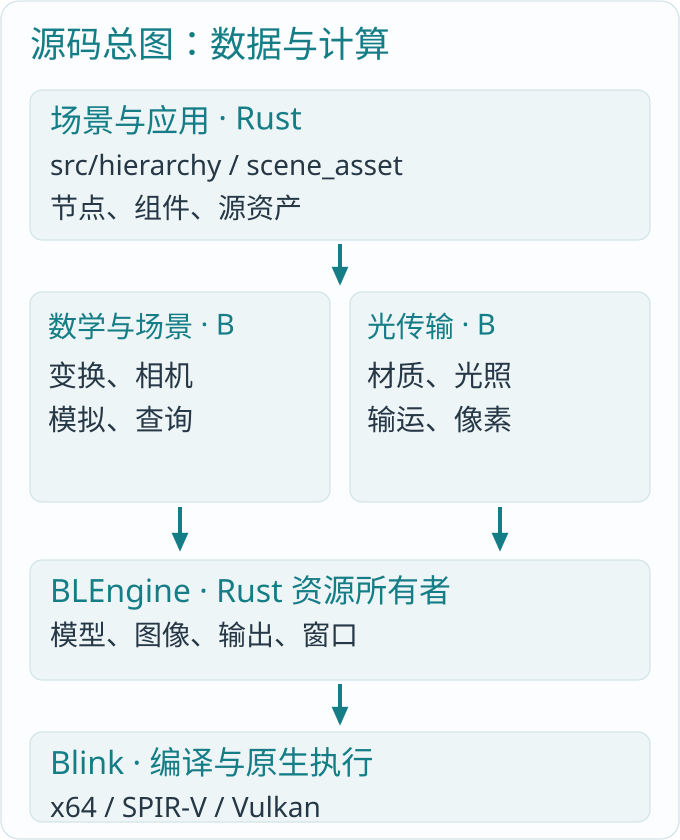

*图 0-1：先辨认“数据属于谁”和“计算在哪里”，再顺着箭头阅读函数。设备框架位于相邻的 BLanguage 工程。*

本书讨论的是这份源码已经建立的引擎，以及完整引擎仍需补齐的部分。例如当前帧采用光线追踪，不存在可以逐行解读的光栅化三角形裁剪器；骨骼动画、完整碰撞系统和音频也尚未实现。相关章节会解释这些能力在引擎中的位置和必要数据，明确指出缺口，不把概念介绍写成已有功能。

## 第一章 向量：用三个数描述位置与方向

### 1.1 位置和位移先分清

设一个顶点位于 `p=(1,2,0)`，把物体向右移动三单位，位移为 `d=(3,0,0)`，新位置就是 `p+d=(4,2,0)`。位置回答“在哪里”，位移回答“从这里往哪里走多远”。二者都能用三个数保存，意义却不同：把相机搬到另一个地方，会改变点相对相机的位置；一束光朝东传播的方向，不会因为整个场景平移而变成朝北。

`src/math.rs` 的 `BLVec3` 保存 `x、y、z`，并提供加减、标量乘除、点积和叉积。B 代码对应使用内建 `float3`。先认识它们代表的几何量，比先记住函数名更重要。

### 1.2 点积：判断两个方向有多接近

源码节选：`src/math.rs:16`。

```rust
    pub fn dot(self, b: Self) -> f32 {
        self.x * b.x + self.y * b.y + self.z * b.z
    }
```

取 `a=(1,0,0)`，`b=(0,1,0)`，点积为零，两方向垂直；取 `b=(1,0,0)`，点积为一，两方向相同；取 `b=(-1,0,0)`，结果为负，两方向相反。

一般情况下 `dot(a,b)=|a||b|cosθ`。只有两向量都已归一化，点积才直接等于夹角余弦。光照中的 `dot(normal,light)` 利用的就是这个关系：光线越正对表面，单位面积接到的光越多；斜着照时，同样的光分摊到更大面积。

### 1.3 叉积：由一张平面找出垂直方向

源码节选：`src/math.rs:19`。

```rust
    pub fn cross(self, b: Self) -> Self {
        Self::new(
            self.y * b.z - self.z * b.y,
            self.z * b.x - self.x * b.z,
            self.x * b.y - self.y * b.x,
        )
    }
```

三角形有三点 `a=(0,0,0)`、`b=(2,0,0)`、`c=(0,1,0)`。两条边为 `b-a` 和 `c-a`，叉积是 `(0,0,2)`。它垂直于三角形，长度是平行四边形面积二；三角形面积因此是一。

交换两条边，结果变成 `(0,0,-2)`。这就是顶点顺序为什么会影响表面朝向。后面判断玻璃的内外介质时，几何外向法线必须与资产描述一致，不能每次都随意翻成朝着相机。

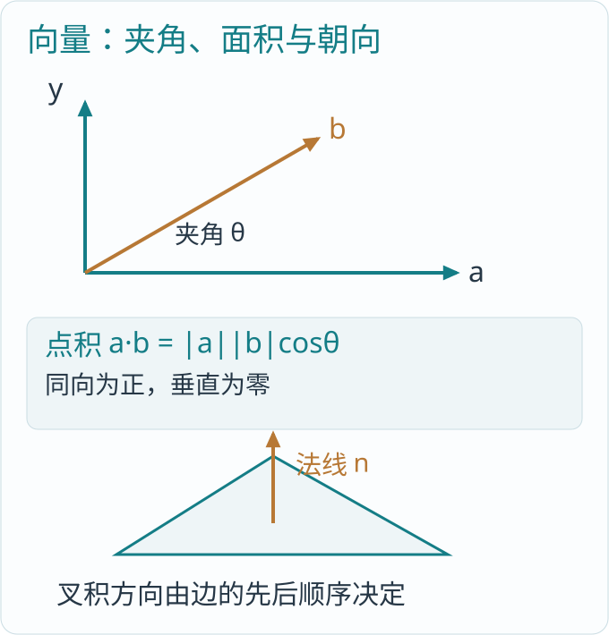

*图 1-1：点积读夹角，叉积读垂直方向；同一组三角形边同时决定面积和朝向。*

### 1.4 归一化与包围盒

`normalized()` 以向量除以自身长度。例如 `(3,4,0)` 的长度为五，单位方向为 `(.6,.8,0)`。原来的长度信息被去掉，留下纯方向。相机方向、法线与材质公式中的方向经常要求单位长度；零向量没有可归一化的方向。

`BLBounds` 用 `min、max` 保存轴对齐包围盒。加入一个点时，每个轴分别取更小和更大的坐标。点 `(1,2,0)` 和 `(4,-1,3)` 得到 `min=(1,-1,0)`、`max=(4,2,3)`，中心是 `(2.5,.5,1.5)`。

包围盒适合先排除大批不可能相交的物体，但“源码有包围盒”不等于“完整场景剔除系统已实现”。当前 `BLMesh` 保存几何边界，实际硬件光线查询使用设备加速结构；后文会分开说明这些职责。

## 第二章 矩阵：把移动、旋转和缩放连成一次计算

### 2.1 从三条式子看懂仿射矩阵

一个本地点 `(x,y,z)` 变到父坐标，可以写成：

```text
x' = m00*x + m01*y + m02*z + tx
y' = m10*x + m11*y + m12*z + ty
z' = m20*x + m21*y + m22*z + tz
```

前面的九个数负责旋转、缩放与剪切，最后三个数负责平移。BLEngine 的 `BLTransform` 以三行四列保存它们；完整四行四列矩阵的最后一行为 `(0,0,0,1)`，不必重复存储。

例如先把局部点 `(1,0,0)` 沿 x 放大两倍，再绕 z 轴旋转九十度，最后平移 `(3,1,0)`，结果依次是 `(2,0,0)`、`(0,2,0)`、`(3,3,0)`。只要把这些操作组合成一个矩阵，任意顶点都能沿同一公式计算。

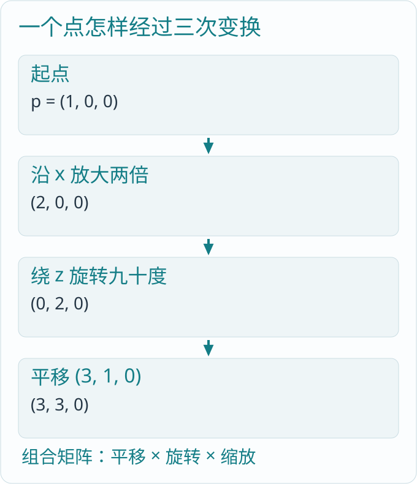

*图 2-1：同一个点沿箭头走过缩放、旋转和平移；顺序是计算的一部分。*

### 2.2 把平移、缩放和旋转写进矩阵

下面是三行四列的数学展开，均与 `BLTransform.rows` 的行排列一致。最后一列是平移，不是额外的缩放分量。

```text
平移 (tx,ty,tz)
[ 1  0  0  tx ]
[ 0  1  0  ty ]
[ 0  0  1  tz ]

缩放 (sx,sy,sz)
[ sx  0   0   0 ]
[ 0   sy  0   0 ]
[ 0   0   sz  0 ]

绕 z 轴旋转 θ
[ cosθ  -sinθ  0  0 ]
[ sinθ   cosθ  0  0 ]
[ 0      0     1  0 ]
```

九十度时 cosθ 为零、sinθ 为一，第一行算出 `x'=-y`，第二行算出 `y'=x`，所以 `(2,0,0)` 变为 `(0,2,0)`。沿 z 轴看，x 轴正向转到了 y 轴正向。绕其他轴同样保持该轴分量，用另外两个分量完成旋转；正负方向由坐标约定和角度符号决定。

非统一缩放表示三个轴倍率不同；剪切则让一个坐标随另一个坐标改变，例如 `x'=x+k*y`。它们都能放进前面的三乘三线性部分，所以场景保存一般仿射矩阵，而不只保存“位置加一个角度”。当前节点没有另存一套四元数姿态或动画轨道。

### 2.3 矩阵相乘不能交换

`Programs/math/transform.b` 给出了很短的组合函数：

源码节选：`Programs/math/transform.b:4`。

```b
T compose<T: BLSquareMatrix>(T first, T second) { return second * first; }
```

引擎采用矩阵乘列向量的写法。`compose(first,second)` 返回 `second*first`，表示先做 `first`，再做 `second`。设先平移一单位，再放大两倍，原点会到二；先放大，再平移，原点只会到一。矩阵名称相同而顺序不同，画面就不同。

场景树里“子物体先到父坐标，再到世界坐标”同理：`world_child = world_parent * local_child`。父节点旋转时，子物体的相对位置也会转动，因为这段平移本来就在父坐标中表达。

### 2.4 点的 w 是一，方向的 w 是零

源码节选：`Programs/math/transform.b:7`。

```b
float3 transform_point(float4x4 world_from_local, float3 position) {
    float4 projected = world_from_local * float4(position, 1.0);
    return projected.xyz / projected.w;
}
```

`float4(position,1.0)` 让矩阵的平移列参与计算。方向写为 `float4(direction,0.0)`，平移项乘零，方向只受线性部分影响。相机组件和光源组件都沿这个区别变到世界空间。

完整投影变换可能得到不等于一的 `w`，所以 `transform_point` 在最后除以 `projected.w`。当前场景的本地矩阵是仿射矩阵；当前像素射线相机直接构造方向，不经这个函数完成传统投影管线。通用数学函数存在，不表示每一条渲染路径都会调用它。

### 2.5 为什么法线要乘逆转置

普通方向直接乘矩阵，法线却必须继续垂直于变换后的表面。考虑平面上的方向 `t=(1,1,0)`，法线 `n=(1,-1,0)`，二者点积为零。沿 x 放大两倍后，切线变为 `(2,1,0)`。若法线也直接缩放，就成为 `(2,-1,0)`，点积为三，已经不垂直。

把法线的 x 分量反而缩小为一半，得到 `(.5,-1,0)`，与 `(2,1,0)` 点积仍为零。这正是逆矩阵再转置的效果。

源码节选：`Programs/math/transform.b:20`。

```b
float3 transform_normal(float3x3 world_from_local, float3 normal) {
    return normalize(transpose(inverse(world_from_local)) * normal);
}
```

实际网格命中已经携带 `world_to_object`，它就是世界矩阵的逆。`Programs/geometry/normals.b` 直接转置其线性部分，避免另算并保存第二份法线矩阵。

源码节选：`Programs/geometry/normals.b:2`。

```b
float3x3 mesh_normal_basis(float3x4 world_to_object) on compute {
    return transpose(float3x3(world_to_object.r0.xyz,world_to_object.r1.xyz,world_to_object.r2.xyz));
}
```

### 2.6 逆矩阵把世界问题带回物体内部

一个实例先沿 x 放大两倍，再向世界 x 平移三，局部 x 为一的点到世界 x 为五。已知世界 x 为五，回到局部坐标就先减三，再除以二，得到一；逆变换的操作顺序与正向相反。

实例 AS 命中的 `world_to_object` 提供的就是这种反向关系。几何可以保持原来的局部顶点，而同一模型在不同实例上有不同世界位置。可逆线性部分是实际实例交给 Vulkan 的前提；把某个轴缩放成零会压塌一个维度，不能再用普通逆矩阵找回原坐标。

## 第三章 几何：三角形不只有三个位置

### 3.1 顶点、索引和属性

一个立方体只有八个空间角点，却往往需要更多顶点记录。原因是同一个角点可能同时属于三张朝向不同的面，也可能处在纹理接缝上；位置相同不代表法线和 UV 相同。

`src/geometry.rs` 的 `BLVertex` 保存位置、法线和可选 UV，`BLTriangle` 保存三个顶点编号及源材质组编号，`BLMesh` 保存全部顶点、三角形、材质组名和包围盒。索引把多个三角形连到可共享的顶点记录，而接缝通过不同记录表达。

阅读场景的立方体包含 **二十四个顶点记录、十二个三角形**。每个面有自己朝外的法线；并没有为了画立方体而把模型偷偷简化成屏幕上的方框。

### 3.2 重心坐标：由命中位置找回法线与纹理

光线命中三角形后，硬件返回两个重心分量 `u、v`。第三个权重为 `1-u-v`。假设 `u=.25、v=.25`，命中点就是 `0.5*a+0.25*b+0.25*c`。三个权重之和为一，因此位置仍在同一三角形平面上。

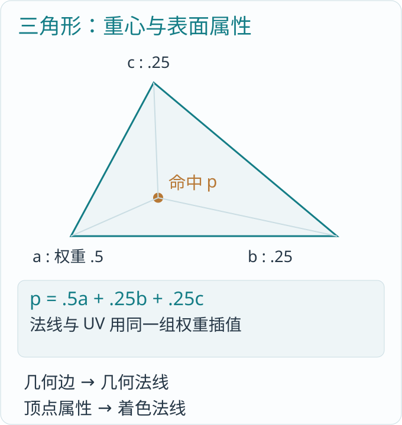

*图 3-1：一次命中把三个角点的属性按同一组权重混合。几何法线来自边，着色法线来自顶点属性。*

`stella.surface::surface_uv` 的实现与这个算式完全一致：

源码节选：`Programs/stella/surface.b:17`。

```b
float2 surface_uv(BLShadingInstance instance, u32 primitive, float2 barycentric) on compute {
    BLTextureTriangle triangle = unsafe_read(instance.texcoords, primitive);
    f32 u = barycentric.x;
    f32 v = barycentric.y;
    return triangle.coordinates[0] * (1.0-u-v) + triangle.coordinates[1] * u + triangle.coordinates[2] * v;
}
```

若 UV 三点为 `(0,0)、(1,0)、(0,1)`，上例命中得到 `(.25,.25)`。法线也按同样权重插值，然后归一化；它让光照在三角形之间平滑变化，但不会改变真实三角形的形状和轮廓。

### 3.3 几何法线与着色法线各做什么

几何法线由两条三角形边叉乘得到，用于决定真实表面的内外、射线起点向哪侧偏移，以及反射或透射是否越过表面。着色法线由顶点法线插值、法线纹理等得到，用于计算局部光照。

把二者混成一个方向会造成实际问题：法线贴图稍微倾斜，玻璃的“内部”就可能被误判；偏移射线时也可能移到物体错误的一侧。因此 `BLStellaSurface` 同时携带二者。平滑和细节服务于外观，真实几何仍决定边界。

## 第四章 相机：从屏幕上的格子发出一条光线

### 4.1 观察坐标由三个方向组成

相机有眼睛位置 `eye`、观察目标 `target` 和一个参考向上方向 `up`。先求 `forward=normalize(target-eye)`，再用叉积求 `right`，最后重新构造与前二者垂直的 `up`。

源码节选：`Programs/scene/camera.b:3`。

```b
BLCamera camera_basis(float3 eye, float3 target, float3 up, f32 span, u32 projection, f32 near, f32 far, u32 medium) on compute {
    float3 forward=normalize(target-eye);
    float3 right=normalize(cross(forward,up));
    return BLCamera(eye,right,cross(right,forward),forward,span,projection,near,far,medium);
}
```

设 `eye=(0,-3,2)`、`target=(0,0,2)`、参考 up 为 `(0,0,1)`。相机向前是 `(0,1,0)`，向右是 `(1,0,0)`，向上仍是 `(0,0,1)`。这些方向构成了相机自己的坐标尺。

参考 up 不必事先和观察方向垂直，但不能与它平行。否则叉积为零，左右方向无从确定。Rust 的相机描述交接处处理这个真实几何前提，B 代码负责基向量计算。

### 4.2 屏幕坐标怎样变成方向

图像的左上角是像素 `(0,0)`，三维相机的“上”却通常取正方向。`stella.visibility::pixel_ray` 在像素中心取样，横向映射到 `[-1,1]`，纵向反过来映射到 `[1,-1]`；横向还乘宽高比，防止宽屏把物体压扁。

源码节选：`Programs/stella/visibility.b:6`。

```b
BLRay pixel_ray<const W:u32,const H:u32,const S:u32>(read dataset<BLCamera> cameras,u32 pixel,u32 layer) on compute {
    f32 sx=((f32(pixel%(W*S))+0.5)/f32(W*S)*2.0-1.0)*(f32(W)/f32(H));
    f32 sy=1.0-(f32(pixel/(W*S))+0.5)/f32(H*S)*2.0;
    return camera_ray(unsafe_read(cameras,layer),float2(sx,sy));
}
```

`W、H` 是最终显示大小，`S` 是每轴内部采样倍率，内部宽为 `W*S`。`index()` 是当前内部像素的一维编号；取余得到列，整除得到行。`.5` 把采样位置放到格子中心，而不是格子左上角。

### 4.3 透视与正交只差一处，却产生两种空间感觉

源码节选：`Programs/scene/camera.b:8`。

```b
BLRay camera_ray(BLCamera camera, float2 ndc) on compute {
    float3x2 basis=float3x2(camera.right.x,camera.up.x,camera.right.y,camera.up.y,camera.right.z,camera.up.z);
    float3 offset=transform_plane(basis,ndc*camera.tangent);
    if (camera.projection==1) { return BLRay(camera.eye+offset,camera.forward); }
    return BLRay(camera.eye,normalize(camera.forward+offset));
}
```

透视相机的光线都从 `eye` 出发，方向随屏幕位置展开，所以近处物体占据更大角度。正交相机的方向保持 `forward`，起点在相机平面上平移，所以同样大小的物体不会仅因远近而缩放。

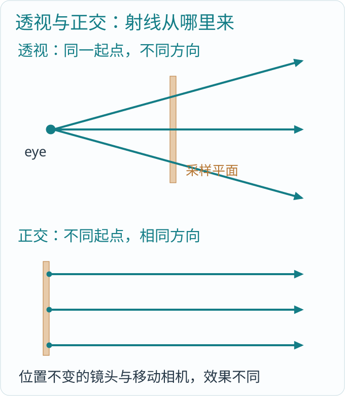

*图 4-1：透视改变方向，正交改变起点。图中画的是射线，矩形代表采样平面。*

`BLCameraDescription.span` 对透视表示垂直半视角的正切，对正交表示画面半高。例如透视 `span=1` 对应垂直视角九十度；`span=.36` 约为四十度。这个字段不是弧度本身。把它直接当 FOV 输入，是源码阅读中容易出现的单位错误。

当前实现没有先把三角形乘投影矩阵再覆盖像素，而是反过来：为每个像素生成世界光线，向场景询问最近命中。两种方法都要建立相机和屏幕的对应，只是计算方向不同。

### 4.4 世界中的点怎样回到屏幕

标签投影需要反过来做。取 `delta=point-eye`，用点积分别得到相机横向、纵向和前向坐标：`x=dot(delta,right)`、`y=dot(delta,up)`、`depth=dot(delta,forward)`。这相当于拿相机的三把尺测量同一个世界位移。

对深度为正的透视点，`ndc_y=y/(depth*span)`，横向还要除宽高比。再映射到像素：横向从画面中心向右，纵向从画面中心向上，所以像素 y 要反号。深度变成两倍而 x、y 不变时，屏幕偏移缩小一半，这就是近大远小的计算来源。

`Programs/scene/labels.b::project` 正按这些点积求 depth、x 和 baseline。生成主射线与投影世界标签互为观察问题的两个方向；不必为了投标签再建立另一台含义不同的相机。

## 第五章 相机运动：绕目标转，不是旋转整张图片

### 5.1 移动的究竟是哪一份数据

`src/window.rs` 的 `BLNavigation` 保存导航的 yaw、pitch、distance。方向键和滚轮改变这些输入；`src/viewer.rs` 每次绘制把它们交给 `BLCameraPrograms::orbit`。Rust 收集输入，B 计算相机，不在窗口消息中重新实现三维数学。

源码节选：`Programs/scene/camera.b:18`。

```b
void orbit(write dataset<BLCamera,1> cameras,
    float3 eye, float3 target, float3 up, f32 span, u32 projection, f32 near, f32 far, u32 medium,
    f32 yaw, f32 pitch, f32 distance) on compute {
    parallel (camera in cameras) {
        BLCamera initial=camera_basis(eye,target,up,span,projection,near,far,medium);
        float3 right=initial.right*cos(yaw)+initial.forward*sin(yaw);
        float3 back=initial.right*sin(yaw)-initial.forward*cos(yaw);
        float3 offset=back*cos(pitch)+initial.up*sin(pitch);
        f32 radius=sqrt(dot(eye-target,eye-target))*distance;
        camera=BLCamera(target+offset*radius,right,initial.up*cos(pitch)-back*sin(pitch),-offset,span,projection,near,far,medium);
    }
}
```

函数先以初始相机建立参考坐标，再围绕目标计算新的 `right、back、offset`。`target+offset*radius` 是新眼睛位置，`-offset` 是新的观察方向，因此目标仍在画面中心。

### 5.2 用半径理解缩放

初始眼睛到目标相距五，distance 为一，轨道半径就是五；distance 为二，半径变成十。这里的滚轮导航通过移动相机改变距离，不改模型顶点，也不把图像放大后再裁切。

这和改变镜头 span 有区别。保持位置、缩小 span 会收窄视野；改变眼睛位置则会改变前后物体之间的透视关系。分析导航效果时，先看修改的是位置还是镜头参数。

### 5.3 相机也能挂在场景节点上

一辆车的相机跟随车身，是因为它的相机组件先经过车身世界矩阵；之后 orbit 再围绕这份已求值的相机工作。相机节点变换和用户导航是两段不同输入。

当前组件求值把 eye、target 当点，用 `w=1`；把 up 当方向，用 `w=0`。非统一缩放或剪切会改变这些世界值，随后 `camera_basis` 再建立正交观察基。镜头 span 和距离区间保持组件值，不把节点缩放暗中解释为镜头变焦。

## 第六章 裁剪、可见性与求交：哪些东西进入画面

### 6.1 先分清三件容易混淆的事

裁剪规定可接受的空间范围；剔除提前排除不可能贡献的对象；遮挡判断某个方向上是否有更近物体。它们都能减少或限制可见内容，但输入和结果不同。

传统光栅化会把顶点变到齐次裁剪坐标，按 `-w≤x≤w、-w≤y≤w` 及其深度约定裁切多边形，然后除以 w、映射屏幕、光栅化，并用深度缓冲选择前后。深度轴的范围取决于具体 API 约定，不能混用。

当前 BLEngine 没有这条三角形光栅化管线。屏幕射线的方向已经限定了观察范围，最近命中查询直接回答每个采样点前方有什么。不能在源码目录里找不到裁剪器时，把相机的 near/far 字段当成完整传统裁剪实现。

### 6.2 当前 near/far 限定的是射线参数

```text
p(t) = origin + t * direction
有效范围：near ≤ t ≤ far
```

相机射线方向已归一化，所以 t 是沿光线的世界距离。当前 `pixel_hit` 将相机 near/far 直接传给求交；它们不是透视相机前方两张相同 z 值的平面。斜射线的沿线距离与相机前向深度并不相同。

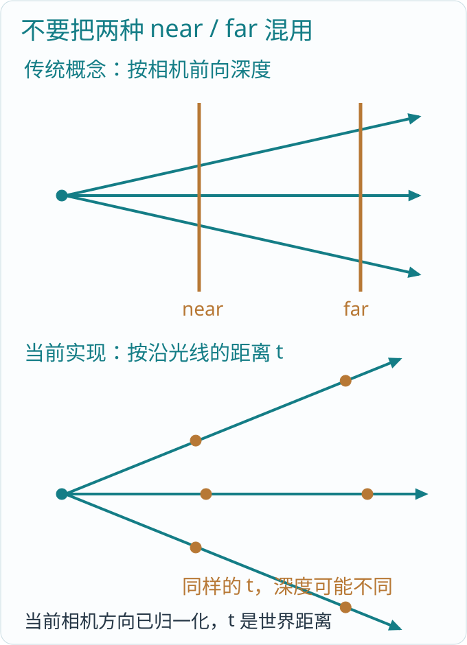

*图 6-1：上图的相机深度平面与下图的沿射线距离区间含义不同。当前实现采用后者。*

例如中心射线沿 forward 前进，t 为十时，前向深度也是十；与 forward 成六十度的射线走十，前向深度只有五。这解释了为什么同名 near/far 不保证相同的裁剪形状。

### 6.3 最近命中怎样选出来

`stella.visibility::closest_hit` 先放入距离为 far 的“未命中”记录；若启用地面，求光线与水平面的交点；再用 `trace_closest` 查询网格；最后检查解析面光。所有候选沿同一条光线、同一个有效区间比较，留下最近者。

网格查询的核心可从更短的通用入口看清：

源码节选：`Programs/scene/query.b:2`。

```b
BLMeshHit mesh_intersect(BLMeshRay ray,read dataset<BLInstance> instances,read acceleration scene,u32 base) on gpu {
    RayHit hit=trace_closest(scene,ray.origin,ray.near,ray.direction,ray.far);
    if(!hit.exists){
        return BLMeshHit(float3(0.0),ray.far,float3(0.0),0,float2(0.0),uint2(0),0,false,uint2(0),float3(0.0));
    }
    u32 instance=base+hit.instance;
    float3x3 basis=mesh_normal_basis(hit.world_to_object);
    float3 normal=mesh_geometric_normal(basis,hit.vertex1-hit.vertex0,hit.vertex2-hit.vertex0);
    float3 local=hit.vertex0*(1.0-hit.barycentric.x-hit.barycentric.y)+
        hit.vertex1*hit.barycentric.x+hit.vertex2*hit.barycentric.y;
    return BLMeshHit(ray.origin+ray.direction*hit.distance,hit.distance,normal,hit.primitive,
        hit.barycentric,unsafe_read(instances,instance).identity,instance,true,unsafe_read(instances,instance).geometry,local);
}
```

`trace_closest` 的三角形遍历和求交由 Blink 的 Vulkan 光线查询后端交给真实加速结构（AS）执行。引擎不在 Rust 中遍历每个三角形，也没有在这个函数里重新写一遍 Möller–Trumbore 求交器。

命中后，B 用距离重建世界位置，用重心重建物体空间位置，并把当前实例槽位映射到稳定运行身份。返回的数据既能供着色，也能作为后续网格选择计算的输入。

### 6.4 世界层和独立层不能直接比距离

BLEngine 可以给独立 overlay 空间使用另一台相机和另一份顶层加速结构。先求世界层，再求独立层；独立层有命中时，按层规则替换世界结果。两台相机的原点和坐标尺度不同，所以不把两个 distance 当成同一坐标下的深度来比较。

当前尚无独立场景视锥剔除器、遮挡层级或 GPU 可见实例压紧管线。硬件 AS 能加速射线查询，但不能据此说整个引擎已经具备完整场景可见性系统。

作为理论对照，传统视锥可以由六张朝内的平面表示。若平面写成 `dot(n,p)+d≥0`，且 n 是单位法线，一个中心 c、半径 r 的球在某平面满足 `dot(n,c)+d<-r`，便整个落在外侧，可以提前排除。与平面相交的球仍须保留，不能只检查球心是否在内部。这说明“范围描述”和“批量对象剔除”之间还需要实际算法；当前实现尚未实现这份场景剔除计算。

## 第七章 场景组织：树保存关系，矩阵解释关系

### 7.1 为什么要有父子节点

想象一个台灯：灯座带着灯杆，灯杆带着灯罩。移动灯座时，不应手动修改每个零件的世界坐标。每个零件只保存相对父节点的本地变换，世界变换由父链组合。

`src/hierarchy.rs` 的 `BLScene` 保存节点槽位和可复用空槽。`BLSceneNode` 保存父关系、本地矩阵，以及可选几何、相机、光源。允许多棵互不相连的树，因此整体是有向森林，而不是强迫一切挂到一个没有实际职责的根对象。

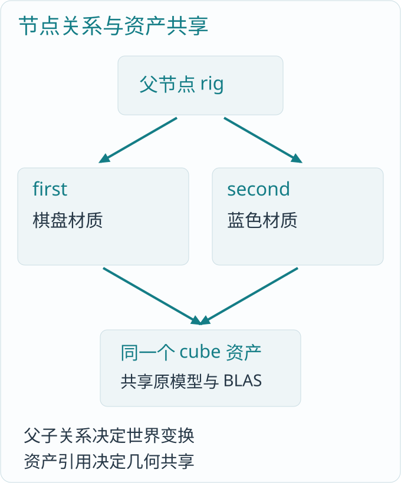

*图 7-1：阅读场景中的两个物体共享 rig 父节点，也共享同一 cube 资产；父子关系与资产共享是两种关系。*

### 7.2 世界矩阵怎样算

源码节选：`Programs/scene/hierarchy.b:9`。

```b
void resolve(read dataset<BLHierarchyNode> nodes,write dataset<BLWorldTransform> worlds) on compute {
    parallel(world in worlds) {
        BLHierarchyNode node=unsafe_read(nodes,index());
        float3x4 matrix=node.local;
        if(node.active){
            while(node.has_parent){
                node=unsafe_read(nodes,node.parent);
                matrix=compose_affine(node.local,matrix);
            }
        }
        world.matrix=matrix;
    }
}
```

每个工作项从自己的本地矩阵开始，沿父链向上，把父矩阵乘到前面。父节点向 x 平移十，子节点向 y 平移二，子节点原点的世界坐标就是 `(10,2,0)`；若父节点旋转，子节点的局部平移也随之旋转。

这里每个节点独立读源节点，写自己的世界结果，所以可以并行。它没有要求先写完父节点的世界矩阵，再让子节点读取那份输出；因此也不用在每一层之间加一次全局阶段。

代价是深层节点会重复读取共同祖先，工作量约为所有节点深度之和。当前没有脏子树增量算法，不应把“可以持续更新”解释为“只重算变化节点”。并行表达减少了数据依赖，具体算法仍有可优化的工作量。

### 7.3 改父节点与删除节点

`BLScene::set_parent` 保留本地矩阵。这意味着把一盏灯从桌子改挂到车上，它的世界位置可能变化。若应用希望保持世界位置，就要先计算新父节点逆矩阵，再显式设置新的本地矩阵；当前 API 不暗中替调用者选择这个语义。

`remove` 通过 B 的 `descendants` 标记整个子树，再由 Rust 删除对应节点和组件、回收槽位。算法判断的是实际父链，不是“编号比根节点大”之类的偶然排列。

### 7.4 槽位不等于身份

删除第六号槽位中的节点，再把新节点放进第六号槽位，并不意味着它们是同一个物体。`BLNodeId` 同时保存槽位和由真实节点所有者创建的 `BLInstanceId`；旧句柄不能因为槽位被复用而认领新对象。

这份身份属于运行中的对象，不是跨进程资产 ID，不随文件保存。它也不是材质版本或几何版本。节点移动仍是同一对象，换了一份几何却不意味着旧表面历史仍然有效。后续时序缓存若要建立表面对应，还需要实际的版本与运动信息。

## 第八章 组件求值：同一节点如何带动模型、相机和灯

### 8.1 保存一份源，生成所需结果

场景保存的是本地节点组件，不再额外保存一份可独立修改的世界相机和世界灯光。`BLScenePrograms::evaluate` 把源数据打包交给 `scene.components::evaluate`：先求世界矩阵，再分别变换相机和灯。

源码节选：`Programs/scene/components.b:29`。

```b
void evaluate(read dataset<BLHierarchyNode> nodes,inout dataset<BLWorldTransform> worlds,
                 read dataset<BLAttachedCamera> local_cameras,write dataset<BLSceneCamera> world_cameras,
                 read dataset<BLAttachedLight> local_lights,write dataset<BLLight> world_lights) on compute {
    resolve(nodes,worlds);
    cameras(worlds,local_cameras,world_cameras);
    lights(worlds,local_lights,world_lights);
}
```

几何实例、相机描述和世界光源是该次输入的派生结果。节点修改后显式重新求值；不能继续拿旧结果当成已经自动更新的场景。

### 8.2 不同灯光对变换的需要不同

点光的位置是点，随父节点平移；方向光表示远处来的传播方向，父节点平移不应改变它。面光的位置是点，两条半边是方向，变换后面积自然变化。聚光的位置和朝向都需要变换。

组件计算在 `Programs/scene/components.b` 中按这些几何意义分支。它不把能量随父节点缩放再任意乘一次，也不把非统一缩放后的聚光悄悄换成椭圆锥。场景变换与灯光物理参数需要分别读懂。

### 8.3 CPU 路径与设备路径

普通 `placements/evaluate` 入口在原生 CPU B 中求值，把最终矩阵交给实例构建。`place_hierarchy_device` 则上传源节点，让 GPU B 求世界矩阵，再按真实可绘节点 gather 到设备实例记录。

源码节选：`Programs/scene/device.b:9`。

```b
void prepare(read dataset<BLHierarchyNode> nodes,inout dataset<BLWorldTransform> worlds,
                read dataset<BLDrawNode> draws,inout dataset<BLDeviceTransform> transforms) on compute {
    resolve(nodes,worlds);
    gather(worlds,draws,transforms);
}
```

这个顺序很具体：`resolve` 产生 worlds，`gather` 消费 worlds。框架负责两段之间的设备可见性。Rust 不需要把所有矩阵先读回 CPU，再重新上传到 TLAS。

当前 `BLGpuScene` 拥有几何、GPU 实例变换与本次加速结构，`BLRenderScene` 引用本次 AS 及 `BLShadingSource`；`BLSceneRenderer` 拥有照明与程序。普通查询不要求初始化渲染材质。Blink 已有明确 refit 接口，实际场景采用、局部更新与完整流送仍应按各自消费者判断。

## 第九章 资产：让文件中的模型变成引擎数据

### 9.1 cook 是显式转换，不是运行时猜格式

阅读案例先把 OBJ 转成 `.blgeom`，再把可读场景文本转成 `.blscene`。`cook` 是引擎命令中的一个动作，表示把源资产转换成运行时明确的格式；它不是额外的书籍程序。

`BLMesh::read_obj` 分别读取位置、法线和 UV。每个面角以 `(位置索引,UV索引,法线索引)` 作为键查找或建立顶点，这正是接缝能保留下来的原因。源码中的关键行是：

局部节选，外围未列出：`src/geometry.rs:137`。

```rust
                        let key = (pi, ti, ni);
                        let index = if let Some(index) = lookup.get(&key) {
                            *index
                        } else {
                            let normal = ni
                                .map(|i| normals[i])
                                .ok_or_else(|| error("正式几何输入必须包含生成器法线"))?;
                            let uv = ti.map(|i| uvs[i]);
                            let index = u32::try_from(vertices.len())?;
                            vertices.push(BLVertex {
                                position: positions[pi],
                                normal,
                                uv,
                            });
                            lookup.insert(key, index);
```

输入必须提供正式三角化和法线。当前读取器不自动剖分任意多边形，不凭空生成缺失法线，不读取 MTL 来推测完整材质。文件转换保留原精度几何，坐标单位换算放在实例矩阵中。

### 9.2 四种文件各保存什么

| 文件 | 主要内容 | 读取位置 |
|---|---|---|
| `.blgeom` | 顶点、三角形、源材质组和原 UV | `src/geometry.rs` |
| `.blscene` | 节点森林、组件、几何路径、启动相机、输出设置 | `src/scene_asset.rs` |
| `.blmat` | 图像、表面、介质、默认组绑定和地面材质 | `src/material.rs` |
| `.bltex` | 线性图像与 mip 数据 | Blink `blcompute` 的纹理读写 |

当前写出格式分别为 BLGEOM 2、BLSCENE 8、BLMAT 2、BLTEX 2。格式版本是实际数据协议，不是渲染质量等级。当前开发版本不提供旧版本自动转换链，源材料应按当前明确格式重新 cook。

### 9.3 相对路径要从所属文件算

场景里的材质路径、模型路径相对最终 `.blscene` 所在目录；材质里的纹理路径相对 `.blmat`。这让一份资产目录可以整体移动，而不必把作者机器的盘符写进文件。

场景保存时，`BLSceneAsset::write` 只写存活节点，并重映射父引用和启动相机引用。文件下标不等于运行身份，删除后的空槽也不写成永久资产对象。重新读入会建立新的运行场景。

当前没有 FBX、UE 资源、骨骼动画或外部材质自动导入。资产层已经有明确的数据入口，但还不能据此称为完整 DCC 生产管线。

## 第十章 几何驻留与加速结构：同一模型怎样画很多次

### 10.1 两个物体不需要两份顶点

阅读场景的两个立方体形状相同，位置、矩阵和材质选择不同。`BLGeometryStore` 以资产编号保存原模型；`BLPlacement` 保存每次摆放的身份、资产引用、变换、颜色和材质选择。

这把“是什么形状”和“放在哪里”分开了。移动一个立方体，改的是实例矩阵；给它换材质，改的是实例的材质绑定；二者都不应复制原三角形。

### 10.2 BLAS 与 TLAS 分别回答什么

底层加速结构 BLAS 描述一份模型内部的三角形。顶层加速结构 TLAS 描述场景里有哪些实例、各自怎样变换，以及引用哪份 BLAS。可以把它们理解为两级查找：先找可能命中的物体，再进入物体的三角形。

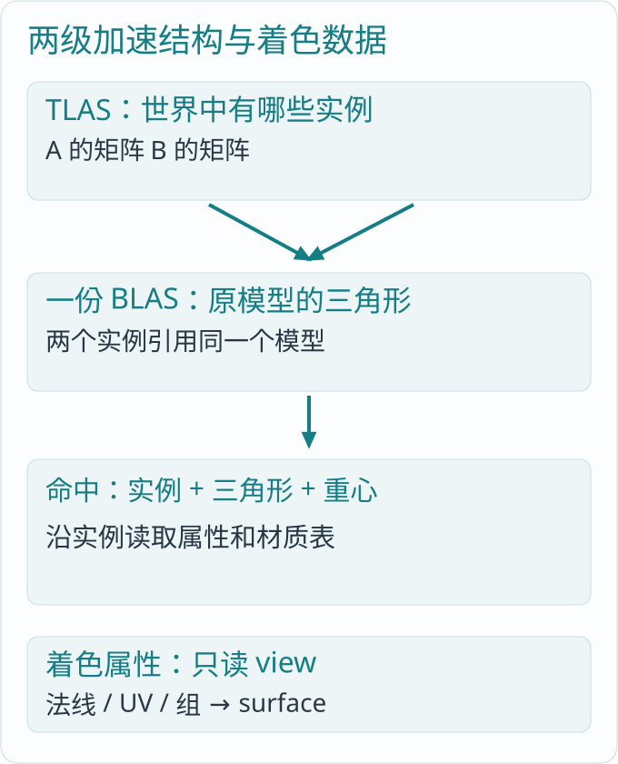

*图 10-1：两个实例共享一个 BLAS，但各有世界变换和材质选择。着色属性表与原生 AS 是不同资源。*

BLGpuScene 把原位置、索引与实例变换交给 Blink 的原生 AS 接口；GPU 层级求值可直接产生同一变换输入。BLRenderScene 引用本次加速结构，BLShadingSource 根据实际材质需求持有法线、UV、材质与网格发光属性。世界层和独立层的 AS 按本次场景来源交付，着色不把原场景移出再归还。

这些结构不等于一份手写的 Rust BVH。实际构建和 Vulkan 内存属于 Blink 的 `vulkan/ray.rs`，引擎交付原精度几何和实例关系。B 在命中之后继续解释属性，不接管原生句柄的释放。

### 10.3 硬件实例记录与着色实例记录别混淆

设备构建用的 `BLDeviceTransform` 使用六十四字节步长，其中前四十八字节是三行四列矩阵，剩余部分由框架维护原生实例信息。B 只写自己声明的矩阵字段。

查询身份记录 BLInstance 与着色记录分开。当前 `BLShadingInstance` 保存真实属性 view、tint、几何／属性来源身份，以及网格光使用的位置与索引：

源码节选：`Programs/render/instance.h:1`。

```b
module render.instance;
struct BLTriangle {array<u32,3> normal_indices;u32 material;};
struct BLNormal {float3 normal;};
struct BLTextureTriangle {array<float2,3> coordinates;};
struct BLMaterialSlot {u32 surface;};
struct BLPosition {float3 position;};
struct BLIndexTriangle stride(12) {array<u32,3> vertices;};
struct BLShadingInstance {
    view<BLTriangle> triangles;
    view<BLNormal> normals;
    view<BLTextureTriangle> texcoords;
    view<BLMaterialSlot> materials;
    float4 tint;
    uint2 identity;uint2 geometry;
    uint2 attributes;uint2 uv_source;
    float3 bounds_min;float3 bounds_max;
    view<BLPosition> positions;
    view<BLIndexTriangle> indices;
};
```

三角形属性记录保存法线索引和材质组；positions／indices 引用原几何的实际内容，供网格光分布等消费者使用，不是另一份宿主几何镜像。`view` 指向真正的只读数据。框架保持它所引用的存储，不能把 view 当成一个脱离所有者仍有效的裸数字。

### 10.4 材质组怎样避免破坏共享

三角形只保存源材质组编号，实例另有“组编号到 surface 编号”的槽位表。同一个立方体可以在一个实例上使用棋盘材质，在另一个上使用蓝色材质，而 BLAS、原法线和三角形仍共享。

UV 的上传也由真实消费者决定：只用常量色时不需要 UV 数据；后来某个实例选择了纹理材质，再向原来源请求对应资产属性。`BLGeometryStore::prepare` 汇合全部实际实例的需求，不为每个实例单独保存一份模型。

这仍是模型级驻留与属性交接，不是虚拟几何。当前没有按可见细节裁取微三角形、压缩簇解码和完整页级流送；保留原精度 BLAS 也不等于已经实现 Nanite。

## 第十一章 材质：从一次命中读出表面是什么

### 11.1 表面颜色不能只靠一个 RGB

一块蓝色塑料和一块蓝色金属，可能有相近的基础色，却有不同的反射。材质至少要回答：表面属于哪种散射模型、颜色从哪里来、粗糙度是多少、介质边界是什么，以及法线细节怎样表达。

`src/material.rs::BLPalette::read` 读取材质库；`Programs/material/palette.h` 声明设备上的 `BLSurface`。Rust 按编译结果的字段偏移和步长打包，不再凭感觉复制一份 C 风格 ABI 结构。

阅读场景的基础声明如下：

```text
BLMAT 2
medium vacuum 1 0 0 0
texture file checker.bltex
texture color .09 .38 .55 1
texture color .19 .16 .13 1
surface tile opaque 0 .3 1.5 0 1 1 0 0
surface blue opaque 1 .18 1.5 0 1 1 0 0
surface floor opaque 2 .65 1.5 0 1 1 0 0
geometry solid tile
ground floor
```

`texture` 按声明顺序编号。surface 的参数依次包含模型、纹理编号、粗糙度、折射率、LOD、UV 缩放与偏移。名称用于绑定，运行时解析成实际编号。`medium vacuum` 是这份文件显式声明的介质，并非运行时偷偷注入的全局对象。

### 11.2 surface_at 是命中与材质之间的桥

`stella.surface::surface_at` 先从实例取得三角形和材质组，再通过实例槽位表取得 surface。需要纹理坐标时，用重心插值原 UV；随后执行 `uv*scale+offset`，采样颜色，再乘实例 tint。

局部节选，外围未列出：`Programs/stella/surface.b:43`。

```b
    BLSurface surface=unsafe_read(surfaces,material);
    float2 uv=surface_coordinates(hit,surface,instances);
    float3 color=(texture_sample(unsafe_read(textures,surface.texture),uv,surface.lod).xyz*surface.color_scale+surface.color_bias)*tint;
    f32 roughness=surface.roughness;
```

`uses_uv` 不是用来掩盖错误资产，而是表示该材质是否真的消费 UV。纹理材质缺失原 UV，资产入口应报告；常量色材质没有这个需求，不必为了凑字段制造无用数据。

### 11.3 法线纹理只改变局部表面方向

法线纹理把 RGB 从 `[0,1]` 解码到 `[-1,1]`。这些分量表达的是沿切线、副切线和原法线的方向，不能直接当作世界坐标。

`material.maps::normal_map` 用三角形边和 UV 边求出切线方向，把它与法线正交化，处理 UV 镜像朝向，再组合纹理方向。随后 `surface_at` 用实际命中的逆转置基变到世界空间。

源码节选：`Programs/material/maps.b:8`。

```b
float3 normal_map(float3 normal,float3 edge_u,float3 edge_v,float2 uv_u,float2 uv_v,float3 encoded,f32 strength) on compute {
    float3 tangent=edge_u*uv_v.y-edge_v*uv_u.y;
    float3 bitangent=edge_v*uv_u.x-edge_u*uv_v.x;
    if(uv_u.x*uv_v.y-uv_u.y*uv_v.x<0.0){tangent=-tangent;bitangent=-bitangent;}
    tangent=normalize(tangent-normal*dot(normal,tangent));
    float3 perpendicular=cross(normal,tangent);
    if(dot(perpendicular,bitangent)<0.0){perpendicular=-perpendicular;}
    float3 sample=encoded*2.0-float3(1.0);
    return normalize(tangent*(sample.x*strength)+perpendicular*(sample.y*strength)+normal*sample.z);
}
```

它能给表面增加凹凸光照细节，却不改变三角形位置、轮廓或真实自遮挡。把法线纹理当成几何细分，会误判画面和内存的来源。

### 11.4 粗糙度怎样进入 GGX

微表面模型把看似平滑的表面理解为很多微小朝向的反射面。粗糙度越小，这些朝向越集中，高光越窄；粗糙度越大，能量散到更宽方向。

`material.microfacet::microfacet_distribution` 实现 GGX 分布，当前 `alpha=roughness²`，分布使用 `a2=alpha²`。不要把粗糙度、alpha 和 a2 当成同一个参数。

源码节选：`Programs/material/microfacet.b:2`。

```b
f32 microfacet_distribution(float3 normal,float3 half_vector,f32 a2) on compute {
    f32 nh=max(dot(normal,half_vector),0.0);
    float3 tangent=cross(normal,half_vector);
    f32 denominator=dot(tangent,tangent)+a2*nh*nh;
    // Divide before the second denominator factor: its square may underflow
    // even when the distribution itself is representable.
    return (a2/denominator)/(3.14159265359*denominator);
}
```

实现先除一次denominator，再除另一因子，避免中间平方先下溢而使可表示结果失真；这是计算次序安排，没有把分母钳成经验阈值。

完整不透明响应还包含 Fresnel 和 Smith 遮蔽项，位于 `material.surface::surface_response`。这些量分别描述界面反射比例、微表面朝向分布和微表面彼此挡住的影响。只保留一个“高光幂次”无法说明当前源码。

## 第十二章 光源与阴影：一条连接能带来多少光

### 12.1 五种光源的量并不相同

`src/lighting.rs::BLLight` 有方向、点、聚光、面光和有限太阳五种形式。方向光用辐照度描述平行来光；点光和聚光保存强度；面光与太阳盘保存辐亮度。字段都叫 energy 的设备记录，不表示物理量可以任意互换。

点光离表面从两单位变成四单位，在其他条件相同的情况下，贡献按距离平方从 `1/4` 变成 `1/16`。方向光没有这样的局部距离衰减。面光则还需要考虑面积、朝向和采样密度。

### 12.2 先选目标，再求入射量

`lighting.lights::light_target` 为方向光产生方向，为点光产生固定点，为面光在两条半边张成的矩形上选点。`light_sample` 再得到单位方向、实际目标、采样密度和已带相应概率权重的光量。

面光的世界位置加上 `[-1,1]` 范围的两条半边得到采样点。若两半边长度各为一且垂直，完整面积是四，不是一。源码中 `area_pdf` 的系数四来自这个定义：

源码节选：`Programs/lighting/lights.b:40`。

```b
        density=area_pdf(light,direction,distance_squared);
        if (density==0.0) { return BLLightSample(direction,float3(0.0),target,true,false,0.0,0); }
```

`distance_squared/projected_area` 把按面积选点的概率换成按观察方向立体角计算的密度。距离越远，同一块灯占据的角度越小，这个密度就越大。

### 12.3 阴影就是表面到灯之间有无阻挡

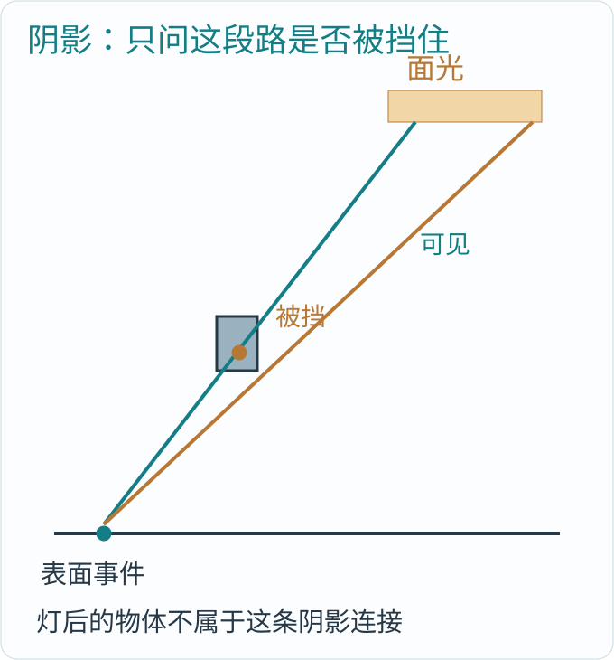

*图 12-1：只检查到目标灯的有效线段；目标背后的物体不应挡住这盏灯。不同面光采样点可能得到不同遮挡。*

`stella.lighting::light_occluded` 对局部灯把最大距离限制到真实目标；`stella.visibility::occluded` 检查可选地面、其他解析面光与网格 `trace_any`。阴影只需回答有没有遮挡，通常不必拿回最近三角形的全部属性。

源码节选：`Programs/stella/lighting.b:80`。

```b
bool light_occluded(read dataset<BLLight> lights,read acceleration scene,BLLightSample sample,f32 near,f32 far,
    float3 origin,bool floor_present,f32 ground_z,u32 target_light,view<BLAreaNode> areas) on gpu {
    f32 maximum=far;
    if(sample.local){maximum=min(maximum,length(sample.target-origin));}
    return occluded(scene,lights,BLRay(origin,sample.direction),near,maximum,
        floor_present,ground_z,target_light,sample.local && sample.event==1,areas);
}
```

起点沿几何法线偏移，方向指向光源。偏移解决的是有限精度下从表面再次出发的几何位置问题；它不能替代正确法线、正确射线区间和正确资产单位。

### 12.4 软阴影和有限太阳

面光有面积，表面上不同采样点会看见不同程度的灯，因此产生半影。采样数少时半影会有噪声；增加采样改变估计精度，也增加实际求交工作量。

有限太阳用角半径定义天空中的圆盘，`sun_direction` 在其立体角内选方向，`sun_emission` 允许相机或反射路径真正看见它。它和单一方向的理想太阳光不同。环境可以是常量或带旋转与缩放的 HDR 图像，B 生成其方向分布并与路径提议共同计算密度；完整大气系统仍未实现。

## 第十三章 采样：为什么算光照需要概率

### 13.1 无法把每个方向都算一遍

一个表面会收到来自许多方向的光。如果每次都穷举所有方向，再为每个方向继续递归，工作量会迅速增长。采样的想法是选择少量方向，让每次贡献按“选到它的可能性”进行补偿，多次结果的平均逐渐接近目标积分。

最简单的离散例子：两个方向的真实贡献分别为二和六，每次等概率选一个。选到第一个时记录 `2/.5=4`，选到第二个时记录 `6/.5=12`，平均为八，等于二加六。连续方向使用概率密度，基本思想相同。

这不是把噪声叫作正确。采样估计有方差；样本不足会在画面中表现为亮点和颗粒。算法是否正确、当前图像是否够稳定，以及性能是否满足目标，是不同问题。

### 13.2 随机数从像素和维度得到

源码节选：`Programs/sampling/random.b:17`。

```b
    BLRandomStream stream=sample_stream(address,dimension);
    uint4 words=sample_next(stream);
    return float3(f32(words.x>>8),f32(words.y>>8),f32(words.z>>8))/16777216.0;
}
```

调用者交付 BLSampleRound 的 key 与 ordinal，sample_address 由路径编号和顶点建立实际采样地址；sample_stream 再按维度产生计数器流。sample_unit3 把生成字的高二十四位映射到 `[0,1)`。不同用途通过明确地址和维度区分，不依赖共享的全局随机状态。

采样轮次由实际消费者传入。静态输入、相同轮次与相同采样地址可复现；新的轮次产生新样本。当前 BLImageMean 保存线性均值和样本计数，BLViewHistory 由真实视图拥有，并按相机与光照来源的适用关系延续或重启。稳定身份或同一像素不自动证明旧照明可复用。

### 13.3 weight 已经包含哪些量

表面把一个方向来的光分配到另一个方向的函数，称为 BSDF。`surface_evaluate` 返回 response 和 density，其中 response 已含 BSDF 与入射余弦。`surface_scatter` 返回的 weight 对连续事件为 `response/density`。路径的累计权重，也称吞吐，只乘这份 weight，不再额外乘一次余弦或除一次概率密度。代码中的 pdf 就表示概率密度。

假设 response 为 `.2`、density 为 `.4`，weight 就是 `.5`。原路径吞吐为 `.8`，新吞吐是 `.4`。重复除概率密度会得到一，已经改变了能量。

### 13.4 MIS：两种找光方法怎样合作

直接选灯容易找到小灯；按材质选方向容易找到窄反射。只用一种方法，某些场景会很难采到关键贡献。MIS 把两种方法按各自概率密度加权，避免对同一类路径重复计算完整能量。

源码节选：`Programs/sampling/mis.b:2`。

```b
f32 power_weight(f32 sampled_density,f32 other_density) on compute {
    // Ratios keep the power heuristic finite without squaring large PDFs.
    if(sampled_density>=other_density){
        f32 ratio=other_density/sampled_density;
        return 1.0/(1.0+ratio*ratio);
    }
    f32 ratio=sampled_density/other_density;
    f32 square=ratio*ratio;
    return square/(1.0+square);
}
```

这是平方权重的等价比例写法。采样策略 A 的密度为二，策略 B 为一，A 的权重是 `4/(4+1)=.8`，B 的对应权重是 `.2`。实现用比值避免直接平方很大的数。

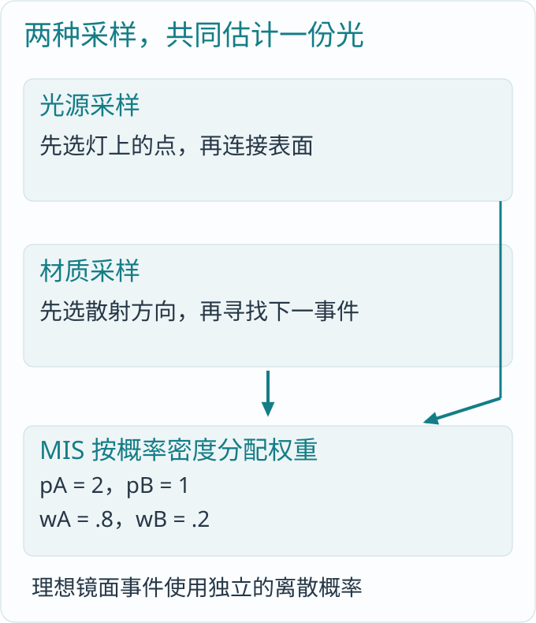

*图 13-1：光源采样和材质采样寻找同一类连接，MIS 分配权重；不是把两份完整结果直接相加。*

理想镜面的离散方向不能和连续的每立体角密度直接相加。源码用事件区分连续反射、离散反射、连续透射和离散透射，在环境或面光逃逸时按真实事件选择权重。最后一段不存在后续材质采样时，也不能给它分配一个虚构竞争策略。

## 第十四章 反射与折射：表面决定光从哪一侧离开

### 14.1 先看最简单的镜面反射

方向约定统一为离开表面的向量。若 `outgoing` 指向观察者，镜面反射的下一方向是 `2*dot(normal,outgoing)*normal-outgoing`。它的切向分量反号，法向分量保持，因此入射角等于反射角。

不透明材质的零粗糙度分支直接产生这个离散方向，不用一个无限尖的 GGX 分布假装理想镜面。粗糙表面则先采样微表面法线，再按它反射，方向会分散。

### 14.2 玻璃的 Fresnel 与 Snell 定律

两介质相对折射率在当前实现中记为 `eta=目标IOR/当前IOR`。Snell 定律给出透射正弦为入射正弦除以 eta；若平方后大于或等于一，就没有可行的折射方向，产生全反射。

源码节选：`Programs/material/dielectric.b:11`。

```b
BLDielectricBoundary dielectric_boundary(float3 normal,float3 outgoing,f32 eta) on compute {
    if(eta==1.0){return BLDielectricBoundary(0.0,1.0,dot(normal,outgoing));}
    f32 cosine=dot(normal,outgoing);
    float3 sine=cross(normal,outgoing);
    f32 transmitted=dot(sine,sine)/(eta*eta);
    if(transmitted>=1.0){return BLDielectricBoundary(1.0,0.0,0.0);}
    f32 other=sqrt(1.0-transmitted);
    float2 coefficients=dielectric_coefficients(cosine,other,eta);
    return BLDielectricBoundary(coefficients.x,coefficients.y,other);
}
```

从空气进入 IOR 为一点五的玻璃，正对界面时反射率约为四个百分点，大部分能量透过；从玻璃斜着射向空气，超过临界角会全反射。Fresnel 不是给玻璃随意加一个高光，而是决定界面反射和透射的比例。

### 14.3 材质边界与内部介质要分开

```text
medium vacuum 1 0 0 0
medium glass 1.5 .2 .4 .8
surface clear dielectric 0 0 vacuum glass 0 1 1 0 0
```

这段材质声明描述一个外侧真空、内侧玻璃的边界。surface 决定边界怎样反射和折射；medium 描述内部沿路传播怎样吸收光。把表面染成绿色，不等于已经模拟光在厚薄不同的玻璃内部走过不同距离。

`stella.surface::surface_at` 用真实几何法线判断当前处在边界哪侧，再交付目标介质；`surface_medium` 只有在路径穿过几何边界时切换编号：

源码节选：`Programs/stella/surface.b:113`。

```b
u32 surface_medium(BLStellaSurface surface,float3 direction) on compute {
    if(dot(surface.geometric_normal,surface.view)*dot(surface.geometric_normal,direction)<0.0){return surface.transmitted_medium;}
    return surface.medium;
}
```

相机显式保存起始介质。当前位置进入另一片区域时，由拥有相机的消费者更新它；当前没有自动空间区域探测。闭合几何、法线外向和介质邻接关系同样需要资产如实描述。

### 14.4 金属为什么需要另一套 Fresnel

`material.conductor.b` 使用 RGB 复折射率的实部 eta 和消光指数 k。金属主要产生导体反射，不能拿不透明塑料的漫反射加白色高光来冒充。

零粗糙度直接产生镜面方向和按通道的 Fresnel 权重；非零粗糙度与其他模型共享 GGX 微表面采样。共同的是采样框架，不同的是材料的物理响应。

当前有不透明、介电和导体模型，尚无完整分层涂层、微表面多次散射和任意材质图。真实天然和田白玉与真皮的最终效果，还需要更完整的数据、输运和视觉验证，不能由“有折射函数”直接推导为完成。

## 第十五章 介质：光离开表面以后仍在发生变化

### 15.1 吸收随真实路程变化

均匀介质的透过率为 `Tr=exp(-sigma_t*d)`，消光系数 `sigma_t` 等于吸收加散射。系数的单位是世界长度的倒数，因此模型单位和实例缩放会直接影响厚度的物理意义。

若纯吸收系数为 `.5`，走一单位透过约 `.607`，走两单位约 `.368`。这自然产生厚处更深、薄处更透的区别；固定乘一个表面颜色做不到这一点。

源码节选：`Programs/material/medium.b:7`。

```b
float3 medium_transmittance(BLMedium medium,f32 distance,bool infinite) on compute {
    float3 extinction=medium.absorption+medium.scattering;
    return float3(medium_channel(extinction.x,distance,infinite),
        medium_channel(extinction.y,distance,infinite),medium_channel(extinction.z,distance,infinite));
}
```

`medium_channel` 对零系数返回一，对正消光的无限远连接返回零，避免把 `0*无穷` 当成有效数学量。这里区分的是物理定义，不是把失败结果换成任意颜色。

### 15.2 散射事件不必发生在三角形上

雾中的一束光，会在到达墙面前撞上介质粒子并改变方向。引擎先求最近几何距离，再采样介质中的自由程；若采样距离更短，这次事件位于空间内部，而不是表面。

`material.medium::medium_sample` 以 RGB 消光的均匀混合提出距离：选一个通道，计算 `s=-log(1-u)/rate`。若发生散射，权重为 `Tr*sigma_s/PDF`；否则用生存概率补偿到达表面的权重。纯吸收没有必要随机造一次碰撞，直接计算确定性透过率。

源码节选：`Programs/stella/volume.b:2`。

```b
BLStellaSegment sample_segment(BLStellaHit geometry,BLRay ray,BLMedium medium,float2 random,bool overlay) on compute {
    BLMediumSample sample=medium_sample(medium,geometry.distance,geometry.kind==0,random);
    BLStellaHit hit=geometry;
    if(sample.scattered){
        u32 kind=6;
        if(overlay){kind=7;}
        hit=stella_hit(ray.origin+ray.direction*sample.distance,0,float3(0.0),0,float2(0.0),sample.distance,kind);
    }
    return BLStellaSegment(hit,sample.weight);
}
```

命中种类六和七分别表示世界层与独立层中的体散射。它们没有三角形法线，后续方向由相函数决定。

### 15.3 HG 相函数控制偏向前还是偏向后

`material.phase` 实现 Henyey–Greenstein 相函数。参数 g 为零时，各方向均匀；正值偏向继续前进，负值偏向后退。源码中两个方向都约定离开事件，因而必须先读清方向约定，再看公式中的正负号。

体事件也会采样光源、检查遮挡、乘真实介质透过率，再与相函数方向采样组合。它沿用同一条路径的吞吐和当前介质编号，没有另开一套与表面输运脱节的颜色叠加系统。

### 15.4 当前能力的范围

这份实现处理均匀介质吸收与散射，能表达有限路径中的内部传播。它尚不是任意空间密度场，也没有完整的异质体积、自动介质区域判定或最终玉石多尺度外观。体散射的数学核、已接通的帧路径和最终材质效果，需要分别评价。

## 第十六章 Stella：把一条完整光路接起来

### 16.1 一个像素的工作不只是一条主光线

世界缓存调度中的浮点优先级落入整数桶时，范围许可来自实际生产链。语言编译器沿B内部整数转换、有限算术、正有限对数及显式clamp交接桶界；完整parallel的共同字段数值范围沿原阶段效果与模块合同交给源码、独立对象／归档及B应用，真实写区失效并交回结果。语言侧普通值resize复用原填充值和保留前缀模型，实际成功后把已有共同数值交给后续独立CPU执行，take_last剩余前缀同样交接。同长度／缩小不混入未写填值，原Frame保留未写数值，增长撤回旧完整保证；fill仍完整求值。共同模型按原有限元素事实交接，递归dataset通过名义元素引用解析；实际深读沿原函数合同交接有限输入路径与分量；未改写入口子树整体返回时，沿同一Returned交接本次实参已有的元素模型及实际位置，普通函数组合和源码缺席obj／lib保持同义。尚未展开的入口与写后未知分别保持，已知载荷、释放前提和条件选择不展开为无限拥有树。两个嵌套拥有输入选支时，未采用方仍由原拥有链清理；元素存活查询只为实际静态F可能读取的借用保留清理关系，普通含view入口未展开本身不构成清理读取。复杂组合的条件合流查询成本仍见Issues C-027.30.6.2。父层与叶元素的实际索引沿原绑定传递，选中字段修复不改写兄弟元素；一般循环不变量仍按Issues具体缺口处理。共同模型只保留各候选独立成立的索引界，不能用空集合中并不存在的元素作见证；真实求值结果可消费本路径实际参数／局部数值及迭代索引的界，函数返回值与字面值一致，条件分支的Upper沿原Below事实查询。resize成功完成同时传递已证明数值上界的实际快照与界距，只保留数字，原目标之后变更或释放不会改写该保证；只读参数的填值复用原求值快照，模块包装与源码SDK原生代码共用同一字段描述及C入口。CPU遍历及GPU交接已闭合；独立读前推导精度和可信外部SDK／Frame入口已经实现；Stella原消费者仍见Issues C-021.1.4.5.2.4.3。GPU独立执行沿原DomainBindings交接同一字段合同：成功提交后的字段数值随原GpuDataset.last_use／Execution及真实依赖使用，后续GPU提交沿原队列接续，CPU读取沿原wait／download。纯区间和本次实际目标数量形成的Index保存在同一ElementRange；传输、冻结共享与绑定重排移动原关系，真实写、可写暴露、替换及释放撤回受影响字段。普通B显式target(gpu,...)及Frame字段投影使用同一合同，正常返回才交回完成；前提拒绝保持未开始的原状态，元数据查询不证明GPU已经完成。语言交付与引擎实际采用分别记录。CPU顺序游标直接改写记录字段时，原循环效果按实际位置撤回相交事实，其他字段和独立资源保持。嵌套循环的Position写沿原元数据交接明确Frame字节范围；子下标未定或子根尚未发射时，原写摘要保留真实已知Frame的严格拥有后代范围，读取与CPU完成选择共用该范围。父及祖先描述不被后代写覆盖，实际描述改写、重绑定和真正未知写仍撤回旧事实；不增加Frame状态、装载缓存或根表。这不代表一般循环及不同动态元素的数值前提已经完成。整数字段读取保留实际选择条件，完整字节非零查询沿已有组件条件与当前路径求解；不同元素的写入按真实下标区分，实际相同或可能重叠位置的零值仍不取得非零许可。除法与返回值拆字使用同一查询。未来直接写的稳定采用条件由原Scope交给共同元素更新，元素选择与完整覆盖使用同一条件；没有被采用的写保持原数值事实，实际写和可变／未知条件仍按真实效果处理。条件仅在原编译分析期间存活，不增设运行时状态、恢复快照或另一个值模型。同一数值归纳沿原If真／假路径交接已提供的稳定关系，外层条件已经成立时，后继修复不混入本路径不可能执行的分支；原bool快照及已有整数等式使用同一职责。实际可变值、引用／外部写及跳过修复的continue仍按真实效果处理；原Scope对稳定u32的<、<=、>、>=沿同一input_snapshot交接实际Operand及Proof，由原Condition生成真／假顺序条件；常量使用原Minimum／Maximum，值间关系复用原Below及constrain_proofs，不生成寄存器或另一数值模型。数值If继续消费同一Clause；真正可变或未知来源仍保留可能分支。原顺序事实的矛盾查询直接消费实际方向与严格性：相反方向至少一侧严格时互斥，两侧均非严格仍允许相等；同一关系在原contradictory与cross_conflict处理，不向生产者补写冗余弱关系，也不新增求解器或值模型。原Proof的分支条件合流同时消费本分量已有Condition与nonzero事实：已有条件及其关系原样交接；没有Condition且该分量已确定非零时，以确定真条件参与同一分支合流；其余保持未知。两侧都没有条件时沿原共有数值事实合流，不额外形成条件图。实际写入继续由原所有者失效，不从入口或header恢复旧事实；循环未进入条件写分支时，原非零值的关系可继续沿返回合同交给实际调用者。未来写查询中的dataset.length按原描述符的长度分量取得只读u32数值快照，保留原Proof的已知或未知关系，不把内建元数据送入普通字段查找；它不提供可写位置，也不从元素共同模型补造具体读取的数值身份。原数值Scope只借用本轮已计算的LoopWrites；已有局部拥有者按实际槽保留未写分量的原Proof，已写分量、未提供未来写范围、非本地位置或未知外部写继续未知。普通不可变Value仍沿原数值事实交接，比较入口不再按整个根的可写标记拒绝，Bool与其他分量复用同一快照职责；不从旧Data.length或共同元素模型恢复数值，不生成额外读取、身份或状态。原数值If沿同一次LoopPlace::Element目标和当前Clause解释资源字段条件：实际容器、父选择及字段相对本目标的元素或祖先域确定，且原未来写不改其地址和真实字段字节时，使用已有ElementComponent／ElementParent形式名字；值和范围仍未知，该名字只在本次目标域内存活，不是共同DatasetContent的具体读取，也不生成Reg或运行状态。原资源域查询与真实Frame字节重叠由同一所有者复用；未知别名、地址或相关字节被写、外部写及无法确定的选择保持未知，不因Reg编号不同推断无别名。闭合普通调用的可写Memory沿原Origin的资源、元素下标、layout／words与Scalar字节，经原拥有者交接实际Frame或严格后代，与直接Position共用原存储投影；常量下标及声明布局保留字段字节，动态下标或未知布局仍是整个已知Frame，归属不明仍未知。逻辑位置的字节关系与源／寿命是否闭合分别消费：有实际下标的Resource／Dataset与被查询位置只含同一个原LoopInput名、无源或调用边时，原MemoryRegion使用相对字节判断实际覆盖，不再因整体pending把兄弟字段一并视为写入；不同输入、混合来源、未决调用、无下标view及外部未知地址保持原未知关系，生命周期与可用性检查保持原职责。范围for的原start／end输入在未来直接字段写摘要中交出原元素选择条件：不可写游标直接作为dataset下标时，原loop_write_projection沿同一次位置递归携带既有Condition，嵌套dataset按真实目标元素域推进，数组槽不增加元素域；原Write::Position.when由共同元素更新直接消费，未被该范围选中的父或叶元素保留原事实。范围界限使用原稳定输入快照，seek按原语义撤回下界；可变或未知界限、表达式下标、调用Memory与while局部仍按真实已知关系处理，不把入口初值当作全部迭代。该选择只在原编译分析期间存活，不改变对象编码、资源ABI或运行状态；变化父while的关联计数与额外父清理仍见Issues C-020.1.3.2.1.2.2.13.4.1.10.1。原数值归纳在同一次LoopContext查询内消费各候选已经交出的Shift、入口与真实guard必要范围；每轮确定向guard外推进且原前缀不发生u32回绕时，原摘要给出共同迭代上界，再约束同一拥有者的Proof。正文进入值与条件头／退出值分别按实际迭代位置交接，不把正文最后一次进入前的上界施加到退出后；break及真实回边继续由原循环状态处理。共同次数为零时，原while空循环出口保留条件本身的求值与副作用，正文不形成执行；不把未知写、无进展或可回绕的循环猜成有限循环。沿原候选摘要一次计算，不增加数值身份、持久计数器、Scope字段、图表、回边状态、AST遍历或第二模型，资源／字节／ABI保持原职责。未来while直接条件同样沿原数值所有者交接：Scope在本次while的原写查询中只收集一次Write，以同一临时集合交接；原numeric_loop_paths在已有表达式效果、分支、continue及真实嵌套影响中，额外交出指定真实下标读取点之前的NumericEffect。已证明该点与本次真条件仍是同一数值时，原必要谓词使用现有ElementIndex相对当前Data.elements表达，经原loop_write_projection按真实dataset层级交给Write::Position.when；已有实际Operand保留，不伪造SSA、物理槽或地址。原路径实际不经过该写时交出不可达条件；未知、实际改写或受嵌套重入影响的值不复用旧谓词。整圈数值查询继续消费原回边结果，读点查询不改变它；Scope写回调不承担执行顺序或回边分析。词法声明只借用原AST，随本次查询存活，不复制资源模型、执行图、拥有者或运行状态。带初始化的词法声明沿原Local借用显式类型（若有）、原初始化表达式及其后续源码切片，Scope不执行或复制源码。原numeric_loop_paths在真实while头取得声明到入口的NumericEffect；净零Shift保留原Proof，其余实际Shift由bounds::Proof的原u32数值范围所有者交出入口Proof，原ScalarRanges按类型及既有nonzero取可达值，integer_result_range／arithmetic_ranges交接加减的低32位及绕回两侧区间，不把循环回边的数学不绕回前提套到单次入口。该过程不创建Value、寄存器、SSA／物理槽或另一份数值状态；Assign／Reflect及未知前缀不借旧初值，条件求值的实际修改关系仍由原表达式效果处理。原iteration_bound／bounded_ranges继续消费必要条件及回边、continue或无回边的单次体，给出共同次数与相应体域，再按实际dataset层级投影原Write::Position.when；实际写点仍查询同一原数值遍历。条件块内／跨条件块的新鲜声明与嵌套重入沿原借用来源交接，不复用失效初值，不增加AST解释器、Scope状态表或运行状态。初始化后的赋值及其条件合流与祖先已拥有标量入口仍分别见Issues C-020.1.3.2.1.2.2.13.4.1.10.1.1.2.2.2、C-020.1.3.2.1.2.2.13.4.1.10.1.1.2.3；形式数值谓词不提供写引用的物理存储。原Scope::local_value_write按真实词法声明、普通非拥有值和原布局投影交接独立局部位置；直接赋值与write／inout调用共用该查询，记录字段、固定数组元素、地址及函数值按各自普通存储处理。普通B闭合调用中，直接Root::Parameter存储写在预分析时投影回对应的原Write::Position，由该原位置描述这份直接写；其他形式内容中的地址／借用、资源元素、外部及不能闭合的内存效果继续由原Memory交接。拥有结果及Element／NamedElement不被当成独立局部普通存储。实际调用仍使用本次求值取得的物理位置及同一合同，不生成未来SSA／物理槽、来源身份、状态表或第二执行器。不增加模型副本、位置身份、ABI、表或运行状态；未覆盖的逐次输入、借用dataset调用及额外父范围返回清理继续原Issues C-021.1.4.5.4.2／C-021.1.4.5.4.3.2／C-020.1.3.2.1.2.2.13.4.1.10，不把该字节精度写成所有循环或完整清理能力。不增加数值表、AST遍历或运行状态。直接赋值和嵌套循环共用原词法Scope已声明的局部分类，纯值计数器的更新不扩大为元素写；真实元素别名和资源写继续按原存储位置处理，不增加运行状态或另一份局部表。元素名与循环的数值下标分别交接，初始轮及继续边保留完整元素位置；把其中一个字段借给普通函数后，记录名仍表示原记录，离开循环后才结束该局部绑定。普通B函数的闭合合同确认无实际写或拥有消费时，write／inout权限不再单独撤回标量、记录及dataset事实，源码与独立obj／lib保持一致；真实写、外部和间接调用继续按原合同处理。闭合普通B的Memory给出已知资源／字段时，共同模型只撤回实际写分量，其他资源保持，源码缺席的obj／lib仍消费同一真实内存合同；失败清理的编译闭合不抹掉实际读取或写入，读取缓存的保守范围不扩大模型写范围。下标实参、字段列及拥有记录内dataset复用原位置和字节投影，循环来源待闭合不扩大为全局写；真正未知仍按未知处理，不生成运行时范围表。闭合普通B的引用及dataset调用沿同一实际Memory写区，非拥有参数权限不重复撤回整值事实；dataset指针的实际根、元素布局和字段字节在预分析与真实调用中一致，模块出口保留输入位置，私有Data不成为外部写区。实际按值dataset仍传递Frame句柄与长度；在原完整初始化检查后，实际Data、元素布局及字节位置同时交给原输入Proof，闭合Memory因此按真实资源撤回数值事实。这个位置是编译期存储关系，不把句柄改成原生地址，不增加机器参数、Frame字段、资源副本或释放者。同上下文的地址身份替换保留Local／Buffer的原固定位置；真正重绑的参数、资源、派生、外部及dataset根继续消费原实参映射并撤去旧形参位置。写区和初始化复用真实存储所有者，不跨模块发布局部槽，不改变机器参数、ABI或释放职责。dataset及拥有字段中的实际元素地址沿原InputSlot::Value引用Data.elements的对应分量，与普通值共享原LoopInput；资源句柄由Data槽交接；循环写预分析撤回旧数值事实时保留原LoopInput借用来源，独立拥有Data的循环源沿原Borrow.resources保留带成立条件的物理资源身份，借用Data及普通地址／view源继续交接实际位置与布局，不把元素内容或位置层当作拥有句柄。首次真实游标读取在原数值身份初始化接点同时取得已有共同来源，后续游标赋值保持本次精确来源，不合并已被覆盖的旧地址。循环出口可直接消费已闭合的Value来源；仍待求解的来源和资源存储版本继续原循环图。循环传地址后的真实写入会撤回相交位置的旧数值，写零后不能继续取得非零许可；原循环出口先将每条回边的原值别名交给同一出口值，再合流数值范围与原零次／重复分支；实际改变的值不成为相等身份，延后MemoryValue沿原Clause求解。普通for及其continue保持未写兄弟字段的事实；条件合流只为两侧均存在且不同的值身份建立输出名；缺少既有身份时不提前命名，实际读取沿原位置取得当前共同事实与借用来源，赋值继续交接其真实新值。复合continue保留实际指针写的原存储别名和后续真实读取。循环入口仍由原LoopWrites交接可能写的位置，尚未读取的地址不能由语法名称推断为不相交。间接影响的本地数值由原循环输入槽命名，入口与真实回边仍由同一LoopState持有，沿原Memory与这些生产者求解当前事实；同一数值效果消费本地存储分量与拥有dataset的长度赋值；resize及dataset构造的确定长度参数沿原独立赋值、分支和真实继续边合流，只保留入口与回边共同保证的数值界，数值界不恢复旧资源身份或冻结为类型count。对同一u32存储位置及循环中不变的常量，`x=c-x`沿原整数运算按回绕语义形成覆盖入口值与反向值的循环范围，原下标和非零消费者直接使用。同一反向与不变路径的顺序、分支及继续边沿同一数值效果合流。dataset绑定的元数据写直接交给原LoopWrites本地槽集合；自然出口按同一写槽选择实际重绑定的dataset，沿原LoopState把入口与真实继续边的长度和共同元素模型交给原Proof及Returned模型；根借用保留原LoopInput的来源，数值模型交接不再次合并根条件。元素归属消费原DataReference交接的实际根；仅有一个来源且就是当前Data根时，直接取得已确定的完整根作用域，多来源、别根和真实嵌套继续原查询。返回元素检查在原元素作用域投影已有拥有集合，不重复并入已由输出汇总或父层交入的当前根。普通调用先按各写访问自身条件合流，再在原Borrow返回处统一施加本次调用路径；各访问条件、未知与已知空写及实际存储版本继续分别保持。拥有状态、实际驻留及长度的uniform／constant事实仍按原数据职责合流，零次执行和break沿原条件处理，普通完整遍历继续由原完成生产者交付。非零使用消费闭合后的实际事实，写零撤回旧非零，未写分量保留当前不变量；break退出不作为下一轮生产者。条件沿现有规范编码比较，不因等价DAG的形状制造数值变更。完整借用与内存安全目标及剩余缺口仍见Issues C-036.5，不将局部能力视作完整保证。实际内存使用统一拥有延后数值事实，普通B调用、C调用与原生写入沿原Memory／MemoryValue求解；形成地址不提前登记InOut，已闭合写区只撤回相交字段，真实读写和最后资源消费者保持。循环局部新拥有输入的预分析缺口继续Issues C-021.1.4.5.4.3.2.5.2。输出值、初始化、拥有消费及最后释放仍沿原合同，快照不证明初始化；原机器参数和资源格式不因此改变。普通CPU循环结束后，原循环写集合把仍成立的共同字段范围交给同一Frame完成入口；原明确Frame、严格拥有后代范围、本地槽和真正未知存储共同选择潜在写的Frame绑定，CPU位置可来自明确cpu或原Inputs::uses中相同位置在当前路径已成立的Use::At要求。查询不增加或复制要求，不改变位置；没有已成立CPU事实的参数和GPU输入不当作CPU。闭合无写引用按原合同及返回来源形成只读地址，不引入额外完成。只处理原拥有者中可用的CPU存储，实际字段写仍即时撤回旧事实。break只表示控制流退出，不证明完整覆盖；已知旧值与新值共同满足的范围可以交接。return与错误退出不执行后续完成。完整普通数据游标从零覆盖且无本层seek时，原每条正常回边已有的共同数值现在交给同一Data.elements：静态区间和仍成立的u32数值上界共同保留，循环内局部数值身份不逃逸；空域仍按全称语义解释。当前游标的共同末值还须合入原IR中非当前下标写的最终可能值，不能用当轮末写抹去后来各轮对先前元素的修改；动态步长／偏移与普通引用调用按真实存储位置及闭合写效果解释，查询不增加IR、寄存器、存储表或运行保护。显式下标从零遍历到入口同长边界时，实际写右值的数值沿原Clause及原IR存储交到自然出口的同一共同模型；每条正常继续边都须覆盖该字段，其他下标的重叠写也计入跨轮最终可能值。原内存效果解释调用和别名写，未知效果不补造数值；不会生成逐元素检查、另一个数值表或额外执行。普通write／inout dataset形参的共同数值沿原ReturnExit／written交回调用者Data.elements，普通数值元素与拥有元素使用同一模型链；源码缺席的对象／归档及转发调用保留该输出。字段列按实际投影更新，未写兄弟字段保持；共同区间、非零和索引不等式不表示不同元素值相等；完整遍历在原出口绑定后仍有真实共同输入来源时，同一来源随数值模型保存，普通调用代入其实际数值与算术关系，迭代内局部身份不逃逸。U64借用地址与U32 Frame根在原模型中各保留真实宽度，公开dataset布局和机器参数保持。嵌套CPU循环对仍存活外层游标字段的纯覆盖，沿原条件IR、entry、真实继续边与自然出口交接；零次分支按入口事实求值，循环头读取的新值和回边值保持各自时点。完整遍历消费路径约束后的原Proof，原存储／干扰查询递归嵌套Loop，其他下标的真实写仍影响全体结果。私有字段完成调用只更新Frame元数据，不作为载荷写。条件通过地址写兄弟字段的数值精度仍见原Issues对应叶项。普通引用写在实际完整循环结束后，沿原LoopWrites及已成立的CPU驻留要求交给同一Frame；部分路径不制造全体完成。普通dataset调用正常返回后，已有written共同保证由真实调用者沿同一完成C入口交给原Frame；字段列的实际前缀偏移与字段相对偏移共同解释，Host借用保留动态offset，U64原始地址转借不取得Frame。静态模块包装与源码SDK交接同一字段描述、原已求值数值和实际偏移，公共C接口及BLCO83／BLRI48保持；只读效果不生成重复完成，失败不进入正常完成。普通CPU函数的requires prefix(data,count.field)沿原Count存储交接已生产前缀：固定形状1的可读u32计数字段持有实际数据及投影的静态事实，数值复制不继承；真实字段写／未知写撤回对应事实，兄弟字段保持。拥有移动、返回、条件与循环沿原Data模型交接，生成并行域携带实际字段区域，子区域不能提升为父资源。运行时继续消费同一DomainBindings，声明本身不产生关系。静态Data.elements与运行Frame接收仍分别表达；共同输入可为按值或read临时算术实参：完整写入count+3后，可由容量count+4或(count+3)+1的后续独立消费者使用。原完成入口直接消费共同模型中已求值的真实u32寄存器来源，逻辑元素槽不充当机器值，存储不重读。循环头读前事实仍见C-021.1.4.5.4.2。普通B引用的声明权限与Frame可写暴露分别交接：原函数合同已闭合为无实际写，且返回地址及保留原数值存储关系的地址位模式均无可写来源外泄时，引用沿原地址入口只形成读区，不撤回已有字段保证。判定直接查询原Contract.view_access与Returned.proof的views／addresses，包括聚合字段及原返回拥有树中的dataset元素载荷；不建立另一份效果、来源或运行状态。声明Access、原子权限、初始化／借用规则及机器Reference ABI不变。真实写、可写地址或位模式返回、尚未闭合及外部未知调用保留原可写暴露和Frame撤回；普通写后的真实完成继续沿原完成入口，不为只读调用追加完成。静态模型与独立原生输入收到的实际完成分别判断。未来读取缓存精度仍见Issues C-021.1.4.5.4.3.2.2；持久外部字段与同字段读前范围继续各自原编号。语言研发、稳定SDK和引擎采用分别成立，本局部交接不证明完整世界缓存或默认Stella已经采用。

实际元素读取若依赖尚未闭合的MemoryValue，由本次既有Dataset读取记录持有原元素Proof及同一次已求值下标／资源绑定；原uses顺序先解析此前Memory值，再投影本次实际选择，交接本次读取自己的数值身份。所有可能的元素模型共同合流，不能只保留待解候选。它不追加旧调用快照，不重走调用链；真实或未知相交写撤回不再共同成立的旧事实，读取前已捕获的普通SSA值保持独立。 实际赋值的可能写入数值沿原位置合同交接。可定位且同标量完整覆盖时，原共同数值更新合流旧值与全部可能写入值，只保留共同成立的范围、非零或Bool条件；原值与所有可能写入值均为false时，新读取仍可得false。可能写入不表示必写或最终确定值，不授予初始化、权限、借用或寿命，也不保留旧完整值身份。未知写、不能按同标量完整对应的写及部分字节写继续按原实际覆盖撤回受影响事实并保留仍有效的未写位。直接写、闭合调用、延后MemoryValue及无提供者源码的obj／lib使用同一合同与原数值更新，不增加快照、数值表、内存图或运行时状态。整数局部或dataset元素只被部分字节覆盖时，编译器按原Origin的实际写区撤去旧完整值身份、地址和条件，在同一Proof.domains保留未写整数位；重复覆盖、截断及扩宽沿实际类型位语义处理。直接写、闭合调用和延后Memory读取共用这一字节关系，共同元素模型仍合流未写元素及可能新值。完整覆盖与未知写不继承旧位事实，位事实不授予初始化、借用或资源寿命。当前按Windows x64布局实现，独立obj／lib以BLCO83交接；条件赋值沿同一Clause保存两侧关系，原共同事实查询保留共同整数位；后继部分写消费当时路径及此前已解快照，再撤去真实写字节。最终非零查询使用原数值上下文，obj／lib沿同一合同消费；整数转换沿原CommonRange保留来源类型、截断、扩展及目标类型；实际非零查询由同一scoped_proof读取原环境和本次路径中的来源位事实，按这条真实转换链投影到目标位宽。已知位与范围继续属于原Proof.domains，符号扩展沿实际符号位处理；目标可能为零或来源未知时不取得新的非零事实，不恢复旧值身份、地址、初始化或资源寿命。

普通B的非循环元素赋值在实际存储、初始化及原Data.elements更新后，将本次受影响的真实Frame资源交回原字段完成入口，只发布同一模型已成立的共同数值和必要长度快照。只改一个元素时继续消费原共同模型，不把局部值推广为全体；未写兄弟字段保持原语义。原for循环在正常出口批量交接，赋值入口不在迭代体逐次全域发布；此处自动交接的实际范围不代替其他循环内部／出口的完成能力。数值发布不恢复被计数字段改写撤回的Prefix，失败右值不进入实际store及写完成。后继CPU／GPU范围沿原资源关系消费，不在消费入口补写、不扫描载荷，不增加ABI字段、Frame或状态表。

可信外部字段沿原生SDK的unsafe DomainBindings::produced_element和unsafe Frame::complete_field交接；Frame的原blink_complete_field C签名、ElementInterval及u32严格界保持。前者按值消费ElementRange并并入同一原domains，后者从同一原Ty取得Scalar并同步借用数值数组。提供者须保证实际字节、完整初始化、字段布局、值域、真实完成／原执行依赖及寿命，声明不读取载荷、不完成写或等待；普通安全输入没有自动字段保证。写、可写地址、替换、取出裸数据和释放沿原失效。Stella原函数体及无源obj／lib的独立CPU／GPU路径已完成原生核对，记录归FixedIssues原.4.3.1；实际引擎跨轮采用仍见Issues C-021.1.4.5.2.4.3.2。

共同字段的逻辑索引在实际读取时，同时消费原目标声明形状、已有same_length长度Proof和当前路径上已成立的长度上界，形成同一个数值Proof；例如目标长度为二时，字段乘八加七可索引十六项表。未知长度不猜成常量，真实写分量先沿原memory_regions撤回，空集合的全称前提不创造机器值。该静态推导复用原data_index_proof／Proof::element_facts，不增加运行检查、元数据或公共ABI。同一次完整parallel写入同长度的其他普通可写dataset时，当前元素的数值模型沿原Place与Proof更新，不依赖源码命名的迭代缓冲；真实写字段由原Stage.element_guarantees和prefix::Facts交接。稳定排序只重排完整记录；完整等长输出沿同一Facts与Stage.element_guarantees接收源记录已有的共同数值和逻辑目标。前缀或更大输出保留未写尾部，输出共同事实因此合入原目标事实；未知尾部不取得源范围。该完成沿原模块合同和ExecutionPlan交给DomainBindings，不携带单元素值身份、路径或借用，也不增加运行检查。没有输入前提的独立排序入口不能从任意外部字节取得字段保证。输入tile在阶段正文前捕获；其读取按原输入绑定、捕获字段字节基址和所选分量消费同一阶段入口element_facts。普通dataset读取继续按原memory_regions撤回当前相交写；后续源写不改变已捕获字节，新源值也不为旧捕获签发保证。CheckedTile的原来源持有实际元素描述：输入及协作参数持原Ty，发布来源持本次已求值Value，类型直接从该来源取得，不再分离保存Ty，也不另存Proof缓存或事实表。不可变发布读取按实际字段／分量投影原Value，经既有capture及element_facts交出共同数值、已知位和逻辑数据目标；值身份与局部路径不跨元素，不表示不同lane的值相等。原子tile可能已被真实写入，读取不继承初始化值保证。后续局部改写不重新求值或改变已发布值；降低后仍只交原Tile／TilePublish及原公共执行／资源ABI。

同一已求值整数来源的加、减和常量乘法比较，由原Clause共有事实查询消费已有Computed整数式、Scalar、Below及数值上下界；本次查询内按同一来源消元，并把成立的整数界留在原Facts供实际索引及分支读取。u8／i8至u64／i64分别使用原机器整数的位宽、有序编码和零位置；只在当前来源范围内不发生回绕的每一步运算才作为数学整数等式展开。会回绕、不同来源或非仿射运算继续保留原机器值，不把它们拒绝为非法B程序。旧值快照与当前改写值分别命名，等价身份沿原事实交接；局部系数及查询中间材料在本次查询结束释放，不增加公共表达式格式、持久缓存、运行状态、范围钳制或新的条件图。分支入口的原required_in已推得的整数Minimum／Maximum／Zero／NonZero，相对本次输入环境新增的部分并入该分支原path，沿原路径合流交给后继读取；同一份查询结果继续精化原Value，不新增查询、逐Bool重扫、来源快照或持久状态。真实改写继续使用新值身份，已取出的旧值快照沿原身份解释。动态选择式在原分量槽合流读取形成实际结果寄存器后，复用原条件partition及两侧已有Proof::output_aliases，把真实继续侧的分量数值与结果身份关系并入同一path；后继条件沿该原路径取得被选值的范围。两侧来源或条件随后改写不改变已取出的选择结果，结果自身改写沿新值身份；常量选择及无继续值沿原控制流处理。不增加数值查询、寄存器、条件图、公开合同格式或运行时指令。整数按位&／|／^在原observe_integer_binary消费两份已求值Proof，按实际Scalar的已知零／一位形成结果KnownBits，交给原Proof.domains及同次path事实；没有已知位的部分保持未知。&只有两侧均为一的位才必为一，任一已知零位必为零；|消费任一已知一及两侧共同零位，^只消费两侧都已知的位。原非零消费者可使用确定位中的一，普通记录、向量分量、转换、合流及对象合同沿同一Proof交接；真实改写或截断撤去不再成立的位，数值事实不授予初始化、访问、借用或寿命。区间包络仍由原算术所有者交付。原Proof::holds_range同时消费同分量的已有区间与KnownBits，在输入range区间并集的每个空隙内判断是否仍有符合固定位的机器值；有可达值就不能满足前提。固定零／一位按实际Scalar的有符号偏置进入数值次序，越过最高冲突位并回到低位的必要模式，不逐机器值枚举；64位端点之后的位置由本次局部宽整数表示。普通按值、共同元素及整域调用复用同一查询，浮点继续原数值区间包含；不新增来源查询、图、表、缓存、范围权威、公开格式或运行检查。字段位集合的Stage／绑定出站交接仍见Issues C-021.1.4.4.3.6.2.1.1.3.2，局部包含成立不等于实际绑定已携带精确集合。整数商仍沿原Computed关系把商与除数的实际类型化范围反推给原被除数：无符号按floor，有符号按向零截断，零商包含两侧余数范围；动态除数只消费当前已知数值范围，正负部分分别取原像并合流。实际MIN除以负一产生原位宽低位结果，原像保留该MIN输入，不把回绕分支当不可达。所有原像均与原Scalar机器域及既有来源范围相交，只精化同一已求值来源，不改除法指令、常量折叠、非零除数许可或数据布局。公开条件投影在原Proof::at_call识别确要退出本次命名作用域的Below／Computed数值关系，在私有约束仍可取得时按原条件根去重，消费现有Clause共同事实查询，将成立的Minimum／Maximum沿原fact映射直接交到同一公开条件。完整绑定的普通调用继续原图翻译，不增加私有数值消元；原分支、析取及其余关系仍由原图交接，不把某个分支的范围冒充所有返回路径。Bool直接返回比较、取反及记录分量按同一实际结果解释，不要求业务先分支再返回常量；旧值快照、实际改写值与不同来源继续分别命名。私有算术身份与内部图不导出，不增加表达式格式、第二合同、持久状态、运行检查或数据拥有者。提供者本次编译出的同一合同可由源码、无提供者h／b的obj及标准lib消费；已丢失相关信息的旧对象须重编提供者，不能靠调用方猜回原实现。BLCO83／BLRI48及实际运算／资源完成保持。已发布整数值的非零位置由原生产点Value交到整数tile_reduce_sum：原整数观察事实同时保留当次已求值结果的纯数值界，发布Value沿既有条件引用原生产路径；消费点后续局部改写和源写不改变旧发布值。固定块宽的真实lane沿原Computed表达式交接全局index对块宽取模，与任意有界输入及普通块内索引许可分别解释。求和只查询同一发布分量的非零条件及真实坐标范围，对lane的常量模余数允许区间用整周期与尾段直接计算位置数上界；多个约束取已成立的共同上界，不枚举lane或扫描载荷。该数量与原有效长度和逐值数值包络共同形成数学整数总和界，再按原位宽解释模回绕，结果仍只归原Proof.ranges。记录投影和重排按实际分量取原条件；普通跨元素读取继续去掉局部身份及条件，不能把稀疏值广播后的所有位置当作原稀疏集合。未知坐标、未知参数宽度和未提供非零关系时保留原逐值求和范围，不伪造紧界；F32规则、归约指令与顺序、同步、资源和公共格式保持。查询临时材料随本次分析结束，不新增环境快照、发布Proof副本、计数表或持久状态。

机器整数移位在原算术结果Proof中交接KnownBits。左移按原Scalar位宽截断并保留实际补零位，无符号右移按逻辑补零；有符号右移只在原符号位已知时交接相应的高位填充值。位移量沿原shift_counts按同一机器位宽解释，零位移及位宽倍数不误作非零移位。每个允许位移闭区间以倍增的位交集计算其全部位移共同成立的位，多段再求共同位；计算量随位宽的对数变化，不逐输入数字或逐位移值枚举，也不新增数值阈值。

来源仍是同一已求值操作数的范围和已有位事实，结果只归原Proof／KnownBits；一次移位运算捕获一份原输入Proof供各分量消费，临时材料在原算术结束后释放。实际改写不沿旧身份取得新值保证，符号未知的填充位保持未知。源调用与无实现源码的obj／lib沿原公开数值合同交接这些位，BLCO83／BLRI48及原运行资源ABI保持；位事实推导本身不生成运行检查。CPU范围降低器的立即数及变量位移量均按同一Scalar位宽解释；窄变量在原count寄存器交出实际低位，32／64位沿原硬件语义，SPIR-V沿原位宽掩码。按位组合与移位在原KnownBits中共同交接；共同字段离散集合的出站交接继续沿Issues C-021.1.4.4.3.6.2.1.1.3.2，移位位事实不自动成为整个字段的精确编码集合。受原窄位移缺陷影响的CPU计算映像须重新生成，公共格式与ABI不因此改版。

数值输入合同使用`requires range(value,lower,upper,...)`：每对端点表示同类型数值闭区间，区间取并集，多条前提分别满足，重叠／相邻区间沿原ScalarRanges合并；`range(value)`表示空集合。value可为普通B按值参数及记录字段／向量分量、普通CPU共同元素路径或整域`data[*].field`；整域沿原普通read／inout字段选择，不假定原子并发输入的共同值。端点使用现有数值字面量、可见模块const及其字段／纯一元二元运算，复用原Builder完整编译期求值，与所选分量标量类型精确匹配；不执行调用或载荷访问，窄整数及i32／i64等类型可由接口中的类型化const给出。浮点闭区间采用数值次序，正负零都属于含零区间，NaN不能作为端点且不属于任何浮点区间，倒置端点拒绝。空dataset全称满足前提，不产生元素、目标非空或访问许可。

普通调用在原Selection／Proof检查已有值集合是所声明集合的子集，callee在同一参数／共同元素模型假定该前提；完整写入及实际相交改写继续沿原事实生产和失效规则，不把输入声明当作输出保证。整域直接生成原ElementFact::Range，由原Program／ExecutionPlan和DomainBindings.require消费已有元数据；普通Vec字节、into_datasets后可改写存储或某批合法样本都不取得输入担保，不增加逐元素扫描、运行检查、资源、拥有表或第二合同。端点在原对象合同中保存类型化常量，无提供者h／b的独立obj／lib不回读实现求值；现行BLCO83增加Range声明编码，旧对象沿原格式边界拒绝并重编，BLRI48与原资源C ABI保持。外部C／cfn不因本项取得数值range前提。声明不自动生产合法编码或确定资源格式；真实编码生产、通用消费者核对及剩余数值能力分别见Issues C-021.1.4.4.3.6.2／.4.2／.4.3，正式引擎合同与SDK采用由真实消费者接入。

同一编码的允许区间集合可供原整数表达式的关联推导消费。已有两个f32上界在乘法处需要共同基值时，原Builder沿仍存活的Proof、参数环境和原Clause共同事实取得相同已求值来源；原IntegerQuery按原ValueIdentity／Computed／Operand工作栈遍历，每个共享表达式只入序一次。对源集合的每个已有闭区间，两侧使用同一片段，沿原arithmetic_ranges及Scalar的实际位宽、位运算和回绕解释原整数运算，再与已有数值界相交；全部片段都成立才交出严格小于关系，不枚举编码值、lane或运行载荷。

该关系在原FloatingBound合并处把非负仿射上界中的x按x≤d−1改写为原d上界，继续消费原转换、除法及四则运算误差和向外舍入；无符号整数到f32的Cast在非负加法处可形成针对自身来源的上界。实际B算法和机器指令不因推导插入检查或改变运算顺序。数值范围不证明不同元素或已改写快照相等，缺少同源事实时不取得这项新关联；相同类型、字段名或dataset归属不能替代值身份。查询中间材料随本次分析释放，不复制IR、另建表达式图、持久关系／范围缓存或运行拥有者。原Proof及公开数值合同交接已推出的范围，无提供者h／b的obj／lib沿原对象合同消费；BLCO83、BLRI48与资源ABI保持。真实编码的合法集合与格式由原提供者声明，编译推导不能从某批样本签发它们。

普通tile读取与整数tile_reduce_sum共享这一来源数值查询；求和逐分量消费整个允许输入集合的数值包络与当前有效长度的已知范围，在数学整数中形成总和界，再由原整数模区间算法解释真实位宽及有符号回绕。不能按互不相交输入片段分别假定所有元素取同一片段，也不把某一元素的身份、路径或借用传给总和。结果只在原Proof.ranges中交接，现有模块合同及原索引消费者直接使用；u32逐值在0至1且有效长度至多W时取得0至W；当同一已发布值的真实非零位置还给出数量上界K时，整数求和进一步与非零逐值贡献的总和界相交，不把普通输入的有界数值当作逐lane坐标。F32／F64 tile_reduce_sum复用同一来源与Proof.ranges，将有限输入集合的包络及有效长度上界N交给原浮点区间所有者。原finite与集合输入共用finite_ranges及次正规数解释；最多N−1次非单位元加法的舍入因子(1+ε)^(N−1)按指数位以原有向端点乘法计算；ε为F32的2^-23或F64的2^-52，最小正规数与最大有限值同样消费实际Scalar，覆盖实际线性／树形顺序及允许的次正规清零，不能直接用理想实数的输入界乘长度替代。单元素保留单位元范围，非负／非正输入保留真实符号；结果向外舍入并包含两种零的位模式。只有能建立所有中间加法有限时才交出有限结果区间，不能由最终相消推定中间不溢出；未知、NaN／无穷或无法建立中间有限性的输入保持未知，不限制合法程序或增加运行保护。其他归约／exclusive扫描及尚无共同输入事实的协作参数继续按原Issues对应缺口推进。原IR、CPU／GPU归约顺序、指令、同步及Frame资源所有者保持；不增加运行检查、事实表、发布缓存、格式标签或ABI。分支、重叠及未知写继续沿原模型合流／撤回，prefix、稀疏选择和不同长度的部分覆盖不冒充全体保证；部分整数原子store／exchange、compare_exchange的desired及min／max候选，沿原写效果与未写元素可能保留的旧共同值求并；已知范围或相同逻辑目标可交接后继CPU／GPU，未知写或未闭合的其他RMW撤回。该摘要不作为atomic_load或RMW返回值的稳定读事实，不表示全体命中或完整初始化；原内存序、实际字节、完成和资源拥有者保持。

主光线找到眼睛看见的第一个事件；阴影连接回答光源是否可达；散射后的下一段继续寻找反射、折射或介质中的后续贡献。这些线段共同形成一条路径。

`BLStellaPath` 保存当前位置与方向、路径编号、吞吐、采样密度、事件、空间层、当前介质和最近命中。当前帧把它作为单个工作项的局部状态，而不是为全屏每一次中间操作分配一个永久数据集。

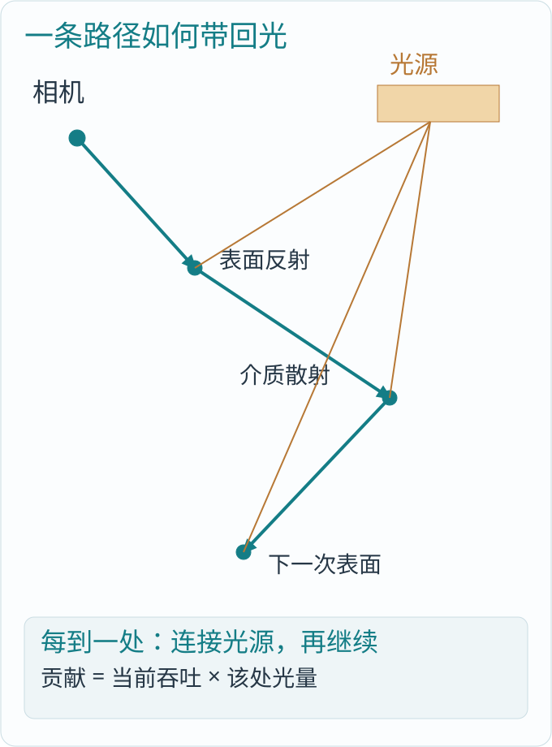

*图 16-1：每次到达事件都可连接光源；继续方向来自表面或相函数。透射改变介质，反射保留所在侧。*

### 16.2 integrate 的主干

`Programs/stella/transport.b::integrate` 为每个内部像素建立主命中与采样地址，再由 path_radiance 累计路径贡献。当前主循环按真实事件和俄罗斯轮盘推进，下面保留初始化及循环主干：

局部节选，外围未列出：`Programs/stella/transport.b:67`。

```b
    BLTransportState state=transport_begin(initial,initial_address,unsafe_read(media,initial.medium).ior);
    while(state.active){
        state=transport_step<N,G>(state,instances,surfaces,lights,distribution,candidates,cells,directions,guiding_cells,settings,media,
            environment,emitters,mesh_lights,mesh_domains,scene,overlay_scene,textures,floor_present,ground_z,ground,overlay_start,
            sample_round,roulette_start,maximum_survival,sampling,fill,include_initial_emission);
    }
```

`scatter_hit` 根据事件选择表面散射或体散射；`traverse_path` 查询下一次最近命中，并比较介质自由程；`hit_radiance` 处理环境、可见面光、体事件和普通表面照明。每一层的工作都有明确输入，而不是由一个巨大函数隐式保存全世界状态。

### 16.3 throughput 为什么要一路相乘

吞吐表示从当前路径顶点传回相机时应乘的比例。第一段乘 `.8`，第二段乘 `.5`，路径吞吐就是 `.4`；第三处收到光量十，对像素的贡献是四。

纹理、散射概率、界面透射、介质传播都可能影响这个乘积。若某一层重复乘入相同衰减，画面会无端变暗；若漏掉概率补偿，则可能产生错误能量。沿着 throughput 查每次乘法，是读光传输源码最有效的办法之一。

### 16.4 有限预算不等于完整实时 GI

当前传入 roulette_start 与 maximum_survival。达到起始顶点后，path_survival 依据吞吐和相对折射率计算继续概率；被选中继续的路径把吞吐除以该概率，补偿随机终止。路径还会在真实环境、吸收或无有效散射时结束，不能用旧的固定段数描述这段实现。

当前已有环境图分布、网格发光提议、直接候选和方向统计／引导等计算，路径消费实际提议与混合密度。视图历史、线性均值和可见性分别由明确消费者持有；候选复用不等于复用旧 RGB，也不等于独立样本数增加。完整时序重建、产品视觉与实时效率目标仍未完成。

## 第十七章 图像形成：线性光怎样变成屏幕像素

### 17.1 当前完整帧有两段设备计算

`Programs/render/frame.b` 的程序体很短：

程序体节选：`Programs/render/frame.b:26`。

```b
    radiance<N,W,H,S,DC,IC,Start,V,Shared,G>(pixels,display,instances,overlays,surfaces,cameras,lights,lighting,media,visible,distribution,candidates,candidate_round,cells,directions,guiding_cells,environment,emitters,mesh_lights,mesh_domains,
        parameters,scene,overlay_scene,textures);
    resolve<W,H,S,DC,IC>(pixels,display,overlays);
```

第一段由radiance组织integrate，计算可见性、材质、直接光与后续输运的线性辐亮度；resolve消费内部图像和叠加输入，合成为显示图像。这是当前两段设备程序的组织，不是说引擎只有两件事情。

数学意义上的求交、着色、散射等阶段，在第一段工作项内部通过函数和循环完成。它们没有必要各保存一张跨全屏中间图。源码章节的逻辑层次与 GPU dispatch 的数量应当分开理解。

### 17.2 超采样怎样合成一个像素

阅读案例最终 `3840×2160`，S 为二，内部 `7680×4320`。每个显示像素对应内部二乘二共四个样本；resolve 把这四份线性辐亮度相加后除以四。

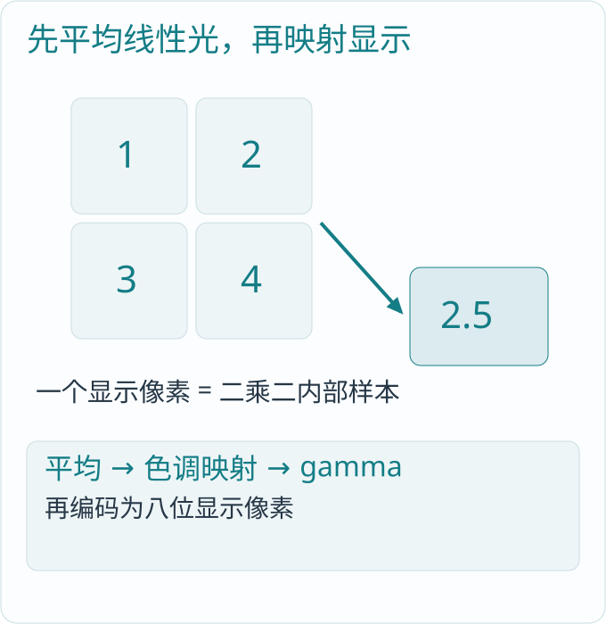

*图 17-1：先在线性光空间平均，再进行显示映射。一个显示像素对应四个内部样本，内部总工作量约为显示的四倍。*

若四个样本为一、二、三、四，平均为二点五。必须在非线性色调映射前平均；先分别压缩高光再平均，一般得不到相同结果。

### 17.3 高动态范围、显示映射与像素编码

resolve 对平均值执行 `radiance/(radiance+1)`，再取约为 `1/2.2` 的幂，将线性光压入显示范围。这是 Reinhard 形式的逐通道压缩加近似 gamma 编码，不是精确的分段 sRGB 传递函数。

随后转成八位通道并打包 BGRA。`BLRenderOutput::save` 下载显示结果，再取出 RGB 写成 PPM。PPM 文件是当前显示结果，不能拿它恢复原来的高动态线性光。

### 17.4 合成不是重新渲染三维模型

`render.composite::composite_at` 把光标、选区等矩形按 alpha 混合进结果，位置使用显示像素坐标。几何背景和覆盖关系由 rectangle 的语义决定。独立空间三维 overlay 则有自己的相机和 TLAS，和这些二维矩形不是同一件事。

当前没有完整透明排序、任意渲染图、运动矢量、时序抗锯齿和屏幕空间重建。二倍内部采样是当前明确的空间超采样输入，不应改称为时序超分辨率。

## 第十八章 执行：B 程序怎样成为真实 CPU/GPU 工作

### 18.1 并行的是数据域，不是主机回调

语言侧执行映像沿原ProgramLayout的DeviceRequirements交接f32／f64实际保留模式需求，BLRI48保存同一合同，GPU装入据此消费真实设备能力。程序数值需求归语言编译与运行库，场景和渲染算法仍归引擎；语言运行库在逻辑设备创建前，按程序已声明特性、计算队列及必要扩展确定默认物理设备；保留独显优先次序、同类沿驱动顺序，全部候选保留，显式选择仍保持原真实句柄。推送常量容量直接使用程序uniform_bytes的最大值，在创建前匹配候选已有物理属性，装入继续消费确定设备的容量；纹理描述符也在同一遍历按原数组元素合计、多程序取最大值，匹配候选已有stage／set的sampler和sampled image容量；装入在该调用内共用一次纹理总数。GPU设备创建借用实际将装入映像的ExecutionPlan，默认、显式物理设备与呈现入口共用该交接。阶段workgroup_width及发射后的shared_bytes分别按各阶段、各独立程序取最大值，直接匹配候选已有maxComputeWorkGroupInvocations／maxComputeWorkGroupSize[0]及maxComputeSharedMemorySize；不相加独立程序的宽度或共享存储。后续装入继续核对已确定设备的实际容量。同一创建遍历复用每个程序的texture_count，将实际普通及辅助storage binding数量与纹理数组元素总数求和，再按独立程序取最大组合数，直接匹配候选已有maxPerStageResources。combined image sampler每个数组元素计一项，AS不进入该项；不能将不同程序各自最大的storage与texture数量拼成不存在的布局。同一程序遍历只求一次普通buffers＋auxiliary_buffers的storage描述符数量，供该程序组合总数及独立storage最大值共用；多程序取最大storage数，在创建前同时匹配候选已有maxPerStageDescriptorStorageBuffers与maxDescriptorSetStorageBuffers。装入已有设备时在原入口一次求storage数，核对同样两项容量，并供组合资源总数复用。AS绑定数直接来自各程序accelerations，多程序取最大值；原AS物理属性并入创建前已有subgroup／float／sorting查询链，同次匹配maxPerStageDescriptorAccelerationStructures和maxDescriptorSetAccelerationStructures，再把同一属性移交原RayDevice。装入沿该设备已有属性核对相同两项容量，不再另查一次AS属性；没有改变原AS构建、完成和资源释放。语言运行库交付与引擎实际采用分别确认。

以相机产生的内部像素为例，`parallel(pixel in pixels)` 为每个像素分配工作，`index()` 给出它在数据域中的编号。每个工作项写自己的 pixel，读取共享场景、材质和图像。

Rust 不逐像素调用函数。其准备入口共享Compiler，通过构建图和build_entry取得或复用最终编译映像，再装入CPU代码／GPU管线，建立真实存储与绑定，再把整个计算域交给后端。CPU 后端生成原生 x64，GPU 后端生成 SPIR-V。`on compute` 的通用计算可以走 CPU 或 GPU；需要 acceleration 的 `on gpu` 程序使用 GPU 能力，不能据此假定整套渲染器也有同样的 CPU 路径。

### 18.2 常量参数与每次输入有什么区别

当前 frame 的 N、W、H、S、DC、IC、Start、V、Shared、G 为专门化参数，分别涉及纹理、输出与内部形状、轮盘起点、可见性记录、共享候选及引导配置；实际含义以公开接口为准。seed、sample_low／sample_high 等是本次采样输入，相机和材质等由实际资源绑定交付。

同规格输出能共享已编译程序，不同规格输出由 `create_output` 选择相应专门化程序。这比在每个像素里反复询问图像规格更直接，但不代表窗口尺寸变化已经完整实现。编译入口和窗口重建是不同职责。

### 18.3 阶段之间必须看到前一段的结果

frame 中 integrate 写 pixels，resolve 读 pixels。B 编译结果保存这些读写关系，执行框架在实际设备提交中组织阶段和内存可见性。只靠 CPU 先后调用两次函数，并不能自动证明 GPU 已完成前一份写入。

当前 `BLRenderOutput::submit` 的设备交接如下，draw 在同一提交接口上明确等待：

局部节选，外围未列出：`src/output.rs:286`。

```rust
        let mut bindings = inputs.frame_bindings(
            scene, pixels, display, overlays, cameras, visible, parameters,
        );
        input.bindings(inputs, scene, self, &mut bindings)?;
        let submitted = self.program.submit(bindings, &[])?;
        let (bindings, _, completion) = submitted.detach();
```

`Bindings` 汇合本次真正使用的数据集、加速结构和纹理。语言 SDK 的 TextureInput::{D2,D3} 可以交接相应原纹理，维度由计算入口合同消费；普通CPU纹理函数在源码／obj／lib中同样借用这些原资源描述，沿原调用及最后消费者保持存储；显式on cpu整域函数及其无源obj／lib也可沿原Frame同步借用这些纹理，原调用方保持到最后CPU消费者结束；GPU整域输入及GPU独立普通调用仍按语言台账建设。这些是语言资源接口，不能据此认定本书引擎代码已经采用新接口、接入Filmic LUT或完成效果验证。submit 交给设备；detach 交出绑定与独立完成观察，实际存储仍由最后使用关系持有。BLRenderSubmission 可以稍后等待，原场景来源无需被搬出再归还。显示或 CPU 读取须消费相应依赖，提交返回不能代替 GPU 完成。

### 18.4 布局由编译结果给出

CPU 的 Rust 结构体和 B 的设备结构体不应靠字段名字相同就假定内存相同。`Dataset::field_offset`、`stride` 和对应 view 布局给出实际打包位置，Rust 用它们写入数值位模式。

例如稳定身份是六十四位整数，B 用 `uint2` 的低高三十二位读取，不能转成 f32 再传递。浮点数无法精确表示任意大整数身份；看起来只是换了一个类型，实际会让不同对象混成同一个编号。

### 18.5 去哪里读编译器与后端

语言前端、检查、并行 IR、优化和 x64/SPIR-V 代码生成属于 `BLanguage/crates/blanguage/src`。CPU 原生执行在 `blcompute/src/cpu.rs`；GPU 执行与绑定在 `blcompute/src/vulkan/mod.rs`，实际完成点在 `vulkan/execution.rs`，加速结构在 `vulkan/ray.rs`，呈现在 `vulkan/present.rs`。

这些文件是引擎的基础依赖，不应复制进 BLEngine 再维护第二份。阅读引擎时先走到设备边界，确实需要理解底层执行时再进入语言工程。

## 第十九章 资源与 I/O：创建之后，谁负责把它用完

### 19.1 加载顺序不等于对象身份

多个模型可以并发读取，完成顺序却可能变化。`BLGeometryReads` 的结果带着实际资产编号 `(key,mesh)`；`BLGeometryStore::prepare` 按编号接收，不把第一个到达的结果误当成第一个 placement 的模型。

读取线程通过共享递增下标领取工作；`sync_channel(0)` 让已完成结果直接交给消费者，不建立一个无界模型积压队列。并发数来自调用者预算和实际文件数，没有任务就没有读取线程。

这解决的是并发来源交接。当前 `place` 仍消费本批全部必要来源后返回，不等于引擎能边显示不完整世界边自动做完整流送。

### 19.2 源顶点、构建输入和最终 AS 有不同寿命

模型文件解码后产生 CPU 网格，构建 BLAS 需要位置和索引的设备输入；构建完成后，这些临时输入可以结束使命，而最终 BLAS 必须保留。TLAS 引用 BLAS，在真正使用 TLAS 的 GPU 工作完成前，BLAS 不能被提前释放。

着色另需法线、UV、材质槽位和图像，它们沿实际绑定与只读 view 保持。不能因为 AS 构建完成，就把后续着色还要读取的属性一并释放。

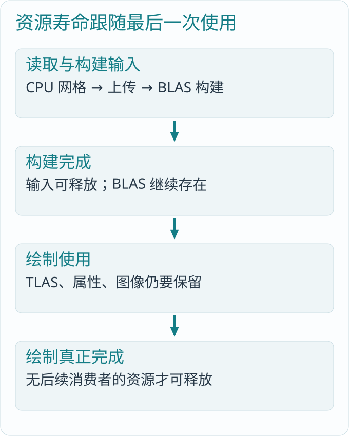

*图 19-1：CPU 调用返回、构建完成、绘制完成是不同时间点。释放跟随最后一个真实消费者。*

Blink 的 `ExecutionResources` 分别持有计算、传输和 AS 构建需要的原生资源；`Execution` 保存完成点和前置依赖，`GpuDataset.last_use` 记录实际最后使用。等待成功后释放已完成工作持有的资源，而不是按“这一帧的 CPU 循环结束了”猜测设备状态。

### 19.3 世界、输出和共享工作图像

世界拥有实例、材质、纹理和 AS；`BLRenderOutput` 拥有自己的显示图像、矩形与相机输入。当前同步绘制使用的内部线性 pixels 由 renderer 共享，不为每个输出复制一份无并行消费者的全屏工作图像。

因此多个相机可以共享世界和同规格程序，但各自需要独立显示图像。`render-views` 顺序导出时复用一份输出；`view-views` 为多个原生窗口各建输出。它们仍按顺序 draw，不是已经具备并发多视图调度。

### 19.4 内存数字要说明口径

数据记录数乘步长是逻辑容量；Vulkan 分配可能因页和对齐大于逻辑容量；驱动显示的总显存还包含别的资源。三个数字不能混报。

例如一张 4K 四字节显示图像约三十三 MB，内部 8K 的线性 pixels 又是另一份数据。共享世界不能在每个输出账上重复相加，也不能因为删除全屏中间命中数据，就宣称驱动总显存必然下降相同数量。

## 第二十章 窗口、输入与呈现：让图像成为应用的一帧

### 20.1 一个 UI 所有者处理整条消息队列

`BLWindowSystem` 注册原生窗口类，并处理创建线程的消息队列。每个 `BLWindow` 保存自己的导航、关闭状态和输入上下文。窗口不是各自偷偷启动一个消息循环；同一 UI 线程统一派发，事件携带实际窗口身份。

`poll_with` 的核心是：

局部节选，外围未列出：`src/window.rs:354`。

```rust
                let got = PeekMessageW(&mut message, std::ptr::null_mut(), 0, 0, 1);
                // PeekMessage会先派发非队列消息，其输入也交给原目标窗口的消费者。
                self.deliver(None, &mut input)?;
                if got == 0 {
                    break;
                }
                if message.message == 0x12 {
                    self.class.quit.set(true);
                    break;
                }
                DispatchMessageW(&message);
                if !self.deliver(Some(BLWindowId(message.window)), &mut input)? {
                    TranslateMessage(&message);
```

消费者处理某个窗口的按键，不应让另一个窗口丢失文字转换。Win32 还可能在调用中重入窗口过程，因此跨原生调用不能一直持有对同一状态的独占可变借用。这些是平台资源和回调的真实约束，不是三维算法。

### 20.2 三维计算与平台输入怎样衔接

导航窗口把方向键、滚轮变成 yaw、pitch、distance；文本窗口把文字、命令和输入法事件交给编辑器。相机计算仍在 B，编辑器命令与文档修改仍在消费方。不同应用可以共用引擎窗口设施，不必共用一套编辑业务状态。

最小化窗口不绘制；当全部窗口都没有绘制工作时，应用等待真实输入。关闭一个窗口只结束该窗口；线程级 WM_QUIT 则表示整个 UI 所有者的退出事实。

### 20.3 交换链并不拥有整个世界

`blcompute::vulkan::Swapchain` 消费原窗口句柄和显示数据。当前呈现把已完成显示结果送到实际交换链图像，再交给窗口系统。它不重新计算场景，不拥有编辑文档，也不能在窗口销毁后继续使用旧句柄。

`BLNativeView` 按交换链、输出、窗口的顺序保存字段，释放时先结束呈现相关资源，再销毁原生窗口。图形对象和窗口生命周期对齐，才有真实可用的多窗口应用。

### 20.4 DPI 和目标尺寸不是一回事

源码使用线程 DPI 上下文处理实际窗口和呈现边界，避免宿主进程的设置影响像素尺寸。当前阅读场景仍明确为 4K 输出、8K 内部采样。DPI 处理不代表支持任意动态 extent，也不应通过缩小目标绕过渲染规格。

当前有多窗口、原生输入和呈现，动态调整窗口尺寸、OutOfDate 重建和完整异步视图仍未完成。本章按源码分析窗口机制，离屏输出与交互窗口的实际验证分别记录。

## 第二十一章 模拟：计算更新和渲染更新为什么要分开

### 21.1 最小的动力学状态

`Programs/simulation/bodies` 保存位置、速度与能量。每步先由位置计算加速度，更新速度，再用新速度更新位置：

源码节选：`Programs/simulation/bodies.b:3`。

```b
void integrate_body<T: floating, const Power: u32 in {1, 2, 3}>(inout BLBody<T, Power> body, f32 dt, f32 strength) on compute {
    body.velocity += central_acceleration<Power>(body.position, strength) * dt;
    body.position += body.velocity * dt;
}
```

这属于半隐式 Euler 积分。若原速度为一、加速度为二、dt 为 `.5`，新速度为二，位置增加一。若改用旧速度更新位置，位置只增加 `.5`；两者不是单纯换行，而是不同数值方法。

`central_acceleration` 提供中心力场，当前软化长度平方为 `.25`，避免中心势在原点发散。这是该力场算法的实际参数，不是平台或语言边界；不能由这个例子推导出完整刚体物理。

### 21.2 并行更新与整体归约

每个 body 读写自己的状态，所以位置和速度更新可以并行。总动能却依赖所有 body，必须归约：

源码节选：`Programs/simulation/statistics.b:7`。

```b
void step_and_total(inout dataset<BLBody<float3, 3>> bodies, write dataset<BLTotal, 1> total, f32 dt, f32 strength) on compute {
    step(bodies, dt, strength);
    total_energy(bodies, total);
}
```

`step` 产生新状态与单体能量，`total_energy` 消费这些结果。B 把两类工作写在同一依赖顺序里，Rust 负责分配真实数据和连续提交。

一千二百步在这里表示物理时间演化，不是为了把跑分数字放大而无意义地重复同一个答案。dt 为 `1/120` 秒时，它模拟十秒；每一步的位置和速度都影响下一步。

### 21.3 当前一百万粒子的真实运行

同一源码与输入、同一初值、一千二百个时间步，Release 原生运行如下。CPU 路径为原生多核 B，GPU 路径使状态驻留设备并在一次提交内推进。


`total_ms` 包含各后端准备、执行、必要传输和输出写入，不包含共同的初值创建。按这一同口径范围，GPU 约为 CPU 的 **3.64 倍**。上行内部计时分别属于 CPU 墙钟和 GPU 时间戳，不能拿它替换同口径端到端加速比。

数值结果保留真实浮点差异，不能把近似相等写成逐位相同。并行归约顺序、后端计算和舍入都会影响末位；需要按算法用途分析误差，而不是把日志改成一致。

### 21.4 距离完整物理系统还有什么

刚体还需要质量与惯性、碰撞形状、宽阶段和窄阶段检测、接触生成、约束求解以及休眠等机制；软体和流体又有不同状态与求解器。当前源码只有这类基本粒子动力学、能量归约和通用网格查询，没有完整碰撞与约束系统。

渲染查询能回答一条射线命中哪个三角形，并不能直接替代连续碰撞、接触稳定性和动力学求解。把更新状态和观察状态分开，才能看清引擎下一步真正缺少哪种算法。

## 第二十二章 编辑器与软件宇宙：引擎怎样接入真实消费者

### 22.1 编辑状态不能搬进渲染器

`src/editor.rs` 加载 BLEditor DLL，通过既有 ABI 接收显示列表和三维字形摆放。文档、光标、排版、命令、插件和软件项目分析仍由编辑器拥有；引擎消费矩形、placement 和输入交接，不再次决定文本该怎样断行。

这和场景文件入口是两种来源。独立 `render/view` 不需要 BLEditor DLL；编辑器接入也不能为了获得某个通用渲染能力，把算法复制进消费方。

### 22.2 显示列表怎样变成几何实例

字形模型和度量由正式资产提供。`place_editor_scene` 将已有字形摆放转换成实例矩阵，正文、状态栏和独立空间使用各自明确输入。它不能用一条矩形代替真实三维字形，再把结果叫作产品渲染完成。

`BLFrame` 是跨 DLL 的临时借用，不能在消费方已经释放或更新后继续读里面的指针。`BLSnapshot` 和实际线程交接保存本次渲染所需数据；`BLPresented` 记录真正呈现结果。CPU 生产了一份显示列表，不等于 GPU 已经显示这一帧。

### 22.3 软件宇宙是消费者，不是通用场景的固定分类

`src/universe.rs` 消费软件项目分析结果，把节点、关系和标签转换成球体、连接几何与三维字形。节点到底代表包、源码单元还是资源集合，应由通用项目分析器决定；引擎只接收形状、变换和实际几何关系。

`Programs/scene/universe.b::place` 计算球和连接的变换。连接通过起终点差建立长度方向，再用叉积构造横向基，正是第二章矩阵知识在真实消费者中的运用。

### 22.4 当前拾取和通用网格查询是两条实际路径

软件宇宙当前 `scene.pick` 使用节点球和标签矩形做命中，再通过归约选择最近结果：

源码节选：`Programs/scene/pick.b:36`。

```b
void pick<const W:u32,const H:u32>(read dataset<BLNode> nodes, write dataset<BLResult,1> result,
             float3 eye, float3 right, float3 up, float3 forward, f32 tangent, float2 pointer) on compute {
    reduce_map(nodes.target,result.hit,bind(intersect<W,H>,eye,right,up,forward,tangent,pointer),no_hit,nearest);
}
```

`nearest` 对相同距离按节点编号排序，保证该选择规则明确。标签的矩形测试在屏幕空间，球的相交在三维空间，二者转换到同一相机射线距离后比较。

第六章的 `scene.query` 则查询真实三角形 AS。当前实现尚未把全部消费者选择迁移到通用网格查询；“引擎已有 API”不能写成“编辑器已经使用并完成”。

### 22.5 标签布局也有可读的算法代价

`scene.labels::project` 把三维中心投到像素，生成标签矩形；`choose` 为每个标签遍历其他标签，按优先级、深度与节点编号判断遮挡。它直观、容易分析，但最坏为平方级比较。

这里没有现成空间索引或完整标签优化器。阅读源码时要同时看“结果怎样得到”和“随着数据量增加，工作怎样增长”，不能把 `parallel` 当成算法复杂度已经消失。

## 第二十三章 从文件到一帧：实际编译与运行

### 23.1 先取得语言与引擎

Blink 的公开地址是 https://github.com/sgua83/Blink 。在准备放置两个工程的父目录执行：

```powershell
git clone `
  https://github.com/sgua83/Blink.git `
  BLanguage
```

BLEngine 当前需从其授权 P4 工程取得。可把 `BLanguage` 与 `BLEngine` 放在相邻目录便于阅读对照；现行已提交引擎的 Cargo 依赖读取 `C:/Program Files/Blink/crates` 中的已安装 SDK。当前公开仓库没有完整引擎源码，读者若只持有 Blink，可以阅读本书与案例，但不能执行下面的引擎构建。

在执行下面的 Cargo 命令前，先从 [GitHub Releases](https://github.com/sgua83/Blink/releases/latest) 下载并双击安装与所取得引擎源码匹配的 Windows x64 Blink 正式版，取得标准目录中的工具和源码 SDK。若还要从 Blink 主线源码构建编译器，其默认构建直接消费 `%ProgramFiles%/Blink` 的稳定 `bc`、`blink` 与 `VERSION`。先核对安装输入；书稿跟随开发主线，所用引擎源码的 SDK 要求以其对应版本为准。

再准备 Rust stable 的 MSVC 工具链与 Visual Studio C++ 桌面开发工具（x64 C++ 工具与 Windows SDK）。新开 x64 Developer PowerShell，在 BLEngine 根目录检查并构建：

```powershell
& "$env:ProgramFiles/Blink/bin/bc.exe" --version
& "$env:ProgramFiles/Blink/bin/blink.exe" --version
cargo build --release
.\target\release\blengine.exe device
```

Cargo 会构建所引用的 Blink 库和引擎，不需要额外的书籍启动器、命令别名或环境变量映射。GPU 渲染需要驱动实际提供 Vulkan 加速结构、光线查询及当前程序所用能力；引擎运行不依赖第三方着色编译器或 Vulkan SDK。

### 23.2 准备同一个阅读场景

以下命令均在 BLEngine 根目录执行。`Saved/Scene` 首次创建，之后沿用。

```powershell
New-Item -ItemType Directory `
  -Path Saved/Scene
Copy-Item `
  ../BLanguage/sample/engine/assets/* `
  Saved/Scene
.\target\release\blengine.exe cook `
  Saved/Scene/cube.obj `
  Saved/Scene/cube.blgeom
.\target\release\blengine.exe `
  cook-scene `
  Saved/Scene/reading.blscene.txt `
  Saved/Scene/reading.blscene
.\target\release\blengine.exe render `
  Saved/Scene/reading.blscene `
  Saved/Scene/frame.ppm
```

第一条转换读 OBJ 的原位置、法线和 UV，建立 BLGEOM；第二条建立节点和组件资产；最后一条加载场景、求值世界、建立资源、绘制并保存。可执行文件就是引擎的正式命令行程序，每个子命令完成一件明确工作。

### 23.3 真正执行的结果


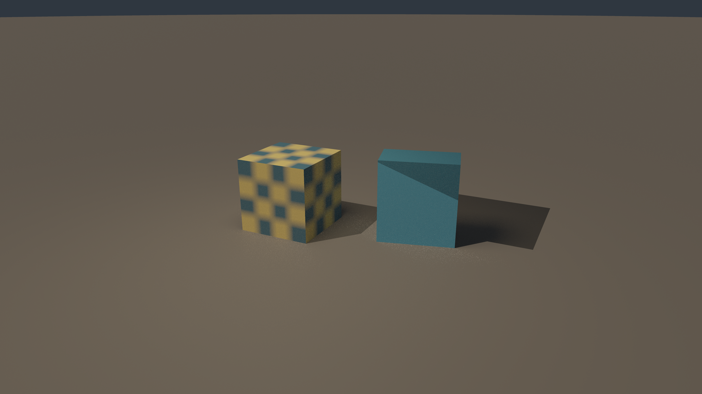

*图 23-2：当前源码原生 PPM 转换的完整 4K 输出。两个物体共用一个立方体模型；左侧使用棋盘表面，右侧选择蓝色表面。PDF 按页面缩放展示，配套 PNG 保留原分辨率。*

模型只有十二个三角形，这份画面用于观察关系与代码结果，不是超高精度字形、天然玉石或大型场景的品质与性能证明。

### 23.4 用第二台相机检查空间理解

```powershell
.\target\release\blengine.exe `
  render-views `
  Saved/Scene/reading.blscene `
  Saved/Scene/views
```

场景只加载一次，相机依次绘制到同一输出，文件名为camera-<节点下标>.ppm；设备程序、读回与文件输出分别计时。

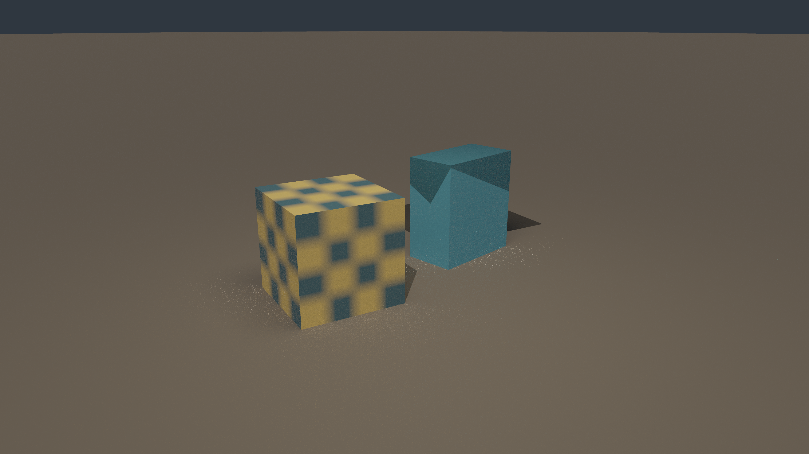

*图 23-3：相同世界从第二台相机观察，模型、材质和灯光没有为这张图另建一套。*

还可以执行 `blengine.exe view` 建立单窗口，或执行 `view-views` 为多相机建立多个窗口。这些入口的当前行为以真实源码和实际运行分别确认，离屏输出不代替窗口验证。

### 23.5 运行模拟并读取计时

```powershell
.\target\release\blengine.exe simulate `
  cpu 1000000 1200 `
  Saved/Scene/bodies-cpu.bldata
.\target\release\blengine.exe simulate `
  gpu 1000000 1200 `
  Saved/Scene/bodies-gpu.bldata
```

一百万是粒子数量，一千二百是物理步数，结果与计时见第二十一章。图像保存和模拟保存都是正式命令的输出，不需要把书籍目录当成另一套程序框架。

## 第二十四章 源码结构：按职责找到真正的入口

### 24.1 Rust 源码按所有者阅读

| 路径 | 负责什么 | 建议先读的入口 |
|---|---|---|
| `src/main.rs` | 正式命令与输入参数 | `run`、`cook` |
| `src/math.rs` | CPU 几何基础量 | `BLVec3`、`BLBounds` |
| `src/hierarchy.rs` | 节点源、身份和修改 | `BLScene`、`BLScenePrograms` |
| `src/components.rs` | 节点组件数据交接 | `BLComponentPrograms::evaluate` |
| `src/identity.rs` | 实例运行身份 | `BLInstanceId::new` |
| `src/geometry.rs` | 原模型与文件格式 | `read_obj`、`read_cooked` |
| `src/geometry_io.rs` | 并发几何来源 | `BLGeometryReads` |
| `src/scene_asset.rs` | 场景文件与源转换 | `read`、`write`、`cook` |
| `src/material.rs` | 材质读取与真实布局打包 | `BLPalette`、`BLAssignments` |
| `src/lighting.rs` | 光源描述与打包 | `BLLighting::datasets` |
| `src/scene.rs` | 几何驻留、实例和属性 | `BLGeometryStore::prepare` |
| `src/render.rs` | 世界设备资源与程序 | `place`、`draw_to` |
| `src/output.rs` | 显示图像和视图输入 | `draw`、`save` |
| `src/view.rs` | 输出规格与相机交接 | `BLRenderTarget`、`BLCameraPrograms` |
| `src/viewer.rs` | 独立场景运行 | `load`、`render_file`、`view_scene` |
| `src/window.rs` | 原生窗口、输入和消息泵 | `BLWindowSystem` |
| `src/editor.rs` | 编辑器 DLL 消费适配 | `view`、`place_editor_scene` |
| `src/universe.rs` | 软件宇宙结果适配 | `prepare`、`pick` |
| `src/labels.rs` | 标签到真实字形摆放 | `BLLabelPrograms` |
| `src/primitives.rs` | 消费者使用的程序化几何 | 球与连接模型构造 |
| `src/clipboard.rs` | 平台剪贴板 | Win32 文本交接 |
| `src/json.rs` | 现有消费协议解析 | JSON 值与解析器 |
| `src/lib.rs` | 库模块与公共导出 | 模块声明 |

主入口不是最大的文件。分析一个问题，应先找实际所有者，再追到计算核。例如世界矩阵错误先看节点源和 `hierarchy.resolve`；不要先去窗口呈现里修补画面。

### 24.2 B 源码按计算关系阅读

| 目录 | 主要实现 | 输入与输出 |
|---|---|---|
| `Programs/math` | 变换与中心力场 | 数学量到数学量 |
| `Programs/geometry` | 基本几何、命中法线 | 边与矩阵到法线 |
| `Programs/scene` | 层级、组件、相机、实例、查询、标签与消费方摆放 | 源节点到世界结果；光线到命中 |
| `Programs/material` | 纹理、GGX、介电、导体、介质与相函数 | 局部表面到响应、概率和方向 |
| `Programs/lighting` | 灯光、环境、可见发光体与采样 | 灯描述到方向和入射量 |
| `Programs/sampling` | 哈希、正交基、MIS | 路径键到样本与权重 |
| `Programs/stella` | 可见性、表面重建、光照、散射、遍历与有限输运 | 场景到线性辐亮度 |
| `Programs/render` | frame、合成和 resolve | 内部辐亮度到显示像素 |
| `Programs/simulation` | 动力学与总能量 | 上一时刻状态到下一时刻 |

每个模块通常以 `.h` 声明接口、以 `.b` 提供实现。先看输入、输出和调用关系，再看结构字段，能避免读完大量定义仍不知道它们为什么存在。

### 24.3 一帧的完整调用链

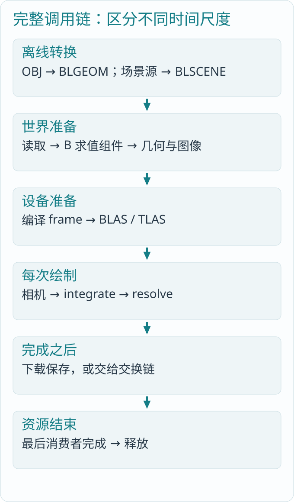

*图 24-1：离线转换、世界准备、每次绘制、保存呈现属于不同时间尺度。不能把所有步骤都算成每帧必须重复。*

沿 `main → viewer::render_file → load` 进入：读取资产、B 求值组件、编译 frame、建立材质图像、按实际缺少资产取得几何、建立 BLAS/TLAS。随后创建输出，B 计算相机，`draw_to → output.draw` 提交 integrate 与 resolve。完成后 save 下载显示图像；窗口路径则把显示数据交给交换链。

这条链解释了为什么设备时间戳不包含全部启动成本，也解释了为什么同一个世界、多次相机绘制不应每次都重新读模型和复制 BLAS。

### 24.4 注释、文档与实际代码的优先顺序

当前 scene_asset.rs 的 MAGIC、VERSION、源解析和写出共同定义 BLSCENE 8。阅读材料使用 BLSCENE_SOURCE 8，环境与补光各自声明；相机与材质的介质编号也按真实接口交付。格式字段应对照当前解析与写出源码。

源码分析同样不能只复述问题列表。每个能力应回到定义、调用者和原生执行范围：函数存在表示有实现，实际入口调用才说明接通，运行日志说明运行过，最终产品效果仍需对应场景验证。

## 第二十五章 完整引擎还需要哪些部分

### 25.1 先用全景图定位，再判断实现程度

| 领域 | 当前实现的实际位置与能力 | 仍未完成的主要部分 |
|---|---|---|
| 数学与变换 | 向量、矩阵、仿射、法线、相机基、射线 | 更广的数学工具与专门算法按实际需求补齐 |
| 场景与组件 | 森林、稳定运行身份、几何／相机／灯、独立 BLGpuScene 与 GPU 变换输入 | 完整设备自主更新、一般局部变更与需求驱动流送 |
| 可见性与查询 | 主射线、阴影、BLAS/TLAS、批量网格查询 | 独立场景剔除、遮挡层级、完整选择迁移 |
| 资产与几何 | OBJ、原精度 BLGEOM、自有场景和材质 | FBX、骨骼／动画导入、虚拟几何与完整流送 |
| 材质与纹理 | 基础色、粗糙度通道、切线法线、三类表面 | 材质图、完整分层模型、多库与热更新 |
| 光照与输运 | 解析灯、HDR 环境分布、网格发光、直接候选、方向引导与轮盘路径 | 完整时序重建、稳定实时 GI 与目标效率 |
| 体积 | 均匀吸收、自由程、HG 散射 | 异质密度场、自动区域、完整玉石外观 |
| 图像与后处理 | 空间超采样、色调映射、gamma 近似、矩形合成 | 运动矢量、时序重建、完整透明和后处理图 |
| 模拟与物理 | 粒子中心力场、积分、能量归约 | 刚体、接触约束、连续碰撞、软体与流体系统 |
| 平台与运行 | Windows x64、Vulkan、原生多窗口与输入 | 动态 extent、完整异步多视图及其他平台适配 |
| 编辑器消费 | DLL 显示输入、真实字形、宇宙与标签适配 | BLEditor 全部功能与最终效果恢复 |
| 动画与骨骼 | 当前无完整实现 | 轨道、混合、骨架、蒙皮、姿态与运动对应 |
| 音频与网络 | 当前无对应运行子系统 | 混音、空间声、连接协议、状态同步等 |
| 内容工具 | 几何与场景显式转换 | 完整编辑、资产数据库、打包与内容迭代工具 |

这张表的目的不是给每项打一个“支持”勾，而是让读者知道数据应该在哪里、现有代码承担了多少职责，以及缺口是否真的存在。

### 25.2 动画为何不是给矩阵加几个关键帧就结束

节点动画需要按时间采样平移、旋转与缩放轨道，解决插值和混合，再把结果交给场景层级。骨骼动画还要保存绑定姿态与逆绑定矩阵，让顶点按骨骼权重变形；蒙皮后的几何和法线必须进入实际渲染与加速结构更新。

当前节点可改本地矩阵，为接入动画提供了输入位置，但没有上述轨道、骨架和蒙皮实现。帧间运动还涉及历史表面对应；仅有稳定实例身份不能推导出顶点如何移动。

### 25.3 场景流送为何不是异步读文件就完成

完整流送需要由真实消费者产生需求，判断哪份几何和图像应驻留，完成读取、解码、上传和设备引用切换，再在最后消费结束后释放旧资源。若还涉及虚拟几何或纹理，还要处理页级地址和细节选择。

当前有并发几何来源、实际 GPU 页存储和异步资源完成关系，但没有完整需求驱动流送。B 适合表达工作集、优先级与数据计算，Rust 负责真实文件和设备资源；无须为了“像一个大引擎”另造第二份场景状态或常驻调度服务。

### 25.4 性能要回到算法和实际消费者

如果层级很深，先看祖先重复遍历；标签很多，先看平方级重叠比较；输运太贵，先分清主命中、阴影样本和后续段的工作；显存增长，先看哪个真实输出或在途消费者仍持有资源。

不能用降低内部采样、简化高精度模型或牺牲材质效果来冒充同画质优化。当前主要任务是完成通用引擎能力并恢复消费者的完整功能与效果，近期完整场景效率目标与长期六十帧目标分别记录；本书的一次简单场景计时不能替代产品结论。

引擎的整体感来自这些关系能够闭合：数学把几何放到正确位置，场景描述对象及其关系，光传输决定可见量，执行框架把计算交给真实设备，所有者让资源活到最后一次使用。读懂一个核心函数之后，再把它放回这张全景图，才算读懂它在引擎中的意义。

## 附录 A 源码节选与版本定位

正文节选对应当前源码，位置见现行源码索引；修订和原生运行历史只在P4双台账记录。

| 源码路径 | 定位 |
|---|---|
| `Cargo.lock` | 当前源码 |
| `Cargo.toml` | 当前源码 |
| `Programs/geometry/normals.b` | 当前源码 |
| `Programs/geometry/normals.h` | 当前源码 |
| `Programs/geometry/primitives.b` | 当前源码 |
| `Programs/geometry/primitives.h` | 当前源码 |
| `Programs/image/mean.b` | 当前源码 |
| `Programs/image/mean.h` | 当前源码 |
| `Programs/image/texture.b` | 当前源码 |
| `Programs/image/texture.h` | 当前源码 |
| `Programs/lighting/area.b` | 当前源码 |
| `Programs/lighting/area.h` | 当前源码 |
| `Programs/lighting/directional.b` | 当前源码 |
| `Programs/lighting/directional.h` | 当前源码 |
| `Programs/lighting/distribution.b` | 当前源码 |
| `Programs/lighting/distribution.h` | 当前源码 |
| `Programs/lighting/environment.b` | 当前源码 |
| `Programs/lighting/environment.h` | 当前源码 |
| `Programs/lighting/environment_field.b` | 当前源码 |
| `Programs/lighting/environment_field.h` | 当前源码 |
| `Programs/lighting/field.b` | 当前源码 |
| `Programs/lighting/field.h` | 当前源码 |
| `Programs/lighting/guiding.b` | 当前源码 |
| `Programs/lighting/guiding.h` | 当前源码 |
| `Programs/lighting/harmonics.b` | 当前源码 |
| `Programs/lighting/harmonics.h` | 当前源码 |
| `Programs/lighting/lights.b` | 当前源码 |
| `Programs/lighting/lights.h` | 当前源码 |
| `Programs/lighting/mesh.b` | 当前源码 |
| `Programs/lighting/mesh.h` | 当前源码 |
| `Programs/material/conductor.b` | 当前源码 |
| `Programs/material/conductor.h` | 当前源码 |
| `Programs/material/dielectric.b` | 当前源码 |
| `Programs/material/dielectric.h` | 当前源码 |
| `Programs/material/energy.b` | 当前源码 |
| `Programs/material/energy.h` | 当前源码 |
| `Programs/material/maps.b` | 当前源码 |
| `Programs/material/maps.h` | 当前源码 |
| `Programs/material/medium.b` | 当前源码 |
| `Programs/material/medium.h` | 当前源码 |
| `Programs/material/microfacet.b` | 当前源码 |
| `Programs/material/microfacet.h` | 当前源码 |
| `Programs/material/opaque.b` | 当前源码 |
| `Programs/material/opaque.h` | 当前源码 |
| `Programs/material/palette.h` | 当前源码 |
| `Programs/material/phase.b` | 当前源码 |
| `Programs/material/phase.h` | 当前源码 |
| `Programs/material/scattering.h` | 当前源码 |
| `Programs/material/surface.b` | 当前源码 |
| `Programs/material/surface.h` | 当前源码 |
| `Programs/material/textured.b` | 当前源码 |
| `Programs/material/textured.h` | 当前源码 |
| `Programs/math/angles.b` | 当前源码 |
| `Programs/math/angles.h` | 当前源码 |
| `Programs/math/field.b` | 当前源码 |
| `Programs/math/field.h` | 当前源码 |
| `Programs/math/scalar.b` | 当前源码 |
| `Programs/math/scalar.h` | 当前源码 |
| `Programs/math/transform.b` | 当前源码 |
| `Programs/math/transform.h` | 当前源码 |
| `Programs/render/composite.b` | 当前源码 |
| `Programs/render/composite.h` | 当前源码 |
| `Programs/render/frame.b` | 当前源码 |
| `Programs/render/frame.h` | 当前源码 |
| `Programs/render/instance.h` | 当前源码 |
| `Programs/render/parameters.h` | 当前源码 |
| `Programs/render/probe_frame.b` | 当前源码 |
| `Programs/render/probe_frame.h` | 当前源码 |
| `Programs/render/receiver_frame.b` | 当前源码 |
| `Programs/render/receiver_frame.h` | 当前源码 |
| `Programs/render/receiver_history.b` | 当前源码 |
| `Programs/render/receiver_history.h` | 当前源码 |
| `Programs/render/resolve.b` | 当前源码 |
| `Programs/render/resolve.h` | 当前源码 |
| `Programs/sampling/counter.b` | 当前源码 |
| `Programs/sampling/counter.h` | 当前源码 |
| `Programs/sampling/direction.b` | 当前源码 |
| `Programs/sampling/direction.h` | 当前源码 |
| `Programs/sampling/frame.b` | 当前源码 |
| `Programs/sampling/frame.h` | 当前源码 |
| `Programs/sampling/mis.b` | 当前源码 |
| `Programs/sampling/mis.h` | 当前源码 |
| `Programs/sampling/random.b` | 当前源码 |
| `Programs/sampling/random.h` | 当前源码 |
| `Programs/sampling/reservoir.b` | 当前源码 |
| `Programs/sampling/reservoir.h` | 当前源码 |
| `Programs/scene/camera.b` | 当前源码 |
| `Programs/scene/camera.h` | 当前源码 |
| `Programs/scene/components.b` | 当前源码 |
| `Programs/scene/components.h` | 当前源码 |
| `Programs/scene/device.b` | 当前源码 |
| `Programs/scene/device.h` | 当前源码 |
| `Programs/scene/hierarchy.b` | 当前源码 |
| `Programs/scene/hierarchy.h` | 当前源码 |
| `Programs/scene/instance.h` | 当前源码 |
| `Programs/scene/labels.b` | 当前源码 |
| `Programs/scene/labels.h` | 当前源码 |
| `Programs/scene/motion.b` | 当前源码 |
| `Programs/scene/motion.h` | 当前源码 |
| `Programs/scene/pick.b` | 当前源码 |
| `Programs/scene/pick.h` | 当前源码 |
| `Programs/scene/query.b` | 当前源码 |
| `Programs/scene/query.h` | 当前源码 |
| `Programs/scene/surface.b` | 当前源码 |
| `Programs/scene/surface.h` | 当前源码 |
| `Programs/scene/transforms.h` | 当前源码 |
| `Programs/scene/universe.b` | 当前源码 |
| `Programs/scene/universe.h` | 当前源码 |
| `Programs/simulation/bodies.b` | 当前源码 |
| `Programs/simulation/bodies.h` | 当前源码 |
| `Programs/simulation/statistics.b` | 当前源码 |
| `Programs/simulation/statistics.h` | 当前源码 |
| `Programs/spatial/bounds.b` | 当前源码 |
| `Programs/spatial/bounds.h` | 当前源码 |
| `Programs/spatial/keys.b` | 当前源码 |
| `Programs/spatial/keys.h` | 当前源码 |
| `Programs/stella/cached_transport.b` | 当前源码 |
| `Programs/stella/cached_transport.h` | 当前源码 |
| `Programs/stella/guiding.b` | 当前源码 |
| `Programs/stella/guiding.h` | 当前源码 |
| `Programs/stella/history.b` | 当前源码 |
| `Programs/stella/history.h` | 当前源码 |
| `Programs/stella/lighting.b` | 当前源码 |
| `Programs/stella/lighting.h` | 当前源码 |
| `Programs/stella/probe_volume.b` | 当前源码 |
| `Programs/stella/probe_volume.h` | 当前源码 |
| `Programs/stella/probes.b` | 当前源码 |
| `Programs/stella/probes.h` | 当前源码 |
| `Programs/stella/receiver_sampling.b` | 当前源码 |
| `Programs/stella/receiver_sampling.h` | 当前源码 |
| `Programs/stella/receiver_shading.b` | 当前源码 |
| `Programs/stella/receiver_shading.h` | 当前源码 |
| `Programs/stella/receiver_statistics.b` | 当前源码 |
| `Programs/stella/receiver_statistics.h` | 当前源码 |
| `Programs/stella/receiver_transport.b` | 当前源码 |
| `Programs/stella/receiver_transport.h` | 当前源码 |
| `Programs/stella/receivers.b` | 当前源码 |
| `Programs/stella/receivers.h` | 当前源码 |
| `Programs/stella/reproject.b` | 当前源码 |
| `Programs/stella/reproject.h` | 当前源码 |
| `Programs/stella/scattering.b` | 当前源码 |
| `Programs/stella/scattering.h` | 当前源码 |
| `Programs/stella/surface.b` | 当前源码 |
| `Programs/stella/surface.h` | 当前源码 |
| `Programs/stella/termination.b` | 当前源码 |
| `Programs/stella/termination.h` | 当前源码 |
| `Programs/stella/transport.b` | 当前源码 |
| `Programs/stella/transport.h` | 当前源码 |
| `Programs/stella/traversal.b` | 当前源码 |
| `Programs/stella/traversal.h` | 当前源码 |
| `Programs/stella/visibility.b` | 当前源码 |
| `Programs/stella/visibility.h` | 当前源码 |
| `Programs/stella/volume.b` | 当前源码 |
| `Programs/stella/volume.h` | 当前源码 |
| `src/clipboard.rs` | 当前源码 |
| `src/components.rs` | 当前源码 |
| `src/editor.rs` | 当前源码 |
| `src/environment.rs` | 当前源码 |
| `src/geometry.rs` | 当前源码 |
| `src/geometry_io.rs` | 当前源码 |
| `src/gpu_scene.rs` | 当前源码 |
| `src/guiding.rs` | 当前源码 |
| `src/hdr.rs` | 当前源码 |
| `src/hierarchy.rs` | 当前源码 |
| `src/history.rs` | 当前源码 |
| `src/identity.rs` | 当前源码 |
| `src/image.rs` | 当前源码 |
| `src/json.rs` | 当前源码 |
| `src/labels.rs` | 当前源码 |
| `src/lib.rs` | 当前源码 |
| `src/lighting.rs` | 当前源码 |
| `src/main.rs` | 当前源码 |
| `src/material.rs` | 当前源码 |
| `src/math.rs` | 当前源码 |
| `src/mesh_lighting.rs` | 当前源码 |
| `src/motion.rs` | 当前源码 |
| `src/output.rs` | 当前源码 |
| `src/primitives.rs` | 当前源码 |
| `src/probes.rs` | 当前源码 |
| `src/receiver_statistics.rs` | 当前源码 |
| `src/receivers.rs` | 当前源码 |
| `src/render.rs` | 当前源码 |
| `src/scene.rs` | 当前源码 |
| `src/scene_asset.rs` | 当前源码 |
| `src/surface.rs` | 当前源码 |
| `src/texture_import.rs` | 当前源码 |
| `src/universe.rs` | 当前源码 |
| `src/view.rs` | 当前源码 |
| `src/viewer.rs` | 当前源码 |
| `src/visibility.rs` | 当前源码 |
| `src/wic.rs` | 当前源码 |
| `src/window.rs` | 当前源码 |

## 附录 B 阅读练习与答案

1. 子节点先沿本地 x 平移二，父节点再绕 z 轴旋转九十度，子节点原点在父旋转后的哪里？答案是 `(0,2,0)`；若把父旋转与子平移交换，则是 `(2,0,0)`。这正是乘法顺序的作用。

2. 透视相机一条射线与 forward 成六十度，沿射线 t 为十时，前向深度是多少？答案是五；当前 near/far 是沿线区间，不能直接按相机深度平面理解。

3. 同一个模型分别使用棋盘和蓝色材质，应复制哪份资源？不复制 BLAS 和原三角形；两个实例保存各自材质选择，并引用相应槽位表。

4. 把一个已经删除节点的槽位交给新节点，旧 ID 是否仍有效？无效；槽位相同而运行身份不同，不能把新对象当成旧对象。

5. 路径当前吞吐为 `.4`，本次散射返回 weight 为 `.25`，新吞吐是多少？答案是 `.1`；若下一处收到光量二，累计贡献为 `.2`，不再额外除同一 PDF。

6. 四十七毫秒的 GPU 帧程序能否证明完整编辑器帧率？不能；离屏案例不是完整产品，设备计时也不包含全部应用工作。

7. 有 `set_transform` 就有骨骼动画吗？没有。还需轨道、骨架、蒙皮、几何更新及真实接入。

## 附录 C 许可与运行材料

BLEngine 源码节选遵守 MIT License，版权和完整许可见 `engine/BLEngine-LICENSE.txt`。数学推导、执行图与解释服务于源码阅读；示意图不冒充产品运行截图。

`engine/assets` 提供正式阅读输入。P4双台账保留实际构建、命令、输出和图像历史。主视图与侧视图由真实完整 PPM 转换，未拼接或重新绘制模型。

本书的 Markdown 与两种中文版 PDF 同步保存在项目 sample 目录。手机阅读版采用单栏、大字号与纵向图示；标准版保留适合桌面阅读和打印的页面宽度。
