# BLEngine 源码分析

## 从一帧图像读懂场景、算法与资源的协作

面向读者：会写 C/C++ 或 Rust，读过前两本书，希望能够独立阅读、理解并扩展一个真实引擎的人。

版本：2026 年 10 月 25 日。分析基线为 BLEngine P4 CL12969，执行基础为 Blink P4 CL12971。

阅读引擎源码，最容易迷失的地方是文件很多，而每个文件都只解释一小段事情。看完一个矩阵函数，仍不知道谁调用它；读懂一个 shader，仍不知道它使用的数据从哪里来。真正的理解，需要把这些局部重新接成一条完整的因果链。

本书从一个实际运行的场景出发：一份立方体几何、两个实例、两种材质、两台相机。沿着它进入资产、场景、几何驻留、材质、光照、Stella 命中、图像输出与原生窗口，再回到编辑器适配和通用计算。

第一本书学习并行思考，第二本书学习 Blink 与 Rust 的组合。这一本把视角放大到整个 BLEngine：为什么某种数据在这里产生，为什么由这个对象拥有，又为什么应当在这个时刻移交或释放。

### 本书使用怎样的源码

引擎仍在演进。本书固定已提交版本，节选以函数和数据关系为单位，调整换行，省略与当前主题无关的重复打包和错误文案。原有变量名、主要分支、资源归属和必要边界保持；节选中的省略不代表修改正式引擎。

BLEngine 当前以 P4 主线 //BLEngine/main 管理；Blink 的公开仓库提供语言、前两本书以及本书和配套场景：

[https://github.com/sgua83/Blink](https://github.com/sgua83/Blink)

sample/engine 保存阅读案例输入、源码版本索引与本次原生记录。正文已包含主要代码节选，阅读不要求登录 P4；执行引擎命令则需要对应的 BLEngine 源码检出和相邻 Blink 工程。

本书的源码分析不等于完整引擎已经交付。当前已能组织独立场景、直接光、纹理和硬件光线查询；Stella 的完整 GI、反射、历史重用及重建仍在开发。书中会在实际调用位置说明其范围。

### 阅读路线

| 阶段 | 章节 | 阅读目标 |
|---|---|---|
| 看见全局 | 1-2 | 建立源码地图，跟完一次真实运行 |
| 找到输入 | 3-7 | 资产、节点、变换、驻留与材质怎样形成 |
| 跟进一帧 | 8-12 | 从光线和命中走到最终图像 |
| 追到底层 | 13-15 | 执行基础、窗口和编辑器怎样配合 |
| 独立分析 | 16、附录 | 判断成本、版本变化与扩展位置 |

## 1　先读地图：三个工程与六类对象

### 1.1　项目边界是第一张地图

BLEngine 并不自己重新实现全部技术栈。它消费独立 Blink 工程中的编译器与执行框架；同时作为独立引擎，为 BLEditor 等应用提供场景和图像能力。

| 工程 | 正式职责 | 阅读入口 |
|---|---|---|
| Blink | B 语言、编译与 CPU/GPU 执行 | crates/blanguage、crates/blcompute |
| BLEngine | 场景、资产、渲染与通用计算消费者 | src/lib.rs、src/main.rs |
| BLEditor | 文档、编辑、命令、排版和应用语义 | 既有核心协议，由适配器消费 |

因此，追到 device.compile 时，应进入 Blink；追到节点挂接和材质绑定时，仍留在 BLEngine；追到字符如何换行时，则应回到编辑核心。


*图 1-1　箭头表示真实消费方向，不表示工程目录的父子关系。*

### 1.2　不要只按扩展名分类

同一个功能常常横跨 Rust 和 B。以相机为例，src/view.rs 拥有描述、输出规格和程序实例；Programs/scene/camera.b 计算视图基与光线。材质同样横跨文件加载、表绑定和 B 的数值求值。

有用的阅读单位是“一个责任完整的数据过程”。先理解相机如何从节点变成主光线，再分别研究其中的 Rust 和 B，能避免把两种语言读成互不相干的世界。

### 1.3　六类对象，各有不同寿命

| 对象 | 例子 | 寿命与用途 |
|---|---|---|
| 资产内容 | BLMesh、BLPalette | 读取并解码正式输入 |
| 逻辑场景 | BLScene | 持有节点与组件的可修改事实 |
| 求值结果 | BLSceneEvaluation | 从当前场景派生本次世界结果 |
| 共享渲染世界 | BLSceneRenderer | 持有实际几何、材质与设备资源 |
| 输出 | BLRenderOutput | 持有某个目标的图像及命中数据 |
| 执行所有者 | Submission、Completed | 持有一次实际设备使用及完成关系 |

这些对象不能只按“都是场景数据”合并。比如输出需要在渲染世界释放后仍能保存最后图像；逻辑节点又不能变成 GPU 缓冲的一个临时别名。

### 1.4　第一次浏览源码的顺序

先读 main.rs 的命令分派，再读 viewer.rs 的 load 和 render_file，随后打开 render.rs 与 output.rs，最后进入 render/frame.b。这个顺序只需几个文件，就能找到从命令行到图片的骨架。

此后再沿参数反向阅读 scene_asset.rs、hierarchy.rs、scene.rs 和 material.rs。骨架已经知道，每个局部函数就能找到自己的位置。

### 1.5　源码关系与运行事实

一个函数存在，说明有对应实现；入口编译通过，说明当前静态检查与代码生成完成；原生运行日志说明某条具体路径真的执行过。它们分别回答不同问题。

本书会同时使用三种证据：固定版本源码解释责任，编译描述解释布局与实际阶段，原生图片和日志解释本次输入发生了什么。遇到尚未实现的目标，仍保留其未完成状态。

## 2　跟完一次运行：从 render 到 PPM

### 2.1　先准备一个能反复读的场景

配套阅读案例有一份十二三角形的立方体原模型，两个几何实例和两台相机。左侧实例使用棋盘纹理，右侧实例使用蓝色表面，并带有非统一缩放与旋转。地面和光源由场景显式提供。


*图 2-1　BLEngine CL12969 原生输出 3840×2160，内部采样 7680×4320。图为基础直接光、面光采样、纹理与阴影，不代表最终天然材质验收。*

场景只有两个几何实例，但足以观察共享几何、独立材质、一般仿射、层级、多个相机和显示输出。简单输入能够帮助我们把每一份资源数清楚。

### 2.2　编译已有引擎源码

Windows x64 环境需要 Rust stable MSVC、Visual Studio C++ 桌面开发工具和提供相应 Vulkan 能力的显卡驱动。两个工程采用相邻目录：

```text
workspace/
  BLanguage/
    crates/blanguage/
    crates/blcompute/
    sample/engine/
  BLEngine/
    src/
    Programs/
    Cargo.toml
```

在 x64 Developer PowerShell、BLEngine 根目录执行：

```powershell
cargo build --manifest-path `
    ../BLanguage/Cargo.toml `
    --workspace --release
cargo build --workspace --release
.\target\release\blengine.exe device
```

CPU 计算不要求创建 Vulkan 设备；本章渲染使用硬件 ray query，还需要相应加速结构与光线查询能力。无需外部 Shader 编译器或 Vulkan SDK。

cargo build 编译 Rust 引擎和它依赖的 Blink 库；生成的 blengine.exe 负责加载场景，调用 Blink 编译 B 算法并组织执行。device 参数查询实际设备。后文均直接使用生成的 exe 路径。

### 2.3　用正式入口构建场景

以下命令只处理本书的小模型，不涉及字体生成器或产品资产：

```powershell
New-Item -ItemType Directory `
    -Path Saved/SourceReading | Out-Null
Copy-Item `
    ../BLanguage/sample/engine/assets/* `
    Saved/SourceReading

.\target\release\blengine.exe cook `
    Saved/SourceReading/cube.obj `
    Saved/SourceReading/cube.blgeom
.\target\release\blengine.exe cook-scene `
    Saved/SourceReading/reading.blscene.txt `
    Saved/SourceReading/reading.blscene
.\target\release\blengine.exe render `
    Saved/SourceReading/reading.blscene `
    Saved/SourceReading/frame.ppm
```

Saved/SourceReading 目录在首次操作时创建；后续直接沿用。PPM 可用支持该格式的图像工具打开。书中的 PNG 由实际 PPM 转换而来，保留完整视野。

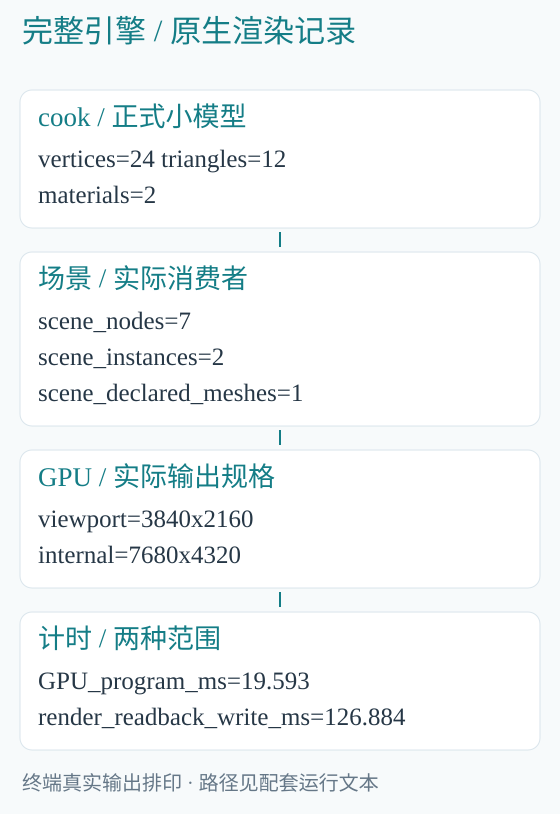

*图 2-2　终端记录排印；采集使用固定源码的独立构建，输出路径另列于运行记录。*

### 2.4　main.rs 只负责选择入口

命令分派将 render 交给 viewer::render_file；真正的加载顺序在 viewer.rs。其主线可以读成：

```text
读取 BLSceneAsset
→ 求值 BLScene
→ 创建 BLSceneRenderer
→ place 实际几何
→ 创建 BLRenderOutput
→ draw_to
→ output.save
```

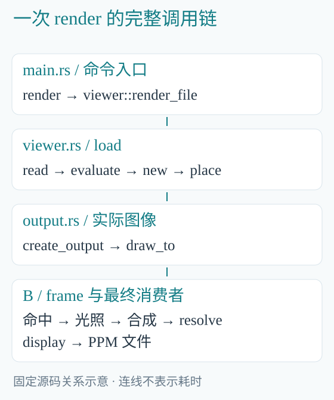

*图 2-3　场景只读取一次，计算结果沿真实消费者向前交接。*

### 2.5　load 没有把所有工作塞进构造函数

viewer::load 的前半部分：

```rust
let asset = BLSceneAsset::read(source)?;
let mut programs_owner =
    BLScenePrograms::new(programs);
let evaluated = programs_owner
    .evaluate(&asset.scene)?;
```

随后根据实际世界光源构造 BLLighting，再创建渲染器。renderer.place 接收本次 placements 和几何加载闭包。闭包只处理渲染器真正请求的资产编号，稍后由 BLGeometryReads 按完成顺序交付。

这几个步骤分别拥有不同结果。读取文件建立逻辑场景，求值得到世界结果，place 才创建该次世界实际需要的几何资源。

### 2.6　render_file 明确拥有输出

```rust
let mut output = renderer
    .create_output(asset.target)?;
let timings = renderer.draw_to(
    &mut output,
    &BLView {
        camera,
        ground: asset.ground,
        overlay: None,
    },
)?;
output.save(out)?;
```

render_file 中的计时从 draw_to 前开始，直到 save 完成；它不包含此前的场景读取、创建渲染器与 place。理解这个计时范围，是源码分析的一部分。

本次 GPU 程序为 19.593 ms，draw、读回和写文件合计 126.884 ms。不能把后者叫作纯渲染内核，也不能把前者换算成完整应用帧率。

## 3　资产入口：文件内容怎样变成引擎对象

### 3.1　离线转换与运行加载分开

geometry.rs 的 read_obj 解析输入 OBJ，cook 调用它并写出 .blgeom；运行场景则明确读取二进制几何。转换是一次显式资产操作，运行入口不会发现缺文件后自动重新转换。

同样，cook-scene 将 .blscene.txt 转成 .blscene。文本格式便于人编辑，二进制保存明确的版本与结构。二者共同服务一个正式运行模型。

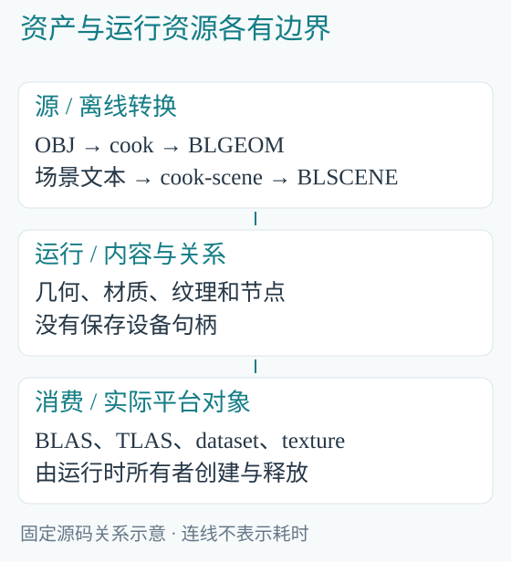

*图 3-1　文件保存内容与关系；设备句柄在运行时由真实所有者创建。*

### 3.2　OBJ 的一个位置可能对应多个顶点

read_obj 使用一个组合键：

```rust
let key = (pi, ti, ni);
```

pi 是位置索引，ti 是可选 UV 索引，ni 是法线索引。只有三者相同，才共用同一个展开顶点。

立方体的角在空间中只有八个位置，却有二十四条展开顶点记录：同一位置在三个面上使用不同法线。若只按位置去重，硬边会被错误地合并；若忽略 UV，纹理接缝也会丢失。

本书模型 cook 后的二十四顶点、十二三角形正来自这一规则，没有增加面数来美化图像。

运行记录中的 materials=2 统计源材质组表：解析器保留初始 default 组，模型再声明 book surface 组。实际三角形使用后者；组表长度不等于已经画出的两种实例材质数。

### 3.3　几何格式保存什么

BLGEOM v2 保存边界、全部顶点、三角形和材质组名。顶点保留 position、normal 和可选 UV；三角形保存三个顶点编号与源材质组编号。

这个编号不是 GPU 中某个全局 surface 的编号。共享模型可以被两个实例指定不同材质，因此源几何只保留自己的组关系。

### 3.4　文件布局不等于 GPU 布局

场景中的相机文件记录使用紧凑编码；B 的相机 dataset 有自己的对齐与字段偏移。两者的字段含义相同，物理存储并不因此相同。

Rust 通过 Dataset::new、field_offset 和 stride 按实际编译布局打包。文件读取器按正式格式解码，GPU 绑定再按程序接口创建；这两个职责不应合成一次任意的指针转换。

### 3.5　路径相对于谁

场景中的 materials 和 mesh 路径相对最终 .blscene 文件所在目录；材质中的纹理路径相对 .blmat 所在目录。

所以案例把 reading.blmat、checker.bltex 和 cube.blgeom 放在同一个输出目录。移动场景包时，内容关系仍可随目录一起迁移，不需要把某台开发机的绝对路径写进格式。

### 3.6　外部输入边界应放在哪里

文件读取器负责版本、索引及完整性，场景构造负责有效父关系，最终平台实例入口负责 Vulkan 矩阵要求。节选源码时，可以略去重复错误文案；这些真实交接责任仍然存在。

反过来，一个已经解码的模型进入着色函数后，不需要每次读取法线都重新解析文件头。边界放在实际输入和所有权交接处，内部主干才会清楚。

## 4　场景：身份、组件与派生结果

### 4.1　BLScene 不是渲染器的一张缓存表

hierarchy.rs 的 BLScene 拥有 slots 和 free。节点持有父关系、本地矩阵以及可选 mesh、camera、light；它表示可以持续修改的世界内容。

```rust
pub struct BLSceneNode {
    parent: Option<BLNodeId>,
    local: [f32; 12],
    mesh: Option<BLSceneMesh>,
    camera: Option<BLCameraDescription>,
    light: Option<BLLight>,
}
```

同一个节点可以同时拥有不同组件。实现没有规定“相机节点永远不能有灯光”，也没有为每种组件另造一套全局节点身份。

### 4.2　节点身份为什么包含代际

```rust
pub struct BLNodeId {
    index: u32,
    generation: u64,
}
```

index 指向场景槽位，generation 区分这个槽位的不同使用时期。删除节点后，原槽位可以复用；旧 ID 不能因此指向新节点。

文件中的节点下标也不是运行 ID。保存时只导出存活节点，压紧后的文件引用重新映射；加载则在新场景中建立新的身份。


*图 4-1　保存只保留当前内容；运行代际不承担跨文件加载的持久身份。*

### 4.3　重挂的语义要从源码读出来

set_parent 在确认父链不成环后，只改 parent：

```rust
self.node_mut(id)?.parent = parent;
```

它保留本地矩阵。因此，把一个对象从父 A 挂到父 B，通常会改变世界位置。如果业务要求“换父但保持世界位置”，调用者需要显式交付相应的新 local，不能仅凭函数名猜测语义。

### 4.4　删除子树由谁决定

BLScene::remove 让 B 的 descendants 根据父链计算成员，再由 Rust 删除对应节点、增加代际并回收槽位。数值关系计算和对象生命周期在同一过程里协作。

B 不负责从 Rust 容器中释放节点；Rust 也没有为每一种场景操作维护另一棵世界树。

### 4.5　evaluate 是一次求值

components.rs 将当前节点、局部相机和灯光打包，B 先求 worlds，再变换组件，最终交付 BLSceneEvaluation。它包含 placements、节点到世界相机的映射和世界光源。

这些是本次输入的派生结果。修改节点后，调用者显式重新求值；不能把旧 evaluation 当成仍会自动变化的场景。

### 4.6　沿案例数清组件

阅读案例有七个节点：一个 rig、两个几何、两个相机和两盏灯。几何路径表只有一项。运行日志的 scene_nodes=7、scene_instances=2、scene_declared_meshes=1 分别数的是不同对象。

看清这些数量的来源，比把它们统称为“场景里有几个物体”更有用。后面的数据集长度、加载请求和资源成本都来自实际消费者。

## 5　空间计算：从节点矩阵到相机光线

### 5.1　3×4 仿射矩阵承载什么

本地矩阵按三行排列，每行四个数。左侧 3×3 表达旋转、缩放和剪切，最后一列表达平移。父矩阵乘子矩阵，把子空间的点送到更高一层空间。

Programs/scene/hierarchy.b 的 resolve 为每个输出沿父链组合，不要求先得到父节点的 worlds 输出。因此不同节点的输出可独立展开；同一条父链内部仍按依赖推进。

```c
float3x4 matrix=node.local;
while (node.has_parent) {
    node=unsafe_read(nodes,node.parent);
    matrix=compose_affine(
        node.local,matrix
    );
}
world.matrix=matrix;
```

节选省略外围 active 分支。父索引和无环结构来自场景所有者，循环不靠任意深度上限终止。

### 5.2　同一矩阵，点和方向的不同输入

camera.eye 和 target 使用 w=1，up 使用 w=0。灯光位置与面光半边也遵守相同规则：位置受平移，方向和边不受平移。

这不是两个不同的变换系统，而是仿射乘法的两个不同输入。读 components.b 时先确认 w，就能理解大部分组件变换。

### 5.3　法线为什么使用逆转置

法线必须始终垂直于表面切向。若线性矩阵 A 将切向 t 变为 A*t，法线就应按 transpose(inverse(A)) 变换，才能保留两者的垂直关系。

举例：原切向 (1,-1,0)，原法线 (1,1,0)，内积为零。沿 x 放大两倍后，切向为 (2,-1,0)。若法线也直接沿 x 放大，得到 (2,1,0)，已经不垂直；使用逆转置得到 (.5,1,0)，内积重新为零。

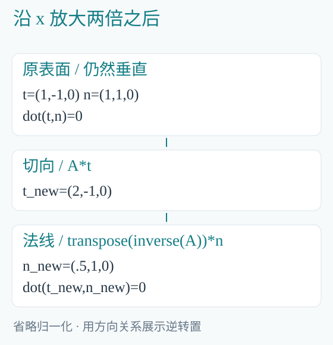

*图 5-1　向量省略归一化，以整数和小数直接展示垂直关系。*

真实代码位于 scene/transforms.b：

```c
float3x3 linear=float3x3(
    matrix.r0.xyz,
    matrix.r1.xyz,
    matrix.r2.xyz
);
return transpose(inverse(linear));
```

一般 affine 入口准备法线矩阵；编辑器专用 glyph 入口已知采用正统一缩放，保留原法线方向，无需创建没有消费者的矩阵表。这个取舍来自具体输入语义。

### 5.4　相机描述与相机基分开

Rust 的 BLCameraDescription 保存 eye、target、up、span、projection、near、far；B 的 camera_basis 将其变成正交基：

```c
float3 forward=normalize(target-eye);
float3 right=
    normalize(cross(forward,up));
float3 camera_up=cross(right,forward);
```

描述适合场景存储和编辑；基适合频繁产生光线。BLCameraPrograms 复用已编译的 look_at 或 orbit，Rust 只交付输入和接收结果。

### 5.5　一个像素怎样变成一条光线

stella.visibility::pixel_ray 将内部采样下标换成屏幕坐标，像素中心加 0.5，横向乘实际宽高比，再交给 camera_ray。

透视相机的光线原点相同，方向随像素变化；正交相机方向相同，原点随像素变化。scene/camera.b 的分支直接表达这一点：

```c
if (camera.projection==1) {
    return BLRay(
        camera.eye+offset,
        camera.forward
    );
}
return BLRay(
    camera.eye,
    normalize(camera.forward+offset)
);
```

span 对透视表示垂直半视角正切，对正交表示半高。分析轨道相机和缩放行为时，应沿这个定义读源码，不能把它直接当作角度。

## 6　几何驻留：从原模型到共享 BLAS

### 6.1　place 接收实例，加载器接收缺口

BLSceneRenderer::place 首先整理本次 placements，再调用几何存储准备实际缺少的内容。加载闭包接收 Vec<u32> 资产编号，返回带编号的模型结果迭代器。

在本书案例中，两条 placement 都引用资产 0。实例数量为二，几何来源需求只有一份。共享从这个实际引用关系开始。

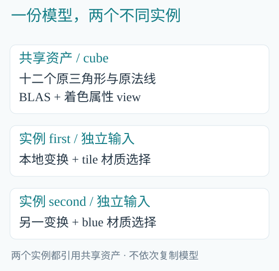

*图 6-1　BLAS 提供求交，着色 view 提供属性；每条实例仍有自己的变换与材质选择。*

### 6.2　prepare 同时处理保留与新增

scene.rs 的几何存储先 retain 当前使用的资产，再按 asset 与材质绑定组合统计需求。已经存在的模型复用；新增模型或新增真实 UV 消费者才请求来源。

```rust
let used: BTreeSet<_> = keys.collect();
self.assets.retain(
    |key, _| used.contains(key)
);
```

这个映射保存的是仍有消费者的资源，不是所有曾经见过的历史模型。清理一个资产引用也不代表仍在设备执行中的资源立即销毁，最后使用点继续负责真实寿命。

### 6.3　硬件求交与着色属性分流

BLAS 构建使用原位置与原三角形顶点索引。着色侧则保存法线索引、源材质组、必要 UV 和共享法线。

```rust
let model = unsafe {
    device.bottom_level(
        &positions, &indices
    )
}?;
```

它们消费同一个模型，但需要不同字段。GPU 着色无需再存一份只为求交服务的位置数组；BLAS 构建也不需要纹理坐标和材质名。

### 6.4　法线共享按什么标准

实现用原 f32 位表示作为共享键：

```rust
let key = v.normal.to_array()
    .map(f32::to_bits);
```

完全相同的法线可共享；没有量化、近似合并或改变法线值。三角形记录保存三个法线索引和源组编号，共十六字节；法线记录按当前布局为十六字节。

同样，UV 以每个原三角形的三个坐标保存，尊重原接缝。省去无消费者的数据，和降低几何精度，是性质不同的操作。

### 6.5　实例的 view 怎样接到来源

shading 函数为每个实例装配 triangles、normals、texcoords 和 materials 的 ViewBinding。来源采用只读共享所有权，clone 不复制全部几何。

```rust
views.push(ViewBinding {
    record: ordinal as u32,
    field: "triangles",
    source: asset.triangles.clone(),
});
```

根记录与实际来源一起交给 upload_with_views。B 读取 view 时，不只拿到一个碰巧可用的地址；存储的实际消费者关系也随资源保留。

### 6.6　I/O 的完成顺序不改变实例顺序

BLGeometryReads 用有限数量的 Rust 工作者读取文件，通过零容量通道交接。它按完成顺序返回 (key,mesh)，几何存储按 key 放回正确资产位置。

较小模型先完成，不会让原本的第二个模型变成第一个实例。源表编号、到达次序与 TLAS 实例编号分别承担不同职责。

析构时先关闭接收端，再 join 工作者，使阻塞发送能够结束。它没有另建常驻读取服务，也没有把消费者已经结束的工作继续积压。

## 7　材质绑定：从组名走到真实纹理

### 7.1　三个名字空间不要混在一起

OBJ 的 usemtl 名称属于源几何；.blmat 的 surface 名称属于材质库；B 的 surface 编号属于当前实际绑定表。

同一个几何组可在两个实例中选择不同 surface。若把全局 surface 编号写回共享三角形，修改一个实例就会污染其他实例，因此当前实现把选择放进实例的 materials view。

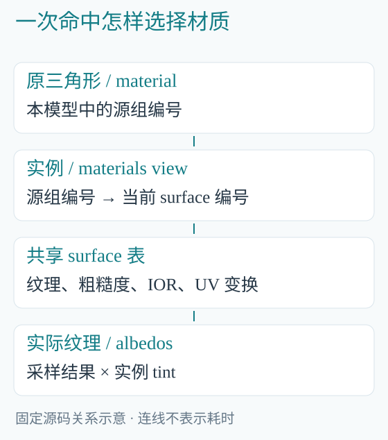

*图 7-1　共享三角形保存原组号，实例表负责选择当前 surface。*

### 7.2　Asset、Solid 与 Groups 各做什么

```rust
pub enum BLMaterialBinding {
    Asset,
    Solid(String),
    Groups(BTreeMap<String,String>),
}
```

Asset 使用库内明确声明的 geometry 规则；Solid 为当前实例统一选择一个命名表面；Groups 按完整源组名映射。未知名称直接报告，Asset 不是名称错误时改用的结果。

本书 first 采用 Asset，对应 tile；second 采用 Solid("blue")。两个实例共享原模型，surface、纹理和粗糙度选择却不同。

### 7.3　从 BLPalette 到程序专门化

BLPalette 读取真实纹理和 surface。渲染器根据纹理数 N 与输出规格选择具体 frame<N,W,H,S,DC,IC>，再创建对应资源。

本案例有三张纹理：一张文件棋盘图、蓝色常量图和地面常量图。常量颜色同样采用明确的 1×1 纹理输入，因此材质计算可以沿同一采样接口使用它们。

### 7.4　名字解析结束，GPU 只读紧凑数据

Rust 在绑定处把组名和 surface 名解析成实际编号。B 中的主线为：

```c
u32 group=unsafe_read(
    instance.triangles,hit.primitive
).material;
u32 material=unsafe_read(
    instance.materials,group
).surface;
BLSurface surface=
    unsafe_read(surfaces,material);
```

GPU 不需要在每次命中时搜索字符串，也不需要解析材质文本。文件系统名称和设备计算编号在正确的边界完成交接。

### 7.5　UV 是否驻留，由真实使用决定

文件纹理需要源 UV，常量色纹理不需要。几何存储汇合该 asset 当前全部实例的 UV 需求：只要仍有一个实际纹理消费者，原 UV 就需要保留。

最后一个消费者消失后，当前引用解除；旧提交仍持有的资源等真实设备使用结束后释放。需求恢复时再由原加载器取得属性，而不是常驻保存一份“以后可能使用”的 CPU 模型副本。

案例中的 first 让共享立方体产生 UV 需求；second 自己不读 UV，但不能据此释放 first 仍在使用的坐标。

### 7.6　读取后还保留哪些 CPU 内容

上传完成后，BLPalette::into_assignments 消费 palette，留下名称映射、默认组绑定、纹理使用语义及 ground 编号。CPU 图像负载不再因一个无用的 palette 副本长期保存。

需要长期持有的，是后续真实消费者仍会用到的内容。一个加载对象的生命周期结束，并不等于它产生的设备纹理也必须结束。

## 8　Stella 总览：一帧为什么拆成四段

### 8.1　先看当前入口的正文

CL12969 的 render/frame.b 按以下顺序组织：

```text
visibility → hits
illuminate(hits) → pixels
composite(pixels,hits) → pixels
resolve(pixels) → display
```

surface_sample 是照明中的局部求值函数，没有另写一张完整内部表面图。源码分工对应实际数据关系，而不是每个概念都分配一个全屏附件。

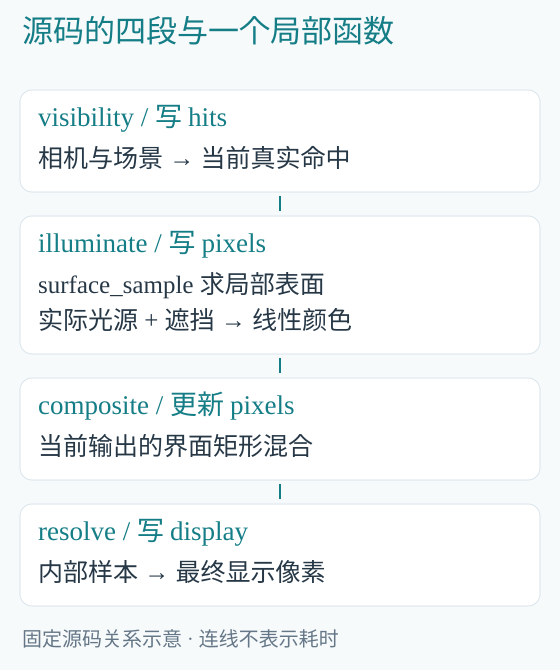

*图 8-1　四段源码目前生成三个执行阶段；照明和界面合成在当前编译结果中融合。*

### 8.2　分开以后，哪个阶段不再需要相机

可见性需要相机和实际输出形状；照明只需当前命中、场景属性和光源。它不再重新生成主光线，也不再依赖 W、H、S 来恢复命中位置。

这样的接口使下一步间接光和复用有明确的共同输入，但接口存在并不说明这些后续算法已经完成。

### 8.3　阶段数要从编译结果读取

在固定版本中检查实际入口：

```powershell
..\BLanguage\target\release\blc.exe check `
    Programs/render/frame.b Programs `
    'frame<3,3840,2160,2,8294400,33177600>'
```

参数依次为纹理数 N、宽 W、高 H、每轴倍率 S、显示数量 DC 和内部数量 IC。末两项来自 W*H 与 W*H*S*S，属于实际输出形状。案例的三个执行域为 hits、pixels、display。

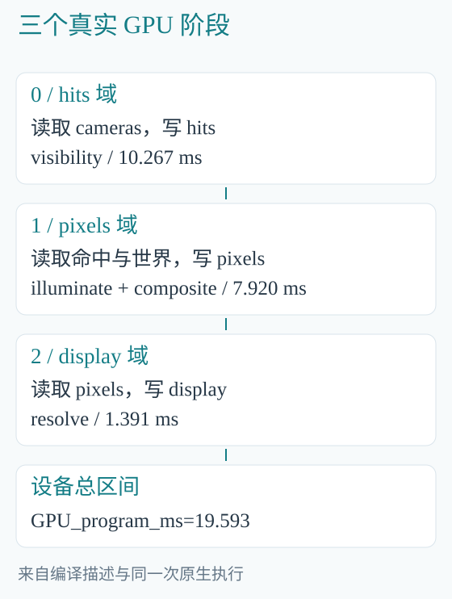

*图 8-2　布局与阶段来自 blc 描述，毫秒来自本次原生渲染。源码阶段数不固定物理内核数。*

### 8.4　拆开也要支付存储成本

命中现在完整写入 BLStellaHit，下一阶段再读它。内部 8K 的约三千三百万样本，每条四十八字节，仅命中原始数据就约 1.59 GB。

这是新接口当前支付的真实成本。它为数据解耦提供基础，却不能据此宣称减少带宽或提高帧率。后续有效域、局部生产消费与复用，必须沿真实需求继续优化。

### 8.5　Stella 当前具备什么

当前已有共同可见性、局部材质求值、直接光、遮挡、界面合成和显示输出。完整 GI、反射、体散射、稳定运动关系、世界缓存、视图历史与重建仍未实现。

阅读 Docs/Stella.md 时，把“已实现的共同数据切片”与后面的总体设计分开。后面的设计规定未来应如何共同工作，不是当前每个模块已经存在的清单。

## 9　可见性：一次真实命中交付哪些事实

### 9.1　从最接近的交点开始

visibility.b 的 closest_hit 同时考虑解析地面和硬件几何。先用平面方程求地面距离，再用 trace_closest 取得几何最近命中，选择有效范围内更近的结果。

```c
f32 distance=(ground_z-ray.origin.z)
    / ray.direction.z;
```

这行位于 floor_present 且 direction.z!=0 的算法分支中。平行于地面的光线没有这个平面交点，不能把分支删除后仍称同一算法。

### 9.2　命中记录保存本次计算事实

```c
struct BLStellaHit {
    float3 position;
    u32 instance;
    float3 incoming;
    u32 primitive;
    float2 barycentric;
    f32 distance;
    u32 kind;
};
```

position 和 incoming 分别占据两个十六字节区域中的十二字节，余下位置容纳 instance 与 primitive；后十六字节保存重心、距离和 kind。实际 stride 为四十八字节。

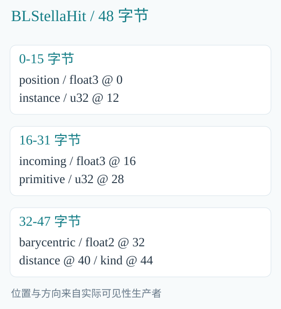

*图 9-1　命中属于当前输出、当前实例绑定，不是跨帧稳定的场景身份。*

### 9.3　为何保留 position 和 incoming

理论上，可以由原点、方向和距离重新计算位置。但如果下一内核重新生成主光线，浮点求值路径可能与实际求交时不同。

Docs/Issues.md 记录了这一具体演进：初版较小命中记录只交距离和引用，重新计算后出现像素差异；随后由原可见性生产者直接交付实际位置和入射方向，保持原结果。

这个修正把事实留给真正的生产者，没有增大误差阈值或在消费者重做一套近似计算。记录变大，则是它当前需要支付的存储成本。

### 9.4　instance、primitive 和重心如何配合

instance 选择当前着色实例，primitive 选择该实例引用的原三角形，barycentric 给出三角形内部位置。三者连起来，才能找到正确法线、UV 和材质组。

若硬件实例表与着色实例表顺序不一致，就算每个下标都在范围内，也可能取到另一件物体的属性。因此它们由同一次 placement 装配保持对应。

### 9.5　独立空间不能只比较距离

kind 的当前含义是：0 无命中，1 世界地面，2 世界几何，3 独立界面空间几何。

有第二台空间相机时，visibility 分别求交；独立空间实际命中会覆盖当前结果并标记为 3。其 instance 加入 overlay_start，使后续仍能访问共同着色表。

两个空间的相机和距离定义不同，不能把它们的 distance 直接比较大小。这个选择表达的是空间合成语义，不是一次全世界深度排序。

### 9.6　当前命中不是历史

每次绘制可以覆盖 hits。当前 instance 下标也会随 place 改变；保存它并不能自动得到运动向量或上一帧对应关系。

稳定表面身份、运动和视图历史需要正式的生产消费关系。当前命中数据为后续提供基础，但源码中尚不存在的历史系统不能由字段名字推断出来。

## 10　表面与直接光：沿命中读到颜色

### 10.1　surface_sample 没有重新求交

stella/surface.b 从 BLStellaHit 开始，按 kind 选择几何或地面。几何命中读取实例、原法线、材质槽位和必要 UV；地面使用法线 (0,0,1) 和 ground 表面。

surface_sample 返回一个局部 BLStellaSurface，包含位置、法线、观察方向、颜色、粗糙度和 IOR。它在当前消费过程中使用，不额外保存一张完整内部材质图。

### 10.2　重心插值尊重源属性

真实法线插值为：

```c
f32 u=barycentric.x;
f32 v=barycentric.y;
return normalize(
    n0*(1.0-u-v)+n1*u+n2*v
);
```

UV 使用同样权重，但无需 normalize。插值之后，法线再按该实例的逆转置矩阵变换并归一化。

着色读取的是模型原法线。表面是否平滑，由源顶点的独立法线关系决定，不能在运行时把立方体的硬边误当成法线错误而平均掉。

### 10.3　纹理采样与实例颜色

真实主线是：

```c
uv=uv*surface.uv_scale+surface.uv_offset;
float3 color=texture_sample(
    unsafe_read(albedos,surface.texture),
    uv,surface.lod
).xyz*tint;
```

surface.texture 的有效关系来自材质绑定入口。uses_uv 为假时不读取源 UV；地面有纹理需求时使用世界 xy。观察方向使用 -hit.incoming，因为 incoming 指向表面，而 view 指向观察者。

### 10.4　光源样本交付方向与权重

lighting/lights.b 将不同光源转成统一 BLLightSample。方向光直接给出反向传播方向与能量；点光根据位置差求方向，并按平方距离衰减；聚光再乘锥形出射分布。

面光以两条半边确定面积和朝向。半边为 u、v，面积为 4*length(cross(u,v))，当前权重包含投影面积与平方距离衰减：

```c
f32 projected_area=4.0*dot(
    cross(light.edge_u,light.edge_v),
    -direction
);
factor*=projected_area;
```

案例的面光朝下。翻转半边之一，会改变出射朝向，而不只是改变图像坐标方向。

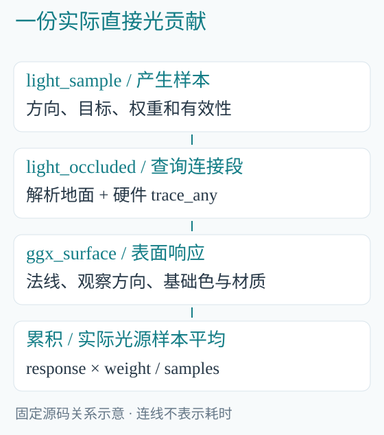

*图 10-1　光源权重包含源侧几何因素，ggx_surface 已包含表面入射余弦。*

### 10.5　阴影光线只查询真正的连接段

light_occluded 先将起点沿法线偏移，再对本地光源从这个实际起点重新连接 target。远端不超过光源距离，所以光源后面的物体不会遮挡这一次连接。

解析地面也参与遮挡；有几何需求时调用 trace_any。空连接和空区间没有遮挡段，相关分支属于光线积分含义。

### 10.6　直接光怎样累加

direct_lighting 遍历实际 light dataset 和各光源的样本。每个有效、未遮挡样本增加：

```c
result += ggx_surface(
    normal,view,incoming.direction,
    color,roughness,ior
)*incoming.weight/f32(light.samples);
```

案例的面光 samples=4，表示用四个位置估计这盏面积光的积分，有明确算法意义。它不是为制造较大计时而重复绘制四次。

当前仍逐内部像素遍历光源与样本，尚未实现大场景光源筛选或波前路径工作队列。增加灯光数量会增加真实计算，不能只看 GPU 并行度就忽略这一成本。

### 10.7　background、fill 与 GI 的差别

无命中使用 background；有效命中使用 direct + color*fill。fill 是明确的辅助项，不查询周围场景，也不传播其他物体的反弹光。

棋盘和蓝色表面在本次图片中出现，说明纹理、直接光与遮挡路径实际执行；它们不能证明已有色溢、镜面反射或玉石内部散射。

## 11　合成与显示：从线性光到屏幕字节

### 11.1　屏幕矩形为何留在引擎边界

composite.b 消费调用者交付的 BLOverlay：rectangle、color 和 background。它只做屏幕合成，不解释选区、光标或终端单元格的业务意义。

同一个矩形协议可以用于多个应用。业务决定矩形是什么，引擎决定如何将它混入当前图像。

### 11.2　前景与底色有不同覆盖条件

普通前景矩形可覆盖该区域；background 矩形只在对应空间没有实体几何时参与合成。若使用独立界面空间，判断改用 kind==3，避免世界背景与界面实体混淆。

混合公式保持直观：

```c
radiance =
    radiance*(1.0-overlay.color.w)
    + overlay.color.xyz*overlay.color.w;
```

原矩形坐标属于输出像素，内部采样坐标先除以 S。于是内部采样倍率变化时，矩形仍覆盖同一个实际输出区域。

### 11.3　resolve 的三个任务

第一，按实际 S×S 内部样本求平均；第二，将线性 radiance 映射为显示范围；第三，打包成 u32 BGRA。

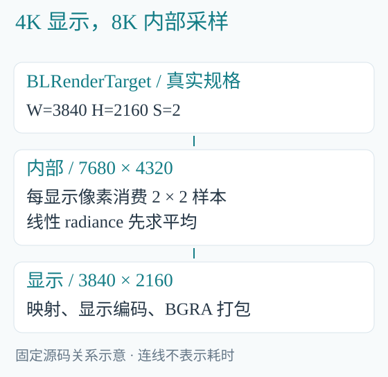

*图 11-1　S 是每轴倍率；S=2 时，一个显示像素消费四个内部采样。*

本书的 4K 输出使用内部 8K，这两个分辨率是不同层次。显示像素少于内部样本，不代表几何被简化或内部计算按 4K 执行。

### 11.4　颜色映射属于 B 的正式算法

当前 resolve 使用 radiance/(radiance+1)，随后进行指数显示编码，并把结果舍入至字节范围。Rust 保存文件时只拆开已经生成的 BGRA，不再运行另一份显示公式。

这也说明为何不能随意删除 max、clamp 或颜色分支：有些条件定义算法与格式。删掉它们可能改变输出，不能统一叫作“清除冗余校验”。

### 11.5　PPM 与窗口消费不同结果形式

save 下载 display，然后写出 RGB PPM。窗口呈现则让交换链消费设备 display。两条路径共享渲染算法，却有不同的最后消费者。

离屏渲染的 readback_write_ms 包含下载和文件写入；窗口路径不能用这项时间代表实际呈现耗时。讨论性能时，应先说清最后一个消费者是谁。

## 12　输出所有权：十个绑定怎样交接

### 12.1　渲染器拥有世界，输出拥有图像

BLSceneRenderer::new 创建共享世界及程序，不隐含创建默认图像。调用者通过 create_output 取得实际 BLRenderOutput。

同初始规格的输出共享编译程序，不同规格会专门化自己的 frame。程序共享并不等于图像共享，每个输出都需要自己的实际像素和命中存储。

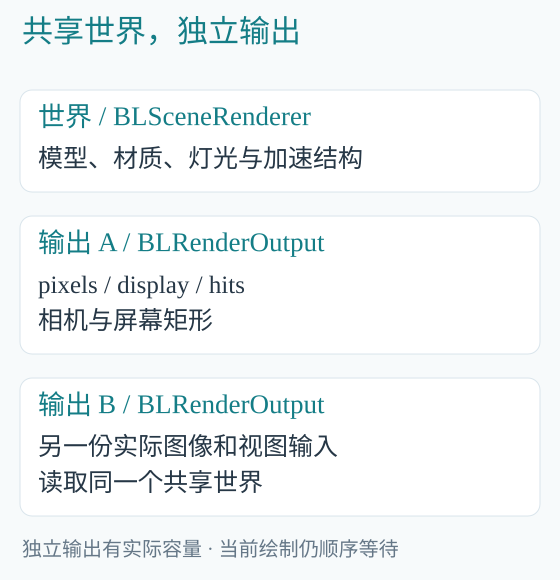

*图 12-1　世界更新不会改写另一输出已经完成的图像；当前 draw_to 仍顺序等待。*

### 12.2　当前 frame 的普通数据绑定

| 绑定 | 内容 | 长期所有者 |
|---|---|---|
| 0 | pixels | 当前输出 |
| 1 | display | 当前输出 |
| 2 | instances | 渲染世界 |
| 3 | overlays | 当前输出 |
| 4 | surfaces | 渲染世界 |
| 5 | normal_matrices | 渲染世界 |
| 6 | cameras | 当前输出 |
| 7 | lights | 渲染世界 |
| 8 | lighting | 渲染世界 |
| 9 | hits | 当前输出 |

此外还有两个 acceleration 槽位和 N 张纹理。它们属于资源绑定，却不是 Vec<GpuDataset> 中的普通记录。省略独立空间时，两项加速结构可以共享同一实际对象。

### 12.3　提交前移动拥有者，不复制图像

output.rs 先取出自己的数据：

```rust
let mut datasets =
    std::mem::take(&mut self.data);
let hits = datasets.remove(4);
let cameras = datasets.remove(3);
let overlays = datasets.remove(2);
datasets.append(&mut inputs.data);
datasets.insert(3, overlays);
datasets.insert(6, cameras);
datasets.push(hits);
```

self.data 中的容器顺序和 program 的绑定顺序不同，所以装配时重新排列。移动的是持有 GPU 存储的 Rust 对象；像素和几何并没有因此复制一遍。

### 12.4　真实完成后归还资源

submit 消费 datasets、加速结构和纹理所有者，wait 等待实际完成。完成对象拆开后，output.rs 把 0/1/3/6/9 归还输出，其余普通数据归还渲染世界。

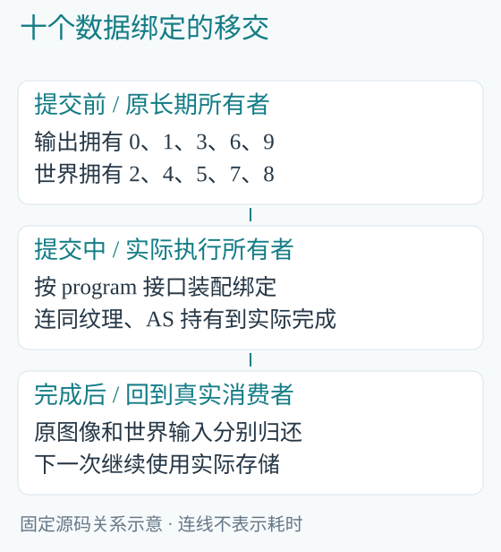

*图 12-2　CPU 容器交接不等于设备执行结束，释放仍遵守真实完成点。*

draw_to 在移动世界输入前检查逻辑设备归属。这是实际资源边界：同一张物理显卡上的两个 Vulkan 逻辑设备，也不能任意互用它们的缓冲。

### 12.5　先估算输出成本，再选择常驻数量

内部 hits 每样本四十八字节，pixels 每样本十六字节，display 每显示像素四字节。4K／每轴两倍采样的三项约为 1.59 GB、0.53 GB、0.033 GB。

另有相机、矩形和物理分配开销。增加三个同规格常驻输出，不会复制整个世界，却仍会增加三份独立图像成本。逻辑字节、Vulkan 分配和驱动总显存也不能混报。

### 12.6　多个相机不一定需要多张常驻图像

render_views 先创建一份 output，按相机依次 draw_to、save。世界加载一次，图像存储也复用一次；每个文件仍保存各自完整结果。

```powershell
.\target\release\blengine.exe render-views `
    Saved/SourceReading/reading.blscene `
    Saved/SourceReading/views
```


*图 12-3　同一世界从另一相机观察，仍为 3840×2160 输出、7680×4320 内部采样。*

原生记录得到 scene_views=2，两个视图 GPU 程序累计 46.026 ms，绘制、读回和写文件累计 249.602 ms。它们是两个视图的合计，不是单帧平均帧率。

## 13　执行基础：引擎怎样消费 Blink

### 13.1　编译器并没有藏在渲染器里

Cargo.toml 的两个路径依赖是 blanguage 与 blcompute。前者负责模块、检查、IR、优化和目标代码；后者负责存储、传输、原生执行与完成后的释放。

BLEngine 编写主要算法和实际消费者，调用 compile_entry 选择具体程序。需要改进寄存器分配或 SPIR-V 编码时，应回到语言工程；需要改变光照模型时，则修改引擎 B 模块。

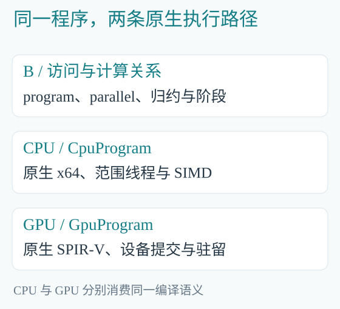

*图 13-1　编译与平台执行属于 Blink，场景与算法消费者属于 BLEngine。*

### 13.2　计算入口证明引擎不依赖编辑器

main.rs 的 simulate 加载 simulation/statistics.b，创建粒子和能量记录，CPU 使用 CpuProgram，GPU 使用 submit_steps。它不读取 .blscene，也不加载 BLEditor DLL。

一百万粒子演化十秒的命令：

```powershell
.\target\release\blengine.exe simulate `
    cpu 1000000 1200 `
    Saved/SourceReading/bodies-cpu.bldata
.\target\release\blengine.exe simulate `
    gpu 1000000 1200 `
    Saved/SourceReading/bodies-gpu.bldata
```

源码 dt=1/120 秒，所以 1200 个时间步恰为十秒。每一步使用前一步更新后的状态，不是对同一输入做统计重复。

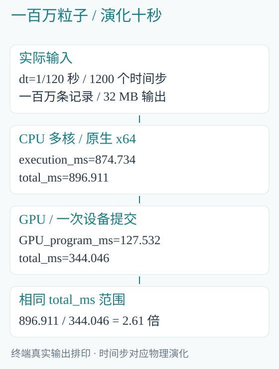

*图 13-2　total_ms 从后端准备开始，包含执行、GPU 所需传输与最终粒子文件写入；两条路径都排除之前共同的数据创建与填充。*

CPU total_ms=896.911，GPU total_ms=344.046，本次相同范围的完整路径约快 2.61 倍。GPU_program_ms=127.532 是其中的设备程序区间，不能拿它替换完整调用时间。

CPU 与 GPU 总动能分别为 63477.54 和 63477.547，保留实际浮点差异。这是动能归约，不是完整机械能守恒声明，也不是全部粒子逐位一致的证明。

### 13.3　一个 program 可以有很多阶段

step_and_total 包含更新速度与位置、计算每粒子能量、再求全域总量。独立粒子工作和全域归约具有不同执行组织，都通过同一 program 的阶段关系表达。

CPU 执行框架按范围使用工作线程；适合的直线计算还可向量化。GPU 按真实资源域组织调用和集合操作。B 源码的简洁没有取消这些差别，而是让后端有足够语义去实现它们。

### 13.4　异步上传返回的是什么

当前 upload、zeroed、BLAS／TLAS 构建可以返回尚未完成的资源。它们已经拥有实际存储和提交完成关系，后续消费者沿原队列建立依赖。

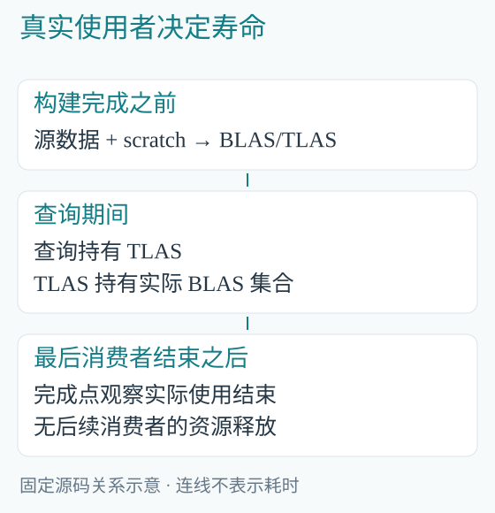

*图 13-3　查询持有 TLAS，TLAS 持有 BLAS；构建输入和 scratch 保留至构建真正完成。*

返回资源不等于设备已经做完；局部变量离开作用域也不等于最后一个 GPU 使用者结束。生命周期由原执行所有者落实，不需要引擎再保存一份完成计数。

### 13.5　GPU 世界矩阵可以直接进入 TLAS

render.rs 的 place_hierarchy_device 使用 scene/device.b：先 resolve，再 gather 实际可绘节点，最后计算法线矩阵。输出矩阵保存在原生实例数据集中，直接交给 top_level_device，不读回 CPU 再重建。

设备实例记录步长为六十四字节，B 写前四十八字节的 float3x4；后部平台标志和 BLAS 关系由执行框架拥有。两边共同使用真实记录，并未各存一张可独立修改的实例表。

该入口是 unsafe：最终世界矩阵须满足有限、线性部分可逆的 Vulkan 前提。普通安全路径则在最终世界结果到 BLTransform::affine 的交接处建立要求。不能只检查局部矩阵，就声称任意深层组合也必然满足同一性质。

### 13.6　当前哪些地方仍在等待

draw_to 当前调用 wait，纹理上传、下载和呈现也存在等待；几何来源仍是整模型读取。缓冲与 AS 的异步交接已经实现，不等于完整资源流送或异步视图已经完成。

分析异步能力时，应沿具体返回值、依赖和消费者追踪。仅看函数名里有没有 async，或代码里有没有线程，都不足以判断真实执行关系。

## 14　原生窗口：唯一消息泵与多个视图

### 14.1　窗口身份直接来自平台

window.rs 的 BLWindowId 包装实际 HWND；BLWindowSystem 持有共享窗口类所有者，窗口状态也持有同一所有者。最后一个真实使用者释放后，才注销窗口类。

它没有再分配一套窗口编号或全局登记表。System 变量可以先释放，只要窗口仍在使用，实际窗口类就继续存在。

### 14.2　UI 线程只有一条消息队列

poll_with 从整条线程队列取消息，处理普通窗口和隐藏系统辅助窗口。它不是分别对每个窗口重复取消息。

```rust
let got = PeekMessageW(
    &mut message,
    std::ptr::null_mut(),
    0, 0, 1,
);
```

target 为 null 表示这里取的是线程队列。原生回调产生带目标身份的 BLInput，再交给实际消费者。

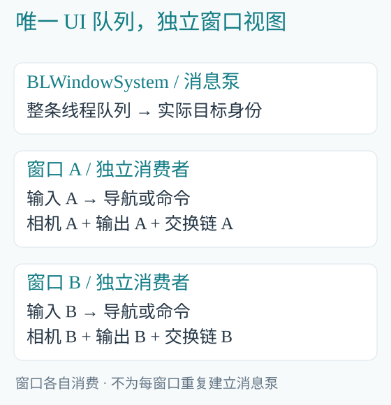

*图 14-1　窗口身份随事件交接，输入消费只作用于对应消息。*

### 14.3　先让命令决定按键，再生成文字

当前顺序是 DispatchMessage，交付回调产生的输入；若消费者没有消费该消息，再 TranslateMessage。这样，快捷键可以被编辑核心处理，而不会同时变成正文字符。

非队列 SendMessage 还可能在 PeekMessage 内部触发回调，因此实现也在取消息后交付这些事件。逐事件交付时先结束队列借用，再调用消费者，允许消费者关闭窗口。

窗口销毁时清除它尚未消费的输入。把所有事件提前搬进另一批容器，可能在窗口已经关闭后仍把旧事件交给消费者；当前代码保留原队列的生命周期。

### 14.4　重入约束体现在存储形式中

原生回调共享 BLState 的不可变引用，导航、关闭标志、UTF-16 代理对和 IME 矩形等小状态使用 Cell。跨 Win32 调用不保留一个可变 Rust 引用。

这是因为系统可以在调用内部再次进入回调。源码中的 Cell 和 RefCell 应联系这个实际平台行为理解，不能只按“内部可变性更方便”解释。

### 14.5　交换链与窗口的销毁顺序

viewer.rs 中的 BLNativeView 将字段按实际释放顺序排列：

```rust
struct BLNativeView {
    chain: Swapchain,
    output: BLRenderOutput,
    window: BLWindow,
    // 相机、统计等字段省略。
}
```

交换链先结束，再释放图像与原生窗口。GPU 使用的窗口句柄不能在平台资源仍需要它时被提前销毁。

多窗口各自拥有导航状态、相机描述、output 和 chain，共享渲染世界。某窗口最小化时跳过它的绘制，所有窗口都无需绘制时等待真实输入。

### 14.6　DPI 也是资源边界的一部分

窗口创建在对应线程 DPI 作用域中进行；交换链创建和呈现也使用实际窗口的 DPI 上下文，结束后归还宿主线程原值。

物理客户区与 WSI 取得的表面尺寸必须一致。若前者是 4K、后者是较小尺寸，问题属于平台上下文和呈现链，而不是算法应该悄悄降低渲染目标。

当前公开 Optimal 与 Suboptimal 两种成功呈现状态；动态 extent、可调整窗口及 OutOfDate 处理仍未完成。分析当前范围时应直接看实际分支，不从多窗口已经存在外推出所有窗口行为都已覆盖。

## 15　编辑器适配：把展示数据交给引擎

### 15.1　适配器不接管编辑语义

editor.rs 加载既有 ABI 22 DLL，核心继续负责文档、命令、按键、排版、行 baseline 和字形 placement。引擎根据这些结果放置实体几何和屏幕矩形。

源文件路径也由核心通过 buffer.open_file 保留，保存和退出由核心既有命令处理。窗口关闭不能绕过文档保存语义直接结束整个产品。

### 15.2　借用指针必须在原所有者处消费

DLL 给出的数组指针属于编辑核心，UI 线程在下一次会使其变化的核心调用之前读取所需内容。传给 GPU 线程的是自有、不可变的展示数据。

```rust
struct BLSnapshot {
    glyph_revision: u64,
    overlay_revision: u64,
    placements: Arc<Vec<BLPlacement>>,
    rectangles: Arc<Vec<BLOverlay>>,
    // 场景展示等字段省略。
}
```

Arc 共享未变化的实际数组；它没有把编辑文档也复制给 GPU。原始借用指针不会因为包进一个跨线程消息就自动延长寿命。

### 15.3　最新快照槽不是历史帧队列

UI 线程发布：

```rust
*latest.lock()
    .map_err(|_| error("编辑展示交接失败"))?
    = Some(snapshot);
```

GPU 线程消费：

```rust
let snapshot = latest.lock()
    .map_err(|_| error("编辑展示交接失败"))?
    .take();
```

节选把完整字段构造收成 snapshot 变量。新版本可以覆盖尚未消费的旧版本；每个 CPU tick 都排进队列，会让 GPU 不断绘制已经过时的展示状态。


*图 15-1　快照是展示消费者所需的数据；文档和排版仍由编辑核心唯一拥有。*

### 15.4　版本号分别对应真实变化

字形版本改变时更新 placements，矩形改变时更新 overlays，软件宇宙展示改变时更新相应场景输入。光标闪烁无需因此重新读取全部模型。

版本号的意义由实际生产者定义。它们帮助消费者识别变化，不承担 GPU 是否完成的职责；设备资源释放仍依据真实执行完成点。

### 15.5　退出沿两个所有者收口

UI 线程获得核心退出决定后，设置 running=false，join GPU 线程。GPU 消费最后一个已发布快照，完成保存和资源使用，随后才允许原生窗口结束。

同一进程中，CPU 编辑 tick 与 GPU 帧可以具有不同节奏。当前源码在初始无快照和最小化分支仍有短时 sleep，不能描述成完全事件驱动；这种等待也不是全局大帧屏障。

### 15.6　专用含义留在适配层

字形 codepoint、baseline、编辑选区与软件宇宙 provider 都由 editor.rs 及相应适配模块解释。通用 BLSceneRenderer 只接收实例、相机和矩形。

因此，理解编辑器接入时应从适配器读向通用接口，而不是给整个引擎套上“文本编辑器专用渲染器”的假设。缺少的通用引擎能力仍回到 BLEngine，编辑语义仍由原核心负责。

## 16　独立分析：成本、演进与扩展位置

### 16.1　先给成本找到所有者

本书单次离屏观察的三个 GPU 阶段分别约为 10.267、7.920、1.391 ms，总设备区间为 19.593 ms。阶段之间还有实际依赖间隔，简单求和不必与总区间逐小数相等。

viewer::render_file 的 126.884 ms 还包含 draw_to 的主机工作、等待、display 下载和 PPM 写入；此前的文件加载、编译与 place 另有生命周期。

因此，想优化一次文件导出，要沿完整导出路径分析；想优化驻留渲染阶段，则先看相应资源和计算。只盯一个毫秒数，容易改错责任位置。

### 16.2　当前最清楚的容量项

hits 与 pixels 都按内部采样数量增长，display 按输出像素增长。S 从 1 变为 2，前两项的样本数量增为四倍。

这解释了为什么“只是增加一个全屏记录”可能有很大代价。后续优化应减少真实无效工作和搬运，并保持必要的内部采样、几何与效果；不能把锁定画质当成可随意削减的预算。

### 16.3　从前两本的版本走到当前版本

| 分析基线 | 一帧组织 | 输出新增责任 |
|---|---|---|
| 第二本 CL12965 | trace + resolve | 当时的图像与视图输入 |
| 本书 CL12969 | visibility + illuminate + composite + resolve | 当前命中 hits，绑定 9 |

旧 render.trace 已在当前版本删除。本书采用固定版本解释这次演进，前一本的摘录仍准确对应它自己的基线。源码分析应先确认版本，再比较机制，不能把两个版本的参数表混在一起。

### 16.4　已实现与后续设计分别阅读

| 范围 | 当前源码已有 | 继续开发 |
|---|---|---|
| 场景 | 节点、组件、层级、材质选择、多输出 | 动画、脏子树与更完整场景能力 |
| 资源 | 共享几何、有限并发读取、缓冲与 AS 异步交接 | 页级流送、压缩、refit、自动背压 |
| 光照 | 当前命中、纹理、GGX、直接光与遮挡 | GI、反射、介质、世界缓存和重建 |
| 视图 | 独立图像、固定目标、多原生窗口 | 异步视图、动态 extent、图像材质输入 |

这些缺口不是通过多写几段初始化代码就能补齐。它们分别需要算法、数据关系和对应真实资源共同成立。当前阶段仍以完整功能和效果为主，60 FPS 属于之后逐步优化的目标。

### 16.5　三条实际扩展的阅读路线

如果增加一种材质输入，从 .blmat 解析与 BLSurface 接口开始，沿 dataset 打包、纹理所有者和 surface_sample 追到消费处；只改变 tint 无法代替新的物理参数。

如果增加一种输出，从 BLRenderTarget、frame 专门化和 BLRenderOutput 开始，确认谁最后消费图像；若要把图像再作为纹理使用，需要当前尚未完成的正式资源交接，不能把 CPU 下载当作已经存在的 GPU 图像输入。

如果改变场景更新，从 BLScene 的实际修改出发，追到 evaluate、place、几何来源需求和 AS 构建。旧文件不应被反复重新加载来冒充持续场景更新。

### 16.6　把源码读成一张可解释的图

读完一个模块，尝试用一句话说明：它接收什么事实，产生什么结果，由谁长期持有，下一位消费者是谁。再用真实入口解释这句话如何发生。

沿本书案例，可以从一个 OBJ 的法线索引追到一次硬件命中，从一个节点的 local 追到世界光线，从一个材质名追到纹理采样，从一个输出对象追到文件与窗口。

当这些关系能够互相对照，源码就不再是一组孤立的文件。它成为一部正在执行的机器，每一部分都有自己的责任和位置。

## 附录　命令、版本与继续阅读

### A.1　完整阅读案例

第二章已经列出构建和资产准备。完成一次准备后，在 BLEngine 根目录继续运行：

```powershell
.\target\release\blengine.exe render `
    Saved/SourceReading/reading.blscene `
    Saved/SourceReading/frame.ppm
.\target\release\blengine.exe render-views `
    Saved/SourceReading/reading.blscene `
    Saved/SourceReading/views
.\target\release\blengine.exe simulate `
    cpu 1000000 1200 `
    Saved/SourceReading/bodies-cpu.bldata
.\target\release\blengine.exe simulate `
    gpu 1000000 1200 `
    Saved/SourceReading/bodies-gpu.bldata
```

交互查看同一正式场景：

```powershell
.\target\release\blengine.exe view `
    Saved/SourceReading/reading.blscene `
    Saved/SourceReading/last.ppm
.\target\release\blengine.exe view-views `
    Saved/SourceReading/reading.blscene `
    Saved/SourceReading/window-frames
```

方向键旋转，滚轮改变距离，Esc 关闭对应窗口并保存最后图像。本书此次重新运行的是离屏 render、render-views、device、资产转换和双后端 simulate；交互窗口及编辑器章节分析固定源码，历史原生记录见引擎 Docs/Issues.md。

### A.2　源码导航表

| 问题 | Rust 入口 | B 入口 |
|---|---|---|
| 一次导出从哪里开始 | main.rs、viewer.rs | render/frame.b |
| 文件如何成为场景 | scene_asset.rs、geometry.rs | 暂不涉及设备算法 |
| 层级与组件如何求值 | hierarchy.rs、components.rs | scene/hierarchy、components |
| 相机与法线怎么形成 | view.rs、scene.rs | scene/camera、transforms |
| 缺少的模型由谁读取 | geometry_io.rs、scene.rs | 实际数据进入后再计算 |
| 材质名如何变成采样 | material.rs、scene.rs | stella/surface |
| 什么决定可见位置 | render.rs 的 AS 输入 | stella/visibility |
| 颜色与遮挡如何累积 | lighting.rs 的实际输入 | lighting/lights、stella/lighting |
| 谁持有当前图像 | output.rs、render.rs | composite、resolve |
| 多窗口怎样交付输入 | window.rs、viewer.rs | 使用同一 frame |
| 编辑器如何交付展示 | editor.rs、universe.rs、labels.rs | scene、geometry、render 模块 |

### A.3　固定源码与复现环境

sample/engine/源码版本索引.json 列出本书读取的 BLEngine CL12969 源文件路径、精确修订和 SHA256。此次运行从这些已提交源码独立构建，未使用引擎工作区尚未提交的 Stella 开发内容。

构建只将 Cargo 清单中的源码路径及两个本地依赖路径指向独立读取目录，Rust 与 B 实现保持固定版本。执行基础为 Blink CL12971，Rust 1.95.0，Windows x64 release；设备为 Ryzen 9 9950X、128 GB 内存和 Radeon RX 9070 GRE。

书中的源码块为节选，不都能脱离其模块单独编译；完整运行案例使用实际引擎入口。输入来自 sample/engine/assets；终端输出保存在运行记录.txt，包含采集路径与实际数值。

### A.4　图片和计时的解释范围

书中两张场景图均来自本次完整 4K 离屏输出，内部保持 8K；没有修改生成器、产品字形或 BLEditor。图片用于说明本案例的数据关系，不能替代完整产品交互、时序稳定性或最终材质验收。

终端卡片由真实输出排印，省略冗长路径时在配套文本保留原行。单次时间用于说明成本归属；重新运行会受系统负载和调度影响。保持输入与计时边界一致，才能作进一步比较。

Copyright (c) 2026 Blink contributors。引擎代码节选 Copyright (c) 2026 BLEngine contributors，MIT License；完整许可随配套阅读材料保留。
