# BLEngine 源码分析

本轮版本提示（2026-10-27）：当前 Blink 已统一普通与计算函数，源 program 声明改为返回类型（无值为 void），parallel 仍显式；应用用 target(cpu, ...)／target(gpu, ...) 选择位置，GPU 同步返回与显式下载分开。纯接口.h不再需要空.b。本书仍解读下述固定历史版本，源码节选及原生记录保留原文；当前规范和能力状态见 Docs/BLanguage.md 与 Docs/Issues.md。

从数学、场景到一帧图像

## 写在前面

三维引擎做的事情，可以从一个很小的问题讲起：模型里有一个点，它经过物体的移动、相机的观察，最后为什么会出现在屏幕的这个位置，又为什么呈现这种颜色？

这个问题把数学、几何、场景、材质、光照和设备执行连在了一起。理解引擎，不只是认识这些模块的名字，还要看清它们各自保存什么、计算什么，以及一份结果怎样交给下一段代码。

本书从向量开始。先用能手算的数字解释坐标和变换，再进入相机、裁剪、场景树和几何资产；随后沿真实命中进入材质、阴影、反射、折射与介质，最后回到 GPU 执行、资源寿命和窗口。读者可以依照这个顺序学习，也可以通过目录和源码索引回到某个具体函数。

分析对象固定为 **BLEngine P4 CL13031**，配套原生执行使用 **Blink P4 CL13046**。源码修订和 SHA256 记录在 `engine/源码版本索引.json`。节选保留真实函数名与计算；省略外围部分时明确标出。书中的数学推导是解释，代码框中的源码节选才是该版本的具体实现。

Blink 语言简称 B 语言，B 也寓意 Base。开源项目地址为 https://github.com/sgua83/Blink 。Blink 拥有语言、编译器与通用 CPU/GPU 执行框架；BLEngine 在其上实现引擎。当前 BLEngine 源码由独立 P4 工程管理，尚未随 Blink 仓库完整公开；本仓库提供书稿、获准摘录的源码和阅读场景，不能把下载 Blink 等同于取得完整引擎。

引擎有两类主要源码。`Programs` 中的 B 代码表达相机、变换、模拟、材质和光传输等计算；`src` 中的 Rust 代码负责场景对象、文件、实际设备资源、执行交接与原生窗口。B 不是附在 Rust 后面的几段着色脚本，Rust 也不是逐像素解释 B 的循环。两者共同构成原生程序。

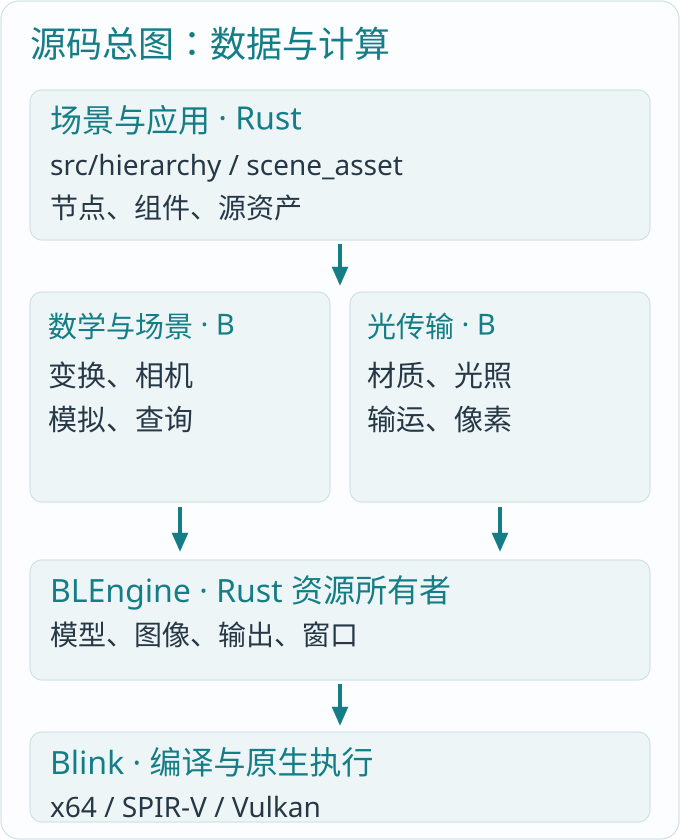

*图 0-1：先辨认“数据属于谁”和“计算在哪里”，再顺着箭头阅读函数。设备框架位于相邻的 BLanguage 工程。*

本书讨论的是这份源码已经建立的引擎，以及完整引擎仍需补齐的部分。例如当前帧采用光线追踪，不存在可以逐行解读的光栅化三角形裁剪器；骨骼动画、完整碰撞系统和音频也尚未实现。相关章节会解释这些能力在引擎中的位置和必要数据，明确指出缺口，不把概念介绍写成已有功能。

## 第一章 向量：用三个数描述位置与方向

### 1.1 位置和位移先分清

设一个顶点位于 `p=(1,2,0)`，把物体向右移动三单位，位移为 `d=(3,0,0)`，新位置就是 `p+d=(4,2,0)`。位置回答“在哪里”，位移回答“从这里往哪里走多远”。二者都能用三个数保存，意义却不同：把相机搬到另一个地方，会改变点相对相机的位置；一束光朝东传播的方向，不会因为整个场景平移而变成朝北。

`src/math.rs` 的 `BLVec3` 保存 `x、y、z`，并提供加减、标量乘除、点积和叉积。B 代码对应使用内建 `float3`。先认识它们代表的几何量，比先记住函数名更重要。

### 1.2 点积：判断两个方向有多接近

源码：`src/math.rs:16`。

```rust
pub fn dot(self, b: Self) -> f32 {
    self.x * b.x + self.y * b.y + self.z * b.z
}
```

取 `a=(1,0,0)`，`b=(0,1,0)`，点积为零，两方向垂直；取 `b=(1,0,0)`，点积为一，两方向相同；取 `b=(-1,0,0)`，结果为负，两方向相反。

一般情况下 `dot(a,b)=|a||b|cosθ`。只有两向量都已归一化，点积才直接等于夹角余弦。光照中的 `dot(normal,light)` 利用的就是这个关系：光线越正对表面，单位面积接到的光越多；斜着照时，同样的光分摊到更大面积。

### 1.3 叉积：由一张平面找出垂直方向

源码：`src/math.rs:19`。

```rust
pub fn cross(self, b: Self) -> Self {
    Self::new(
        self.y * b.z - self.z * b.y,
        self.z * b.x - self.x * b.z,
        self.x * b.y - self.y * b.x,
    )
}
```

三角形有三点 `a=(0,0,0)`、`b=(2,0,0)`、`c=(0,1,0)`。两条边为 `b-a` 和 `c-a`，叉积是 `(0,0,2)`。它垂直于三角形，长度是平行四边形面积二；三角形面积因此是一。

交换两条边，结果变成 `(0,0,-2)`。这就是顶点顺序为什么会影响表面朝向。后面判断玻璃的内外介质时，几何外向法线必须与资产描述一致，不能每次都随意翻成朝着相机。

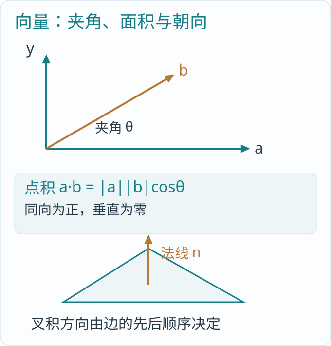

*图 1-1：点积读夹角，叉积读垂直方向；同一组三角形边同时决定面积和朝向。*

### 1.4 归一化与包围盒

`normalized()` 以向量除以自身长度。例如 `(3,4,0)` 的长度为五，单位方向为 `(.6,.8,0)`。原来的长度信息被去掉，留下纯方向。相机方向、法线与材质公式中的方向经常要求单位长度；零向量没有可归一化的方向。

`BLBounds` 用 `min、max` 保存轴对齐包围盒。加入一个点时，每个轴分别取更小和更大的坐标。点 `(1,2,0)` 和 `(4,-1,3)` 得到 `min=(1,-1,0)`、`max=(4,2,3)`，中心是 `(2.5,.5,1.5)`。

包围盒适合先排除大批不可能相交的物体，但“源码有包围盒”不等于“完整场景剔除系统已实现”。当前 `BLMesh` 保存几何边界，实际硬件光线查询使用设备加速结构；后文会分开说明这些职责。

## 第二章 矩阵：把移动、旋转和缩放连成一次计算

### 2.1 从三条式子看懂仿射矩阵

一个本地点 `(x,y,z)` 变到父坐标，可以写成：

```text
x' = m00*x + m01*y + m02*z + tx
y' = m10*x + m11*y + m12*z + ty
z' = m20*x + m21*y + m22*z + tz
```

前面的九个数负责旋转、缩放与剪切，最后三个数负责平移。BLEngine 的 `BLTransform` 以三行四列保存它们；完整四行四列矩阵的最后一行为 `(0,0,0,1)`，不必重复存储。

例如先把局部点 `(1,0,0)` 沿 x 放大两倍，再绕 z 轴旋转九十度，最后平移 `(3,1,0)`，结果依次是 `(2,0,0)`、`(0,2,0)`、`(3,3,0)`。只要把这些操作组合成一个矩阵，任意顶点都能沿同一公式计算。

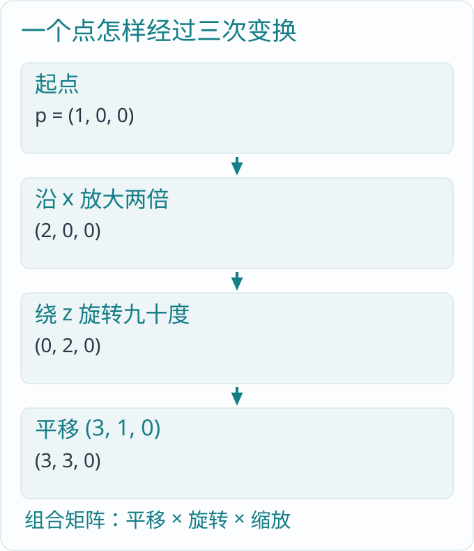

*图 2-1：同一个点沿箭头走过缩放、旋转和平移；顺序是计算的一部分。*

### 2.2 把平移、缩放和旋转写进矩阵

下面是三行四列的数学展开，均与 `BLTransform.rows` 的行排列一致。最后一列是平移，不是额外的缩放分量。

```text
平移 (tx,ty,tz)
[ 1  0  0  tx ]
[ 0  1  0  ty ]
[ 0  0  1  tz ]

缩放 (sx,sy,sz)
[ sx  0   0   0 ]
[ 0   sy  0   0 ]
[ 0   0   sz  0 ]

绕 z 轴旋转 θ
[ cosθ  -sinθ  0  0 ]
[ sinθ   cosθ  0  0 ]
[ 0      0     1  0 ]
```

九十度时 cosθ 为零、sinθ 为一，第一行算出 `x'=-y`，第二行算出 `y'=x`，所以 `(2,0,0)` 变为 `(0,2,0)`。沿 z 轴看，x 轴正向转到了 y 轴正向。绕其他轴同样保持该轴分量，用另外两个分量完成旋转；正负方向由坐标约定和角度符号决定。

非统一缩放表示三个轴倍率不同；剪切则让一个坐标随另一个坐标改变，例如 `x'=x+k*y`。它们都能放进前面的三乘三线性部分，所以场景保存一般仿射矩阵，而不只保存“位置加一个角度”。当前节点没有另存一套四元数姿态或动画轨道。

### 2.3 矩阵相乘不能交换

`Programs/math/transform.b` 给出了很短的组合函数：

源码：`Programs/math/transform.b:4`。

```b
T compose<T: BLSquareMatrix>(T first, T second) { return second * first; }
```

引擎采用矩阵乘列向量的写法。`compose(first,second)` 返回 `second*first`，表示先做 `first`，再做 `second`。设先平移一单位，再放大两倍，原点会到二；先放大，再平移，原点只会到一。矩阵名称相同而顺序不同，画面就不同。

场景树里“子物体先到父坐标，再到世界坐标”同理：`world_child = world_parent * local_child`。父节点旋转时，子物体的相对位置也会转动，因为这段平移本来就在父坐标中表达。

### 2.4 点的 w 是一，方向的 w 是零

源码：`Programs/math/transform.b:7`。

```b
float3 transform_point(float4x4 world_from_local, float3 position) {
    float4 projected = world_from_local * float4(position, 1.0);
    return projected.xyz / projected.w;
}
```

`float4(position,1.0)` 让矩阵的平移列参与计算。方向写为 `float4(direction,0.0)`，平移项乘零，方向只受线性部分影响。相机组件和光源组件都沿这个区别变到世界空间。

完整投影变换可能得到不等于一的 `w`，所以 `transform_point` 在最后除以 `projected.w`。当前场景的本地矩阵是仿射矩阵；当前像素射线相机直接构造方向，不经这个函数完成传统投影管线。通用数学函数存在，不表示每一条渲染路径都会调用它。

### 2.5 为什么法线要乘逆转置

普通方向直接乘矩阵，法线却必须继续垂直于变换后的表面。考虑平面上的方向 `t=(1,1,0)`，法线 `n=(1,-1,0)`，二者点积为零。沿 x 放大两倍后，切线变为 `(2,1,0)`。若法线也直接缩放，就成为 `(2,-1,0)`，点积为三，已经不垂直。

把法线的 x 分量反而缩小为一半，得到 `(.5,-1,0)`，与 `(2,1,0)` 点积仍为零。这正是逆矩阵再转置的效果。

源码：`Programs/math/transform.b:20`。

```b
float3 transform_normal(float3x3 world_from_local, float3 normal) {
    return normalize(transpose(inverse(world_from_local)) * normal);
}
```

实际网格命中已经携带 `world_to_object`，它就是世界矩阵的逆。`Programs/geometry/normals.b` 直接转置其线性部分，避免另算并保存第二份法线矩阵。

源码：`Programs/geometry/normals.b:2`。

```b
float3x3 mesh_normal_basis(float3x4 world_to_object) on compute {
    return transpose(float3x3(world_to_object.r0.xyz,world_to_object.r1.xyz,world_to_object.r2.xyz));
}
```

### 2.6 逆矩阵把世界问题带回物体内部

一个实例先沿 x 放大两倍，再向世界 x 平移三，局部 x 为一的点到世界 x 为五。已知世界 x 为五，回到局部坐标就先减三，再除以二，得到一；逆变换的操作顺序与正向相反。

实例 AS 命中的 `world_to_object` 提供的就是这种反向关系。几何可以保持原来的局部顶点，而同一模型在不同实例上有不同世界位置。可逆线性部分是实际实例交给 Vulkan 的前提；把某个轴缩放成零会压塌一个维度，不能再用普通逆矩阵找回原坐标。

## 第三章 几何：三角形不只有三个位置

### 3.1 顶点、索引和属性

一个立方体只有八个空间角点，却往往需要更多顶点记录。原因是同一个角点可能同时属于三张朝向不同的面，也可能处在纹理接缝上；位置相同不代表法线和 UV 相同。

`src/geometry.rs` 的 `BLVertex` 保存位置、法线和可选 UV，`BLTriangle` 保存三个顶点编号及源材质组编号，`BLMesh` 保存全部顶点、三角形、材质组名和包围盒。索引把多个三角形连到可共享的顶点记录，而接缝通过不同记录表达。

阅读场景的立方体包含 **二十四个顶点记录、十二个三角形**。每个面有自己朝外的法线；并没有为了画立方体而把模型偷偷简化成屏幕上的方框。

### 3.2 重心坐标：由命中位置找回法线与纹理

光线命中三角形后，硬件返回两个重心分量 `u、v`。第三个权重为 `1-u-v`。假设 `u=.25、v=.25`，命中点就是 `0.5*a+0.25*b+0.25*c`。三个权重之和为一，因此位置仍在同一三角形平面上。

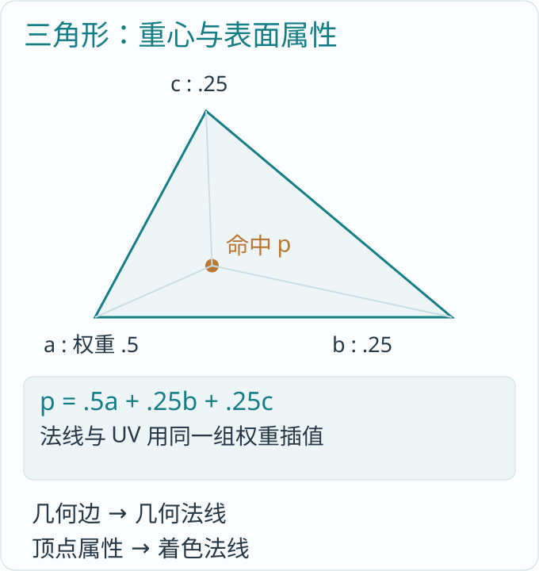

*图 3-1：一次命中把三个角点的属性按同一组权重混合。几何法线来自边，着色法线来自顶点属性。*

`stella.surface::surface_uv` 的实现与这个算式完全一致：

源码：`Programs/stella/surface.b:17`。

```b
float2 surface_uv(BLInstance instance, u32 primitive, float2 barycentric) on compute {
    BLTextureTriangle triangle = unsafe_read(instance.texcoords, primitive);
    f32 u = barycentric.x;
    f32 v = barycentric.y;
    return triangle.coordinates[0] * (1.0-u-v) + triangle.coordinates[1] * u + triangle.coordinates[2] * v;
}
```

若 UV 三点为 `(0,0)、(1,0)、(0,1)`，上例命中得到 `(.25,.25)`。法线也按同样权重插值，然后归一化；它让光照在三角形之间平滑变化，但不会改变真实三角形的形状和轮廓。

### 3.3 几何法线与着色法线各做什么

几何法线由两条三角形边叉乘得到，用于决定真实表面的内外、射线起点向哪侧偏移，以及反射或透射是否越过表面。着色法线由顶点法线插值、法线纹理等得到，用于计算局部光照。

把二者混成一个方向会造成实际问题：法线贴图稍微倾斜，玻璃的“内部”就可能被误判；偏移射线时也可能移到物体错误的一侧。因此 `BLStellaSurface` 同时携带二者。平滑和细节服务于外观，真实几何仍决定边界。

## 第四章 相机：从屏幕上的格子发出一条光线

### 4.1 观察坐标由三个方向组成

相机有眼睛位置 `eye`、观察目标 `target` 和一个参考向上方向 `up`。先求 `forward=normalize(target-eye)`，再用叉积求 `right`，最后重新构造与前二者垂直的 `up`。

源码：`Programs/scene/camera.b:3`。

```b
BLCamera camera_basis(float3 eye, float3 target, float3 up, f32 span, u32 projection, f32 near, f32 far, u32 medium) on compute {
    float3 forward=normalize(target-eye);
    float3 right=normalize(cross(forward,up));
    return BLCamera(eye,right,cross(right,forward),forward,span,projection,near,far,medium);
}
```

设 `eye=(0,-3,2)`、`target=(0,0,2)`、参考 up 为 `(0,0,1)`。相机向前是 `(0,1,0)`，向右是 `(1,0,0)`，向上仍是 `(0,0,1)`。这些方向构成了相机自己的坐标尺。

参考 up 不必事先和观察方向垂直，但不能与它平行。否则叉积为零，左右方向无从确定。Rust 的相机描述交接处处理这个真实几何前提，B 代码负责基向量计算。

### 4.2 屏幕坐标怎样变成方向

图像的左上角是像素 `(0,0)`，三维相机的“上”却通常取正方向。`stella.visibility::pixel_ray` 在像素中心取样，横向映射到 `[-1,1]`，纵向反过来映射到 `[1,-1]`；横向还乘宽高比，防止宽屏把物体压扁。

源码：`Programs/stella/visibility.b:2`。

```b
BLRay pixel_ray<const W:u32,const H:u32,const S:u32>(read dataset<BLCamera> cameras,u32 pixel,u32 layer) on compute {
    f32 sx=((f32(pixel%(W*S))+0.5)/f32(W*S)*2.0-1.0)*(f32(W)/f32(H));
    f32 sy=1.0-(f32(pixel/(W*S))+0.5)/f32(H*S)*2.0;
    return camera_ray(unsafe_read(cameras,layer),float2(sx,sy));
}
```

`W、H` 是最终显示大小，`S` 是每轴内部采样倍率，内部宽为 `W*S`。`index()` 是当前内部像素的一维编号；取余得到列，整除得到行。`.5` 把采样位置放到格子中心，而不是格子左上角。

### 4.3 透视与正交只差一处，却产生两种空间感觉

源码：`Programs/scene/camera.b:8`。

```b
BLRay camera_ray(BLCamera camera, float2 ndc) on compute {
    float3x2 basis=float3x2(camera.right.x,camera.up.x,camera.right.y,camera.up.y,camera.right.z,camera.up.z);
    float3 offset=transform_plane(basis,ndc*camera.tangent);
    if (camera.projection==1) { return BLRay(camera.eye+offset,camera.forward); }
    return BLRay(camera.eye,normalize(camera.forward+offset));
}
```

透视相机的光线都从 `eye` 出发，方向随屏幕位置展开，所以近处物体占据更大角度。正交相机的方向保持 `forward`，起点在相机平面上平移，所以同样大小的物体不会仅因远近而缩放。

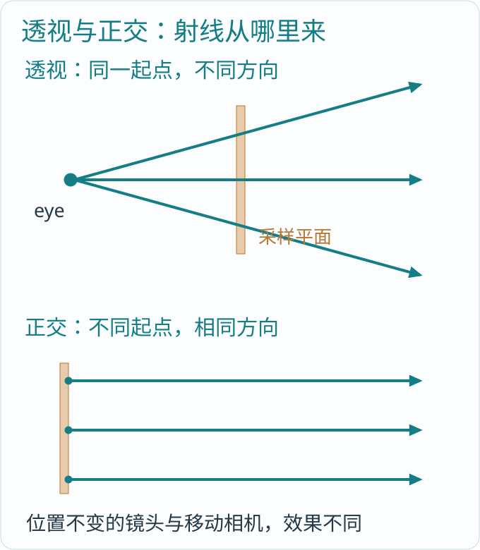

*图 4-1：透视改变方向，正交改变起点。图中画的是射线，矩形代表采样平面。*

`BLCameraDescription.span` 对透视表示垂直半视角的正切，对正交表示画面半高。例如透视 `span=1` 对应垂直视角九十度；`span=.36` 约为四十度。这个字段不是弧度本身。把它直接当 FOV 输入，是源码阅读中容易出现的单位错误。

当前实现没有先把三角形乘投影矩阵再覆盖像素，而是反过来：为每个像素生成世界光线，向场景询问最近命中。两种方法都要建立相机和屏幕的对应，只是计算方向不同。

### 4.4 世界中的点怎样回到屏幕

标签投影需要反过来做。取 `delta=point-eye`，用点积分别得到相机横向、纵向和前向坐标：`x=dot(delta,right)`、`y=dot(delta,up)`、`depth=dot(delta,forward)`。这相当于拿相机的三把尺测量同一个世界位移。

对深度为正的透视点，`ndc_y=y/(depth*span)`，横向还要除宽高比。再映射到像素：横向从画面中心向右，纵向从画面中心向上，所以像素 y 要反号。深度变成两倍而 x、y 不变时，屏幕偏移缩小一半，这就是近大远小的计算来源。

`Programs/scene/labels.b::project` 正按这些点积求 depth、x 和 baseline。生成主射线与投影世界标签互为观察问题的两个方向；不必为了投标签再建立另一台含义不同的相机。

## 第五章 相机运动：绕目标转，不是旋转整张图片

### 5.1 移动的究竟是哪一份数据

`src/window.rs` 的 `BLNavigation` 保存导航的 yaw、pitch、distance。方向键和滚轮改变这些输入；`src/viewer.rs` 每次绘制把它们交给 `BLCameraPrograms::orbit`。Rust 收集输入，B 计算相机，不在窗口消息中重新实现三维数学。

源码：`Programs/scene/camera.b:18`。

```b
program orbit(write dataset<BLCamera,1> cameras,
    float3 eye, float3 target, float3 up, f32 span, u32 projection, f32 near, f32 far, u32 medium,
    f32 yaw, f32 pitch, f32 distance) on compute {
    parallel (camera in cameras) {
        BLCamera initial=camera_basis(eye,target,up,span,projection,near,far,medium);
        float3 right=initial.right*cos(yaw)+initial.forward*sin(yaw);
        float3 back=initial.right*sin(yaw)-initial.forward*cos(yaw);
        float3 offset=back*cos(pitch)+initial.up*sin(pitch);
        f32 radius=sqrt(dot(eye-target,eye-target))*distance;
        camera=BLCamera(target+offset*radius,right,initial.up*cos(pitch)-back*sin(pitch),-offset,span,projection,near,far,medium);
    }
}
```

函数先以初始相机建立参考坐标，再围绕目标计算新的 `right、back、offset`。`target+offset*radius` 是新眼睛位置，`-offset` 是新的观察方向，因此目标仍在画面中心。

### 5.2 用半径理解缩放

初始眼睛到目标相距五，distance 为一，轨道半径就是五；distance 为二，半径变成十。这里的滚轮导航通过移动相机改变距离，不改模型顶点，也不把图像放大后再裁切。

这和改变镜头 span 有区别。保持位置、缩小 span 会收窄视野；改变眼睛位置则会改变前后物体之间的透视关系。分析导航效果时，先看修改的是位置还是镜头参数。

### 5.3 相机也能挂在场景节点上

一辆车的相机跟随车身，是因为它的相机组件先经过车身世界矩阵；之后 orbit 再围绕这份已求值的相机工作。相机节点变换和用户导航是两段不同输入。

当前组件求值把 eye、target 当点，用 `w=1`；把 up 当方向，用 `w=0`。非统一缩放或剪切会改变这些世界值，随后 `camera_basis` 再建立正交观察基。镜头 span 和距离区间保持组件值，不把节点缩放暗中解释为镜头变焦。

## 第六章 裁剪、可见性与求交：哪些东西进入画面

### 6.1 先分清三件容易混淆的事

裁剪规定可接受的空间范围；剔除提前排除不可能贡献的对象；遮挡判断某个方向上是否有更近物体。它们都能减少或限制可见内容，但输入和结果不同。

传统光栅化会把顶点变到齐次裁剪坐标，按 `-w≤x≤w、-w≤y≤w` 及其深度约定裁切多边形，然后除以 w、映射屏幕、光栅化，并用深度缓冲选择前后。深度轴的范围取决于具体 API 约定，不能混用。

当前 BLEngine 没有这条三角形光栅化管线。屏幕射线的方向已经限定了观察范围，最近命中查询直接回答每个采样点前方有什么。不能在源码目录里找不到裁剪器时，把相机的 near/far 字段当成完整传统裁剪实现。

### 6.2 当前 near/far 限定的是射线参数

```text
p(t) = origin + t * direction
有效范围：near ≤ t ≤ far
```

相机射线方向已归一化，所以 t 是沿光线的世界距离。当前 `pixel_hit` 将相机 near/far 直接传给求交；它们不是透视相机前方两张相同 z 值的平面。斜射线的沿线距离与相机前向深度并不相同。

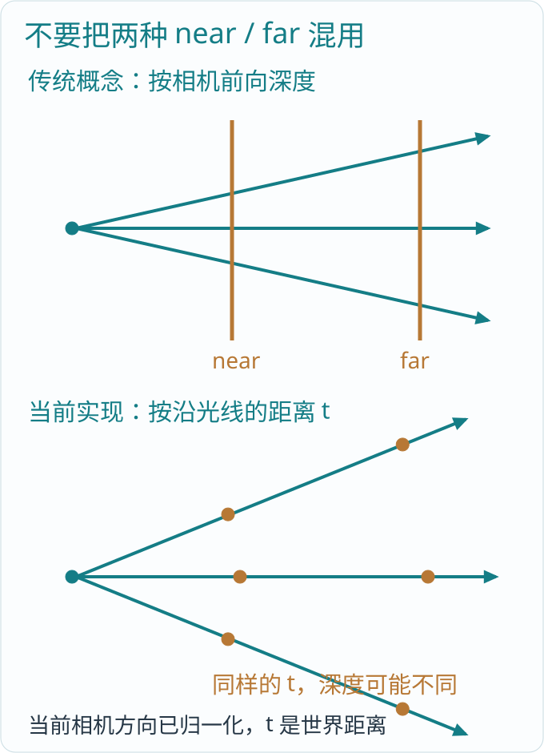

*图 6-1：上图的相机深度平面与下图的沿射线距离区间含义不同。当前实现采用后者。*

例如中心射线沿 forward 前进，t 为十时，前向深度也是十；与 forward 成六十度的射线走十，前向深度只有五。这解释了为什么同名 near/far 不保证相同的裁剪形状。

### 6.3 最近命中怎样选出来

`stella.visibility::closest_hit` 先放入距离为 far 的“未命中”记录；若启用地面，求光线与水平面的交点；再用 `trace_closest` 查询网格；最后检查解析面光。所有候选沿同一条光线、同一个有效区间比较，留下最近者。

网格查询的核心可从更短的通用入口看清：

源码：`Programs/scene/query.b:2`。

```b
BLMeshHit mesh_intersect(BLMeshRay ray,read dataset<BLInstance> instances,read acceleration scene,u32 base) on gpu {
    RayHit hit=trace_closest(scene,ray.origin,ray.near,ray.direction,ray.far);
    if(!hit.exists){
        return BLMeshHit(float3(0.0),ray.far,float3(0.0),0,float2(0.0),uint2(0),0,false,float3(0.0));
    }
    u32 instance=base+hit.instance;
    float3x3 basis=mesh_normal_basis(hit.world_to_object);
    float3 normal=mesh_geometric_normal(basis,hit.vertex1-hit.vertex0,hit.vertex2-hit.vertex0);
    float3 local=hit.vertex0*(1.0-hit.barycentric.x-hit.barycentric.y)+
        hit.vertex1*hit.barycentric.x+hit.vertex2*hit.barycentric.y;
    return BLMeshHit(ray.origin+ray.direction*hit.distance,hit.distance,normal,hit.primitive,
        hit.barycentric,unsafe_read(instances,instance).identity,instance,true,local);
}
```

`trace_closest` 的三角形遍历和求交由 Blink 的 Vulkan 光线查询后端交给真实加速结构（AS）执行。引擎不在 Rust 中遍历每个三角形，也没有在这个函数里重新写一遍 Möller–Trumbore 求交器。

命中后，B 用距离重建世界位置，用重心重建物体空间位置，并把当前实例槽位映射到稳定运行身份。返回的数据既能供着色，也能作为后续网格选择计算的输入。

### 6.4 世界层和独立层不能直接比距离

BLEngine 可以给独立 overlay 空间使用另一台相机和另一份顶层加速结构。先求世界层，再求独立层；独立层有命中时，按层规则替换世界结果。两台相机的原点和坐标尺度不同，所以不把两个 distance 当成同一坐标下的深度来比较。

当前尚无独立场景视锥剔除器、遮挡层级或 GPU 可见实例压紧管线。硬件 AS 能加速射线查询，但不能据此说整个引擎已经具备完整场景可见性系统。

作为理论对照，传统视锥可以由六张朝内的平面表示。若平面写成 `dot(n,p)+d≥0`，且 n 是单位法线，一个中心 c、半径 r 的球在某平面满足 `dot(n,c)+d<-r`，便整个落在外侧，可以提前排除。与平面相交的球仍须保留，不能只检查球心是否在内部。这说明“范围描述”和“批量对象剔除”之间还需要实际算法；固定版本尚未实现这份场景剔除计算。

## 第七章 场景组织：树保存关系，矩阵解释关系

### 7.1 为什么要有父子节点

想象一个台灯：灯座带着灯杆，灯杆带着灯罩。移动灯座时，不应手动修改每个零件的世界坐标。每个零件只保存相对父节点的本地变换，世界变换由父链组合。

`src/hierarchy.rs` 的 `BLScene` 保存节点槽位和可复用空槽。`BLSceneNode` 保存父关系、本地矩阵，以及可选几何、相机、光源。允许多棵互不相连的树，因此整体是有向森林，而不是强迫一切挂到一个没有实际职责的根对象。

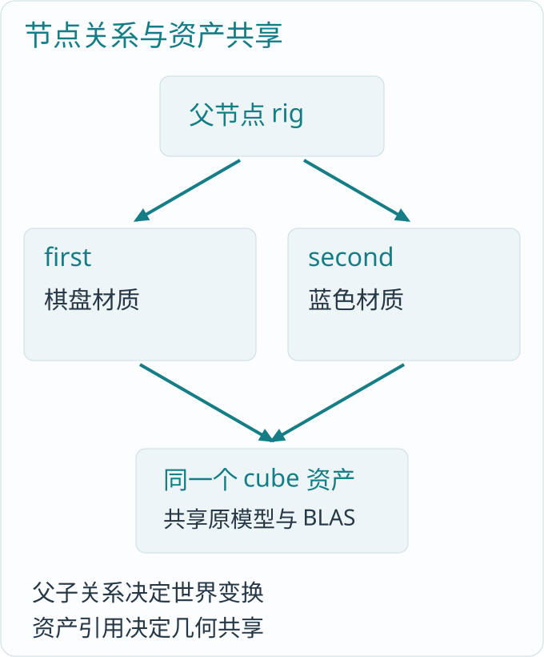

*图 7-1：阅读场景中的两个物体共享 rig 父节点，也共享同一 cube 资产；父子关系与资产共享是两种关系。*

### 7.2 世界矩阵怎样算

源码：`Programs/scene/hierarchy.b:9`。

```b
program resolve(read dataset<BLHierarchyNode> nodes,write dataset<BLWorldTransform> worlds) on compute {
    parallel(world in worlds) {
        BLHierarchyNode node=unsafe_read(nodes,index());
        float3x4 matrix=node.local;
        if(node.active){
            while(node.has_parent){
                node=unsafe_read(nodes,node.parent);
                matrix=compose_affine(node.local,matrix);
            }
        }
        world.matrix=matrix;
    }
}
```

每个工作项从自己的本地矩阵开始，沿父链向上，把父矩阵乘到前面。父节点向 x 平移十，子节点向 y 平移二，子节点原点的世界坐标就是 `(10,2,0)`；若父节点旋转，子节点的局部平移也随之旋转。

这里每个节点独立读源节点，写自己的世界结果，所以可以并行。它没有要求先写完父节点的世界矩阵，再让子节点读取那份输出；因此也不用在每一层之间加一次全局阶段。

代价是深层节点会重复读取共同祖先，工作量约为所有节点深度之和。当前没有脏子树增量算法，不应把“可以持续更新”解释为“只重算变化节点”。并行表达减少了数据依赖，具体算法仍有可优化的工作量。

### 7.3 改父节点与删除节点

`BLScene::set_parent` 保留本地矩阵。这意味着把一盏灯从桌子改挂到车上，它的世界位置可能变化。若应用希望保持世界位置，就要先计算新父节点逆矩阵，再显式设置新的本地矩阵；当前 API 不暗中替调用者选择这个语义。

`remove` 通过 B 的 `descendants` 标记整个子树，再由 Rust 删除对应节点和组件、回收槽位。算法判断的是实际父链，不是“编号比根节点大”之类的偶然排列。

### 7.4 槽位不等于身份

删除第六号槽位中的节点，再把新节点放进第六号槽位，并不意味着它们是同一个物体。`BLNodeId` 同时保存槽位和由真实节点所有者创建的 `BLInstanceId`；旧句柄不能因为槽位被复用而认领新对象。

这份身份属于运行中的对象，不是跨进程资产 ID，不随文件保存。它也不是材质版本或几何版本。节点移动仍是同一对象，换了一份几何却不意味着旧表面历史仍然有效。后续时序缓存若要建立表面对应，还需要实际的版本与运动信息。

## 第八章 组件求值：同一节点如何带动模型、相机和灯

### 8.1 保存一份源，生成所需结果

场景保存的是本地节点组件，不再额外保存一份可独立修改的世界相机和世界灯光。`BLScenePrograms::evaluate` 把源数据打包交给 `scene.components::evaluate`：先求世界矩阵，再分别变换相机和灯。

源码：`Programs/scene/components.b:29`。

```b
program evaluate(read dataset<BLHierarchyNode> nodes,inout dataset<BLWorldTransform> worlds,
                 read dataset<BLAttachedCamera> local_cameras,write dataset<BLSceneCamera> world_cameras,
                 read dataset<BLAttachedLight> local_lights,write dataset<BLLight> world_lights) on compute {
    resolve(nodes,worlds);
    cameras(worlds,local_cameras,world_cameras);
    lights(worlds,local_lights,world_lights);
}
```

几何实例、相机描述和世界光源是该次输入的派生结果。节点修改后显式重新求值；不能继续拿旧结果当成已经自动更新的场景。

### 8.2 不同灯光对变换的需要不同

点光的位置是点，随父节点平移；方向光表示远处来的传播方向，父节点平移不应改变它。面光的位置是点，两条半边是方向，变换后面积自然变化。聚光的位置和朝向都需要变换。

组件计算在 `Programs/scene/components.b` 中按这些几何意义分支。它不把能量随父节点缩放再任意乘一次，也不把非统一缩放后的聚光悄悄换成椭圆锥。场景变换与灯光物理参数需要分别读懂。

### 8.3 CPU 路径与设备路径

普通 `placements/evaluate` 入口在原生 CPU B 中求值，把最终矩阵交给实例构建。`place_hierarchy_device` 则上传源节点，让 GPU B 求世界矩阵，再按真实可绘节点 gather 到设备实例记录。

源码：`Programs/scene/device.b:9`。

```b
program prepare(read dataset<BLHierarchyNode> nodes,inout dataset<BLWorldTransform> worlds,
                read dataset<BLDrawNode> draws,inout dataset<BLDeviceTransform> transforms) on compute {
    resolve(nodes,worlds);
    gather(worlds,draws,transforms);
}
```

这个顺序很具体：`resolve` 产生 worlds，`gather` 消费 worlds。框架负责两段之间的设备可见性。Rust 不需要把所有矩阵先读回 CPU，再重新上传到 TLAS。

固定版本的设备入口仍挂在 `BLSceneRenderer` 上，使用单一 TLAS；它还不是完全独立的 GPU 场景对象，也没有实现 refit 和脏子树。书中对源数据和资源所有者的分析以这个版本为准。

## 第九章 资产：让文件中的模型变成引擎数据

### 9.1 cook 是显式转换，不是运行时猜格式

阅读案例先把 OBJ 转成 `.blgeom`，再把可读场景文本转成 `.blscene`。`cook` 是引擎命令中的一个动作，表示把源资产转换成运行时明确的格式；它不是额外的书籍程序。

`BLMesh::read_obj` 分别读取位置、法线和 UV。每个面角以 `(位置索引,UV索引,法线索引)` 作为键查找或建立顶点，这正是接缝能保留下来的原因。源码中的关键行是：

局部节选，外围未列出：`src/geometry.rs:137`。

```rust
let key = (pi, ti, ni);
let index = if let Some(index) = lookup.get(&key) {
    *index
} else {
    let normal = ni
        .map(|i| normals[i])
        .ok_or_else(|| error("正式几何输入必须包含生成器法线"))?;
    let uv = ti.map(|i| uvs[i]);
    let index = u32::try_from(vertices.len())?;
    vertices.push(BLVertex {
        position: positions[pi],
        normal,
        uv,
    });
    lookup.insert(key, index);
```

输入必须提供正式三角化和法线。当前读取器不自动剖分任意多边形，不凭空生成缺失法线，不读取 MTL 来推测完整材质。文件转换保留原精度几何，坐标单位换算放在实例矩阵中。

### 9.2 四种文件各保存什么

| 文件 | 主要内容 | 读取位置 |
|---|---|---|
| `.blgeom` | 顶点、三角形、源材质组和原 UV | `src/geometry.rs` |
| `.blscene` | 节点森林、组件、几何路径、启动相机、输出设置 | `src/scene_asset.rs` |
| `.blmat` | 图像、表面、介质、默认组绑定和地面材质 | `src/material.rs` |
| `.bltex` | 线性图像与 mip 数据 | Blink `blcompute` 的纹理读写 |

当前格式分别为 BLGEOM 2、BLSCENE 7、BLMAT 2、BLTEX 1。格式版本是实际数据协议，不是渲染质量等级。当前开发版本不提供旧版本自动转换链，源材料应按当前明确格式重新 cook。

### 9.3 相对路径要从所属文件算

场景里的材质路径、模型路径相对最终 `.blscene` 所在目录；材质里的纹理路径相对 `.blmat`。这让一份资产目录可以整体移动，而不必把作者机器的盘符写进文件。

场景保存时，`BLSceneAsset::write` 只写存活节点，并重映射父引用和启动相机引用。文件下标不等于运行身份，删除后的空槽也不写成永久资产对象。重新读入会建立新的运行场景。

当前没有 FBX、UE 资源、骨骼动画或外部材质自动导入。资产层已经有明确的数据入口，但还不能据此称为完整 DCC 生产管线。

## 第十章 几何驻留与加速结构：同一模型怎样画很多次

### 10.1 两个物体不需要两份顶点

阅读场景的两个立方体形状相同，位置、矩阵和材质选择不同。`BLGeometryStore` 以资产编号保存原模型；`BLPlacement` 保存每次摆放的身份、资产引用、变换、颜色和材质选择。

这把“是什么形状”和“放在哪里”分开了。移动一个立方体，改的是实例矩阵；给它换材质，改的是实例的材质绑定；二者都不应复制原三角形。

### 10.2 BLAS 与 TLAS 分别回答什么

底层加速结构 BLAS 描述一份模型内部的三角形。顶层加速结构 TLAS 描述场景里有哪些实例、各自怎样变换，以及引用哪份 BLAS。可以把它们理解为两级查找：先找可能命中的物体，再进入物体的三角形。

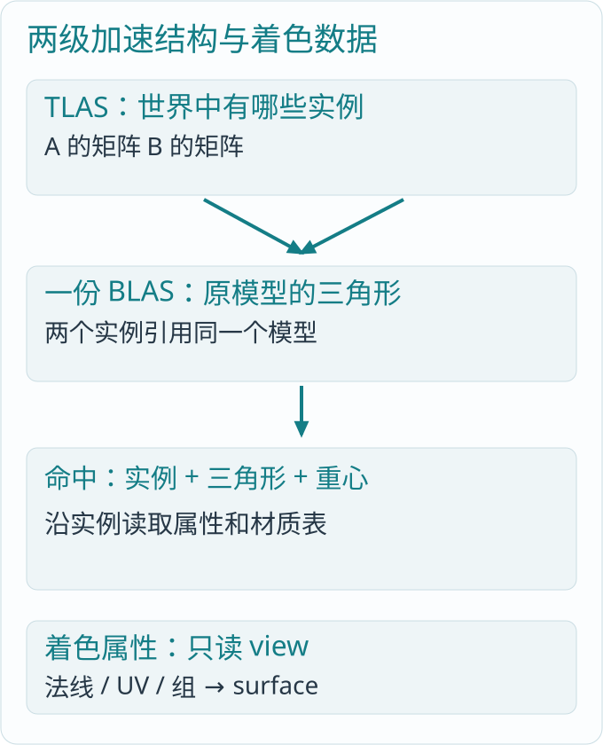

*图 10-1：两个实例共享一个 BLAS，但各有世界变换和材质选择。着色属性表与原生 AS 是不同资源。*

`src/scene.rs::insert` 把原位置和三角形交给 `Device::bottom_level`，同时建立着色需要的三角形法线索引、法线记录和可选 UV。`instances` 再把 placement 变成 `RayInstance`；`src/render.rs::set_partitioned_instances` 建立世界层和可选独立层的 TLAS。

这些结构不等于一份手写的 Rust BVH。实际构建和 Vulkan 内存属于 Blink 的 `vulkan/ray.rs`，引擎交付原精度几何和实例关系。B 在命中之后继续解释属性，不接管原生句柄的释放。

### 10.3 硬件实例记录与着色实例记录别混淆

设备构建用的 `BLDeviceTransform` 使用六十四字节步长，其中前四十八字节是三行四列矩阵，剩余部分由框架维护原生实例信息。B 只写自己声明的矩阵字段。

着色用的 `BLInstance` 则保存只读 view、tint 和身份：

源码：`Programs/scene/instance.h:1`。

```b
module scene.instance;
struct BLTriangle {array<u32,3> normal_indices;u32 material;};
struct BLNormal {float3 normal;};
struct BLTextureTriangle {array<float2,3> coordinates;};
struct BLMaterialSlot {u32 surface;};
struct BLInstance {
    view<BLTriangle> triangles;
    view<BLNormal> normals;
    view<BLTextureTriangle> texcoords;
    view<BLMaterialSlot> materials;
    float4 tint;
    uint2 identity;
};
```

这里的三角形记录保存的是法线索引和材质组，不再复制硬件已有的每个位置。`view` 指向真正的只读数据。框架保持它所引用的存储，不能把 view 当成一个脱离所有者仍有效的裸数字。

### 10.4 材质组怎样避免破坏共享

三角形只保存源材质组编号，实例另有“组编号到 surface 编号”的槽位表。同一个立方体可以在一个实例上使用棋盘材质，在另一个上使用蓝色材质，而 BLAS、原法线和三角形仍共享。

UV 的上传也由真实消费者决定：只用常量色时不需要 UV 数据；后来某个实例选择了纹理材质，再向原来源请求对应资产属性。`BLGeometryStore::prepare` 汇合全部实际实例的需求，不为每个实例单独保存一份模型。

这仍是模型级驻留与属性交接，不是虚拟几何。当前没有按可见细节裁取微三角形、压缩簇解码和完整页级流送；保留原精度 BLAS 也不等于已经实现 Nanite。

## 第十一章 材质：从一次命中读出表面是什么

### 11.1 表面颜色不能只靠一个 RGB

一块蓝色塑料和一块蓝色金属，可能有相近的基础色，却有不同的反射。材质至少要回答：表面属于哪种散射模型、颜色从哪里来、粗糙度是多少、介质边界是什么，以及法线细节怎样表达。

`src/material.rs::BLPalette::read` 读取材质库；`Programs/material/palette.h` 声明设备上的 `BLSurface`。Rust 按编译结果的字段偏移和步长打包，不再凭感觉复制一份 C 风格 ABI 结构。

阅读场景的基础声明如下：

```text
BLMAT 2
medium vacuum 1 0 0 0
texture file checker.bltex
texture color .09 .38 .55 1
texture color .19 .16 .13 1
surface tile opaque 0 .3 1.5 0 1 1 0 0
surface blue opaque 1 .18 1.5 0 1 1 0 0
surface floor opaque 2 .65 1.5 0 1 1 0 0
geometry solid tile
ground floor
```

`texture` 按声明顺序编号。surface 的参数依次包含模型、纹理编号、粗糙度、折射率、LOD、UV 缩放与偏移。名称用于绑定，运行时解析成实际编号。`medium vacuum` 是这份文件显式声明的介质，并非运行时偷偷注入的全局对象。

### 11.2 surface_at 是命中与材质之间的桥

`stella.surface::surface_at` 先从实例取得三角形和材质组，再通过实例槽位表取得 surface。需要纹理坐标时，用重心插值原 UV；随后执行 `uv*scale+offset`，采样颜色，再乘实例 tint。

局部节选，外围未列出：`Programs/stella/surface.b:38`。

```b
BLSurface surface=unsafe_read(surfaces,material);
float2 uv=float2(0.0);
if(surface.uses_uv){
    uv=position.xy;
    if(hit.kind==2 || hit.kind==3){uv=surface_uv(unsafe_read(instances,hit.instance),hit.primitive,hit.barycentric);}
}
uv=uv*surface.uv_scale+surface.uv_offset;
float3 color=texture_sample(unsafe_read(textures,surface.texture),uv,surface.lod).xyz*tint;
f32 roughness=surface.roughness;
```

`uses_uv` 不是用来掩盖错误资产，而是表示该材质是否真的消费 UV。纹理材质缺失原 UV，资产入口应报告；常量色材质没有这个需求，不必为了凑字段制造无用数据。

### 11.3 法线纹理只改变局部表面方向

法线纹理把 RGB 从 `[0,1]` 解码到 `[-1,1]`。这些分量表达的是沿切线、副切线和原法线的方向，不能直接当作世界坐标。

`material.maps::normal_map` 用三角形边和 UV 边求出切线方向，把它与法线正交化，处理 UV 镜像朝向，再组合纹理方向。随后 `surface_at` 用实际命中的逆转置基变到世界空间。

源码：`Programs/material/maps.b:8`。

```b
float3 normal_map(float3 normal,float3 edge_u,float3 edge_v,float2 uv_u,float2 uv_v,float3 encoded,f32 strength) on compute {
    float3 tangent=edge_u*uv_v.y-edge_v*uv_u.y;
    float3 bitangent=edge_v*uv_u.x-edge_u*uv_v.x;
    if(uv_u.x*uv_v.y-uv_u.y*uv_v.x<0.0){tangent=-tangent;bitangent=-bitangent;}
    tangent=normalize(tangent-normal*dot(normal,tangent));
    float3 perpendicular=cross(normal,tangent);
    if(dot(perpendicular,bitangent)<0.0){perpendicular=-perpendicular;}
    float3 sample=encoded*2.0-float3(1.0);
    return normalize(tangent*(sample.x*strength)+perpendicular*(sample.y*strength)+normal*sample.z);
}
```

它能给表面增加凹凸光照细节，却不改变三角形位置、轮廓或真实自遮挡。把法线纹理当成几何细分，会误判画面和内存的来源。

### 11.4 粗糙度怎样进入 GGX

微表面模型把看似平滑的表面理解为很多微小朝向的反射面。粗糙度越小，这些朝向越集中，高光越窄；粗糙度越大，能量散到更宽方向。

`material.microfacet::microfacet_distribution` 实现 GGX 分布，当前 `alpha=roughness²`，分布使用 `a2=alpha²`。不要把粗糙度、alpha 和 a2 当成同一个参数。

源码：`Programs/material/microfacet.b:2`。

```b
f32 microfacet_distribution(float3 normal,float3 half_vector,f32 a2) on compute {
    f32 nh=max(dot(normal,half_vector),0.0);
    float3 tangent=cross(normal,half_vector);
    f32 denominator=dot(tangent,tangent)+a2*nh*nh;
    return a2/(3.14159265359*denominator*denominator);
}
```

完整不透明响应还包含 Fresnel 和 Smith 遮蔽项，位于 `material.surface::surface_response`。这些量分别描述界面反射比例、微表面朝向分布和微表面彼此挡住的影响。只保留一个“高光幂次”无法说明当前源码。

## 第十二章 光源与阴影：一条连接能带来多少光

### 12.1 五种光源的量并不相同

`src/lighting.rs::BLLight` 有方向、点、聚光、面光和有限太阳五种形式。方向光用辐照度描述平行来光；点光和聚光保存强度；面光与太阳盘保存辐亮度。字段都叫 energy 的设备记录，不表示物理量可以任意互换。

点光离表面从两单位变成四单位，在其他条件相同的情况下，贡献按距离平方从 `1/4` 变成 `1/16`。方向光没有这样的局部距离衰减。面光则还需要考虑面积、朝向和采样密度。

### 12.2 先选目标，再求入射量

`lighting.lights::light_target` 为方向光产生方向，为点光产生固定点，为面光在两条半边张成的矩形上选点。`light_sample` 再得到单位方向、实际目标、采样密度和已带相应概率权重的光量。

面光的世界位置加上 `[-1,1]` 范围的两条半边得到采样点。若两半边长度各为一且垂直，完整面积是四，不是一。源码中 `area_pdf` 的系数四来自这个定义：

源码：`Programs/lighting/lights.b:44`。

```b
density=area_pdf(light,direction,distance_squared);
if (density==0.0) { return BLLightSample(direction,float3(0.0),target,true,false,0.0,0); }
```

`distance_squared/projected_area` 把按面积选点的概率换成按观察方向立体角计算的密度。距离越远，同一块灯占据的角度越小，这个密度就越大。

### 12.3 阴影就是表面到灯之间有无阻挡

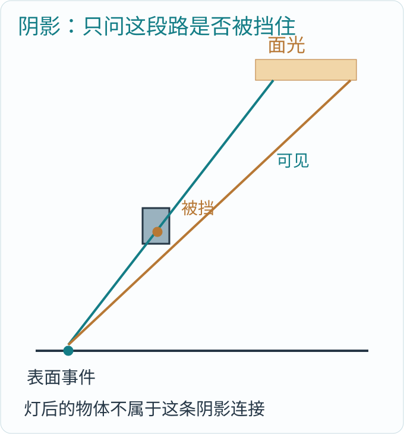

*图 12-1：只检查到目标灯的有效线段；目标背后的物体不应挡住这盏灯。不同面光采样点可能得到不同遮挡。*

`stella.lighting::light_occluded` 对局部灯把最大距离限制到真实目标；`stella.visibility::occluded` 检查可选地面、其他解析面光与网格 `trace_any`。阴影只需回答有没有遮挡，通常不必拿回最近三角形的全部属性。

源码：`Programs/stella/lighting.b:3`。

```b
bool light_occluded(read dataset<BLLight> lights,read acceleration scene,BLLightSample sample,f32 near,f32 far,
    float3 origin,bool floor_present,f32 ground_z,u32 target_light) on gpu {
    f32 maximum=far;
    if(sample.local){maximum=min(maximum,length(sample.target-origin));}
    return occluded(scene,lights,BLRay(origin,sample.direction),near,maximum,
        floor_present,ground_z,target_light,sample.local && sample.event==1);
}
```

起点沿几何法线偏移，方向指向光源。偏移解决的是有限精度下从表面再次出发的几何位置问题；它不能替代正确法线、正确射线区间和正确资产单位。

### 12.4 软阴影和有限太阳

面光有面积，表面上不同采样点会看见不同程度的灯，因此产生半影。采样数少时半影会有噪声；增加采样改变估计精度，也增加实际求交工作量。

有限太阳用角半径定义天空中的圆盘，`sun_direction` 在其立体角内选方向，`sun_emission` 允许相机或反射路径真正看见它。它和单一方向的理想太阳光不同。当前环境其余部分仍为恒定颜色，不是有方向细节的天空贴图或完整大气系统。

## 第十三章 采样：为什么算光照需要概率

### 13.1 无法把每个方向都算一遍

一个表面会收到来自许多方向的光。如果每次都穷举所有方向，再为每个方向继续递归，工作量会迅速增长。采样的想法是选择少量方向，让每次贡献按“选到它的可能性”进行补偿，多次结果的平均逐渐接近目标积分。

最简单的离散例子：两个方向的真实贡献分别为二和六，每次等概率选一个。选到第一个时记录 `2/.5=4`，选到第二个时记录 `6/.5=12`，平均为八，等于二加六。连续方向使用概率密度，基本思想相同。

这不是把噪声叫作正确。采样估计有方差；样本不足会在画面中表现为亮点和颗粒。算法是否正确、当前图像是否够稳定，以及性能是否满足目标，是不同问题。

### 13.2 随机数从像素和维度得到

源码：`Programs/sampling/random.b:10`。

```b
f32 sample_unit(u32 key,u32 dimension) on compute {
    return f32(sample_hash(key^sample_hash(dimension))&0x00ffffff)/16777216.0;
}
```

键和采样维度经过整数哈希，低二十四位映射到 `[0,1)`。不同方向分量、路径顶点和自由程使用明确维度或独立流，不依赖各工作项抢一个全局随机状态。

这样每个像素可以独立工作，也便于复现。当前 `frame` 使用固定种子零，没有跨帧递增样本和时序历史；连续渲染相同静态输入，不会自动获得越来越多的新样本来消除噪声。

### 13.3 weight 已经包含哪些量

表面把一个方向来的光分配到另一个方向的函数，称为 BSDF。`surface_evaluate` 返回 response 和 density，其中 response 已含 BSDF 与入射余弦。`surface_scatter` 返回的 weight 对连续事件为 `response/density`。路径的累计权重，也称吞吐，只乘这份 weight，不再额外乘一次余弦或除一次概率密度。代码中的 pdf 就表示概率密度。

假设 response 为 `.2`、density 为 `.4`，weight 就是 `.5`。原路径吞吐为 `.8`，新吞吐是 `.4`。重复除概率密度会得到一，已经改变了能量。

### 13.4 MIS：两种找光方法怎样合作

直接选灯容易找到小灯；按材质选方向容易找到窄反射。只用一种方法，某些场景会很难采到关键贡献。MIS 把两种方法按各自概率密度加权，避免对同一类路径重复计算完整能量。

源码：`Programs/sampling/mis.b:2`。

```b
f32 power_weight(f32 sampled_density,f32 other_density) on compute {
    // Ratios keep the power heuristic finite without squaring large PDFs.
    if(sampled_density>=other_density){
        f32 ratio=other_density/sampled_density;
        return 1.0/(1.0+ratio*ratio);
    }
    f32 ratio=sampled_density/other_density;
    f32 square=ratio*ratio;
    return square/(1.0+square);
}
```

这是平方权重的等价比例写法。采样策略 A 的密度为二，策略 B 为一，A 的权重是 `4/(4+1)=.8`，B 的对应权重是 `.2`。实现用比值避免直接平方很大的数。

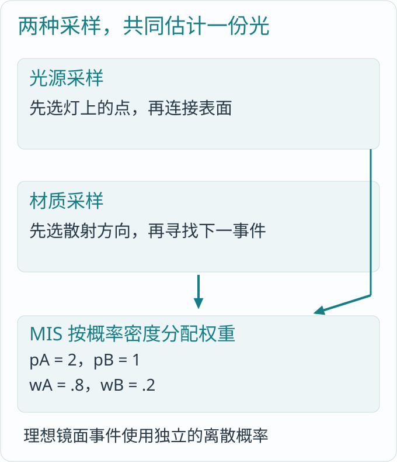

*图 13-1：光源采样和材质采样寻找同一类连接，MIS 分配权重；不是把两份完整结果直接相加。*

理想镜面的离散方向不能和连续的每立体角密度直接相加。源码用事件区分连续反射、离散反射、连续透射和离散透射，在环境或面光逃逸时按真实事件选择权重。最后一段不存在后续材质采样时，也不能给它分配一个虚构竞争策略。

## 第十四章 反射与折射：表面决定光从哪一侧离开

### 14.1 先看最简单的镜面反射

方向约定统一为离开表面的向量。若 `outgoing` 指向观察者，镜面反射的下一方向是 `2*dot(normal,outgoing)*normal-outgoing`。它的切向分量反号，法向分量保持，因此入射角等于反射角。

不透明材质的零粗糙度分支直接产生这个离散方向，不用一个无限尖的 GGX 分布假装理想镜面。粗糙表面则先采样微表面法线，再按它反射，方向会分散。

### 14.2 玻璃的 Fresnel 与 Snell 定律

两介质相对折射率在当前实现中记为 `eta=目标IOR/当前IOR`。Snell 定律给出透射正弦为入射正弦除以 eta；若平方后大于或等于一，就没有可行的折射方向，产生全反射。

源码：`Programs/material/dielectric.b:11`。

```b
BLDielectricBoundary dielectric_boundary(float3 normal,float3 outgoing,f32 eta) on compute {
    if(eta==1.0){return BLDielectricBoundary(0.0,1.0,dot(normal,outgoing));}
    f32 cosine=dot(normal,outgoing);
    float3 sine=cross(normal,outgoing);
    f32 transmitted=dot(sine,sine)/(eta*eta);
    if(transmitted>=1.0){return BLDielectricBoundary(1.0,0.0,0.0);}
    f32 other=sqrt(1.0-transmitted);
    float2 coefficients=dielectric_coefficients(cosine,other,eta);
    return BLDielectricBoundary(coefficients.x,coefficients.y,other);
}
```

从空气进入 IOR 为一点五的玻璃，正对界面时反射率约为四个百分点，大部分能量透过；从玻璃斜着射向空气，超过临界角会全反射。Fresnel 不是给玻璃随意加一个高光，而是决定界面反射和透射的比例。

### 14.3 材质边界与内部介质要分开

```text
medium vacuum 1 0 0 0
medium glass 1.5 .2 .4 .8
surface clear dielectric 0 0 vacuum glass 0 1 1 0 0
```

这段材质声明描述一个外侧真空、内侧玻璃的边界。surface 决定边界怎样反射和折射；medium 描述内部沿路传播怎样吸收光。把表面染成绿色，不等于已经模拟光在厚薄不同的玻璃内部走过不同距离。

`stella.surface::surface_at` 用真实几何法线判断当前处在边界哪侧，再交付目标介质；`surface_medium` 只有在路径穿过几何边界时切换编号：

源码：`Programs/stella/surface.b:85`。

```b
u32 surface_medium(BLStellaSurface surface,float3 direction) on compute {
    if(dot(surface.geometric_normal,surface.view)*dot(surface.geometric_normal,direction)<0.0){return surface.transmitted_medium;}
    return surface.medium;
}
```

相机显式保存起始介质。当前位置进入另一片区域时，由拥有相机的消费者更新它；当前没有自动空间区域探测。闭合几何、法线外向和介质邻接关系同样需要资产如实描述。

### 14.4 金属为什么需要另一套 Fresnel

`material.conductor.b` 使用 RGB 复折射率的实部 eta 和消光指数 k。金属主要产生导体反射，不能拿不透明塑料的漫反射加白色高光来冒充。

零粗糙度直接产生镜面方向和按通道的 Fresnel 权重；非零粗糙度与其他模型共享 GGX 微表面采样。共同的是采样框架，不同的是材料的物理响应。

当前有不透明、介电和导体模型，尚无完整分层涂层、微表面多次散射和任意材质图。真实天然和田白玉与真皮的最终效果，还需要更完整的数据、输运和视觉验证，不能由“有折射函数”直接推导为完成。

## 第十五章 介质：光离开表面以后仍在发生变化

### 15.1 吸收随真实路程变化

均匀介质的透过率为 `Tr=exp(-sigma_t*d)`，消光系数 `sigma_t` 等于吸收加散射。系数的单位是世界长度的倒数，因此模型单位和实例缩放会直接影响厚度的物理意义。

若纯吸收系数为 `.5`，走一单位透过约 `.607`，走两单位约 `.368`。这自然产生厚处更深、薄处更透的区别；固定乘一个表面颜色做不到这一点。

源码：`Programs/material/medium.b:7`。

```b
float3 medium_transmittance(BLMedium medium,f32 distance,bool infinite) on compute {
    float3 extinction=medium.absorption+medium.scattering;
    return float3(medium_channel(extinction.x,distance,infinite),
        medium_channel(extinction.y,distance,infinite),medium_channel(extinction.z,distance,infinite));
}
```

`medium_channel` 对零系数返回一，对正消光的无限远连接返回零，避免把 `0*无穷` 当成有效数学量。这里区分的是物理定义，不是把失败结果换成任意颜色。

### 15.2 散射事件不必发生在三角形上

雾中的一束光，会在到达墙面前撞上介质粒子并改变方向。引擎先求最近几何距离，再采样介质中的自由程；若采样距离更短，这次事件位于空间内部，而不是表面。

`material.medium::medium_sample` 以 RGB 消光的均匀混合提出距离：选一个通道，计算 `s=-log(1-u)/rate`。若发生散射，权重为 `Tr*sigma_s/PDF`；否则用生存概率补偿到达表面的权重。纯吸收没有必要随机造一次碰撞，直接计算确定性透过率。

源码：`Programs/stella/volume.b:6`。

```b
BLStellaSegment sample_segment(BLStellaHit geometry,BLRay ray,BLMedium medium,float2 random,bool overlay) on compute {
    BLMediumSample sample=medium_sample(medium,geometry.distance,geometry.kind==0,random);
    BLStellaHit hit=geometry;
    if(sample.scattered){
        u32 kind=6;
        if(overlay){kind=7;}
        hit=stella_hit(ray.origin+ray.direction*sample.distance,0,float3(0.0),0,float2(0.0),sample.distance,kind);
    }
    return BLStellaSegment(hit,sample.weight);
}
```

命中种类六和七分别表示世界层与独立层中的体散射。它们没有三角形法线，后续方向由相函数决定。

### 15.3 HG 相函数控制偏向前还是偏向后

`material.phase` 实现 Henyey–Greenstein 相函数。参数 g 为零时，各方向均匀；正值偏向继续前进，负值偏向后退。源码中两个方向都约定离开事件，因而必须先读清方向约定，再看公式中的正负号。

体事件也会采样光源、检查遮挡、乘真实介质透过率，再与相函数方向采样组合。它沿用同一条路径的吞吐和当前介质编号，没有另开一套与表面输运脱节的颜色叠加系统。

### 15.4 当前能力的范围

这份实现处理均匀介质吸收与散射，能表达有限路径中的内部传播。它尚不是任意空间密度场，也没有完整的异质体积、自动介质区域判定或最终玉石多尺度外观。体散射的数学核、已接通的帧路径和最终材质效果，需要分别评价。

## 第十六章 Stella：把一条完整光路接起来

### 16.1 一个像素的工作不只是一条主光线

主光线找到眼睛看见的第一个事件；阴影连接回答光源是否可达；散射后的下一段继续寻找反射、折射或介质中的后续贡献。这些线段共同形成一条路径。

`BLStellaPath` 保存当前位置与方向、路径编号、吞吐、采样密度、事件、空间层、当前介质和最近命中。当前帧把它作为单个工作项的局部状态，而不是为全屏每一次中间操作分配一个永久数据集。

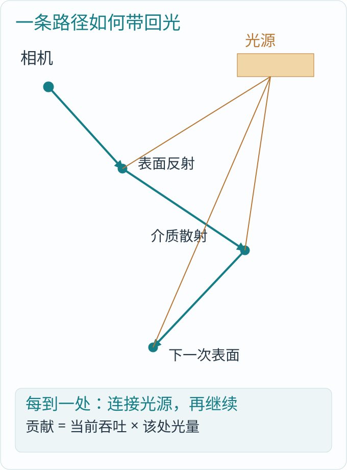

*图 16-1：每次到达事件都可连接光源；继续方向来自表面或相函数。透射改变介质，反射保留所在侧。*

### 16.2 integrate 的主干

`Programs/stella/transport.b::integrate` 对每个内部像素独立执行：先求主命中和第一段介质传播，得到第一份辐亮度；随后在预算内反复散射、遍历、累计。下面保留循环的真实主干：

局部节选，外围未列出：`Programs/stella/transport.b:43`。

```b
u32 round=0;
while(round<segments && path.active){
    path=scatter_hit<N>(path,instances,surfaces,settings,media,textures,ground,seed,round);
    if(path.active){
        path=traverse_path(path,settings,lights,media,scene,overlay_scene,
            floor_present,ground_z,overlay_start,seed,round+1);
        radiance+=path.throughput*hit_radiance<N>(path,instances,surfaces,lights,media,
            scene,overlay_scene,textures,settings,floor_present,ground_z,ground,path.path^seed,
            (round+1)*5+3,round+1<segments,false);
    }
    round+=1;
```

`scatter_hit` 根据事件选择表面散射或体散射；`traverse_path` 查询下一次最近命中，并比较介质自由程；`hit_radiance` 处理环境、可见面光、体事件和普通表面照明。每一层的工作都有明确输入，而不是由一个巨大函数隐式保存全世界状态。

### 16.3 throughput 为什么要一路相乘

吞吐表示从当前路径顶点传回相机时应乘的比例。第一段乘 `.8`，第二段乘 `.5`，路径吞吐就是 `.4`；第三处收到光量十，对像素的贡献是四。

纹理、散射概率、界面透射、介质传播都可能影响这个乘积。若某一层重复乘入相同衰减，画面会无端变暗；若漏掉概率补偿，则可能产生错误能量。沿着 throughput 查每次乘法，是读光传输源码最有效的办法之一。

### 16.4 有限预算不等于完整实时 GI

`BLTransportSettings.segments` 指定允许的附加路径段数。当前 viewer 选择十六，第一次主命中不计入这十六段。这是该入口的计算预算，不是语言常量或所有场景都足够的物理上限。

固定版本已有有限局部多段输运及环境、面光和有限太阳的 MIS。还没有世界采样缓存、跨帧表面历史、重投影和稳定重建；随机种子也固定。不能把“有间接光路径”写成“已经达到完整 Lumen 级实时全局光照”。

## 第十七章 图像形成：线性光怎样变成屏幕像素

### 17.1 当前完整帧有两段设备计算

`Programs/render/frame.b` 的程序体很短：

程序体节选：`Programs/render/frame.b:18`。

```b
integrate<N,W,H,S,IC>(pixels,overlays,cameras,instances,surfaces,lights,lighting,media,
    scene,overlay_scene,textures,floor_present,ground_z,ground,overlay_start,0,Segments);
resolve<W,H,S,DC,IC>(pixels,display);
```

第一段 `integrate` 为内部图像计算线性辐亮度，包含可见性、材质、直接光、后续输运和屏幕矩形合成；第二段 `resolve` 把内部图像变成显示图像。这是当前两段设备程序的组织，不是说引擎只有两件事情。

数学意义上的求交、着色、散射等阶段，在第一段工作项内部通过函数和循环完成。它们没有必要各保存一张跨全屏中间图。源码章节的逻辑层次与 GPU dispatch 的数量应当分开理解。

### 17.2 超采样怎样合成一个像素

阅读案例最终 `3840×2160`，S 为二，内部 `7680×4320`。每个显示像素对应内部二乘二共四个样本；resolve 把这四份线性辐亮度相加后除以四。

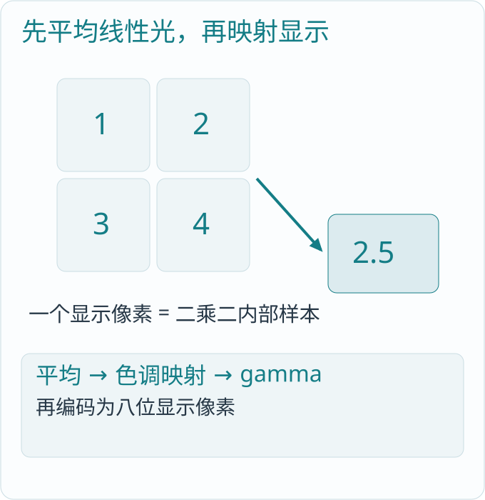

*图 17-1：先在线性光空间平均，再进行显示映射。一个显示像素对应四个内部样本，内部总工作量约为显示的四倍。*

若四个样本为一、二、三、四，平均为二点五。必须在非线性色调映射前平均；先分别压缩高光再平均，一般得不到相同结果。

### 17.3 高动态范围、显示映射与像素编码

resolve 对平均值执行 `radiance/(radiance+1)`，再取约为 `1/2.2` 的幂，将线性光压入显示范围。这是 Reinhard 形式的逐通道压缩加近似 gamma 编码，不是精确的分段 sRGB 传递函数。

随后转成八位通道并打包 BGRA。`BLRenderOutput::save` 下载显示结果，再取出 RGB 写成 PPM。PPM 文件是当前显示结果，不能拿它恢复原来的高动态线性光。

### 17.4 合成不是重新渲染三维模型

`render.composite::composite_at` 把光标、选区等矩形按 alpha 混合进结果，位置使用显示像素坐标。几何背景和覆盖关系由 rectangle 的语义决定。独立空间三维 overlay 则有自己的相机和 TLAS，和这些二维矩形不是同一件事。

当前没有完整透明排序、任意渲染图、运动矢量、时序抗锯齿和屏幕空间重建。二倍内部采样是当前明确的空间超采样输入，不应改称为时序超分辨率。

## 第十八章 执行：B 程序怎样成为真实 CPU/GPU 工作

### 18.1 并行的是数据域，不是主机回调

以相机产生的内部像素为例，`parallel(pixel in pixels)` 为每个像素分配工作，`index()` 给出它在数据域中的编号。每个工作项写自己的 pixel，读取共享场景、材质和图像。

Rust 不逐像素调用函数。它调用 `compile_entry` 取得选定入口的可执行程序，建立真实存储与绑定，再把整个计算域交给后端。CPU 后端生成原生 x64，GPU 后端生成 SPIR-V。`on compute` 的通用计算可以走 CPU 或 GPU；需要 acceleration 的 `on gpu` 程序使用 GPU 能力，不能据此假定整套渲染器也有同样的 CPU 路径。

### 18.2 常量参数与每次输入有什么区别

当前 frame 的 `N、W、H、S、DC、IC、Segments` 是编译专门化参数：纹理数量、显示尺寸、内部倍率、显示与内部记录数、路径预算。它们影响实际程序和数据布局；相机位置等则是每次绘制交付的数据。

同规格输出能共享已编译程序，不同规格输出由 `create_output` 选择相应专门化程序。这比在每个像素里反复询问图像规格更直接，但不代表窗口尺寸变化已经完整实现。编译入口和窗口重建是不同职责。

### 18.3 阶段之间必须看到前一段的结果

frame 中 integrate 写 pixels，resolve 读 pixels。B 编译结果保存这些读写关系，执行框架在实际设备提交中组织阶段和内存可见性。只靠 CPU 先后调用两次函数，并不能自动证明 GPU 已完成前一份写入。

当前 `BLRenderOutput::draw` 的交接如下：

局部节选，外围未列出：`src/output.rs:138`。

```rust
let done = self
    .program
    .submit(
        Bindings {
            datasets,
            accelerations: std::mem::take(&mut inputs.accelerations),
            textures: inputs.textures.clone(),
        },
        &values,
    )?
    .wait()?;
let (bindings, accelerations, timings) = done.into_parts();
```

`Bindings` 汇合本次真正使用的数据集、加速结构和纹理。`.submit()` 交给设备，`.wait()` 等待这次绘制完成，再把世界输入和输出数据归还各自所有者。

### 18.4 布局由编译结果给出

CPU 的 Rust 结构体和 B 的设备结构体不应靠字段名字相同就假定内存相同。`Dataset::field_offset`、`stride` 和对应 view 布局给出实际打包位置，Rust 用它们写入数值位模式。

例如稳定身份是六十四位整数，B 用 `uint2` 的低高三十二位读取，不能转成 f32 再传递。浮点数无法精确表示任意大整数身份；看起来只是换了一个类型，实际会让不同对象混成同一个编号。

### 18.5 去哪里读编译器与后端

语言前端、检查、并行 IR、优化和 x64/SPIR-V 代码生成属于 `BLanguage/crates/blanguage/src`。CPU 原生执行在 `blcompute/src/cpu.rs`；GPU 执行与绑定在 `blcompute/src/vulkan/mod.rs`，实际完成点在 `vulkan/execution.rs`，加速结构在 `vulkan/ray.rs`，呈现在 `vulkan/present.rs`。

这些文件是引擎的基础依赖，不应复制进 BLEngine 再维护第二份。阅读引擎时先走到设备边界，确实需要理解底层执行时再进入语言工程。

## 第十九章 资源与 I/O：创建之后，谁负责把它用完

### 19.1 加载顺序不等于对象身份

多个模型可以并发读取，完成顺序却可能变化。`BLGeometryReads` 的结果带着实际资产编号 `(key,mesh)`；`BLGeometryStore::prepare` 按编号接收，不把第一个到达的结果误当成第一个 placement 的模型。

读取线程通过共享递增下标领取工作；`sync_channel(0)` 让已完成结果直接交给消费者，不建立一个无界模型积压队列。并发数来自调用者预算和实际文件数，没有任务就没有读取线程。

这解决的是并发来源交接。当前 `place` 仍消费本批全部必要来源后返回，不等于引擎能边显示不完整世界边自动做完整流送。

### 19.2 源顶点、构建输入和最终 AS 有不同寿命

模型文件解码后产生 CPU 网格，构建 BLAS 需要位置和索引的设备输入；构建完成后，这些临时输入可以结束使命，而最终 BLAS 必须保留。TLAS 引用 BLAS，在真正使用 TLAS 的 GPU 工作完成前，BLAS 不能被提前释放。

着色另需法线、UV、材质槽位和图像，它们沿实际绑定与只读 view 保持。不能因为 AS 构建完成，就把后续着色还要读取的属性一并释放。

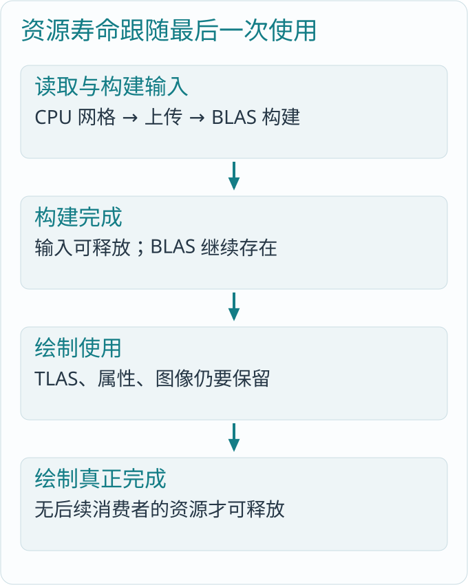

*图 19-1：CPU 调用返回、构建完成、绘制完成是不同时间点。释放跟随最后一个真实消费者。*

Blink 的 `ExecutionResources` 分别持有计算、传输和 AS 构建需要的原生资源；`Execution` 保存完成点和前置依赖，`GpuDataset.last_use` 记录实际最后使用。等待成功后释放已完成工作持有的资源，而不是按“这一帧的 CPU 循环结束了”猜测设备状态。

### 19.3 世界、输出和共享工作图像

世界拥有实例、材质、纹理和 AS；`BLRenderOutput` 拥有自己的显示图像、矩形与相机输入。当前同步绘制使用的内部线性 pixels 由 renderer 共享，不为每个输出复制一份无并行消费者的全屏工作图像。

因此多个相机可以共享世界和同规格程序，但各自需要独立显示图像。`render-views` 顺序导出时复用一份输出；`view-views` 为多个原生窗口各建输出。它们仍按顺序 draw，不是已经具备并发多视图调度。

### 19.4 内存数字要说明口径

数据记录数乘步长是逻辑容量；Vulkan 分配可能因页和对齐大于逻辑容量；驱动显示的总显存还包含别的资源。三个数字不能混报。

例如一张 4K 四字节显示图像约三十三 MB，内部 8K 的线性 pixels 又是另一份数据。共享世界不能在每个输出账上重复相加，也不能因为删除全屏中间命中数据，就宣称驱动总显存必然下降相同数量。

## 第二十章 窗口、输入与呈现：让图像成为应用的一帧

### 20.1 一个 UI 所有者处理整条消息队列

`BLWindowSystem` 注册原生窗口类，并处理创建线程的消息队列。每个 `BLWindow` 保存自己的导航、关闭状态和输入上下文。窗口不是各自偷偷启动一个消息循环；同一 UI 线程统一派发，事件携带实际窗口身份。

`poll_with` 的核心是：

局部节选，外围未列出：`src/window.rs:279`。

```rust
let got = PeekMessageW(&mut message, std::ptr::null_mut(), 0, 0, 1);
// PeekMessage会先派发非队列消息，其输入也交给原目标窗口的消费者。
self.deliver(None, &mut input)?;
if got == 0 {
    break;
}
if message.message == 0x12 {
    self.class.quit.set(true);
    break;
}
DispatchMessageW(&message);
if !self.deliver(Some(BLWindowId(message.window)), &mut input)? {
    TranslateMessage(&message);
```

消费者处理某个窗口的按键，不应让另一个窗口丢失文字转换。Win32 还可能在调用中重入窗口过程，因此跨原生调用不能一直持有对同一状态的独占可变借用。这些是平台资源和回调的真实约束，不是三维算法。

### 20.2 三维计算与平台输入怎样衔接

导航窗口把方向键、滚轮变成 yaw、pitch、distance；文本窗口把文字、命令和输入法事件交给编辑器。相机计算仍在 B，编辑器命令与文档修改仍在消费方。不同应用可以共用引擎窗口设施，不必共用一套编辑业务状态。

最小化窗口不绘制；当全部窗口都没有绘制工作时，应用等待真实输入。关闭一个窗口只结束该窗口；线程级 WM_QUIT 则表示整个 UI 所有者的退出事实。

### 20.3 交换链并不拥有整个世界

`blcompute::vulkan::Swapchain` 消费原窗口句柄和显示数据。当前呈现把已完成显示结果送到实际交换链图像，再交给窗口系统。它不重新计算场景，不拥有编辑文档，也不能在窗口销毁后继续使用旧句柄。

`BLNativeView` 按交换链、输出、窗口的顺序保存字段，释放时先结束呈现相关资源，再销毁原生窗口。图形对象和窗口生命周期对齐，才有真实可用的多窗口应用。

### 20.4 DPI 和目标尺寸不是一回事

源码使用线程 DPI 上下文处理实际窗口和呈现边界，避免宿主进程的设置影响像素尺寸。当前阅读场景仍明确为 4K 输出、8K 内部采样。DPI 处理不代表支持任意动态 extent，也不应通过缩小目标绕过渲染规格。

当前有多窗口、原生输入和呈现，动态调整窗口尺寸、OutOfDate 重建和完整异步视图仍未完成。本章按源码分析窗口机制，配套新运行记录是离屏帧与多相机导出，不把它冒充本次已运行的窗口验证。

## 第二十一章 模拟：计算更新和渲染更新为什么要分开

### 21.1 最小的动力学状态

`Programs/simulation/bodies` 保存位置、速度与能量。每步先由位置计算加速度，更新速度，再用新速度更新位置：

源码：`Programs/simulation/bodies.b:3`。

```b
void integrate_body<T: floating, const Power: u32 in {1, 2, 3}>(inout BLBody<T, Power> body, f32 dt, f32 strength) on compute {
    body.velocity += central_acceleration<Power>(body.position, strength) * dt;
    body.position += body.velocity * dt;
}
```

这属于半隐式 Euler 积分。若原速度为一、加速度为二、dt 为 `.5`，新速度为二，位置增加一。若改用旧速度更新位置，位置只增加 `.5`；两者不是单纯换行，而是不同数值方法。

`central_acceleration` 提供中心力场，当前软化长度平方为 `.25`，避免中心势在原点发散。这是该力场算法的实际参数，不是平台或语言边界；不能由这个例子推导出完整刚体物理。

### 21.2 并行更新与整体归约

每个 body 读写自己的状态，所以位置和速度更新可以并行。总动能却依赖所有 body，必须归约：

源码：`Programs/simulation/statistics.b:7`。

```b
program step_and_total(inout dataset<BLBody<float3, 3>> bodies, write dataset<BLTotal, 1> total, f32 dt, f32 strength) on compute {
    step(bodies, dt, strength);
    total_energy(bodies, total);
}
```

`step` 产生新状态与单体能量，`total_energy` 消费这些结果。B 把两类工作写在同一依赖顺序里，Rust 负责分配真实数据和连续提交。

一千二百步在这里表示物理时间演化，不是为了把跑分数字放大而无意义地重复同一个答案。dt 为 `1/120` 秒时，它模拟十秒；每一步的位置和速度都影响下一步。

### 21.3 当前一百万粒子的真实运行

同一固定源、同一初值、一千二百个时间步，Release 原生运行如下。CPU 路径为原生多核 B，GPU 路径使状态驻留设备并在一次提交内推进。

| 口径 | CPU | GPU |
|---|---|---|
| 程序内部执行计时 | 1214.745 ms，CPU 墙钟 | 114.413 ms，GPU 设备时间 |
| total_ms，同一命令计时范围 | 1228.396 ms | 369.908 ms |
| 总动能输出 | 63477.54 | 63477.547 |

`total_ms` 包含各后端准备、执行、必要传输和输出写入，不包含共同的初值创建。按这一同口径范围，GPU 约为 CPU 的 **3.32 倍**。上行内部计时分别属于 CPU 墙钟和 GPU 时间戳，不能拿它替换同口径端到端加速比。

数值结果保留真实浮点差异，不能把近似相等写成逐位相同。并行归约顺序、后端计算和舍入都会影响末位；需要按算法用途分析误差，而不是把日志改成一致。

### 21.4 距离完整物理系统还有什么

刚体还需要质量与惯性、碰撞形状、宽阶段和窄阶段检测、接触生成、约束求解以及休眠等机制；软体和流体又有不同状态与求解器。当前源码只有这类基本粒子动力学、能量归约和通用网格查询，没有完整碰撞与约束系统。

渲染查询能回答一条射线命中哪个三角形，并不能直接替代连续碰撞、接触稳定性和动力学求解。把更新状态和观察状态分开，才能看清引擎下一步真正缺少哪种算法。

## 第二十二章 编辑器与软件宇宙：引擎怎样接入真实消费者

### 22.1 编辑状态不能搬进渲染器

`src/editor.rs` 加载 BLEditor DLL，通过既有 ABI 接收显示列表和三维字形摆放。文档、光标、排版、命令、插件和软件项目分析仍由编辑器拥有；引擎消费矩形、placement 和输入交接，不再次决定文本该怎样断行。

这和场景文件入口是两种来源。独立 `render/view` 不需要 BLEditor DLL；编辑器接入也不能为了获得某个通用渲染能力，把算法复制进消费方。

### 22.2 显示列表怎样变成几何实例

字形模型和度量由正式资产提供。`place_editor_scene` 将已有字形摆放转换成实例矩阵，正文、状态栏和独立空间使用各自明确输入。它不能用一条矩形代替真实三维字形，再把结果叫作产品渲染完成。

`BLFrame` 是跨 DLL 的临时借用，不能在消费方已经释放或更新后继续读里面的指针。`BLSnapshot` 和实际线程交接保存本次渲染所需数据；`BLPresented` 记录真正呈现结果。CPU 生产了一份显示列表，不等于 GPU 已经显示这一帧。

### 22.3 软件宇宙是消费者，不是通用场景的固定分类

`src/universe.rs` 消费软件项目分析结果，把节点、关系和标签转换成球体、连接几何与三维字形。节点到底代表包、源码单元还是资源集合，应由通用项目分析器决定；引擎只接收形状、变换和实际几何关系。

`Programs/scene/universe.b::place` 计算球和连接的变换。连接通过起终点差建立长度方向，再用叉积构造横向基，正是第二章矩阵知识在真实消费者中的运用。

### 22.4 当前拾取和通用网格查询是两条实际路径

软件宇宙当前 `scene.pick` 使用节点球和标签矩形做命中，再通过归约选择最近结果：

源码：`Programs/scene/pick.b:36`。

```b
program pick<const W:u32,const H:u32>(read dataset<BLNode> nodes, write dataset<BLResult,1> result,
             float3 eye, float3 right, float3 up, float3 forward, f32 tangent, float2 pointer) on compute {
    reduce_map(nodes.target,result.hit,bind(intersect<W,H>,eye,right,up,forward,tangent,pointer),no_hit,nearest);
}
```

`nearest` 对相同距离按节点编号排序，保证该选择规则明确。标签的矩形测试在屏幕空间，球的相交在三维空间，二者转换到同一相机射线距离后比较。

第六章的 `scene.query` 则查询真实三角形 AS。固定版本尚未把全部消费者选择迁移到通用网格查询；“引擎已有 API”不能写成“编辑器已经使用并完成”。

### 22.5 标签布局也有可读的算法代价

`scene.labels::project` 把三维中心投到像素，生成标签矩形；`choose` 为每个标签遍历其他标签，按优先级、深度与节点编号判断遮挡。它直观、容易分析，但最坏为平方级比较。

这里没有现成空间索引或完整标签优化器。阅读源码时要同时看“结果怎样得到”和“随着数据量增加，工作怎样增长”，不能把 `parallel` 当成算法复杂度已经消失。

## 第二十三章 从文件到一帧：实际编译与运行

### 23.1 先取得语言与引擎

Blink 的公开地址是 https://github.com/sgua83/Blink 。在准备放置两个工程的父目录执行：

```powershell
git clone `
  https://github.com/sgua83/Blink.git `
  BLanguage
```

BLEngine 当前需从其授权 P4 工程取得。完整目录应是相邻的 `BLanguage` 与 `BLEngine`，因为引擎的 Cargo 依赖指向 `../BLanguage/crates`。当前公开仓库没有完整引擎源码，读者若只持有 Blink，可以阅读本书与案例，但不能执行下面的引擎构建。

Windows x64 环境需要 Rust stable 的 MSVC 工具链与 Visual Studio C++ 桌面开发工具。打开 x64 Developer PowerShell，在 BLEngine 根目录直接构建：

```powershell
cargo build --release
.\target\release\blengine.exe device
```

Cargo 会构建所引用的 Blink 库和引擎，不需要额外的书籍启动器、命令别名或环境变量映射。GPU 渲染需要驱动实际提供 Vulkan 加速结构、光线查询及当前程序所用能力；引擎运行不依赖第三方着色编译器或 Vulkan SDK。

### 23.2 准备同一个阅读场景

以下命令均在 BLEngine 根目录执行。`Saved/Scene` 首次创建，之后沿用。

```powershell
New-Item -ItemType Directory `
  -Path Saved/Scene
Copy-Item `
  ../BLanguage/sample/engine/assets/* `
  Saved/Scene
.\target\release\blengine.exe cook `
  Saved/Scene/cube.obj `
  Saved/Scene/cube.blgeom
.\target\release\blengine.exe `
  cook-scene `
  Saved/Scene/reading.blscene.txt `
  Saved/Scene/reading.blscene
.\target\release\blengine.exe render `
  Saved/Scene/reading.blscene `
  Saved/Scene/frame.ppm
```

第一条转换读 OBJ 的原位置、法线和 UV，建立 BLGEOM；第二条建立节点和组件资产；最后一条加载场景、求值世界、建立资源、绘制并保存。可执行文件就是引擎的正式命令行程序，每个子命令完成一件明确工作。

### 23.3 真正执行的结果

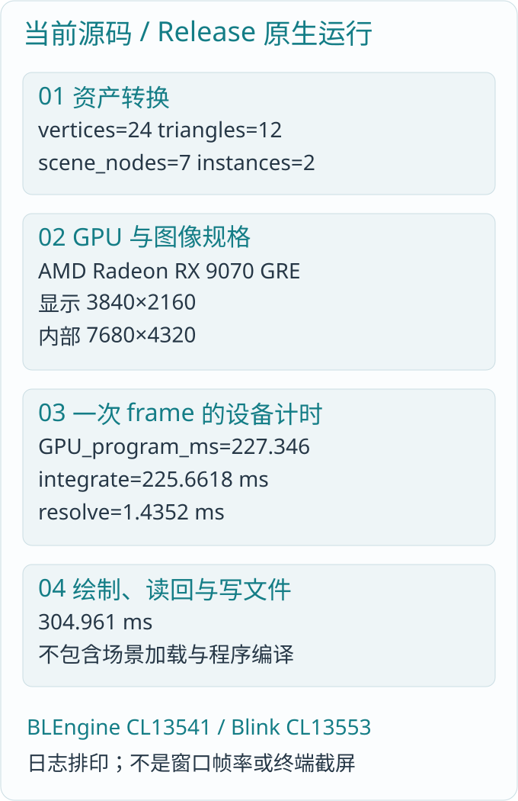

*图 23-1：固定源码 Release 原生日志排印，非终端截屏。GPU 两段时间分别来自 integrate 与 resolve；完整原始记录见 engine/运行记录.txt。*

实际设备为 AMD Radeon RX 9070 GRE。输出是 `3840×2160`，内部为 `7680×4320`。一次 frame 的 GPU 程序跨度为 **46.898 ms**，两段时间为 **45.45448、1.41876 ms**；绘制、读回和写文件合计 **180.977 ms**。此范围不含前面的场景加载、源程序编译及资源准备，也不是窗口产品帧率。

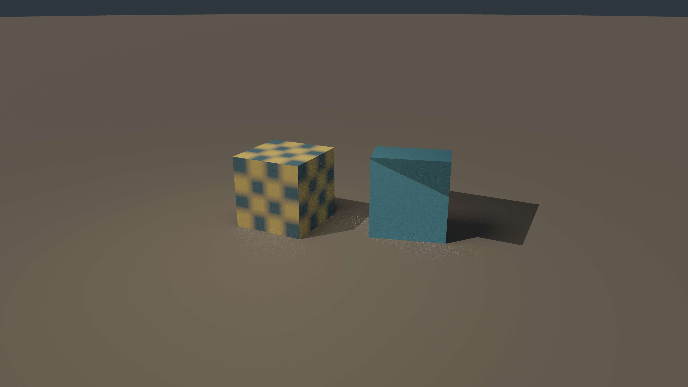

*图 23-2：本次固定源码原生 PPM 转换的完整 4K 输出。两个物体共用一个立方体模型；左侧使用棋盘表面，右侧选择蓝色表面。PDF 按页面缩放展示，配套 PNG 保留原分辨率。*

模型只有十二个三角形，这份画面用于观察关系与代码结果，不是超高精度字形、天然玉石或大型场景的品质与性能证明。

### 23.4 用第二台相机检查空间理解

```powershell
.\target\release\blengine.exe `
  render-views `
  Saved/Scene/reading.blscene `
  Saved/Scene/views
```

场景只加载一次，相机依次绘制到同一输出，文件名为 `camera-<节点下标>.ppm`。本场景相机下标为三和四。两视图 GPU 程序跨度之和为 **98.290 ms**，绘制、读回与文件写入共 **342.771 ms**。

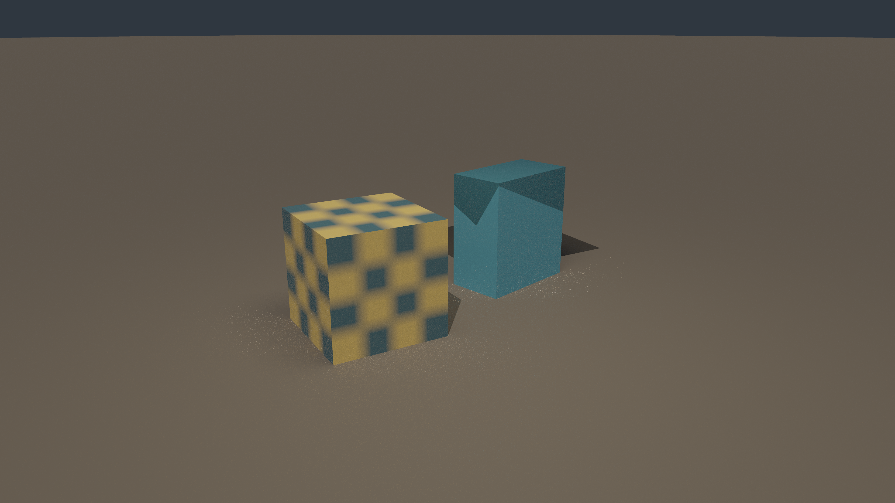

*图 23-3：相同世界从第二台相机观察，模型、材质和灯光没有为这张图另建一套。*

还可以执行 `blengine.exe view` 建立单窗口，或执行 `view-views` 为多相机建立多个窗口。当前新记录没有执行这两条交互入口，因此其行为分析来自固定源码，而非本次运行画面的推断。

### 23.5 运行模拟并读取计时

```powershell
.\target\release\blengine.exe simulate `
  cpu 1000000 1200 `
  Saved/Scene/bodies-cpu.bldata
.\target\release\blengine.exe simulate `
  gpu 1000000 1200 `
  Saved/Scene/bodies-gpu.bldata
```

一百万是粒子数量，一千二百是物理步数，结果与计时见第二十一章。图像保存和模拟保存都是正式命令的输出，不需要把书籍目录当成另一套程序框架。

## 第二十四章 源码结构：按职责找到真正的入口

### 24.1 Rust 源码按所有者阅读

| 路径 | 负责什么 | 建议先读的入口 |
|---|---|---|
| `src/main.rs` | 正式命令与输入参数 | `run`、`cook` |
| `src/math.rs` | CPU 几何基础量 | `BLVec3`、`BLBounds` |
| `src/hierarchy.rs` | 节点源、身份和修改 | `BLScene`、`BLScenePrograms` |
| `src/components.rs` | 节点组件数据交接 | `BLComponentPrograms::evaluate` |
| `src/identity.rs` | 实例运行身份 | `BLInstanceId::new` |
| `src/geometry.rs` | 原模型与文件格式 | `read_obj`、`read_cooked` |
| `src/geometry_io.rs` | 并发几何来源 | `BLGeometryReads` |
| `src/scene_asset.rs` | 场景文件与源转换 | `read`、`write`、`cook` |
| `src/material.rs` | 材质读取与真实布局打包 | `BLPalette`、`BLAssignments` |
| `src/lighting.rs` | 光源描述与打包 | `BLLighting::datasets` |
| `src/scene.rs` | 几何驻留、实例和属性 | `BLGeometryStore::prepare` |
| `src/render.rs` | 世界设备资源与程序 | `place`、`draw_to` |
| `src/output.rs` | 显示图像和视图输入 | `draw`、`save` |
| `src/view.rs` | 输出规格与相机交接 | `BLRenderTarget`、`BLCameraPrograms` |
| `src/viewer.rs` | 独立场景运行 | `load`、`render_file`、`view_scene` |
| `src/window.rs` | 原生窗口、输入和消息泵 | `BLWindowSystem` |
| `src/editor.rs` | 编辑器 DLL 消费适配 | `view`、`place_editor_scene` |
| `src/universe.rs` | 软件宇宙结果适配 | `prepare`、`pick` |
| `src/labels.rs` | 标签到真实字形摆放 | `BLLabelPrograms` |
| `src/primitives.rs` | 消费者使用的程序化几何 | 球与连接模型构造 |
| `src/clipboard.rs` | 平台剪贴板 | Win32 文本交接 |
| `src/json.rs` | 现有消费协议解析 | JSON 值与解析器 |
| `src/lib.rs` | 库模块与公共导出 | 模块声明 |

主入口不是最大的文件。分析一个问题，应先找实际所有者，再追到计算核。例如世界矩阵错误先看节点源和 `hierarchy.resolve`；不要先去窗口呈现里修补画面。

### 24.2 B 源码按计算关系阅读

| 目录 | 主要实现 | 输入与输出 |
|---|---|---|
| `Programs/math` | 变换与中心力场 | 数学量到数学量 |
| `Programs/geometry` | 基本几何、命中法线 | 边与矩阵到法线 |
| `Programs/scene` | 层级、组件、相机、实例、查询、标签与消费方摆放 | 源节点到世界结果；光线到命中 |
| `Programs/material` | 纹理、GGX、介电、导体、介质与相函数 | 局部表面到响应、概率和方向 |
| `Programs/lighting` | 灯光、环境、可见发光体与采样 | 灯描述到方向和入射量 |
| `Programs/sampling` | 哈希、正交基、MIS | 路径键到样本与权重 |
| `Programs/stella` | 可见性、表面重建、光照、散射、遍历与有限输运 | 场景到线性辐亮度 |
| `Programs/render` | frame、合成和 resolve | 内部辐亮度到显示像素 |
| `Programs/simulation` | 动力学与总能量 | 上一时刻状态到下一时刻 |

每个模块通常以 `.h` 声明接口、以 `.b` 提供实现。先看输入、输出和调用关系，再看结构字段，能避免读完大量定义仍不知道它们为什么存在。

### 24.3 一帧的完整调用链

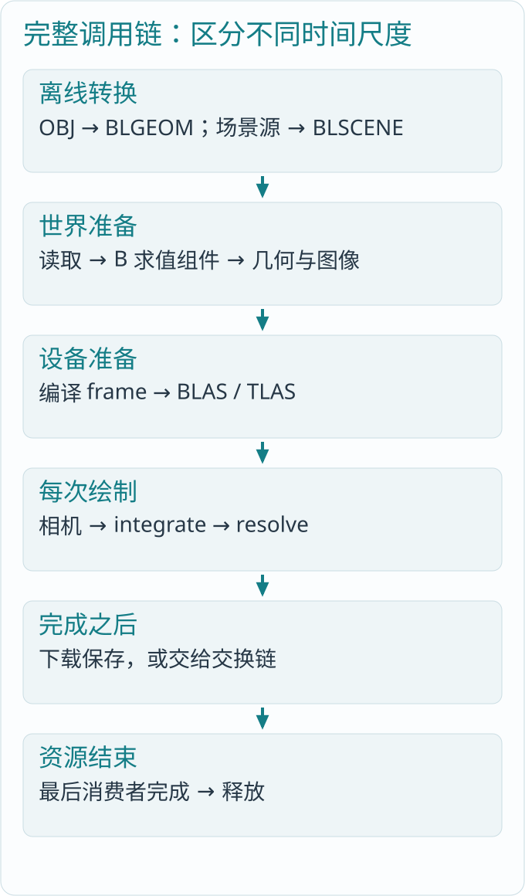

*图 24-1：离线转换、世界准备、每次绘制、保存呈现属于不同时间尺度。不能把所有步骤都算成每帧必须重复。*

沿 `main → viewer::render_file → load` 进入：读取资产、B 求值组件、编译 frame、建立材质图像、按实际缺少资产取得几何、建立 BLAS/TLAS。随后创建输出，B 计算相机，`draw_to → output.draw` 提交 integrate 与 resolve。完成后 save 下载显示图像；窗口路径则把显示数据交给交换链。

这条链解释了为什么设备时间戳不包含全部启动成本，也解释了为什么同一个世界、多次相机绘制不应每次都重新读模型和复制 BLAS。

### 24.4 注释、文档与实际代码的优先顺序

固定源码的 `scene_asset.rs` 顶部注释仍写 v6，实际 `const VERSION` 已为七，读写字段也含起始介质。遇到这种情况，应对照常量、解析和实际文件，而不是只照抄注释。

源码分析同样不能只复述问题列表。每个能力应回到定义、调用者和原生执行范围：函数存在表示有实现，实际入口调用才说明接通，运行日志说明运行过，最终产品效果仍需对应场景验证。

## 第二十五章 完整引擎还需要哪些部分

### 25.1 先用全景图定位，再判断实现程度

| 领域 | 固定版本的实际位置与能力 | 仍未完成的主要部分 |
|---|---|---|
| 数学与变换 | 向量、矩阵、仿射、法线、相机基、射线 | 更广的数学工具与专门算法按实际需求补齐 |
| 场景与组件 | 森林、稳定运行身份、几何／相机／灯、显式更新 | 脏子树、完整设备自主更新与独立 GPU 场景 |
| 可见性与查询 | 主射线、阴影、BLAS/TLAS、批量网格查询 | 独立场景剔除、遮挡层级、完整选择迁移 |
| 资产与几何 | OBJ、原精度 BLGEOM、自有场景和材质 | FBX、骨骼／动画导入、虚拟几何与完整流送 |
| 材质与纹理 | 基础色、粗糙度通道、切线法线、三类表面 | 材质图、完整分层模型、多库与热更新 |
| 光照与输运 | 解析灯、有限太阳、阴影、有限局部多段路径 | 方向天空、任意发光网格及其分布、稳定实时 GI |
| 体积 | 均匀吸收、自由程、HG 散射 | 异质密度场、自动区域、完整玉石外观 |
| 图像与后处理 | 空间超采样、色调映射、gamma 近似、矩形合成 | 运动矢量、时序重建、完整透明和后处理图 |
| 模拟与物理 | 粒子中心力场、积分、能量归约 | 刚体、接触约束、连续碰撞、软体与流体系统 |
| 平台与运行 | Windows x64、Vulkan、原生多窗口与输入 | 动态 extent、完整异步多视图及其他平台适配 |
| 编辑器消费 | DLL 显示输入、真实字形、宇宙与标签适配 | BLEditor 全部功能与最终效果恢复 |
| 动画与骨骼 | 当前无完整实现 | 轨道、混合、骨架、蒙皮、姿态与运动对应 |
| 音频与网络 | 当前无对应运行子系统 | 混音、空间声、连接协议、状态同步等 |
| 内容工具 | 几何与场景显式转换 | 完整编辑、资产数据库、打包与内容迭代工具 |

这张表的目的不是给每项打一个“支持”勾，而是让读者知道数据应该在哪里、现有代码承担了多少职责，以及缺口是否真的存在。

### 25.2 动画为何不是给矩阵加几个关键帧就结束

节点动画需要按时间采样平移、旋转与缩放轨道，解决插值和混合，再把结果交给场景层级。骨骼动画还要保存绑定姿态与逆绑定矩阵，让顶点按骨骼权重变形；蒙皮后的几何和法线必须进入实际渲染与加速结构更新。

当前节点可改本地矩阵，为接入动画提供了输入位置，但没有上述轨道、骨架和蒙皮实现。帧间运动还涉及历史表面对应；仅有稳定实例身份不能推导出顶点如何移动。

### 25.3 场景流送为何不是异步读文件就完成

完整流送需要由真实消费者产生需求，判断哪份几何和图像应驻留，完成读取、解码、上传和设备引用切换，再在最后消费结束后释放旧资源。若还涉及虚拟几何或纹理，还要处理页级地址和细节选择。

当前有并发几何来源、实际 GPU 页存储和异步资源完成关系，但没有完整需求驱动流送。B 适合表达工作集、优先级与数据计算，Rust 负责真实文件和设备资源；无须为了“像一个大引擎”另造第二份场景状态或常驻调度服务。

### 25.4 性能要回到算法和实际消费者

如果层级很深，先看祖先重复遍历；标签很多，先看平方级重叠比较；输运太贵，先分清主命中、阴影样本和后续段的工作；显存增长，先看哪个真实输出或在途消费者仍持有资源。

不能用降低内部采样、简化高精度模型或牺牲材质效果来冒充同画质优化。当前主要任务是完成通用引擎能力并恢复消费者的完整功能与效果，六十帧目标属于后续逐步优化；本书的一次简单场景计时不能替代产品结论。

引擎的整体感来自这些关系能够闭合：数学把几何放到正确位置，场景描述对象及其关系，光传输决定可见量，执行框架把计算交给真实设备，所有者让资源活到最后一次使用。读懂一个核心函数之后，再把它放回这张全景图，才算读懂它在引擎中的意义。

## 附录 A 源码节选与版本定位

正文每份源码节选均标出路径、符号或行号。以下索引按固定 CL13031 建立；完整逐文件修订、提交号和 SHA256 见 `engine/源码版本索引.json`。同一 P4 changelist 快照内，各文件最后修改的 CL 可以不同，不表示混用了未提交源码。

设备框架说明以 Blink CL13046 的 `blcompute/src/cpu.rs`、`vulkan/mod.rs`、`vulkan/ray.rs`、`vulkan/execution.rs` 和 `vulkan/present.rs` 为准。当前工作区可能继续演进，阅读固定版本可避免把后来拆分的文件误认为书中已经存在。

| 源码路径 | 固定修订 |
|---|---|
| `src/clipboard.rs` | #2，最后修改 CL12904 |
| `src/components.rs` | #2，最后修改 CL13009 |
| `src/editor.rs` | #21，最后修改 CL13031 |
| `src/geometry.rs` | #4，最后修改 CL12941 |
| `src/geometry_io.rs` | #1，最后修改 CL12958 |
| `src/hierarchy.rs` | #5，最后修改 CL13031 |
| `src/identity.rs` | #1，最后修改 CL13031 |
| `src/json.rs` | #3，最后修改 CL12904 |
| `src/labels.rs` | #6，最后修改 CL13031 |
| `src/lib.rs` | #15，最后修改 CL13031 |
| `src/lighting.rs` | #3，最后修改 CL13019 |
| `src/main.rs` | #17，最后修改 CL12954 |
| `src/material.rs` | #7，最后修改 CL13029 |
| `src/math.rs` | #2，最后修改 CL12904 |
| `src/output.rs` | #7，最后修改 CL13024 |
| `src/primitives.rs` | #2，最后修改 CL12904 |
| `src/render.rs` | #27，最后修改 CL13031 |
| `src/scene.rs` | #16，最后修改 CL13031 |
| `src/scene_asset.rs` | #8，最后修改 CL13009 |
| `src/universe.rs` | #9，最后修改 CL13031 |
| `src/view.rs` | #5，最后修改 CL13013 |
| `src/viewer.rs` | #9，最后修改 CL13013 |
| `src/window.rs` | #5，最后修改 CL12954 |
| `Programs/geometry/normals`（.b / .h） | .b #1 CL13031；.h #1 CL13031 |
| `Programs/geometry/primitives`（.b / .h） | .b #2 CL12904；.h #2 CL12904 |
| `Programs/lighting/environment`（.b / .h） | .b #3 CL13013；.h #2 CL13009 |
| `Programs/lighting/lights`（.b / .h） | .b #6 CL13019；.h #6 CL13019 |
| `Programs/material/conductor`（.b / .h） | .b #1 CL13029；.h #1 CL13029 |
| `Programs/material/dielectric`（.b / .h） | .b #1 CL13009；.h #1 CL13009 |
| `Programs/material/maps`（.b / .h） | .b #1 CL13026；.h #1 CL13026 |
| `Programs/material/medium`（.b / .h） | .b #2 CL13013；.h #2 CL13013 |
| `Programs/material/microfacet`（.b / .h） | .b #1 CL13009；.h #1 CL13009 |
| `Programs/material/palette`（.b / .h） | .b #1 CL12874；.h #5 CL13029 |
| `Programs/material/phase`（.b / .h） | .b #1 CL13013；.h #1 CL13013 |
| `Programs/material/scattering`（.b / .h） | .b #1 CL13009；.h #3 CL13029 |
| `Programs/material/surface`（.b / .h） | .b #7 CL13029；.h #5 CL13029 |
| `Programs/material/textured`（.b / .h） | .b #6 CL13029；.h #5 CL13029 |
| `Programs/math/field`（.b / .h） | .b #3 CL12835；.h #3 CL12835 |
| `Programs/math/transform`（.b / .h） | .b #2 CL12904；.h #2 CL12904 |
| `Programs/render/composite`（.b / .h） | .b #3 CL13015；.h #2 CL13015 |
| `Programs/render/frame`（.b / .h） | .b #21 CL13026；.h #19 CL13031 |
| `Programs/render/resolve`（.b / .h） | .b #4 CL12914；.h #5 CL12969 |
| `Programs/sampling/frame`（.b / .h） | .b #1 CL12997；.h #1 CL12997 |
| `Programs/sampling/mis`（.b / .h） | .b #1 CL12997；.h #1 CL12997 |
| `Programs/sampling/random`（.b / .h） | .b #1 CL12973；.h #1 CL12973 |
| `Programs/scene/camera`（.b / .h） | .b #2 CL13009；.h #2 CL13009 |
| `Programs/scene/components`（.b / .h） | .b #2 CL13019；.h #2 CL13009 |
| `Programs/scene/device`（.b / .h） | .b #2 CL13024；.h #2 CL13024 |
| `Programs/scene/hierarchy`（.b / .h） | .b #1 CL12925；.h #1 CL12925 |
| `Programs/scene/instance`（.b / .h） | .b #1 CL13031；.h #1 CL13031 |
| `Programs/scene/labels`（.b / .h） | .b #3 CL12914；.h #3 CL12914 |
| `Programs/scene/pick`（.b / .h） | .b #4 CL12914；.h #4 CL12914 |
| `Programs/scene/query`（.b / .h） | .b #1 CL13031；.h #1 CL13031 |
| `Programs/scene/transforms`（.h） | .h #4 CL13024 |
| `Programs/scene/universe`（.b / .h） | .b #3 CL12914；.h #3 CL12914 |
| `Programs/simulation/bodies`（.b / .h） | .b #9 CL12904；.h #8 CL12904 |
| `Programs/simulation/statistics`（.b / .h） | .b #4 CL12904；.h #4 CL12904 |
| `Programs/stella/lighting`（.b / .h） | .b #12 CL13026；.h #13 CL13031 |
| `Programs/stella/scattering`（.b / .h） | .b #8 CL13024；.h #6 CL13013 |
| `Programs/stella/surface`（.b / .h） | .b #7 CL13029；.h #9 CL13031 |
| `Programs/stella/transport`（.b / .h） | .b #9 CL13026；.h #9 CL13031 |
| `Programs/stella/traversal`（.b / .h） | .b #9 CL13024；.h #9 CL13024 |
| `Programs/stella/visibility`（.b / .h） | .b #7 CL13031；.h #6 CL13031 |
| `Programs/stella/volume`（.b / .h） | .b #2 CL13024；.h #1 CL13013 |

## 附录 B 阅读练习与答案

1. 子节点先沿本地 x 平移二，父节点再绕 z 轴旋转九十度，子节点原点在父旋转后的哪里？答案是 `(0,2,0)`；若把父旋转与子平移交换，则是 `(2,0,0)`。这正是乘法顺序的作用。

2. 透视相机一条射线与 forward 成六十度，沿射线 t 为十时，前向深度是多少？答案是五；当前 near/far 是沿线区间，不能直接按相机深度平面理解。

3. 同一个模型分别使用棋盘和蓝色材质，应复制哪份资源？不复制 BLAS 和原三角形；两个实例保存各自材质选择，并引用相应槽位表。

4. 把一个已经删除节点的槽位交给新节点，旧 ID 是否仍有效？无效；槽位相同而运行身份不同，不能把新对象当成旧对象。

5. 路径当前吞吐为 `.4`，本次散射返回 weight 为 `.25`，新吞吐是多少？答案是 `.1`；若下一处收到光量二，累计贡献为 `.2`，不再额外除同一 PDF。

6. 四十七毫秒的 GPU 帧程序能否证明完整编辑器帧率？不能；离屏案例不是完整产品，设备计时也不包含全部应用工作。

7. 有 `set_transform` 就有骨骼动画吗？没有。还需轨道、骨架、蒙皮、几何更新及真实接入。

## 附录 C 许可与运行材料

BLEngine 源码节选遵守 MIT License，版权和完整许可见 `engine/BLEngine-LICENSE.txt`。数学推导、执行图与解释服务于源码阅读；示意图不冒充产品运行截图。

`engine/assets` 提供正式阅读输入。`engine/运行记录.txt` 保留本次 Release 构建路径、设备、命令、原始输出与图像哈希。正文运行卡片按这些日志排印，主视图与侧视图由真实完整 PPM 转换，未拼接或重新绘制模型。

本书的 Markdown 与两种中文版 PDF 同步保存在项目 sample 目录。手机阅读版采用单栏、大字号与纵向图示；标准版保留适合桌面阅读和打印的页面宽度。
