# Blink 和 Rust 混合编程

## 从四个数开始，一步一步写出完整程序

这本书讲一件具体的事：怎样在 Rust 程序中使用 Blink 写的算法。

Rust 程序可以读取文件、响应输入、管理对象；其中需要大量计算的部分，可以交给 Blink。算完以后，Rust 再使用结果，继续完成应用的工作。Blink 简称 B。后文说“B 程序”，就是用 Blink 写的计算程序。

我们先处理四个数。Rust 提供输入，B 做一次“乘二加一”，Rust 打印结果。把这个小程序的文件、编译和调用全部弄清楚，再逐步学习粒子模拟、场景变换和材质图像。

开源项目与全部配套源码：

[https://github.com/sgua83/Blink](https://github.com/sgua83/Blink)

本书面向会写 C/C++ 或基础 Rust 的读者。第一本《并行编程的艺术》介绍 B 的并行写法；这里更关心怎样把它用到一个 Rust 项目里。第三本《BLEngine 源码分析》再专门讨论引擎架构。

### 怎样使用这本书

第一、二章给出一个完整的 DLL 调用例子。第三章进入 Rust 原生接口，从加载 B 文件一直写到读取粒子结果。后面逐步增加连续计算、共享模型、场景和纹理；第十三章把这些内容用来生成一张可以打开的图片。

书中的命令均在 Blink 仓库根目录执行，直接写出 exe 路径。每个 exe 都是一个有具体用途的示例程序。源码在 sample/hybrid 中，不需要另外安装 BLEngine 或配置 P4。

书中的独立教学模块以仓库现行 sample/hybrid 为准，采用当前统一函数语法，并由本轮 Blink Release 工具实际编译。它们演示粒子、变换、GGX 与图像组合；当前 BLEngine 的完整场景、Stella 和资源交接另见《BLEngine 源码分析》。Rust 节选省去与当节无关的计时或界面部分，完整示例注明真实路径。

版本：2026 年 10 月 27 日。运行环境为 Windows x64，Blink v0.1。原始运行记录保存在 sample/hybrid/运行记录.txt，源码出处见同目录的 BLEngine摘录来源.md。

## 1　让 Rust 调用一个 B 算法

### 1.1　这次要得到什么结果

有四个数：1、2、3、4。每个数先乘二，再加一。算完应当得到 3、5、7、9。

只用 Rust 时，计算部分可以这样写：

```rust
for value in &mut values {
    *value = *value * 2.0 + 1.0;
}
```

我们把这一小段计算移到 B 中。Rust 仍然创建 values 数组，仍然打印它；中间改成调用 B 写的算法。

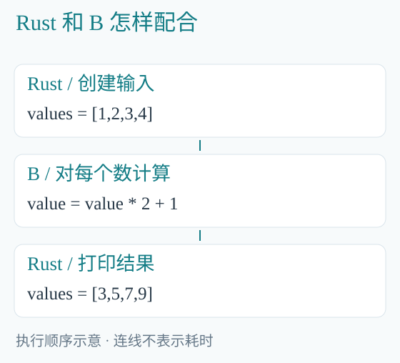

*图 1-1　两种语言共同完成一次数组处理。图中的数值可以直接手算。*

### 1.2　先看需要自己写的三个文件

本章源码在 sample/hybrid/first：

```text
first/
  numbers.h   声明 B 的调用入口
  numbers.b   实现乘二加一
  main.rs     Rust 准备输入并调用
```

三个文件都在下面完整列出。先读它们，再执行后面的编译命令。

### 1.3　numbers.h：说明算法接收什么

```c
module numbers;

void transform(
    inout dataset<f32> values
) on compute;
```

module numbers 给这组 B 代码起名。transform 是公开的计算入口。dataset<f32> 表示一组 32 位浮点数，参数名为 values。

inout 表示既读又写：算法读取原来的数，再把新值写回。on compute 表示这个计算可以交给 CPU 或 GPU 后端执行。

这里的 .h 是 B 的接口文件，由 Blink 编译器读取。

### 1.4　numbers.b：写出算法

```c
module numbers;

void transform(
    inout dataset<f32> values
) on compute {
    parallel (value in values) {
        value = value * 2.0 + 1.0;
    }
}
```

公式与前面的 Rust 循环相同，value 和 values 的名字也相同。

parallel 表示每个元素可以独立计算。处理 1 时不需要等待 2 的结果，处理 3 时也不读取 4。Blink 据此安排 CPU 或 GPU 上的工作，Rust 调用方不必逐个元素调用这个公式。

### 1.5　main.rs：完整的 Rust 调用程序

```rust
#[allow(non_camel_case_types, dead_code)]
#[path = "../../../target/hybrid/numbers.rs"]
mod numbers;

fn main() -> Result<(), String> {
    let mut values: [f32; 4] =
        [1.0, 2.0, 3.0, 4.0];
    let mut program = numbers::Program::new(
        numbers::Backend::Cpu
    )?;
    println!("before: {values:?}");
    program.run(&mut values)?;
    println!("after:  {values:?}");
    Ok(())
}
```

先看 main 中间的四件事：创建四个数，准备 CPU 算法，调用 run，打印改过的数组。Rust 中已经没有“乘二加一”的循环；这个公式保存在 numbers.b 中。

开头的 mod numbers 引入一份由 blc 生成的 Rust 接口。path 指定它的位置；路径相对于这个 main.rs。这个生成文件也叫 numbers.rs，与我们自己写的 main.rs 是两个文件。

Program::new 准备所选后端，run 才执行算法。这里选择 Backend::Cpu。values 前面的 mut 允许修改数组；&mut values 表示本次调用可以修改它。

? 的意思是：这一步失败就返回错误，成功则继续。Result<(), String> 表示成功时没有额外返回值，失败时带回错误文字；Ok(()) 表示正常结束。最前面的 allow 属性只关闭生成接口中未使用代码和类型命名的提示。

### 1.6　下载 Blink，准备编译器

安装 Git for Windows、Rust stable 的 MSVC 工具链，以及 Visual Studio 的“使用 C++ 的桌面开发”组件。打开 x64 Developer PowerShell：

```powershell
git clone `
    https://github.com/sgua83/Blink.git
Set-Location Blink
cargo build --workspace --release
```

这条 cargo 命令构建 Blink 工具链。完成后，Blink 编译器位于 target/release/blc.exe。下面一直在这个 Blink 目录中操作。

### 1.7　编译与链接：把 B 做成 DLL

```powershell
.\target\release\blc.exe -c `
    sample/hybrid/first/numbers.b `
    -o target/hybrid/numbers.obj `
    -I sample/hybrid/first --program transform
.\target\release\bllink.exe `
    target/hybrid/numbers.obj `
    -o target/hybrid/numbers.dll
```

第一步由 Blink 编译器读取 numbers.b，从 sample/hybrid/first 查找模块，选择 transform 入口并输出已编译的 numbers.obj；第二步由 bllink 链接该目标文件，生成 numbers.dll 和配套接口。链接阶段不重读 B 源码、不生成 B 机器码，也不调用 Cargo 或 rustc。

编译器同时读取同目录的 numbers.h，并生成以下文件：

| 生成文件 | 这次用来做什么 |
|---|---|
| numbers.dll | 运行时执行 B 算法的库 |
| numbers.lib | 链接 Rust 程序时使用的导入库 |
| numbers.rs | 给 Rust 使用的类型和调用接口 |
| numbers.abi.h | 给 C/C++ 使用的接口，本章暂时不用 |

这些文件不需要手写。numbers.b 决定算法；生成的 numbers.rs 让 Rust 知道怎样调用这个库。创建 Program 时，库会准备相应的 CPU 机器码或 GPU 程序。

### 1.8　构建宿主：生成 Rust exe

```powershell
rustc --edition=2024 `
    sample/hybrid/first/main.rs `
    -L native=target/hybrid `
    -o target/hybrid/numbers.exe
```

rustc 编译 Rust 文件。-L native 指明查找导入库的目录，-o 指定生成的 exe。main.rs 引入的生成接口已经声明要链接 numbers 库，所以这里无需自己写底层函数指针。

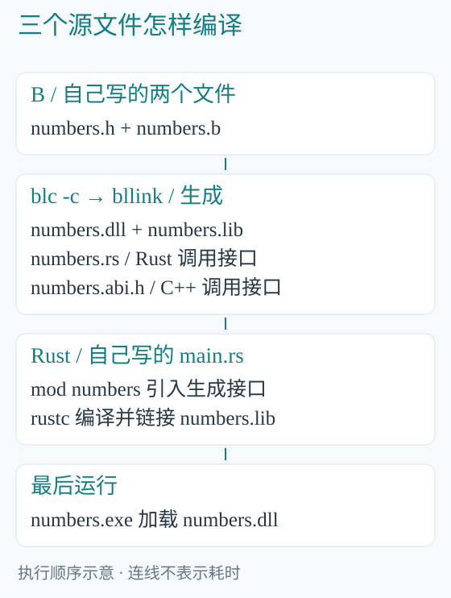

*图 1-2　上半部分生成算法库和接口，下半部分生成调用这个库的 Rust 程序。*

### 1.9　运行并核对四个数

```powershell
.\target\hybrid\numbers.exe
```

```text
before: [1.0, 2.0, 3.0, 4.0]
after:  [3.0, 5.0, 7.0, 9.0]
```

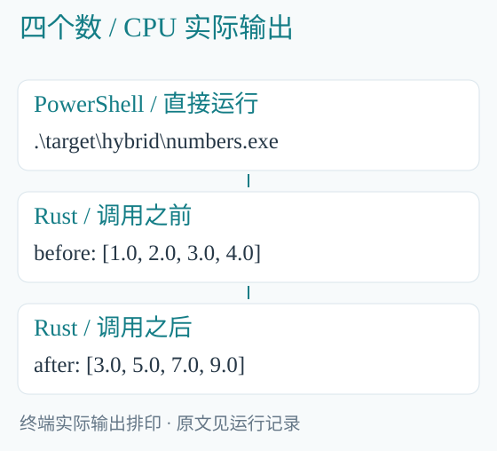

*图 1-3　由本章的 B 文件和 Rust 文件编译后原生运行。*

numbers.exe 和 numbers.dll 放在同一输出目录，运行时由 Windows 加载 DLL。目标机器执行这个现成的程序时，不需要再次读取 numbers.b。

至此已经完成一次混合编程：Rust 创建输入，B 修改这些数，Rust 读取并打印结果。接下来仔细看 run 这一行背后发生了什么。

## 2　看清这一次调用，再换成 GPU

### 2.1　run 怎样找到 transform

main.rs 调用的是 numbers::Program::run，B 中的入口却叫 transform。二者的联系来自上一章编译时的 --program transform 与随后的独立链接。

编译命令的 --program 已经选定 transform。生成的这个 DLL 只导出该具体入口的调用接口，numbers.rs 中的 Program 也对应它。因此 run 执行的就是选中的 transform，不会按文件名猜一个函数。

三个名字分别说明不同事情：numbers 是这组算法和生成库的名字；transform 是 B 中的入口；numbers.exe 是我们最后运行的应用程序。

### 2.2　四个数怎样经过两种语言

执行 run 以前，values 是 Rust 的四元素数组。生成接口把这段数组及元素数交给 DLL。Blink 准备计算所用的数据，执行 B 程序，再把结果写回 values。

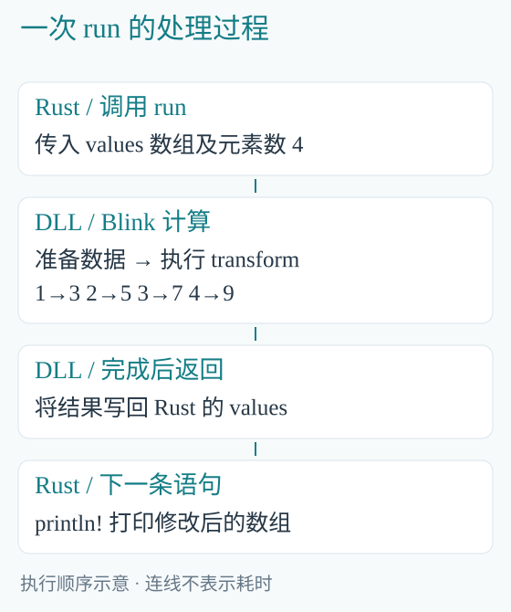

*图 2-1　当前 DLL 调用会进行必要的数据复制。箭头表示处理顺序，不表示四个数共用同一块底层存储。*

在 B 中，values 的长度是四；parallel 的 value 每次对应其中一个元素。value=1 得到 3，value=2 得到 5，依次类推。run 返回后，Rust 的第二个 println 才读取修改后的数组。

Rust 不需要把同一个公式再写一遍，也不需要在两个 println 之间启动另一个命令行程序。DLL 调用发生在 numbers.exe 这个进程内部。

### 2.3　先看一个容易忽略的符号

```rust
program.run(&mut values)?;
```

&mut 是一次可修改的借用。调用期间，程序使用这份数组；调用返回后，后面的 Rust 代码继续使用它。生成的 Rust 接口按 B 的 inout 参数接收可修改切片。

如果 B 参数是 read，Rust 接口就接收只读切片；如果参数需要写入，接口就接收可修改切片。B 的访问声明与 Rust 的调用类型在这里对应起来。

当前 DLL 的 run 是同步调用：CPU 路径执行完成后返回；GPU 路径则包含上传、执行、等待和结果下载，再返回。后面的 Rust 代码读到的是这次已经完成的结果。

### 2.4　只换执行后端，保留同一份 B 算法

配套 gpu.rs 与 main.rs 使用相同数组、同一个 DLL 和同一行 run。准备程序时换成：

```rust
let mut program = numbers::Program::new(
    numbers::Backend::Gpu
)?;
```

把这份 Rust 文件编译成另一个用途明确的 exe：

```powershell
rustc --edition=2024 `
    sample/hybrid/first/gpu.rs `
    -L native=target/hybrid `
    -o target/hybrid/numbers-gpu.exe

.\target\hybrid\numbers-gpu.exe
```

GPU 版本仍然输出 [3.0, 5.0, 7.0, 9.0]。B 的公式保持不变，Rust 选择了另一种执行后端。显卡驱动需要支持程序所需的 Vulkan 能力，无需额外安装 Vulkan SDK。

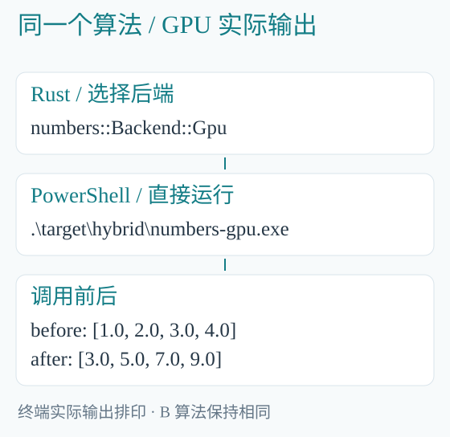

*图 2-2　四个数便于逐项核对；较大规模的耗时比较见第十章。*

### 2.5　为什么小数组不适合比较速度

四次数值计算很少，设备准备和数据传输却仍然存在。这个例子用来理解文件、编译、调用和结果。需要判断 GPU 是否划算时，应使用实际问题的规模，并把传输也算进去。

后面会计算一千万个材质采样点。届时既比较 CPU/GPU 的计算时间，也单独说明把结果全部下载到 Rust 要花多少时间。

### 2.6　下一步为什么要学习 Rust 原生接口

DLL 的调用方式适合把一个算法接入已有项目：Rust 交入数组，得到结果，继续工作。

连续模拟还有另一种需要：第一步算完，结果留在 GPU，第二步接着用；或者让几段 B 程序共用一张纹理。此时 Rust 需要直接控制上传、提交、等待和下载。

Blink 为此提供 blanguage 与 blcompute 两个 Rust crate。blanguage 编译 B，blcompute 创建数据并执行。从下一章开始，我们使用这两个库，把每一步展开来看。

## 3　从粒子输入一直写到计算结果

### 3.1　先说清这次模拟什么

本章使用 BLEngine 的真实粒子算法。每个粒子有位置 position、速度 velocity 和动能 energy。给定一个很短的时间 dt，先更新速度，再用新速度更新位置，最后计算总动能。

三个粒子的初始位置分别为 (1,0,0)、(1.001,0,0)、(1.002,0,0)，速度都是 (0,1,0)。dt=0.01 秒，中心力强度 strength=0.2。

初速度让粒子向 y 方向运动，中心力让它向原点弯曲。因此一步以后，第一个粒子的 y 应接近 0.01，x 应略小于 1。先有这个预期，再读程序。

### 3.2　B 文件接收哪些数据

入口位于 Programs/simulation/statistics.b，声明在同名 .h 中：

```c
void step_and_total(
    inout dataset<BLBody<float3,3>>
        bodies,
    write dataset<BLTotal,1> total,
    f32 dt, f32 strength
) on compute {
    step(bodies,dt,strength);
    total_energy(bodies,total);
}
```

bodies 是粒子数组。BLBody<float3,3> 是引擎采用的具体粒子类型：位置和速度都是三分量向量，第二个参数 3 选择此处的中心力模型。这里先使用这个具体类型即可。

total 只存一条记录，字段 value 保存总动能。dt 和 strength 是本次计算共用的两个浮点参数，不是每个粒子都复制一份的数据。

step_and_total 的两行正文明确规定先推进粒子，再求总量。

### 3.3　把 Rust 版本完整列出来

下面是配套 src/bin/particle-cpu.rs 的全部计算过程。为便于阅读，只调整换行。它从编译 B 文件开始，到打印结果结束，不调用另外编写的加载或填充辅助函数。

```rust
use blcompute::{
    Dataset, Value, cpu::CpuProgram
};
use std::path::Path;

fn main() -> blcompute::Result<()> {
    let root = Path::new(
        "sample/hybrid/Programs"
    );
    let mut compiled =
        blanguage::compile_entry(
        &root.join(
            "simulation/statistics.b"
        ),
        root,
        "step_and_total",
    )?;
    let code = compiled.programs.remove(0);

    let mut bodies =
        Dataset::new(&code, 0, 3)?;
    let total = Dataset::new(&code, 1, 1)?;
    let stride =
        bodies.stride() as usize / 4;
    let position = bodies
        .field_offset("position")?
        as usize / 4;
    let velocity = bodies
        .field_offset("velocity")?
        as usize / 4;

    for (i, row) in bodies.words_mut()
        .chunks_exact_mut(stride)
        .enumerate()
    {
        row[position] =
            (1.0+i as f32*0.001).to_bits();
        row[velocity+1] =
            1.0_f32.to_bits();
    }

    let mut data = vec![bodies, total];
    let values = [
        Value::F32(0.01),
        Value::F32(0.2),
    ];
    let program = CpuProgram::new(code)?;
    program.run(&mut data, &values)?;

    let first_x = f32::from_bits(
        data[0].words()[position]
    );
    let first_y = f32::from_bits(
        data[0].words()[position+1]
    );
    let energy = data[1]
        .field_offset("value")?
        as usize / 4;
    let total_energy = f32::from_bits(
        data[1].words()[energy]
    );
    println!(
        "first_x={first_x:.6} first_y={first_y:.6}"
    );
    println!(
        "total_energy={total_energy:.6}"
    );
    Ok(())
}
```

这段程序比第一章长，因为数据准备、布局和执行都展开了。下面按实际执行顺序读它。

### 3.4　第一步：让编译器找到 B 入口

compile_entry 的三个参数分别是 B 实现文件、模块根目录、公开入口名。根目录让编译器能找到 simulation.bodies 和 math.field 等导入。

返回的 compiled 包含编译结果。我们选定一个入口，取出其中的 code。code 描述这段程序的参数、数据布局和计算阶段；后面创建数据时也要使用它。

本章使用库调用来编译 B，因此 Rust 程序启动后会读取这些 B 文件。第一章则先把算法打包进 DLL。两种做法使用 Blink 的同一套编译和执行基础。

### 3.5　第二步：按照 B 参数顺序创建数据

```rust
let mut bodies =
    Dataset::new(&code, 0, 3)?;
let total = Dataset::new(&code, 1, 1)?;
```

0 对应 B 的第一个 dataset 参数 bodies，3 是粒子数量。1 对应第二个 dataset 参数 total，最后的 1 是记录数量。这里的 0、1 是参数位置，不是 CPU 或 GPU 编号。

Dataset 可以先理解为“按照这段 B 程序的格式分配的一张数据表”。每行是一个粒子，行中包含位置、速度和能量。它还记录每行占多少字节、字段放在什么位置。

### 3.6　第三步：把初值写到正确的位置

本例查询得到：一条粒子记录占 32 字节；position 从第 0 字节开始，velocity 从第 16 字节开始，energy 从第 28 字节开始。

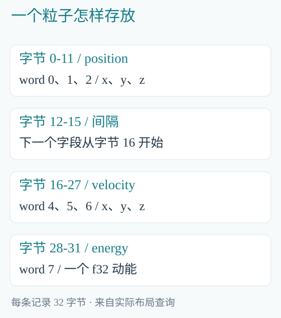

*图 3-1　每个 word 为四字节；位置的三个数后面有四字节间隔。*

words_mut 把底层存储按 u32 单元交给我们，因此字节偏移要除以四。stride 也除以四，表示一行有八个 word。chunks_exact_mut(stride) 于是每次取出一整行。

第 i 行把 x 写成 1.0+i*0.001，把 y 方向速度写成 1.0。Dataset::new 创建的主机存储初始为零，因此其余位置和速度分量保持零。

to_bits 把 f32 的四字节表示写入 u32 单元；from_bits 在读出时还原它。这里不能写成 x as u32，因为数值转换会把 1.5 变成整数 1。

这个布局也解释了为什么不能直接把一个随手定义的 Rust struct 强转过去：字段名字相同，字节位置未必相同。原生接口提供查询函数，按返回的布局填充即可。

### 3.7　第四步：把数组和普通参数交给程序

```rust
let mut data = vec![bodies, total];
let values = [
    Value::F32(0.01),
    Value::F32(0.2),
];
let program = CpuProgram::new(code)?;
program.run(&mut data, &values)?;
```

vec![bodies,total] 创建一个 Rust 动态数组，类似 C++ 的 vector。data 按顺序放入两个数据集，分别对应 bodies 和 total。values 按顺序放入两个普通参数，分别对应 dt 和 strength；Value::F32 标明参数是 32 位浮点数。数据集和普通参数分别传递。

CpuProgram::new 把 code 准备成 CPU 上可以执行的程序。run 执行这个 B 入口。返回后，data[0] 已保存新粒子状态，data[1] 已保存总动能。

在这里，Rust 负责选文件、建立数据、填值、调用和打印；B 负责更新粒子并求和。这些操作现在可以在同一份完整代码中逐项找到。

### 3.8　B 中的一步怎样算

simulation/bodies.b 先更新每个粒子，再计算动能。其积分部分为：

```c
parallel (body in bodies) {
    integrate_body(body,dt,strength);
}
```

integrate_body 对当前粒子执行：

```c
body.velocity +=
    central_acceleration<Power>(
        body.position,strength
    )*dt;
body.position += body.velocity*dt;
```

本例 Power=3，来自前面的具体粒子类型。central_acceleration 根据位置求指向中心的加速度。先改速度，再用新速度更新位置，所以不能任意交换这两行。

之后每粒子的动能为 0.5*dot(velocity,velocity)，total_energy 用 reduce_sum 将它们相加。

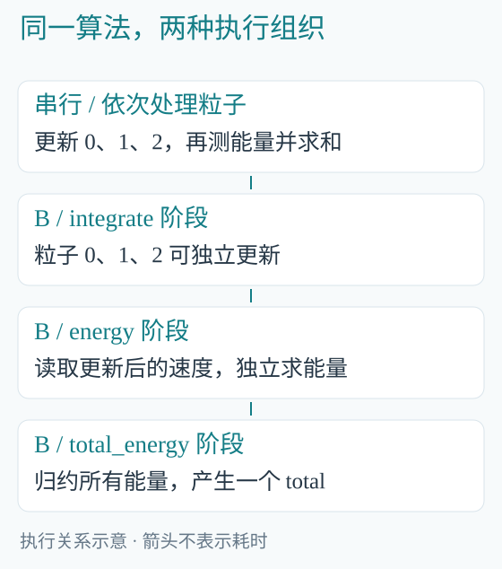

*图 3-2　每个粒子内部按公式顺序执行；不同粒子可以独立计算，求和则需要合并结果。*

### 3.9　编译并核对结果

```powershell
cargo build --release `
    --manifest-path sample/hybrid/Cargo.toml `
    --target-dir target

.\target\release\particle-cpu.exe
```

Cargo 读取这个 Rust 示例项目的 Cargo.toml，编译它依赖的 blanguage、blcompute 和各个示例。此后各章可以直接运行已生成的 exe。

```text
first_x=0.999986 first_y=0.010000
total_energy=1.500003
```

结果与开头的预期一致：x 略小于 1，y 接近 0.01。total_energy 是三个粒子的动能之和。

读取第一粒子时使用 data[0]，读取总能量时使用 data[1]。这两个位置与输入参数表保持一致；from_bits 把相应 word 还原为 f32。

### 3.10　同一粒子算法怎样交给 GPU

配套 particles.exe 提供 CPU/GPU 两个选择，并额外打印耗时。它的 GPU 分支仍使用刚才的 B 入口、相同初值和相同 dt、strength。以下从已经准备好的 code、data、values 接着写：

```rust
let device = Device::for_program(&code)?;
let data = data.into_iter()
    .map(|d| device.upload(d))
    .collect::<Result<Vec<_>>>()?;
let program = device.compile(code)?;
let done = program
    .submit(data, &values)?
    .wait()?;
let bodies = device.download(
    &done.datasets()[0]
)?;
```

这一段增加了四项操作：选设备、上传数据、提交并等到完成、下载所需结果。Device 来自 blcompute::vulkan，Result 来自 blcompute，完整实现见 src/particles.rs。

into_iter 依次取出 data 中的两个数据集，map 对每项调用 upload，collect 把上传结果组成新的动态数组。任何一项上传失败，? 就返回错误。新 data 中保存的是 GPU 上的数据对象。

```powershell
.\target\release\particles.exe gpu 3
```

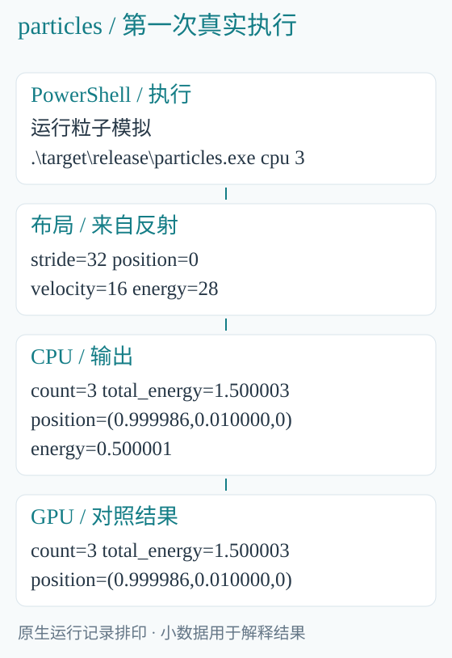

*图 3-3　第一粒子的位置和总动能在这里显示的小数位上相同。*

submit 返回一次提交记录，wait 等到这次计算结束，download 才把设备数据取回 Rust。下一章将去掉中间不必要的下载，让第二步直接使用第一步的 GPU 数据。

## 4　连续模拟：让下一步直接用上一步的结果

### 4.1　为什么不在每一步都下载

上一章只推进了 0.01 秒。现在连续推进三步，共 0.03 秒。第二步需要第一步改过的位置和速度，第三步再使用第二步的结果。

若每一步都下载全部粒子，再上传，数值虽然能算下去，却多搬了两趟数据。CPU 只需要查看最终结果时，可以让这三步都在 GPU 上完成。


*图 4-1　下方只在最后下载；三步仍然按先后依赖执行。*

### 4.2　先把三次提交连起来

配套 src/particles.rs 的 steps 函数先按上一章准备程序与粒子，接着执行：

```rust
let first =
    program.submit(data, &values)?;
let second = program.submit_after(
    first, &[0, 1], vec![], &values
)?;
let third = program.submit_after(
    second, &[0, 1], vec![], &values
)?;
let done = third.wait()?;
```

first 是第一步的提交。submit_after 接收它，使第二步接着使用第一步的数据。[0,1] 选中 bodies 和 total，顺序与第三章相同。vec![] 表示没有补入新的数据集，values 仍然传入同样的 dt 和 strength。

Rust 连续安排三步，只在 third.wait 等待。GPU 仍需先算完第一步，才开始使用它的结果；减少的是 CPU 在每两步之间的等待和传输。

### 4.3　Rust 为什么不让旧 data 继续使用

调用 submit(data,...) 后，原来的 data 不能再由这一段 Rust 代码任意读写。它已经交给尚未完成的计算使用。这就是这里遇到的所有权移动。

等到 wait 返回，数据可以从 done 中取得；或者像上面一样，直接把提交交给下一段计算。这样写，代码中就能看出数据当前正由哪一步使用。

GPU 还在使用的数据由提交记录继续保存。最后一次使用结束，且没有后续使用者时，才释放存储。应用不必另外维护一份“可能正在使用”的列表。

### 4.4　运行三步，检查运动方向

```powershell
.\target\release\particle-steps.exe
```

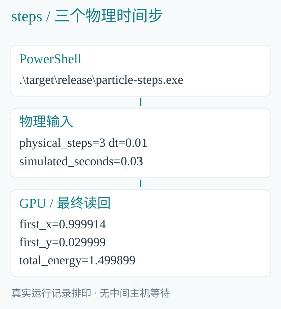

*图 4-2　三步各为 0.01 秒；这不是把同一个输入重复三次来跑分。*

第一个粒子得到 first_x=0.999914、first_y=0.029999。y 接近 0.03，说明向上运动继续了三步；x 继续减小，说明中心力在起作用。

总动能为 1.499899。这里统计的是动能，没有把势能算进去，也没有使用严格保能量的积分方法，因此不应把它当成机械能守恒检查。

### 4.5　同一个程序也可以一次提交多步

BLEngine 的模拟命令还使用下列形式：

```rust
let steps = NonZeroU32::new(3).unwrap();
let done = program
    .submit_steps(data, &values, steps)?
    .wait()?;
```

当每步使用同一程序、同一组参数时，submit_steps 可以把这些物理时间步放在一次设备提交中。上面的 3 已知不为零，NonZeroU32 用来表达这一要求。

如果第二步换了算法或参数，就按实际顺序分别提交。先看清计算需要什么，再选择这两种写法。

## 5　分别计算两组粒子，再合并结果

### 5.1　先把目标写成三个小步骤

左边有三个粒子，初速度为 (0,1,0)；右边也有三个粒子，初速度为 (0,2,0)。我们想知道两组推进一步后的动能总和。

做法很直接：左组计算自己的总动能，右组也计算自己的总动能，最后把两个数相加。右组速度约为左组两倍，动能与速度平方成正比，因此它的动能应约为四倍。

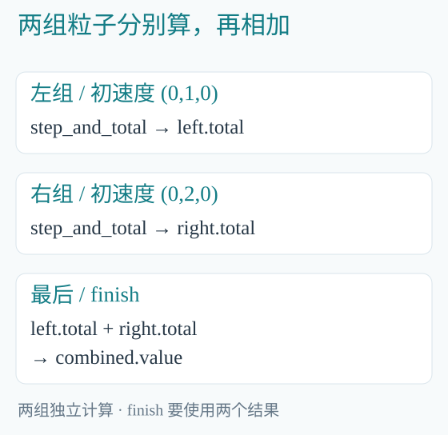

*图 5-1　最后一步要等两个总量都可用。当前实现使用同一设备队列，不据此宣称两组同时占用不同队列。*

### 5.2　B 只需要写怎样相加

两组粒子都使用第三章的 step_and_total。最后相加的入口位于 Programs/book/handoff.b；book 是配套示例的模块目录：

```c
void finish(
    read dataset<BLTotal,1> left,
    read dataset<BLTotal,1> right,
    write dataset<BLTotal,1> combined
) on compute {
    parallel (value in combined) {
        value.value =
            left[0].value+right[0].value;
    }
}
```

left 和 right 各有一条 BLTotal 记录。combined 也只有一条，写入两者 value 的和。这里的 read 表示相加过程不修改左右结果，write 表示要产生 combined 的值。

### 5.3　Rust 怎样把两份结果交进来

flow 函数先创建两组粒子，并分别上传。用第三章的程序得到两个提交，再调用 finish：

```rust
let left =
    program.submit(left, &values)?;
let right =
    program.submit(right, &values)?;
let done = finish.submit_join(
    [left, right],
    &[1, 3, 4],
    vec![combined],
    &[],
)?.wait()?;
```

submit_join 先按顺序看两次提交里各有哪些数据，再接上新建的 combined。把这五项列出来，就能读懂 [1,3,4]：

| 索引 | 数据 | 相加时放在哪里 |
|---|---|---|
| 0 | 左组 bodies | 不传入 finish |
| 1 | 左组 total | 第一个参数 left |
| 2 | 右组 bodies | 不传入 finish |
| 3 | 右组 total | 第二个参数 right |
| 4 | 新建 combined | 第三个参数 combined |

这几个编号选择要传给 B 的数据，不是在复制三组粒子。最后的 &[] 表示 finish 没有 dt 这样的普通参数。

### 5.4　结果在哪里相加

Rust 把尚在 GPU 上的两个总量交给 finish。相加在 B 中完成，Rust 最后才下载并打印结果。完整配套函数位于 src/particles.rs 的 flow。

```powershell
.\target\release\particle-flow.exe
```

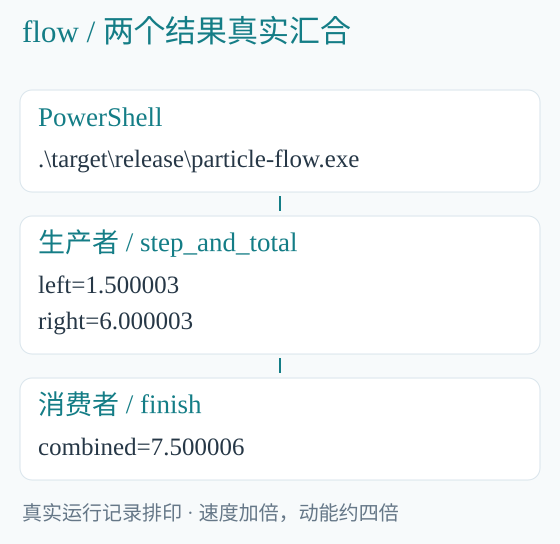

*图 5-2　left=1.500003，right=6.000003，combined=7.500006。*

这里学到的是把计算接在一起的方法。两组互不依赖，并不自动保证两倍速度；实际耗时还与设备和调度有关。

### 5.5　如果以后只处理筛选后的部分

本章处理全部粒子。若 B 先用 compact 筛出一部分有效粒子，后面还需要知道有效数量来自哪次筛选。Blink 用 DomainBindings 连同这项关系一起传递。

以后使用 partition、into_bindings 等接口时，要保留它们交出的对象。只取出一个 count 数字，再拼一份普通 Vec，无法代替这个筛选结果。当前例子不需要额外引入这些对象。

## 6　两个物体怎样共用一份模型

### 6.1　先分清模型与物体

同一个立方体可以在场景里出现两次：左边一个、右边一个，颜色也可以不同。它们的位置和颜色各有一份，三角形和法线却可以共用。

如果一份模型有很多三角形，为每个物体都复制一遍，就会占用很多内存。本章摘读 BLEngine 的模型代码，看 Rust 怎样准备一份几何数据，B 又怎样从不同物体访问它。

这里把“同一模型在场景中的一次使用”称为实例。模型说明形状，实例说明这次使用时的位置、颜色等信息。

### 6.2　B 的实例记录中放了什么

引擎的 render/trace.h 定义了：

```c
struct BLInstance {
    view<BLTriangle> triangles;
    view<BLNormal> normals;
    view<BLTextureTriangle> texcoords;
    view<BLMaterialSlot> materials;
    float4 tint;
};
```

tint 是这个实例自己的颜色参数。其他四项是 view，可以先理解为指向一组只读数据的视图。实例用 triangles 找三角形，用 normals 找法线，用 texcoords 找纹理坐标，用 materials 找材质选择。

两个实例的 triangles 可以连接同一份三角形数组；它们各自的 tint 仍然可以不同。


*图 6-1　共享的是模型数据；两个实例自己的颜色和变换仍然分开。*

### 6.3　Rust 先创建这份共享数据

src/scene.rs 先按 B 中 triangles 字段的元素格式创建数据：

```rust
let triangles = Dataset::for_view(
    program, 2, "triangles", count
)?;
// 在这里填入模型的三角形记录。
let triangles = device
    .upload(triangles)?
    .freeze();
```

计算函数 是已经编译的一帧渲染程序。2 选中其中的实例数据集，"triangles" 选中这个实例类型里的 view 字段，count 是模型的三角形数量。

Dataset::for_view 按三角形格式分配一份数组。填入源模型数据后，upload 上传到 GPU，freeze 把它转成可共享的只读数据。这里省略的是与第三章同类的逐字段填充，三角形记录仍完整保留在正式源码中。

### 6.4　再把它接到两个实例上

装配一个实例的主干如下：

```rust
views.push(ViewBinding {
    record: ordinal as u32,
    field: "triangles",
    source: asset.triangles.clone(),
});

device.upload_with_views(data, views)
```

data 保存实例记录，views 说明这些记录中的 view 连接哪份数据。record 是实例在数组中的位置，field 是字段名，source 是前面准备好的只读三角形数组。

给第二个实例也填入同一 asset.triangles 的 clone，就能让它们共用这份几何。这里的 clone 增加的是共享引用，没有再上传一份三角形数组。

### 6.5　B 怎样通过 view 读到三角形

命中某个实例的第 primitive 个三角形后，render/trace.b 读取：

```c
BLTriangle triangle = unsafe_read(
    instance.triangles, primitive
);
```

instance 是这次命中的实例。它的 triangles 已经由前面的 Rust 代码连接到模型，所以这一行能读到正确的三角形记录。接着从 normal_indices 选择三个顶点法线，进行后续表面计算。

这里的 primitive 来自该模型的求交结果；模型和实例的装配需要保持这个对应关系。unsafe_read 不会自行修正一个连错的模型。

### 6.6　局部变量结束后，模型还在吗

只要实例和执行仍在使用共享数据，这份存储就要保留。ReadDataset 的共享引用和提交记录会维持它的使用关系。最后一个使用者结束后，才能回收相应资源。

CPU 的只读数据用 Arc 共享；GPU 设备对象用 Rc 共享。二者的 clone 都不复制完整模型。Rc 也意味着这些设备对象不能随意移到其他线程，下一章的 CPU 场景状态与这里的 GPU 对象要分别理解。

view 中的运行地址只对当前存储有效。保存模型文件时保存三角形、法线等内容；重新加载后，再创建数据并连接 view。把一段旧地址抄到另一台设备上，无法带走它指向的模型。

## 7　Rust 建立父子关系，B 算出世界位置

### 7.1　先用三个平移看懂问题

一个根节点位于 (10,0,0)。它的子节点相对根向 y 方向移动 2；孙节点再相对子节点向 z 方向移动 3。

因此，根、子、孙的世界位置分别为 (10,0,0)、(10,2,0)、(10,2,3)。本章只用平移，先看清父子关系怎样影响结果。

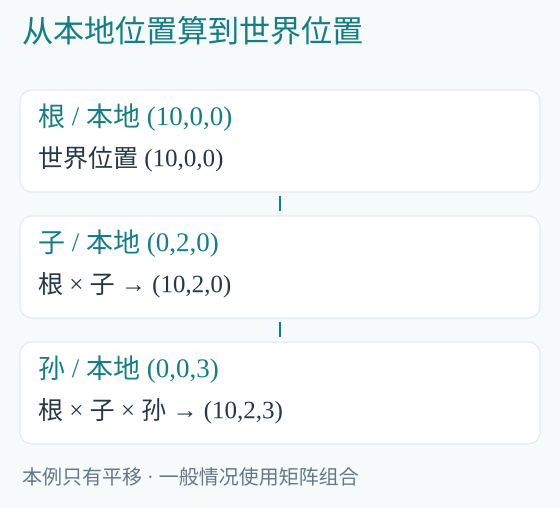

*图 7-1　每个输出沿自己的父链读取；不同节点的输出可以独立计算。*

### 7.2　Rust 给 B 哪些输入

Rust 维护场景中的节点，知道谁是父节点。计算前，它把这次需要的内容整理成节点数组。B 使用的记录为：

```c
struct BLHierarchyNode {
    float3x4 local;
    u32 parent;
    bool has_parent;
    bool active;
};
struct BLWorldTransform {
    float3x4 matrix;
};
```

local 是相对父节点的变换；parent 是父节点在本次输入数组中的位置；has_parent 表示是否还有父节点；active 表示本次是否按父链求值。worlds 数组中的 matrix 保存计算后的世界变换。

BLScene 中长期使用的节点 ID 还包含代际，用来区分删除后又复用的槽位。本次 B 数组中的 parent 只是数组位置。把场景整理成数组时，Rust 要把这两类编号对应好。

### 7.3　初值怎样写进矩阵

示例 src/scene.rs 创建三个节点。每个 local 是三行四列的仿射矩阵，最后一列放平移量。根节点的三行是：

```text
1 0 0 10
0 1 0  0
0 0 1  0
```

子节点最后一列为 (0,2,0)，孙节点为 (0,0,3)。其余部分都是单位矩阵，所以没有旋转或缩放。

Rust 使用与第三章相同的字段偏移方法填入这些行。配套项目把这段重复操作收成 put 函数，定义在 src/lib.rs：

```rust
fn put(
    data: &mut Dataset,
    row: usize,
    field: &str,
    values: &[f32],
) -> Result<()> {
    let i = row*data.stride() as usize/4
        + data.field_offset(field)? as usize/4;
    for (word, value) in data.words_mut()[i..]
        .iter_mut().zip(values)
    {
        *word = value.to_bits();
    }
    Ok(())
}
```

第 row 行的起点加上 field 的偏移，就是要写的位置。values 中的每个浮点数依次写入。于是根节点的第一行可以写成：

```rust
put(&mut nodes, 0, "local.r0",
    &[1.0, 0.0, 0.0, 10.0])?;
```

同样填写另外两行，再设置各节点的 parent、has_parent、active。完整填充代码在 src/scene.rs 的 run 函数中。

### 7.4　B 从当前节点一直走到根

scene/hierarchy.b 的 resolve 为每条 worlds 输出执行：

```c
parallel (world in worlds) {
    BLHierarchyNode node =
        unsafe_read(nodes,index());
    float3x4 matrix = node.local;
    if (node.active) {
        while (node.has_parent) {
            node = unsafe_read(
                nodes,node.parent
            );
            matrix = compose_affine(
                node.local,matrix
            );
        }
    }
    world.matrix = matrix;
}
```

从孙节点看这一段：先拿自己的 z=3，找到父节点加上 y=2，再找到根加上 x=10，最后写出 (10,2,3)。真实程序使用矩阵乘法，因此同一写法也能处理旋转和缩放。

compose_affine(parent,child) 先应用右边的子变换，再应用左边的父变换。矩阵顺序不能任意交换。

### 7.5　这里怎样并行

串行写法会依次求根、子、孙。B 可以让每个输出各自沿父链求值，因为它只读取 nodes 输入，不等另一个线程先写好父节点的 worlds。

代价是一些父节点可能被重复读取。父链很深时，这项工作会增加；能否比其他层级算法更快，要看实际场景。读懂数据依赖，才能看出并行发生在哪里，也能看出成本在哪里。

Rust 建立输入时应保证父索引有效、父链无环。这样遍历才会到达根。这也是此处使用 unsafe_read 的前提。

### 7.6　编译和运行

用第三章的 Cargo 命令构建示例后，执行：

```powershell
.\target\release\scene-evaluate.exe cpu
.\target\release\scene-evaluate.exe gpu
```

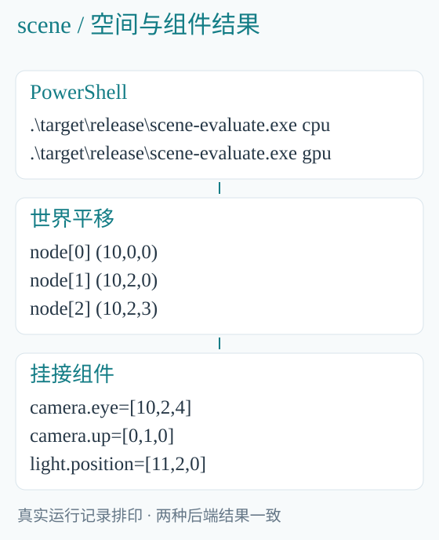

*图 7-2　两个后端都得到 (10,0,0)、(10,2,0)、(10,2,3)。相机和灯光的输出在下一章解释。*

scene-evaluate.exe 的完整入口在 src/bin/scene-evaluate.rs，数据准备与调用在 src/scene.rs。它还在同一 B 程序中计算相机和灯光，不需要另跑一次场景变换。

## 8　把世界变换用于相机和灯光

### 8.1　沿用上一章的三个节点

把一台相机放在孙节点上，本地位置为 (0,0,1)。孙节点的世界位置是 (10,2,3)，所以相机的世界位置应为 (10,2,4)。

再把一盏点光源放在子节点上，本地位置为 (1,0,0)。子节点的世界位置是 (10,2,0)，灯光的世界位置应为 (11,2,0)。

Rust 负责建立这些挂接关系：相机记录中的 node=2，灯光记录中的 node=1。B 根据节点的世界矩阵计算最终位置。

### 8.2　一段 B 程序把三件事连起来

scene/components.b 的 evaluate 正文依次调用：

```c
resolve(nodes,worlds);
cameras(
    worlds,local_cameras,world_cameras
);
lights(
    worlds,local_lights,world_lights
);
```

先算 worlds，再分别给相机和灯光使用。这些调用写在同一个 B 入口里，Rust 不需要下载 worlds，再重新上传给另外两段计算。

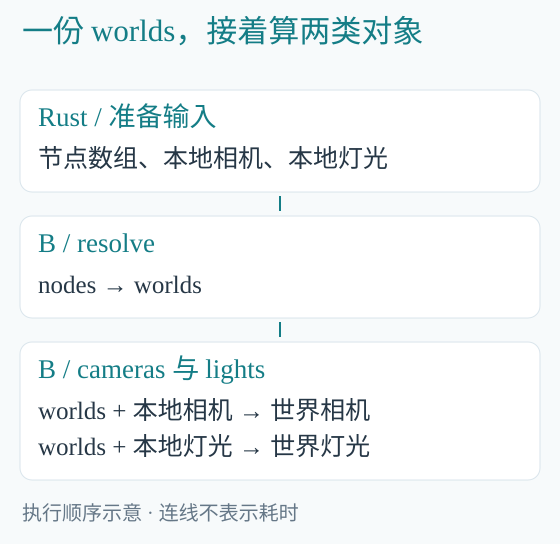

*图 8-1　箭头表示先后所需的数据，不保证后端同时执行相机和灯光阶段。*

### 8.3　点和方向有什么不同

相机除了 eye，还有 target 和 up。eye 是位置，target 是看向的位置，up 是朝上的方向。B 中的变换为：

```c
value.eye =
    world*float4(value.eye,1.0);
value.target =
    world*float4(value.target,1.0);
value.up =
    world*float4(value.up,0.0);
```

最后补上的 1.0 使点受到平移；补 0.0 则让方向不加上平移。于是本地 eye=(0,0,1) 变成 (10,2,4)，target=(0,0,0) 变成 (10,2,3)，up=(0,1,0) 保持不变。

这段区别直接来自数学含义。把 up 也加上节点位置，会把一个“朝上方向”误当成空间位置。

### 8.4　不同灯光需要变换不同字段

点光源主要关心位置，方向光主要关心方向，面光源还带有描述发光面的两条边。实现用 kind 区分灯光种类，其中两项为：

```c
if (value.kind!=0) {
    value.position =
        world*float4(value.position,1.0);
}
if (value.kind==0 || value.kind==2) {
    value.direction =
        world*float4(value.direction,0.0);
}
```

这里的 if 决定要计算什么，不能只为缩短代码就删掉。模型读取失败时的错误文字可以省略展示，决定光源含义的分支则要保留。

### 8.5　Rust 传入和取出的数组逐项对应

这个示例的六个数据集为：

| 位置 | 数组 | 记录数 |
|---|---|---|
| 0 | nodes，输入节点 | 3 |
| 1 | worlds，输出世界矩阵 | 3 |
| 2 | local_cameras，本地相机及节点号 | 1 |
| 3 | world_cameras，输出相机 | 1 |
| 4 | local_lights，本地灯光及节点号 | 1 |
| 5 | world_lights，输出灯光 | 1 |

src/scene.rs 按这个顺序建立 data，调用 evaluate，再从 data[1]、data[3]、data[5] 读结果。普通数值参数为空，因此执行时传 &[]。

上一章的 scene-evaluate.exe 已经运行了这整个过程，打印 camera.eye=[10,2,4]、camera.up=[0,1,0]、light.position=[11,2,0]。用前面的平移相加就能逐项核对。

## 9　Rust 准备纹理，B 计算表面颜色

### 9.1　这次要计算什么

设想表面上有很多采样点。每个点知道自己朝向哪里、眼睛从哪里看、光从哪里来。我们要算出每个点反射出的颜色。

本例的 B 类型 BLShadingPoint 记录这些输入，输出字段叫 radiance。它表示计算得到的线性颜色，暂时还不是可以直接写进 PNG 的三个字节。

先认清本章实际用到的几个字段：

| 字段 | 含义 |
|---|---|
| normal | 表面法线，表示朝向 |
| view、light | 看向观察者和光源的方向 |
| uv | 从纹理的哪个位置取颜色 |
| tint | 对纹理颜色再乘一个颜色系数 |
| roughness | 粗糙度，控制高光集中或分散 |
| ior | 折射率，用于计算反射比例 |
| radiance | 本次算出的线性颜色 |

### 9.2　Rust 创建一张四颜色纹理

src/sheet.rs 的 texture 函数完整如下：

```rust
fn texture() -> Result<Texture2D> {
    Texture2D::new(vec![TextureMip {
        width: 2,
        height: 2,
        pixels: vec![
            [0.9, 0.3, 0.1, 1.0],
            [0.1, 0.6, 0.9, 1.0],
            [0.2, 0.7, 0.3, 1.0],
            [0.8, 0.7, 0.2, 1.0],
        ],
    }])
}
```

每行是一个像素的红、绿、蓝、透明度。Texture2D 和 TextureMip 来自 blcompute，Result 也使用这个 crate 的错误类型。

纹理只创建一次，所有采样点共用。每个点的 uv 不同，就可能读到不同颜色。

### 9.3　B 准备采样点

Programs/book/sheet.b 用 prepare 设置法线、纹理坐标和粗糙度。W、H 表示表格宽高；下面摘出随位置变化的部分：

```c
f32 x=(f32(index()%W)+0.5)/f32(W);
f32 y=(f32(index()/W)+0.5)/f32(H);
point.normal=normalize(float3(
    (x-0.5)*1.4,(y-0.5)*1.4,1.0
));
point.roughness=0.08+0.84*x;
```

index() 是当前采样点的编号。除余把一维编号换成二维位置，再将位置映射到 0 到 1 附近。法线随 x、y 改变；粗糙度从左到右增大。

完整 prepare 同时设置 view、light、uv、lod、tint、ior 和 radiance。全部字段都有初值，然后再交给材质计算。

### 9.4　使用引擎已有的材质公式

接下来调用 material/textured.b 的 shade：

```c
parallel (point in points) {
    point.radiance = textured_ggx(
        albedo, point.uv, point.lod,
        point.normal, point.view,
        point.light, point.tint,
        point.roughness, point.ior
    );
}
```

albedo 是前面的纹理。textured_ggx 先按 uv 采样，再乘 tint，最后调用引擎的 ggx_surface 求表面反射。Rust 没有再实现一份材质公式。

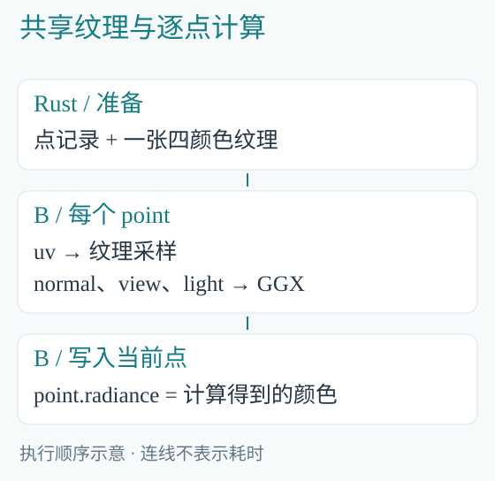

*图 9-1　各个采样点读取同一张纹理，只写自己的 radiance。*

串行版本会依次对 point 做同样的事；B 用 parallel 表示这些点可以独立计算。变量和公式保持相同，区别放在如何执行这些工作上。

### 9.5　先理解 GGX 里最直观的两步

GGX 是一种表面高光模型。粗糙度低时，高光更集中；粗糙度高时，高光更散。读本章不必先推导整个模型，但可以看懂它怎样使用输入。

```c
f32 nl = dot(normal,light);
f32 nv = dot(normal,view);
if (nl<=0.0 || nv<=0.0) {
    return float3(0.0);
}
float3 half_vector =
    normalize(view+light);
```

nl 和 nv 分别看表面是否朝向光和观察者。背向时不产生这里的反射贡献，返回零。half_vector 是光与观察方向之间的单位方向，用于后面的高光计算。

函数最后将漫反射和镜面反射相加：

```c
return base*(
    (1.0-fresnel)*nl/3.14159265359
)
    + float3(specular);
```

这些计算集中在 B 文件中。CPU 和 GPU 都使用这份公式，Rust 只需提供它要求的纹理和数据。

### 9.6　Rust 怎样选中整个采样程序

配套程序加载的是 book/sheet.b 的 materials<10000,1000>。它先调用 prepare，再调用真实的 shade，总共处理一千万点。

从第三章的加载步骤接着看：取出 code 后，创建点记录和纹理：

```rust
let points =
    Dataset::new(&code, 0, 10_000_000)?;
let albedo = texture()?;
```

points 是第一个数据集参数，albedo 是纹理参数。纹理有自己的资源位置，不塞进 Vec<Dataset> 中。

### 9.7　CPU 和 GPU 分别怎样接收纹理

CPU 准备 CpuProgram 后执行：

```rust
let output = program.run_owned(
    cpu::Bindings {
        datasets: vec![points],
        textures: vec![albedo],
    },
    &[],
)?;
```

Bindings 在这里就是“这次传入的资源集合”：datasets 放数据集，textures 放纹理。run_owned 接收这些对象，执行后交回结果。

GPU 则先把 points 和 albedo 上传。下面的 points 和 albedo 已是设备上的对象：

```rust
let done = program.submit(
    vulkan::Bindings {
        datasets: vec![points],
        accelerations: vec![],
        textures: vec![albedo],
    },
    &[],
)?.wait()?;
```

本例按采样点直接算材质，不做几何求交，因此 accelerations 为空。&[] 说明没有额外普通参数。准备、执行与结果读取的完整代码位于 src/sheet.rs 的 run 函数。

### 9.8　运行并看一个采样点

```powershell
.\target\release\material-samples.exe cpu
.\target\release\material-samples.exe gpu
```

两次运行都会输出 count=10000000 和中心点的颜色。CPU 中心点约为 (0.152368,0.172937,0.118156)，GPU 约为 (0.152371,0.172865,0.118214)。

它们存在浮点舍入差异，不能把打印得相近说成全部结果逐位相同。接下来先读懂耗时，第十三章再把这些颜色变成一张图片。

## 10　读懂时间：计算、准备和传输各花了多久

### 10.1　先确认两边做了同一件事

上一章两个命令都处理一千万点，都先准备采样参数再计算 GGX。CPU 使用 Blink 的原生多核程序，GPU 使用设备程序。

程序先测第一次执行，再用已经准备好的程序、纹理和数据测一次执行。第二次用来观察连续使用这些资源时的成本。每个耗时字段都对应一次完整执行，没有把多次结果除出来冒充一次。

### 10.2　把一次实际记录逐项读清楚

本书原始观测使用 Ryzen 9 9950X、128 GB 内存和 Radeon RX 9070 GRE，Rust 1.95.0，release 构建。具体数值会随机器与负载变化。

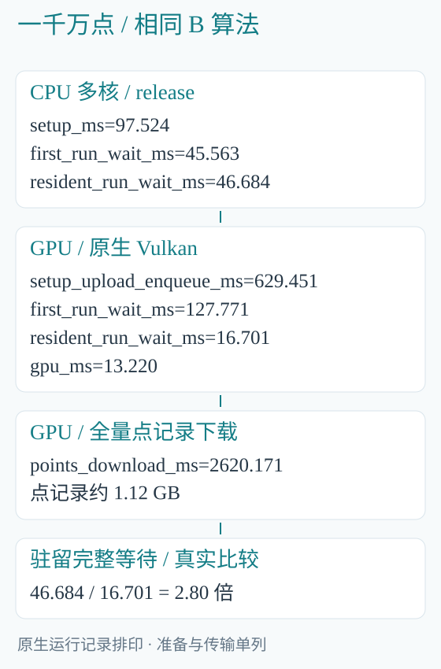

*图 10-1　图中分别列出准备、第一次执行、复用后执行及完整下载。*

| 计时范围 | CPU 多核 | GPU |
|---|---|---|
| 准备程序与数据 | 97.524 ms | 629.451 ms，包含上传入队 |
| 第一次执行并等到完成 | 45.563 ms | 127.771 ms，受未完成上传影响 |
| 使用已准备资源执行并等待 | 46.684 ms | 16.701 ms |
| 设备上的程序时间 | 不适用 | 13.220 ms |
| 全部点记录下载 | 主机上已有数据 | 2620.171 ms |

这一回准备后的执行等待，CPU 为 46.684 ms，GPU 为 16.701 ms，约快 2.80 倍。比较用的是两边相同的“调用执行接口到完成”的范围。

### 10.3　为什么第一次没有这么快

第一次运行时，GPU 上传可能还没有结束。CPU 提交计算后，需要连同这些前置工作一起等完。以后继续使用同一份设备数据，就省去了再次准备与上传。

如果应用只算一次，就应比较准备加执行的总时间。如果应用连续计算很多帧，就应同时关注第一次成本和之后每次的成本。

13.220 ms 是显卡时间戳覆盖的程序区间；16.701 ms 还包含主机调用和等待。讨论真实调用耗时要用后者，讨论设备内核才看前者。

### 10.4　下载为什么比计算还慢

一条采样点记录为 112 字节，一千万条约 1.12 GB。把这些记录全部复制回主机，本次用了约 2620 ms，远超过 13.220 ms 的设备计算。

这是很实际的提醒：程序中需要的若只是最后一张图片，就没有必要下载所有法线、观察方向、粗糙度和中间颜色。第十三章会在 GPU 上完成显示转换，只下载最后的四字节显示像素。

那一章处理一百万像素时，中间点记录约 112 MB，最终显示数据为 4 MB，相差二十八倍。这个比例来自记录大小；它不代表实际下载耗时一定也相差二十八倍。

### 10.5　什么时候值得保留设备上的数据

如果下一步仍由 GPU 处理，就直接继续传递设备数据；如果最后要由 Rust 写文件，再下载所需输出。这样既少复制，也少等待。

程序和纹理同样可以保留。每次只改 dt 或相机参数时，不必重新编译未变化的 B 文件，也不必重传同一张纹理。

### 10.6　怎样评价自己的应用

先测用户真正等待的那段过程。例如一次图片导出，就测准备、计算、下载、写文件；每帧连续计算，就另列已经准备好资源后的每帧成本。

正式比较时保持相同输入、同样优化的构建和相同计时范围，重复测单次操作，报告中位数与波动。CPU/GPU 的浮点结果也要按应用要求判断，不能只看加速倍数。

书中的原始日志保留完整读数，便于理解这些范围。它们是具体机器上的观察，不是换一台机器也应得到的固定答案。

## 11　读模型文件：先由 Rust 读，再交给 B 算

### 11.1　读取文件与计算三角形是两步

前面一直直接准备数组。真实项目还要从磁盘读入模型，解码三角形、法线和纹理坐标，然后才能交给 B 使用。

文件路径、文件打开和格式解析由 Rust 处理。进入 B 的是解码后的计算数据。这样，B 的表面计算不必知道模型文件原来存在哪个盘。

本章摘读 BLEngine 的 src/geometry_io.rs。重点看文件结果怎样被接到后续计算，模型的完整格式留在第三本书分析。

### 11.2　多个文件怎样分给读取线程

sources 保存需要读取的 (key,path)；key 是资产编号，path 是文件路径。多个线程用一个原子下标领取下一项：

```rust
while let Some((key, path)) =
    sources.get(
    next.fetch_add(1, Ordering::Relaxed)
) {
    let result =
        BLMesh::read_cooked(path)
            .map(|mesh| (*key, mesh));
    if sender.send(result).is_err() {
        break;
    }
}
```

fetch_add 返回当前编号，再把编号加一，所以不同线程拿到不同项。任务表在线程开始前已经准备好且不再修改；Relaxed 在这里用于领取编号，读出的模型通过通道传递。

read_cooked 返回模型或读取错误。map 在成功时把资产编号和模型放到一起。无论哪个文件先读完，它的编号都不会丢。


*图 11-1　读取线程只读文件和解码；设备线程接收后，再建立模型所需资源。*

### 11.3　为什么通道容量设为零

mpsc::sync_channel(0) 要求发送端与接收端交接后，发送者才能继续。一个线程读好模型后，如果设备线程暂时接不过来，它就在 send 等待。

这样不会不断把已解码的大模型堆进队列。仍会占用内存的是各线程当前读取或等待交出的模型，以及已经由后续代码接走的数据。容量为零只说明通道不额外存队列项。

recv 会等待结果到来；没有结果时不会反复查询磁盘。非阻塞 try_next 返回 Pending 时，则由已有的调用循环稍后继续处理。没有新请求就不创建读取工作。

### 11.4　接收结果时按编号放回模型

src/scene.rs 处理读取结果的主干是：

```rust
for source in load(requested)? {
    let (key, mesh) = source?;
    self.insert(
        device, program, key, &mesh,
        groups, needs_uv,
    )?;
}
```

requested 是本次缺少的资产编号；load 返回前面那批读取结果。insert 根据 key 将模型放入正确位置，并按当前材质需要建立三角形、法线和 UV 数据。groups 是材质组信息，needs_uv 表示是否需要纹理坐标。

随后就能使用第六章的 view 将模型连接到实例。较小文件先读完，只会改变到达时间，不会让它变成另一个物体的模型。

### 11.5　提前结束时怎样让线程退出

若后续已经不需要这批模型，读取线程可能还等在 send。实现先关闭接收端，再等待线程结束：

```rust
self.receiver.take();
if let Err(e) = self.finish() {
    eprintln!("{e}");
}
```

接收端关闭以后，send 返回错误，前面的循环跳出。finish 再 join 读取线程。若反过来先等线程，线程却仍在等接收端取走模型，就会互相等待。


*图 11-2　已经开始的文件读取要结束；不会把仍在工作的线程丢到后台不管。*

这一章增加的是 Rust 的文件并发。B 的材质、变换等算法仍接收相同的数据格式，不需要随着读取线程数量改变。

## 12　调用一段需要几何的 B 渲染程序

### 12.1　把前面的数据放到同一次调用里

现在已有几何、实例、相机、光源和纹理。渲染需要根据相机发出光线，找到表面，计算颜色，再形成显示像素。

本章阅读随书维护的 Programs/render/frame.b 教学入口。它比前面的独立示例多了几何求交所需的加速结构。下一章则提供一个下载 Blink 后就能运行的完整图像程序，不要求先写出整个引擎。

### 12.2　先检查这个 B 入口

先用 Blink 编译器检查这段程序：

```powershell
.\target\release\blc.exe check `
    sample/hybrid/Programs/render/frame.b `
    sample/hybrid/Programs `
    'frame<1,1000,1000,1,1000000,1000000>'
```

本书所附版本得到 trace、resolve 两个执行阶段。check 只检查计算入口，不创建场景或输出图片。下面看 Rust 怎样为它准备输入。

### 12.3　B 中先算颜色，再转换显示像素

render/frame.b 的计算正文先调用 trace，再调用 resolve：

```c
trace<N,W,H,S>(
    pixels,instances,overlays,surfaces,
    normal_matrices,cameras,lights,
    lighting,scene,overlay_scene,albedos,
    floor_present,ground_z,ground,
    overlay_start
);
resolve<W,H,S,DC,IC>(pixels,display);
```

trace 使用相机、几何、灯光等输入，写出 pixels 的线性颜色。resolve 读取它，进行采样汇合和显示转换，写出 display。

W、H 是输出宽高，S 是每轴内部采样倍数，DC=W*H，IC=W*H*S*S，N 是纹理数量。它们选择这次程序的具体形状。

Rust 只调用这个组合后的入口。它不用在 trace 和 resolve 之间把所有 pixels 下载一遍。

### 12.4　先按 B 参数顺序列出数据集

这个版本的一帧有九个普通数据集参数：

| 绑定 | 数组 | 里面放什么 |
|---|---|---|
| 0 | pixels | 内部采样的线性颜色 |
| 1 | display | 最终显示像素 |
| 2 | instances | 模型 view 与实例参数 |
| 3 | overlays | 屏幕矩形与颜色 |
| 4 | surfaces | 材质参数 |
| 5 | normal_matrices | 实例法线变换 |
| 6 | cameras | 当前视图相机 |
| 7 | lights | 光源参数 |
| 8 | lighting | 本次光照设置 |

“绑定”在这里就是程序的数据参数位置。和第三章的 0=bodies、1=total 一样，编号来自该 B 入口自己的接口。

几何、材质和灯光可以供多个视图共用；每个视图的 pixels、display 和相机则各自准备。


*图 12-1　共享场景输入；每个视图单独保存自己的图像。*

### 12.5　加速结构与纹理另行传入

scene 和 overlay_scene 是光线查询用的加速结构，albedos 是纹理数组。它们不是普通 Dataset，需要放在相应资源列表中。

对这个教学入口，datasets 按上表排列；inputs 保存设备资源，values 保存 floor_present 等普通参数。使用当前 blcompute 接口的同步交接写法如下：

```rust
let done = self.program.submit(
    Bindings {
        datasets,
        accelerations: std::mem::take(
            &mut inputs.accelerations
        ),
        textures: inputs.textures.clone(),
    },
    &values,
)?.wait()?;
```

Bindings 的三组资源分别对应数据集、加速结构和纹理。std::mem::take 把已有加速结构列表移给这次提交；纹理 clone 则共享已有纹理存储。两者都没有重新复制整个场景。

### 12.6　计算完成后继续使用这些资源

submit 使用的模型、纹理和图像在 GPU 运行时需要一直保留。wait 返回以后，这个同步示例从 done 取回数据和加速结构，下一次调用继续使用。


*图 12-2　Rust 传递资源对象；B 计算相应图像。完成后可以复用存储。*

显示窗口可以直接使用设备结果；写图片文件时才下载 display。此时下载的是最后的显示像素，不是全部内部颜色、模型和材质。

当前 BLEngine 的真实异步入口位于 src/output.rs:221，直接引用场景所有者的加速结构与材质纹理，并交付独立完成对象：

```rust
let submitted = self.program.submit(
    Bindings {
        datasets,
        accelerations: scene.accelerations.clone(),
        textures: inputs.materials.textures.clone(),
    },
    &values,
)?;
let (bindings, _, completion) = submitted.detach();
```

BLRenderSubmission 持有 completion 和本次视图 snapshot；detach 交还绑定并不代表 GPU 已完成。真实资源保持到消费者完成，设备完成与下载分别处理。完整执行案例和当前参数布局见《BLEngine 源码分析》。

## 13　完整项目：生成一幅一百万像素的材质图

### 13.1　先看最后要交付的东西

这次生成一张 1000×1000 的图片。每个像素对应一个采样点，法线和粗糙度随位置变化，使用第九章那张四颜色纹理和真实 GGX 公式。

B 完成准备、材质计算和显示转换。Rust 负责创建设备和数据，执行这个 B 入口，最后把图片保存为 PPM。PPM 是简单的 RGB 图片格式，可以用支持它的图像工具打开。

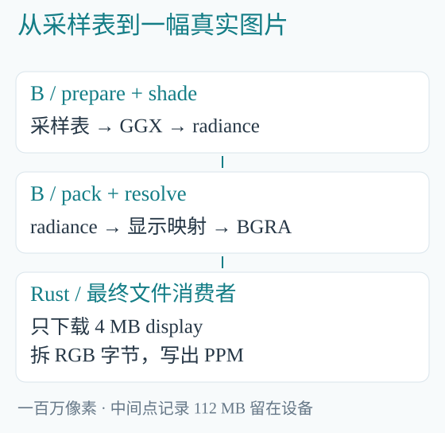

*图 13-1　中间结果留在 GPU；Rust 只取最后要保存的显示像素。*

### 13.2　B 的 image 入口按顺序做什么

Programs/book/sheet.b 的 image 先调用 materials，再 pack，最后 resolve：

```c
materials<1000,1000>(points,albedo);
pack(points,pixels);
resolve<1000,1000,1,1000000,1000000>(
    pixels,display
);
```

materials 内部先 prepare 再 shade，所以按源码计算步骤看，共有准备采样点、计算材质、整理颜色、显示转换四步。

points 保存每个点的完整输入和颜色，pixels 只保存后续显示转换需要的 radiance，display 最后每像素保存一个打包后的 u32。

pack 是连接这两种记录的小程序：

```c
void pack(
    read dataset<BLShadingPoint,1000000>
        points,
    write dataset<BLPixel,1000000> pixels
) on compute {
    parallel (pixel in pixels) {
        pixel.radiance =
            points[index()].radiance;
    }
}
```

输入输出都有一百万条，所以第 i 个像素直接读取第 i 个采样点。pack 不需要修改 points，只把它的颜色取出。

### 13.3　显示颜色为什么还要转换一次

材质得到的 radiance 可能大于 1，并且是线性颜色。显示像素则要写成有限的通道值。引擎的 render/resolve.b 先映射颜色：

```c
float3 mapped = pow(
    max(radiance/(radiance+1.0),
        float3(0.0)),
    0.454545454545
);
```

radiance/(radiance+1.0) 压缩较亮的值，后面的幂用于显示编码。然后每个通道转为 0 到 255 的整数，打包为：

```c
pixel.bgra = (red<<16) | (green<<8)
    | blue | 0xff000000;
```

这些 max、通道范围限制和移位都是颜色转换与格式的组成部分。此处沿用引擎原来的算法。

### 13.4　完整的 Rust 程序

src/bin/material-image.rs 从加载 B 到写图片全部放在同一个 main 中。下面保留全部操作，仅省去打印耗时的几行：

```rust
use blcompute::{
    Result, Texture2D, TextureMip,
    vulkan::{Bindings, Device},
};
use std::{
    fs::File,
    io::{BufWriter, Write},
    path::Path,
};

fn main() -> Result<()> {
    let root = Path::new(
        "sample/hybrid/Programs"
    );
    let mut compiled =
        blanguage::compile_entry(
        &root.join("book/sheet.b"),
        root, "image",
    )?;
    let code = compiled.programs.remove(0);
    let device =
        Device::for_program(&code)?;

    let points =
        device.zeroed(&code,0,1_000_000)?;
    let pixels =
        device.zeroed(&code,1,1_000_000)?;
    let display =
        device.zeroed(&code,2,1_000_000)?;
    let albedo = Texture2D::new(vec![
        TextureMip {
            width: 2,
            height: 2,
            pixels: vec![
                [0.9,0.3,0.1,1.0],
                [0.1,0.6,0.9,1.0],
                [0.2,0.7,0.3,1.0],
                [0.8,0.7,0.2,1.0],
            ],
        }
    ])?;
    let albedo =
        device.upload_texture(&albedo)?;
    let program = device.compile(code)?;

    let done = program.submit(
        Bindings {
            datasets: vec![
                points,pixels,display
            ],
            accelerations: vec![],
            textures: vec![albedo],
        },
        &[],
    )?.wait()?;
    let display = device.download(
        &done.datasets()[2]
    )?;

    std::fs::create_dir_all(
        "Saved/HybridBook"
    )?;
    let mut file = BufWriter::new(
        File::create(
            "Saved/HybridBook/materials.ppm"
        )?
    );
    file.write_all(
        b"P6\n1000 1000\n255\n"
    )?;
    for &bgra in display.words() {
        file.write_all(&[
            (bgra>>16) as u8,
            (bgra>>8) as u8,
            bgra as u8,
        ])?;
    }
    file.flush()?;
    Ok(())
}
```

从第三章走到这里，加载 B、选择设备、准备数据、执行和下载都已经出现过。新增加的主要是三份按像素排列的数组、一张纹理，以及最后的文件写入。

### 13.5　逐项对上 B 与 Rust 的参数

| B 参数 | Rust 准备的对象 | 用途 |
|---|---|---|
| points | 第 0 个数据集，一百万条 | 采样参数及材质颜色 |
| pixels | 第 1 个数据集，一百万条 | 供显示转换使用的颜色 |
| display | 第 2 个数据集，一百万条 | 打包后的显示像素 |
| albedo | 上传的 2×2 纹理 | 表面基础颜色 |

device.zeroed 在 GPU 上分配并准备相应存储。它可以有尚未结束的设备操作，后续提交会按依赖使用这些资源，Rust 不必为每次创建都插入一次 wait。

submit 接收的 vec![points,pixels,display] 与 B 的数据参数顺序相同。textures 放入 albedo，accelerations 为空，因为本项目直接计算采样点，不做光线与几何的求交。

### 13.6　为什么只下载第 2 个数据集

done.datasets()[2] 是 display。Rust 最后需要写图片，只要这些已经打包好的显示像素。

如果下载 points，还会搬回每个像素的法线、方向、粗糙度等数据。它们的计算工作已经结束，写图片时不再需要，所以本例把它们留在 GPU。

源码里的四步也不一定对应四个物理内核。Blink 可以把满足条件的步骤融合；要看实际编译输出，不能只数源程序中的调用。

### 13.7　PPM 文件里实际写了什么

P6 表示二进制 RGB 图片，1000 1000 是宽高，255 是每个通道的最大值。随后每个像素写三个字节：红、绿、蓝。

display 的 u32 是 BGRA 打包值，因此 Rust 用移位依次取出红、绿、蓝；透明度字节不用写进这个 PPM 格式。颜色的数学转换已经由 B 完成，这里只是整理文件字节。

BufWriter 将许多小次写入先放进缓冲，最后 flush。文件打开、写入或刷新失败时，? 会把错误返回给调用者。

### 13.8　编译、运行、打开图片

```powershell
cargo build --release `
    --manifest-path sample/hybrid/Cargo.toml `
    --target-dir target

.\target\release\material-image.exe
```

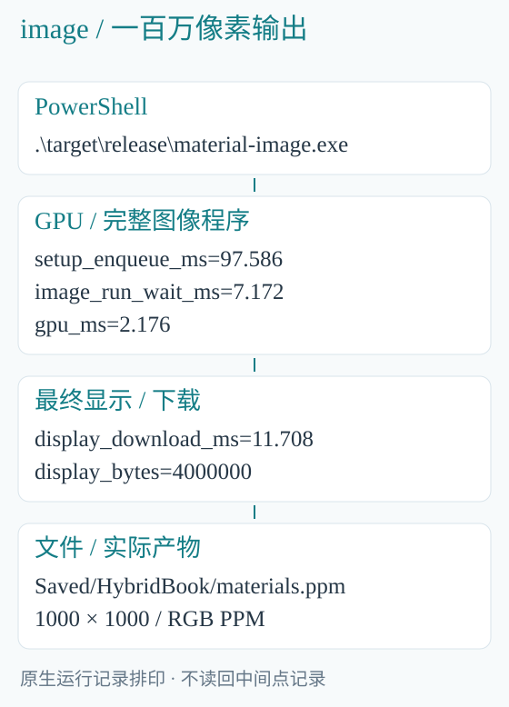

*图 13-2　原始观测中，设备程序为 2.176 ms，调用并等待为 7.172 ms，显示像素下载为 11.708 ms。计时范围分别列出。*

使用图像工具打开 Saved/HybridBook/materials.ppm，就能看到下图。书中 PNG 由这个实际输出转换而来。


*图 13-3　从左到右粗糙度增加，法线与纹理采样也随位置变化。*

观察图像后，再回到 prepare 中的几行公式。这样能把一个具体输入如何影响最终像素对应起来。某处更亮可能同时受到法线、纹理和高光影响，不能只归因于一个参数。

## 14　把学到的调用方式用进自己的项目

### 14.1　先挑一段真正要计算的工作

可以先从现有 Rust 项目中挑一个输入输出清楚的算法：图像处理、粒子更新、批量空间变换，或者一组统计计算。

列出输入数组、普通参数和输出。把计算写进 B，把文件、用户输入和结果使用继续留在 Rust。先跑通一个小输入，再增加规模和连续执行。

例如要给第三章的粒子换一个力场，修改的是 B 的加速度计算；Rust 的文件保存代码可以继续使用。要改变输出路径，修改 Rust 即可。

### 14.2　什么时候选择 DLL，什么时候用原生 API

| 做法 | 怎样使用 | 适合的情况 |
|---|---|---|
| blc -c／bllink | 先生成库，再由 Rust/C++ 链接调用 | 给已有项目交付一个数组算法 |
| blanguage、blcompute | 在 Rust 中加载 B，直接创建和传递资源 | 连续 GPU 计算、共享纹理和复杂步骤组合 |

第一章已经完整演示 DLL。第三章以后使用原生 API，是为了把上传、设备数据和等待都写出来。两种方式都保留，按项目需要选择。

当前 DLL 接口支持纯值数组和普通参数，调用会同步等到结果。纹理、view、加速结构以及本书的完整异步组合，需要使用原生 Rust 接口。

### 14.3　同一个 DLL 也能交给 C++

numbers.dll 同时生成 numbers.abi.h 和 numbers.lib。C++ 通过生成头文件调用，链接同一导入库即可。

仓库里的 sample/interop/map.cpp 提供了完整例子；下列命令在 Blink 根目录运行：

```powershell
.\target\release\blc.exe -c `
    sample/lessons/map.b `
    -o target/interop/map.obj `
    -I sample --program scale
.\target\release\bllink.exe `
    target/interop/map.obj -o target/interop/map.dll

cl /nologo /utf-8 /EHsc `
    /I target/interop `
    sample/interop/map.cpp `
    target/interop/map.lib `
    /Fo:target/interop/map-cpp.obj `
    /Fe:target/interop/map-cpp.exe

.\target\interop\map-cpp.exe
```

输出为 3 5 7 9。编译 B 的是 blc，编译 C++ 调用方的是 cl。Rust 和 C++ 都可以作为正式调用方；Rust 仍可直接使用原生 crate。

B 的普通 CPU 应用已支持通过 extern "C" 声明调用 Windows x64 DLL 的 C 导出；Rust 与 C++ 可以各自按 C ABI 导出函数。普通值、位置借用与连续布局合同有明确边界，不直接导入语言对象或普通 Rust ABI。完整范围见 Docs/NativeInterop.md。

### 14.4　把只需准备一次的东西留下来

同一个程序连续计算时，可以保留已经编译的程序、设备、纹理和数据。每次只交入变化的普通参数或更新过的数据。

改 dt 不需要重新读取全部模型；换输出路径不需要重编译材质；下一步仍在 GPU 上算时，也不需要先下载全部中间结果。按照实际使用次序安排这些对象，通常比不断重复创建更简单。

### 14.5　可以自己继续完成的三件事

第一，把材质图的粗糙度范围改成普通参数。B 接口加上参数，prepare 使用它，Rust 再按顺序传入 Value::F32。用同一程序改变参数，观察输出。

第二，把四颜色纹理换成自己的 .bltex 文件。Rust 读取 Texture2D 后仍按原方式上传，B 的采样和 GGX 可以继续使用。

第三，在粒子更新之后增加另一段 B 计算。先确定它需要 bodies、total 还是其他输出，再选择 submit_after 或 submit_join。让它直接使用已有设备结果，最后再下载应用需要的部分。

### 14.6　写完以后，自己核对一遍这条过程

从程序入口顺着读：输入在哪里创建，加载哪个 B 入口，数据和普通参数怎样对应，何时执行，结果从哪里取回。先用小输入核对这些步骤，再增加数据规模和计算步骤；这与第一章的四个数是同一种调用过程。

## 附录 A　可直接执行的命令

### A.1　构建 Blink 工具链

先安装第一章所列工具，在 x64 Developer PowerShell 中执行：

```powershell
git clone `
    https://github.com/sgua83/Blink.git
Set-Location Blink
cargo build --workspace --release
```

下文均在这个 Blink 根目录执行。已有仓库时从构建命令开始。

### A.2　编译第一个 DLL，运行 CPU 和 GPU 版

```powershell
.\target\release\blc.exe -c `
    sample/hybrid/first/numbers.b `
    -o target/hybrid/numbers.obj `
    -I sample/hybrid/first --program transform
.\target\release\bllink.exe `
    target/hybrid/numbers.obj `
    -o target/hybrid/numbers.dll

rustc --edition=2024 `
    sample/hybrid/first/main.rs `
    -L native=target/hybrid `
    -o target/hybrid/numbers.exe
.\target\hybrid\numbers.exe

rustc --edition=2024 `
    sample/hybrid/first/gpu.rs `
    -L native=target/hybrid `
    -o target/hybrid/numbers-gpu.exe
.\target\hybrid\numbers-gpu.exe
```

两者都把 [1,2,3,4] 变为 [3,5,7,9]。生成的 DLL 与 exe 留在同一目录。

### A.3　构建并逐章运行原生 Rust 示例

```powershell
cargo build --release `
    --manifest-path sample/hybrid/Cargo.toml `
    --target-dir target

.\target\release\particle-cpu.exe
.\target\release\particles.exe cpu 3
.\target\release\particles.exe gpu 3
.\target\release\particle-steps.exe
.\target\release\particle-flow.exe
.\target\release\scene-evaluate.exe cpu
.\target\release\scene-evaluate.exe gpu
.\target\release\material-samples.exe cpu
.\target\release\material-samples.exe gpu
.\target\release\material-image.exe
```

particle-cpu 是第三章完整展开的 CPU 小程序。particles 计算同样的物理问题，并提供数量、后端和计时输出。其余 exe 各自完成对应章节的一个例子。

GPU 例子需要驱动提供所需 Vulkan 能力。执行失败会返回错误，不会悄悄换成 CPU。CPU 例子不需要创建设备。

### A.4　查看 B 采样程序的编译结果

```powershell
.\target\release\blc.exe check `
    sample/hybrid/Programs/book/sheet.b `
    sample/hybrid/Programs `
    'materials<10000,1000>'
```

本书现行教学模块中，prepare 和 shade 形成两个源步骤，优化后合成一个执行 Map 阶段。完整图像 image 也可用相同 check 形式查看。

### A.5　原始输出放在哪里

sample/hybrid/运行记录.txt 保留图表使用的原始终端输出。第十章和第十三章的耗时来自其中所标明的原始观测；重新运行不会强制得到相同毫秒数。

一千万点的采样例子与一百万像素的图片例子规模不同。比较耗时时先对齐输入规模和计时范围。CPU/GPU 浮点差异也保留在记录中。

## 附录 B　查找完整源码

### B.1　从例子直接找到文件

| 例子 | B 文件 | Rust 文件 |
|---|---|---|
| 四个数的 DLL 调用 | first/numbers.h、numbers.b | first/main.rs、gpu.rs |
| 一次 CPU 粒子模拟 | Programs/simulation/statistics、bodies | src/bin/particle-cpu.rs |
| 粒子 CPU/GPU 与多步计算 | 同上 | src/particles.rs |
| 两组结果相加 | Programs/book/handoff | src/particles.rs 的 flow |
| 场景、相机和灯光 | Programs/scene/hierarchy、components | src/scene.rs |
| 材质采样与计时 | Programs/book/sheet、material/textured | src/sheet.rs |
| 完整图片 | Programs/book/sheet、render/resolve | src/bin/material-image.rs |

这些路径相对 sample/hybrid。B 模块同时有 .h 接口和 .b 实现。src/lib.rs 中的辅助函数完成 B 加载、字段写入和结果读取，各个 exe 的入口在 src/bin 中。

### B.2　引擎节选的原文件

模型 view 来自 BLEngine 的 render/trace.h 与 src/scene.rs；文件读取来自 src/geometry_io.rs；一帧资源调用来自 src/output.rs 和 render/frame.b。

BLEngine摘录来源.md 列出各个文件的修订和 SHA256。该清单记录教学模块的最初来源与本轮文件 SHA256；现行 Programs 使用当前语言接口，并同时提供所需导入文件，直接由最新版编译器编译。

Programs/book 是为这些例子准备输入和连接步骤的小模块。实际 GGX、粒子更新、场景变换和显示转换仍使用引擎实现。

### B.3　版本变化时怎样继续阅读

BLEngine 还在开发，新版本可能改变渲染阶段或参数。对照其他版本时，先找到具体入口的 .h，按参数表重新对应 Rust 的数据，再追到执行和结果使用。

本书教的是怎样把两种语言实际接起来。引擎整体结构、Stella 的后续实现与窗口平台细节，放在第三本《BLEngine 源码分析》中阅读。

Copyright (c) 2026 Blink contributors。引擎摘录 Copyright (c) 2026 BLEngine contributors，MIT License。完整许可随配套源码保留。

## 本版统一函数接口

B 计算入口使用统一 void 函数定义，parallel 及原数据访问不变。Rust 的 Program、compile_entry、同步run与异步submit仍消费同一算法产物，不要求换一套宿主接口；--program是产物入口选项。B应用使用target选择本次CPU／GPU位置，同步GPU返回与显式下载分别完成计算与传输。普通 CPU 原生调用、递归与有限独立模块已经实现；完整模块／资源契约及一般异步应用语法仍待完成。原始性能记录注明真实来源和测量范围；当前编译与 CPU／GPU 调用结果分别记录。
