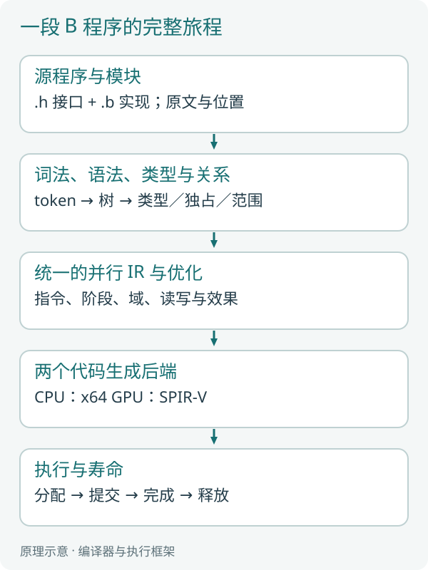
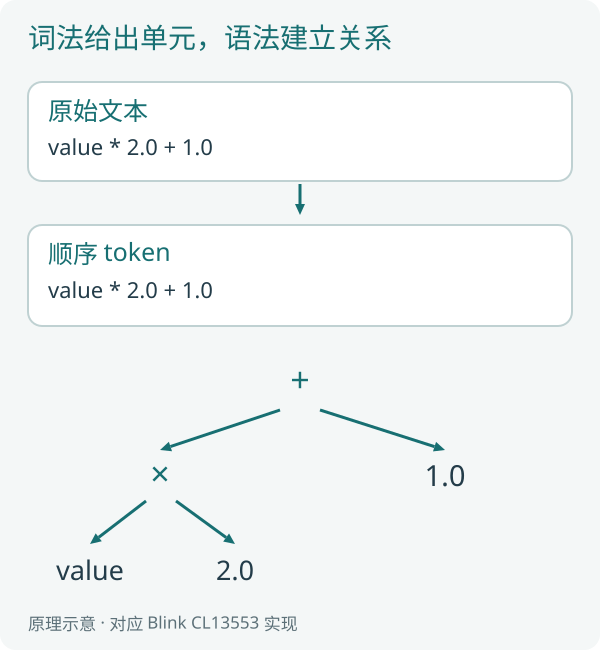
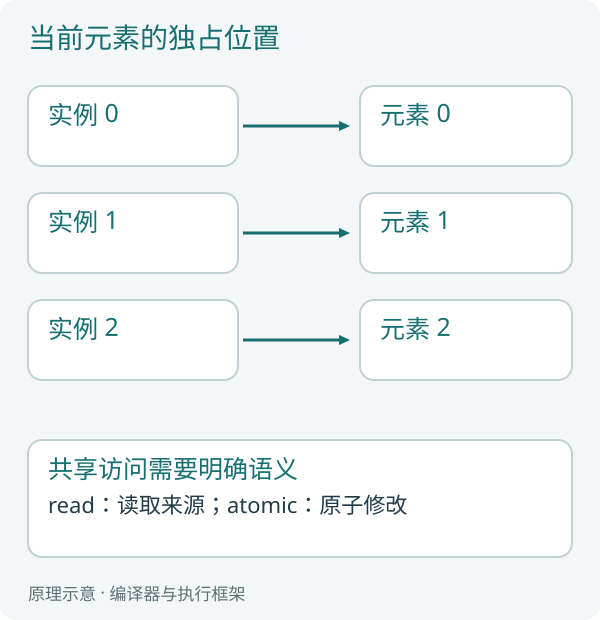
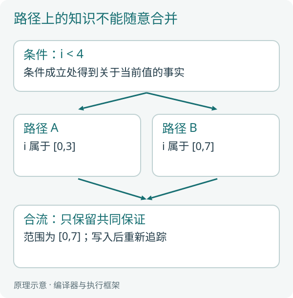
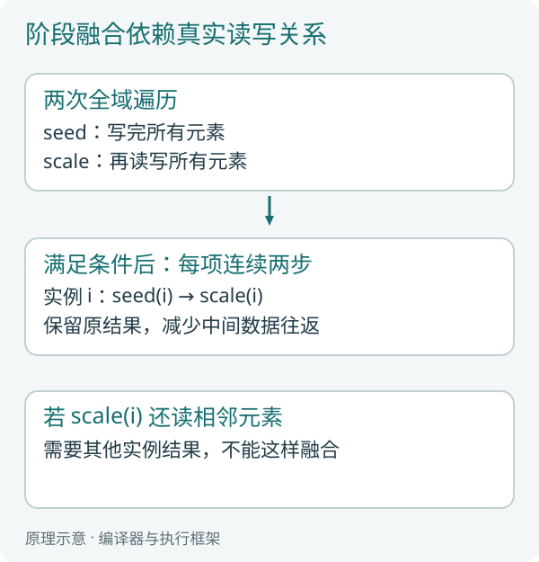
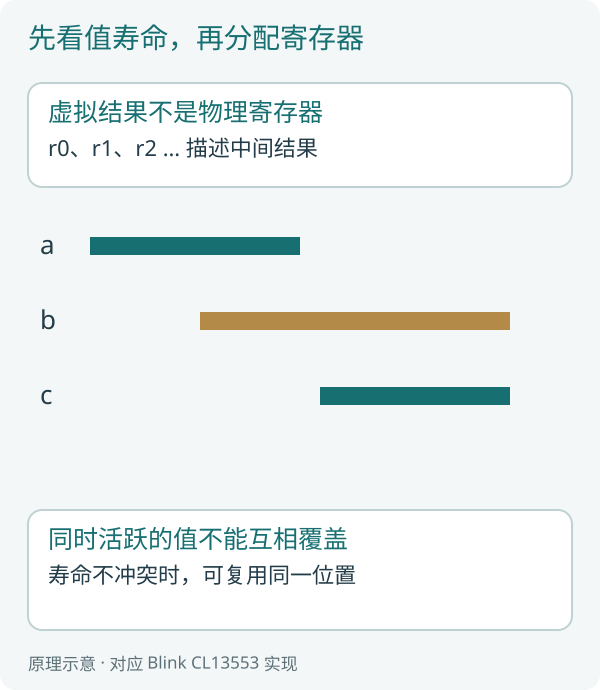
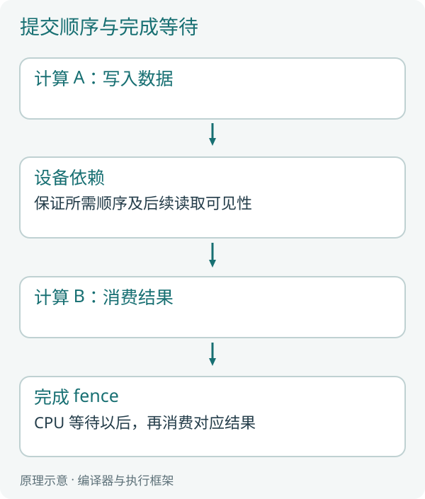
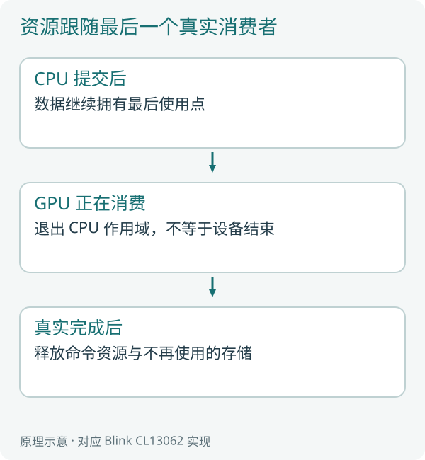
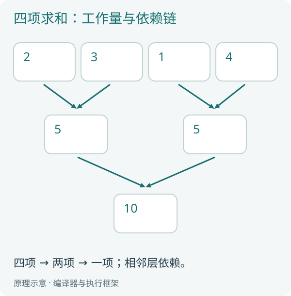
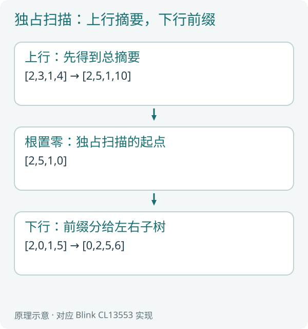

# B 语言源码分析

从一行算式到 CPU 与 GPU 的真实执行

## 写在前面

一门语言怎样把 `value = value * 2.0 + 1.0` 变成处理器真正执行的工作？

这件事并不是把几个英文单词换成机器指令。编译器先要认出句子的结构，分清数字和数据，判断每一处读取、写入是否成立，再把计算整理成适合不同处理器的形式。计算开始以后，还要有人准备内存、安排执行，并在最后一个使用者结束后释放资源。

本书沿着这条完整路径阅读 Blink 的实现。Blink 简称 B 语言，B 也寓意 Base。开源工程在 https://github.com/sgua83/Blink 。读者最好已经写过少量 B 程序；熟悉 C/C++ 会有帮助，不要求预先学过编译原理、汇编、Rust 或 Vulkan。

遇到必要知识，我们先用能手算的例子说明，再进入源码。例如，先看乘法为什么应先于加法组成语法树，再看解析函数；先理解“两个值还要同时用，所以不能占同一个寄存器”，再看寄存器分配；先区分“工作已提交”和“工作已完成”，再看 GPU 资源释放。

本文沿当前Blink源码阅读；现行文件和节选行号见compiler/源码版本索引.json。源码、构建、原生执行和性能分别判断，历史结果保存在P4双台账。

当前实现包括自研前端、并行中间表示、Windows x64／SPIR-V 后端及 CPU／Vulkan 执行框架，也能把普通 CPU 应用编译为目标文件，再由独立链接器生成可执行程序。普通 CPU 原生调用、递归与有限独立模块已有实现；完整模块／资源契约、其他目标调用、一般异步应用、基础库与跨平台能力仍分别开放。



*图 0-1：前端回答“这段程序是什么意思”，后端回答“怎样表达给处理器”，执行框架回答“怎样使它真实运行”。箭头经过的每个对象都将在正文展开。*

## 阅读路线

第一部分从一个小程序开始，补齐内存、Rust 阅读方法、词法、语法和类型知识。第二部分讲独占访问、范围事实、中间表示、控制流与优化。第三部分进入 CPU 指令、调用约定、寄存器、线程和 SIMD。第四部分进入 GPU 执行模型、SPIR-V、Vulkan、分页、同步与资源寿命。最后通过归约、扫描、筛选、排序和块内协作，看清高级并行操作怎样落到两种硬件上，再阅读 DLL 与完整源码结构。

各章末尾的“自己走一遍”用于检查是否理解，并附解释。它们是阅读练习，不是需要安装或执行的额外测试工具。

## 第一章 从四个数走完整条路径

### 1.1 先认识要追踪的计算

我们使用工程已有的 `sample/lessons/map.b`。这里的 map 表示逐元素计算；`lessons.map` 是教学模块名，不是标准库函数。先读最短的 `scale`：

源码节选：`sample/lessons/map.b:9`。

```rust
void scale(inout dataset<f32> values) on compute {
    parallel (value in values) {
        value = value * 2.0 + 1.0;
    }
}
```

输入为 `[1.0,2.0,3.0,4.0]`，每个元素先乘二再加一，得到 `[3.0,5.0,7.0,9.0]`。四个结果互不依赖。计算第三项时，不需要等待第一项算完，也不需要知道第一项的结果。

对应的 C 写法可以是下面这样。变量名和计算保持一致，差别集中在循环表达上。

```c
for (unsigned i = 0; i < count; ++i) {
    float value = values[i];
    value = value * 2.0f + 1.0f;
    values[i] = value;
}
```

C 循环描述一个接一个访问下标的过程，成熟 C/C++ 编译器在条件允许时也能自动向量化。B 的 `parallel` 直接声明每个实例拥有当前元素；具体分成几个 CPU 范围、怎样组成 SIMD 批次，或怎样安排 GPU 工作组，由后面的实现决定。不能把这种语义差别简化为“C 总是串行，B 总是更快”。

### 1.2 同一个例子为什么还有 seed 和 demo

源码节选：`sample/lessons/map.b:1`。

```rust
module lessons.map;

void seed(write dataset<f32> values) on compute {
    parallel (value in values) {
        value = f32(index() + 1);
    }
}
```

`seed` 把元素设为从一开始的数字，`index()` 是从零开始的当前位置。第零项写入一，第一项写入二。

源码节选：`sample/lessons/map.b:15`。

```rust
void demo(inout dataset<f32> values) on compute {
    seed(values);
    scale(values);
}
```

`demo` 先产生数据，再完成变换。因此不需要额外编写输入文件，就能得到这四个结果。源码有两个逐元素阶段，优化器可能把它们合成一个实际阶段。我们将在第十一章解释合并的条件。

### 1.3 下载、构建与观察

先下载并双击安装 [Windows x64 正式版 v0.14.1.1](https://github.com/sgua83/Blink/releases/tag/v0.14.1.1) 的 `Blink-Setup-windows-x64.exe`，作为可独立取得的稳定 Blink 种子。默认编译器构建直接读取 `%ProgramFiles%/Blink` 内的 `VERSION`、`bin/bc.exe` 与 `bin/blink.exe`；稳定种子要在执行 Cargo 之前安装好。

当前源码工具链还需要 Git、Rust stable 的 MSVC 工具链，以及 Visual Studio 的 C++ 桌面开发工具（x64 C++ 工具与 Windows SDK）。新开 x64 Developer PowerShell，先核对实际种子，再下载并构建源码：

```powershell
& "$env:ProgramFiles/Blink/bin/bc.exe" --version
& "$env:ProgramFiles/Blink/bin/blink.exe" --version
git clone https://github.com/sgua83/Blink.git
cd Blink
cargo build --workspace --release
```

原build.rs用上述种子bc逐模块生成B词法、泛型前瞻、对象元数据、COFF对象写出及归档生成对象，再由同一次blink归档静态链接；种子保留在安装目录，新构建产物进入工程target。Rust编译其余语法构造、AST、检查、IR、后端与执行框架；B算法由Blink自己的后端生成代码。GPU 执行还需要支持相应 Vulkan 能力的显卡与驱动。

先检查，再导出 CPU/GPU 代码：

```powershell
.\target\release\bc.exe check sample\lessons\map.b sample demo
.\target\release\bc.exe build sample\lessons\map.b Saved\MapCode sample demo
```

这里的 `build` 输出可供研究的阶段代码与布局，尚不是应用 `.exe`。在这本源码分析书里，我们正要观察这些中间产物，因此会使用这一命令。

常规使用先看完整 B 应用 `sample/applications/map_cpu.b`：main 自行分配四条记录，直接写出输入初始化、parallel 变换和输出；没有导入 lessons 或调用 demo。完整 `.h` 与 `.b` 如下；模块名、入口和计算均可见：

`sample/applications/map_cpu.h`：

```c
module applications.map_cpu;

u32 main() on cpu;
```

`sample/applications/map_cpu.b`：

```c
module applications.map_cpu;

u32 main() on cpu {
    dataset<f32> values = dataset<f32>(4);

    parallel (value in values) { value = f32(index() + 1); }

    parallel (value in values) { value = value * 2.0 + 1.0; }

    for (value in values) { if (!println(value)) { return 1; } }
    return 0;
}
```

GPU 版 `map_gpu.b` 在同一文件完整定义 scale_values，并在 main 明确 upload、target(gpu, ...)、download；CPU 无需 target 包装。两份源码以正式工具0.14.1.1运行均输出3、5、7、9。用 bc -c 编译、blink 独立链接后，直接运行 EXE，无设备参数：

```powershell
& "$env:ProgramFiles/Blink/bin/bc.exe" -c sample/applications/map_cpu.b -o target/book-apps/map_cpu.obj -I sample
& "$env:ProgramFiles/Blink/bin/blink.exe" target/book-apps/map_cpu.obj -o target/book-apps/map_cpu.exe
.\target\book-apps\map_cpu.exe
```

设备能力 on compute 与本次目标 target 不同，当前没有 target(auto, ...) 或隐式迁移。上述基础应用已用正式版0.14.1.1实际运行；本书源码分析继续跟随现行main，不把研发源码身份等同于旧发行标签。

下面仅保留一个后端隔离测试：不引入应用 main，分别检查同一编译器模块在 CPU 与 GPU 上的生成／绑定／执行，便于源码分析和逐字节结果对照。它不是常规程序入口：

```powershell
.\target\release\brun.exe cpu sample\lessons\map.b demo sample Saved\MapCpu :4
.\target\release\brun.exe gpu sample\lessons\map.b demo sample Saved\MapGpu :4
```

`:4` 申请四个初始为零的元素；`demo` 自己填入初值。结果保存在相应目录的 `values.bldata`。这只属于后端隔离测试的数据协议；正常 B 应用直接运行 EXE，并由代码选择设备。附录提供不加命令别名的直接读取方法。

正文节选对应当前源码，位置见现行源码索引；修订和原生运行历史只在P4双台账记录。


上面的阶段、布局和设备名来自工具输出；两行 values 从实际 BLDATA 读取后排成可读文本。启动和准备成本没有混入四元素算式的性能结论。


### 1.4 从输入文字到输出数字

整条路径可以先压缩成一句话：读取 `.h/.b`，得到单词，组成语法树，检查类型与访问，建立并行阶段，做合法优化，生成 CPU 指令或 SPIR-V，再由执行框架准备资源并运行。

在这个过程中，“程序”至少有三种形态：编辑器里的文字、编译器内存中的结构、处理器消费的代码。它们描述同一件事，却不能彼此混淆。语法树不是机器码，机器码字节也不自动等于可执行文件。

**自己走一遍。** 若第二项结果不对，应先怀疑语法分析器吗？不应直接跳到某一层。先确认实际输入，再看编译出的操作与布局，最后核对 CPU/GPU 各自的结果。每一层都有自己的输入和输出，问题要沿着真实差异定位。

## 第二章 内存：数字怎样占据一段地址

### 2.1 先分清值、位和地址

值是一件事，保存值的位又是一件事。`u32` 的一和 `f32` 的一都占四字节，编码不同。`f32` 的 `1.0` 通常对应十六进制 `3f800000`，不能把这四字节当作无符号整数一使用。转换类型可能改变编码；逐位解释则保留编码，改变理解方式。

地址告诉我们数据在哪里。假设第一个 `f32` 的地址为一千，元素间隔为四字节，第四个元素位于 `1000 + 3×4 = 1012`。源码中的通用记录也是这个规律，只是间隔不一定等于单个字段的大小。

```text
元素地址 = 数据起点 + 元素下标 × stride
字段地址 = 元素地址 + 字段偏移
```

这里的 `stride` 是相邻完整记录的间隔，字段偏移则描述字段在一条记录中的位置。理解这两个数，后面就能读懂 CPU 地址计算、GPU 分页、C ABI 和 view。

### 2.2 对齐为什么会产生空白

处理器和接口通常要求某些数据从适当的地址开始。对齐为十六意味着起点是十六的整数倍。一个 `float3` 有三个四字节分量，内容共十二字节；在此版本的 B 布局中，它的对齐是十六。单独作为数组元素时，记录间隔因而是十六，而非十二。

源码节选：`crates/blanguage/src/ir.rs:286`。

```rust
    pub fn vector(s: Scalar, n: usize) -> Self {
        if n == 1 {
            return Self::scalar(s);
        }
        Self {
            name: match s {
                Scalar::F32 => format!("float{n}"),
                Scalar::U32 => format!("uint{n}"),
                Scalar::I32 => format!("int{n}"),
                Scalar::Bool => format!("bool{n}"),
                _ => format!("{}x{n}", s.name()),
            },
            arguments: Vec::new(),
            values: Vec::new(),
            size: n as u32 * s.size(),
            align: s.align() * if n == 2 { 2 } else { 4 },
            components: (0..n).map(|i| (s, i as u32 * s.size())).collect(),
            fields: Vec::new(),
            view: None,
            array: None,
            enumeration: false,
            result: false,
            variants: Vec::new(),
            dataset: None, cleanup: None, function: None,
        }
    }
```

零长度array<T,0>保留T的对齐和完整类型身份，载荷字节数为零；无字段记录及仅含零尺寸字段的记录也沿同一Ty布局存在，不是void或数值。B参数／返回与位置降低不为这些值生产机器分量，GPU只按实际字节生成数据页，逻辑记录数量和原绑定表仍保留；普通C ABI直接零尺寸按值交接与裸取址仍以现行可表示范围为准。

不要从“内容十二字节”推出“任何地方都连续十二字节”。记录中的字段、矩阵的行、整个 dataset 的 stride 都要按编译器布局处理。C++ 或 Rust 的同名类型也未必具有相同布局。


*图 2-1：字段内容、对齐空白、完整记录间隔是三个不同概念。编译器给出统一布局，两个后端和执行框架共同消费。*

### 2.3 源码中的 Ty 保存了什么

源码节选：`crates/blanguage/src/ir.rs:107`。

```rust
#[derive(Clone, Debug, PartialEq, Eq)]
pub struct CFunctionType {
    pub result: crate::ast::TypeName,
    pub parameters: Vec<(crate::ast::Access, crate::ast::TypeName)>,
    pub contracts: Vec<crate::ast::ContractPredicate>,
}
#[derive(Clone, Debug, PartialEq, Eq)]
pub struct Ty {
    pub name: String,
    pub arguments: Vec<Ty>,
    pub values: Vec<u32>,
    pub size: u32,
    pub align: u32,
    pub components: Vec<(Scalar, u32)>,
    pub fields: Vec<(String, u32, Box<Ty>)>,
    pub view: Option<Box<Ty>>,
    pub array: Option<Box<Ty>>,
    pub enumeration: bool,
    pub result: bool,
    pub variants: Vec<Variant>,
    pub dataset: Option<Box<Ty>>,
    pub cleanup: Option<String>,
    pub function: Option<Box<CFunctionType>>,
}
```

`size` 是类型内容占用，`align` 是对齐，`components` 把值分解为标量及偏移，`fields` 保留记录字段。`view` 与 `array` 说明它是否还包含引用式只读资源或内联数组。

B源语言通过size_of<T>()与align_of<T>()读取同一Ty的大小和对齐，结果是usize编译期常量。原expected_storage完成具体类型及dataset包装，泛型／const闭合后仍沿原类型服务；查询不构造对象、不执行owned释放，也不生成运行时节点或布局表。dataset查询其描述值，view查询其引用值，owned保持载荷布局，实际存储仍归Frame／blcompute。float3的大小12、对齐16与array<float3,2>的大小32各保留原语义。

源码节选：`crates/blanguage/src/check/generics.rs:91`。

```rust
        if key.is_none() && matches!(name, "size_of" | "align_of") {
            let ([GenericArgument::Type(syntax)], []) = (explicit, args) else {
                return self.fail(span, "B153", format!("{name}<T>()需要一个明确类型且不接收值实参"));
            };
            let ty = self.expected_storage(syntax, span)?;
            let bytes = if name == "size_of" { ty.size } else { ty.align };
            return Ok(Some(self.constant(Scalar::U64, Bits::from(bytes))));
        }
```

普通同名类型／函数继续原解析。公开接口若保存查询表达式，消费者须支持该语法；仅实现内部使用查询的已编译obj／lib，沿既有常量、符号及BLCO／BLRI格式交接，不要求链接阶段重读实现或再次编译。源类型修改仍由原对象依赖规则决定重编；这里不再计算第二份布局。

这样，一个 `float3` 在前端仍有完整类型，在后端却可拆成三个 `f32` 分量。语言向量不保证每一处都会使用一条硬件向量指令；是否批量执行，还取决于计算、访问和后端计划。

address与handle、u64保留不同类型身份；其8字节大小、8字节对齐及单个U64逻辑分量仍由原Ty表示，模块和Windows x64调用ABI消费同一布局。usize／isize只是u64／i64的同义类型，不复制数值实现或建立32位CPU分支。address()是空值，普通复制与相等比较保留全部64位；CPU的unsafe_address与address_bits显式交接整数位模式。它们不访问或拥有指向存储，也不因一个值非零就取得可读写位置。address_of取得原连续CPU位置或资源元素的真实地址，复用CallReference／Position及原布局，不先读取或复制载荷。原Scope的声明扫描保留取址所需的Local存储；当前值分析消费真实写入，取址本身不使循环中的原数值事实失效。沿已有builder是否存在区分这两个阶段，不增加存储表、值流或效果图。普通值、记录／数组、函数返回与独立obj／lib沿Proof.views／Borrow交接同一来源；真实写入使原Local／Data别名对应的旧数值事实失效，不另建运行时地址表。整数地址往返不保留静态借用。编译期在原Proof中按实际值分量交接可证明的地址位模式与原存储／字节区间关系；它与静态借用分开，不授予权限、初始化或寿命。复制、记录／固定数组、条件选择及普通B参数／返回／输出保留同一数值来源；同宽64位整数转换保持位模式，缩窄或改变位模式的运算撤去该关系。真实写入沿原数值地址来源和字节范围投影到原Local或资源位置；已知资源没有局部槽位不构成来源未知。原资源与其字段字偏移交给同一数值失效消费者，真正写入必须撤回相应旧事实，未写字段及独立资源保持；原范围无法闭合、越出已知存储或真实未知地址仍按External处理。公开对象合同只用原输入重绑定，不导出被调私有Local／slot，整数结果不延长原存储寿命。原Proof.addresses只保存稀疏的编译期数值关系，原Proof.views继续交接借用；原Identity／Origin保存真实布局与条件，原写范围消费者复用同一位置失效。External仍可能与原Local相交。原内存结果区分已知来源与External，再沿原局部表的实际区间填写Pointer别名；真实写入及循环写分析使受影响的旧数值事实失效，不能继续把它们作为常量；未知写入仍保留可能有效的原地址借用，并加入External来源，不把可能覆盖当作确定覆盖。局部表键为逻辑分量区间终点，原Ty仍决定字节布局。不透明C调用通过原MemoryTarget交接External内存效果，原MemoryEffect在本函数局部表上填写实际InOut别名；同步回调经整数userdata读写显式取址的局部存储后，原位置读取和字段／固定数组仍消费真实内存。原Scope::Write交接显式位置、不透明外部写及闭合B调用的实际写位置；循环预分析与数值出口复用原Access、输入Proof和位置分量查询，不增加第二张效果图。已取出的普通SSA快照保持。该编译期交接不创建运行时地址登记，也不凭未知写入推定初始化；普通B调用沿原Access合同交接资源互斥、类型位置及实际Memory效果；原Function.calls连接自身MemoryTarget，实际内存效果沿原函数图闭合后填入Call.memory，独立对象／归档保留同一合同。调用IR只消费原闭合Access的实际读写方向，不重复叠加实参地址能力；Position的writes与initialized交接Write、Read或InOut，后者是实际读取，不能因来源已初始化而清掉。原MemoryEffect在同一结构中保留不透明方向和已知位置：外部C及cfn用ensures memory(none／read／write／inout)交接不透明效果，未声明为inout，多个承诺取许可交集。该部分与显式位置的实际读写分别合流，未知读取加一个局部输出写不会变成所有存储未知写。原局部表只展开实际不透明方向；位置可写许可不制造额外写入，none也不允许删除真实调用。指针形成仍只交接原别名，不透明C仍交接原Memory效果。类型位置仍持有真实布局，Memory不伪造类型；never调用也保留真实读取。形成地址及B实参暴露不冒充实际访问，原IR别名继续消费这些地址；Position交接真正读写，Memory交接不透明C效果。ApplicationLoads组合两项原职责：typed Reference ABI交接明确Local槽或Indexed字节写，额外效果只取call.memory_use指向的首个原Memory记录；普通B调用只有这个额外效果记录，命名／间接C首记录消费原不透明合同，后续typed位置仍由原Memory求解和实际别名消费者交接。Reference ABI已描述这些位置，装载查询不能因它们尚待闭合再次推成未知额外写，损失未写局部下标的原常量快照。普通标量引用写未被该资源图完整覆盖，不能在有memory_use时跳过；标量下标经引用改写，旧LoadLocal身份便不能用于当前dataset读取。已知引用字节范围由原store_overlaps在同一真实位置上判断。共同元素模型失去某字段的普遍数值保证，与已求值且之后没有相交写入的装载快照分别交接；已经证明不相交的写保留原快照，实际或未知相交写仍撤回对应数值关系。当原64位地址拆分可追溯到已有PositionAddress时，原装载重叠查询直接消费其CallReference，把实际基址、下标、stride及字段／额外字节偏移归到同一原位置，再比较读写字节范围；查询只借用原IR，不建立地址图、数值表或运行时状态。真实局部输出不使独立已分配dataset内容失效。constant查询直接LoadLocal时沿原IR前缀找最后一个可能写，只有StoreLocal继续追该原寄存器；调用／分支／循环写和没有完整前缀的嵌套位置保持未知；跨活动循环继续消费原LoopWrites，可能回边改写的槽不取得入口常量，不保留常量缓存或另一份值流。循环预分析也消费同一合同：Scope仅在不透明方向允许写时形成External，显式位置仍进入原Write::Position；普通B按闭合Access只撤回其已覆盖的dataset内容许可写；普通标量Reference的位置仍由原typed ABI及Position交给LoopWrites，不由资源内容只读结论删除。Module的只读及写范围查询读取Memory的真实方向，循环数值与装载不增加另一份效果图。原write_address_values先规范化已有Origin，再处理同一次写入的局部Proof与Data.elements：不透明未知写沿原内容失效入口，已知资源位置按Origin资源及words交给既有update_application_elements。CPU资源字段的position_origin从原Place交回element_layout与真实words，不能重新按局部字段类型从零解释。调用后新装载不继承已写字段初始化时的非零范围，未写字段、其他资源和捕获值保持；复用原update_application_contents／update_application_elements，没有第二份元素模型，原初始化、借用、拥有和最后释放保持。External位置沿原读写接点交接，原Origin的初始化事实不清掉实际读取。已有闭合访问合同的B调用按实际条件使真正写入与不透明C可能影响的数值事实失效，纯地址值、只读及原SSA快照保持。源函数完成时沿原Function.calls闭合尚未完成的分量，已闭合直接依赖消费原接口；未闭合与合法空访问合同分别表示，公开编码仍为原闭合集合。同源和obj／lib调用使用同一访问合同。普通CPU调用的原Unit尚未闭合时，原Call持有调用前实际位置的数值快照，原绑定只交接该调用的MemoryValue；后续读取仍发射真实Load，不提前复用调用前常量、范围或非零许可。原Module先闭合实际Access，再按原Call顺序把已解析的前次MemoryValue代入本次访问条件及来源，形成当前MemoryEffect后才交付本次快照；后次调用直接消费这一前缀，不另遍历全函数重建。当前快照不能用于证明当前调用无写；普通位置与资源共同普通载荷使用同一Call.snapshots／MemoryValue，实际Origin、条件及字节布局保留到原Position消费者，IR出口再投影Local／Data别名。普通拥有聚合与资源共同模型在同一个快照捕获入口按实际活动字段排除资源描述分量；资源描述及子长度继续归原类型化拥有模型，真实write／inout交接实际新资源，空变体不产生子资源；原绑定表保留同一Module的实际延后数值身份，快照形成后按同一值捕获其条件，由原分支合流消费。未写位置继承原事实，可能写位置保持未知，已捕获SSA值独立。普通Local数值快照消费原Origin的实际字节位置及已有Presence选择，静态／动态候选只撤回相交分量；IR整块Local别名仍保留真实物理读写，不作为数值写范围。无法闭合的原位置及未知写继续保守。类型化引用在原Address／PositionAccess分别交接可写能力与实际写入：实参准备只检查权限，真实赋值沿原Parameter／Derived字段投影进入写效果；普通与拥有引用共用同一原参数位置来源，未写字段事实保持。只读、布局与初始化合同仍须满足。递归循环入口仍见Issues C-020.2.7.2.3.2.2.3.3；factory经未闭合调用与部分写入后的下标关系，以及同分量部分覆盖后的新非零推导，分别见C-005.59.2／.3及C-005.60，不以当前分析缺口限制语言。此时需要等待的原整数除数要求保存在同一Function使用记录，继续消费原非零规则，不另建数值图、SSA解释器或验证器。返回／写回和访问合同沿原规范输入／输出身份交接解析后的数值事实；这些快照只属于编译Module，不进入运行时资源或ABI。同一已解析数值事实也进入原初始化及调用访问查询的路径上下文。原typed Reference写、初始化、借用与最后资源完成继续由原所有者消费。循环预分析的字面三元未选分支、其他存储范围及异步保留回调仍按各自实际缺口推进。完整系统ABI消费者与外部回调仍按各自具体缺口建设。

`unsafe_position<T>`直接形成原Reference位置，按Ty的真实字节偏移读写，read／write／inout借用原地址。已知B来源保留布局、只读／可写权限和逐分量初始化；外部位置没有B参数初始化scope，不登记为Frame拥有资源，实际范围、对齐、权限、初始化与最后消费者前存活由调用者负责。原Requirement::Address检查已知布局、写权限及初始化，Requirement::Memory交接实际内存效果；它们不等同于dataset的Unborrowed要求。当前跨语句裸地址写与待执行静态F的读取冲突不保证穷尽诊断，显式unsafe调用者及提供安全B接口的库实现仍须遵守原借用合同；保留已知来源或编译成功都不证明全部别名合法。地址位模式、可能借用与确定初始化分别表达，不能因取址就认为已写入，也不能把条件地址的全部候选都标为完成。

实际写入位置及条件沿原函数正常出口交接。递归和完整for的待闭合事实保存在原Position／Function.uses中，来源与确定结果沿原调用关系统一收敛；读取、条件输出与转借都保留实际时点，不由后续写入补足。公开合同只含闭合位置与完整条件，不携带被调私有槽或循环表达。资源及指向该资源的地址可以共同返回；拥有字段或值移动仍使用原存储，缺少拥有者的地址不能逃逸。own静态F的真实后续读取参与原view_liveness，最后消费前不允许存储resize／迁移／释放，Frame／blcompute仍是唯一物理资源所有者。

源码节选：`crates/blanguage/src/check/address.rs:862`。

```rust
    pub(super) fn external_position(&mut self, explicit: &[GenericArgument], args: &[Expr], span: Span) -> Result<Option<Place>> {
        if self.program.target != Target::Cpu {
            return self.fail(span, "B265", "unsafe_position只解释本进程CPU地址");
        }
        let ([GenericArgument::Type(name)], [arg]) = (explicit, args) else {
            return self.fail(span, "B153", "unsafe_position<T>需要一个明确普通类型和一个address实参");
        };
        let ty = self.world.ty(name, &self.definition.source, span, &self.definition.module, &self.definition.imports)?;
        if ty.owns_resources() {
            return self.fail(span, "B224", "外部地址位置不能创建Blink拥有资源");
        }
        if ty.contains_views() || ty.components.is_empty() {
            return self.fail(span, "B263", "外部地址位置需要非空普通值布局，不能解释Blink资源引用");
        }
        let Some(mut value) = self.expr(arg)? else { return Ok(None); };
        self.require_same(&Ty::builtin("address").unwrap(), &value.ty, arg.span)?;
        let borrow=borrow_in_path(&self.current_address_borrow(&value.proof.view_borrow(0)),&self.path);
        self.check_view_requirement(view::Requirement::Address{borrow:borrow.clone(),layout:Layout::of(&ty),writes:false,writable:false,initialized:false,span})?;
        let external=!borrow.pending()&&!borrow.sources.is_empty()&&borrow.sources.iter().all(|source|matches!(source,view::Source::External));
        let identity = value.proof.addresses.first().cloned().flatten().unwrap_or_else(||match bounds::Proof::capture(&value).known_value(&value.ty) {
            Some(bits) => Identity::Constant(bits[0]),
            None => Identity::Value(value.component_origins(0)),
        });
        value.ty = Ty::scalar(Scalar::U64);
        let low = self.cast(value.clone(), Scalar::U32).regs[0];
        let shift = self.constant(Scalar::U64, 32);
        let high = self.binary(">>", value, shift, span,None)?;
        let high = self.cast(high, Scalar::U32).regs[0];
        let place=Place::Reference {
            words: ty.components.iter().map(|(_, offset)| *offset).collect(),
            ty:ty.clone(),
            address: if external{ReferenceAddress::External{address:[low,high],identity}}
                else{ReferenceAddress::Borrowed{address:[low,high],identity,borrow:borrow.clone(),layout:Layout::of(&ty)}},
            scope: None,
            access: Access::InOut,
        };
        let memory=if external{self.position_origin(&place,span)?.normalize()}else{borrow};
        self.check_view_requirement(view::Requirement::Memory{target:MemoryTarget::Value(low),borrow:memory,access:Some(Access::InOut),span})?;
        Ok(Some(place))
    }
```

已知地址身份与真实标量宽度共同判断借用重叠；同址u64与其第4字节处的u32不能因为逻辑分量不同而被误认为不相交。未知外部别名仍属于unsafe调用者的真实合同，不增加运行时扫描、另一个地址表或全局写效果。

源码节选：`crates/blanguage/src/check/address.rs:622`。

```rust
    pub(super) fn overlaps(&self, ty: &Ty, words: &[u32], other: &Self, other_ty: &Ty, other_words: &[u32]) -> bool {
        let (base, other_base) = match (self, other) {
            (Self::External { identity: Identity::Constant(a), .. },
             Self::External { identity: Identity::Constant(b), .. }) => (u128::from(*a), u128::from(*b)),
            (Self::External { identity: Identity::Value(a), .. },
             Self::External { identity: Identity::Value(b), .. })
                if a.iter().any(|identity| b.contains(identity)) => (0, 0),
            _ if self == other => (0, 0),
            _ => return false,
        };
        ty.components.iter().zip(words).any(|((scalar, _), word)| {
            let begin = base + u128::from(*word);
            other_ty.components.iter().zip(other_words).any(|((other_scalar, _), other_word)| {
                let other_begin = other_base + u128::from(*other_word);
                begin < other_begin + u128::from(other_scalar.size())
                    && other_begin < begin + u128::from(scalar.size())
            })
        })
    }
```

`cfn<R,P...>`把原生C函数地址的返回及参数签名放进原Ty参数结构；read／write／inout包装只在签名元数据里存在，不分配数据或增加Scalar。函数值自身仍是8字节、8对齐的U64载荷；不同签名保持不同名义身份，空值与真实调用分别定义。

CPU的unsafe_function显式把外部address解释为cfn签名，function_address取得同一原地址；普通B参数、结果、记录／数组和模块保留签名。函数签名以原TypeName保存已绑定的名义引用，函数地址本体保持8字节；原World先完成真实布局，再验证签名闭包，实际调用才取得完整参数／返回布局。记录因而可以通过函数签名自引用或互引用，按值接收或返回记录也不改变地址大小；直接按值嵌入自身仍拒绝。类型、const与usize／isize别名保持原规范身份。B源码的value(args...)通过原Call产生实际间接调用，目标先于实参求值，字段、数组元素和返回表达式也可作目标；调用消费原Proof已知非零或requires nonzero前提，不插入运行时判空分支。真实签名、已装载代码及最后消费者前存活仍由外部来源负责；函数值的非零输入前提与条件输出写在cfn签名后，使用argument0起的位置名；静态命名、外部和间接调用借用原合同的同一视图，实际已求值输入沿原Nonzero选择／prove满足前提，入口沿原resolve／assume取得事实；实际返回值与Proof／Position继续交接初始化。TypeName和CFunctionType的contracts向量保存同一份输入／输出元数据，条款顺序／重复统一，模块常量绑定真实类型和值，不另造函数定义、运行时初始化标志或资源所有者。唯一Construct分派保留第一次真实Ty，cfn交给原值构造器，普通聚合沿原打包路径；函数地址没有记录字段，不按空记录构造。具体合同的声明与执行共用原运算类型规则，声明类型闭合时检查完整表达式及根bool，不依赖真实调用来触发检查；泛型在原实例化闭合后消费同一规则。字面量按原运算统一身份；浮点谓词已交接初始化，声明已按语义匹配。明确C ABI的B定义可形成直接原生入口；需执行上下文的回调与可保留代码／状态寿命继续建设。Result与一般变体的宽载荷沿原条件图保留完整非零关系；实际标签选择后，重组取得同一次载荷的许可，零值、其他分支及改写后内容保持原前提。

源码节选：`crates/blanguage/src/function_types.rs:249`。

```rust
    pub(crate) fn c_function_type(&self, name: &TypeName, source: &Source, span: Span, module: &str, imports: &[String]) -> crate::Result<Ty> {
        let Some((result, parameters)) = name.arguments.split_first() else {
            return source.fail(span, "B263", "cfn<R,P...>至少需要一个返回类型");
        };
        let GenericArgument::Type(result) = result else { return source.fail(span, "B263", "cfn签名只接受类型，不接受const数值"); };
        let result = self.c_signature_type(result, source, span, module, imports)?;
        let mut parsed = Vec::new();
        for parameter in parameters {
            let GenericArgument::Type(parameter) = parameter else { return source.fail(span, "B263", "cfn签名只接受类型，不接受const数值"); };
            let access = if !parameter.dataset && !parameter.view && !parameter.tile {
                match parameter.name.as_str() { "read" => Access::Read, "write" => Access::Write, "inout" => Access::InOut, _ => Access::Value }
            } else { Access::Value };
            let parameter = if access == Access::Value { parameter } else {
                let [GenericArgument::Type(element)] = parameter.arguments.as_slice() else {
                    return source.fail(span, "B263", "cfn位置参数使用read<T>／write<T>／inout<T>");
                };
                element
            };
            parsed.push((access, self.c_signature_type(parameter, source, span, module, imports)?));
        }
        let contracts = crate::check::outputs::bind_function_contracts(
            self, &result, &parsed, name.contracts.as_ref().map(|value| value.as_slice()).unwrap_or(&[]),
            source, span, module, imports)?;
        let function = CFunctionType { result, parameters: parsed, contracts };
        let mut ty = Ty::scalar(Scalar::U64);
        ty.name = type_name(&function.syntax());
        ty.function = Some(Box::new(function));
        Ok(ty)
    }
```


函数值调用复用直接C调用的实参求值、read／write／inout借用、连续布局及返回投影。外部声明与函数值只提供各自真实目标和签名，共用c_call，不造一个不存在的DLL或Definition来转接。

源码节选：`crates/blanguage/src/check/external.rs:264`。

```rust
    pub(super) fn external_call(&mut self, d: &Arc<Definition>, args: Vec<Argument>, span: Span, generated_origin: Option<Arc<GeneratedOrigin>>) -> Result<Option<Value>> {
        let parameters = d.function.params.iter().map(|param| {
            let ty = value_type(self.world, d, &param.ty, param.span)?;
            Ok(if param.access == Access::Value { CallParameter::value(ty) }
                else { CallParameter::reference(ty, param.access) })
        }).collect::<Result<Vec<_>>>()?;
        let result = if d.function.result.name == "void" || d.function.result.is_never() { None }
            else { Some(value_type(self.world, d, &d.function.result, d.function.span)?) };
        self.c_call(CallTarget::External(d.function.external.clone().unwrap()), &parameters, args, result,
            d.function.result.is_never(), Some(d.as_ref().into()), span, generated_origin)
    }
```

目标是原Call的一份真正操作数，存活分析和寄存器重写必须保留它；否则参数正确也可能调用到被覆盖的地址。

源码节选：`crates/blanguage/src/ir/external.rs:79`。

```rust
pub enum CallTarget {
    External(crate::ast::ExternalName),
    Defined(String),
    Indirect(Reg),
}
```

源码节选：`crates/blanguage/src/ir/external.rs:200`。

```rust
    pub(crate) fn all_operands(&self, f: &mut impl FnMut(Reg) -> bool) -> bool {
        if let CallTarget::Indirect(reg) = &self.target && !f(*reg) { return false; }
        self.arguments.iter().all(|argument| match argument {
            CallArgument::Value { values, dataset_borrow, .. } => values.iter().all(|reg| f(*reg))
                && dataset_borrow.iter().all(|borrow| borrow.frame.iter().chain([&borrow.handle]).all(|reg| f(*reg))),
            CallArgument::Reference { address, .. } => address.all_operands(f),
        })
    }
```

Windows x64在原调用区为间接目标留一个独立槽，准备实参前保存该地址；参数寄存器设置完成后再取出并执行call。槽位属于本次调用栈，不产生额外代码所有者或运行时登记。

源码节选：`crates/blanguage/src/native/external.rs:122`。

```rust
        if let CallTarget::Indirect(reg) = call.target {
            self.load(reg);
            self.instruction(None, &[0x89], true, 0, Operand::memory(4, layout.target.unwrap() as u32));
        }
```

源码节选：`crates/blanguage/src/native/external.rs:164`。

```rust
        let reference = match &call.target {
            CallTarget::Indirect(_) => { self.instruction(None, &[0x8b], true, 0, Operand::memory(4, layout.target.unwrap() as u32)); None }
            CallTarget::External(name) => Some(self.native_code_address(NativeSymbol::External(name.clone()))),
            CallTarget::Defined(name) => Some(self.native_code_address(NativeSymbol::Function(name.clone()))),
        };
```

循环写入预分析借用`check/effects/sources.rs`中的原声明、词法绑定与泛型实例，取得本次函数值签名和完整实参类型；resize与take_last的返回仍是原元素类型、动态形状的拥有dataset，array<T,N>构造由原TypeName／World取得完整元素和长度。own(value,F)由user_owned::user_owned_function解析原静态F，user_owned_type沿原World产生完整owned<T,F>；make_user_owned与Scope::call共用这两个生产者，实际上下文、载荷求值、pack及释放仍归原消费者。原generics::specialize消费同一类型，不重新求值实参、不为预分析增加值流或类型表；写范围仍进入原effects消费者。数值回边分析消费同一份已收集的写入及其源调用，不重复生成写图，不按未知函数名一律清空其他位置的事实。


变体继续使用共用的4字节物理分量。一个64位整数或函数地址非零，只能说明两个半字至少一个非零，不能把两个半字都标成非零。生产者把这条析取放进原标签Condition，快照身份沿原输出／模块合同交接。

源码节选：`crates/blanguage/src/check/bounds.rs:1592`。

```rust
    pub(super) fn retain_payload_nonzero(&mut self, payload: &Value, offset: u32) {
        let mut required = Clause::default();
        for (component, (scalar, at)) in payload.ty.components.iter().enumerate() {
            if !scalar.is_integer() || scalar.size() <= 4 || !payload.component_nonzero(component) { continue; }
            let mut either = Clause::impossible();
            for (word, (part, position)) in self.ty.components.iter().enumerate().skip(1) {
                if *position < offset + at || position + part.size() > offset + at + scalar.size() { continue; }
                either = Clause::either(&either, &Clause::facts(
                    [Fact::NonZero(ValueIdentity::Register(self.regs[word]))].into()));
            }
            required = Clause::both(&required, &either);
        }
        if matches!(&**required.0, ClauseNode::Facts(facts) if facts.is_empty()) { return; }
        let mut condition = Condition::component(self, 0);
        for case in &mut condition.cases { *case = Clause::both(case, &required); }
        self.proof.conditions.resize_with(self.regs.len(), || None);
        self.proof.conditions[0] = Some(Box::new(condition));
    }
```

一般变体的标签不是bool。编号3和5都非零，但属于不同分支；原Condition以零／非零分区并保留准确数值范围。整数比较消费已有标签条件一次，递归比较只生产自身关系，不重复挂接条件图。

源码节选：`crates/blanguage/src/check/bounds.rs:2686`。

```rust
    pub fn comparison(op: Comparison, a: &Value, b: &Value) -> Self {
        let mut result = Self::compare(op, a, b);
        if a.ty.components.len() == 1 && a.ty == b.ty
            && a.ty.components[0].0.is_integer() && a.ty.components[0].0 != Scalar::Bool {
            for value in [a, b] {
                if value.proof.component_condition(0).is_none() { continue; }
                let condition = Self::component(value, 0);
                let facts = Clause::either(&condition.cases[0], &condition.cases[1]);
                for case in &mut result.cases { *case = Clause::both(case, &facts); }
            }
        }
        result
    }
```

重组只查询实际覆盖的完整整数分量：假定它们全部为零，与当前真实路径矛盾，才取得完整值非零。窄切片不继承更宽来源的非零信息；没有新的运行时判空或另一份载荷状态。

源码节选：`crates/blanguage/src/check/bounds.rs:1582`。

```rust
    pub(super) fn nonzero_bytes(&self, offset: u32, size: u32, path: &Clause) -> bool {
        let mut zero = Facts::new();
        for (component, (scalar, at)) in self.ty.components.iter().enumerate() {
            if !scalar.is_integer() || *at < offset || at + scalar.size() > offset + size { continue; }
            if self.component_nonzero(component) { return true; }
            zero.extend(self.component_origins(component).into_iter().map(Fact::Zero));
            zero.insert(Fact::Zero(ValueIdentity::Register(self.regs[component])));
        }
        !zero.is_empty() && !Clause::both(path, &Clause::facts(zero)).possible()
    }
```


签名引用只绑定原声明和const数值；它不会提前展开被引用记录。完整Ty在原World中产生，再沿同一引用闭包检查普通C值、位置访问和资源限制；一次查询已经消费的同一签名不反复展开，未知、非法资源或直接按值递归不会因此跳过。

源码节选：`crates/blanguage/src/function_types.rs:294`。

```rust
    pub(crate) fn validate_c_functions(&self, ty: &Ty, source: &Source, span: Span, module: &str, imports: &[String], consumed: &mut BTreeSet<String>) -> crate::Result<()> {
        if let Some(function) = &ty.function && consumed.insert(ty.name.clone()) {
            let (parameters, result, _) = self.c_function_signature(function, source, span, module, imports)?;
            crate::check::outputs::validate_function_contracts(
                &parameters, result.as_ref(), &function.contracts, source, span)?;
            for parameter in parameters {
                let ty = match parameter.kind { CallParameterKind::Value(ty) | CallParameterKind::Reference { ty, .. } => ty };
                self.validate_c_functions(&ty, source, span, module, imports, consumed)?;
            }
            if let Some(result) = result { self.validate_c_functions(&result, source, span, module, imports, consumed)?; }
        }
        for nested in ty.arguments.iter().chain(ty.fields.iter().map(|(_, _, ty)| ty.as_ref()))
            .chain(ty.variants.iter().map(|variant| variant.ty.as_ref()))
            .chain(ty.array.as_deref()).chain(ty.view.as_deref()).chain(ty.dataset.as_deref()) {
            self.validate_c_functions(nested, source, span, module, imports, consumed)?;
        }
        Ok(())
    }
```

算法DLL的CPU机器码直接交给原COFF对象：每个主范围、集合延续和排序入口拥有实际符号、重定位与展开节。生成Rust包装只保存同次编译的ExecutionPlan字节和这些已链接入口的地址，原CpuCode继续承担阶段与线程调度。GPU及普通应用资源包装仍消费原resource映像编码；SDK动态CPU映像也保留自己的装入职责。执行布局、代码和入口类别必须来自同一编译产物，原FFI负责交回实际错误；不将条件模板冒充已验证入口，也不把局部帧大小当作完整线程栈上界。

源码节选：`crates/blanguage/src/resource.rs:103`。

```rust
fn compiler_output<T: Encode>(value: &T) -> Vec<u8> {
    let mut bytes = ABI.to_vec();
    bytes.extend(value.bytes());
    bytes
}
fn decode_compiler_output<T: Decode>(bytes: &[u8]) -> codec::Result<T> {
    let bytes = bytes.strip_prefix(ABI).ok_or("不支持的模块资源 ABI")?;
    T::from_bytes(bytes)
}
```

源码节选：`crates/blanguage/src/dll/source.rs:4`。

```rust
pub(super) fn constructor(p: &ExecutableProgram, prefix: &str, worker: &crate::compiler::Worker) -> Result<(String, Vec<(String, crate::native::NativeCode)>), Box<dyn std::error::Error>> {
    use crate::native::{ContinuationCode, RangeResult, StageCode};
    let mut functions = Vec::new();
    let mut declarations = String::new();
    let cpu = if p.target() == Target::Gpu {
        "return Err(std::io::Error::other(\"GPU 专属程序不能提交给 CPU\").into())".into()
    } else {
        let image = crate::native::program::compile_in(worker, p.clone()).map_err(std::io::Error::other)?;
        let layout = image.program().compiler_output_bytes();
        let (_, stages, callees) = image.into_parts();
        let mut entry = |code: crate::native::NativeCode| {
            let index = functions.len();
            let name = format!("__blink_range_{prefix}_{index}");
            declarations.push_str(&format!("#[link_name={name:?}] static range_{index}: u8;\n"));
            functions.push((name, code));
            format!("std::ptr::addr_of!(range_{index})")
        };
```

声明检查读取真实类型、字面量许可和源位置，不借用一次执行的寄存器或Proof。原数值转换、向量维度、矩阵形状及地址身份规则由同一纯函数选择；原二元IR运算码也在此选择，执行端不再重复解析／检查，只按选择执行原转换和降低；原除数非零与控制路径证明仍在实际Builder。这样未调用合同也不能留下错误的运算类型，且不复制一套运算符检查器。

源码节选：`crates/blanguage/src/check/operators.rs:48`。

```rust
pub(super) fn binary(op: &str, a: &Ty, a_literal: bool, b: &Ty, b_literal: bool,
    source: &Source, span: Span) -> Result<(Ty, Binary)> {
    if a.is_c_function() || b.is_c_function() || a.is_address() || b.is_address()
        || a.is_handle() || b.is_handle() {
        same(a, b, source, span)?;
        if !matches!(op, "==" | "!=") {
            let message = if a.is_c_function() {
                "C函数地址只比较同签名的完整身份，不参与数值运算或次序比较"
            } else if a.is_address() {
                "address只比较完整地址身份；数值运算须显式取得address_bits"
            } else { "不透明身份只支持完整身份的相等或不等比较" };
            return source.fail(span, "B147", message);
        }
        return Ok((Ty::scalar(Scalar::Bool),
            if a.is_handle() { Binary::Handle } else { Binary::Identity }));
    }
    if a.has_variants() || b.has_variants() {
        return source.fail(span, "B269", "结果值的运算先通过 match 或 try 取得对应载荷");
    }
    let comparison = matches!(op, "==" | "!=" | "<" | ">" | "<=" | ">=");
    if a.enumeration || b.enumeration {
        same(a, b, source, span)?;
        if !comparison {
            return source.fail(span, "B268", "编号枚举只直接比较同类型值；数值运算先显式取得声明的整数表示");
        }
    }
    if a.matrix_shape().is_some() || b.matrix_shape().is_some() {
        let (ty, kind) = matrix::binary_type(op, a, a_literal, b, b_literal, source, span)?;
        return Ok((ty, Binary::Matrix(kind)));
    }
    if a.components.is_empty() || b.components.is_empty()
        || a.array.is_some() || b.array.is_some() || !a.fields.is_empty() || !b.fields.is_empty()
        || a.contains_views() || b.contains_views() {
        return source.fail(span, "B147", "结构体和资源视图不能作为数值进行运算");
    }
    let operands = numeric(a, a_literal, b, b_literal, source, span)?;
    let scalar = operands.scalar;
    if scalar == Scalar::Bool && !matches!(op, "==" | "!=") {
        return source.fail(span, "B150", "bool 只支持逻辑或相等运算");
    }
    if scalar.is_float() && matches!(op, "%" | "&" | "|" | "^" | "<<" | ">>") {
        return source.fail(span, "B151", "位运算与取余需要整数");
    }
    let operation = if matches!(op, "/" | "%") && !scalar.is_float() { None } else {
        Some(BinaryOp::from_source(op, scalar).ok_or_else(|| Diagnostic {
            source: source.clone(), span, code: "B178", message: format!("未知二元运算 {op}"),
        })?)
    };
    Ok((Ty::vector(if comparison { Scalar::Bool } else { scalar },
        a.components.len().max(b.components.len())), Binary::Numeric { operands, comparison, operation }))
}
```

原OutputCondition只负责纯表达式组织；路径来自真实按值快照、资源长度与返回值，字段消费原member_type。dataset的存储类型使用原Ty::owned_dataset及真实count，initialized位置仍选择实际元素。根结果必须是bool；泛型类型及const沿原实例化闭合，不生成假函数或声明用执行IR。

源码节选：`crates/blanguage/src/check/outputs.rs:713`。

```rust
fn typed_path(value: &OutputCondition, input: &impl Fn(&str) -> Option<(Access, Ty)>,
    returned: Option<&Ty>, source: &Source, span: Span) -> Result<Ty> {
    match value {
        OutputCondition::Name(name) if name == "returned" => returned.cloned().ok_or_else(|| Diagnostic {
            source: source.clone(), span, code: "B225", message: "无返回值的函数没有returned输入".into(),
        }),
        OutputCondition::Name(name) => {
            let Some((access, ty)) = input(name) else {
                return source.fail(span, "B225", format!("输出条件没有输入{name}"));
            };
            if access == Access::Value || ty.dataset.is_some() { Ok(ty) }
            else { source.fail(span, "B225", "输出条件只引用按值输入快照、资源长度和实际returned") }
        }
        OutputCondition::Member(base, field) => {
            let ty = typed_path(base, input, returned, source, span)?;
            if (ty.array.is_some() || ty.dataset.is_some()) && field == "length" {
                return Ok(Ty::scalar(Scalar::U32));
            }
            if ty.has_variants() {
                return if ty.variants.iter().any(|variant| variant.name == *field) {
                    Ok(Ty::scalar(Scalar::Bool))
                } else { source.fail(span, "B225", "输出条件使用声明的返回变体名称") };
            }
            member_type(&ty, field, source, span).map(|(ty, _)| ty)
        }
        _ => source.fail(span, "B225", "输出条件的字段来自输入或returned"),
    }
}
fn condition_type(value: &OutputCondition,
    path: &impl Fn(&OutputCondition) -> Result<Ty>, source: &Source, span: Span,
) -> Result<(Ty, bool)> {
    Ok(match value {
        OutputCondition::Name(_) | OutputCondition::Member(..) =>
            (path(value)?, false),
        OutputCondition::Number(text) => {
            let (ty, _) = number(source, span, text)?;
            let literal = ty.components[0].0.size() == 4;
            (ty, literal)
        }
        OutputCondition::StaticU32(_) => (Ty::scalar(Scalar::U32), false),
        OutputCondition::Constant(value) => (value.ty.clone(), false),
        OutputCondition::Bool(_) => (Ty::scalar(Scalar::Bool), false),
        OutputCondition::Unary(op, value) => {
            if op == "-" && let OutputCondition::Number(text) = value.as_ref() {
                let (ty, _) = operators::negative_number(source, span, text)?;
                let literal = ty.components[0].0.size() == 4;
                (ty, literal)
            } else {
                let (ty, literal) = condition_type(value, path, source, span)?;
                operators::unary(op, &ty, source, span)?;
                (ty, literal)
            }
        }
        OutputCondition::Binary(op, a, b) => {
            let (a, a_literal) = condition_type(a, path, source, span)?;
            let (b, b_literal) = condition_type(b, path, source, span)?;
            if matches!(op.as_str(), "&&" | "||") {
                let boolean = Ty::scalar(Scalar::Bool);
                operators::same(&boolean, &a, source, span)?;
                operators::same(&boolean, &b, source, span)?;
                (boolean, false)
            } else {
                let (ty, kind) = operators::binary(op, &a, a_literal, &b, b_literal, source, span)?;
                let literal = matches!(kind, operators::Binary::Numeric { operands, comparison: false, .. }
                    if a_literal && b_literal && !operands.scalar.is_float());
                (ty, literal)
            }
        }
    })
}
```

### 2.4 Dataset 是布局的实际承载者

源码节选：`crates/blcompute/src/lib.rs:89`。

```rust
pub struct Dataset {
    pub(crate) ty: Ty,
    pub(crate) stride: u32,
    pub(crate) count: u32,
    pub(crate) words: Vec<u32>,
    pub(crate) views: views::Views<ReadDataset>,
}
```

`words` 是 CPU 上的存储，`count` 是记录数，`stride` 是相邻记录间隔。这里使用 `Vec<u32>` 保存四字节 word，是保存原始位模式的容器，并不表示其中的所有字段都是 `u32`。

`memory()`按需读取这一个原Vec：逻辑字节是count乘stride，存储字节是当前word长度乘四，容量字节是Vec可用容量乘四。前者含声明布局／记录填充，第二项还含最后一个word的尾填充；缩容后保留的容量继续占用存储，零载荷也可能有非零预留容量。它们都不冒充OS承诺页、工作集、分配器开销或全对象图。

源码节选：`crates/blcompute/src/lib.rs:215`。

```rust
    pub fn memory(&self) -> DatasetMemory {
        DatasetMemory {
            logical_bytes: u64::from(self.count) * u64::from(self.stride),
            stored_bytes: self.words.len() as u64 * std::mem::size_of::<u32>() as u64,
            capacity_bytes: self.words.capacity() as u64 * std::mem::size_of::<u32>() as u64,
        }
    }
```

Frame在`crates/blcompute/src/application.rs`中唯一持有CPU／GPU存储。准备失败保留输入、程序与域；提交接受后才交接producer与最后使用点，撤回Count写入的旧许可。等待失败交回原Submission及同一存储和程序；实际写入不回滚，不发布新保证。

Frame的`cpu_data_memory()`从当前CPU数据槽按同一实际Dataset分组，返回原句柄与这些字节数；冻结的共享存储不按句柄重复计算。GPU槽不在CPU数据范围中，查询不会隐式下载或等待。释放后的槽从下一次查询消失；保留下来的旧报告只有当时元数据，不保活任何Dataset或设备，也不证明其他宿主分配已经释放。代码VM由CpuProgram／CpuTemplate的code_memory()查询，见第十五章；它与数据字存储分别由原所有者解释。CPU view来源按下一节、GPU来源按第十九章直接借用原绑定；Frame当前数据根见2.6，程序根见2.7；其他宿主容器及B／C实际入口仍有独立未完成范围。

**自己走一遍。** `stride=32`、字段偏移十二、下标三，字段距数组起点多远？`3×32+12=108` 字节。若把 stride 错当作字段大小四，读到的就会是另一条记录或另一个字段。

### 2.5 从一个view字段追到原存储

记录中的view header是机器寻址表示，真实所有权在原Views中。bindings保存原数据集的实际存储字偏移与source索引；sources持有冻结来源。不能读取header里的数字，再另建一张拥有图。

源码节选：`crates/blcompute/src/views.rs:19`。

```rust
pub(crate) struct Views<Source> {
    pub sources: Vec<Source>,
    // 按实际存储字偏移排序；仍由同一引用图持有原source索引。
    pub bindings: Vec<(usize,usize)>,
}
```

`Dataset::layout()`交回原Ty的共享借用。`view_bindings()`同样只遍历现有边，把整个数据集的字偏移换算为记录号和记录内字节偏移，然后借用原source。没有新的存储、Arc或资源身份；同源多字段的source仍是同一Dataset，嵌套来源可以继续沿这些接口读取。

源码节选：`crates/blcompute/src/views.rs:72`。

```rust
    pub fn view_bindings(&self) -> impl ExactSizeIterator<Item = DatasetView<'_>> {
        self.views.bindings.iter().map(|&(word, source)| {
            let byte = word as u64 * 4;
            DatasetView {
                record: (byte / u64::from(self.stride)) as u32,
                offset: (byte % u64::from(self.stride)) as u32,
                source: &self.views.sources[source],
            }
        })
    }
```

已知字段路径时，`view_source(record, field)`沿原Ty::field_at选择该记录的实际活动载荷，再在原bindings二分查询。例如pair.left、list[1]、Some.left和Ok.right仍保留各自真实层级与大小写。非view字段、非活动变体、错误记录或已撤回绑定都没有来源；真实空来源仍是一个Dataset，其count为零。原始字节不能代替绑定。

这些都是原借用，不是可长期保存的资源快照。父存储不能在活动观察期间改写或释放，来源不能因此取得可写权限；只读／冻结绑定沿原Deref查询同一对象。count、stride、words和memory分别回答记录数、实际布局、原位模式与直接字存储大小，不能将多个view当成多份分配。CPU实际执行沿原同步入口完成；GPU对应的来源与保留点见第十九／二十一章；Frame当前数据根见下一节，程序根见2.7；B／C观察仍有各自未完成范围。

### 2.6 从Frame借用当前数据根

Frame已经持有原数据和有效域关系，观察不需要再建一张根表。data直接交回同一DomainBindings的共享借用；datasets交回同一原Vec，保持原槽索引与None空槽，ResidentData的Cpu／Gpu就是实际原存储。通过这些借用继续读原布局或来源，不load程序、创建设备或隐式传输。

源码节选：`crates/blcompute/src/application.rs:91`。

```rust
    pub fn data(&self) -> &DomainBindings<Option<ResidentData>> {
        &self.data
    }
```

datasets还保留这份原容器的len和capacity，不复制槽、生成统计表或改写拥有者。对非零尺寸D，两者乘`size_of::<D>()`分别得到已初始化槽跨度和原Vec可用槽容量；D内部的dataset载荷另由其原memory查询，不能与槽字节混算。len包含None空槽，容量尾部仍未初始化；零尺寸D的槽字节为零，Vec的usize::MAX容量也不代表实际字节分配。这些值不表示分配器账单、OS页或整个Frame内存。

源码节选：`crates/blcompute/src/bindings.rs:70`。

```rust
    pub fn datasets(&self) -> &Vec<D> {
        &self.datasets
    }
```

共享借用有效时，Frame不能被执行、改写或释放；操作结束后再取当前根。release把槽交回None，allocate以后可以复用同一整数，不能把它当永久资源身份。查询不复制Arc／Rc或生成另一释放链，CPU字节快照与当前借用分别表达。

有效前缀关系同样从原domains借用，不把观察结果变成新权威。DomainRelation的索引属于当前原datasets，在Frame里就是原槽号；字段位置沿原记录字节布局交接。

源码节选：`crates/blcompute/src/bindings.rs:24`。

```rust
pub struct DomainRelation {
    /// 当前原datasets中的实际槽索引；在Frame中就是原句柄。
    pub domain: usize,
    /// 完整记录内选中字段的字节偏移和声明类型字节数。
    pub offset: u32,
    pub bytes: u32,
    /// count.binding同样索引原datasets，count.word是记录内字节偏移。
    pub count: PrefixCount,
}
```

domain_relations共享借用同一原Vec，len是当前有效关系数，capacity是可容纳关系槽数。分别乘实际`size_of::<DomainRelation>()`，可读出有效槽跨度与容量字节；这里只计容器槽，不含数据载荷、分配器或OS开销。计数字段写入或release撤回关系时，len可归零而原预留容量仍在；空余槽不产生关系或访问许可。offset／bytes是完整记录内选中字段的字节范围，count.word虽名word，仍是计数字段字节偏移；例如前面有八字节普通字段时，它为八，而不是第八个u32。复制或自行构造这份元数据不能写入原私有关系，也不证明GPU完成或容量尾部初始化。实际CPU／GPU执行产生前缀；整域调用按所属执行布局中的实际可能写字节撤回相交Count，未写兄弟字段及纯元数据保持。显式取得可写原生地址、resize、release及重排／分区继续沿各自原关系撤回或映射，不能把函数参数的可写声明当作真实整域写入。

这些是当前数据根的Rust接口。Frame现有公开生产路径没有直接接收宿主with_views／冻结数据的入口，不能向私有槽注入一个例子就称已集成；程序根见2.7，B／C实际观察仍按各自范围推进，不由数据根查询冒称完成。

### 2.7 从Frame的程序目录追到原代码

Frame的数据与程序定义分别由实际所有者持有。programs借用原模块的同一Vec<ProgramSlot>，Cpu项是已经绑定的CpuTemplate，Gpu项是原只读SPIR-V映像；程序号仍为原目录索引。CPU代码在Frame创建的模块装入阶段一次绑定，run只借用，不再来回取出／归还程序。

源码节选：`crates/blcompute/src/application.rs:95`。

```rust
    pub fn programs(&self) -> &Vec<ProgramSlot> {
        &self.definitions.programs
    }
```

len／capacity乘实际size_of::<ProgramSlot>()只计这个定义容器。Frame::gpu_programs另借用本Frame实际Vec<Option<GpuTemplate>>，同一索引对应本设备实例，CPU位置没有GPU实例；其len／capacity只计本机槽容器。两种查询分别沿原定义所有者和本设备实例所有者，没有第二程序目录、观察副本或新身份。GPU定义及设备程序共享同一原ExecutionPlan，SPIR-V和布局不因每个实例复制。

源码节选：`crates/blcompute/src/application.rs:36`。

```rust
pub enum ProgramSlot {
    Cpu(CpuTemplate),
    Gpu(Arc<blanguage::spirv::ProgramImage<TemplateProgram>>),
}
impl ProgramSlot {
    pub fn layout(&self) -> &ExecutionPlan {
        match self {
            Self::Cpu(program) => program.program(),
            Self::Gpu(image) => image.program(),
        }
    }
}
```

ProgramSlot::layout借用原ExecutionPlan；GPU是否已有本设备pipeline沿本Frame的gpu_programs真实槽观察。查询不分配、装入、创建设备、执行、等待或传输。CPU已经绑定或GPU槽Some均不证明工作已经接收、执行或完成。活动借用仍不能跨Frame改写／释放。

CpuTemplate的code_memory查询实际VM区段，会分配Vec并调用VirtualQuery，成本和原OS错误保持；不能把多个入口的共用区段重复计成独占内存。数据release不卸载仍有真实消费者的原定义／代码；定义、CPU VM及GPU最后使用点分别持有对应资源到最后消费者结束。B／C观察、CPU范围真实Frame输入与完整热更新仍按各自未完成范围，不因目录借用而冒称已经交付。

## 第三章 只学阅读源码所需的 Rust

### 3.1 结构体、枚举与 match

C 结构体保存字段，Rust 的 `struct` 也如此。Rust 的 `enum` 还可以让不同情况各自携带数据。例如中间指令 `Constant` 保存目标编号、标量类型和位模式；`Binary` 保存运算与两个输入。`match` 则逐种处理这些情况。

与“操作码加一堆随意字段”的写法相比，这种表示把哪些数据属于哪种情况直接写进类型。阅读时先看枚举有哪些分支，再寻找处理该分支的 `match`，就能沿着同一项能力贯穿前端和两个后端。

### 3.2 Option 和 Result 并不神秘

`Option<T>` 表示有或没有：`Some(value)` 保存内容，`None` 表示没有。阶段的 `prefix: Option<PrefixCount>` 表示阶段是否限制在某个有效前缀，不是把零当成“没有”。

`Result<T,E>` 表示成功或错误：`Ok(value)` 与 `Err(error)`。函数调用后面的 `?` 表示成功就取出结果，失败就把错误交还上层。它不是重新尝试，也不是忽略错误。

源码节选：`crates/blanguage/src/parser.rs:16`。

```rust
pub fn parse(source: Source) -> Result<Module> {
    let tokens = lexer::lex(&source)?;
    Parser {
        source,
        tokens,
        at: 0,
    }
    .module()
}
```

读这段代码时，先把 `lexer::lex(&source)?` 译成“对源码分词；失败时结束当前解析并传递错误”。随后创建 `Parser`，从 token 零开始解析模块。暂时不必逐个研究 Rust 的借用语法。

### 3.3 引用、所有权和作用域

`&T` 表示只读借用，`&mut T` 表示独占可变借用。把值移动给另一个对象以后，旧变量通常不能再直接使用它。对象退出作用域会执行 `Drop`，类似 C++ 的析构。

这使资源拥有者可用类型表达，但不会自动替我们理解 GPU：CPU 函数返回时，设备工作可能还在执行。正确实现必须让拥有者保留到真实完成点。后文会看到，这恰恰是执行框架最重要的工作之一。

`Rc<T>` 让同一线程中的多个对象共享一个资源的所有权，复制 Rc 主要增加引用计数，不复制整个 GPU 缓冲。`Arc<T>` 使用原子引用计数，适合跨线程共享所有权。编译器的源码与定义用到 Arc；这个版本的 Vulkan 对象大量使用 Rc，不应因看到“共享”就一律理解为多线程安全。

### 3.4 unsafe 表示哪一层责任

机器码入口、原始指针和 Vulkan API 会出现 `unsafe`。它表示调用者必须满足 Rust 类型系统没有完整表达的条件，例如地址有效、布局正确、对象寿命足够。它不意味着“这一段不用讲清楚”，反而提示我们追问这些条件由谁建立。

**自己走一遍。** `Rc<GpuDataset>` 被复制，显存内容会复制一份吗？不会。两个所有者引用同一实际对象。是否另有上传、读回或拷贝，要看执行路径，不能从 Rc 的 clone 推断。

## 第四章 模块装载：先把程序找齐

### 4.1 一个文件不等于整个程序

`map.h` 声明可公开使用的接口，`map.b` 给出实现。源码模式按实际需要读取接口与存在的实现，产物导入则消费对象中的公开接口。只解析当前文件，却不知道调用的函数来自哪里，无法完成可靠的类型、访问与阶段分析。

公开入口由 `crates/blanguage/src/lib.rs` 导出，源码装入实现位于 `crates/blanguage/src/frontend.rs`。公开接口 `compile` 编译入口模块，`compile_entry` 选择具体入口，`check` 允许只检查函数库，不要求伪造一个算法入口。

源码节选：`crates/blanguage/src/frontend.rs:135`。

```rust
pub fn compile(path: &Path, module_root: &Path) -> Result<Compilation> {
    compile_module(path, module_root, true, None, None)
}
/// 选择公开 program 的具体静态入口，例如 shade<13> 或 run<float3,17>。
pub fn compile_entry(path: &Path, module_root: &Path, entry: &str) -> Result<Compilation> {
    compile_module(
        path,
        module_root,
        true,
        Some((EntryKind::Domain, entry)),
        None,
    )
}
```

这些 API 接收文件路径与模块根目录。根目录用于把 `lessons.map` 这样的模块名映射到文件路径；它与 C 预处理器简单粘贴头文件的行为不同。

### 4.2 模块身份先进入同一来源表

A导入B、B又导入A可以形成合法函数闭包。模块装入与按值布局递归、常量求值环不是同一种关系，不能仅因import成环就拒绝整个模块。

源码节选：`crates/blanguage/src/frontend.rs:522`。

```rust
    if let Some(name) = import
        && world.sources.contains_key(name)
    {
        return Ok(name.to_owned());
    }
```

来源表识别同一模块；接口和实际实现进入原声明集合后，递归导入复用该身份。已提供对象的模块只消费公开接口，不补读库.b。显式实例请求中的外部限定类型及静态释放函数，按所指模块从实际提供的对象／归档装入；无关提供者不进入本次声明闭包。类型实参在请求上下文中检查，再以原名义身份交给泛型实例；完整dataset在原specialize中保留形状和元素所有权，显式调用、模块导出与推导采用同一类型，含view元素沿相同完整类型规范化，不为显式实参保留另一道类型拦截；实际按值、返回及view来源仍交给原Data／Proof与Frame。普通CPU完整dataset的read T／inout T实参由原read_argument／mutable_argument按实际位置形成BorrowedData；临时聚合字段先取得真实Place，dataset类别直接复用application_place_reference，不能被尚未替换的T当成普通拥有记录。普通值、拥有聚合及write初始化继续各归原交接，临时dataset交给原Scoped拥有者，原specialized_arguments接收完整类型；循环写扫描在原check/effects.rs::Scope::writes_expression通过原Scope查询实际dataset类型，区分内容写与拥有位置替换，保留真实长度并撤回已变内容事实；函数正文仍使用原定义的词法导入，库不反向导入用户类型。纯类型／常量／外部模块不需要空实现，普通函数仍须有匹配函数体。装入器统一检查常量、类型和外部C声明的签名及普通值ABI，应用、对象模块与源码SDK共用这一职责；未调用的非法声明也在产物复用前拒绝。对象构建按实际值、记录与类型集合名称查询保存输入，参与范围推导的构造探测也属于消费者；重算原绑定后决定是否复用，不能只看最终机器重定位。无关值、记录／变体及类型集合名称不再牵动调用对象，实际类型／变体构造仍消费原记录内容与可见性。原常量、类型内容及外部实例仍向同一本次集合交接声明键，不在运行期维护第二份名称或接口表。

### 4.3 名字怎样变成唯一对象

不同模块都可以有 `run`，因此内部使用 `模块::名称` 区分它们。`World` 保存已读源码、记录类型、函数和类型集合。解析函数名时，还要结合当前模块、明确导入和公开权限，不能从整个世界里随意找一个同名函数。

`.h/.b` 的签名也要一致：名称相同还不够，参数类型、权限、参数名、执行目标和接口条件等都属于接口约定。否则调用者相信的接口与真正实现会是两回事。

**自己走一遍。** A和B都导入C会复制一份C吗？不会，同一来源表保持模块身份。若记录按值包含自身，为什么仍须拒绝？那是无法形成有限布局的类型递归，归类型布局所有者处理。

源码捕获、编译上下文与产物各自有唯一所有者。Compiler及其clone共享活动CPU预算，独立实例／函数／阶段按真实依赖并行；build_graph固定本次B源码输入。入口映像与COFF按声明及实现依赖复用；无关实现变化保持产物，实际依赖变化重新编译。缓存命中不证明冷编译成本降低。

native_function::Module由Builder、CheckedFunction和模块编译入口按值交接，唯一持有同一编译的类型／program目录；原finalize同时处理这些program，经Finalized把目录移交应用／模块产物。application::Context只缓存本函数Frame参数寄存器；普通函数独立形成Context，调用者留在原Builder，declaration、domain与CheckedFunction返回不再搬运它。真实Frame、设备与完成仍归blcompute；该目录整理不构造CPU范围实例Frame，局部分配和最后释放仍沿C-027.35.4.2.2.3.2.2。

默认Cargo功能compiler保留完整源码编译与工具入口；B资源包装对原blanguage／blcompute路径依赖关闭该功能，仅消费共同表示、原已编译映像／资源编码和仍需的后端助手。共同codec.rs持有唯一字节编码，Frame与CPU／GPU资源仍归原执行框架。包装与运行库由一次Cargo依赖图生产，沿原target/dll复用实际依赖；仅运行角色不生产源码编译器身份，也不调用B前端种子。运行库仍有原生／SPIR-V生成消费者，这不代表后端预编译或运行库B迁移已经完成。

### 4.4 统一函数怎样落到不同执行范围

源语言以返回类型、名称和参数定义函数。第一章的 `void seed`、`void scale` 与普通值函数共用定义与名称解析；`parallel` 显式表达数据域，`on cpu／gpu／compute` 声明可用目标。`execution.rs` 沿实际函数体和调用闭包推导 Invocation、Domain、Host 参与要求，它们是编译事实，不是用户另写的函数类别或运行时许可。

`never` 函数结果表示没有正常返回边；真实退出或持续执行沿原控制流交付，不生成普通值、不宣称输出初始化或设备完成。当前支持函数结果及其调用路径，一般数据类型组合仍未实现。

CPU 主流程的普通调用沿当前 CPU 位置执行；`target(cpu, f(...))` 与 `target(gpu, f(...))` 选择本次实际位置。GPU 同步调用只等待本次真实提交，结果仍在 GPU，CPU 读取前显式 download。普通 CPU 调用通过 Call、调用帧与真实参数／返回 ABI 组织，元素与协作函数仍按其参与范围专门化。内部 Program、Stage 和 ExecutionPlan 继续表示算法产物及执行关系。

独立模块把公开接口和已生成代码交给调用者；向量位置借用传递实际分量地址，记录和数组保留声明布局，C 连续布局要求进入明确合同。这里已有有限实现，完整参与／资源阶段契约和版本演化仍待完成。

## 第五章 词法：把一行字符切成能辨认的单元

### 5.1 为什么不能直接按空格切开

`value=value*2.0+1.0;`没有空格，依然是完整语句。`<=`是一个比较符，不能先吃掉`<`再把`=`留成另一项。小数点、范围`..`、名字里的下划线、行注释与块注释各有意义。

Token只保存原文的字节范围。文字只属于Source，解析器通过同一范围借用切片；不为每个token分配、复制和释放一份String。

源码节选：`crates/blanguage/src/lexer.rs:3`。

```rust
#[repr(transparent)]
#[derive(Clone, Copy, Debug)]
pub struct Token {
    pub span: Span,
}
impl Token {
    pub fn text<'a>(&self, source: &'a Source) -> &'a str {
        &source.text[self.span.start..self.span.end]
    }
}
```

这里没有把每个关键字编成独立枚举；解析器仍比较原文。AST需要长期持有独立名称或数字文字时，由Parser在实际构造处取得自己的String。

### 5.2 一个扫描位置贯穿整个B循环

扫描由`src/bootstrap/lexer.b`实现。`at`是当前字节位置，`start`是本次token起点；B直接读取借入的UTF-8字节。空白和注释被跳过，标识符、数字、引号字符串与运算符各按现有语言规则识别。最终输出`[start,at)`，不复制原文；引号内容的具体含义由原语法消费者决定。

源码节选：`crates/blanguage/src/bootstrap/lexer.b:81`。

```b
        } else if (at + 2u64 < length && byte_at(source,at+2u64) == 61
            && (c == 60 || c == 62) && byte_at(source,at+1u64) == c) {
            at += 3u64;
        } else if (at + 1u64 < length && double_operator(c,byte_at(source,at+1u64))) {
            at += 2u64;
        } else if (single_operator(c)) { at += 1u64; }
        else { return ScanResult(0u64,start,start+1u64,2); }
```

三个字符的移位赋值先于双字符、单字符运算符，保持最长匹配。数字允许指数里的正负号，不把普通加法全部吞入。`value*2.0+1.0`得到`value`、`*`、`2.0`、`+`、`1.0`；词法层不判断value的类型或可写性。

### 5.3 Span、输出存储与诊断属于谁

源码节选：`crates/blanguage/src/ast.rs:3`。

```rust
#[repr(C)]
#[derive(Clone, Copy, Debug, Default)]
pub struct Span {
    pub start: usize,
    pub end: usize,
}
```

Span的start/end是字节范围；诊断再从原Source计算行号和字符列，不能把中文UTF-8字节数当成人眼字数。`repr(C)`让这两个64位位置按B／Rust共同的C布局交接；Token是同一Span的透明包装。

源码节选：`crates/blanguage/src/bootstrap/lexer.h:1`。

```b
module bootstrap.lexer;
struct TokenSpan { u64 start; u64 end; };
struct ScanResult { u64 count; u64 start; u64 end; u32 error; };
extern "C" ScanResult scan(address source, u64 length, address tokens) on cpu;
```

Rust入口拥有Vec，按源码n字节最多n个非空token加EOF的数学上界提供输出空间。同步调用只借出源码、长度和原输出地址；B写Span并返回数量，成功后Rust才设置Vec长度。B不分配、不保留地址，错误交回B001至B004的原字节位置，Diagnostic仍沿原Source显示。最后消费者和释放仍由原Rust所有者负责，没有第二份token表或资源释放链。

本版标识符使用ASCII，大小写有区别；中文可写在文本字面量与注释中。普通引号文本由Parser解码为既有array<u8,N>：N是实际UTF-8字节数，允许空文本，不自动补NUL。原Construct节点明确指定u8类型，因此用户同名函数或局部名称不会改变字节；常量、记录、模块和CPU／GPU后端继续消费原数组。转义支持反斜线、引号、换行、回车、制表、零字节及Unicode标量，非法转义直接报错。链接名仍由原link_string检查非空、非NUL的ASCII及其有限转义，动态文本容器和完整字符串库继续待实现。类型里的`>>`只推进当前Span的起点，剩余切片成为`>`；表达式中的右移不变。

### 5.4 稳定种子怎样参与正式构建

原build.rs调用已安装稳定发行的bc，分别生成B词法、泛型前瞻、对象元数据与栈字段读写、符号绑定、COFF物理／逻辑读取、对象写出与归档生成的无Frame标准COFF对象，再由同一次blink生成静态库并链接进正式编译器。种子输入的VERSION由原共享读句柄保持到全部编译与归档子进程结束，新工具写工程target；编译器运行时直接调用已编入的B代码，构建保持原compiler角色与依赖关系。标准COFF描述物理容器；Blink模块合同、嵌入执行归档、导入绑定及根工厂数据由原Blink链接阶段解释并形成最终原生输入。无Frame引导对象的C ABI静态消费与含资源模块的完整交接分别核对；普通C入口的实际调用闭包需要Frame时仍按现行B263交回，资源ABI的根Frame输入和寿命另由真实消费者持有。

词法扫描、泛型尖括号前瞻、对象元数据及栈字段读写、对象符号选择与重定位绑定、标准COFF结构读取／字节写出、逻辑节映射／COMDAT关联／重定位Target恢复及静态归档格式生成由B接管；其余对象语义／合同及栈记录生成、归档输入I/O、最终语言对象拥有容器及合同内部恢复、归档目录读取／抽取与其余语法构造、AST、检查、IR、后端及执行框架仍由Rust实现。新工具可重编同一B引导模块；完整编译器两代自举及GPU参与编译继续待完成。

**自己走一遍。** `a<=b`得到三项；`a < = b`保持四项。位置和原文分开保存，仍不能把不同源码自动视作相同运算。

## 第六章 语法：算式为什么是一棵树

### 6.1 先用括号画出结构

`value * 2.0 + 1.0` 的结构是 `(value * 2.0) + 1.0`。根是加法，左边是乘法，乘法的左右两边才是 value 和常量二。若误组成 `value * (2.0 + 1.0)`，输入二时会从正确的五变成六。

语法树把这种关系保存下来。树中节点回答“做什么”，子节点回答“对什么做”。它比原始字符串更适合检查、重写和代码生成。



*图 6-1：词法得到顺序单元，语法建立嵌套关系。树上的位置表示运算优先级，不表示硬件线程。*

### 6.2 解析器怎样知道在哪里

源码节选：`crates/blanguage/src/parser.rs:48`。

```rust
struct Parser {
    source: Source,
    tokens: Vec<Token>,
    at: usize,
}
impl Parser {
    fn peek(&self) -> &str {
        self.tokens[self.at].text(&self.source)
    }
    fn span(&self) -> Span {
        self.tokens[self.at].span
    }
    fn take(&mut self, text: &str) -> bool {
        if self.peek() == text {
            self.at += 1;
            true
        } else {
            false
        }
    }
```

`peek` 查看下一项，`take` 在匹配时向前移动，`expect` 则要求必须匹配，否则产生错误。读长解析函数时，始终记着“at 当前指向哪一个 token”，通常比盯着所有分支更容易理解。

### 6.3 优先级不是靠先写哪一行代码猜出来的

本版表达式使用带最低优先级参数的 `expr`。先解析一个基本表达式，再不断查看后续运算符。只有运算符优先级达到当前要求，才把它接入树中；右侧递归使用相应门槛，从而保持乘法先于加法等关系。

源码节选：`crates/blanguage/src/parser.rs:1107`。

```rust
            let prec = match self.peek() {
                "||" => 1,
                "&&" => 2,
                "|" => 3,
                "^" => 4,
                "&" => 5,
                "==" | "!=" => 6,
                "<" | ">" | "<=" | ">=" => 7,
                "<<" | ">>" => 8,
                "+" | "-" => 9,
                "*" | "/" | "%" => 10,
                _ => 0,
            };
            if prec == 0 || prec < min {
                break;
            }
            let op = self.peek().to_owned();
            self.at += 1;
            let rhs = self.expr(prec + 1,type_argument)?;
            lhs = Expr {
                kind: ExprKind::Binary(op, Box::new(lhs), Box::new(rhs)),
                span,
            };
        }
        Ok(lhs)
    }
```

第一次阅读无需背下所有优先级数值。抓住两点：数值大小服务于结合次序，树形结构才是解析结果。括号则显式开启一个完整子表达式，读到右括号后再回到外层。

### 6.4 语句树保留了并行结构

普通算式之外，AST 还保存条件、循环、函数调用、parallel、阶段边界和集合操作的源形式。语法层知道这是并行语句，却还没有证明独占写入、有效下标或函数权限。结构合法和语义合法是两件事。

`array<array<u32,4>,3>` 中连续的 `>>` 在类型上下文是两个闭合尖括号；表达式中的 `>>` 则是右移。解析器的 `type_close` 专门区分这两个位置。同样的字符在不同语法位置可以承担不同意义。

**自己走一遍。** `2 + 3 * 4` 的根是加法，右子树是乘法，结果十四。若代码生成器收到错误的树，后端再正确也只会忠实计算错误的结构。

### 6.5 泛型尖括号怎样与移位区别

`array<array<u32,2>,3>`包含嵌套类型，连续的`>>`可结束两层泛型；`value<N+(x>>2)>`中的右移处在值表达式括号内，不能关闭外层泛型。前瞻只寻找结束之后的token游标，完整语法仍由Parser构造原AST。

`bootstrap/parser.b`直接借用原Source字节和词法已写入的同一TokenSpan数组。B维护尖括号、圆括号与方括号深度，沿原接受规则返回结束游标或无结果。函数不改变Parser当前at，也不分配或保留Token；输入及其释放仍属于原调用者。

源码节选：`crates/blanguage/src/bootstrap/parser.b:17`。

```b
extern "C" AngleEnd angle_end(address source,address tokens,u64 count,u64 at) on cpu {
    if(at>=count){return AngleEnd(0u64,0);}
    TokenSpan start=span_at(tokens,at);
    if(start.end-start.start!=1u64||byte_at(source,start.start)!=60){return AngleEnd(0u64,0);}
    i64 depth=i64(0);u64 parentheses=0u64;u64 brackets=0u64;u64 index=at;
    while(index<count){
        TokenSpan token=span_at(tokens,index);u64 length=token.end-token.start;
        u32 first=0;u32 second=0;
        if(length>0u64){first=byte_at(source,token.start);}
        if(length>1u64){second=byte_at(source,token.start+1u64);}
        if(parentheses!=0u64||brackets!=0u64){
            if(length==1u64){
                if(first==40){parentheses+=1u64;}
                else if(first==41){if(parentheses==0u64){return AngleEnd(0u64,0);}parentheses-=1u64;}
                else if(first==91){brackets+=1u64;}
                else if(first==93){if(brackets==0u64){return AngleEnd(0u64,0);}brackets-=1u64;}
            }
            index+=1u64;continue;
        }
        if(length==1u64&&first==40){parentheses=1u64;index+=1u64;continue;}
        if(length==1u64&&first==91){brackets=1u64;index+=1u64;continue;}
        if(length==1u64&&first==60){depth+=i64(1);}
        else if(length==1u64&&first==62){depth-=i64(1);}
        else if(length==2u64&&first==62&&second==62){depth-=i64(2);}
        else if(!accepted(length,first,second)){return AngleEnd(0u64,0);}
        if(depth==i64(0)){return AngleEnd(index+1u64,1);}
        if(depth<i64(0)){return AngleEnd(0u64,0);}
        index+=1u64;
    }
    return AngleEnd(0u64,0);
}
```

C ABI结果AngleEnd用end及present表达原Option，Rust同步入口只把结果交回type_argument_is_value、declaration_type及表达式解析的四处消费者。类型消费`>>`时仍推进原Span起点，后续前瞻读取这个实际范围。当前只有词法和这段前瞻由B实现，其他Parser职责及完整自举的剩余范围见Issues的C-032.2.2。

## 第七章 类型与布局：不只检查能不能相加

### 7.1 名字到类型，还要经过解析

源文件里的 `float3`、用户记录和泛型参数先以 TypeName 保存。随后 `World` 结合模块和泛型实例，把它变成具有大小、对齐、分量和字段的 Ty。

这一步不仅拒绝不相容的加法，也决定一个字段究竟位于哪一字节。没有统一布局，CPU 后端、GPU 后端和调用方会对同一内存各有解释。

### 7.2 标量与记录怎样统一

源码节选：`crates/blanguage/src/ir.rs:269`。

```rust
    pub fn scalar(s: Scalar) -> Self {
        Self {
            name: s.name().into(),
            arguments: Vec::new(),
            values: Vec::new(),
            size: s.size(),
            align: s.align(),
            components: vec![(s, 0)],
            fields: Vec::new(),
            view: None,
            array: None,
            enumeration: false,
            result: false,
            variants: Vec::new(),
            dataset: None, cleanup: None, function: None,
        }
    }
```

Scalar明确描述各数值类型的实际大小与对齐：窄整数为一／二字节，u32／i32／f32／bool为四字节，u64／i64／f64为八字节。B普通bool不是C++的一字节bool。逻辑分量和物理存储字不能混为一谈。一个记录被展开为多个带字节偏移的标量，字段保留名义结构。这样，通用代码生成可以逐分量处理，而不是为每个用户记录再写一套后端。

设记录包含 `float3 position` 和 `f32 energy`：position 的三个分量在偏移零、四、八；后续字段和最终 stride 按类型布局计算。不能把语言规则照搬成任意外部平台 C 结构体的默认布局，跨语言时使用生成接口更明确。

### 7.3 泛型：在编译期换成具体形状

“同一个函数能处理不同类型”有两种很不同的实现：运行时判断类型，或者编译前形成具体实例。Blink 当前主要采用后者。

源码节选：`crates/blanguage/src/generics.rs:58`。

```rust
    let replacements: BTreeMap<_, _> = function
        .types
        .iter()
        .zip(arguments)
        .map(|(p, t)| (p.name.clone(), t))
        .collect();
    let value_map: BTreeMap<_, _> = function
        .values
        .iter()
        .zip(values)
        .map(|(p, v)| (p.name.clone(), *v))
        .collect();
```

`replacements` 把类型参数映射到具体类型；`value_map` 把静态值参数映射到具体整数。随后替换函数签名、正文与条件，再进入原来的检查和代码生成路径。

例如一个宽度为四的固定数组与宽度为八的固定数组，存储、循环形状或协作工作量可能不同。把宽度在编译期确定，后端就能计算实际布局；代价是可能产生多个实例，编译量与代码体积也会增加。

### 7.4 泛型实例化不等于任意语言能力已经齐备

本版支持有限类型集合、具体类型和值参数、开放 u32 const 的具体实例等能力。一般关联类型、动态长度数组或所有符号约束不能因此推定为已完成。读 `generics.rs`、`value_parameters.rs`、`type_sets.rs` 时，应分别辨认“允许哪些实参”“怎样替换”“何时检查”。

**自己走一遍。** 把一个静态宽度从四改成八，需要修改 GPU 内存分配器里的固定字段偏移吗？不应如此。具体类型重新给出布局，后端与执行框架消费它，避免维护第二份权威布局。

## 第八章 并行的根基：每个实例到底拥有哪一个位置

### 8.1 数据竞争是什么

假设两个线程同时执行 `total = total + 1`。它们可能都先读到零，再各自写回一，最终只加了一次。问题不在加法本身，而在多个执行者同时读写同一位置，并且缺少足够的同步语义。

逐元素变换可以从更简单的所有权开始：实例零只改元素零，实例一只改元素一。它们对不同地址写入，既无需为每个元素加锁，也不依赖操作系统恰好按顺序调度。

### 8.2 read、write、inout 和 atomic 表达不同关系

源码节选：`crates/blanguage/src/ast.rs:55`。

```rust
#[derive(Clone, Copy, Debug, PartialEq, Eq, PartialOrd, Ord)]
pub enum Access {
    Value,
    Read,
    Write,
    InOut,
    Atomic,
}
impl Access {
    pub fn reads(self) -> bool {
        matches!(self, Self::Read | Self::InOut | Self::Atomic)
    }
    pub fn writes(self) -> bool {
        matches!(self, Self::Write | Self::InOut | Self::Atomic)
    }
}
```

`read` 允许读取而不修改，`write` 表达输出，`inout` 读取并更新当前独占内容，`atomic` 允许通过原子操作共享访问。权限进入检查和依赖分析，不只是供文档阅读的注释。普通函数独立检查时，dataset形参表示声明的完整借用；实际CPU／GPU并行实例借出的inout仍只拥有当前元素及相应字段，原DatasetView沿调用交接这个范围。on compute／on gpu普通函数可按此规则内联修改实际存储，字段投影不生成复制列，也不能将read／atomic来源升级成inout。

原子操作能让某次访问不可分割，但不会自动消除算法顺序依赖；独占访问则从一开始避免多个实例争用同一输出位置。选择哪一种，取决于真实数据关系。



*图 8-1：普通并行写沿当前元素的身份分开。读取其他元素需要合法只读来源；共享修改必须具有相应原子语义。*

### 8.3 检查器同时问两个问题

源码节选：`crates/blanguage/src/check.rs:4161`。

```rust
        let binding = view.binding;
        let Some(i) = self.expr(index)? else {
            return Ok(None);
        };
        self.require_same(&Ty::scalar(Scalar::U32), &i.ty, index.span)?;
        let current = i.regs[0] == self.global_index;
        let same_shape = self.program.same_length(binding, self.domain);
        if !self.index_in(
            &i,
            IndexDomain::Data(binding),
            self.program.buffers[binding].count.unwrap_or(0),
            None,
        ) && !(current && (binding == self.domain || same_shape))
        {
            return self.fail(
                index.span,
                "B137",
                "索引有效性无法静态证明；使用有界游标、同域 index()、有效长度条件或形状约束",
            );
        }
        if matches!(view.access, Access::Write | Access::InOut) {
            if self
                .appends
                .iter()
                .any(|(output, count)| *output == binding || count.binding == binding)
            {
                return self.fail(
                    index.span,
                    "B221",
                    "append 的共享输出／计数不能在同一阶段借为普通独占元素",
                );
            }
            self.element_domains.insert(binding);
        }
        Ok(Some(self.dataset_element(
            &view, i.regs[0], view.access.writes() && (view.whole || current),
        )))
    }
```

第一问是下标是否有效：是否属于该数据集允许的域。requires index沿原Program.same_length消费实际Data索引域的等长关系；长度值仍只是长度，不会因此变成合法下标。第二问是是否有权写：即使数字没有越界，也不表示当前实例拥有那个位置。字段借用仍指向同一个原缓冲：字段转借在原DatasetView保留本次Access，投影及嵌套转借保持或收窄权限，不改写Stage根的原权限。整份Dataset与实际元素位置的同次借用沿原binding和字段字节区域比较，inout重叠由原B227拒绝；同源read／read、atomic／atomic及不相交字段保持合法。检查器按声明字段路径取得元素类型和实际字节位置，容量与记录步幅保持。CPU／GPU元素阶段的函数转借、下标和只读游标沿同一位置映射访问，不复制整列数据；同阶段共享读取与独占写入在原位置降低时交接实际区域，动态数组、向量和嵌套字段保留全部合法候选位置；写参数的初始化义务与真实数据位置分别保持。判定直接消费同一份区域，不在IR丢失关系后再扫描重建；真实重叠与原范围约束保持。普通CPU函数按原参与范围交接dataset：Invocation的read／write／inout／atomic参数使用真实64位存储地址、长度、u64物理步幅和字段偏移；Host参数继续使用原Frame句柄布局。同一具体函数在源码、对象和归档调用中使用同一ABI，所以同型字段保持父记录实际步长，不按父布局复制实现。DataPayload保存实际布局，DataReference只记原类型中的字段路径；初始化、借用和最后消费者仍沿原资源判断。不可变view携带原存储的实际元素步长，跨记录字段列不复制成连续数组。IR的ElementStride只表示原寻址scale：固定步长使用立即数，动态步长引用view原低／高SSA分量，原操作数遍历、改名、数值读取和CPU／GPU后端共同消费，不另造布局需求或状态。CPU／GPU整域read／write／inout／atomic入口可以借用同一字段：整域参数只传根句柄和字段偏移，长度与物理步长由原Frame取得，原父记录类型与所有权保持。普通CPU函数按真实载荷访问需要消费原借用布局，独占借用按实际字段区域判断，write和条件输出只更新所选字段的原初始化位置。整域输出的逻辑字段偏移叠加实际投影偏移，写入只交付真实保证的字段初始化；兄弟字段不因此获得初始化。同根不同字段可以分别read／write／inout借用；普通调用与自动parallel消费同一份字段区域检查，整域入口不重复按根句柄拦截。Frame沿原绑定列表核对所有前置同根参数的真实区域，普通可写重叠仍拒绝，同一根只交接一份存储。有效域只属于原根中的实际数据区域，字段偏移与范围随计数来源交接；相邻字段或同起点更大的父记录不能取得该关系。写入按原来源与字段分量撤回内容事实，未写兄弟位置的范围、非零和索引关系保持；已复制值仍是自己的快照。整域只做一次失效，普通CPU借用共用原操作，不另建事实表。运行期普通CPU载荷地址也交接真实写入范围：原行号乘物理步幅，加字段及动态数组偏移，得到64位字节位置；每个实际写入标量按自己的字节宽度交接。Frame只撤回与这些字节重叠的四字节计数来源，未写兄弟字段保持原有效域；零写入字节表示读取。共同入口返回原根地址，不新增关系表、区域拥有者或另一条失效路径。CPU整域atomic字段也复用这一原布局，先要求所选字段已初始化，按原32／64位原子指令修改原地址；同根原子别名和与普通读写的区域互斥保持。普通CPU应用的atomic dataset原生参数也保持原Access与借用布局，字段、游标及atomic T转借在原CPU地址执行32／64位原子指令；GPU整域字段沿同一物理根的页数组、步幅和偏移交接。

`values[index()+1]` 在某些长度下可能合法，但多个实例的访问可能交错，且不再是当前独占元素。编译器不会因为下标仍在范围内，就自动授予普通并行写权限。这正是“范围证明”和“所有权证明”不能混为一谈的原因。

CPU应用还可以用`dataset<T>(length,F)`逐项接收拥有元素。静态F在每个实际下标产生一份完整元素，元素的子dataset仍由原Frame持有；生成只保存元素载荷和子资源元数据，子资源实际位于CPU或GPU与此分别处理。长度已证明为零时没有元素消费者，`dataset<T>(0)`无需生成器；显式提供生成器仍检查真实签名但不调用，正长度或未知长度仍要求逐项产生拥有值。空序列沿原初始化与Frame关系交接，不建立假元素或第二拥有状态。退出时，检查器沿逆序元素读取调用原静态释放F，再释放外层存储，整份移动或返回不会复制拥有者。

普通函数接收dataset时，元素的子资源位置必须来自实际输入，不能沿用类型模板的CPU初值。原位置合同用Field与Elements区分字段和共同元素，沿同一Data.elements遍历参数、实参和返回闭包；Elements不是元素零。记录、固定数组和活动变体中的子资源分别交接，空集合及非活动载荷不产生虚构来源，未知也不能当作CPU。原静态F、显式传输及真正的内容读取消费相应位置，Frame仍是唯一物理资源所有者；对象／归档保存的是同一编译合同，没有新增机器参数或运行时拥有表。普通只读借用的内部机器参数为32字节、对齐8：root:u64在偏移0、length:u32在8、stride:u64在16、offset:u32在24。原DataPayload.root的Scalar区分真实地址和Frame句柄；元数据与真实载荷消费相同来源。应用通过Frame::storage_address纯查询当前地址，CPU范围直接消费原绑定；GPU驻留数据只取length不等待或下载，读取载荷仍需原CPU位置合同。GPU设备地址不能被CPU解引用，借用和派生view仍保持到最后真实消费者。CPU范围消费已闭合被调函数的CPU／GPU位置合同；明确on cpu的同源普通函数在CPU范围沿原native_declaration／native_call编译和调用，Compute共享函数保持原内联选择；CPU范围中的已有view可按原长度关系复制或切片，非零起点使用真实64位步长；不要求额外application上下文，存储与最后消费者仍由原拥有者持有。view构造从原借用描述符取得真实步长，切片和装载消费同一表示，不再由域接口推断元素连续性。普通位置的requires contiguous仍由原合同负责；完整Frame资源操作仍沿原独立缺口推进。

原B实参到ABI实参的关系直接归同一CallArgument。原native_call的源码调用完成点只属于传入真实实参AST的原调用：实际IR调用与写回输出完成后，先推进该源码点，再结束参数临时拥有者。生成的静态F、dataset初始化及归约调用没有原调用AST，不因共用诊断span推进外层源码状态；各自实际调用、来源及资源释放继续原职责。源码完成点不由生成调用代替，函数退出及资源完成继续归原所有者。拥有值进入释放时，原入口沿实际拥有子树／位置及完整dataset拥有者取得该点仍留在caller的view借用；原递归只消费这份借用与本树尚未执行F的关系，资源叶不再重复查询caller的view借用，真实游标／位置借用仍沿原入口检查。借出dataset内容和结束整个dataset拥有者分别交接；整树F随实际拥有者进入原释放树，内容投影仍保留真实外部消费者。临时拥有位置按实际分量交接普通地址与F来源，不省略未交付字段。旧内容的F和资源仍由原释放路径结束，新输出写回同一位置，共同Data.elements不承载调用期间的局部未初始化状态；未交付字段F、跨元素F及已保存外部地址继续参与借用检查。运行时下标的固定拥有数组沿原Position::Indexed与Presence选择条件交接实际分量；调用者借用的原来源边只在未交付该分量的条件下保留，所选旧树继续原F与资源释放。不能将所有候选元素同时视为已交付，也不能省略未交付字段、跨元素F或已保存的外部地址。资源叶只消费已交付的实际释放树；原位置写回和作用域出口在原拥有者处结束对应状态，不按合流Data.root身份横向改写其他绑定，未选中元素保持原拥有与最后释放。ArgumentOrigin区分隐式Frame和被调B参数的零基序号／名称；原调用的Expr切片仅沿现有路由临时借用，在原native_call生产处取得真实Expression位置及上下文，向量引用分量共享材料，零分量保留参数关系。生成调用没有原实参语法时位置为空，其他C／运行库／域包装默认没有本叶材料，不从调用位置或寄存器猜补。Frame裁剪、克隆和原重映射处理同一记录；不重求值、不保留AST、不改变必要编码或实际资源完成。详见[实参与CallArgument](../Docs/BLanguage.md#普通调用b实参与实际callargument的来源)。

源码节选：`crates/blanguage/src/check/view_liveness.rs:143`。

```rust
        let mut omitted=BTreeMap::<usize,owned_presence::Presence>::new();
        if let Some(root)=binding.stored_place(){for transfer in transferred{if let Transfer::Owned{place:Some(place),..}=transfer{
            let components=match place{
                Place::Indexed{initialization,..}=>root.owned_positions().into_iter().flatten().enumerate().map(|(component,position)|{
                    let when=initialization.iter().fold(owned_presence::Presence::None,|when,selected|when.or(owned_presence::Presence::selected(selected,&position)));
                    (component,when)
                }).collect::<Vec<_>>(),
                _=>place.components_in(&root).into_iter().flatten().map(|component|(component,owned_presence::Presence::All)).collect(),
            };
            for(component,when)in components{if when!=owned_presence::Presence::None{omitted.entry(component).and_modify(|old|*old=old.clone().or(when.clone())).or_insert(when);}}
        }}}
```

源码节选：`crates/blanguage/src/check/view_liveness.rs:554`。

```rust
fn retained_component(borrow:view::Borrow,component:usize,omitted:&BTreeMap<usize,owned_presence::Presence>)->view::Borrow {
    match omitted.get(&component){Some(when)=>borrow.restricted(&when.condition().assume(&bounds::Clause::default(),false)),None=>borrow}
}
```

源码节选：`crates/blanguage/src/check/application.rs:932`。

```rust
    pub(super) fn application_drop(&mut self,data:&Data,retained:&view::Borrow,span:Span)->Result<()> {
        self.application_movable(data,retained,span)?;
        let handle=if let Some(place)=&data.place{self.read_place(&place.clone().project(Ty::scalar(Scalar::U32),&[0]),span, None)?.regs[0]}else{data.root.regs[0]};
        if data.ty.owns_resources(){self.drop_application_elements(data,retained,span)?;}
        let origin=Arc::new(GeneratedOrigin{reason:GenerationReason::DatasetRelease,trigger:self.source_site.clone().map(GenerationAnchor::Syntax)});
        self.code.push(Inst::generated(self.application_release(handle).kind,origin));
        Ok(())
    }
```

命名的match拥有载荷由owned_arm保留在原env绑定中，正常分支退出先调用既有drop_binding，待静态F、元素元数据读取和资源释放完成后才移出绑定。清理消费原拥有树及已求值位置，不让调用前已移动的旧来源代替正在清理的实际拥有者；实际已移出的字段与提前返回继续沿原出口处理，没有第二拥有表或释放路径。

源码节选：`crates/blanguage/src/check/owned_values.rs:1041`。

```rust
    pub(super) fn drop_returned(&mut self,value:Returned,retained:&view::Borrow,span:Span) -> Result<()> {
        let transferred=match &value{
            Returned::OwnedValue(value)if value.ownership.may_own()=>view_liveness::Transfer::Owned{value,place:value.place.as_ref()},
            Returned::Dataset(data)if data.ownership.may_own()=>view_liveness::Transfer::OwnedData(data),
            _=>return Ok(()),
        };
        let mut borrow=self.view_uses.all(self,std::slice::from_ref(&transferred));borrow.union(retained);
        let consumed=match &value {
            Returned::OwnedValue(value)=>value.place(),
            Returned::Dataset(data)=>data.place.clone(),
            _=>None,
        };
        self.cleanup_group(consumed.into_iter().collect(),|builder|builder.drop_owned_tree(value,&borrow,span))
    }
```

源码节选：`crates/blanguage/src/check/application.rs:990`。

```rust
    pub(super) fn application_movable(&mut self,data:&Data,retained:&view::Borrow,span:Span)->Result<()> {
        self.check_view_requirement(view::Requirement::Unborrowed{resource:self.owned_resource_borrow(data),borrow:retained.clone(),ownership:true,span})?;
        if self.application_position_borrowed(data.root.identity()) {
            return self.fail(
                span,
                "B227",
                "dataset 的元素仍被当前游标或位置借用，不能交接或覆盖整份所有权",
            );
        }
        Ok(())
    }
```

源码节选：`crates/blanguage/src/check/native_function.rs:885`。

```rust
        if syntax.is_some(){self.view_uses.after(span);}
        let Some(ty) = result else {
            for name in held { self.finish_scoped_argument(&name, span)?; }
            return Ok(Some(Returned::Unit));
        };
```

普通函数的CallParameter沿同一原记录携带compiler专用参数来源，实际种类由CallParameterKind表达；隐式Frame与真实形参分开，Source形参保留声明序号、名称、实际实例与原Parameter起点，合成形参只借用原生成触发。FunctionBody::parameter_inputs按真实种类只读分段原inputs，向量引用展开共享来源，零分量为空输入；Frame省略直接移除同一参数和输入。参数JSON增加origin及input_registers，原codec只编码种类与类型／访问，运行编码和代码不承载来源。这里只说明逻辑IR输入，最终机器寄存器／栈仍归后端映射。详见[形参与IR输入](../Docs/BLanguage.md#普通函数形参与ir输入的来源)。

值形参中的固定数组和含数组聚合在原array.rs::materialize_array_bindings接收物化职责，再由共用materialize_array逐分量写入原local slots形成新Local；materialize_array_bindings在按值参数实际绑定处调用现有read_only形成ReadOnlyLocal。存储分配与绑定权限分别由原生产者负责。ArrayParameterStore只分类这些原StoreLocal；表达式、局部绑定、取址、普通／外部实参与拥有／view暂存仍用同一算法并保持原来源。真实参数的Param.span通过Parameter语法锚点保留原定义、特化及内联上下文，当前范围只是起始令牌；合成参数只借用已有生成触发。零长值及被优化消除的存储不因观察补回，必要运行编码、ABI和最后资源消费者保持。详见[数组形参物化来源](../Docs/BLanguage.md#数组形参物化storelocal的生成来源)。

check/application.rs中的DataPayload.elements只描述所有已初始化元素共同成立的Returned／Proof。unknown_element_model和template_returned只读原Ty／Returned／Proof，按字段、固定数组及变体的字节位置投影同一资源树，不把逻辑分量编号交给真实寄存器表，也不发射载荷转换。变体以u32字打包时，一个字不等于其中的窄字段，两个字也不等于一个宽值；只有相同布局与标量的数值事实才直接保留，view来源继续交接。真实活动载荷仍由原variant_payload在取得实际SSA值后解码。局部元素及祖先身份在每份模型自身作用域中重绑定，共同合同使用声明DatasetContent输入身份，不表示不同元素的数值相等；实际装载按本次已生成寄存器实例化所选分量的共同数值身份，保留共同范围／非零条件及原资源／view借用来源。不同下标的数值比较与分支消费各自真实值。元素写入、函数返回及独立对象／归档把同一事实交给真实消费者。地址字段的后续显式读取与实际静态F共同约束来源寿命，原位置的初始化和CPU调用内存效果继续沿原合同交接。真正的拥有形参在入口捕获本次机器输入的父值数值来源，整体返回继续交接该快照，不从返回模型旧寄存器重建未知来源。它不是每个运行时元素另建的拥有对象或释放表。

普通CPU函数的`requires nonzero(input[*].value)`、`requires nonempty(input[*].value.values)`与`requires index(input[*].value.index,input[*].value.values)`分别交接共同标量、子资源非空及同一元素的索引关系。parser在原Nonzero／Nonempty／Index路径保存[*]，contracts的Selection沿同一拥有树定位Data.elements，调用处消费实际Proof、入口在原模型接收前提。共同Index的目标含[*]时，两端选择同一dataset与同一嵌套作用域；目标也可为独立全局dataset、不可变view或固定array，源的每个所选u32分量对应同一目标；值分量在原Proof标记原资源IndexDomain，所选子资源的长度Proof直接交给原bounds::index_in，与范围／域／below_length共同判断。长度在一至二变化时，长度减一仍对应同一实际资源，不用最小长度替代关系，也不全局混合不同共同模型的局部身份。拥有字段的原Value元数据与payload Data.length仍归同一OwnedValue；固定array使用真实类型数量，共同array保留原Selection作用域。已证明外0元素只形成全称空集合，零长array的非空／index前提沿同一父值与payload长度Proof表达外dataset为空，不生成array元素或元素0访问。真实字段写入与合法inout记录整体替换撤回旧事实；u32向量与swizzle只交接所选分量，兄弟资源不借用关系。普通函数、泛型及无实现源码的对象／归档沿原合同交接，没有运行时扫描、检查或另一合同／拥有状态。源为空时全称关系成立，却不能据此推出独立目标非空；原Clause只接收源作用域非空蕴含目标非空的关系。Selection临时持有原作用域各层长度，运行期不扫描元素或维护合同表。当前不定义两个共同集合的逐项配对或标量对共同资源的量化映射；参数、元素及借用模式仍按现行可表达能力使用。

拥有类型中的静态F身份不自动把其requires变成值不变量。公开requires cleanup(value[,condition])沿原可读输入选择实际拥有子树、字段或dataset共同元素，按原Ty和generics专门化确定F，仅展开其真实公开前提。普通分量没有F义务；集合为空或变体不活动时，原长度及标签条件保留其适用范围。条件只消费原纯输入快照，不读取调用或存储；合同不执行F、移动或释放资源，也不授予write／atomic已有内容事实。

源码节选：`crates/blanguage/src/check/contracts.rs:456`。

```rust
            ContractPredicate::Cleanup { value, condition } => {
                let inputs=outputs::inputs(builder,definition,env)?;
                let when=outputs::expression(builder,definition.into(),condition,&inputs,None,contract.span)?;
                let(model,active)=cleanup_selection(builder,definition,env,value,contract.span)?;
                let required=cleanup_condition(builder,model,active,contract.span)?;
                (Predicate::Cleanup{when:bounds::Condition::of(&when),required},format!("cleanup({value})"))
            },
```

调用者证明输入条件蕴含实际F前提；独立函数入口把同一关系交给原Condition／Proof，具体F调用仍消费原contracts::prove。function_parameters暂借原env形成合同，随后归还同一环境并沿原path假定已声明前提，不增加另一份合同状态。实际写入及移动继续改变原身份，旧快照不成为当前值的新许可；未证明的contiguous仍为未知。

源码节选：`crates/blanguage/src/check.rs:1713`。

```rust
    let environment=std::mem::take(&mut b.env);
    let requirements=contracts::resolve(b,d,&environment);b.env=environment;
    let requirements=requirements?;
    contracts::assume(&mut b.env, &mut b.path, &requirements);
```

sequence::push仅在原h／b声明cleanup(value, data.length == 4294967295)，使真实溢出路径清理未采用value时取得该条件下的F前提；原参数、结果、正文及错误返回责任保持，正常移交不要求提前释放。ContractPredicate沿现行BLCO67交接同源与模块声明，资源映像与ABI使用BLRI33。独立obj／lib消费相同实际合同，旧对象在原格式入口拒绝。

拥有记录的dataset字段长度从父Value当前分量取得，声明固定形状再沿原Proof合并同一长度事实。这样既保留字段此刻真实来源，也不丢掉类型已经确定的大小；动态长度不会重新借用分支合流前的旧资源叶寄存器。普通CPU的逻辑只读入口允许`read dataset<T>`中的T拥有资源或静态释放身份，length及合法下标的普通标量字段沿原BorrowedData／Access读取；同根只读别名、转发和非连续字段保持原真实布局。callee不释放父存储或元素静态F，原caller在最后消费者后逆序结束元素，再释放外层；read不取得写入、替换、移动或拥有返回权限。合法动态元素、记录字段、非连续列投影及固定拥有数组选择可以进入read拥有聚合形参。read_argument保留实际Place，read_aggregate沿DataReference投影实例化原Data.elements；native_call按原Value形参约定交接已读取的真实元数据。调用者在全部实参求值和原别名检查结束前保持真实位置，被调方只借用原子资源，不能把位置地址当作拥有载荷或取得第二拥有权。

返回子资源view或地址时，原Borrow源图的Element节点记录父来源、原类型资源字段路径和已求值的实际元素Operand；Parameter在原身份之外保存共同输入族的祖先选择，普通输入不带元素投影。Borrow::select_elements只实例化这些模型索引，源快照不由目标序数重新解释。Borrow.resources取得实际子资源；Borrow.owners同时沿父拥有关系取得最后消费者依赖。普通载荷写入由writable_storage将原Place::ApplicationElement.resource直接交给require_view_unborrowed，沿同一Borrow与原Requirement::Unborrowed检查实际子资源；低层application_address仍消费其既有identity到data_borrow关系。拥有交接／覆盖／传输／释放继续消费各自对应关系，活动子view不会冻结无关的父head字段，也不会让父存储提前释放。stored_element_borrow沿原element_owner_bindings、bind_element_resource_borrows及element_scope_bindings逐层把所选view的ElementComponent／ElementParent借用经Borrow::at_call交接到真实父资源；不将局部身份视为函数全局资源，也不整体过滤内部借用。普通载荷写和子资源覆盖因此消费同一活动来源。普通inout返回子view时，resource_borrow直接消费真实根已有的借用，不把物理装载寄存器重复加入资源来源；finish_return沿实际Dataset／OwnedValue输出调用原owned_resource_borrow收集完整拥有子树。Borrowed写回根以原输入身份命名，其存储副本沿同一bindings交接；真实拥有输出仍用原输出位置。capture_element_model收口时，close_stored_resources沿本次原元素绑定重定位EC／EP，再保留原物理来源；进入子dataset时使用同一element_scope_bindings，不把父层名字套到子层。Source::Projection只记录当前dataset元素的字段投影，Source::Element表示进入真正子dataset；Borrow::element消费同层Projection并组合字段，跨dataset仍保留嵌套Element。application_reference_value交出真实投影，element_input_bindings选择同一实参字段模型，因此返回view、写回模型、兄弟字段写和父释放消费同一真实路径。原条件、循环、记录／数组和源码缺席模块交接这同一来源，返回的只读地址不能升级写权限。父拥有资源可与其子view一并放入拥有聚合返回；局部父资源若没有一并交付，引用不能逃逸。这些关系只在原编译期图和对象合同中交接，不增加运行时拥有表、资源副本或第二释放链。

CPU借用描述符的原步长表示也由application_reference_value交接：布局步长为U32而参数需要U64时，原Cast只拓宽数值表示，不改变实际字节步长。该指令用DatasetBorrowStrideCast交接生成来源，触发复用原SourceSite；已经U64的跨函数转交继续直传。view步长由application_stride_parts用同一生成原因交接低／高U32，24字节view保留原地址、长度和完整64位步长；CPU寻址与切片不按元素Ty重建固定步长。Projection根Proof、storage_address、字段偏移与stride的Proof／constant／uniform各保持原职责，来源材料只归原IR及按需快照，不进入必要运行编码，也不为观察保活转换。接口细节见[CPU借用描述符步长来源](../Docs/BLanguage.md#cpu借用描述符步长cast的生成来源)。

直接写`rows[i].values.length`、在原范围成立时索引、构造view或取得只读地址，同样进入原只读模型。application_reference从声明可见的字段取得实际Place，view_place则接收临时生产者已经求出的dataset字段位置；二者共用owned_records::application_place_reference。该入口按实际存储所有者恢复原资源：普通拥有槽使用原候选树，Frame字段使用application_owned_argument读取实际Data.elements及所选元数据，不先读取整个父记录，不复制、移动或重新拥有子dataset。类型查询只识别声明可见的位置，实际资源恢复统一消费这个Place。for的拥有记录元素游标由Binding::Owned持有原ApplicationElement位置。read_expression_type直接查询这个位置的Ty，read_aggregate的Name分派复用application_owned_argument，按实际资源来源与布局经materialize_element装载一次元数据；原OwnedValue::borrow／unpack_record交接共享子资源，直接子遍历与read dataset形参消费同一来源。它不建立新拥有绑定，不改变普通复制、移动和释放。原下标只求值一次。子元数据是实际位置的一次装载，不是env中的独立拥有资源；view、原生调用与地址转换直接消费原Data.root.proof的借用来源。

源码节选：`crates/blanguage/src/check/owned_values.rs:461`。

```rust
        if let ExprKind::Name(name)=&expr.kind
            && let Some(Binding::Owned(owner))=self.env.get(name).cloned()
            && matches!(owner.place.storage(),Place::ApplicationElement{..})
            && owner.place.ty().owns_resources() && owner.place.ty().dataset.is_none() {
            let Returned::OwnedValue(mut value)=self.application_owned_argument(&owner.place,expr.span)? else{return self.fail(expr.span,"B224","read聚合需要拥有记录、数组或变体")};
            if !value.available(){return self.fail(expr.span,"B227","只读借用需要已初始化且未移动的全部活动资源");}
            self.prepare_owned_read(&Returned::OwnedValue(value.clone()));value.borrow();
            return Ok(Some((Returned::OwnedValue(value),None)));
        }
```

Place::ApplicationElement在原编译期位置上保留实际资源Borrow，array字段投影及position_origin将它交给原地址来源。Argument::overlaps保留实际字段region比较，同时从普通值、临时返回值与read位置的实际类型Proof取得原Borrow::owners。同一调用中，子view／地址与父拥有值交接仍冲突；两个只读别名、独立父及无关head字段继续沿原规则使用。它们复用同一来源图和原调用检查，没有第二别名图、拥有表或释放链；实现源码缺席的对象／归档交接同一合同。

直接子长度与普通标量重复读取共用原装载的数值来源。普通CPU同一执行段中，`if(rows[i].values.length>0)`后的`rows[i].values[0]`可以沿实际长度证明；`if(data[i]!=0)`后的`100/data[i]`同样消费原数值事实。ApplicationLoads直接查询原已发射IR，比较Scalar、地址、下标、stride、word及两次读取间的真实可能写入，把可等同的原寄存器身份交给read_owned_proof和path_proof。conditional_blocks与selection_returned在同一code中保留原前缀，分别取走当前分支的新增指令；没有装载缓存、存储版本表或第二IR。

materialize_element把本次packed分量身份交给原ElementComponent／DatasetContent，同一ElementBindings沿已有Place.parent逐层交接当前及祖先动态元素选择，再由原translate_returned实例化共同模型的选择条件；记录与固定数组投影不增加dataset层。物化先从storage.proof的实际模型来源查询当前路径事实，再沿substitute_values把该来源真正替换为当前加载分量；空来源继续未知，不把模型分量号视为当前寄存器。原rebind_model、translate_returned继续交接已装载Value及Data.root／length的实际数值来源；原owned_borrows::each_data只遍历实际Some载荷和Dataset叶，统一交接Borrow::element父子来源，空变体不构造不存在的子资源。read_aggregate直接消费该来源，不重复遍历声明类型；物化不递归改写Data.elements或生成另一拥有者。共同模型从不表示不同元素数值相等。同位写、变化下标和未知地址写截断旧内容关系；可区分的兄弟字段、其他元素及只读调用按原字节范围和合同判断。普通inout引用仍有声明的写权限。已捕获的旧值／bool保持快照，不能指代写后的当前内容。rebound只把Name／Member绑定赋值计入外层再绑定，载荷Index写不再无端要求dataset的可变头部；真实整份赋值仍保留该存储职责。

while_loop检查正文期间保留本轮条件的原code前缀，检查结束后再分别取出条件与正文，仍交给原Loop生产者；没有复制指令或改变运行次序。因此每轮新读的`while(data[i]!=0)`和`while(rows[i].values.length>0)`可以向同轮正文交接除数及子长度事实。

短路或选择表达式可把读取放在已完成If内部。ApplicationLoads::prior_snapshot只有在当前原Condition／Clause能确定实际执行分支时才进入该分支，并按整个嵌套指令区间核对真实可能写入。若If条件来自LoadLocal，只沿该次读取之前的指令查找实际StoreLocal值；未知写终止查询，后续环境或bool赋值不替代原条件来源。此处交接的是原数值身份，不复用机器寄存器或移动装载，也不从未执行分支取事实。原整数非零检查继续拒绝从矛盾路径取得许可。

循环体内部条件与每轮新读的while条件按当前执行交接。循环外已证明的标量非零及子dataset长度，在实际地址、下标稳定且可能写效果不覆盖读取的while／for中也可传入正文。原LoopContext暂持原outer指令向量，ApplicationLoads查询原向量及当前code；装配仍交回原Loop，不复制指令或改变运行次序。

源码节选：`crates/blanguage/src/check/application.rs:109`。

```rust
    fn code(&self)->impl DoubleEndedIterator<Item=&Inst> {
        self.0.loop_contexts.iter().flat_map(|context|context.outer.iter()).chain(self.0.code.iter())
    }
```

Scope的Local::Inferred继续沿原词法limit查询初始化表达式；dataset构造的元素与显式静态形状由同一dataset_constructor_type生产。Scope仅将其包装为Ty::owned_dataset交给原generics，动态length不成为const N，不求值length／factory、不创建Frame或发射IR。真实create_application_dataset也消费该纯类型结果，然后原入口只求值一次长度并继续原分配、初始化与拥有释放；World的类型／形状错误直接交还，大小写敏感和资源边界保持。

源码节选：`crates/blanguage/src/check/application.rs:1346`。

```rust
    pub(super) fn dataset_constructor_type(world:&World,definition:&Definition,explicit:&[GenericArgument],arguments:usize,span:Span)->Result<(Ty,Option<u32>)> {
        if !(1..=2).contains(&explicit.len())||!(1..=2).contains(&arguments) {
            return definition.source.fail(span,"B266","dataset<T>(length) 需要元素类型和一个 u32 长度");
        }
        let GenericArgument::Type(element) = &explicit[0] else {
            return definition.source.fail(span, "B266", "dataset<T> 需要元素类型");
        };
        if element.dataset {
            return definition.source.fail(span,"B232","资源包装不能直接嵌套；子资源通过记录字段表达");
        }
        if element.tile {
            return definition.source.fail(
                span,
                "B266",
                "dataset 的元素是普通值，不是另一份 dataset 或 tile 所有权",
            );
        }
        let ty = world.ty(element,&definition.source,span,&definition.module,&definition.imports)?;
        let count = if let Some(argument) = explicit.get(1) {
            let Some(shape) = argument.shape() else {
                return definition.source.fail(span, "B266", "dataset<T,N> 的 N 需要静态 u32 形状");
            };
            world.shape(
                &Some(shape),
                &definition.source,
                span,
                &definition.module,
                &definition.imports,
            )?
        } else {
            None
        };
        Ok((ty,count))
    }
```

源码节选：`crates/blanguage/src/check/effects/sources.rs:85`。

```rust
        if name=="dataset" && let Some(explicit)=explicit {
            return Builder::dataset_constructor_type(self.world,self.definition,explicit,args.len(),span).map(|(ty,count)|Some(Ty::owned_dataset(ty,count)));
        }
```

原loop_writes收集正文和条件的既有写输入，把局部槽位、实际写存储根及未知内存效果交给同一LoopContext。原invalidate_writes同时结束可能被写的Data.elements旧共同数值：contents或原loop_write_projection给出实际words，沿原资源／借用来源交给既有update_application_elements(None,None)；未知存储效果处理原真实资源范围。原更新职责继续保留借用／拥有关系，已知写只撤回实际分量，未写字段不因共享同一dataset而失去数值。没有第二模型、运行状态或除法特例，本轮条件与已捕获旧值仍沿各自原事实。update_application_elements只在index_range=(0,0)可能完整覆盖时形成原长度一比较，其余更新移除恒假覆盖路径的无用constant IR，不为循环失效发射代码。

源码节选：`crates/blanguage/src/check/effects.rs:266`。

```rust
        if effect.unknown_storage {
            let contents=self.env.values().flat_map(Binding::application_resources).map(|data|(
                data.root.identity(),view::resource_borrow(data),data.ty.components.iter().map(|(_,word)|*word).collect::<Vec<_>>()
            )).collect::<Vec<_>>();
            for(source,resource,words)in contents{self.update_application_elements(&[source],&resource,&words,application::ElementUpdate::Unknown);}
        }else{
            for write in writes {
                let changed=match write {
                    Write::Position{place,contents:true,..}=>self.written_application_data(place).map(|data|(
                        data.root.identity(),view::resource_borrow(data),data.ty.components.iter().map(|(_,word)|*word).collect::<Vec<_>>()
                    )),
                    Write::Position{place,contents:false,..}=>self.loop_write_projection(place,writes)?.map(|(data,_,(_,components))|(
                        data.root.identity(),view::resource_borrow(data),components.into_iter().flatten().map(|i|data.ty.components[i].1).collect::<Vec<_>>()
                    )),
                    _=>None,
                };
                if let Some((source,resource,words))=changed{self.update_application_elements(&[source],&resource,&words,application::ElementUpdate::Unknown);}
            }
        }
```

显式可写dataset实参的contents输入沿原written_application_data取得无拥有资源的真实根，给原LoopWrites.storage交接该根未知字节区间；不再将这份已知存储写扩大为全部存储未知。iterator来源、未知位置及拥有内容仍按实际未知范围处理，原Call整体效果独立保留，不凭签名取消实际写。无拥有资源的元素／字段写由loop_write_projection沿written_application_data、member_type及固定数组分量映射取得实际根与Scalar投影。constant_index只使用未被全部可能写输入改变的原下标事实；声明布局给出步长和分量word／宽度，LoopWrites交接真实字节区间。ApplicationLoads既复用原allocate结果区分不同实际分配，也把同根已知读取与未来区间交给和StoreIndexed共用的byte_overlap；多个写区间分别保留，不把中间未写字节也当作覆盖。未知下标／布局仍是未知范围，未解析子dataset或拥有内容结束不能误归父存储。内部allocate只产生新Dataset，已发射分配不会改写原有读取；显式引用／内存写仍先消费原合同。普通静态CPU值调用在原Scope仍持有正文let等词法实参Ty／count时，以原generics选定实例；Write::External携带这个实际实例，循环归一在原入口条件及正文读取之前，通过native_declaration形成／导入同一Unit，再查询同一Module闭合view_access；原Module::declare保持实例只构造一次。原写输入按所有权传入、消费者按借用读取，不复制实例或离开作用域后用入口环境重新推导正文局部；没有另一实例表、调用图、IR求值或数值失效跳过路径。无拥有结果且合同实际只读时保留元素读取与局部数值。闭合写仅指向原ABI借用dataset输入、且原显式contents Position已经交接这些实参时，也不重复添加全局External；真实写仍由原Position和LoopWrites处理。元素无拥有内容／清理F的按值dataset输入也由同一typed根覆盖：原arguments先检查调用者保留view／地址与别名，原move_application_dataset交付唯一拥有并使旧绑定Moved，callee沿原最后消费者完成与释放链结束该存储。这份已转移存储的闭合写不再扩大为所有旧存储未知；没有正文未来AST根表、资源复制或第二释放链。普通已闭合B调用复用native_call_memory的Access、实际输入Proof和when，向同一LoopWrites交接真正写位置，不因存在隐藏地址或Memory条款而扩大为整次外部写。该投影只替代其覆盖的dataset内容写，显式Reference与实际拥有位置继续交给原消费者；不能因存在Memory而先删除未覆盖的标量写。component_projection同时投影已有类型和实际位置，Scope只读取已形成的值快照，不重新解释或求值实参、下标，也不复制IR或再造调用图。未生成的动态来源保留原未知，不能据不完整输入推定无写；资源拥有继续由原Position和唯一拥有者消费。原address_write_components由普通写入与循环共同查询，只撤回真实相交的局部、记录及数组分量；源码与已编译对象／归档消费相同合同。address按值形参没有inout标记不能证明无写；真正只读address函数和普通记录结果按实际合同保持组合能力。dataset的实际静态factory调用也参与同一交接。factory沿原World／generics以实际U32参数取实例，原native_declaration完成声明／导入后才查询同一Module闭合访问；无拥有结果且实际只读可保留事实，其余调用交给原完整未知内存效果，元素装载与局部槽数值同时失效。零长度不调用factory，扫描使用字面／静态长度及已有不可变U32零值，可变旧零不能跳过实际调用。每轮新条件和已捕获旧数值／bool保持各自来源；LoopWrites只是原循环工作的不可变分析输入。

源码节选：`crates/blanguage/src/check/effects.rs:420`。

```rust
                    if self.functions.read_only(&instance.name) {
                        normalized.retain(|write|!matches!(write,Write::Position{call:Some(origin),..} if std::ptr::eq(*origin,call)));
                    }
```

原Module只读查询同时消费Resource、Position、Dataset和Memory的闭合Access，不维护第二份副作用状态。确认没有实际写或拥有消费时，Scope不再按write／inout参数权限生产标量、记录或dataset伪写；首次声明／导入仍使用原已选实例，完成后也只删除该call自己的参数权限Position。真实Scalar Reference写、资源拥有及未知／外部／间接调用继续由原合同与Position消费者交接；实参表达式的独立写与write初始化责任保持，没有另一调用记录、状态或词法实例推导。Resource项交接借用前提与所有权消费，Position、Dataset和Memory交接实际或未知写，只读结论同时消费这些项；调用方还分别处理结果拥有关系及实际调用输入。writes_covered_by_dataset_inputs只消费同一Unit闭合合同，沿实际编码参数宽度和inputs取得原borrowed_dataset_parameter_type或元素无拥有资源的按值dataset真实根；只接受这些根的Dataset写，不把Element中的指针值或其他Position写归成父dataset写。Scope的writes_covered区分只读与已经由原参数位置覆盖的写，Scalar Reference及当前未覆盖的Atomic保持原实际效果。源调试ParameterOrigin和frame标志都不作为此公开关系的权威，源与无提供者源码对象／归档共用同一已有ABI，不另建映射表、调用图、缓存或运行状态。

源码节选：`crates/blanguage/src/check/native_function.rs:42`。

```rust
    pub(super) fn writes_covered_by_dataset_inputs(&self,name:&str,descriptor:&Ty)->bool {
        fn covered(borrow:&view::Borrow,roots:&BTreeSet<Reg>)->bool {
            borrow.inputs.is_empty()&&borrow.calls.is_empty()&&!borrow.sources.is_empty()&&borrow.sources.iter().all(|source|match source {
                view::Source::Data(ValueIdentity::Register(root))=>roots.contains(root),
                view::Source::Position(origin)=>match &origin.root {address::Root::Derived(borrow)=>covered(borrow,roots),_=>false},
                _=>false,
            })
        }
        let Some(unit)=self.units.get(name).and_then(Option::as_ref) else{return false;};
        let Some(access)=unit.contract.view_access.as_ref() else{return false;};
        let mut offset=0;let mut roots=BTreeSet::new();
        for parameter in &unit.contract.parameters {
            let(width,dataset)=match &parameter.kind {
                CallParameterKind::Value(ty)=>(ty.components.len(),ty==descriptor||ty.dataset.as_ref().is_some_and(|element|!element.owns_resources())),
                CallParameterKind::Reference{..}=>(2,false),
            };
            if dataset{roots.insert(unit.contract.inputs[offset]);}
            offset+=width;
        }
        access.iter().all(|access|match access {
            view_contracts::Access::Resource{ownership,..}=>!*ownership,
            view_contracts::Access::Memory{access,..}=>!access.writes(),
            view_contracts::Access::Position{position,..}=>!position.writes,
            view_contracts::Access::Dataset{borrows,access,..}=>!access.writes()||covered(borrows,&roots),
            view_contracts::Access::Initialized{..}=>true,
        })
    }
```

源码节选：`crates/blanguage/src/check/native_function.rs:32`。

```rust
    pub(super) fn read_only(&self,name:&str)->bool {
        self.units.get(name).and_then(Option::as_ref).and_then(|unit|unit.contract.view_access.as_ref()).is_some_and(|access|
            access.iter().all(|access|match access {
                view_contracts::Access::Resource{ownership,..}=>!*ownership,
                view_contracts::Access::Memory{access,..}=>!access.writes(),
                view_contracts::Access::Position{position,..}=>!position.writes,
                view_contracts::Access::Dataset{access,..}=>!access.writes(),
                view_contracts::Access::Initialized{..}=>true,
            }))
    }
```

源码节选：`crates/blanguage/src/check/effects.rs:22`。

```rust
pub(super) struct LoopWrites {
    pub locals: BTreeSet<usize>,
    pub storage: Vec<(Reg,Option<std::ops::Range<u128>>)>,
    pub unknown_storage: bool,
    pub external: bool,
}
```

有写普通调用实际参数位置的循环精度仍沿C-005.13.2.2.5.2推进；可变动态下标经短路前置C调用后的范围事实另归C-005.14，静态不可达正文仍按C-005.12处理。这些当前分析缺口不构成永久语言限制。拥有填充值只交给已证明不回绕的唯一新增位置。resize_application_dataset复用原Returned求值、初始化与资源树，填充值只求值并交接一次；capture_element_model把新值投影到原共同元素身份，非空旧序列沿原join保留旧新共同事实，已知空序列直接接收新模型。它不会把最后一项的nonzero或index当作全部旧项的保证。填充值及其静态释放函数持有的真实地址／借用在原Frame调整前交接，外部来源保持到最后实际释放函数完成；Frame仍只复制声明分量和保留共同前缀，不另建包装、拥有表或第二释放链。普通填充仍可广播，未增长时也求值一次。动态集合混合CPU与GPU元素的位置区分、含view元素的resize增长及批量增长保持各自未完成范围；完整存储与最后清理不替代通用容器。

take_last_application_dataset直接物化原Data.elements中的最后一个实际元素，交给原可写Place，再共用resize_application_storage缩短同一Frame槽位。输出覆盖复用store_owned_returned：普通局部位置在清理旧值前交出原拥有模型，Frame元素保持先清理旧值、写入实际存储、再交回元素合同的次序。存活性消费时点由实际调用者选择；assign_application_element保持after(rhs.span)，普通assign_owned_storage及take_last各选择自身原after(span)。共用函数只消费已求值载荷及当前ViewUses，不把Frame元素旧内容的清理切换到新内容的后续读取；check_returned_type只借用Builder，不重选存活性。它不把已交出的尾值再次作为fill，也不为尾部取出增加运行时元素状态或释放路径。输入临时绑定在输出求值中仍持有原资源；release_application_data让临时拥有者保持到自身真实清理完成再移除，旧具名来源Moved不能代替这个仍存活的拥有者。

源码节选：`crates/blanguage/src/check/application.rs:1308`。

```rust
    pub(super) fn take_last_application_dataset(&mut self,args:&[Expr],span:Span)->Result<Option<Data>> {
        let [source,output]=args else{return self.fail(span,"B266","take_last(data,output)消费非空CPU dataset并交出唯一尾值");};
        let Some(returns::Returned::Dataset(data))=self.evaluate_returned(source,None)? else {
            if !self.flow.continues(){return Ok(None);}
            return self.fail(source.span,"B224","take_last需要一份拥有的dataset");
        };
        let data=self.refresh_application_data(data,span)?;
        if data.ownership!=Ownership::Owned{return self.fail(source.span,"B227","dataset借用不能交出尾元素或缩短存储");}
        self.require_application_initialized(&data,span)?;self.application_cpu(&data,span)?;
        let one=self.constant(Scalar::U32,1);let last=self.binary("-",data.length.clone(),one,span,None)?;
        if !self.index_in(&last,IndexDomain::ApplicationData(data.root.identity()),data.length.minimum(),None) {
            return self.fail(source.span,"B137","take_last需要由原长度条件证明输入非空");
        }
        let held=self.hold_binding(Binding::ApplicationData(data.clone()));
        let destination=self.mutable_place(output,Access::Write)?;
        if !self.flow.continues(){return Ok(None);}
        let Some(destination)=destination else{return self.fail(output.span,"B227","take_last输出需要同元素类型的可写位置");};
        self.require_same(&data.ty,destination.ty(),output.span)?;
        let place=Self::application_element(&data,&last,(last.minimum(),last.maximum()));
        let packed=self.read_storage_value(&place,span,None)?;
        let mut value=if data.ty.owns_resources(){self.materialize_element(&DataReference::direct(data.clone()),packed,&place)}else{returns::Returned::value(packed)};
        self.require_returned_initialized(&mut value,span)?;
        self.env.remove(&held);
        self.view_uses.invocation(span);let retained=self.view_uses.all(self,&[]);
        self.application_movable(&data,&retained,span)?;
        if data.ty.owns_resources(){
            let old=if matches!(destination.storage(),Place::ApplicationElement{..}){self.application_owned_argument(&destination,span)?}else{self.owned_place_model(&destination)};
            self.view_uses.after(span);
            self.store_owned_returned(destination,old,value,span)?;
        }
        else {
            let packed=self.returned_storage(&value);self.write_storage_value(&destination,&packed,span,None)?;
            self.assign_owned_proof(&destination,bounds::Proof::capture(&packed),packed.uniform);self.initialize(&destination);
        }
        // A shrinking Frame never reads fill; the moved tail has no second owner there.
        let fill=argument(self.constant(Scalar::U64,0));
        self.resize_application_storage(data.root,data.ty,last,data.elements,fill,span).map(Some)
    }
```

整元素及其记录／固定数组混合字段路径移动替换通过assign_statement的实际dataset拥有元素入口进入assign_application_element。入口沿原AST保留Member和固定数组Index的源码顺序，原member_type／array_index取得实际字段与数组单元位置；每个下标只求值一次，求值期间保持父DataReference借用，实际左侧类型仍须拥有资源；独立拥有位置和普通值继续由原入口处理，不扩大owned_expression_type或把动态元素伪装成独立env拥有者。左侧Place和副作用下标只取得一次，旧元素先按本次packed元数据物化；原临时位置借用保持父资源直到右值完成，随后drop_returned运行旧静态F并结束旧拥有树，再写入唯一新值。新值的原拥有者被消费，旧新内容没有第二释放链。活动子view、只读入口及右值提前消费父资源仍不合法，最后真实view消费者结束后才可替换。

字段路径使同一materialize_element只取得所选旧字段／子树，原drop_returned只接管这一字段。记录与固定数组逆序释放时，drop_returned直接消费原OwnedValue的同一拥有树；每次交出字段后在原载荷结束其拥有关系，再由`crates/blanguage/src/check/user_owned.rs`中的OwnedValuePayload::cleanup_borrow取得尚未执行静态F的真实借用，和外层retained一起交给当前字段的原释放检查。原Binding及dataset元素继续共用该算法，不为借用查询另造拥有包装。来源不能早于这些F结束；已经移出或完成的包装不再保留消费关系。没有复制物理资源、改释放顺序或另建释放状态。父静态F与未改兄弟字段继续保持，完整数组字段按数组逆序清理，变体字段只处理实际活动载荷。新字段仍沿capture_element_model映射回真实父ElementComponent分量，原Data.elements保存所有仍存在元素的共同事实；普通父id的共同nonzero不因另一个dataset字段被替换而撤回，新字段不满足共同nonempty时也不会沿用旧前提。原源码缺席对象／归档交接相同模型，调用方和库内替换均只持有原Frame的实际存储。固定数组各候选投影沿实际Ty::aggregate_part映射，物化使用同一已装载的实际旧值，不产生多次读取或清理；动态选位仍合流可能未改的旧字段，唯一外层元素与唯一实际投影完整覆盖时才接收新模型。跨子dataset的整元素及拥有字段写入沿同一实际父拥有树处理。application_place_reference从实际Place.storage的原ApplicationElement交接access，保持Borrowed状态，不能将read／atomic升级；本地拥有位置继续使用同一原候选来源，不另设权限或拥有状态。右值期间持有原DataReference及其Element父来源，祖先的移动／传输／释放仍由原application_movable与view借用消费者拒绝。物理旧值、下标和右值各一次，实际旧F与最终剩余资源仍归原拥有树和Frame。

Returned::bind_outputs在Data.elements的绑定边界为无来源分量保留原ElementComponent，缺失向量分量同样按真实模型宽度补齐；实际参数身份、已有相等别名和范围保持。逻辑regs不是函数机器寄存器，不能用同号的句柄、长度或工厂参数证明另一个字段。Proof::common各捕获一次完整Ty的候选事实，并沿已有选择条件或原共同合流交接整数的零／非零，实际调用替换后再从已闭合结果标记原nonzero；bool输出别名仍只解释真实bool。NotEqual不以两个非零条件都成立推出数值相等，真正的bool相等仍由原Boolean事实及矛盾查询处理。element_owner_bindings在此之前保留实际按值及read／inout参数已有Proof的全部分量和相等别名，非参数局部值继续只交接原view及资源元数据。aliases沿同一Data分支保留当前函数的Register与ResourceParameter真实物理来源，避免连续调用返回后将原输入子资源误改为Unresolved；ElementComponent／ElementParent继续由原元素作用域绑定。Value只捕获一次原Proof，引用直接消费OwnedBinding持有的原Proof，再沿原project选择分量；不制造Value、SSA或第二输入模型。唯一新增元素因此仍能向原调用者交接参数的数值、子资源长度与索引关系，实际改写后的快照按原规则失效。capture_element_model的projection沿实际父Ty记录字段及固定数组单元映射原ElementComponent编号，旧初始化和唯一增长传空投影；同一个原Data.elements合流仍存在的旧新共同事实，已知唯一实际元素完整覆盖时接收新模型。不按元素维护表，不把不同元素数值视为相等。按值取出元素仍沿其Issues开放；静态F算术返回的共同nonzero沿原类型、实际实参范围和数值来源分析，不把共同模型当作同一实际元素。

含view元素由静态F交付真实值，非空集合不能把零地址当作view来源；空集合没有元素消费者。F可以返回同时拥有dataset及引用它的view记录，记录内还可嵌套这样的dataset。bind_element_resource_borrows沿原resource_paths把ElementComponent资源根交接为实际父Borrow及字段路径；materialize_element、application_element_proof和element_input_bindings::collect共同消费这份绑定。深层元素保留完整父作用域。调用输入已有的数值／地址身份及条件属于调用者。element_input_bindings::collect在原DatasetContent输出循环中，对普通数值投影掉本模型局部ElementComponent名称，保留父层、选择索引及实际Register／DatasetContent／MemoryValue身份，防止旧输入事实被当作当前输出元素事实。view_contracts::components沿Ty确定view／address借用根，resource_paths与model_data确定实际dataset根；这些引用分量继续保留原来源，不能按当前borrow是否为空来分类。原Borrow::at_call保持，同一完整Proof仍交给原address_contents收集实际地址内容，不新增运行状态或另一份资源模型。序列set沿原cleanup(data[*], index < data.length)及cleanup(value, index >= data.length)分别交接旧值和未采用值的F前提；成功移入的新值在真实最后释放前承担其自身前提。原实际调用边界继续消费同一Proof合同，不因只读取view字段就丢失未装载的拥有子资源关系。

因此，view的原父存储与子资源必须活到最后消费者，提前覆盖、消费父资源和返回局部悬垂view会被原借用检查拒绝；最后使用之后可继续替换合法拥有字段。Frame、实际字存储与逆序释放仍是原有一条拥有链。不同元素的借用区分沿Source::overlaps与原Clause的实际索引相等关系交接；同元素、未知选择与父释放保留真实消费者。该具体能力不能代替完整内存安全保证，嵌套物化沿原Place.parent把当前及祖先已求值选择交给同一ElementBindings。

整份含view拥有元素移动在原assign_application_element求值、结束旧内容并存入新内容。保存新值的原临时绑定覆盖最后一次capture_element_model；资源根按原Ty的记录／数组偏移及变体判别字后的对齐载荷布局进入原ElementComponent。close_stored_resources保留同一资源的生产来源及物理别名，materialize_element交接实际父路径；这些名称是同一资源的编译期来源，不是新拥有者。普通数值字段更新不清除Data.root的资源Proof，也不重复写入资源根。

原按值参数和application_movable消费已有整个拥有子树的借用来源，因此把资源移动进容器后，旧地址仍不能越过容器的移交或释放。拥有者仍存活时，普通view或地址元数据继续引用同一存储。前置Proof与最终拥有模型共用实际长度及祖先完整覆盖条件，长度一的完整替换会结束旧内部view来源；其他长度继续保留可能未改元素。模块的原资源输出由resource_output_name直接取得根Data现有resource_borrow，再沿原类型字段路径交接各层子资源；选支及实际物理别名保持。合流后的返回寄存器属于ABI输出，不重新成为物理来源。Borrow::unresolved沿每条真实来源边及其嵌套父来源的原条件判断未知关系；已经由分支或拥有转移排除的边不作为活动借用，仍可能发生的未知来源继续拒绝。它不把未知来源改成空内容，也不为通过检查新增状态或另一份借用图。原canonical与converge继续沿既有输入／输出映射闭合，EC／EP只在其元素作用域解释。native_call对原Contract已经闭合的返回／写回资源直接保留实际实参来源，尚未闭合的函数才使用既有CallResult。application_handle_available复用原owned_resource_borrow与当前路径，在同一Data／Proof拥有树中寻找仍可用的实际资源。native_call在含地址或view的拥有结果交出之前，把原Returned::OwnedValue已经持有的资源引用交给原require_view_available；原查询沿同一个候选迭代器消费这些引用和env当前资源，不把旧输入绑定Moved当作结果所持物理存储已经结束。查询不复制或注册返回拥有者，普通Value／位置／参数接点没有该临时拥有结果时交接空切片并保持原语义。临时拥有记录投影在`crates/blanguage/src/check/owned_records.rs`的member_returned中区分返回字段的实际借用：非空时把唯一原OwnedValue移入原env，空时仍沿原drop_returned立即结束残余资源。`crates/blanguage/src/check/owned_values.rs`的temporary_scope只在栈上保存进入时已有临时名称；原语句、条件、数值循环边界、seek位置及返回／选择分支内已完成的消费，沿原release_application_data结束本次新临时拥有者。该出口先把结束的临时绑定从env移入原逆序集合，不把已移出普通字段的旧Proof当成未来读取；未执行静态F的真实cleanup_borrow继续交给同一释放检查。具名绑定沿同一原逆序释放集合处理：自身drop_binding结束后，release_application_data按实际名字将原ApplicationData的现有Ownership结束，已有OwnedValue也只在子资源读取和静态F完成后用原mark_moved结束环境拥有关系；清理组持有正在结束的真实消费者，不能把开始清理提前写成拥有关系已结束。资源及F仍执行时保持原绑定可读，完成后的dataset不再贡献旧清理借用，不根据合流root身份扫描或改写其他绑定。hold_binding从原env现有临时名字取得下一身份，scoped_argument直接复用此生产者，删除按env.len重复命名；环境出现空洞也不覆盖仍持有资源的绑定。没有计数器、第二拥有表、物理资源副本或另一释放路径。无借用元数据和真实拥有字段移动保持原结束顺序，借用不能逃逸到后续语句或函数返回；read_aggregate的普通Value字段投影同样消费原typed_view_borrow：非空时保留原env中的唯一临时拥有者，交原temporary_scope在完整消费结束后释放；无借用时仍移除原owner并直接drop_binding。该字段的read参数不接管拥有者，因此不会在准备实参或callee返回时提前结束其资源，read返回借用可由外层同表达式继续消费；原dataset／拥有聚合Scoped与动态数组模型合流保持原职责。selection_returned的selection_arm沿结果typed_view_borrow、原字段view及实际资源来源，移出仍由结果消费的新临时拥有者；已有名字继续走原环境合流，其他临时量由原temporary_scope结束。结果相关拥有者按原创建顺序交回同一hold_binding，原Presence限制实际选支，异构拥有树与嵌套条件保持独立；不创建运行时拥有表或资源副本。OwnedValuePayload::restrict_owned承接原Returned内已有算法，两个实际消费者共用它；view::require_view_available把原sources边的Clause交给application_handle_available，Conditional Ownership在同一来源条件下查询，普通位置查询仍消费原self.path。原读取与最后F／释放继续沿既有消费者和出口，条件原值快照保留，借用逃逸仍拒绝。owned_records::owned_array_index对实际Returned::Dataset先用原hold_binding保持唯一父拥有者，再读取原实际元素。read_place结果的typed_view_borrow为空时仍立即finish_scoped_argument；非空时保持同一env绑定，由原temporary_scope在完整表达式结束后沿既有资源出口释放，使元素中指回父存储的地址／view先完成真实消费。返回的是原普通Value及Proof，既不新建资源表示，也不把地址类型本身当作来源证明；跨语句／函数的借用逃逸继续由原检查拒绝。view::view_place对非位置基表达式调用一次evaluate_returned：实际Dataset交原hold_binding保持唯一Data，再由application_index形成真实元素Place；普通返回值继续原returned_expression、数组物化或view位置路径。Flow仍沿原控制完成语义处理。check.rs::index_expr删除普通值专用的重复base／数组／view索引代码，直接复用owned_array_index，再由ordinary_return交回普通值；原Data、普通数组与view仍沿各自既有索引消费者，不通过indexed_returned递归回同一入口。位置与取值共用原类型、Proof及完整表达式资源出口，没有新的拥有表、类型猜测、语法白名单、资源副本或释放路径。view_place在同次Returned匹配中接收实际OwnedValue数组，由原owned_value_binding(value,true)形成一次Local存储，把唯一原拥有树交同一hold_binding，再由原array_place形成实际元素位置。该路径不复制物理资源、不移动元素或另建数组清理入口；完整消费结束后仍沿原temporary_scope及拥有树逆序执行F和释放。原owned_array_index按值投影、read_aggregate借用及mutable_argument的既有临时拥有值交接保持原语义，不把不同消费简单合并为同一位置谓词；mutable_argument在实际Place::ApplicationElement边界调用application_owned_argument，局部拥有位置继续原owned_place_model。application_owned_references沿原实际资源来源／元素作用域与Ty布局选择Data.elements中的记录及数组投影，materialize_element把同一资源模型绑定到实际读取；不建立局部拥有槽位、资源副本或运行时拥有表。assign_owned_place的Frame分流与原整份元素赋值共用assign_application_element_model，完整单元素覆盖采用实际新模型，其余动态可能性与原模型合流。native_call的written先更新标量Proof，再将同一次调用的完整拥有输出交回，避免标量摘要撤回覆盖刚交回的嵌套资源合同。view_liveness::stored_element_borrow的原passed只携带真实作用域深度和分量字节位置，BorrowedData与OwnedReference沿同一入口交接；后者从实际ApplicationElement及所拥有Data取得原来源，不以Indexed基位置冒充完整交接。State::borrow的静态F与原AST后续读取共用同一元素递归及ElementBindings，删除该查询里未绑定的Frame F摘要；私有真实拥有绑定同样沿原元素模型查询，原DataReference／借用值保持其真实借用。user_owned::cleanup_views从原F访问和拥有条件交付本树每个F分量的来源，原cleanup_borrow继续原嵌套Data职责；Frame上下文逐来源过滤已移交内部边，再绑定实际父作用域。stored_element_borrow的data把整份dataset视图或唯一元素拥有位置已完整交付的实际分量送入原omitted；projected复用retained_component后再绑定原ElementBindings，静态F同样消费该原分量集合。后续读取新输出不再把旧DatasetContent当作另一份caller消费者；未交付分量及外部真实消费者继续保留。F树只在原拥有树根收集一次，嵌套Data进入其自身元素作用域；不按整个共同槽位删除跨元素或外部借用。write／inout实参直接消费原位置，临时dataset及临时拥有数组的元素／普通字段由原view_place保持真实父拥有者，沿原实际模型交接到完整位置消费结束；mutable_argument复用同一is_place，不另按语法根猜测是否存在位置。位置借用不先执行拥有值投影移动。按值投影继续原移动及残余拥有者结束，read及完整临时拥有值分别沿原调用、借用和拥有交接结束。普通值临时数组的元素及其普通字段可沿原实际位置交给write／inout。数组返回值先进入当前执行的独立局部存储，修改只作用于该临时副本，不回写函数的按值输入。CPU位置及其地址沿本函数帧和既有来源／逃逸规则存活；可在该帧内继续消费，不能从函数返回或输出局部地址。GPU继续使用原阶段局部存储，不把设备位置当作CPU地址。按值参数、不可变绑定及read来源在原绑定入口保持既有只读权限，不能借物化或取址升级。新存储、初始化、Proof、ABI及释放职责沿原所有者，不增加拥有表、写回镜像或第二释放链。临时拥有数组、嵌套拥有数组或Frame返回值内的dataset字段，以原已求值Place恢复同一资源引用，再取得其中元素及实际write／inout位置；不把dataset元数据当普通可复制值，也不先移出该子资源。普通拥有槽复用原候选树，Frame元素复用原application_owned_argument与实际元素模型，保留父位置、字段布局、初始化、Access及最后消费者寿命。基表达式及各层下标按源码顺序各求值一次；临时父拥有者沿原完整消费结束，取出的地址不能跨出真实父寿命。原只读／原子、越界、重叠和外部借用关系保持。完整dataset视图独占交接时，实际完整作用域及字段投影决定已交付的元素分量；唯一元素的拥有位置完整交接使用同一覆盖关系。调用方后续读取与静态F不再重复消费这些已交付的旧分量，被调方输入／输出及原拥有树继续承担真实消费。未交付字段、跨元素来源及已保存外部地址／F保持；不能把部分元素交接当作整个共同模型已交付。多元素借用沿实际选择来源区分。独立F保存读取借用时，该来源在F实际完成前不可改写；资源所有者的F直接接管拥有载荷，按真实资源拥有及释放关系消费，不把它与另一个资源的读取借用混为一谈；完整子dataset字段可直接交给普通CPU的泛型inout T或write T；尚未替换的语法T不决定资源种类。原入口取得实际Place后，dataset直接交给同一application_place_reference与BorrowedData，其他普通值与拥有聚合分别沿原Reference／OwnedReference交接。原访问、初始化、形状、别名、地址来源及父寿命继续由实际资源和被调合同决定；不把子dataset复制为普通值或再创建拥有者。原所有候选均不可用时仍拒绝，没有删去Moved检查或另建拥有表。源码、对象与归档交接同一合同，Frame与实际释放仍只沿原拥有树；原始view载荷写入及独占借出继续在原消费者拒绝。assign_application_element在旧内容结束前选择原RHS的after点：原AST分析已经排除被覆盖位置未来的新值读取，未覆盖位置、外部旧view及新Returned实际持有的旧view仍保留。新Returned的原临时绑定保持到最后模型捕获，因而不能把新值仍持有的旧view误判成借用结束；不改变真实drop、完整覆盖条件或资源拥有树。不同元素借用按同一原Source实际选择交接，普通CPU的完整dataset作为read T或inout T实参时，原read_argument／mutable_argument按实际存储位置交接既有BorrowedData，再由原泛型实例、输入Access及Frame消费同一资源；未替换的语法T不改变资源种类或消费caller拥有者。名称、拥有字段、字段投影与嵌套位置沿原application_reference求值一次。read只读，inout要求已初始化的实际独占内容并交接真实写入；二者均不释放父存储。临时dataset由原Scoped及临时绑定持有唯一拥有者，到最后真实调用消费者完成后结束；非dataset普通位置／拥有聚合继续沿原职责交接。写入预分析通过原Scope类型查询区分实际dataset内容写与拥有位置替换，循环保持真实长度，真实内容和普通变量写入仍沿原写集合撤回受影响事实。只读不能升级权限，活动借用、资源移交、未初始化与返回view寿命仍沿原规则检查。

源码节选：`crates/blanguage/src/check/owned_borrows.rs:31`。

```rust
    pub(super) fn mutable_argument(&mut self,expr:&Expr,access:Access)->Result<Option<cooperative::Argument>> {
        if let Some(data)=self.application_reference(expr)?{
            return Ok(Some(cooperative::Argument::BorrowedData(data)));
        }
        let(place,owner)=if self.is_place(expr){
            let Some(place)=self.mutable_place(expr,access)?else{return Ok(None)};
            if place.ty().dataset.is_some(){
                let data=self.application_place_reference(place,expr.span)?;
                return Ok(Some(cooperative::Argument::BorrowedData(data)));
            }
            if !place.ty().owns_resources(){return Ok(Some(cooperative::Argument::Reference(self.borrow_owned(place))));}
            (place,None)
        }else{
            let result=self.evaluate_returned(expr,None)?;if !self.flow.continues(){return Ok(None);}
            let value=match result{
                Some(Returned::Dataset(mut data))=>{
                    let owner=self.hold_binding(Binding::ApplicationData(data.clone()));
                    data.ownership=Ownership::Borrowed;
                    return Ok(Some(cooperative::Argument::Scoped{value:Returned::Dataset(data),owner}));
                },
                Some(Returned::OwnedValue(value))=>value,
                _=>return self.fail(expr.span,"B224","独占临时参数需要实际拥有值或dataset"),
            };
            let value=self.owned_value_binding(value,true);let place=value.place().unwrap();let owner=self.hold_binding(Binding::OwnedValue(value));(place,Some(owner))
        };
        let model=if matches!(place.storage(),Place::ApplicationElement{..}){self.application_owned_argument(&place,expr.span)?}else{self.owned_place_model(&place)};
        let Returned::OwnedValue(mut value)=model else{unreachable!()};
        if value.ownership==Ownership::Borrowed{return self.fail(expr.span,"B227","read聚合不能提升为独占借用");}
        self.prepare_owned_read(&Returned::OwnedValue(value.clone()));
        if access==Access::InOut{if !value.all_available(){return self.fail(expr.span,"B227","inout聚合需要全部活动拥有资源");}self.load_owned_value(&mut value,expr.span)?;}
        Ok(Some(cooperative::Argument::OwnedReference{value,place,owner}))
    }
```

返回某个元素的数字或view长度，不能把它命名为“所有元素的同一个值”。application_element_proof先建立这次装载的实际寄存器快照，再在同一Proof的域中放入CommonRange，引用原DatasetContent或MemoryValue的共同数值范围。CommonRange同时保存真实源／目标Scalar；canonical及模块codec交接同一范围关系，Proof::cast和at_call共用ScalarRanges::cast，把共同输入的区间及源零值按真实转换解释后再收窄输出。同宽符号变化能保持非零，却不把旧有序位编码或共同输入当作输出数值身份；缩窄可能得到零，不能照搬源非零。连续转换只有等价于单次转换时才合并，混合宽度链的未闭合范围见Issues C-005.67。不同读取保留不同数值身份，可以实际得到长度一和二而比较不等，同时各自都满足大于零。多层转发、嵌套集合和read拥有元素沿相同输入交接，不从范围推出元素相等或复制私有元素身份。实际条件选值的原LoadLocal输出在Proof::common中接收每个选支的数值条件身份：只在本支条件内，把本支该分量的身份沿原output_bound重命名为这次实际输出。条件中的CommonRange由原at_call消费真实输入持有的非零与公开共同范围来源；不同读取与不同元素不因此获得相等身份。普通合流没有实际选值输出时保持原关系。可能空、未知共同来源和真实越界仍需原证明，借用、拥有及最后释放不由数值事实授予。

实际写入仍更新原共同模型，旧共同非零失效后，新读取不能继续充当除数；已经返回并捕获的普通数字仍是原快照。范围关系直接属于现有Proof与独立模块合同，不增加运行期检查、扫描或第二推导状态；对象格式只随真实编码变化更新，Frame与最后消费者的释放职责保持。

application_element_scopes把实际physical sources与原view::resource_borrow的Data／Parameter／Element、CallResult及LoopInput关联到同一既有父模型；Element.fields逐层复用model_data(_mut)，不把子模型局部身份变成函数资源拥有者。函数按值返回的实际CallResult也沿此原来源定位，不能只比较父root的机器寄存器。只有完整来源、唯一作用域和全部祖先／当前dataset都明确唯一，才替换共同模型；相应长度比较沿原Condition进入输出关系，调用处由真实参数选择完整覆盖或旧新共同模型，其余仍保留未改元素。

assign_owned_proof同时消费直接ApplicationElement和动态Indexed.locations，交接原Place.resource Borrow并按真实分量交回同一作用域的update_application_elements；动态可能未改位置保留旧新共同事实。实际written分量用原value_component取得真实旧新Value并交给Proof::common，结果只赋回该分量；未写兄弟保留原来源及条件，不把整条记录的事实重新拼入各分量。模型交回Data.elements前，Proof::retain_view_borrows沿完整updated.ty仅保留真实view／address边，普通句柄数值不会把某个函数局部生产调用带到另一函数。共同元素模型的逻辑槽不是调用者SSA寄存器；分支、短路、返回及部分元素写回合流沿原拥有树只合并模型既有Proof，不能再次捕获模型槽；实际运行值仍按原SSA身份合流；application_element_proof直接投影模型已有Proof，在同一bindings代入本次真实资源与已求值下标，普通数值、条件、地址／view及子资源长度消费同一实际选择，不把缺失来源补成同号Register。共同DatasetContent与MemoryValue不成为不同实际元素的相等数值身份；每次读取使用自己的真实装载快照，只由CommonRange交接共同范围／非零。Bool条件沿同一关系继承已确定的共同true／false，由CommonRange实际目标Scalar区分Bool命题与整数非零。静态factory的序数沿原完整Proof绑定为对应元素层次的ElementIndex，读取时由本次实际下标实例化，不把不同元素的值视为相等。application_element_proof查询原拥有available后沿同一父来源选择已有模型，多个可能来源的Proof沿原join合流，已移动旧绑定退出内容事实权威；变量名排序不改变实际新读取的值、资源或前提。这些接点沿原所有者交接，没有新增资源版本、运行时表、读取副本或第二释放链。多输入返回的父／子长度范围沿原返回模型与本次真实调用Proof交接；同一动态集合内混合CPU／GPU子资源的位置沿原Place的已求值下标及父元数据位置进入同一Data.elements：部分写的Residency只在真实选择相同时使用新来源，物化时用同一选择实例化，普通数值与借用继续原Returned合流。ElementIndex仅是原模型的受绑定序数；原Input::Selected保存实际源选择，Arguments按原资源族层次移动外层选择，Output绑定与原固定点交接当前输出模型，转交其他集合不按目标序数重选源。局部条件与私有调用Proof的替换直接复用原substitute_values，不另建身份遍历或条件图。未知选择按所有实际可能来源检查，不生成逐元素表、机器参数、运行时判断或隐式传输，借用选择由原Borrow独立交接；初始化内的bind_indices沿原Returned交接完整Proof与嵌套长度；application_element_proof以原单一bindings同时代入实际资源和Place下标，普通数值、条件及view不分开重绑。stored_element_borrow消费实际常量Index选择，原Unborrowed、模型关联与选择临时拥有者共用来源交叠。未知选择保持全部可能来源；嵌套物化沿原Place.parent把当前及祖先已求值选择交给同一ElementBindings。

普通CPU拥有元素dataset的inout入口沿cooperative::parameter_type与原BorrowedData交接；call_arguments分别检查父载荷及view::resource_paths选出的真实子资源拥有路径，投影前缀保持实际兄弟关系。finish_return在原borrowed／written中保留Returned::Dataset，finish_function_body恢复原Binding::ApplicationData，不为dataset伪造stored_place。native_call沿原env、writes、Bindings及residency::OutputKind::Written连接同一输出闭包，apply_application_dataset_model沿原application_element_scopes和capture_element_model将实际结果交回既有Data.elements。共同数值与真实CPU／GPU来源由各自原消费者使用，Frame与最后资源消费者没有第二条释放链。update_application_elements计算原绑定的新模型时保持旧env参数可见，canonical_element_inputs仍能解析未写兄弟view的原来源，随后替换同一键。view_liveness::State::new把Write／InOut的dataset纳入真实输出；stored_element_borrow沿Data.elements与OwnedValue.payloads的同一递归读取整份输出，空路径也进入实际内嵌子dataset，字段／数组excluded继续选出已结束的子树。内部view仍需访问旧数据时拒绝替换，完整替换旧子容器时原内部消费者正常结束，不新增来源权威或释放状态。cooperative已有transferred只引用已求值的OwnedReference／BorrowedData实参。State::borrow对OwnedReference继续用原Place／omitted，owned按实际Ty字段／数组／变体物理分量投影到payload；BorrowedData则经原application_element_scopes、DataReference.projection与words把真实借入子树内部的局部EC／其内EP消费者交给callee。只在这一调用查询中交接内部消费者，外部view、未交付字段和指向子树外的来源继续保留；原AST只负责未来真实使用，计算下标无需按字面量重建位置，原Unborrowed、callee输出和资源释放职责保持。owned_borrows::assign_owned_storage在after语义下先将实际RHS交给原assign_owned_place，与已更新Proof保持同一拥有模型，随后原old沿drop_returned完成清理，最后才写入原物理位置；同一模型交接前移，不增加副本或释放链。owned_presence::Returned::join_presence沿原restore递归Data.elements和OwnedValue.payloads，同一choice恢复子资源拥有、借用、初始化和位置；原Residency::conditional及调用bindings继续负责实际选支。共同元素模型沿原join的stored语义仅合流既有Proof，不以模型槽补造当前寄存器事实。Proof::join_view_borrows的二分支view来源逐分量交给原Borrow::selected，完整相同来源由该生产者直接交回；没有choice时沿原joined合流。通用多候选选择继续由select_view_borrows处理，数值、地址及其他Proof状态沿各自原消费者交接。

源码节选：`crates/blanguage/src/check/owned_presence.rs:46`。

```rust
    pub(super) fn join_presence(&mut self,other:Self,choice:Option<&Presence>){
        match choice {
            Some(Presence::All) => return,
            Some(Presence::None) => { *self=other; return; }
            _ => {}
        }
        fn restore(target:&mut Returned,a:&Returned,b:&Returned,choice:Option<&Presence>){match(target,a,b){(Returned::Dataset(target),Returned::Dataset(a),Returned::Dataset(b))=>{target.ownership=Ownership::either(&a.ownership,&b.ownership,choice);let a_borrow=view::resource_borrow(a);let b_borrow=view::resource_borrow(b);let borrow=if let Some(choice)=choice{view::Borrow::selected(&choice.condition(),&a_borrow,&b_borrow)}else{a_borrow.joined(b_borrow)};target.root.proof=target.root.proof.clone().with_view_borrow(0,borrow);let ai=a.initialization.clone().unwrap_or(Position::Initialized);let bi=b.initialization.clone().unwrap_or(Position::Initialized);let initialization=if a.ownership==Ownership::Moved{bi}else if b.ownership==Ownership::Moved{ai}else if let Some(choice)=choice{Position::selected(choice.clone(),ai,bi)}else{Position::both(ai,bi)};target.initialization=match initialization{Position::Initialized=>None,position=>Some(position)};if let Some(choice)=choice{target.residency=residency::Residency::selected(choice.clone(),a.residency.clone(),b.residency.clone());}if a.ownership==Ownership::Moved{target.residency=b.residency.clone();}else if b.ownership==Ownership::Moved{target.residency=a.residency.clone();}restore(&mut target.elements,&a.elements,&b.elements,choice);},(Returned::OwnedValue(target),Returned::OwnedValue(a),Returned::OwnedValue(b))=>{target.ownership=Ownership::either(&a.ownership,&b.ownership,choice);target.value.proof.join_view_borrows(&a.value.proof,&b.value.proof,choice.map(Presence::condition).as_ref());for(index,payload)in target.payloads.iter_mut().enumerate(){if let(Some(target),Some(a),Some(b))=(payload.as_deref_mut(),a.payloads[index].as_deref(),b.payloads[index].as_deref()){restore(target,a,b,choice);}}},_=>{}}}
        let old=self.clone();self.join(other.clone(),false);restore(self,&old,&other,choice);
    }
```

try提前交付Err时，外层赋值或调用已经取消，临时位置与实参借用没有未来消费者。finish_return先检查返回值、write输出及真实借用，再从原argument绑定中结束非拥有临时值；原ApplicationData和OwnedValue中仍有拥有权的临时值继续交给release_application_data，按原顺序调用静态F和释放资源。正常继续的右值仍保持借用，错误返回也不免除输出初始化或允许局部view逃逸。它修正原临时消费者的结束时机，不增加取消协议、状态或释放表。


普通CPU Invocation函数的read／write／inout／atomic dataset借用交接真实地址、长度、u64记录步幅和字段偏移；Host参数交接原Frame句柄、长度、记录步幅和字段偏移四个u32；DataPayload与实际Place直接保存Access，不以可写布尔值代替原子权限。atomic参数只允许原子操作及atomic转借，不能变成普通read／write／inout或不可变view；普通可写资源可按已初始化的真实区域借给atomic参数。atomic T沿已有原生位置参数ABI交接，字段、嵌套数组与非连续向量分量保留实际地址。Atomic直接使用IndexedSource的Data／Tile／View位置，不另存目标类别和重复下标；CPU地址上的读改写使用真实LOCK指令，加载／存储保持显式内存序，GPU不解释CPU裸地址。资源仍由原Frame拥有，最后真实消费者完成后释放；普通CPU函数自身不因此创建并行域。对象合同与资源C ABI采用语言规范“已编译模块的资源ABI”中的现行编码版本。

GPU数据集绑定以同一个16字节头交接：原页数组的64位设备地址、u32物理记录步幅、u32逻辑字段偏移。原根在既有页表分配的开头持有其零偏移头，页数组紧随其后；非零字段偏移只由本次提交参数持有另一个同格式头，指向原页数组，不复制页地址或字段载荷。SPIR-V按物理步幅计算整记录分页，再叠加字段及真实分量偏移；归约、扫描、排序和临时摘要同样消费实际绑定布局，不再转传未被消费的固定stride。不可变view携带实际元素步长访问原页数组，设备指针指到原16字节dataset绑定头之后；24字节view值不替换该绑定头。集合首遍与根写回交接原逻辑描述符，实际中间层只替换自己的临时引用，不从根分配重建零偏移引用。输入根只交接一次，字段类型、初始化、read／write／inout／atomic与真实区域关系保持，DomainBindings在原require／completed处消费实际slot与offset，参数和资源由原Execution持有至真实GPU完成。Frame同步GPU调用保持等待本次完成并返回同一根，结果不隐式下载。GPU绑定头遵守现行执行映像语义；Frame共同C签名与对象合同分别按其实际编码版本交接，不相容产物须重新编译。

普通函数的实现编译成对象后，调用处仍须知道它实际读写了哪里。`Access::Dataset`沿原访问合同保存真实字段、元素下标、路径条件、Read／Write／InOut方向及atomic操作属性；普通赋值、动态数组与嵌套调用沿同一Place来源闭合交接。调用方把形参来源投影到自己的物理字段，再交给原地址副作用及并行读写区消费者，没有另一份读写表。Access::Initialized在同一合同内保留本次输出必需位置和被调自身的实际初始化事实；它不表示载荷读取，也不允许调用者用借用前的旧值充当write完成。

源码节选：`crates/blanguage/src/check/view_contracts.rs:13`。

```rust
pub(super) enum Access {
    Resource {resources:Borrow,borrows:Borrow,ownership:bool,when:bounds::Condition},
    Position {borrows:Borrow,when:bounds::Condition,position:PositionAccess},
    Memory {borrows:Borrow,when:bounds::Condition,access:super::Access},
    Dataset {borrows:Borrow,when:bounds::Condition,index:Option<bounds::Operand>,access:super::Access,atomic:bool},
    Initialized {borrows:Borrow,initialized:Vec<address::Initialization>,when:bounds::Condition},
}
```

参数的read／write／inout／atomic声明表示访问许可，不能代替实现中的实际效果。只查询length不产生载荷效果；普通载荷读取和赋值分别记录Read及Write，atomic_load记录Read＋atomic，atomic_store记录Write＋atomic，原子读改写记录InOut＋atomic。读取当前元素与共享读取其他元素保留区别；动态数组候选分量还带着原下标条件，不能合成无条件访问。数值已确定的下标仍保留原值身份，单元素的index()仍是当前迭代位置。普通跨元素读取与实际写区继续由原范围规则比较，atomic共享操作保持自己的别名语义。真实写区改变时，对象／归档合同随之改变，旧调用方须重新检查；只改私有实现而合同不变时沿原构建规则复用调用方。纯域组合的参与要求由原execution.rs::Body及调用闭包推导；被调方已编译不把纯域组合变成Host，真正分配及普通CPU控制仍是Host。源码、无实现对象和归档沿同一闭合合同组合。真实写区由原操作直接交给所属Stage.write_regions，按binding保留记录内半开字节区间；Stage.writes仍只做原依赖调度。原ProgramLayout只组合本实际编译单元的阶段范围，源码展开与已编译子域合同分别沿原交接消费，不把其他编译单元的写入提前带入。Frame／CpuProgram和GPU提交在原关系所有者处，只撤回与Count四字节重叠的关系，未写兄弟字段和纯length保持；原prefix::Facts同样消费每次实际操作范围，不按可写声明再次清除。Invocation read／write／inout／atomic通过同一32字节实际地址、长度、物理步长和字段偏移交接；CPU算法DLL范围的atomic实参必须来自原atomic来源，同根原子别名保持共享，inout借用仅授予实际当前元素的修改权，CPU write dataset的完成义务按本次真实借用位置交接：独立函数保留写前读限制，正常返回把必需输出位置、实际写入及成立条件交给原初始化合同；CPU范围只要求当前实例获准的元素与字段，普通Host调用仍须完成实际借出的整份范围，空集合没有元素义务。调用处不以旧初始化值补足本次write输出，源码与无提供者实现的对象／归档消费同一合同。普通B应用的实际Frame借用输入只附带在原CallArgument::Value，原Module合同闭合后在同一finalize消费实际可能写字段和条件，沿原Frame地址入口交接逐元素字节、stride和count；编译引用消费后清除，不进入普通函数的机器参数。Frame只撤回与这些写区重叠的Count四字节，字段之间的记录间隙保持。B应用和普通模块的CPU范围直接交给所属COFF对象，实际Program.imports与同一普通Object合并，原静态链接完成普通函数及外部入口的重定位。模块工厂只交接类型、执行布局、CPU代码表索引及SPIR-V，另借用同次静态链接的入口地址表；原ResourceBinding的代码根只引用同一对象的实际入口符号，真实资源包装被消费时进入原节选择。Frame创建时在原目录绑定CPU入口，run只借用同一代码执行原阶段，不再复制本路径CPU机器码或运行时查找普通函数。带运行库的应用把同次B代码、原静态运行库和资源绑定一次链接到同一EXE，标准CRT入口调用原B正文main并初始化平台设施；不再拆支持DLL。没有运行库依赖的独立应用继续原自研PE输出，算法DLL保持原静态链接。所属PE／DLL和依赖保持到最后真实CPU消费者结束。CPU索引标签2与独立SDK机器码标签0分开，GPU标签1保持；静态路径不创建运行库代码VM。CPU范围中明确on cpu的普通源函数沿原native_declaration／native_call和实际参数生成原生Call；Compute共享函数保留原源码内联选择，其CPU递归回边沿同一普通函数编译器交接；同一具体实例由本次原Module持有，不按调用点或阶段复制函数闭包。应用／模块的范围代码和普通callee由所属COFF统一交出，私有实现不成为资源映像的另一权威。独立CPU入口映像持有自己实际消费的命名callee，与范围／集合入口共同装入同一VM，重定位在本映像内绑定；原展开表和外部库在最后真实CPU消费者结束后共同释放。当前CPU范围尚未携带真实Frame资源执行上下文，只能调用实际无需Frame的闭包。缺失范围同时包括原产物中类型／program与代码的对应交接、范围入口的实际资源输入、实例独占存储及失败返回；编译目录保留不等于已经交付这些输入，不能并发可变借用已取出参数的父Frame。原共同C ABI已经交回拥有错误并保持宿主存活；生成B应用包装的销毁／退出属于应用终端，不能代替CPU范围向原SDK执行Result交回失败。局部分配、拥有结果和内部计算继续沿Issues C-027.35.4.2.2.3各独立叶，实际执行失败适配沿C-020.5.2.4.2；这些能力仍未实现，不作为永久语言限制；GPU递归、完整设备普通调用与选择性内联仍按各自未完成能力记录；on compute／on gpu普通write／inout dataset函数沿原源码展开直接使用GPU或CPU元素存储；write入口不提供旧内容，每条正常退出按原初始化合同完成本次真正借出的当前位置及字段，inout入口保留已初始化的借用。独立检查、源码展开与Stage直接消费同一位置／输出条件；返回点在实际条件成立的路径上复用原初始化位置查询，不以原始集合判定丢失条件关系。实际并行调用只授予本实例当前位置与真实字段的写权限，不支持任意非原子散写；完整设备普通调用与递归仍按各自未完成能力记录。对象编码为现行BLCO67，执行资源编码为BLRI33。

### 8.4 跨函数也不能丢掉位置身份

源码节选：`crates/blanguage/src/check/ownership.rs:22`。

```rust
#[derive(Clone, PartialEq, Eq, PartialOrd, Ord)]
pub(super) enum Position {
    Initialized,
    Local(usize),
    Borrowed(Arc<view::Borrow>,address::Layout,u32),
    Initialization(Arc<address::InitializationEffect>),
    Element(usize, u32),
    ViewElement([ValueIdentity; 3], Reg, ElementStride, u32),
    TileElement(usize, Reg, u32),
    Parameter(usize, usize),
    ApplicationElement(usize, ApplicationIndex, u32),
    ApplicationInput(view::LoopInput, Option<ApplicationIndex>, u32),
    Indexed(std::sync::Arc<[Position]>, ApplicationIndex),
    Conditional(std::sync::Arc<owned_presence::Presence>,std::sync::Arc<Position>,std::sync::Arc<Position>),
    Both(std::sync::Arc<Position>,std::sync::Arc<Position>),
}
```

普通函数按`Position`与Place交接read／write／inout的实际位置和字段；整记录与内部字段可能重叠，不同字段按真实区域判断。元素阶段与CPU共用只读规则，命名位置不复制成输入快照；同源只读可重合，独占借用不能与重叠只读交接。拥有记录／数组的dataset长度消费父值当前数值分量，资源叶仍交接真实来源、初始化与拥有权，不从旧分支寄存器补造长度。

只读tile游标直接使用既有OwnedBinding保存行内容事实，不另设TileElement绑定。位置由真实tile编号、行寄存器和字段字节偏移识别；固定字段与静态数组分量的重复读取保持同一未知内容身份。输入捕获和普通发布的tile不可变，后续修改原全局元素不改变已捕获内容；atomic tile仍须逐次显式原子访问，不能复用普通读取的值关系。循环、seek和协作范围沿原环境生命周期处理，不增加运行时缓存或第二份资源所有者。

不可变view游标保留原view的活动借用，并以同一OwnedBinding保存该行内容的事实。view地址与长度的三分量语义身份、行寄存器、实际步长与字段字节偏移共同标识位置；固定字段和静态数组分量的重复读取取得同一内容来源。每次建立游标时，各字段具有自己的未知值身份，短路条件中尚未读取的一侧也沿这份身份合流。实际CPU／GPU装载仍读取原地址，字段值、资源借用和最后消费者的生命周期分别保持。一般动态数组分量的重复选择关系仍是独立能力缺口。

循环与普通调用都保持这份原来源。循环出口先去掉直接自身边，识别直接不变输入，再用原resolve把这些输入代入其他来源定义。完整Borrow与入口相同的地址／view或资源槽按实际成立条件交回入口；改变的来源、条件和存储版本继续引用原循环关系。每个返回出口先在本出口的路径、值与初始化关系内改名，再参加原返回合流。函数合同只据真实输入和最终合流输出命名，不把私有出口别名汇成全函数表。普通write／inout调用先消费被调用方原写回合同，再代入本次实参。原合同已经闭合时，即使实参仍带有调用方自己的待求解关系，也不再生产一个新的未知调用结果；真正缺失或未闭合的合同仍由原调用图收敛。这样保留真实依赖，同时避免把已知来源丢掉后反复重建。

模块合同编码保留Inactive占位键，用它区别某个变体载荷已知没有view与来源尚未知。没有实际所有者的占位条件写为true，不授予任何资源、地址或初始化权限；真实来源的条件仍由原Condition编码规整。旧对象经同一解码／编码交接，链接器继续精确比较合同，不增加推导或忽略字段。

CPU以`view<T>(source,start,end)`借用半开元素区间。原入口依序求值，沿Proof证明start<=end<=length，空区间合法。无seek的for保留原捕获起点<=当前游标；首轮展开仍传原起点，改写变量不改快照，本层seek不取得初始下界。寻址按T步幅作64位偏移，长度为end-start；十六字节表示、来源与模块合同保持，Unicode边界归文本库。

**自己走一遍。** 两个变量类型相同，是否证明它们互不重叠？不能。类型说明如何解释数据，身份与偏移才说明是否指向同一处内容。

## 第九章 范围事实：编译器怎样理解 if 的保护作用

### 9.1 条件不只是要生成的跳转

看到 `if (i < data.length)`，人知道条件成立的分支中 i 小于该长度。编译器也需要保存这种知识，才能判断 `data[i]` 是否有效。

同样，整数除法要知道除数不为零。这里的知识不是无限强的数学证明器，而是沿当前路径维护的有限事实。

源码节选：`crates/blanguage/src/check/bounds.rs:22`。

```rust
enum Fact {
    Equal(ValueIdentity, ValueIdentity),
    Index(ValueIdentity, IndexDomain),
    Minimum(ValueIdentity, Scalar, Bits),
    Maximum(ValueIdentity, Scalar, Bits),
    NonZero(ValueIdentity),
    Boolean(ValueIdentity, bool),
    Below(ValueIdentity, ValueIdentity, bool, Scalar),
    Outside(ValueIdentity,IndexDomain),
    Zero(ValueIdentity),
    NotEqual(ValueIdentity, ValueIdentity),
    Predicate(FloatPredicate, bool),
}
```

确定整数二元运算把实际类型、运算和已求值输入快照的Computed关系保存在结果Proof，原Clause消费同一事实。关系随值进入普通返回及write／inout合同；长度在分配、传输或返回时更换资源域，原with_domains只替换旧存储身份，保留Computed等数值关系，不能把已有表达式作为资源域一起清掉。真实覆盖仍消费新值；调用代入真实输入时，精确点复用原常量语义，有界非单点输入复用原arithmetic区间运算，再与已有输出范围相交；同一位宽、符号与回绕规则由该唯一范围实现维护。长度二的静态生成器把真实下标零至一交给i+1，输出一至二，原共同nonzero直接消费；输入可能回绕到零时仍不能取得非零许可。例如从零开始的两次index(inout count)分别返回旧值零和一，写后值依次为一和二；索引检查消费这些结果，不把输入固定为常量，也不把未知结果猜成有界。没有进入合同的私有中间计算不会靠重读提供者实现补出。常量按类型与位模式表示；同一次事实查询沿相等输入推导相等结果，嵌套运算沿已有关系收敛。因此未改写数组上的`value.indices[ordinal(item)&1]`重复选择可以消费前次条件，直接重复算式下标也消费同一条路径，不要求手工保存所选标量。调用、原子读取与已改变内容分别保留真实快照；求值顺序、范围检查与资源所有者保持，不添加运行时缓存或逐元素判断。

动态数据集的长度关系由原参数Proof和Clause表达。`requires same_length(a,b)`只约束两个dataset形参的实际长度，不合并存储、布局或权限；固定相同形状、同一长度值和当前路径上的相等事实可以证明调用。普通CPU调用消费原合同，整域接口及ProgramLayout把根参数关系交给已编译模块和执行映像。CPU应用提取parallel时只传递已成立的同长关系，并以一棵关系树避免为每对资源重复编码。真实入口复用blcompute::arguments已有的长度参数字，在执行前比较声明的关系；CPU、GPU与Frame共用这一入口，不逐元素判断，也不按运行期N生成代码。零长保持合法，借用、初始化和最后消费者仍由原所有者负责。

`Fact` 包含相等、索引域、最小值、最大值和非零。同文件的 `Proof` 按分量保存来源、条件、ScalarRanges、非零和索引域。整数范围可表达回绕后的多个区间。不回绕Offset同时发布原Below顺序，使不同正偏移仍可交接共同顺序。活动载荷按声明类型和逻辑分量消费当前路径事实，index／ordinal复用同一精化入口；数值快照、view来源与资源权限分别保持。

### 9.2 为什么事实跟随值，而不是永远跟随变量名

设 `i=2`，在 `i<4` 的分支中又执行 `i=9`。先前比较的是旧值二，不是后来写入的九。若把“i 小于四”永久挂在变量名上，就会错误允许新的数组访问。

本版使用值身份和来源快照，并在写入、投影和路径合流时更新事实。index() 和当前游标的 ordinal 重复求值仍指向同一个实际索引寄存器，生成值时直接消费当前路径已知的范围、相等和非零事实；不必另写局部变量才能连接条件与访问。当前路径退出或游标进入另一次迭代时，仍按原作用域撤回相应事实。这个细节比“给变量加一个安全标签”复杂，却是理解真实编译器分析的关键。

完整parallel的输出属于原资源，而不是前一游标的寄存器身份。prefix::Facts沿原阶段效果保存每个元素共同成立的数值范围；下一Builder的同域游标消费该范围。抽取只保留原ranges：

源码节选：`crates/blanguage/src/check/bounds.rs:373`。

```rust
    // 阶段完成只交接所有元素共有的数值范围，旧寄存器、路径及借用不跨阶段。
    pub(super) fn scalar_ranges(&self) -> Self {
        Self { ranges: self.ranges.clone(), ..Self::default() }
    }
```

真实写入由Facts::written在原效果入口一次消费字段字节与可用结果，未写字段保持，不另行覆盖整份元素Proof。阶段最终范围直接进入原ExpandedDomain和Interface.elements；模块只编码原Proof的数值载荷，没有另一份区间表示。独立对象／归档和转导出沿同一binding与真实写区交回，提供者实现源码不是消费前提：

源码节选：`crates/blanguage/src/module/domain.rs:10`。

```rust
#[derive(Clone)]
pub(crate) struct Interface {
    pub instance: String,
    pub target: Target,
    pub buffers: Vec<Buffer>,
    pub write_regions: std::collections::BTreeMap<usize, std::collections::BTreeSet<(u32, u32)>>,
    pub uniforms: Vec<Uniform>,
    pub length_requirements: Vec<(usize, usize)>,
    pub outputs: Vec<Output>,
    pub elements: std::collections::BTreeMap<usize, crate::check::Proof>,
}
```

普通B应用沿同一合同更新Data.elements，原未知写与单元素值更新入口共同处理完整数值结果，不新建范围表。应用游标局部事实与共同字段范围同时成立；读取点消费两者交集，原局部值不进入共同资源查询。范围交集直接复用同一ScalarRanges，共同索引域并入原局部Proof；它们同时约束本次读取，不表示两个元素拥有相同数值：

源码节选：`crates/blanguage/src/check/bounds.rs:383`。

```rust
    fn constrain_common_ranges(&mut self, other: &Self, width: usize) {
        self.domains.resize_with(width, Domains::new);
        for component in 0..width { self.domains[component].extend(other.domains(component)); }
        self.ranges.resize_with(width, ScalarRanges::default);
        for component in 0..width {
            self.ranges[component] = self.range_set(component).combine(&other.range_set(component),
                |(a, b), (c, d)| ScalarRanges::interval(a.max(c), b.min(d)));
        }
    }
```

该编码为BLCO67；资源ABI保持BLRI33。普通值resize也复用原填充值捕获与保留前缀合流，实际拥有值不能广播的规则保持。prefix／where的部分覆盖与原子改写不产生全容量新值域；持久外部输入合同、同字段循环读前范围及普通引用调用精度分别见Issues C-021.1.4.5.2／.5.4.2／.5.4.3。

CPU顺序循环的写范围从实际位置产生。for_loop先建立将被正文使用的同一个游标绑定，再运行原loop_writes；循环IR、真实入口、条件与退出仍由原LoopContext交接。没有先造一份影子游标或把正文未知写扩成全存储写：

源码节选：`crates/blanguage/src/check.rs:3747`。

```rust
        self.env.insert(name.clone(), binding);
        let mut writes=self.loop_writes(None,body,borrowed,initial)?;
        writes.locals.insert(slot);
        self.loop_contexts.last_mut().unwrap().writes=writes;
```

原loop_write_projection从该ApplicationElement取得实际根、字段字节与已知下标，后续仍由同一写效果撤回Data.elements。别名按真实相交位置交接，未写字段及独立资源保持；不新增元素表、运行状态或第二效果图：

源码节选：`crates/blanguage/src/check/effects.rs:370`。

```rust
            ExprKind::Name(name)=>{
                let Some(Binding::Owned(owner))=self.env.get(name)else{return Ok(None);};
                let Place::ApplicationElement{identity,words,index_range,..}=&owner.place else{return Ok(None);};
                let Some(data)=self.env.values().flat_map(Binding::application_resources)
                    .find(|data|data.root.identity()==*identity)else{return Ok(None);};
                let components=words.iter().map(|word|data.ty.components.iter().enumerate()
                    .filter_map(|(i,(_,offset))|(word==offset).then_some(i)).collect()).collect();
                let index=(index_range.0==index_range.1).then_some(index_range.0);
                Ok(Some((data,index,(owner.place.ty().clone(),components))))
            },
```

直接写other保留level，真正写level仍使旧许可失效。同字段读前事实和普通引用调用中的权限／实际Memory投影仍是上述独立缺口，不通过保留失效旧快照使合法目标看似成功。

共同模型的regs是元素槽号，不能当成外层真实IR寄存器。每次写回沿原capture_element_model已经使用的规则补齐ElementComponent身份；即使赋值或合流撤回了旧来源，后续路径细化也只消费当前元素身份，不会把槽四误读成旁边另一个数组长度的寄存器四。这里没有新的身份表或寄存器：

源码节选：`crates/blanguage/src/check/application.rs:2990`。

```rust
                updated.proof.origins.resize_with(updated.regs.len(),Vec::new);
                for(component,origins)in updated.proof.origins.iter_mut().enumerate(){
                    let identity=ValueIdentity::ElementComponent(updated.regs[component]);
                    if !origins.contains(&identity){origins.push(identity);}
                }
```

全局目标本身可以是借用输入，其真实根与长度和拥有资源进入同一element_owner_bindings。嵌套遍历中的循环输入是同一资源根的原分析表示，application_element_scopes沿活动LoopContext已有映射查询各层作用域，不另造别名状态：

源码节选：`crates/blanguage/src/check/application.rs:2704`。

```rust
        let owner=view::resource_borrow(data);
        let owners=std::iter::once(&owner).chain(self.loop_contexts.iter().filter_map(|context|context.view_resources.get(&data.root.identity())));
        for owner in owners{for(path,complete)in collect(resource,owner,&self.path){paths.entry(path).and_modify(|old|*old|=complete).or_insert(complete);}}
```

同一输入合同可由独立obj／lib消费，不能把普通CPU静态前提当作跨次运行的持久保证。原运行拥有组的字段事实仍见Issues C-021.1.4.5.2；嵌套游标写无关字段的过度失效与命名游标子资源替换分别见C-021.1.4.5.4.1.1和C-020.1.6.2.11。

### 9.3 两条路径汇合，什么知识还能保留

若一条分支知道 `i∈[0,3]`，另一条知道 `i∈[0,7]`，两条路汇合以后只能共同保证 `[0,7]`。如果只有一条路径知道除数非零，汇合后也不能无条件保留非零。

源码节选：`crates/blanguage/src/check/bounds.rs:979`。

```rust
        self.nonzero = (0..width)
            .map(|i| self.nonzero.get(i) == Some(&true) && other.nonzero.get(i) == Some(&true))
            .collect();
        self.ranges = (0..width)
            .map(|i| self.range_set(i).union(&other.range_set(i)))
            .collect();
```

非零要求两条路径都成立，范围容纳两侧可能的值。域关系保留共同上界：一侧精确等于界时取非严格关系；一侧最大值不大于另一侧最小值时，也保证后者已有的上界。末尾端点可用于切片，直接索引仍须严格小于长度。

源码节选：`crates/blanguage/src/check/bounds.rs:1132`。

```rust
    pub(super) fn common(a: &Value, b: &Value, choice: Option<&Condition>, outputs: Option<&[Reg]>) -> Self {
        let mut proof=Self::capture(a);let mut other=Self::capture(b);
        let aliases=[Clause::facts(proof.facts(&a.ty)),Clause::facts(other.facts(&b.ty))];
        for(component,(scalar,_))in a.ty.components.iter().enumerate(){
            if scalar.is_integer(){
                for((target,aliases),source)in [&mut proof,&mut other].into_iter().zip(&aliases).zip([a,b]){
                    for condition in target.conditions[component].iter_mut(){
                        for case in &mut condition.cases{*case=Clause::both(case,aliases);}
                        if let Some(regs)=outputs{
                            **condition=condition.output_bound(&BTreeMap::from([(source.component_identity(component),ValueIdentity::Register(regs[component]))]));
                        }
                    }
                }
            }
        }
        proof.join_condition(&other,a.regs.len(),choice);
        proof
    }
```

共同元素把每个候选整值已有的字段相等、范围和索引关系交给同一原条件图。整数分量在capture时形成原零／非零条件，common直接复用这些条件并附加原整值别名，不再重复构造。调用处的Boolean／Zero／NonZero共用实际输入条件与身份；已知非零仅排除零分支，真分支继续保留全部真实上下文。原known_value先消费精确范围，再只从真实可达的整数零分支与不可达的非零分支恢复零位模式，不能把非零当作1或把浮点负零改成整数零。平面环境从聚合值已有Proof取事实，潜在载荷的资源长度随其实际活动来源交接；字段读取、调用与原拥有树继续保留相应元数据。新增元素补入原模型的ElementComponent身份时保留该输入已有的数值Proof，原实参已有的域与条件在Equal代入处继续交接；输入条件图保持调用者的命名空间，因此一次增长的结果可以继续参与下一次增长。索引查询同时消费本次值和所选长度的实际替代路径，Index／Outside内部的资源与长度依赖也沿原相等关系规范。旧模型仅在原外长度非零时参与，外空不会制造旧元素；实际越界、错资源和未知输入仍须拒绝。这些关系属于编译期，运行期资源继续由原Frame及最后真实消费者持有。


数值构造可能接收普通记录，其多个分量不一定同型。Builder::cast沿原Ty逐分量选择常量转换，Proof::cast在同一原入口逐分量保持同型事实或按真实转换更新范围、非零、来源及条件；运行期原InstKind::Cast继续消费实际寄存器类型。只有实际类型改变才折叠整份常量，不为记录另建值包装或转换状态。浮点范围与整数范围复用原Proof.ranges的ScalarRanges集合，以各自数值次序解释；浮点有序位是可逆的编译期编码，谓词代入恢复真实存储位，不能把它当运行整数。截断到零的宽整数也不能继续作为非零除数。

普通值与数值回边复用原合流。u32游标的无回绕单调递增把入口精确Offset放宽为Lower，仅保留相对下界。同宽无符号值的end>begin产生Upper，end-begin至少为一；减法按实际分量与来源快照消费正距离，并以该标量bit_mask限制结果，不受u32资源索引ABI限制，正差可作为非零除数。无符号零扩展到更宽无符号类型仍沿原Proof保留输入数值来源与关系，两个扩宽端点因此继续消费同一Upper。目标改为有符号时，原模块范围使用不同顺序编码，转换仍交接正确范围，但不把旧来源直接当作同编码输入。 同位宽符号往返保留原位模式关系；类型化共同范围经过实际转换后继续交接，缩窄或实际改写不沿用旧数值身份与算术域，有符号运算不套用无符号正差结论。固定形状与当前u32长度ABI的动态资源索引前提也交接数值上界，供初次加一的无回绕推导；这不规定永久长度上限。循环只继承入口与实际继续边共同的数值界，不恢复旧身份；seek结束当前路径并沿原继续边交接。普通循环沿原LoopState保留实际继续边，仍引用入口值的自然出口分量与这些回边交接共有数值。原LoopControl用入口的真实输入重绑定首个条件，分别保留零次与已经执行路径；当前变量被改写不冒充原输入快照。改变的数值身份沿原output_aliases和Clause合流，实际B写入后不继续使用入口常量或非零许可，已取出的SSA快照仍独立。view借用、Position初始化与资源所有权继续由原消费者处理，没有运行时出口标记、第二张图或另一份拥有状态。flow::check_application_loop和leave_loop消费同一回边；LoopControl::bindings交接原入口值，数值合流只使用既有Proof与条件别名，不改静态借用或确定初始化。返回出口与选择表达式把同一实际条件交给原Proof::common，完整Ty及各分量事实只捕获并合流一次；Returned::join_locations沿原dataset长度、Data.elements与拥有载荷递归交接该条件。选中可证明的外空继续按全称空集合满足共同前提，不制造元素或索引许可。uniform取两侧共有值，constant只保留相同常量；dataset与拥有载荷仍沿各自原模型交接。



*图 9-1：条件内的知识属于该路径和实际值；合流时留下共同事实。重新赋值会产生新的内容身份。*

模块接口统一同一条件的不同写法。无符号零与非零条件由原`Clause::canonical`归一：下界一对应非零，上界零对应零，更强范围已经保证的事实不重复保留。原`Clause::overlaps`与`negate`判定覆盖，消除数值关系蕴含的多余项。已知整数零比较保留完整零／非零关系，不再生成小于零／大于零两支；零已蕴含的数值界也退出，零位置仍由原Scalar和实际范围确定。因此，一个布尔表达式与多个正常返回点可交付相同驻留合同。有符号有序范围、浮点谓词及真实不同合同的严格比较保持原语义。

### 9.4 有限浮点怎样成为索引

u32生产的数值转成f32后仍是有限值。clamp按原min／max计算，所得0至15转换回u32，原索引消费者可以使用这个界。赋值、记录／向量投影、选择和普通函数返回沿同一ranges字段传递；独立对象与归档保存相同语义，没有另一份浮点表或条件DAG。

原浮点输入未必有限。有序编码先保留实际可能位，只有可达集合全部有限时才进行相应范围运算；NaN／无穷不会因类型是f32就被丢弃。常量范围同时保留其唯一实际位模式：

源码节选：`crates/blanguage/src/check/bounds/floating.rs:16`。

```rust
pub(super) fn ranges(value: &Value, component: usize) -> ScalarRanges {
    let scalar = value.ty.components[component].0;
    let ranges = value.proof.range_set(component).restrict(0, scalar.bit_mask());
    match &value.constant {
        Some(values) => { let at = order(scalar, values[component]); ranges.restrict(at, at) }
        None => ranges,
    }
}
```

端点计算也不能假装宿主双精度完全精确。F32相加的极小第二项可能在宿主F64求值时消失；原数值生产者保留主值与残差，再根据下界／上界向外取可表示值。它仅在编译器里生成原范围，不向B程序加入判断：

源码节选：`crates/blanguage/src/check/bounds/floating.rs:44`。

```rust
fn sum_bound(a: f64, b: f64, lower: bool) -> f64 {
    let sum = a + b;
    let back = sum - a;
    let tail = (a - (sum - back)) + (b - back);
    let value = rounded(Scalar::F32,sum,lower);
    if value == sum && (lower && tail < 0.0 || !lower && tail > 0.0) {
        if lower { (value as f32).next_down() as f64 } else { (value as f32).next_up() as f64 }
    } else { value }
}
```

F32除法只在原规范的分母范围内交接包含设备误差的结果，正有限对数只保留有限性，再由原clamp确定边界。范围越过整数可表示域、非法对数输入或真实后续覆盖仍按原索引／初始化消费者处理。当前共同四则范围覆盖F32，完整目标精度与其他数值能力继续原职责；普通模块以BLCO67解释该数值编码，资源ABI仍为BLRI33。

### 9.5 拒绝编译不一定等于程序必然错误

一个复杂算式可能数学上安全，却超出当前分析能力。B137 表示检查器无法静态证明所需的索引关系，不等于它已经找到某次真实越界；反过来，编译成功也不保证业务公式正确或程序必然结束。

### 9.6 共享条件图怎样结束寿命

一个条件可能被多个路径和结果共同引用。Clause 用 Arc 持有原条件节点；动态选择关系和后续检查共享同一张 DAG，查询结束后，仍有消费者的节点必须继续保留。这些引用共同持有编译状态，保持同一张条件图的节点身份。

条件图可以很深。最后一个消费者结束时，释放动作本身也需要明确实现，不能让一长串父子节点依赖同样深的 Rust 调用栈。原 Clause 所有者沿引用计数迭代消费最后引用的节点：

源码节选：`crates/blanguage/src/check/bounds.rs:1714`。

```rust
impl Drop for Clause {
    fn drop(&mut self) {
        // 同一引用只消费一次；ManuallyDrop字段不会在这里再次自动析构。
        let mut next = Some(unsafe { ManuallyDrop::take(&mut self.0) });
        let mut pending: Vec<Arc<ClauseNode>> = Vec::new();
        while let Some(node) = next.take().or_else(|| pending.pop()) {
            let Some(node) = Arc::into_inner(node) else { continue; };
            match node {
                ClauseNode::Both(a, b) | ClauseNode::Either(a, b) => {
                    pending.push(b.into_node());
                    next = Some(a.into_node());
                }
                ClauseNode::Branch(parent, condition, _) => {
                    if let Some(Condition { cases }) = Arc::into_inner(condition) {
                        pending.extend(cases.map(Self::into_node));
                    }
                    next = Some(parent.into_node());
                }
                ClauseNode::Impossible | ClauseNode::Facts(_) => {}
            }
        }
    }
}
```

Arc::into_inner 原子消费本次引用；只有最后一个引用取得实际节点。Both 和 Either 的原有子引用、Branch 的 parent 及 Condition 的两条真实分支移动到本次局部工作栈继续释放；仍被共享的节点继续归剩余消费者。外部单独持有的 Condition 同样保持其分支，直到自己的最后消费者结束。

私有 ManuallyDrop 只阻止同一个 Arc 在交接后再次自动析构；Clause 的布局、引用身份和查询关系保持。释放原图不按图深度增加 Rust 调用帧。这是编译期状态的内存寿命，程序运行时的 CPU／GPU 数据与完成点仍由后文的执行框架负责。

**自己走一遍。** “编译器知道 i 小于 A 的长度”是否自动允许访问 B[i]？只有还能建立 A、B 的相应长度或域关系时才可以。两个数据集都叫数组，不构成证明。

## 第十章 中间表示：把语言意思和硬件细节分开

### 10.1 为什么需要 IR

若解析完源代码就直接写 x64，GPU 后端便得重新实现一遍类型与并行分析。若直接变成 GPU 风格线程代码，CPU 又会继承不适合自己的细节。

中间表示 IR 保存已经明确的计算：数据布局、阶段、域、读取、写入、标量操作与控制流。前端交付同一份意思，两个后端分别选择硬件表达。

### 10.2 虚拟寄存器只是中间结果编号

手算一项变换可以写成：

```text
r0 = 读取当前 value
r1 = 常量 2.0
r2 = r0 × r1
r3 = 常量 1.0
r4 = r2 + r3
把 r4 写回当前 value
```

这是解释用的简化 IR，不是导出文件的逐字内容。r0 等编号让每个结果有明确来源，却还没有决定占用 RAX、XMM0 或栈上的哪一处。把虚拟编号当成物理寄存器，后面就会觉得“怎么会有几百个寄存器”。

源码节选：`crates/blanguage/src/ir.rs:983`。

```rust
    Constant(Reg, Scalar, Bits),
    FunctionAddress(Reg, CallTarget),
    PositionAddress { dst: Reg, address: CallReference },
    /// Actual CPU BufferAddress stride; metadata only, never a payload read.
    BufferStride(Reg, usize),
    Index(Reg),
    Uniform(Reg, u32),
    LoadLocal(Reg, usize),
    StoreLocal(usize, Reg),
```

源码节选：`crates/blanguage/src/ir.rs:1006`。

```rust
    Load {
        dst: Reg,
        binding: usize,
        index: Reg,
        word: u32,
    },
    Store {
        binding: usize,
        index: Reg,
        word: u32,
        value: Reg,
    },
    Unary {
        dst: Reg,
        op: UnaryOp,
        a: Reg,
    },
    Binary {
        dst: Reg,
        op: BinaryOp,
        a: Reg,
        b: Reg,
    },
```

`Constant` 保存位模式，Load/Store 保存实际绑定、下标及 word，Binary 用枚举表达运算。字段已在前端展开，所以一个记录操作可能对应多个标量结果。

### 10.3 Stage 保存执行关系

源码节选：`crates/blanguage/src/ir.rs:1205`。

```rust
#[derive(Clone, Debug)]
pub struct Stage {
    pub domain: usize,
    pub prefix: Option<PrefixCount>,
    pub selection: Option<Selection>,
    pub operation: Operation,
    #[cfg(feature = "compiler")]
    pub(crate) operation_source: Option<std::sync::Arc<SourceSite>>,
    #[cfg(feature = "compiler")]
    pub(crate) generated_origin: Option<std::sync::Arc<GeneratedOrigin>>,
    pub boundary_before: bool,
    pub registers: Vec<Scalar>,
    // Key is the first logical component after this declaration; padding has no slot.
    pub locals: BTreeMap<usize, Ty>,
    pub code: Vec<Inst>,
    pub reads: Vec<usize>,
    pub writes: Vec<usize>,
    pub write_regions: BTreeMap<usize, BTreeSet<(u32, u32)>>,
    pub cross_access: Vec<usize>,
    pub tiles: Vec<Tile>,
}
```

`domain` 指向遍历的数据域；`prefix` 与 `selection` 限制实际工作；`operation` 区分普通逐元素、归约、扫描等；`reads/writes/cross_access` 描述依赖，`boundary_before` 保留显式阶段边界。

程序还保留源阶段数量和优化后阶段列表。这让我们能观察“源码有两步，执行只需一步”，而不是在应用外再维护一份阶段表。

### 10.4 一次检查怎样完成

`check::compile_program` 先把参数分类为数据集、纹理、加速结构或统一值，求出布局，建立名字到资源的对应。随后展开程序调用，建立阶段，记录源阶段数，最后运行优化。

源码节选：`crates/blanguage/src/check.rs:481`。

```rust
    program.prefix_requirements = prefix::relations(&program, &env, d, ContractKind::Requires)?;
    program.prefix_guarantees = prefix::relations(&program, &env, d, ContractKind::Ensures)?;
    let mut facts = prefix::Facts::new(&program.prefix_requirements);
    let mut calls = Vec::new();
    expand_program(
        world,
        instance,
        &mut env,
        &mut program,
        &mut Vec::new(),
        &mut false,
        &mut facts,
        &mut calls,
        instance.definition.syntax_context(Some(&instance.name)).1.domain_path.clone(),
        functions,
    )?;
    program.source_stages = program.stages.len();
    Ok(ExpandedDomain { program, calls, outputs: facts.outputs, elements: facts.elements })
}
```

统一值是整次执行共同使用的参数，不是每个元素各有一份的输出数组。它在 CPU 端作为参数字访问，在 GPU 端进入相应程序参数布局。两者使用同一份 offset，而非各自猜测。

**自己走一遍。** 改名 `value` 是否必然改变机器指令？不会。名字主要用于解析和诊断，真正运算由 IR 里的来源、类型和操作表达。

## 第十一章 优化：先理解哪些变化不改变意思

### 11.1 两个独立遍历为什么能合并

`seed` 写当前元素，`scale` 立刻使用同一元素。只要不存在跨元素读取、协作或明确阶段边界，就能让实例零连续做自己的两步，再让其他实例做各自两步，不必先写完整中间数组再重新遍历。

普通串行版本原本是两轮循环：

```text
第一轮：对所有 i，values[i] = i + 1
第二轮：对所有 i，values[i] = values[i] × 2 + 1
```

合并以后，仍按每个 i 得到相同值：

```text
对每个 i：
    value = i + 1
    values[i] = value × 2 + 1
```

这首先是减少数据往返与阶段开销，而不是增加更多线程。

源码节选：`crates/blanguage/src/optimize.rs:12`。

```rust
        if let Some(previous) = stages.last_mut() {
            if matches!(previous.operation, Operation::Map)
                && matches!(stage.operation, Operation::Map)
                && previous.subgroup_operations().is_empty()
                && stage.subgroup_operations().is_empty()
                && !previous.has_external_effects()
                && !stage.has_external_effects()
                && !previous.has_tile_scope()
                && !stage.has_tile_scope()
                && previous.domain == stage.domain
                && previous.prefix == stage.prefix
                && previous.selection == stage.selection
                && !stage.boundary_before
                && !cross_dependency(previous, &stage)
                && !cross_dependency(&stage, previous)
            {
                let base = previous.registers.len();
                let local = previous.locals.last_key_value().map_or(0, |(end, _)| *end);
                map(&mut stage.code, &|r| r + base, &|s| s + local);
                previous.registers.extend(stage.registers);
                previous.locals.extend(stage.locals.into_iter().map(|(end, ty)| (end + local, ty)));
                previous.code.extend(stage.code);
                previous.reads.extend(stage.reads);
                previous.writes.extend(stage.writes);
                for (binding, written) in stage.write_regions {
                    previous.write_regions.entry(binding).or_default().extend(written);
                }
                previous.cross_access.extend(stage.cross_access);
                previous.reads.sort_unstable();
                previous.reads.dedup();
                previous.writes.sort_unstable();
                previous.writes.dedup();
                previous.cross_access.sort_unstable();
                previous.cross_access.dedup();
                continue;
            }
        }
```

源码明确检查 Map、相同域、相同前缀与筛选条件、没有要求保留的边界、没有跨元素依赖，也排除当前不能这样融合的 subgroup/tile 情况。不能只看到两个 parallel 就无条件合并。



*图 11-1：同一元素的前后计算可组成一条流水；若第二阶段需要其他元素的完整结果，就必须保留相应阶段关系。*

### 11.2 跨元素依赖为什么改变结论

假设第二阶段读 `values[i-1]`。如果实例 i 的后半步先执行，而实例 i-1 的前半步还没完成，就会读到旧内容。阶段融合必须关心读取来自哪里，不只关心数组名字是否相同。

源码节选：`crates/blanguage/src/optimize.rs:270`。

```rust
fn cross_dependency(a: &Stage, b: &Stage) -> bool {
    a.cross_access.iter().any(|r| {
        (a.writes.contains(r) && (b.reads.contains(r) || b.writes.contains(r)))
            || (a.reads.contains(r) && b.writes.contains(r))
    })
```

这段代码把跨元素访问与读写集合结合起来。阶段的关系信息在这里成为优化依据，因此前端漏记一次读取可能不是“少一条日志”，而会导致错误重排。

### 11.3 不再使用的计算怎样删除

若 `a=2+3` 的结果从不用于输出、控制流或其他可见效果，计算它没有必要。死代码消除从仍需保留的结果与效果反向寻找输入，把没有消费者的纯计算删去。

但写输出、原子更新、append 等效果不能因为返回值无人使用就删除。分支条件也可能控制一次真实写入。`dce` 不仅看赋值左边是否有人读，还要认识每种指令的效果。

`value_flow.rs` 处理局部值传播，`selection.rs` 在可安全表达时简化选择，`invariant.rs` 处理集合计算中可外提的统一部分。这里没有“只要更短就合法”的规则，必须保持源语言的求值与可见效果。

商与余数也可以共享一次除法。`Values::block`在原src和除数相同、原直线块允许配对时，按quotient／remainder角色保留两个输入的来源；先写余数再写商也不会颠倒身份。合并指令的generated_origin说明integer_division_pair，单一source_site为空，AI从多输入锚点分别读取两条真实来源。

源码节选：`crates/blanguage/src/optimize/value_flow.rs:168`。

```rust
                        let old = OperationOrigin::from_instruction(&out[position]);
                        let current = OperationOrigin::from_instruction(&inst);
                        let (quotient, remainder) = if matches!(previous, IntegerDivisionResult::Quotient(_)) {
                            (old, current)
                        } else {
                            (current, old)
                        };
                        out[position] = Inst::generated(kind, std::sync::Arc::new(GeneratedOrigin {
                            reason: GenerationReason::IntegerDivisionPair,
                            trigger: Some(GenerationAnchor::IntegerDivisionPair { quotient, remainder }),
                        }));
```

这里只共享原source_site／generated_origin，不保存旧输入IR或运行状态。后续死代码消除可能把Both裁为单结果；IntegerDivisionResultPrune在同一保留Inst上交接裁剪前来源及input_results／output_results商余角色。此前的配对事实保持，不表示两个结果都在运行时被消费；整条除法删除时，来源交给原EliminatedOperation及其真实根。该局部关系不代替所有值复用、删除历史或最终机器指令映射；其他缺口按原台账推进，不为观察保活操作。编译器和本查询当前仍由Rust实现，B接管与自举另按原职责记录。

同一个表达式的结果还可以被其他位置复用。整数商／余数和普通纯表达式分别在原键真正命中时交接删除来源；value、quotient和remainder标明被复用哪个结果，input_results说明该输入当时实际产生哪些结果。它不从旧配对来源或最终Both形态倒推过程：部分复用后仍可能重新配对。

源码节选：`crates/blanguage/src/optimize/value_flow.rs:202`。

```rust
                    self.aliases.insert(dst, *old);
                    reuses.entry(*old).or_default().push(RetainedUse::Expression(ExpressionReuse {
                        result: ReuseResult::Value,
                        paired_input: false,
                        origin: OperationOrigin::from_instruction(&inst),
                    }));
                    continue;
```

源码节选：`crates/blanguage/src/optimize/value_flow.rs:245`。

```rust
                        continue;
                    }
                    // 后续读取同一版本可直接复用；真实写入会更新其值。
                    self.locals.insert(*slot, *dst);
                }
                InstKind::StoreLocal(slot, value) => {
                    self.locals.insert(*slot, *value);
                }
                InstKind::StoreLocalIndexed { base, len, .. } => {
                    self.locals
                        .retain(|slot, _| !(*base..*base + *len).contains(slot));
                }
                InstKind::StoreIndexed { source, .. } => self.invalidate(source.aliases()),
                InstKind::Load {
                    dst,
                    binding,
                    index,
                    word,
                } => {
                    let key = (*binding, *index, *word);
                    if let Some((old, store)) = self.memory.get(&key) {
                        self.aliases.insert(*dst, *old);
                        if let Some(store) = store {
                            reuses.entry(*old).or_default().push(RetainedUse::IndexedStoreRead {
                                store: store.clone(),
                                read: OperationOrigin { source_site: inst.source_site.clone(), generated_origin: inst.generated_origin.clone() },
                            });
                        } else {
                            reuses.entry(*old).or_default().push(RetainedUse::IndexedRead(OperationOrigin {
                                source_site: inst.source_site.clone(), generated_origin: inst.generated_origin.clone(),
                            }));
                        }
                        continue;
                    }
                    self.memory.insert(key, (*dst, None));
                }
                InstKind::Store {
                    binding,
                    index,
                    word,
                    value,
                } => {
                    self.memory
                        .retain(|(b, i, w), _| b != binding || (*i == *index && *w != *word));
                    self.memory.insert((*binding, *index, *word), (*value, Some(OperationOrigin {
                        source_site: inst.source_site.clone(), generated_origin: inst.generated_origin.clone(),
                    })));
                }
                InstKind::If { yes, no, .. } => {
                    let mut y = self.clone();
                    let mut n = Self { locals: std::mem::take(&mut self.locals), memory: std::mem::take(&mut self.memory), ..self.clone() };
                    let mut branches = y.block(yes, registers, reuses);
                    branches.join(n.block(no, registers, reuses));
                    // 已退出的分支不流入普通继续点；各出口只交付共同的同一 SSA 值。
                    continuing = self.resume(&mut flow, branches);
                }
                InstKind::Loop {
                    condition,
                    test,
                    body,
                } => {
                    let mut written = BTreeSet::new();
                    for block in [&*condition, &*body] {
                        visit(block, &mut |i| {
                            written.extend(i.local_writes());
                        });
                    }
                    // 循环下一次进入时可能已改变；不把进入前的局部值当作循环不变量。
                    self.locals.retain(|slot, _| !written.contains(slot));
                    let after = self.local_values();
                    self.memory.clear();
                    let mut cycle = Self { locals: std::mem::take(&mut self.locals), ..self.clone() };
                    let condition_flow = cycle.block(condition, registers, reuses);
                    *test = cycle.root(*test);
                    let mut loop_flow = Flow {
                        next: condition_flow.next.as_ref().map(|_| after),
                        breaks: condition_flow.breaks,
                        continues: condition_flow.continues,
                        exits: condition_flow.exits,
                    };
                    if condition_flow.next.is_some() {
                        let body_flow = cycle.block(body, registers, reuses);
                        // 普通／continue 回边和 break 由本循环接收；Scope 退出仍向外传递。
                        // 已写槽仍保留在原循环携带状态，不把某次迭代的定义交给循环后。
                        merge(&mut loop_flow.exits, body_flow.exits);
                    }
                    continuing = self.resume(&mut flow, loop_flow);
                }
                InstKind::Call(call) => {
                    for slot in call.locals(true) {
                        self.locals.remove(&slot);
                    }
                    for effect in &call.memory {
                        if effect.access.writes() && let MemoryAlias::Data(binding) = effect.alias {
                            self.memory.retain(|(b, _, _), _| *b != binding);
                        }
                    }
                    for arg in &call.arguments {
                        if let CallArgument::Reference { access, address: CallReference { storage: CallStorage::Indexed(source), .. }, .. } = arg
                            && access.writes()
                        {
                            if matches!(source, IndexedSource::Pointer { .. }) { self.invalidate(source.aliases()); }
                            else { self.memory.clear(); }
                        }
                    }
                }
                _ => {}
            }
            out.push(inst);
            if !continuing {
                break;
            }
        }
        *code = out;
        if continuing {
            flow.next = Some(self.local_values());
        }
        flow
    }
}
fn retain_reuses(code: &mut [Inst], reuses: &mut Reuses) {
    for inst in code {
        let mut reused = Vec::new();
        let mut reads = Vec::new();
        let mut indexed = Vec::new();
        let mut indexed_reads = Vec::new();
        let result_count = inst.results().count();
        for (result_index, reg) in inst.results().enumerate() {
            let result = match &inst.kind {
                InstKind::IntegerDivide { result, .. } => match result {
                    IntegerDivisionResult::Quotient(_) => ReuseResult::Quotient,
                    IntegerDivisionResult::Remainder(_) => ReuseResult::Remainder,
                    IntegerDivisionResult::Both { quotient, .. } if *quotient == reg => ReuseResult::Quotient,
                    IntegerDivisionResult::Both { .. } => ReuseResult::Remainder,
                },
                _ => ReuseResult::Value,
            };
            for source in reuses.remove(&reg).into_iter().flatten() {
                match source {
                    RetainedUse::Expression(source) => reused.push(source),
                    RetainedUse::LocalRead(origin) => reads.push(LocalReadForward { result_index, result_count, result, origin }),
                    RetainedUse::IndexedRead(origin) => indexed_reads.push(origin),
                    RetainedUse::IndexedStoreRead { store, read } => indexed.push(IndexedStoreReadForward { result_index, result_count, result, store, read }),
                }
            }
        }
        if !reused.is_empty() {
            let retained = OperationOrigin::from_instruction(inst);
            inst.generated_origin = Some(std::sync::Arc::new(GeneratedOrigin {
                reason: GenerationReason::ExpressionReuse,
                trigger: Some(GenerationAnchor::ExpressionReuse { retained, reused }),
            }));
        }
        if !reads.is_empty() {
            let retained = OperationOrigin::from_instruction(inst);
            inst.generated_origin = Some(std::sync::Arc::new(GeneratedOrigin {
                reason: GenerationReason::LocalReadForward,
                trigger: Some(GenerationAnchor::LocalReadForward { retained, reads }),
            }));
        }
        if !indexed.is_empty() {
            let retained = OperationOrigin::from_instruction(inst);
            inst.generated_origin = Some(std::sync::Arc::new(GeneratedOrigin {
                reason: GenerationReason::IndexedStoreReadForward,
                trigger: Some(GenerationAnchor::IndexedStoreReadForward { retained, reads: indexed }),
            }));
        }
        if !indexed_reads.is_empty() {
            let retained = OperationOrigin::from_instruction(inst);
            inst.generated_origin = Some(std::sync::Arc::new(GeneratedOrigin {
                reason: GenerationReason::IndexedReadReuse,
                trigger: Some(GenerationAnchor::IndexedReadReuse { retained, reused: indexed_reads }),
            }));
        }
```

本次值流仅暂存待交接来源，沿原完整IR及归约公共入口／各函数体把材料交回真实保留Inst，临时寄存器号随后释放。原source_site仍是保留操作自己的语法，完整复用点从GeneratedOrigin::ExpressionReuse的retained／reused读取；已有来源共享，不保存被删除的旧IR或运行状态。后续DCE照常裁剪／删除，完整删除历史和机器映射仍按原职责推进，不为观察保活操作。这些编译工具当前仍由Rust实现，B接管与自举按原职责分别记录。

索引读取还可能直接取得先前Store写入的值。原memory条目只在本次分析中附带实际Store来源，真正消除Load时将Store和读取的来源交回保留值的Inst；indexed_store_read_forward中的retained仍是值生产者，store与read分别描述另外两个接点。map教程中，seed的f32转换生产值、seed赋值写入它、scale随后读取它，这三处可直接从同一IR查询。tiles的demo_publish<4>也保留实际tile值生产、cell写回和后续cell读取。材料没有永久SSA键、缓存增删历史或运行地址。普通CPU函数参数的资源载荷使用LoadIndexed／StoreIndexed地址访问，与这张memory表的Load／Store不同；归约后端在kernel值流之后才插入输出Store，随后交给reads::place和发射，不回到此前的输入归集。当前正式路径没有已确认的Store值到ValueCode或归约输入事件，不为预设事件增设材料。已有局部输入读取来源保持，未来真实生产者仍按实际拥有者交接，不把当前构造方式变成语言限制。

先前Load本身也可能提供后续读取。simulation.bodies::integrate_body先读body.position计算加速度，写入velocity后再读position更新位置；原memory仍保留同下标未被写的position分量。实际第二次读取被替代时，IndexedReadReuse把该来源交给原保留Load，retained与reused分别保留首次与后续读取的OperationOrigin。float3的word为0、4、8，各条Load分别记录；它们是原逻辑分量位置，不是运行地址。四份真实入口查询显示标量integrate有1次，float3的integrate和step各3次，energy为0。去掉新增包装后，原IR和此前全部来源材料保持；不为观察保活读取或保存旧SSA表。

局部读取也可能直接被已有值替代。命中原locals后，原别名算法继续消除LoadLocal，来源分别交给真实指令定义或ValueCode实际输入。普通定义可能是多结果Call或Both，因此材料包含本次交接时的结果序号／数量及商／余数角色，不能只保存一组没有目标分量的读取。

源码节选：`crates/blanguage/src/optimize/value_flow.rs:239`。

```rust
                        let value = self.root(value);
                        self.aliases.insert(*dst, value);
                        reuses.entry(value).or_default().push(RetainedUse::LocalRead(OperationOrigin {
                            source_site: inst.source_site.clone(),
                            generated_origin: inst.generated_origin.clone(),
                        }));
                        continue;
```

源码节选：`crates/blanguage/src/check/native_function.rs:1612`。

```rust
            if !frame.contains(&name) {
                function.parameters.remove(0);
                function.body.inputs.drain(..2);
                GeneratedOrigin::remove_input_prefix(&mut function.body.generated_origin, 2);
            }
```

有些源函数最终是“输入即输出、没有指令”。这时LocalInputForward只引用原ValueCode.inputs的零基位置及被删除读取，不伪造定义Inst；原entry_origin和根生成材料分别保持。Frame前缀在原finalize真正移除时，来源引用也随同调整，旧共享快照保持，零分量参数不制造输入。语法、数值、原控制与失效不改变，必要运行编码不携带这些compiler材料；降层新增输入读取沿后文的Stage根交接，写失效及合流事实仍按原独立职责推进，不把读取替代当作完整内存历史或运行观察。这些编译工具当前仍由Rust实现，B接管与自举分别记录。

归约在后端降层时还会组合单位元、投影和合并函数。内核保留原Stage.operation中的值函数及其来源，Stage.code则已经是本次降层代码；原六角色向量和分区末尾描述它们实际如何接在一起。ReductionKernel::ir_json直接编码这些已有事实，AI无需从Stage JSON缺失的字段猜映射，也不增加一份拥有表。末尾是code的零基排他指令下标，向量是内核逻辑Reg；原输入来源的序号仍指向原ValueCode.inputs，不能把两套编号混成物理寄存器。调用者选择的project／identity、实际空分区和未采集的新传播事件分别理解，不把原函数仍有材料写成它又执行了一次。

统一纯值提取还保留这次移动本身的事实。原extract在同一纯操作匹配及all_operands统一性判断成功时，把Inst移到本内核入口，用ReductionUniformExtract交接retained原来源、提取前的Identity／Project／Combine分区、实际准许类别及uniform_operand_count。这个数量是当时操作数访问次数，种子可以为零，同一Reg重复访问也分别计；它不是性能收益或运行次数。原source_site独立保持，后续公共入口CSE沿原来源复用，可以从保留操作反查多个真实分区的提取，不从最终位置猜原角色。分支／循环内及非统一运算仍按原控制留在原处，查询不重跑编译或内核生成，不新增另一SSA图或uniform表。

检查期的一元常量计算也在原生产点交接来源。unary_expr按原operators::unary、constant::unary完成计算后，只给这次constant_value新建的各Constant加UnaryConstantFold：真实运算与Scalar、输入／结果位模式、从零计的逻辑分量序号及总数。直接source_site保持，锚点expression共享同一原语法；后续原CSE／DCE及空Map删除继续携带这份事实，不为解释而保活操作或保存旧IR。环绕、窄位截断、浮点负零和NaN符号位均沿原规则。

负数字面量由原negative_number直接定型，i32／i64最小值不能伪装成同型正数取负；单目加号没有实际运算，不制造折叠事件。模块const普通读取、阶段Root::Literal及输出契约沿下述实际结果交接；形状／编号整数求值的最终结果仍有独立来源缺口，不能因临时Builder有材料就宣称完成。材料仅compiler，查询沿原IR所有者与最后消费者，不进入运行编码；详细接口与真实缺口见语言规范及Architecture对应职责。

模块const普通读取由原evaluate在临时Builder结束前取得已有变换的OperationOrigin，随原Ty／Bits返回ModuleConstantEvaluation；module_constant及具名输出条件的常量读取共用evaluated_constant，以原构造器建立相同结果及直接source_site，让各真实分量共享该材料。其constant保持实际常量全名，definition只在已有真实源码定义时存在，operations描述整个该次求值，不是每个结果的完整因果图。相邻分量若共享同一语法和变换材料，只交接一份，避免记录／向量常量的嵌套别名反复复制同一事实；没有另一追踪表或保存旧IR。嵌套常量、原DCE及空Map根继续交接既有事实，必要对象编码和运行资源不带这些材料。具名B／外部C条件的直接常量读取保留原空calls，普通读取保留原self.calls，求值上下文没有交换；签名绑定继续用原OutputConstant持有Ty／Bits，并在compiler配置共享可选generated_origin；字段／数组长度／变体选择及数值转换保留输入常量的求值材料，identity对已有类型化值直接克隆。PartialEq／Eq、排序、合同去重与codec仍只消费原Ty／Bits，来源不制造新签名身份；new构造与对象解码的来源为空，runtime-only配置没有该字段。条件convert共用evaluated_constant把既有材料交给原Constant及后续retained来源，不重求值或建表，也不把该材料当作投影／转换自身的完整因果图。阶段Root::Literal继续持有原Ty／Bits，并共享可选求值材料。stage_root具名模块const直接接收原evaluate；临时stage_expression取得本次新增Constant已有材料及结果实际引用的入口Constant材料，无关预装载不进入该次结果。非空事实形成StageConstantEvaluation，保存实际expression及operations；相邻共享事实与原模块const共用收集，不存Reg／来源表。Builder::roots共用evaluated_constant交给同一值IR，CSE／DCE和空Map根继续持有，不保活指令、阶段或临时Builder。这不是逐结果分量的完整因果图或全部输入谱系；整域调用现在直接接收Root已有求值材料，DomainCallLiteral原因保持，锚点分别共享原call语法与evaluation，原单源查询仍只解释调用；两成员各自以null表达材料缺失，统一表示不重求值或增运行参数。阶段if在所选body成功展开后，以StageIfSelection把原condition、实际value、已有evaluation、阶段早退returned及本次新增Stage／DomainCall的OperationOrigin交给原Program根；retained保留此前根及内层选择，空分支和无阶段早退也不丢选择。仅保存原来源，不存旧IR或未选body；阶段融合后的最终来源仍归原独立职责。整域FunctionBody的DomainEntry锚点以context保留原入口Definition／Syntax或null，以expansion共享完整展开根；单源查询只沿context。物理片段不继承完整展开根，DomainPartCall也只取入口context，避免把全域选择写给每段。空body及仅调用已编译域仍可从原入口取得实际选择，材料到最后IR消费者释放，不增运行参数、控制图或资源寿命。阶段for的原bound闭包各求值一次，以StageForBound保留原边界Expression、实际u32及已有evaluation；同一Program根的StageForExpansion交接原statement、counter、first／last、iterations及循环前retained。StageForIteration按实际index交接阶段早退、新Stage／DomainCall来源与本次body.expansion；原根在展开所有者内按作用域移动，之前迭代的根不会重复进入后续迭代。空／反向范围没有迭代，空body不造Stage，早退后不造后续迭代；内层if／for各归其真实迭代，最终机器映射仍沿原独立任务。整域入口复用DomainEntry.expansion，物理片段不继承全域根，不增运行状态、IR副本或调用链。整数结果仍按原形状／变体编号任务推进，Root持有不能代替这些实际消费者。stage_root的整值Name及stage_expression的整值Name成功结果以同一Root::reference_literal共享StageConstantReference：reference为本次真实读取，retained保留原求值／绑定材料。直接Constant.source_site仍按原生成职责保持，绑定沿generated_origin进入原CSE／DCE／空Map根、DomainCallLiteral.evaluation及if／for材料；普通引用不等于算术折叠。临时Builder同时接收原展开domain_path，SourceContext的定义、实例与inline关系保持，常量自身求值仍使用原定义上下文。别名结果可通过原StageConstantEvaluation.operations持有已有绑定，既不另加Root字段／来源表，也不保存旧IR或承诺所有复合表达式的输入谱系。

二元常量计算在原binary中区分两个真实生产路径：constant::binary完成已许可的普通运算，constant::divide完成原除数规则已许可的整数商余；两侧实际Value.constant及原计算成功共同决定是否产生BinaryConstantFold，不把之后的比较命题known_value混为同一事实。原结果Constant保持原寄存器、Scalar／Bits、source_site、literal和Proof；每个逻辑分量共享原触发表达式及操作拼写，记录有效输入／输出Scalar、两侧与结果位模式、输入广播下标／数量和输出下标／数量。原生成材料进入retained，生成步骤没有直接语法时expression仍为null，不从运算或范围补造源身份。来源沿原IR及CSE／DCE／空Map根和原模块／阶段结果接点继续共享，不留旧IR或另建求值／来源图；静态事实不等于实际指令数、运行次数或性能收益。形状／编号与Proof比较继续原独立任务。

数值常量转换仍由原cast和constant::cast处理。成功物化的各Constant仅在该分量源／目标Scalar不同的时候附加CastConstantFold，保留原expression、逐分量源／目标类型、输入／结果位模式与逻辑分量下标／数量；混合记录不能复用首字段类型。相同Scalar的寄存器复用或混合结果中的同型物化不制造事件，不能常量求值的原Cast与位重解释保留独立职责。原literal、Proof、布局、source_site及数值行为保持，材料沿原IR与CSE／DCE／空Map、模块／阶段结果到最后查询消费者，不重算、保活或增加来源／执行状态；静态记录不是实际转换次数或机器成本。

位重解释与数值转换分别表达。原bitcast在完整常量输入时，以同一组位模式生成目标Scalar的原Constant，并在同一接点交接BitcastConstantFold；expression沿该Constant的source_site，源／目标Scalar说明方向，bits只保存一份共同位模式，逻辑分量下标／总数说明向量位置。它不把NaN、负零或其他位模式解释为宿主数值，不另存相同的输入／结果bits。动态输入保持原UnaryOp::Bitcast，原类型／数量诊断、literal、Proof、布局及运行行为不改。材料沿原IR、CSE／DCE／空Map根、模块／阶段实际结果及查询快照，到最后IR消费者后释放，不增加求值、来源表、必要执行编码或保活；它不代表运行次数、完整输入谱系或最终机器映射。

整数min／max的已知结果来自原bounds::arithmetic与整数已知值求值，不要求两侧Value.constant都存在。普通known_value与观察接点共用原整数分量求值，在同一次取得结果时交接SingletonRange或ZeroCondition依据；不追加一次条件求解。原成功物化的Constant取得MinmaxKnownValue，保留expression、实际min／max、共同Scalar、输入有效区间、原完整常量载荷是否存在、同值关系、广播分量及结果位模式。区间端点是原始Scalar位模式，按真实数值排序并包含端点；有符号偏置只归内部分析，不导出为原始值。它是本次局部前提快照，不是完整输入谱系或证明图。原Bool与其他known_value消费者保持，浮点及未取得完整已知结果的比较／Select不误标；来源仍沿原IR、消除根、模块／阶段结果及查询快照到最后消费者，不留Proof／条件图、旧IR或运行状态，不增加求值器、必要执行编码或保活。

比较命题的已知值在原binary的常量运算未取得完整结果且comparison成立时产生，不能仅按两侧constant是否存在判断。普通known_value与此接点共用原Bool分量求值，同次得到结果和false／true分支可达性，既不重复求解，也不把原二元常量计算误标。原成功物化的Constant取得ComparisonKnownValue，保存expression、实际比较与有效输入Scalar、可取得的区间、原完整常量载荷是否存在、同值／广播关系、结果位模式和同次可达性，旧生成材料进入retained。整数端点按Scalar数值次序还原原位模式；浮点端点由原floating::bits还原，保留其位序及NaN／负零可能性，不能据此把!(a<b)等同a>=b；Bool不伪造数值区间。前提仍只属于该次原Proof作用范围，写入与生命周期变化由原所有者处理，来源材料不继承旧前提。材料沿原IR、消除根、模块／阶段结果及查询快照到最后消费者，不保留Proof／Clause图、旧IR、AST／World、完整输入谱系或运行状态，不增加求值器、必要执行编码或保活。

条件IR还须区分原合同与当前调用者的源码。Contract::Declaration借用原Definition而不是另持合同切片，expression在实际convert／expr区间进入合同来源；相同定义及原Signature调用点保留已知上下文，跨定义只使用能确定的被调来源。离开及错误出口恢复调用者来源。外部声明没有实现body时不能伪造source_definition，也不能把声明span套到调用者源码；声明自身的来源由下述SourceDeclaration独立交接。这是修正来源生产者的归属，不在位置查询加截断、保护或替代路径。

SourceDeclaration只保存真实声明的原Source、函数范围、模块、名称及Source／CompiledInterface取得方式，SourceOrigin仍表示实现；两者共用原路径、摘要及位置序列化，范围不被扩大。真实具名C调用及静态FunctionAddress用DeclarationReference把声明交给同一指令，保留原调用者source_site及retained旧材料。输出条件实际新生成的指令用ContractCondition保存相应声明、条款span及原材料；直接复用bool输入／返回值而无新指令时不伪造节点，原Call仍持有完整声明来源。间接函数地址不反推命名声明，真实B实现不套成声明；这些compiler材料与原IR同寿命，不进入运行编码或增加源码／条件状态表。


源码节选：`crates/blanguage/src/ir/inspect.rs:279`。

```rust
impl ReductionKernel {
    /// Serializes this lowered kernel; operation retains the original value functions.
    pub fn ir_json(&self) -> String {
        node("reduction_kernel_ir", &[
            ("stage", self.stage.ir_json()),
            ("invariant_end", number(self.invariant_end)),
            ("initialize_end", number(self.initialize_end)),
            ("project_end", number(self.project_end)),
            ("invariants", array(self.invariants.iter().map(number))),
            ("source", numbers(&self.source)), ("projected", numbers(&self.projected)),
            ("initial", numbers(&self.initial)), ("left", numbers(&self.left)),
            ("right", numbers(&self.right)), ("result", numbers(&self.result)),
        ])
    }
}
```

同一读取还可能在后续降层才被消除。例如，循环内对local的写只出现在函数提前返回的路径，DCE删除这份无消费写；下一次值传播才知道循环后local仍是输入。原值函数仍保留先前阶段的读取，不能把新事实写回它，冒充原阶段已优化。原with_prelude在真实Inst来源交接后，将剩余真实输入读取交给本次kernel.stage.generated_origin。ReductionInputForward用left／right／source角色和零基逻辑分量引用原内核列表，不增加永久Reg表；无投影时source与right相同，合并读取仍归Right。u64的一项逻辑分量与物理存储字分别理解，缺少语法的真实生成读取仍保留空来源。

源码节选：`crates/blanguage/src/optimize/invariant.rs:51`。

```rust
    let (binding, inputs) = value_flow::with_prelude(
        &mut entry,
        &mut [&mut identity, &mut project, &mut combine],
        &kernel.stage.registers,
        &[
            (ReductionInputRole::Left, &kernel.left),
            (ReductionInputRole::Right, &kernel.right),
            (ReductionInputRole::Source, &kernel.source),
        ],
    );
    if !inputs.is_empty() {
        let retained = kernel.stage.generated_origin.take();
        kernel.stage.generated_origin = Some(std::sync::Arc::new(GeneratedOrigin {
            reason: GenerationReason::LocalReadForward,
            trigger: Some(GenerationAnchor::ReductionInputForward { retained, inputs }),
        }));
    }
```

观察写入要回到原指令和布局。StoreLocalIndexed已有base／len逻辑存储范围、index动态字节偏移寄存器、word静态字节偏移及value标量类型；它们与locals声明共同说明实际寻址，不能把完整逻辑范围当作一次实际写宽度。优化器locals缓存中的关系被删除，是内部分析维护，不能因此推定内存已改变或初始化丢失；把同一次缓存维护逐轮包进来源链，会重复描述内部实现。AI直接读取原访问和控制事实，临时分析状态沿原活跃所有者观察；真正消失、合并或替换的程序操作继续保留来源，两类职责分别处理。

指针写与原子操作同样沿原IR查询。普通函数的地址合同收敛后，原apply_memory回填Pointer.aliases，现有JSON直接编码Local的逻辑base／len或Data绑定；优化器使用的正是这些别名，不另保存一份失效历史。原Atomic还保留操作、标量类型与内存序：Load不写，比较交换可能失败，清除分析缓存不能冒充已写内存。公开指令内容在Inst.kind及来源查询中，JSON由所属ValueCode／Stage／FunctionBody等容器提供；构造中尚未回填的空别名、静态Reg编号与未采集的运行地址／值分别理解。完整接口与边界见[语言规范](../Docs/BLanguage.md#指针与原子访问的既有别名事实)。

原生调用要同时查看Reference参数和Call.memory。前者给出原类型、访问及底层存储／字节投影，后者给出按值地址等额外内存影响；原Call::locals(true)消费两类可写Local范围，Read本身不成为局部写。普通函数合同收敛后，apply_memory消费临时memory_use并回填同一Call.memory，原SDK及JSON直接交接，不再保存一份缓存删除清单。静态范围、实际内存写入、外部实现信任及运行完成分别理解；完整字段及生命周期见[规范](../Docs/BLanguage.md#原生调用的既有局部访问事实)。

循环查询保留原condition代码、test逻辑寄存器和body代码，循环体为零次也不表示条件没有执行。Break／Continue作用于最近Loop，Exit只结束最近Scope；原嵌套结构与真实写操作、调用效果、指针别名共同给AI提供事实。原值流在入口沿同一visit／local_writes汇总可能写，停止沿用旧局部值；这是一轮临时分析，不另存written或缓存清理历史，也不能把某次迭代的值当循环后结果。真正消失／替换的操作来源及运行现场仍分别交接，详见[规范](../Docs/BLanguage.md#循环的既有控制与可能局部写事实)。

控制合流要区分“没有继续路径”和“路径继续但没有共同已知值”。原Flow将普通继续、break、continue和Scope退出分开，当前merge只保留各类路径共同的同一SSA；实际If／Scope／Loop与读写仍在原IR，真正读取替代仍沿LocalReadForward及原输入锚点。两条分支写不同定义后保留LoadLocal是正常结果，不能强选一条来源。临时合流表不另存历史；结束迭代也须与实际删除剩余操作区分，原代码有break并不证明发生删除。当前真实消费没有该事件，不增加空来源；真正程序删改仍按实际生产者交接。字段及边界见[规范](../Docs/BLanguage.md#控制合流与实际读取替代)。

有些普通值操作最终没有任何消费者。原dce沿同一needed集合删除它们，原ValueCode或Stage用UnusedOperations／EliminatedOperations保留这次删除来源；EliminatedOperation::ValueResults交接原OperationOrigin和当时结果的Scalar列表，整数除法另用可选integer_division_results交接被删除的商／余数角色，普通值为null。不保存旧指令、操作数、常量位模式或Reg。Both全部删除有两个角色，单商或单余数只有实际角色；只删一个结果时仍归保留Inst上的IntegerDivisionResultPrune，不重复记成整条操作删除。单条IR操作可以有多个结果，一条源语句也可能产生多条操作；不能将这份材料的数量当作运行次数或性能收益。原生成根与入口保持，下一轮只记录新删除，原Frame前缀移除继续沿保留根调整输入来源引用。没有材料时仍须区分未采集与未发生，不从优化后的代码反推完整历史。

没有结果的私有写与被删除的值分别表达。原StoreLocal的目标Local不在needed时，同一EliminatedOperation用DirectPrivateWrite记录原写来源和输入Scalar；ValueResults继续表达普通值及商余结果。两种操作复用原UnusedOperations／EliminatedOperations根，JSON的operations逐项区分eliminated_private_write与eliminated_value。直接写的result_types()为None，一个U64逻辑分量也不是四字节。槽号和Reg会随原压缩消失，不写成永久身份，不为来源保活旧IR、私有存储或值；实际运行地址仍由原运行观察职责负责。索引私有写用同一枚举的IndexedPrivateWrite，分别保留原逻辑范围长度component_count、原字节偏移项的index_type、静态byte_offset、写入Scalar及原来源。临时base／Local／Reg不做永久身份：array<Pair,3>可能有六个逻辑分量，写U64字段仍只写八字节，其字段偏移可以是八；范围长度不是数组元素数或固定四字节字。该记录沿同一ValueCode／Stage及空Map后的Program交接，原needed与求值不变，当前布局、运行地址和实际索引值不由删除来源猜补。

这些事实直接从原bc ir普通函数、应用及程序查询取得，SDK和JSON消费同一根。普通指令的无代码事实、被删除的私有写、整数结果裁剪与整个Stage消失分别属于各自生产点；整个空Map阶段被原optimize移除时，Program.generated_origin以EmptyMapRemoval接收其原语句来源及已有生成材料；全部阶段消失仍能从原Program查询这次删除，不为保存来源保活空阶段。code为空与运行时集合为空分别理解，source_stages继续记录原展开数量。查询与生命周期见[规范](../Docs/BLanguage.md#未消费普通值结果的删除来源)和[架构](../Docs/Architecture.md#tool-7-3-1-5)。
### 11.4 选择表达式不是总能两边都先算

`condition ? a/b : 0` 只有选中除法时才应求除法，未选分支可能包含无效访问或不允许提前执行的计算。编译器保留必要控制流，再只对确实安全的操作简化为选择；这与第九章的路径事实相连。

检查器的selection_returned先沿原temporary_scope完成条件求值与布尔检查，再把原Value交给selection_after_condition处理两臂与合并。连续短路表达式在检查左侧条件时，不提前保留分支合并阶段的局部状态；两侧检查、路径与环境合流、临时拥有者及IR生成仍走同一Builder。这里调整的是编译器宿主的工作阶段，B程序的求值顺序和机器码语义保持原规则。

**自己走一遍。** “阶段数下降”是否证明整次程序更快？不直接证明。它说明执行结构改变；最终还要看机器码、寄存器压力、访问以及实际测量。

### 11.5 编号变化必须保持同一生产与消费

IR寄存器编号是编译期的值身份。压缩或重排编号时，一条指令的输入、结果和它的后续消费者必须使用同一映射；资源绑定编号仍属于原资源，不跟着寄存器改名。

源码节选：`crates/blanguage/src/optimize.rs:313`。

```rust
            InstKind::Constant(dst, ..)
            | InstKind::FunctionAddress(dst, _)
            | InstKind::Index(dst)
            | InstKind::Uniform(dst, _)
            | InstKind::BufferStride(dst, _)
            | InstKind::TileLength(dst)
            | InstKind::TileLane(dst) => *dst = r(*dst),
```

`BufferStride`生产原CPU物理记录步长，结果为u64。它与其他有结果的指令一起经过`optimize::map`的原结果映射，调用实参继续引用同一个结果。后端按原u64位置读写，不增加另一份步长、额外寄存器保留或运行时修补。

## 第十二章 控制流：条件、循环和返回怎样留下来

### 12.1 顺序指令之外还需要道路

对直线算式，可以从头逐项执行。对 if，需要根据条件走不同道路；对循环，需要回到先前位置；对函数 return，需要离开当前函数的展开范围。原Scope写扫描把字面布尔值、原不可变快照及完整循环写摘要已证明稳定的本地bool的原Proof已知值，以及&&／||组合的确定结果交给循环写集合与NumericEffect。函数不可变值仍沿原写入标记；本地bool只有在原完整LoopWrites排除实际及未知本地写后，才向同一Scope的条件与实参消费者交接原Proof。Scope借用本次摘要，筛选后的写由同一原投影主体重新形成完整摘要，数值、资源和装载快照共用；会改写或未知的位置不沿用入口事实，不另建效果图。false?zero(value):1和true?1:zero(value)都不执行zero，未选臂不进入写集合；未执行if正文的写入、break或continue也不进入循环数值事实。条件结果确定并不代表条件没有副作用：例如tick(count)&&false仍执行左侧调用，只是不进入if正文；false&&zero(value)才真正跳过右侧。原扫描先保留可能执行的条件效果，再交接已确定的布尔结果，数值归纳沿同一Scope保留局部声明、函数值与match载荷的词法来源。完整AST及选择表达式的两侧类型／访问检查保持，声明扫描继续分配所需的位置存储；动态分支和实际资源沿原消费者交接，不另设求值器或运行时分支。

原比较关系与数值界也进入同一非零判断。例如while正常结束留下count<=i，再结合count>0，就能知道当前i不是零；if中先比较a>=b、再判断b>0也交接同一关系。原contradictory按真实Scalar及零／非零、上下界判断Below能否成立，整数除余按声明布局逐分量复用Value::nonzero_bytes和原Clause。只使用当前可执行路径，写入后的新值、可能回绕或缩窄、break与旧快照不能借用失效关系；未选侧的常量零除仍拒绝。不增加运行时分支或另一套求解图。

IR 用结构化的 If 和 Loop 保存这些关系：

源码节选：`crates/blanguage/src/ir.rs:1049`。

```rust
    If {
        condition: Reg,
        yes: Vec<Inst>,
        no: Vec<Inst>,
    },
    Loop {
        condition: Vec<Inst>,
        test: Reg,
        body: Vec<Inst>,
    },
    Break,
    Continue,
    // 当前静态展开函数的退出域；Exit 只离开最近的 Scope，不结束 invocation。
    Scope(Vec<Inst>),
    Exit,
```

子指令列表使“这段代码在哪个条件内”仍然清楚。后端再把它变成目标所需的分支、标签与合流结构。

### 12.2 源变量反复赋值与结果编号不冲突

`x=x+1` 中的新值与旧值不是同一个结果。IR 的虚拟结果可以各有编号，同时使用局部槽表达可变位置。当前实现包含 LoadLocal/StoreLocal 与结构化控制流，不能直接称为已经完成完整 SSA。

循环的数值下标与源元素别名也有各自的身份。LoopContext.iterator持有原名称和当前下标进度，LoopControl只保留原控制条件模板；推进时更新原进度，源范围变量是Value才更新其数值，元素位置继续保持原类型。LoopState在原环境中快照初始续边还需要的元素别名，真正leave_loop再按原入口names结束局部绑定。字段转借、分支退出、continue与seek沿这些原消费者交接，不复制元素、重建类型或增加运行期状态。

源码节选：`crates/blanguage/src/check/flow.rs:338`。

```rust
    pub(super) fn capture_loop_cursor(&mut self, value: Value) {
        if let Some((name,cursor))=self.loop_contexts.last_mut().and_then(|context|context.iterator.as_mut()) {
            *cursor=value.clone();
            if let Some(Binding::Value(source))=self.env.get_mut(name){*source=value;}
        }
    }
```

SSA 的基本思想是每个结果只定义一次，合流时明确来自哪条路径。理解它有助于读 SPIR-V 和值传播，但不能把课本上一套标准 SSA 算法当成本仓库已经全部实现的事实。

### 12.3 return 不能误杀整个并行实例

普通函数会静态展开进调用者。被调用函数内部 return，只应结束那次函数调用；若把它直接编成整个并行实例退出，调用者后续写结果就会丢失。

因此 IR 还有 Scope/Exit 的局部退出域。CPU 生成器维护退出目标，SPIR-V 的 returns 模块维护对应结构。它们把“退出最近展开函数”与“结束 计算域当前实例”区分开来。

**自己走一遍。** 一个函数返回以后，调用它的函数是否也应直接结束？通常不应。看清当前退出属于哪一层，才能读懂嵌套分支和函数展开。

## 第十三章 CPU 后端之前：认识指令、寄存器和调用约定

### 13.1 CPU 不认识变量名

CPU 取得指令，读取寄存器或内存，做运算，再把结果放回相应位置。`value` 这个名字不会让处理器自动找到数组。生成器必须把它落实为数据表、记录下标、stride、字段偏移和实际地址。

寄存器是处理器直接使用的小量存储。通用寄存器处理地址、整数和控制信息，XMM 寄存器用于相应标量或 SIMD 运算。内存容量大得多，但地址计算与访问需要成本。编译器因此尽量让仍会使用的中间值留在寄存器。

机器指令由字节编码，例如函数返回指令具有特定编码。汇编是这些编码的可读名称，PE 可执行文件则还要包含操作系统装载所需的结构。生成原生指令不等于已经生成完整应用文件。

### 13.2 函数双方必须对“参数放哪里”达成一致

若调用方把第一个参数放在 RCX，生成函数却从 RDX 读取，指针再正确也会用错。这套约定就是调用约定，属于 ABI 的一部分。

本版 Windows x64 的全部范围入口共用五个参数：数据绑定表、参数 word、结束下标、开始下标和算法输出地址。Microsoft x64 ABI 使用 RCX、RDX、R8、R9 传递前四个参数，第五个参数经调用方栈传入。返回的u32只表示本次执行成功或失败，计数及多分量摘要都写实际输出地址，顺序在两边必须完全相同。每个BufferAddress槽为十六字节：偏移零保存原地址，偏移八保存实际记录stride；字段投影从原地址加字段偏移开始，相邻记录仍按父布局跨步。标量与SSE2批次、扫描／排序及范围摘要消费同一布局，工作区替换时同时交接自己的真实步长，不另建逐行指针或列副本。

源码节选：`crates/blanguage/src/native/image.rs:13`。

```rust
pub type RangeEntry = unsafe extern "C" fn(
    *const BufferAddress, *const u32, u32, u32, *mut u32,
) -> u32;
```

这是编译器与执行器共同使用的唯一C范围函数类型。原始指针由实际数据／工作区所有者组织并保持；没有算法输出的入口不解引用output。线程池只在本批回调真正完成后读取各范围状态，失败不采用部分摘要或继续下一阶段，已有写入仍按实际结果交回调用者。同步集合阶段也消费同一状态。它没有隐含Frame，资源分配和拥有失败退出仍须完成原问题链。

Microsoft 的 [x64 调用约定](https://learn.microsoft.com/en-us/cpp/build/x64-calling-convention?view=msvc-170) 说明参数寄存器、栈与保存规则。这里解释的是 Windows x64，不能据此宣称相同字节序列也符合 Linux x64 的调用约定。

### 13.3 栈帧保存临时内容和需要恢复的寄存器

栈是一段按调用组织的内存。生成函数进入时保存需要保持的寄存器，为局部槽与溢出值留出空间；退出时恢复它们，并返回调用者。代码还必须遵守栈对齐和调用其他函数时的约定。

源码节选：`crates/blanguage/src/native/codegen.rs:165`。

```rust
    fn leave(&mut self, frame: u32) {
        self.preserve_registers(true);
        self.bytes(&[0xb8, 1, 0, 0, 0]);
        if frame > 0 {
            self.bytes(&[0x48, 0x81, 0xc4]);
            self.u32(frame);
        }
        self.bytes(&[0x5b, 0x41, 0x5f, 0x41, 0x5e, 0x41, 0x5d, 0x41, 0x5c, 0xc3]);
    }
```

`leave` 先恢复原保持寄存器，将成功状态1写入eax，再沿同一栈退出；算法结果已写到调用方提供的输出地址，返回状态不覆盖它。最后的字节包括返回指令。看懂用途比背下每个十六进制编码更有价值；若要修改编码，必须回到目标指令集与 ABI 逐项核对。

**自己走一遍。** 一个入口能在本机通过函数指针运行，为什么仍不能直接双击 `.x64`？裸代码没有普通应用的装载格式、启动入口与链接信息，且依赖执行框架传入的数据和参数。

## 第十四章 寄存器分配与 x64 生成

### 14.1 值的寿命决定能否共用位置

计算 `a=b+c; d=a*e; f=d+g` 时，a 在得到 d 后可能不再使用；d 在得到 f 后也可能不再使用。若两个值从不需要同时保留，就可以复用同一个物理位置。

反过来，`d=a+e` 同时需要 a 和 e，它们不能在执行加法之前互相覆盖。活跃性分析就是反向问：“这一点之后，还有谁需要这个值？”

### 14.2 干涉图可以先当作座位冲突图

把每个值画成一个点，同时活跃的两个值连线。相连的点不能使用同一寄存器；不相连的点则有机会共用。把有限寄存器分给这些点，类似给冲突图着色。算法还要考虑不同寄存器类别、调用保存规则和使用频率。

源码节选：`crates/blanguage/src/native/allocation.rs:5`。

```rust
#[derive(Clone, Copy, Debug, PartialEq, Eq, PartialOrd, Ord)]
pub(super) enum Location {
    Immediate(Bits),
    Gpr(u8),
    Xmm(u8),
    Stack(u32),
}
```

位置分为通用寄存器、XMM 和栈。放不下的值进入栈槽，这叫溢出；同样不同时使用的溢出值仍可复用栈空间。

源码节选：`crates/blanguage/src/native/allocation.rs:51`。

```rust
    fn edge(&mut self, a: usize, b: usize) {
        if a != b && !self.addressable.contains(&a) && !self.addressable.contains(&b) {
            self.edges[a].insert(b);
            self.edges[b].insert(a);
        }
    }
    fn together(&mut self, live: &BTreeSet<PrivateSlot>) {
        let allocated: Vec<_> = live
            .iter()
            .map(|slot| self.id(*slot))
            .filter(|id| !self.addressable.contains(id))
            .collect();
        for (i, &a) in allocated.iter().enumerate() {
            for &b in &allocated[..i] {
                self.edge(a, b);
            }
        }
    }
```

`edge` 记录冲突，`together` 将同一时刻活跃的值关联起来。实际实现还处理条件、循环、调用和可寻址局部，不能把这两段短代码当作完整分配器。



*图 14-1：虚拟编号很多，物理寄存器有限。只有寿命不冲突、类别和调用规则也允许的值，才可以复用位置。*

### 14.3 Emitter 把结果写成真实字节

native.rs 是 CPU 后端的公开入口。native/codegen.rs 及其子模块在 compiler feature 中生成机器码；native/image.rs 持有编译器与执行器共用的代码、重定位和执行计划。关闭 compiler 的 SDK 仍可装入 CPU 映像，执行器无需携带 x64 发射实现。GPU 发射也属于 compiler feature；CPU 与 GPU 的装入入口只消费已编译映像，关闭compiler的执行SDK不编入Compiler、编译预算、优化器及自定义归约lowering；运行摘要与共有布局仍由原定义交接。Ty::syntax与CFunctionType::syntax只在compiler角色把共有类型重建为源码TypeName，供原World、泛型与检查消费；运行角色保留实际布局、Access及签名／合同身份，不包含这两个源码转换入口。应用根与算法DLL的原archive::compile为执行框架生成独立Cargo单元，对blanguage／blcompute依赖明确关闭默认特性；根包装只消费共同资源ABI、原类型／执行布局与已编译映像。发行包交接工具及源码SDK，不将workspace编译器特性统一后的静态库当作无compiler运行库采用。

源码节选：`crates/blanguage/src/native/codegen.rs:180`。

```rust
    fn jump(&mut self, condition: Option<u8>) -> usize {
        if let Some(c) = condition {
            self.bytes(&[0x0f, c]);
        } else {
            self.bytes(&[0xe9]);
        }
        let at = self.code.len();
        self.u32(0);
        at
    }
    fn patch(&mut self, at: usize, target: usize) {
        let relative = (target as i64 - (at + 4) as i64) as i32;
        self.code[at..at + 4].copy_from_slice(&relative.to_le_bytes());
    }
```

一个前向跳转生成时，目标代码可能尚未出现。生成器先写占位位移，记住位置；目标出现后，`patch` 按“目标地址减去该跳转后续位置”补入相对位移。它不是运行时搜索标签。

算术、加载、存储和转换也都进入 Emitter。`operands.rs` 选择可直接使用的操作数，`integer.rs` 处理整数专门降低，`texture.rs` 将 CPU 纹理访问连接到对应实现。不能只读 `emit` 入口就认为已读完全部指令生成。

### 14.4 重定位解决外部地址

打印和外部 C 调用在装载时取得真实地址，生成的重定位清单随机器码保留。取得函数地址也需要重定位，但取址本身不是调用。发射器只在实际 invoke 处记录调用，把调用重定位位置或间接目标事实交给同一 NativeCode；栈报告消费这份记录，不从重定位数量猜测调用。

源码节选：`crates/blanguage/src/native/image.rs:40`。

```rust
#[derive(Clone, Debug)]
pub struct NativeCode {
    pub bytes: Vec<u8>,
    pub relocations: Vec<Relocation>,
    pub stack_bytes: u32,
    pub calls: Vec<Option<usize>>,
    /// 主函数末端；不包括同映像的无帧探栈叶辅助与常量。
    pub function_end: usize,
    /// 发射器产生的Windows x64展开字节，与本映像一起交接。
    pub unwind: Vec<u8>,
    /// 仅compiler持有的尾部分区；执行编码不保留，主函数仍沿function_end。
    #[cfg(feature = "compiler")]
    pub tail_regions: Option<Vec<Region>>,
    /// 原尾部目标与实际rel32字段；执行编码不保留。
    #[cfg(feature = "compiler")]
    pub tail_references: Option<Vec<TailReference>>,
    /// 原IR操作的实际发射区间；仅compiler观察，执行编码不保留。
    #[cfg(feature = "compiler")]
    pub operation_ranges: Option<Vec<OperationRange>>,
    /// 同一次普通函数发射的ABI生成事实；执行编码不保留。
    #[cfg(feature = "compiler")]
    pub function_abi: Option<FunctionAbi>,
}
```

同一 NativeCode 还交付主函数末端 function_end 与 Windows x64 展开字节 unwind。末端不包含映像尾部的无帧探栈叶辅助和常量；展开信息只描述真实主函数序言中的压栈、帧分配和非易失寄存器保存。普通应用、范围和集合辅助入口复用 native/unwind.rs 的同一编码，按实际指令完成位置写入展开操作。

普通CPU函数还在同一次原标量发射中取得OperationRange：对每个实际Inst读取原code的起止游标，保存原OperationOrigin及是否包含已记录的嵌套操作。材料从原Emitter移动到同一NativeCode的compiler专用operation_ranges，SDK code_json只借用这些事实；SourceSite／GeneratedOrigin不可变共享，不保留Inst、ValueCode、Stage或AST／World。范围按发射完成顺序平铺，控制父项可以包含子范围，不能求和当作指令数或运行次数；零长度表示没有新增字节，游标不是可断点地址。None表示未保留材料，Some空序列表示已采集而没有操作，真实范围的空来源仍保持未知。普通application发射启用，其余并行／SIMD与集合辅助暂为None；ABI参数／结果／退出、尾部来源及纹理降低分别沿独立叶推进，不把操作body材料写成完整映射。原私有读排布移动完整Inst，来源随实际次序交接，不建另一来源表或图。

同一普通函数映像的compiler专用function_abi直接记录参数home与输入搬移的实际字节范围。原emit_function只交接原定义和真实实例，emit_value在实际home／读取前后读取code游标，ParameterOrigin仍由原参数不可变共享；ABI槽序号与CallParameter逻辑序号分别表达，隐藏结果地址home单独标识，不伪造源参数。FunctionAbi材料完成时移入同一NativeCode，不保留函数体、类型合同、分配器或运行资源。None表示未保留，Some空ranges表示已采集但没有当前已交接步骤；零长度不能当作断点地址。原栈维护也直接交接scratch保存／恢复、帧分配／释放及非易失寄存器保存／恢复范围；frame_bytes来自原分配／释放值，未新增字节的原调用保持零长度，不虚构指令或保存清单。原结果地址保存与间接输出交接真实stack_offset_bytes（相对已分配帧RSP），浮点、整数及打包聚合输出由实际结果分支说明；没有结果不产生输出记录。不保留结果运行值或复制合同，共同末尾RET还在原发射点交接FunctionReturn范围（JSON function_return），function_end继续是原主函数末端，不包含尾部数据。该记录不等同于源码return、执行成功／失败或资源完成，原Scope／Exit仍随IR操作来源交接；普通B错误结果ABI已有实现，失败生成段来源仍另行推进，不能按未匹配字节反推职责。

编译器角色还在同一NativeCode的tail_regions记录探栈辅助、对齐与每个字面量的实际末端，主函数继续复用function_end。code_json(ip)只解码主／辅助代码，数据和对齐保留原字节；StageCode及ProgramImage按原容器返回全部入口，bc build同时导出.x64.json。

尾部与使用点之间还由同一NativeCode的compiler专用tail_references交接：探栈记录原probe字段和实际辅助起点，字面量记录实际目标并直接移动原references Vec。TailReference只持有target及原rel32_fields，目标种类仍归tail_regions，不复制字面量表、IR或来源图。code_json输出target_offset_bytes及rel32_field_offsets_bytes；字段是同一代码中的四字节有符号PC相对位移位置，目标等于字段末端加原位移，不能把它当作指令或断点地址。共享数据保留每个真实使用字段，源关系借原操作／ABI范围；不能仅凭位模式推为唯一源字面量，未知来源仍未知。所有材料随同一代码事实消费者释放，不保留Emitter／Frame或运行资源。

这些观察事实不进入必要执行编码；无compiler的运行库不含tail_regions／tail_references／operation_ranges／function_abi。从执行映像恢复后若未保留尾部分区，查询明确报告缺失；现有BLCR／BLCF只恢复原布局，tail_references、操作来源与function_abi仍为None，不能按旧模板猜补。这也解释了为什么单独复制裸指令字节不一定就能运行：调用地址、参数表、平台展开和寿命仍有原上下文。

**自己走一遍。** 更多融合是否总能降低寄存器占用？不一定。融合可能延长值的同时活跃区间，导致溢出。减少阶段与减少寄存器压力有时需要权衡。

## 第十五章 CPU 执行：范围并行与 SIMD 是两层事情

### 15.1 先把工作分成范围

一百万个元素不意味着创建一百万个操作系统线程。运行时把连续元素组成范围，每个工作者领取一段，用本机范围函数处理。

源码节选：`crates/blcompute/src/cpu.rs:65`。

```rust
    loop {
        let begin = work.next.fetch_add(work.grain, Ordering::Relaxed);
        if begin >= work.count {
            break;
        }
        let end = (begin + work.grain).min(work.count);
```

`fetch_add(grain)` 原子地领取下一个起点，末尾用 min 保证最后范围不超过 count。线程数与领取顺序会变化，但每个范围中的当前元素仍有自己的独占位置。

这里的 Relaxed 只用于领取不重叠的编号。它不是宣称所有数据访问都无需顺序约束；任务发布、工作完成与存储寿命由线程池调用和相应拥有者负责。不能把一个原子变量的内存序泛化为整个算法的同步规范。

### 15.2 SIMD 让一个核心同时处理多个元素

多个线程使用多个核心；SIMD 则让一个核心的一条适当指令对多个分量工作。两者可以叠加：每个工作者领取连续范围，范围内再以四个元素组成 SSE2 批次。

native/packet.rs为能够表达的直线计算及批次内统一的结构化分支／循环建立四元素计划，逐元素分歧和tile协作仍使用原生标量范围。主循环先处理完整批次，余下元素由同一程序语义的标量部分完成。一个长度为十的范围，可以先做两批四，再处理剩下二。

源码节选：`crates/blanguage/src/native/codegen.rs:724`。

```rust
    let stage = &lowered;
    let mut graph = allocation::Graph::new(stage);
    let allocation = Allocation::new(stage, &graph);
    let packet = packet::Plan::new(program, stage).map(|plan| {
        let allocation = PacketAllocation::new(stage, &mut graph, &plan.address_only);
        (plan, allocation)
    });
    drop(graph);
    let mut frame_layout = Frame::new(
        &allocation,
        packet.as_ref().map(|(_, allocation)| allocation),
    );
```

这里同时建立普通分配与可用的 packet 计划。复杂控制流、部分协作或无法这样降低的操作有其实际实现范围，书中不能把所有 B 指令都描述为已经四路 SIMD。


*图 15-1：范围负责把工作交给多个工作者，SIMD 负责范围内的批量运算，尾部仍保持相同计算含义。图中的两个范围和四元素批次用于说明，不是固定线程数。*

### 15.3 机器码怎样变成可调用函数

算法DLL中的CPU入口由原COFF链接进最终PE。Windows加载器完成代码、依赖和展开节的装入，CpuProgram只借用匹配范围ABI的地址；销毁一个程序不释放整个DLL的代码。宿主须保持DLL及其依赖，直到最后一个真实CPU工作和程序消费者结束，随后才可卸载。

源码节选：`crates/blcompute/src/cpu.rs:485`。

```rust
    /// 借用所属原生模块的已链接代码；执行布局仍由同一编译产物交接。
    ///
    /// # Safety
    /// 映像必须来自同一无前置条件入口的编译产物。每个地址都必须具有对应范围ABI；
    /// 所属模块及其依赖须保持到最后真实CPU工作和本程序消费者结束。
    #[doc(hidden)]
    pub unsafe fn from_linked(image: blanguage::native::ProgramImage<ExecutableProgram, *const u8>) -> Result<Self> {
        Ok(Self { code: CpuCode::linked(image).map_err(|(error, _)| error)? })
    }
```

SDK直接装入CPU映像时，代码尚未属于已链接PE，下面的VM装入仍由原执行框架负责。两种来源共用实际阶段与调度表示，代码各自归其真实所有者。

源码节选：`crates/blcompute/src/cpu.rs:258`。

```rust
        let codes = image.code().collect::<Vec<_>>();
        if codes.is_empty() { return Ok((None, std::collections::BTreeMap::new())); }
        let mut size = 0usize;
        let mut layout = Vec::with_capacity(codes.len());
        for code in &codes {
            let begin = u32::try_from(size.div_ceil(16) * 16)?;
            let unwind = u32::try_from((begin as usize + code.bytes.len()).div_ceil(4) * 4)?;
            size = unwind as usize + code.unwind.len();
            layout.push((begin, unwind));
        }
        let table_offset = size.div_ceil(4) * 4;
        let count = u32::try_from(codes.len())?;
        size = table_offset + codes.len() * std::mem::size_of::<RuntimeFunction>();
        let address = unsafe { VirtualAlloc(std::ptr::null_mut(), size, 0x3000, 0x04) };
        if address.is_null() { return Err(std::io::Error::last_os_error().into()); }
        let mut allocation = Self { address, functions: None, _libraries: Vec::new() };
        let table = unsafe { address.cast::<u8>().add(table_offset).cast::<RuntimeFunction>() };
        let mut addresses = std::collections::BTreeMap::new();
        for (index, (code, &(begin, unwind))) in codes.iter().zip(&layout).enumerate() {
            let entry = unsafe { address.cast::<u8>().add(begin as usize) };
            addresses.insert(*code as *const _ as usize, entry.cast::<c_void>());
            unsafe {
                std::ptr::copy_nonoverlapping(code.bytes.as_ptr(), entry, code.bytes.len());
                std::ptr::copy_nonoverlapping(code.unwind.as_ptr(), address.cast::<u8>().add(unwind as usize), code.unwind.len());
                std::ptr::write(table.add(index), RuntimeFunction { begin, end: begin + u32::try_from(code.function_end)?, unwind });
            }
        }
```

SDK的这次VM分配从创建起由Executable中的Allocation持有。指令、四字节对齐的展开字节和RuntimeFunction表放在同一次分配中；表中的起点、末端和展开位置相对这份内存。原映像只被借用，解析后的地址写入本次实际分配；Library持有本次装入的DLL引用。已链接算法入口没有这份Allocation，其代码归所属DLL。

源码节选：`crates/blcompute/src/cpu.rs:316`。

```rust
        allocation._libraries = libraries.into_values().collect();
        unsafe {
            let mut old = 0;
            if VirtualProtect(address, size, 0x20, &mut old) == 0 {
                return Err(std::io::Error::last_os_error().into());
            }
            if FlushInstructionCache(GetCurrentProcess(), address, size) == 0 {
                return Err(std::io::Error::last_os_error().into());
            }
        }
        if unsafe { RtlAddFunctionTable(table, count, address as u64) } == 0 {
            return Err(error("Windows未接受CPU代码的原生展开信息"));
        }
        allocation.functions = Some(unsafe { std::ptr::NonNull::new_unchecked(table) });
        Ok((Some(std::sync::Arc::new(allocation)), addresses))
    }
}
impl Drop for Allocation {
    fn drop(&mut self) {
        unsafe {
            if let Some(table) = self.functions { RtlDeleteFunctionTable(table.as_ptr()); }
            VirtualFree(self.address, 0, 0x8000);
        }
    }
}
```

执行框架先复制指令和展开字节、处理必要重定位，再把页面改成可执行并刷新指令缓存。RtlAddFunctionTable 成功后，入口才交给 CPU 调用；Windows 可以据此从实际 B 指令位置恢复调用者的栈与非易失寄存器。大型帧在一次实际减栈前调用同映像的无帧叶辅助逐页触及，帧分配仍记录在主函数序言中。

最后一个真实消费者结束后，SDK的Allocation先撤销本次动态函数表，再释放同一VM及其DLL引用。已链接算法DLL、普通PE应用和对象将同一次发射结果交给PE／COFF展开节，由所属模块的装入和卸载决定代码寿命。没有独立的展开元数据所有权或全局拥有表；展开支持仍不等于源码行号调试、异常处理语言语义或栈耗尽诊断。

CPU 随后通过匹配 ABI 的入口调用这些指令，而不是由 Rust 对每一条 B 指令逐项解释。独立CPU模板仍在全部阶段装入成功后才移动原布局，失败返还原映像。Frame创建时一次绑定CPU定义，构造错误沿Result返回；成功后代码与布局归不可变原目录，run不取出／归还程序。GPU按本Frame设备借用原映像装入，失败保留原定义。这里没有保留第二份代码或自动重放；普通CpuProgram的按值构造仍在失败时结束输入消费。

可写和可执行内存、页面权限与函数签名属于这段代码必须满足的真实平台要求。它们与“变量是否乘二”处在不同层次。

从实际Frame可经programs原槽、Loaded(Program::Cpu)取得同一CpuTemplate；2.7的根与layout借用不触发装入，原Image没有运行库VM。`CpuProgram::code_memory()`与`CpuTemplate::code_memory()`按需查看这些原代码入口。它们遍历同一阶段拥有者中的主代码、集合续段、Scan前缀及排序代码；每个入口只读取当前Windows VM区段，原OS错误直接交还调用者。

源码节选：`crates/blcompute/src/cpu.rs:236`。

```rust
    fn memory(&self, stage: usize) -> Result<CpuCodeMemory> {
        let mut information = std::mem::MaybeUninit::<MemoryBasicInformation>::zeroed();
        if unsafe { VirtualQuery(self.address, information.as_mut_ptr(), std::mem::size_of::<MemoryBasicInformation>()) } == 0 {
            return Err(std::io::Error::last_os_error().into());
        }
        let information = unsafe { information.assume_init() };
        Ok(CpuCodeMemory {
            stage,
            entry_address: self.address as usize,
            runtime_owned: self._allocation.is_some(),
            allocation_address: information.allocation_base as usize,
            region_address: information.base_address as usize,
            region_bytes: information.region_size,
            allocation_protection: information.allocation_protect,
            protection: information.protect,
            state: information.state,
            kind: information.kind,
        })
    }
```

`stage`对应原ExecutionPlan阶段，`runtime_owned`来自原Executable是否持有Allocation。其余字段是VirtualQuery的当前结果：分配根、入口所在页开始的区段及字节数、初始／当前保护、状态与类型。区段包含页粒度及其他内容，不等于单函数指令字节或整个模块。多个外部入口可以共用同一VM，不能把每个入口的区段字节相加当成独占分配，也不能凭MEM_PRIVATE推断代码归运行库。

返回值只有当时的元数据，不持有VM、DLL或新的地址身份，不授予读取／改写代码的权限。原所有者结束后代码释放，旧地址可能被OS复用；原资源和最后消费者仍决定寿命。其他宿主容器、完整资源来源及B／C观察入口没有因本查询完成。

#### 从应用帧借用原类型表

应用Frame从资源声明接收原Vec<Ty>，数据分配继续按该表的原类型号取得布局。观察同一表时，原拥有者只交出共享借用：

源码节选：`crates/blcompute/src/application.rs:103`。

```rust
    pub fn types(&self) -> &Vec<Ty> {
        &self.definitions.types
    }
```

len与capacity分别给出有效类型槽数和保留槽容量；乘本次Rust布局size_of::<Ty>()才是外层类型槽字节，Ty.size／align仍只描述B数据布局。名称、分量、嵌套String／Vec／Box与实际数据、代码和设备分配分别由各原所有者持有，不能只相加这两个不同层次的大小冒充整个Frame内存。空但预留容量仍持有槽存储，预留尾部不能读作有效Ty。

共享借用不复制或保活第二份表，不装入、执行或等待。数据分配／resize／驻留替换／release本身不改类型表，活动观察仍须在Frame修改／销毁前结束；随后重新借用当前原表。这个Rust SDK接口不新增B／C入口，其他宿主分配和完整内存观察仍见Issues原范围。

### 15.4 如何理解性能

并行效率常受调度成本、内存带宽、缓存命中、寄存器压力和算法规模共同影响。小到四个元素时，创建或准备执行的成本会淹没算术，不能用它衡量吞吐。大规模逐元素任务又可能先达到内存带宽上限，此时再加核心也不会按倍数增长。

本书的四元素运行只用于源码追踪；需要性能比较时，应使用第一本书已提供的 Release、大规模同算法对照，同时分清编译、准备、内核执行与数据传输。源码结构能解释测量，不能代替测量。

**自己走一遍。** 一条 SIMD 指令处理四项，是否一定比标量快四倍？不是。加载、存储、依赖、尾部、转换与实际指令吞吐仍会限制速度。

## 第十六章 GPU 之前：线程、工作组、subgroup 和分歧

### 16.1 一个 parallel 实例如何找到自己的元素

GPU 把大量实例组织成工作组。每个实例有本组编号和组内编号，组合后得到逻辑上的全局位置。二维、三维调度还需按布局展开，不能永远假定只存在 X 维。

为了直观，先看一维示意：组宽四，组二的组内一对应 `2×4+1=9`。这只是公式示意；本版很多集合管线实际使用六十四线程工作组，具体宽度由对应操作与程序要求决定。

### 16.2 尾部实例为什么还要判断是否有效

要处理十项而组宽四，需要三个组，共十二个实例。最后两个位置没有真实元素，不能直接读取。普通 map 的无效实例可以不做正文；有协作屏障时，则还要考虑全组参与条件，不能让一部分实例提前退出，使其他实例永远等不到它们。


*图 16-1：工作组组织逻辑实例，不承诺所有组同时驻留。尾部、共享内存与协作条件都必须在生成代码中落实。*

### 16.3 工作组与 subgroup 不是一个东西

工作组是程序声明的协作范围。subgroup 是设备在组内安排的一批执行通道，可支持 ballot、广播和归约等操作。不能把工作组宽度、subgroup 宽度或某张显卡的常见 wave 宽度当作同一个常数。

多个通道根据不同条件走不同路径，称为分歧。它不表示程序自动错误，却可能使硬件分批执行不同路径；需要 subgroup 协作时，还必须满足相应的参与和能力约定。

### 16.4 内存层次影响算法结构

每个实例有自己的值，组内有可共享的存储，所有组再通过设备全局存储交换数据。组内共享不能直接当作所有工作组共同可见的数组；跨组数据依赖一般要经过全局存储和恰当的后续命令依赖。

因此归约和扫描通常有多个设备阶段：组内先解决局部问题，再处理各组摘要，最后把摘要传播回去。这不是 API 给算法增加的无意义步骤，而是硬件协作范围在算法中的体现。

**自己走一遍。** 两个工作组都在运行，能否用本组 barrier 等待另一组？不能。组内屏障不提供全局会合；假定所有组同时驻留还可能造成等待无法推进。

## 第十七章 SPIR-V：直接生成 GPU 能接受的程序

### 17.1 SPIR-V 位于哪里

spirv.rs 是公开入口，spirv/codegen.rs 及其子模块在 compiler feature 中生成 SPIR-V；spirv/image.rs 保存编译器和执行器共用的 Shader、阶段映像、页绑定和前缀布局。执行 SDK 的 Device::load／load_template 直接装入这些映像，Device::compile／compile_template 由默认编译角色提供。两种入口沿同一 Device 和资源所有者工作。

SPIR-V 是标准二进制中间语言。它仍由驱动处理成设备执行形式，不是某一种 GPU 的最终机器指令。Blink 自己把 IR 写成 SPIR-V，不先生成 GLSL/HLSL 再调用另一编译器。

标准规定模块、类型、结果编号、存储类别、控制流与能力。详见 [Khronos SPIR-V 规范](https://registry.khronos.org/SPIR-V/specs/unified1/SPIRV.html)。理解“它是有类型和结构的程序”，比把 `.spv` 当作一团不透明字节更有帮助。

### 17.2 一条指令怎样装进 word

源码节选：`crates/blanguage/src/spirv/codegen.rs:57`。

```rust
fn op(out: &mut Vec<u32>, code: u16, args: &[u32]) {
    out.push(((args.len() as u32 + 1) << 16) | code as u32);
    out.extend_from_slice(args);
}
```

每个 word 是三十二位。首 word 的高十六位保存本条指令总 word 数，低十六位保存操作码，其余 word 保存操作数。若有三个操作数，总长度是四，首 word 就由 `(4<<16)|opcode` 组成。

例如一个浮点加法在概念上要说明结果类型、结果编号和两个输入编号。后端从 IR 的类型与结果关系生成这些编号，不能把 CPU 的 XMM 编号直接塞进 SPIR-V。

以本实现用到的 OpFAdd 为例，操作码是一百二十九，操作数是“结果类型、结果编号、输入 A、输入 B”，共四个，所以整条指令占五个 word，首 word 为 `0x00050081`。下面的 `%` 名称只是便于阅读的符号，文件里实际存放整数编号：

```text
word 0：5 << 16 | 129
word 1：f32 的类型编号
word 2：新结果的编号
word 3：输入 A 的编号
word 4：输入 B 的编号
```

这五项把“浮点加法”完整连接起来。若类型编号错了，即使操作码正确，指令仍然不是有效的同一项计算。

### 17.3 为什么生成器维护多个输出区

模块中的类型、常量、装饰和函数体有各自的位置。Emitter 使用 `types`、`constants`、`defs`、`decorations` 和 `body` 等集合，逐步建立结果，再按格式组成模块。

相同类型和常量可以复用对应编号；不同结果需要各自编号。分支要有正确的块、标签与合流关系，不只是把一串算术操作按顺序拼起来。

### 17.4 一个语言阶段可能需要多个 GPU pass

源码节选：`crates/blanguage/src/spirv/codegen.rs:38`。

```rust
pub enum Pass {
    Main,
    ReductionTail,
    ScanTail,
    ScanAdd,
    ScanRootAdd,
    CompactScatter,
    SelectionArguments,
    SelectionScan,
    SelectionScatter,
    SortHistogram(u32),
    SortScatter(u32),
    SortKey(usize),
    SortScan,
    SortGather,
    DispatchArguments(PrefixCount),
}
```

Pass 包含主执行、归约尾部、扫描补加、筛选散布和排序各步骤。语言给用户一个完整集合操作，后端则依据算法生成多份相互配合的 SPIR-V。这与 CPU 的范围内核和尾部处理是同一思想：保留统一语言含义，分别选择硬件实现。

**自己走一遍。** 生成 `.spv` 成功是否就说明数据已经算过？没有。它只说明相应代码已生成；还要创建设备资源、管线与命令，提交并实际完成。

## 第十八章 Vulkan 执行：从代码到真正提交

### 18.1 四个对象先分开

设备代表可执行工作的 GPU 与队列。缓冲保存数据。计算管线连接 SPIR-V 与必要布局。命令缓冲记录“绑定什么、调度多少、哪些访问需要依赖”。这些对象各有寿命，不能把所有句柄都当作无归属整数。

描述符告诉程序如何找到实际资源；程序参数说明本次长度、分区起点及统一值。编译时的 binding 零最终必须对应这次绑定的实际缓冲，而非另一个恰好大小相同的对象。

### 18.2 编译程序和执行一次是两回事

同一份GPU程序复用管线，临时空间、描述符和命令属于每次执行。装入借用原计划与SPIR-V，由原`Compiled`持有部分设备资源；全部成功才取得计划，失败沿原`Drop`释放资源。`Device::load_template`以`Err((error,image))`交回同一未改输入，`Frame`接回原槽。调用方显式再装入，终端消费者释放输入并传播原错误，不自动重试；借用与拥有只是装入期类型区别，没有第二计划、状态表或新包装。

源码节选：`crates/blcompute/src/vulkan/mod.rs:2019`。

```rust
    pub fn submit(
        &self,
        data: impl Into<Bindings<DomainBindings<GpuDataset>>>,
        values: &[Value],
    ) -> Result<Submission> {
        self.submit_steps(data, values, NonZeroU32::MIN)
    }
```

`submit`接收拥有的数据绑定，建立本次数据关系与命令；返回的`Submission`仍可能在设备中运行。装入尚未提交计算。

### 18.3 源码阶段怎样变成命令

`submit_owned` 遍历 IR 阶段，根据 Operation 选择 map、扫描、筛选、排序或归约的记录函数。静态域从已知容量安排调度，有效前缀域则使用设备中的计数与间接参数。

命令通常包括绑定管线、绑定资源、写入本次参数、发起 dispatch，以及前后操作所需的内存依赖。CPU 不再替每个像素或粒子执行 B 算式，只负责准备这份设备工作。

### 18.4 同一个 API 不代表所有设备能力都一样

普通计算、subgroup、硬件求交和窗口呈现有不同能力需求。框架按程序需要申请能力；没有窗口的计算任务不应被迫拥有交换链。读 `Device::for_programs`、能力收集与设备创建时，要看申请来自哪个实际消费者。

**自己走一遍。** 把同一份 SPIR-V 用在另一设备上，为什么仍可能失败？设备必须支持程序要求的能力、布局和资源限制，标准代码格式不等于所有硬件功能相同。

## 第十九章 GPU 数据：分页、传输与只读 view

### 19.1 一份逻辑数组可以分成多块物理存储

当数据很大，单块分配会受到真实设备资源和分配条件约束。Blink 保留一份逻辑记录域，将数据存放到多个物理页，用页表保存各页的设备地址。

源码节选：`crates/blanguage/src/spirv/image.rs:4`。

```rust
/// GPU 存储页的最大字节数；每页只容纳完整记录，页表使用 64 位设备地址。
pub const PAGE_BYTES: u32 = 256 * 1024 * 1024;
```

当前页上限是 256 MiB，这是实现参数，不是语言规定“数组只能这么大”。每页只容纳完整记录。若 stride 为四十字节，页容量取整除；不能让一条记录前半在这一页、后半在下一页，却仍按单页地址读取。

```text
每页记录数 = floor(页字节上限 / stride)
页号 = 元素下标 / 每页记录数
页内下标 = 元素下标 % 每页记录数
字段地址 = 页表[页号] + 页内下标 × stride + 字段偏移
```


*图 19-1：逻辑下标连续，物理页不必连续。页表与数据页由同一实际存储所有者持有，地址计算来自统一类型布局。*

#### 从数据页追到Vulkan分配对象

一页数据的逻辑字节、VkBuffer请求大小、Vulkan需求区间和VkDeviceMemory整块分配是四个不同层次。末word可以填充，驱动可以要求更大的对齐区间，多个小buffer还可在同一个Block中取得互不重叠的Range。原allocated_bytes()返回直接buffer的需求区间之和，不是共享块去重后的显存总额。

Block是原Vulkan内存对象的唯一实际所有者。成功分配后，它保存同一次VkMemoryAllocateInfo中的大小与内存类型；Range引用这一个Block，最后一个Range结束后才释放原内存，不能由当前空闲洞或固定池大小反推完整分配。

源码节选：`crates/blcompute/src/vulkan/buffer_memory.rs:122`。

```rust
        let mut block = Self {
            owner: inner.owner.clone(),
            memory,
            size: info.allocationSize,
            memory_type: info.memoryTypeIndex,
            mapped: null_mut(),
            free: RefCell::new(vec![(0, size)]),
            free_memory: inner.functions.vkFreeMemory,
            unmap: inner.functions.vkUnmapMemory,
        };
```

GpuDataset::memory()与ReadDataset::memory()按需返回同一存储的元数据。数据页标出原索引及逻辑覆盖，绑定表与实际实例地址数组分别标明角色；每个buffer继续沿原Allocation／Range取得绑定偏移、需求区间、整块大小与内存类型。

源码节选：`crates/blcompute/src/vulkan/mod.rs:1206`。

```rust
    pub fn memory(&self) -> GpuDatasetMemory {
        let mut buffers = vec![self.allocation.memory_info(GpuBufferRole::BindingTable)];
        for (index, page) in self.pages.iter().enumerate() {
            let page_bytes = u64::from(self.page_records()) * u64::from(self.stride);
            let logical_offset = index as u64 * page_bytes;
            buffers.push(page.memory_info(GpuBufferRole::DataPage {
                index,
                logical_offset,
                logical_bytes: (self.bytes() - logical_offset).min(page_bytes),
            }));
        }
        if let Some(instances) = &self.instances {
            buffers.push(instances.pointers.memory_info(GpuBufferRole::InstancePointers));
        }
        GpuDatasetMemory {
            device: self.allocation.inner.owner.device as usize,
            logical_bytes: self.bytes(),
            buffers,
        }
    }
```

观察结果里的device限定buffer／memory句柄作用域。两个数据对象可能只共享同一Block中的不同区间，两个冻结别名也可能就是同一个buffer；不能把每项的allocation_bytes相加当作独占显存。报告只分配返回的CPU元数据，不创建GPU页或工作，不等待／下载，不持有GpuStorage、Block、Execution或BLAS；原所有者结束后，旧句柄可能被复用。

这只观察该数据存储直接持有的buffer。view子图、实例引用的AS、纹理、管线及暂存仍有各自真实所有者；驱动的进程预算也是另一种估计，均不能用本查询冒充完整资源图或物理驻留。

### 19.2 上传和下载是实际的数据移动

CPU 内存与 GPU 设备存储不是把同一地址重新命名就能互换。上传准备数据并通过传输命令写入设备；下载把实际设备结果带回可供 CPU 访问的存储，还要等待相应完成与可见性。

因此程序只需继续在 GPU 消费结果时，保持驻留往往更合理；只有需要 CPU 数值、保存文件或其他真实消费者时才读回。少做一次传输，与把计算本身优化一倍，是不同类型的收益。

### 19.3 view 保存的是来源关系

一个记录可以引用某份冻结的只读数据，用于共享模型、材质或几何。view不是把被引用数据嵌入每条记录，也不能把CPU地址原样当成设备地址。含view的持久dataset可作为read或inout整域参数；CPU／compute／GPU遵守同一规则。inout按原权限更新不含view的普通兄弟字段及其数组分量，原view载荷与来源保持；实际含view字段或整记录不能写入或作为普通write／inout位置借出，compact／排序／append也不能复制view载荷到持久输出。不含view的字段可按既有权限转借给普通函数。write完整根不能构造view图，atomic根及整域按值view仍不开放；只读view元素不获得写权限。本地普通view值及聚合仍可按既有来源规则组合、赋值和返回，不把持久图的写入限制扩大为局部值限制。根和共享子资源继续由原Dataset／GpuStorage.views及最后真实CPU／GPU消费者持有，字段更新不改图、不复制资源、不新增完成或所有权表；view机器布局与资源C ABI保持现行定义。

前端知道字段类型与访问权限，传输框架遍历真实来源关系，为目标侧构造相应地址信息，并让来源存储继续活着。嵌套 view 的传输因此是闭合资源图的处理，不只是一段裸字节复制。

源码节选：`crates/blcompute/src/vulkan/mod.rs:1745`。

```rust
#[derive(Clone)]
pub struct GpuProgram {
    compiled: Rc<Compiled>,
    partition_elements: NonZeroU32,
    capture_timestamps: bool,
}
#[derive(Clone)]
pub struct GpuTemplate {
    code: GpuProgram,
}
pub struct Bindings<D = Vec<GpuDataset>> {
```

`ReadDataset`共享冻结的真实来源；`binding()`把原存储直接交给read dataset参数，不分配另一份记录、页数组或传输。冻结的父记录及其子资源图随最后消费者完成释放，不能再绑定write／inout。

**自己走一遍。** 冻结以后原数据是否从此无人拥有？不是。可写所有权转成只读共享，实际消费者通过引用关系继续持有它；最后一个消费者结束以后才具备释放条件。

### 19.4 不复制资源的来源查询

GpuDataset::layout与stride借用原GpuStorage布局；view_bindings同样沿原Views交回记录号、记录内字节偏移和Rc中原GpuDataset的共享借用。多个字段引用同一来源时得到同一个对象，嵌套来源可以继续遍历。查询不解析设备地址，也不先下载一份记录。

源码节选：`crates/blcompute/src/vulkan/mod.rs:1183`。

```rust
    pub fn view_bindings(&self) -> impl ExactSizeIterator<Item = GpuDatasetView<'_>> {
        self.views.bindings.iter().map(|&(word, source)| {
            let byte = word as u64 * 4;
            GpuDatasetView {
                record: (byte / u64::from(self.stride)) as u32,
                offset: (byte % u64::from(self.stride)) as u32,
                source: &self.views.sources[source].0,
            }
        })
    }
```

GPU查询交付真实绑定边与静态类型，不凭Ty中的候选分支生成活动字段路径。实际变体tag在设备上；当前观察没有读取它，就不能声称读到了它。记录内offset与source分别回答字段机器位置和真实来源，语义与CPU字段路径查询的可取范围不同。

same_storage在有效借用中比较原GpuStorage，冻结来源和不同只读绑定仍可以指向同一存储；不同空数据不会合并。共享同一VkDeviceMemory块的不同数据对象也不是同一个存储。ReadDataset沿Deref取得原对象，原有公开入口保持；没有克隆Rc、第二张图或永久资源ID。直接buffer大小仍由memory解释，不能将多个view重复计为多份分配。

## 第二十章 同步：先后顺序、可见性与完成信号

### 20.1 顺序正确，还要保证看到正确内容

第一段计算写数组，第二段读取它。我们需要第二段在所需写入之后执行，并能看到这些写入。仅把两条 dispatch 按顺序记录，不足以代替所有内存依赖。

同步中至少分清三个问题：哪些执行必须先后发生，哪些写入要对后续读取可见，以及 CPU 在什么时候能确认设备工作结束。它们不是同一个开关。

### 20.2 RAW、WAR、WAW 可以先用中文理解

先写后读：读者要消费前一段的新值。先读后写：写者不能过早覆盖前一读者仍需的数据。先写后写：后一次覆盖要遵守约定顺序。只有实际涉及同一资源、同一相关访问时才建立相应依赖。

IR 的 reads/writes 是这类关系的重要来源，执行框架再结合传输与计算访问生成 Vulkan 依赖。Khronos 的 [同步示例](https://docs.vulkan.org/guide/latest/synchronization_examples.html) 区分执行依赖和内存可见性；本书把原则对应到当前项目所用 API，不把其他版本示例原样当作 Blink 源码。

### 20.3 barrier 与 fence 分别回答什么

命令中的 barrier 处理相应设备访问之间的依赖；fence 让 CPU 查询或等待一次提交是否结束。fence 不是每个元素使用的锁，也不替代程序内部的所有数据依赖。



*图 20-1：A 写、B 读之间需要正确的设备依赖；CPU 取回结果需要真实完成。GPU 组内 barrier 只负责自己的协作范围，与这两者也不同。*

### 20.4 为什么不在每一步之间等待 CPU

若所有中间结果都先读回 CPU 再上传，设备流水会不断断开。`submit_after` 与 `submit_join` 接续实际所有权和前序提交，使后续工作继续消费设备结果。

源码节选：`crates/blcompute/src/vulkan/mod.rs:2049`。

```rust
    /// 同队列直接衔接，order 索引前项所有数据以及 additional 中依次追加的数据。
    pub fn submit_after(
        &self,
        previous: Submission,
        order: &[usize],
        additional: impl Into<Bindings<DomainBindings<GpuDataset>>>,
        values: &[Value],
    ) -> Result<Submission> {
        self.submit_join([previous], order, additional, values)
    }
```

本版主要是同一设备队列上的衔接，不等于多队列、多个 GPU 或所有分支都真正同时执行。接口表达可交接的关系，实际硬件并发还取决于实现与设备安排。

**自己走一遍。** CPU 收到 submit 返回值后能否立即把所有输入显存释放？不能。返回表示提交路径建立，不表示 GPU 已经不再访问它们。

## 第二十一章 资源寿命：Drop 为什么还不够

### 21.1 CPU 变量消失与 GPU 使用结束不是同一时刻

```text
CPU：提交 A → 创建 B → 旧变量退出作用域
GPU：     A 仍在执行 → B 才开始读取
```

如果旧变量析构时立刻释放设备内存，GPU 会继续访问已经失去所有者的地址。解决办法必须围绕真实最后使用点，不能只围绕 CPU 帧号或经验上“应该已经结束”。

### 21.2 物理存储和最后使用点一起保存

源码节选：`crates/blcompute/src/vulkan/mod.rs:1072`。

```rust
pub struct GpuDataset {
    storage: ManuallyDrop<DatasetStorage>,
    last_use: Option<Rc<Execution>>,
}
enum DatasetStorage {
    Owned(GpuStorage),
    Read(ReadDataset),
}
/// 不透明物理存储；可读借用不允许交换存储与它的执行寿命。
#[doc(hidden)]
pub struct GpuStorage {
    // allocation 持有16字节绑定头及原页数组；数据页随唯一存储转移。
    allocation: Allocation,
    pages: Vec<Allocation>,
    ty: Ty,
    stride: u32,
    count: u32,
    producer: Usage,
    views: Views<ReadDataset>,
    instances: Option<ray::InstanceInput>,
}
```

`GpuDataset` 保存实际 GpuStorage 和可选 last_use。GpuStorage 持有页表、数据页、类型、容量、只读来源及相关实例资源。它们不是多份数组副本，而是同一物理存储的组成。

源码节选：`crates/blcompute/src/vulkan/mod.rs:1102`。

```rust
impl Drop for GpuDataset {
    fn drop(&mut self) {
        // Rust 唯一析构入口移交一次物理存储；外层不再重复释放页和依赖。
        let storage = unsafe { ManuallyDrop::take(&mut self.storage) };
        if let Some(execution) = &self.last_use {
            execution.discard(storage);
        } else {
            drop(storage);
        }
    }
}
```

析构把存储交给最后执行点处理；没有未决使用时直接释放。`ManuallyDrop` 在这里让唯一析构入口显式移交一次存储，避免外层再自动释放同一内容。理解这份所有权转移后，才适合修改 unsafe 部分。

### 21.3 Completion 记录设备事实

源码节选：`crates/blcompute/src/vulkan/execution.rs:21`。

```rust
pub(super) struct Completion {
    pub inner: Rc<Inner>,
    pub fence: Cell<VkFence>,
    pub submitted: Cell<bool>,
    pub sequence: Cell<u64>,
    result: Cell<Option<i32>>,
}
```

Completion 持有 fence 与提交状态。`wait` 调用 Vulkan 等待并保留真实结果，Execution 在完成后释放该次命令资源和不再使用的存储。共享多个引用不会制造多个设备完成事实，它们指向同一个完成点。

GpuDataset::last_use把这个原点直接交给观察者：device限定原逻辑设备，sequence是原队列从零开始的序号，complete沿原Execution查询。它只复制本次元数据，不持有另一个Execution，也不清除last_use或制造新的完成状态。

源码节选：`crates/blcompute/src/vulkan/mod.rs:1196`。

```rust
    pub fn last_use(&self) -> Result<Option<GpuDatasetUse>> {
        let Some(execution) = self.dependency() else { return Ok(None); };
        let complete = execution.is_complete()?;
        Ok(Some(GpuDatasetUse {
            device: execution.point.inner.owner.device as usize,
            sequence: execution.point.sequence.get(),
            complete,
        }))
    }
```

同一冻结存储的不同read绑定可以有不同执行点。源保留的生产点已经完成，不能据此推断后来某个别名的读取已完成；same_storage也不合并这些点。没有保留点时返回None，不将其解释为已初始化或所有消费者完成。原Execution观察到完成时仍按原职责释放命令资源，查询不等待、提交或下载，真实错误直接交回。

### 21.4 wait 以后交还什么

源码节选：`crates/blcompute/src/vulkan/mod.rs:2909`。

```rust
        let timings = match result {
            Ok(timings) => timings,
            Err(error) => return Err((error, self)),
        };
        for dataset in &mut self.bindings.datasets {
            dataset.last_use = None;
        }
        Ok(Completed {
            bindings: self.bindings,
            accelerations: self.accelerations,
            timings,
        })
    }
}
```

wait先等待真实执行；只有显式开启采集且存在实际阶段时才读取原查询池。GpuProgram和GpuTemplate通过with_timestamps(true)?请求采集，默认关闭。Completed.timings、into_parts第三项及GpuCompletion::wait的计时为Option<GpuTimings>：None表示未采集／没有阶段，Some保留实际查询得到的零值或非零值。普通计算不要求队列具备计时能力，显式开启时才检查；计算命令是否存在仍由实际阶段决定。查询池继续由原ExecutionResources、Submission及独立观察者保持到最后消费者完成。

成功交回Completed并清除本次绑定的last_use；Owned可能不再保留点，Read仍可沿原冻结来源观察旧生产点，不是保留刚清除工作的第二记录。失败交回(error,self)，同一Submission仍持有绑定、加速结构、查询池与原完成点。调用者可继续持有或明确结束原提交；错误不承诺数据可用。



*图 21-1：资源沿真实消费者保留。共享和分支共享执行事实，物理存储在最后相关使用结束以后释放。*

**自己走一遍。** 只看到引用计数归零，能否证明 GPU 已结束？不能。还要看计数所拥有的对象是否承接实际未完成提交；本实现正通过 last_use、Execution 和 Completion 建立这个关系。

## 第二十二章 归约：从顺序累加到一棵合并树

### 22.1 先看八个数的工作量

顺序求和把八项一个接一个累加，主要链长随项数增长。并行树先合并相邻对，再合并各对的结果，最后得到总和：八项、四项、两项、一项。

总工作量仍然与项数同阶；变化的是可以同时进行的部分，以及最深依赖链。不是因为加法忽然免费，而是把一条长链分成能并行的短链。

用四项 `[2,3,1,4]` 手算：第一层可以同时得到 `2+3=5` 和 `1+4=5`，第二层再得 `5+5=10`。三次加法分成两层，而非沿一个累计值连续等待三次。真实 GPU 实现用六十四路树；示意树说明并行原理，不保证浮点组合顺序与任何串行循环一致。



*图 22-2：工作量和依赖深度是两个不同指标。增加并行硬件能缩短可并行部分，无法消除最后一层对前一层结果的依赖。*


*图 22-1：归约产生摘要；扫描产生每项之前的摘要；筛选借助扫描给保留项分配互不冲突的位置。*

### 22.2 GPU 先合并组内，再合并组间

`spirv/reduce.rs` 让组内线程先装入自己的值或单位元，沿共享存储的树合并。末尾不足一组的无效项放入单位元，例如加法的零，避免改变结果。

浮点 min/max 还要处理实际有效长度和比较语义，不能只塞入一个哨兵就假定 NaN、正负零等所有情况都正确。源码中的有效项选择正是这类细节；手算普通加法时可以先用零理解尾部。

源码节选：`crates/blanguage/src/spirv/reduce.rs:104`。

```rust
        self.scan_barrier();
        for width in [32, 16, 8, 4, 2, 1] {
            let width = self.constant(Scalar::U32, width);
            let selected = self.id();
            self.emit(176, &[b, selected, local, width]);
            let run = self.id();
            let end = self.id();
            self.emit(247, &[end, 0]);
            self.emit(250, &[selected, run, end]);
            self.emit(248, &[run]);
            let other = self.id();
            self.emit(128, &[u, other, local, width]);
```

执行框架把各组摘要继续交给下一轮归约，而非读回 CPU 自己累加。

源码节选：`crates/blcompute/src/vulkan/mod.rs:2627`。

```rust
                                let mut length = count;
                                let mut pass = 0;
                                loop {
                                    let groups = length.div_ceil(64).max(1);
                                    if pass > 0 {
                                        commands.barrier(0x800, 0x800, 0x40, 0x60);
                                    }
```

实际行数在每层减少，组数按向上取整计算。只有一个组时写最终目标，否则写当前执行拥有的临时摘要。这里的多 pass 来自算法层次。

### 22.3 结合律、顺序与浮点误差

整数无溢出的数学加法具有结合律；固定宽度整数则还要按语言的实际溢出语义理解。浮点数由于舍入，`(a+b)+c` 与 `a+(b+c)` 可能不同，所以树形浮点求和不能许诺与串行逐项求和逐位一致。

自定义归约也要说明组合规则、单位元与顺序要求。矩阵乘法、字符串拼接等可能不满足交换律，但满足适当结合条件时仍能按顺序组合。不能把“可结合”与“可以任意重排元素”画等号。

### 22.4 CPU 使用范围摘要

CPU 对各领取范围生成原生计算，得到部分结果，再按该操作要求合并摘要。它与 GPU 共享语言含义，却无需模仿 GPU 的每个六十四线程 barrier。阅读 `native/reduce.rs`、`custom_reduce.rs` 与 `cpu.rs`，要跟踪摘要的布局和顺序。

**自己走一遍。** 求最小值时，尾部空位填零可以吗？一般不可以。若所有真实值都为正，零会错误成为最小值。必须使用该运算与类型定义的单位元及边界语义。

## 第二十三章 扫描、筛选与有效前缀

### 23.1 扫描比求和多保存了什么

输入 `[2,3,1,4]` 的独占加法扫描是 `[0,2,5,6]`。第 i 项保存它之前所有项的和，不包含自己。总和为十，但扫描保存的是每个位置之前的累计关系。

顺序代码维护一个 running 值即可；并行实现先形成组内树，再让各组获得之前各组的摘要，最后把组前缀加回本组结果。本版 GPU 使用 work-efficient Blelloch 扫描，CPU 使用对应范围摘要与补加。

先看四项扫描的两次树遍历。上行先求局部摘要：`[2,3,1,4] → [2,5,1,10]`。此时根保存总和十，但我们要的是每一项之前的和。把根改成单位元零，得到 `[2,5,1,0]`。

下行时，左子树收到父节点原有前缀，右子树收到“父节点前缀＋左子树总和”。根层处理后是 `[2,0,1,5]`；两个底层对子再同时处理，得到 `[0,2,5,6]`。这就把一个总摘要展开为每个位置自己的前缀。



*图 23-1：上行计算摘要，下行传播前缀。图中数组状态只是说明四项算法，实际代码还要处理多分量、尾部、组间摘要与设备存储。*

四项时，上行和下行各有三次树节点处理。对大规模数据，处理量仍随项数线性增长，树的深度随规模的对数增长。这是 work-efficient 的含义；它不声称小输入也必然值得启动 GPU。

源码节选：`crates/blanguage/src/spirv/scan.rs:33`。

```rust
    pub(super) fn scan_barrier(&mut self) {
        let scope = self.constant(Scalar::U32, 2);
        let semantics = self.constant(Scalar::U32, 0x108);
        self.emit(224, &[scope, scope, semantics]);
    }
```

这个 barrier 是组内共享树的同步。跨组递归由外层设备命令组织，它不能被一个组内 barrier 替代。

### 23.2 稳定筛选怎样避免争抢输出下标

假设保留标记是 `[1,0,1,1]`，独占扫描得到 `[0,1,1,2]`。保留项使用自己的扫描结果作为输出位置：原第零、二、三项分别写到零、一、二。

这样既保持输入顺序，也为每个保留项产生唯一位置。无需让所有线程每写一项都争抢同一个全局计数器。这是扫描从数学操作变成存储分配方法的例子。

### 23.3 容量与有效长度为什么要分开

输出缓冲能容纳一百万条，不表示本次真的写了一百万条。筛选以后可能只有二十万条有效记录。后续程序应消费有效前缀，尾部容量仍存在，却不是算法结果。

IR 的 PrefixCount 与 PrefixRelation 将数据和计数的对应保存下来。DomainBindings 继续持有这些关系。一个任意 u32 数字并不能自动证明另一缓冲的前多少条有效。

### 23.4 GPU 已知的数量不必马上告诉 CPU

设备筛选产生 Count，后续间接调度从该 Count 生成工作组数量。若每次都先把 Count 读回 CPU 再下发下一阶段，就打断了本可留在设备中的数据关系。

`vulkan/prefix.rs` 组织这些参数与层级工作，`bindings.rs` 保留实际资源身份和前缀关系。修改 Count 或重新映射绑定时，要更新相应关系，不能让旧关系继续替新内容背书。

### 23.5 where 与 compact 不相同

`where` 选择原位置，正文仍拥有原记录身份；`compact` 把保留项稳定移动到新的连续前缀。后者的输出下标一般不再等于原下标。当前 GPU where 可使用私有原索引辅助，CPU 则在原范围收集选中位置，语言层仍保留原位置含义。

**自己走一遍。** 一百万容量的缓冲在本次筛选后 Count 为零，后续是否可以把全部容量当作有效输入？不可以。容量满足存储，Count 及其关系表达本次有效结果，两者职责不同。

## 第二十四章 稳定排序：为什么先搬索引，最后才搬记录

### 24.1 稳定性不只关乎“排好大小”

有三个记录，键分别为二、一、二；两个键为二的记录在输入中先后出现。稳定排序要求输出中仍保持它们的原相对顺序。只比较最终键是否递增，无法判断这一点。

本版 GPU 使用四位一轮的 LSD 基数排序，每轮有十六个桶。先统计各桶数量，再计算桶起点和局部位次，最后稳定散布。处理三十二位键需要按各四位组逐轮推进。

### 24.2 每轮只搬小的键和原序号

若一条记录很大，每轮排序都搬全部字段会增加大量内存流量。实现中间主要重排八字节的“键与原始序号”，等完整顺序确定后，再 gather 一次完整记录。

源码节选：`crates/blanguage/src/spirv/sort.rs:66`。

```rust
            e.sort_store(s.target, e.index, 0, key);
            e.sort_store(s.target, e.index, 4, original);
```

对于多个字段的字典序键，先处理低优先级，再稳定处理高优先级；每次装入下一键时通过当前原序号读取原记录。这使已有排序结果保留下来，而不额外复制一份完整键记录。

### 24.3 有符号数与浮点数怎样成为可排序编码

无符号整数的编码顺序直接对应大小。带符号整数要处理符号位，浮点数还要分别处理正负编码。此版本以位映射形成所定义的全序，原字段内容不修改。

源码节选：`crates/blanguage/src/spirv/sort.rs:36`。

```rust
            let scalar = s.keys[key_index].1;
            let unit = match scalar.size() { 1 => Scalar::U8, 2 => Scalar::U16, _ => Scalar::U32 };
            let at = e.address_scalar(unit, s.source, original, s.keys[key_index].0);
            let key = e.load_raw(Scalar::U32, unit, &[at], true);
            let bias = scalar.order_bias() as u32;
            let key = if scalar.is_float() {
                let high = if scalar == Scalar::F64 {
                    e.load_raw_buffer(Scalar::U32, s.source, original, s.keys[key_index].0 + 4)
                } else { key };
                let shift = e.constant(Scalar::U32, 31);
                let negative = e.sort_binary(194, high, shift);
                let zero = e.constant(Scalar::U32, 0);
                let inverse = e.sort_binary(130, zero, negative);
                let mask = if scalar == Scalar::F32 {
                    let sign = e.constant(Scalar::U32, 0x8000_0000);
                    e.sort_binary(197, inverse, sign)
                } else { inverse };
                e.sort_binary(198, key, mask)
            } else if bias != 0 {
                let sign = e.constant(Scalar::U32, bias);
                e.sort_binary(198, key, sign)
            } else {
                key
            };
```

这不等于随意用浮点 `<` 就能得到相同顺序：正负零、NaN 编码等在这里有明确处理方式。阅读排序结果时，应先看接口承诺的键顺序，而不是只凭平常数值比较猜测。

### 24.4 稳定逻辑次序不能依赖硬件偶然安排

subgroup 的 lane 与 LocalInvocationIndex 未必能按某张显卡的习惯直接等同。实现合成算法所需的逻辑序号，声明必要 subgroup 能力，保证散布的稳定含义。把碰巧在一台机器成立的映射写进算法，会破坏跨设备正确性。

CPU 排序则使用自己的原生范围与合并路径，位于 `native/sort.rs` 和 `cpu/sort.rs`。两个后端的代码形态可以不同，稳定性、键解释和记录布局必须服从同一语言操作。

**自己走一遍。** 数据量很大时，只优化比较指令是否足够？未必。排序常受读写、直方图、散布、摘要扫描及中间记录大小影响，减少不必要搬运同样重要。

## 第二十五章 块内协作、原子与有界输出

### 25.1 tile 先提供一份明确的输入快照

邻域或小块算法经常需要同一组读取一块数据。若直接让每个实例随意共享写，很难推断谁看到了哪一步。tile 将输入形状、有效长度和读取关系明确表达；publish 再交付阶段中生成的不可变中间值。

前端位于 `check/tile.rs` 和 `check/subgroup.rs`，共享布局和操作由 IR 保存；CPU 的 `native/tile.rs` 与 GPU 的 `spirv/tile.rs` 分别落实。CPU 不会为了模仿每个 GPU lane 再创建一个系统线程，它可以在一个范围内顺序模拟相应块内步骤，保持同样的语言结果。

### 25.2 barrier 不是随意插入的一次暂停

若一半实例进入包含 barrier 的分支，另一半不进入，协作可能无法完成。语言检查因此必须知道块内协作发生在什么执行结构中，普通函数不能偷偷藏一个要求所有实例会合的屏障。

静态根块、输入快照、发布和实际最后读取位置共同决定共享存储的安排。后端可以复用不再被消费的共享 word，但不能因为进入了下一行代码就覆盖上一阶段仍会读取的内容。

### 25.3 原子操作也有不同含义

atomic add 解决单次更新的不可分割性。acquire/release 等内存序还涉及相关访问何时可被观察，它们不是“更快／更慢”的随意等级。dataset 的跨实例原子与 tile 内部原子由同一操作表达，但实际作用域与存储类别不同。

CPU dataset 原子需要真实跨线程原子指令；一个范围独占的 tile 私有存储则有自己的执行方式。GPU 根据目标选择 Device 或 Workgroup 范围。后端要落实语义，而不是把所有原子都机械翻译成同一个调用。

### 25.4 append 为什么返回是否接纳

输出容量有限，不能让全局计数无限增长后再假定每条记录都写入成功。封闭的 append 先在容量内预留唯一位置，再完整写入记录，并用 bool 告诉调用者是否接纳。

CPU 使用容量比较与原子比较交换等原生操作；GPU 将实际活动 subgroup 的预留合并，减少争用。阶段完成后才交付有效前缀，预留计数本身不能被当作同阶段所有记录都已写完的发布信号。

这里的容量、所有权和发布属于数据协议的核心。具体返回顺序与跨后端成功调用者未必一致，因此不能把 append 误写成稳定 compact。

**自己走一遍。** 得到一个唯一输出下标，是否已经证明该位置的记录写完并对所有消费者可见？没有。预留、写入、发布与消费是不同步骤。

## 第二十六章 DLL 与跨语言调用：边界怎样保持清楚

### 26.1 C、C++ 和 Rust 为什么能调用同一份 B

跨语言调用需要稳定约定：函数叫什么，参数怎样传递，数据怎样布局，错误怎样返回，谁分配和释放。C ABI 是当前 DLL 的共同边界，不把普通 Rust Vec 或 C++ 对象的内部结构直接当跨语言协议。

`bc -c <module.b> --program <入口> -o <算法.obj>` 编译算法目标文件，`blink <算法.obj> -o <算法.dll>` 链接 DLL 及配套 C／C++、Rust 接口。普通应用使用同一编译命令选择 main，再链接为 exe。编译与链接是两个正式阶段，C++ 包装和 Rust 切片、Result、Drop 消费同一接口与布局。

### 26.2 DLL 内究竟装了什么

源码节选：`crates/blanguage/src/dll/mod.rs:268`。

```rust
pub(crate) fn compile_in(worker: &crate::compiler::Worker, program: &ExecutableProgram, prefix: &str) -> Result<crate::object::Object> {
    let prefix = identifier(prefix)?;
    let (header, binding, source, functions) = generate(program, &prefix, worker)?;
    let imports = program.imports.clone();
    let (sections, positions, stack) = crate::object::module_code(functions, &imports, &prefix)?;
    let symbols = positions.into_iter().map(|(name, (section, value))| crate::object::Symbol {
        name, section, value, contract: Vec::new(), function: true,
    }).collect();
    let exports = ["create", "run", "destroy"]
        .into_iter()
        .map(|n| format!("{prefix}_{n}"))
        .collect();
    let archive = crate::object::compile_archive(&source, exports, &["blanguage", "blcompute"], worker)?;
    Ok(crate::object::Object {
        name: program.name().into(),
        kind: crate::object::Kind::Library {
            prefix,
            header,
            binding,
        },
        sections, stack,
        symbols,
        imports,
        archive: Some(archive),
    })
}
```

编译阶段一次生成CPU机器码、SPIR-V和执行布局。CPU主范围及集合入口经原module_code形成COFF代码、符号、重定位及展开节，框架和C ABI包装编成附属静态库；包装使用已链接CPU入口与原执行布局，GPU仍装入原SPIR-V映像。链接器消费两者，把原DLL／函数身份绑定到PE导入表；不调用Cargo／rustc，不重读B实现，也不在创建算法程序时再复制CPU机器码。CPU范围和自定义归约／扫描已可调用无需Frame的普通已编译CPU函数。编译器直接消费原闭合合同，值、聚合返回和位置参数使用真实ABI，范围与集合的导入交给同一Program和算法COFF；链接器按真实符号及合同选择对象／归档成员，把原COFF直接交给原生DLL链接。CPU范围可按本实例的read／write／inout／atomic权限，从原BufferAddress借出真实dataset位置及字段投影，BufferStride读取同一实际步长；write初始化只覆盖真正借出的元素与字段，无需建立Frame，也不把句柄位模式当地址。需要Frame的局部分配、拥有返回及内部计算仍是独立缺口，GPU不能调用这些普通CPU符号。

对象的符号选择与重定位绑定由bootstrap/bindings.h／.b负责。Rust借用原Object的名字、节、定义与引用，并提供按真实条目上界分配的存储；B在同一个节点区维护名字和DLL／名字两棵有序树，产生唯一的本轮符号目录及重定位索引。定义保留原顺序，重复名字引用最后定义；未解析名字按首次出现加入，DLL导入按UTF-8字节确定排序。COMDAT关联和辅助行参与真实行号，原始名字不复制。

B的prepare只选择一次并算出派生名字的精确长度；COFF布局确认实际字段宽度后，materialize消费同一目录填充名字存储，随后写出最终对象。所有存储仍由同步调用方持有，最后消费者结束后正常释放；没有Frame、运行库、分配回调或额外符号服务。下面的C ABI视图只属于编译器内部，不改变目标文件与资源ABI。

源码节选：`crates/blanguage/src/bootstrap/bindings.h:1`。

```b
module bootstrap.bindings;
import bootstrap.coff;
// Windows x64 C ABI and caller-owned array strides.
const u64 SECTION_BYTES=72u64;
const u64 DEFINITION_BYTES=40u64;
const u64 INPUT_RELOCATION_BYTES=64u64;
const u64 NODE_BYTES=72u64;
const u64 OUTPUT_RELOCATION_BYTES=24u64;
struct BindingBytes {address bytes;u64 length;};
struct BindingKey {BindingBytes first;BindingBytes second;};
struct BindingNode {BindingKey key;u64 value;u64 parent;u64 left;u64 right;u64 red;};
struct BindingSection {
    BindingBytes name;u64 flags;address relocations;u64 relocation_count;
    address associated;u64 associated_count;u64 owner;u64 symbol;
};
struct BindingDefinition {BindingBytes name;u64 section;u64 value;u64 function;};
struct BindingRelocation {u64 offset;u64 kind;u64 target;u64 section;BindingBytes name;BindingBytes dll;};
struct BoundRelocation {u64 offset;u64 symbol;u64 kind;};
struct BindingInput {BindingBytes name;address sections;u64 section_count;address definitions;u64 definition_count;};
struct BindingWork {address symbols;address nodes;address relocations;};
struct BindingPlan {u64 symbols;u64 names;u64 relocations;u32 error;};
extern "C" BindingPlan prepare(BindingInput input,BindingWork work) on cpu;
extern "C" void materialize(BindingInput input,BindingWork work,BindingPlan plan,address names) on cpu;
```

标准COFF对象的文件布局和字节写出由bootstrap/coff.h／.b负责。B借用本轮符号、原节载荷和已绑定重定位，计算文件内偏移、节表和符号／字符串表，再直接填充同一个Rust Vec。辅助记录按实际节及COMDAT关联生成，65535条起的重定位使用标准溢出行；最终语言对象拥有容器、合同内部恢复及其余对象语义／合同／栈记录生产继续归原Rust所有者。输出完成前输入保持，B不保留地址、不复制载荷。

源码节选：`crates/blanguage/src/bootstrap/coff.h:1`。

```b
module bootstrap.coff;
// Windows x64 C ABI; all borrowed-view fields occupy eight bytes.
const u64 SECTION_BYTES=72u64;
const u64 SYMBOL_BYTES=80u64;
const u64 RELOCATION_BYTES=24u64;
struct CoffSection {
    address name;u64 name_length;address bytes;u64 byte_length;u64 flags;
    address relocations;u64 relocation_count;u64 offset;u64 relocation_offset;
};
struct CoffSymbol {
    address name;u64 name_length;u64 section;u64 value;
    u64 function;u64 external;u64 auxiliary;u64 owner;u64 generated;u64 source;
};
struct CoffRelocation {u64 offset;u64 symbol;u64 kind;};
struct CoffInput {address sections;u64 section_count;address symbols;u64 symbol_count;};
struct CoffLayout {u64 length;u64 symbols;u64 strings;u64 symbol_count;u32 error;};
extern "C" CoffLayout layout(CoffInput input) on cpu;
extern "C" void encode(CoffInput input,CoffLayout layout,address output) on cpu;
```

标准COFF结构读取由bootstrap/coff_read.h／.b负责。原Reader继续持有本次文件快照，B从实际字节读取AMD64头、节载荷范围、短／长符号名、辅助记录、重定位溢出与原始字段；Rust接收借用描述符，完成真实UTF-8字符串及原容器的构造。节载荷沿原快照借用，到最终Section／Archive才形成拥有数据，不建立中间载荷副本。

构建入口先只读取.blbuild，决定输入复用后才读取代码与Blink元数据；不因迁移而提前完整解码。物理范围与标准COFF字段只由B读取入口解释，共享资源／合同内部编码与最终语言对象拥有容器仍由原Rust消费者负责；逻辑节映射、COMDAT关联及重定位Target由B对象读取入口交接。B不保留地址、不引入Frame、分配回调或额外目录。

源码节选：`crates/blanguage/src/bootstrap/coff_read.h:1`。

```b
module bootstrap.coff_read;
// Borrowed Windows x64 C ABI views; the input snapshot owns every byte.
struct ReadBytes {address bytes;u64 length;};
struct ReadRange {ReadBytes bytes;u32 error;};
struct ReadBuild {ReadBytes bytes;u64 present;u32 error;};
struct ReadSymbols {ReadBytes strings;u64 offset;u64 count;u32 error;};
struct ReadSymbol {
    ReadBytes name;i64 section;u64 value;u64 storage;u64 function;
    u64 auxiliary;u64 selection;u64 owner;u64 next;u32 error;
};
struct ReadSection {
    ReadBytes name;ReadBytes bytes;u64 flags;u64 relocations;u64 relocation_count;u32 error;
};
struct ReadRelocations {u64 offset;u64 count;u32 error;};
struct ReadRelocation {u64 offset;u64 symbol;u64 kind;u32 error;};
extern "C" ReadRange headers(ReadBytes input) on cpu;
extern "C" ReadBuild build_inputs(ReadBytes input,ReadBytes headers) on cpu;
extern "C" ReadSymbols symbols(ReadBytes input) on cpu;
extern "C" ReadSymbol symbol(ReadBytes input,ReadSymbols table,u64 index) on cpu;
extern "C" ReadSection section(ReadBytes input,ReadBytes headers,u64 index) on cpu;
extern "C" ReadRelocations relocations(ReadBytes input,u64 offset,u64 count,u64 flags) on cpu;
extern "C" ReadRelocation relocation(ReadBytes input,u64 offset,u64 index) on cpu;
```

原raw节记录直接保存加载索引；特殊元数据节不占加载位置，其他消费者沿同一记录取得原节。

源码节选：`crates/blanguage/src/bootstrap/object_read.b:20`。

```b
extern "C" ObjectSectionResult logical_section(ReadBytes input,ReadBytes headers,u64 index,inout u64 mapped) on cpu {
    ReadSection row=section(input,headers,index);
    ObjectSection value=ObjectSection(row.name,row.bytes,row.flags,row.relocations,row.relocation_count,0u64);
    if(row.error!=0){return ObjectSectionResult(value,row.error);}
    array<u8,7> meta=array<u8,7>(u8(46),u8(98),u8(108),u8(109),u8(101),u8(116),u8(97));array<u8,5> runtime=array<u8,5>(u8(46),u8(98),u8(108),u8(114),u8(116));array<u8,8> build=array<u8,8>(u8(46),u8(98),u8(108),u8(98),u8(117),u8(105),u8(108),u8(100));
    if(!matches<7>(row.name,meta,true) &&
       !matches<5>(row.name,runtime,true) &&
       !matches<8>(row.name,build,true)){
        mapped+=1u64;value.mapped=mapped;
    }
    return ObjectSectionResult(value,0);
}
```


原辅助定义给出选择和所有者编号，B消费同一raw记录的加载索引与真实flags，Rust只向原associated交接结果。

源码节选：`crates/blanguage/src/bootstrap/object_read.b:32`。

```b
extern "C" ObjectAssociation association(ObjectRows rows,u64 selection,u64 owner) on cpu {
    if(selection==1u64){return ObjectAssociation(0u64,0u64,0);}
    if(selection!=5u64){return ObjectAssociation(0u64,0u64,4);}
    if(owner==0u64){return ObjectAssociation(0u64,0u64,1);}
    if(owner>rows.count){return ObjectAssociation(0u64,0u64,2);}
    ObjectSection value=row_at(rows,owner-1u64);
    if(value.mapped==0u64){return ObjectAssociation(0u64,0u64,2);}
    if((value.flags&4096u64)==0u64){return ObjectAssociation(0u64,0u64,3);}
    return ObjectAssociation(1u64,value.mapped-1u64,0);
}
```


B先解释真实节引用，再解释长度编码的DLL目标或模块符号。DLL长度数字、溢出与UTF-8边界在原解析入口处理；模块合同表和最终拥有字符串仍由Rust持有。

源码节选：`crates/blanguage/src/bootstrap/object_read.b:66`。

```b
extern "C" ObjectTarget resolve_target(ObjectRows rows,ReadBytes name,i64 section,u64 value) on cpu {
    if(section>i64(0)){
        u64 index=u64(section)-1u64;
        if(index>=rows.count){return failure(5);}
        ObjectSection row=row_at(rows,index);
        if(row.mapped==0u64){return failure(5);}
        return ObjectTarget(0u64,row.mapped-1u64,value,empty_bytes(),empty_bytes(),0);
    }
    array<u8,15> prefix=array<u8,15>(u8(95),u8(95),u8(98),u8(108),u8(105),u8(110),u8(107),u8(95),u8(105),u8(109),u8(112),u8(111),u8(114),u8(116),u8(36));
    if(matches<15>(name,prefix,false)){return import_target(name,15u64);}
    return ObjectTarget(2u64,0u64,0u64,empty_bytes(),name,0);
}
```


对象元数据外层读取由bootstrap/metadata_read.h／.b负责。同一份输入和原Cursor位置交给B，B读出BLCO头、三类前缀、参与要求、长度前缀字节、合同包络、帧及四类调用。Rust消费类型化字段，构造原Kind、字符串、Vec和BTreeMap；共享资源codec和函数合同规范化仍在原位置消费原blob，后续逻辑节映射及Target由B对象读取入口交接，最终Object拥有容器与栈验证仍归原所有者。

读取器只有输入与位置，没有另一套阶段状态机、事件协议或目录；字符串和二进制字段共用同一个长度前缀读取。原输入保持到最后同步消费者，B不保留地址、不分配Rust容器或创建Frame。当前FORMAT仍由coff.rs传入，软件版本与实际格式身份分别处理。

源码节选：`crates/blanguage/src/bootstrap/metadata_read.h:1`。

```b
module bootstrap.metadata_read;
import bootstrap.coff_read;
// One borrowed input and the original sequential read position.
struct MetaCursor {ReadBytes input;u64 position;};
struct MetaWord {u64 value;u32 error;};
struct MetaField {ReadBytes value;u32 error;};
struct MetaHeader {
    ReadBytes name;u64 kind;ReadBytes interface;ReadBytes prefix;ReadBytes header;ReadBytes binding;
    u64 requirements;u64 stack;u32 error;
};
struct MetaRequirement {ReadBytes name;u64 kind;u32 error;};
struct MetaBinding {ReadBytes name;ReadBytes value;u32 error;};
struct MetaFrame {ReadBytes name;u64 has_coff;u64 section;u64 start;u64 local;u64 calls;u32 error;};
struct MetaCall {u64 kind;u64 offset;ReadBytes reason;u32 error;};
extern "C" MetaWord word(inout MetaCursor cursor) on cpu;
extern "C" MetaField bytes(inout MetaCursor cursor) on cpu;
extern "C" MetaHeader header(inout MetaCursor cursor,u64 format) on cpu;
extern "C" MetaRequirement requirement(inout MetaCursor cursor) on cpu;
extern "C" MetaBinding binding(inout MetaCursor cursor) on cpu;
extern "C" MetaFrame frame(inout MetaCursor cursor) on cpu;
extern "C" MetaCall call(inout MetaCursor cursor) on cpu;
```

对象元数据外层由bootstrap/metadata.h／.b写出。Rust保持本次对象名／种类、参与要求、依赖库／导出、共同资源描述、函数合同及真实栈调用字段；必要C ABI只借出原字节和小型字段视图。B计算完整长度并直接填充同一个Rust Vec，不先在Rust拼好栈字节再复制。函数合同引用原载荷，冲突仍由语义所有者拒绝；资源描述内部继续复用共同codec，原Rust外层word／string生产退出。直接／尾调用、间接及未知调用的真实原因都进入同一元数据，栈报告语义没有迁移到字节写出器。对象格式身份沿coff.rs的FORMAT交接给B，读取使用同一值；软件VERSION不承担格式或ABI身份。

源码节选：`crates/blanguage/src/bootstrap/metadata.h:1`。

```b
module bootstrap.metadata;
// Windows x64 C ABI: borrowed fields and array strides.
const u64 BYTES_BYTES=16u64;
const u64 REQUIREMENT_BYTES=24u64;
const u64 BINDING_BYTES=32u64;
const u64 FRAME_BYTES=64u64;
const u64 CALL_BYTES=32u64;
struct MetadataBytes {address bytes;u64 length;};
struct MetadataRequirement {MetadataBytes name;u64 kind;};
struct MetadataBinding {MetadataBytes name;MetadataBytes value;};
struct MetadataCall {u64 kind;u64 offset;MetadataBytes reason;};
struct MetadataFrame {
    MetadataBytes name;u64 has_coff;u64 section;u64 start;u64 local;
    address calls;u64 call_count;
};
struct MetadataInput {
    u64 format_version;MetadataBytes name;u64 kind;
    MetadataBytes interface;u64 stack_bytes;
    MetadataBytes prefix;MetadataBytes header;MetadataBytes binding;
    address requirements;u64 requirement_count;
    address libraries;u64 library_count;
    address exports;u64 export_count;
    MetadataBytes resource;
    address bindings;u64 binding_count;
    address frames;u64 frame_count;
};
struct MetadataLayout {u64 length;u32 error;};
extern "C" MetadataLayout layout(MetadataInput input) on cpu;
extern "C" void encode(MetadataInput input,address output) on cpu;
```

COFF静态归档的格式由crates/blanguage/src/bootstrap/archive.h／.b生成，原static_library.rs负责输入I/O、COFF对象身份及唯一Vec输出存储。B布局阶段给出两个链接成员、长名称及对象成员的位置和总字节数，写出阶段直接消费这些位置并填同一输出；原对象字节保持。符号按UTF-8字节名称与原成员顺序排序，同名选择仍是原首成员；Rust借用视图只交接必要C ABI，不复制载荷或保留另一份目录权威。归档读取及按需抽取仍沿原Rust所有者，不能把格式写出等同整个链接器已经用B实现。

应用链接以唯一实际入口为根，沿机器符号选择显式模块与按库顺序抽取的成员，再沿实际函数节和重定位继续。每个函数的机器代码与内部字面量在同一个 COMDAT 节；pdata／xdata 以标准 COFF 关联随这个函数保留。递归和共享打印／导入跳板按原节身份闭合，未调用函数不把缺失依赖或 DLL 导入带进应用；真正需要的定义须有匹配合同，显式重复仍拒绝。

模块资源包装只在真实调用后进入执行库导出，原工厂及本地类型／程序索引保持；没有资源包装消费者的模块不带入自己的资源 archive。需要的模块资源映像仍完整交给原 Frame，不重排条目。对象栈声明仍是原上界，本项不替代函数级最小栈分析。对象元数据交接真实类型合同、COFF辅助符号与节关联；对象、模块资源与执行映像的现行兼容身份统一见[语言规范“已编译模块的资源ABI”](../Docs/BLanguage.md#已编译模块的资源abi)；签名使用名义TypeName编码，真实不匹配由各自格式入口拒绝。入口和符号选择归原链接器，物理节、重定位、合同与资源仍由原所有者交接；SDK单对象算法 DLL 也使用同一链接入口。

DLL 的 create 装载已生成的 CPU 代码或建立 GPU 管线，仍可能有装载与驱动准备成本；消费者不需要 B 源码或 Rust 工具链。编译、链接、装载、数据传输与一次算法执行的成本应分别记录。

### 26.3 错误与寿命不能跨边界含糊处理

算法DLL的run同步完成并复制结果后返回，handle由配套destroy释放。调用期保持宿主数组有效及写入独占，不保留宿主栈地址。

共同Frame的allocate／resize／run／upload／download／address沿原Result交回拥有错误：空指针成功，有结果时第一参数output只在成功初始化；非空错误由原运行库解释，调用者通过blink_error_message借用文本，最终用blink_error_destroy恰好消费一次；需要合并时，blink_error_join在所有文本借用结束后消费两个独立错误并交回一个，原primary分配保留合并文本。错误不借用Frame，Frame结束后仍可读取；创建Frame的回调只服务原创建入口，完整C签名见[NativeInterop](../Docs/NativeInterop.md#共同frame-c-abi的错误与所有权)。

普通B函数沿原Module分别闭合Frame需求与fallible。需要Frame的纯释放函数也可以不会失败；只有实际可失败的B调用交回拥有错误，存在业务结果时使用第一个机器output指针，即使是u32或f64；void没有业务输出指针。Frame如需要位于该指针之后，原参数仍按真实次序交接。无失败函数保持原值／位置和结果ABI，外部C声明也保持原签名。FunctionBody.fallible、Call.error及Raise说明实际函数返回，不把最近Scope的Exit改成函数退出；生成检查继承原Call的来源，最后由同一原生发射器交付。对象和归档按实际合同交接，调用方不读取提供者B实现，也不为无失败调用生成错误分支。

分配／执行包装只处理真实模块基址和参数数组布局；resize／传输／地址直接调用原共同C入口，交回原错误，不在非根结束进程。普通资源失败先沿原拥有事实结束本函数尚存的局部及按值参数；独占write／inout拥有聚合由callee结束实际剩余树，caller只撤销本次真实借用位置的旧拥有关系，read不取得销毁权，正常返回保持原借用交回。记录及完整构造的容器由已接管的原释放组继续执行剩余F；F再失败时消费新旧两个拥有错误、保留全部原文本并继续，最后只交回一个拥有错误。

原Builder的env／path／initialized、实际位置及当前定义保持到同一Call／编译期Cleanup的最后消费者，原function_program以同一只读对象延长寿命，不复制调用图。原Module闭合真实可失败关系后生成普通If／Scope／Raise，最后统一优化和压缩编号；Cleanup及未使用的NoFail事实随后删除，不进入对象合同或执行映像。根导出集合由crates/blanguage/src/application.rs::compile_resources交接，错误文本与合并的唯一实现位于crates/blcompute/src/application/abi.rs。无失败调用不生成提前释放或额外F前提检查；正常释放组的可空错误与真实失败出口的拥有错误分别表达，不用正常清理取得借用参数的销毁权。

尚未交付的拥有结果在实际交接前仍归原作用域：本函数的返回准备值保持到同一次正常清理完成，普通调用已经产生的结果保持到原临时实参清理完成。二者沿原hold_binding进入同一env；正常清理只保留它，成功后才移出并交给原ReturnExit或调用表达式，清理F失败则由同一原失败Scope结束。return表达式不再单独重复结束临时拥有者，原finish_return统一消费该次完整退出。没有额外返回镜像、运行拥有表或完成标志；NoFail清理不增加失败出口或返回F的额外前提，真实失败清理仍满足实际F合同。实际接点为check/returns.rs::return_statement／finish_return及check/native_function.rs::native_call；原代码、合同、来源及编号保持到原最后消费者后才优化。

逐元素构造尚未完成的初始化前缀、实参采用前及晚期地址准备失败、resize未采用输入／fill仍分别沿Issues C-020.5.2.4.2.2.1.2.4／.5／.8推进，不把已闭合范围称为完整拥有退出。错误最后交回唯一应用根报告和结束Frame，源码业务Result不混入这一内部错误。

### 26.4 反向调用与独立应用是另两项能力

B 的普通 CPU 应用已能通过明确的 `extern "C"` 声明调用 Windows x64 DLL，并能独立编译、链接和启动。它使用 C 导出、普通值与明确位置借用，不把 C++ 类、Rust 对象或任意资源布局直接当作跨语言 ABI。普通 B 模块调用、算法 DLL 与系统库互操作分别承担各自接口和生命周期职责。

c_function接受显式C ABI的声明或定义：不带from的B函数沿原具体实例取得代码地址，带from的外部声明直接交接原ExternalName的DLL符号；两者继续使用同一cfn签名、参数和结果合同。c_function(Name<T,...,N>)沿原静态引用完成具体实例绑定。模板的实际类型／u32 const、结果和输出条件先完成原替换，再检查真实C签名；DLL导入仍为固定符号。取址没有运行实参，不从接收变量猜模板参数。源码接口保存真实C标记；向量位置在这里是一份连续指针，普通B函数的分量地址规则仍归原ABI。具体声明装入时检查，模板的实际C合同在原实例生产处检查，正文继续原访问／初始化检查。地址进入原符号可达关系，Frame需求只随真实调用闭包传播；C入口若仍需Frame便不能按没有上下文的C ABI交付，不建立全局当前Frame或转发宿主。

源码节选：`crates/blanguage/src/check/callback.rs:56`。

```rust
    pub(super) fn c_function_value(&mut self, args: &[Expr], span: Span) -> Result<Value> {
        if self.program.target != Target::Cpu || self.application.is_none() {
            return self.fail(span, "B265", "c_function在普通CPU应用或模块中取得C函数符号地址");
        }
        let (instance, ty) = signature(self.world, &self.definition, args, span)?;
        let target = if let Some(name) = &instance.definition.function.external {
            CallTarget::External(name.clone())
        } else {
            self.native_declaration(&instance)?;
            CallTarget::Defined(instance.name)
        };
        let reg = self.reg(Scalar::U64);
        let first = self.code.len();
        self.emit(InstKind::FunctionAddress(reg, target));
        if let Some(declaration) = instance.definition.declaration_origin() {
            let declaration = Arc::new(declaration);
            for instruction in &mut self.code[first..] { instruction.reference_declaration(declaration.clone()); }
        }
        let mut proof = bounds::Proof::default(); proof.mark_nonzero(0);
        Ok(Value { proof, literal: false, ty, regs: vec![reg], uniform: true, constant: None })
    }
```

纯签名绑定把类型生产与地址降低分清：原Scope词法来源分析与Builder共同消费同一实例和CFunctionType，原effects据此识别推导函数值的write／inout位置。运行期按值整数或cfn参数及其字段的requires nonzero随同一签名传递；c_function取址把参数名称规范化到argument0起的位置，间接调用仍检查该输入义务，不能只证明调用目标本身非零后省略实参前提。外部C／Rust调用者履行实际接口承诺，不增加隐藏Frame或运行时判空。没有额外的初始化状态或运行时写回；模板的requires nonzero(N)在原const实例替换时检查并消费。

源码节选：`crates/blanguage/src/check/callback.rs:18`。

```rust
pub(super) fn signature(world: &World, caller: &Definition, args: &[Expr], span: Span) -> Result<(crate::generics::Instance, Ty)> {
    let [reference] = args else {
        return caller.source.fail(span, "B153", "c_function需要一个明确的C ABI函数引用");
    };
    let (name, explicit) = match &reference.kind {
        ExprKind::Name(name) => (name, None),
        ExprKind::FunctionRef(name, arguments) => (name, Some(arguments.as_slice())),
        _ => return caller.source.fail(reference.span, "B153", "c_function需要C ABI函数名及具体类型／const实参"),
    };
    let Some(key) = world.resolve(name, &caller.module, &caller.imports, true) else {
        return caller.source.fail(span, "B158", format!("未知函数 {name}"));
    };
    let definition = world.functions[&key].clone();
    if !definition.function.c_abi {
        return caller.source.fail(span, "B263", "c_function需要明确的extern C声明或定义，不自动改变普通B函数ABI");
    }
    let instance = generics::specialize(world, &key, &[], explicit, (&caller.source, &caller.module, &caller.imports), reference.span)?;
    let definition = &instance.definition;
    let f = &definition.function;
    let contracts = f.contracts.iter().filter_map(|contract| {
        match &contract.predicate {
            ContractPredicate::Nonzero(value) if contract.kind == ContractKind::Requires =>
                Some(ContractPredicate::Nonzero(parameter_name(value, &f.params))),
            ContractPredicate::Memory(access) if contract.kind==ContractKind::Ensures=>Some(ContractPredicate::Memory(*access)),
            ContractPredicate::Initialized { value, condition: when } =>
                Some(ContractPredicate::Initialized { value: parameter_name(value, &f.params), condition: condition(when, &f.params) }),
            _ => None,
        }
    }).collect();
    let syntax = CFunctionType {
        result: f.result.clone(),
        parameters: f.params.iter().map(|parameter| (parameter.access, parameter.ty.clone())).collect(),
        contracts,
    }.syntax();
    let ty = world.c_function_type(&syntax, &definition.source, f.span, &definition.module, &definition.imports)?;
    Ok((instance, ty))
}
```

函数地址不执行代码，也不持有模块／状态的所有权。本地源码普通B函数暂存内部Frame参数，finalize从真实操作数及普通调用传播需求并删除无需的首参；已编译导入直接采用原Contract.frame的闭合ABI，不制造Frame或误删第一个真实参数。C入口必须在整个实际调用闭包中无需Frame，直接或间接分配B资源、发起CPU／GPU程序仍报B263；普通参数不能自动成为活动Frame。源语言不公开Frame身份值，也没有取得当前Frame的内建入口，根运行库资源C ABI和内部调用则保持原职责。代码、外部状态和真实资源继续由其所有者保持至注销及最后一次回调，签名和非零检查不证明这些寿命。资源型可保留回调及动态热卸载仍有独立缺口，不能由无Frame的静态C入口推出全部能力，也不为此增加第二个Frame、运行时登记或宿主转发。

**自己走一遍。** 为什么生成头文件比手写一个“看起来一样”的结构更可靠？它取自同一编译布局，避免 bool 宽度、向量对齐和字段偏移在两个工程里各自猜测。

## 第二十七章 纹理、求交与显示：通用执行框架的边缘在哪里

### 27.1 纹理不只是二维数组下标

纹理的维度、层级、通道编码与采样是分别交接的事实。B的texture2d／texture3d在计算入口及源内展开分别使用float2／float3；普通CPU函数在源码、obj和lib中也可只读借用相应原纹理。GPU独立普通调用、含纹理整域Frame入口和NVIDIA三维小数LOD偏差仍未闭合，不能由普通函数、资产往返或单设备结果宣布完整三维能力及Filmic LUT完成。

`texture.rs`的二维`TextureMip`与三维`TextureMip3D`都把原`TextureTexels`作为载荷。体数据x连续、再y、再z，每个mip有真实深度，三轴逐级减半；不是将z切片拼成二维图集。格式继续区分RGBA32F、UNORM、sRGB和RGB10A2等实际通道编码，复制不通过浮点运算重建颜色。

源码节选：`crates/blcompute/src/texture.rs:254`。

```rust
pub struct TextureMip3D {
    pub width: u32,
    pub height: u32,
    pub depth: u32,
    pub pixels: TextureTexels,
}
```

`Texture3D`的克隆只共享同一Arc层级。三轴寻址配置属于这份资源视图，读取BLTEX v3得到默认Clamp；文件保存维度与通道、每层宽高深和原体数据，没有GPU身份、寻址配置或staging填充。二维BLTEX v1／v2仍由二维入口解释，不靠猜测载荷形状选择另一种资产。

源码节选：`crates/blcompute/src/texture.rs:262`。

```rust
pub struct Texture3D {
    pub(crate) levels: Arc<[TextureMip3D]>,
    pub(crate) address: [TextureAddress; 3],
}
```

Vulkan二维／三维资源沿同一原Storage、Image和uploaded完成点持有image、view、sampler；上传使用同一原生主体，三维句柄为`vulkan::Texture<3>`，默认`Texture`仍是二维。图像创建直接消费相同格式与imageType的实际设备能力；不能凭通用格式位或全局二维尺寸推定3D可用。

源码节选：`crates/blcompute/src/vulkan/texture.rs:249`。

```rust
    pub fn upload_texture3d(&self, source: &crate::Texture3D) -> Result<Texture<3>> {
        self.upload_image(source.dimensions(), source.address(), source.format(),
            source.levels.iter().map(|m| &m.pixels))
    }
```

真正的三维复制让每个区域的extent.depth进入字节跨度，深度随各层宽高一起减半；原staging对齐只属于设备交接，不进入体资产。上传交接后CPU资产可以结束，原Execution保持传输所需存储，最后共享图像退出时沿原完成点释放。显式download_texture3d从实际图像同步读出完整mip并恢复采样布局，不保留旧CPU像素作为另一份结果权威。

只读参数可写成`read texture2d<rgba8_unorm> noise`，三维及固定资源数组同样可声明实际格式。TypeName与TextureBinding交接格式要求，blcompute复用ast::TextureFormat的同一编码定义；CPU与Vulkan原绑定入口消费实际资源元数据。格式未声明时保持未知，不能传给要求明确格式的形参。普通CPU借用仍只交接原描述地址，外部调用方承担真实输入与寿命；不扫描像素、不复制资源。格式与实际coordinate／lod的原数值事实共同交给bounds/floating.rs::Proof::texture_sample；在已知归一格式及现有合法输入证明覆盖内，原ranges得到保守[0,2]。四则、floor、整数转换与普通返回合同沿同一范围继续，obj／lib不需重读实现，实际采样指令和资源保持。输入未知或非有限、格式未知和RGBA32F仍不形成该范围，不将理想[0,1]当作严格最终输出，也不改变原过滤精度许可。Stella外部离散编码及完整散射仍沿Issues C-021.1.4.4.3／.4。

沿原TextureBinding的维度，CPU在同一降低器产生二维四点或三维八点读取，再逐轴插值并混合mip；texel地址为64位，原mip描述统一交接宽、高、深与像素指针。原TextureInput::{D2,D3}只持有对应已有资源，CPU／GPU Bindings、上传依赖和最后消费者仍是唯一拥有链。普通CPU纹理形参取得原BufferAddress列表的实际借用地址，未使用形参也保留参数位置；独立对象和归档的调用者只消费公开维度、形状及索引合同，不重读提供者实现。TextureSource的parameter寄存器沿原活跃性和重编号交接，根绑定入口沿原范围表交接；CPU后端共用同一寻址与采样降低，不复制描述、像素或Frame。降低直接消费发射者已经拥有的Stage与寄存器／指令容器，范围入口仅为其原读取放置建立所需独立阶段，普通函数继续使用已有阶段。BLCO67表达实际参数ABI，BLRI33的执行描述字段保持。

### 27.2 硬件求交是通用能力，材质算法属于引擎

BLAS 描述底层几何加速结构，TLAS 组织实例。Vulkan ray 模块创建与拥有实际结构，B 的 RayQuery IR 表达查询及所需结果。只有消费真实顶点或变换时，相关读取才有对应需求。

通用框架负责结构与物理资源寿命；BLEngine 的材质、光照和光传输算法留在引擎。这样，语言工程不会因为第一个消费者是引擎，就把某种材质或场景状态写进通用编译器。

### 27.3 窗口呈现也有自己的资源关系

`vulkan/present.rs` 管理交换链、图像与呈现状态；它不拥有编辑器排版或文档。计算程序无需窗口时，普通设备不必创建交换链。理解实际消费者，是阅读这些平台模块的入口。

这一章提供源码位置和职责定位。完整 BVH 数学、光传输与引擎场景组织另见《BLEngine 源码分析》，本书集中在语言如何表达并执行这些能力。

**自己走一遍。** 某个 B 计算函数 能查询三角形，是否说明语言工程应拥有完整场景树？不说明。通用查询资源与应用场景语义是不同职责。

## 第二十八章 把完整路径重新连起来

#

普通函数的实际输入在原声明入口形成：

源码节选：`crates/blanguage/src/check.rs:1549`。

```rust
        if p.ty.is_texture_resource() {
            let address = b.reg(Scalar::U64);
            parameters.push(CallParameter::value(Ty::scalar(Scalar::U64)).with_origin(origin.clone()));
            inputs.push(address);
            let mut resource = texture::TextureReference::binding(texture_index);
            resource.source.parameter = Some(address);
            b.env.insert(p.name.clone(), Binding::Texture(resource));
            texture_index += 1;
            continue;
        }
```

后端从调用方已交付的参数或原范围绑定表取得同一描述项；这两者是不同执行入口的真实输入，数组选择之后仍指向原存储：

源码节选：`crates/blanguage/src/native/texture.rs:375`。

```rust
    pub(super) fn texture_binding_address(&mut self, texture: TextureSource) {
        if let Some(parameter) = texture.parameter {
            self.load(parameter);
            self.bytes(&[0x49, 0x89, 0xc7]);
        } else {
            let offset = (self.program.buffers.len() + self.program.texture_offset(texture.binding)) as u64 * u64::from(BUFFER_BYTES);
            if offset > i32::MAX as u64 {
                self.bytes(&[0x49, 0xbf]);
                self.bytes(&offset.to_le_bytes());
                self.bytes(&[0x4d, 0x01, 0xe7]);
            } else {
                self.bytes(&[0x4d, 0x8d, 0xbc, 0x24]);
                self.u32(offset as u32);
            }
        }
        if let Some(element) = texture.element {
            self.load(element);
            self.bytes(&[0x48, 0xc1, 0xe0, BUFFER_BYTES.trailing_zeros() as u8]);
            self.bytes(&[0x49, 0x01, 0xc7]);
        }
    }
    pub(super) fn texture_pointer(&mut self, texture: TextureSource) {
        self.texture_binding_address(texture);
        self.bytes(&[0x4d, 0x8b, 0x3f]);
    }
```

这里的地址形成不增加资源拥有或运行时登记。普通函数ABI可用不表示含纹理的整域模块Frame输入、GPU独立普通调用或引擎LUT采用已经完成；这些剩余边界仍由原问题台账分别记录。

## 28.1 再看最初的一行代码

`value = value * 2.0 + 1.0` 进入 lexer 后成为 token；parser 按优先级组成树；World 提供 value 的来源与类型；检查器把当前位置落实为独占元素，并建立对应指令与阶段。

优化器利用同域和访问关系融合 seed/scale，传播可复用的局部结果，删除无消费者的纯计算。CPU 后端分配寄存器、生成范围函数和可用 SIMD 批次，线程池领取范围；GPU 后端生成结构化 SPIR-V，Vulkan 绑定实际页表、参数与管线，记录并提交工作。

最后，CPU 在真实完成后获得结果，GPU 资源沿最后使用点释放。整个过程里，类型布局和资源身份始终从各自的真实所有者传向消费者，没有让每层再猜一份答案。

### 28.2 修改一种能力，应该沿哪些文件阅读

若要扩展一种算术，先确定源语义、类型与边界，再找表达式检查、IR 运算、优化可见效果、CPU/SPIR-V 降低及必要运行设施。不是看到 GPU 缺一个 opcode，就先在 shader 拼一段特殊代码。

若要增加集合操作，还要确定域、输出容量、计数、稳定性、顺序和临时数据寿命。若要增加平台，则不仅是增加几条指令，还包括 ABI、启动、代码装载、线程、内存、文件和链接。

这些是阅读与设计问题，不是在每次修改后增加一套固定审核系统。验证应复用正式编译和实际原生执行，记录真实输入、输出与必要测量。

### 28.3 编译成功、执行正确和性能优秀分别证明什么

编译成功说明当前前端与后端接受并生成相应结果。原生执行的数值核对说明特定输入下得到了已观察结果。性能记录说明某个构建、设备和规模的成本。任一项都不能单独替代其他两项。

一张图展示 dispatch，不证明所有设备都支持；某次 CPU/GPU 结果相同，不证明浮点算法对所有输入逐位等价；一项阶段优化，也不能直接冒充完整应用加速。

### 28.4 下一次读源码，可以从这里开始

先选一段真实程序，写清输入、输出和允许的关系；沿 `compile_entry → load → lexer/parser → check → optimize → native/spirv → cpu/vulkan` 前进。每一层都问：它拿到什么，补充了什么知识，交出去什么对象，这个对象由谁拥有、何时结束。

当这些问题都能回答，目录就不再是一堆文件名。你看到的是一个能解释自己如何工作的系统：语言表达计算，编译器保留含义，后端选择实现，执行框架让资源与真实工作共同完成生命周期。

## 附录 A 构建产物和运行结果的读取

### A.1 从干净构建得到工具

先完成第 1.3 节的稳定 Blink 种子安装及实际路径版本检查，再准备 Git、Rust MSVC 与 Windows 构建工具。默认编译器构建从 `%ProgramFiles%/Blink` 消费种子；在工程根目录执行 `cargo build --workspace --release`，生成 `target/release/bc.exe`、`blink.exe`和`brun.exe`。实际程序以本次正式构建为准，不需要复制历史研发目录。

### A.2 读取四个浮点结果

BLDATA 包含文件头和记录载荷，不是文本。若只想查看第一章生成的四项值，可在项目根目录执行下面这条 Python 命令。它是查看二进制的工具命令，不是 B 应用的打印语法。

```powershell
python -c "import struct; from pathlib import Path; p=Path('Saved/MapCpu/values.bldata'); print(struct.unpack('<4f',p.read_bytes()[24:]))"
```

```text
(3.0, 5.0, 7.0, 9.0)
```

文件头结构以 `Dataset::read_data/write_data` 为准。不要让某个临时脚本对格式的猜测成为第二份正式布局。

### A.3 编译导出文件读什么

`.x64` 是 CPU 原生阶段字节，配套重定位说明辅助函数地址的装载位置；`.spv` 是对应 GPU pass，布局文件说明绑定、类型和参数。不同操作会生成不同数量的 pass。不要按“源函数一个，文件一定一个”推断。


| 文件 | 字节数 |
|---|---|
| `lessons_map_demo.0.reloc` | 0 |
| `lessons_map_demo.0.spv` | 1856 |
| `lessons_map_demo.0.x64` | 364 |
| `lessons_map_demo.layout` | 261 |

## 附录 B 按职责查找源码

下表是阅读索引，路径相对于工程根目录。当前源码文件与节选位置见 `compiler/源码版本索引.json`。

| 源码位置 | 主要阅读问题 |
|---|---|
| `crates/blanguage/src/main.rs` | 命令行怎样选择检查、代码导出与目标文件编译 |
| `lib.rs`、`frontend.rs` | 公开入口及源码装载、接口核对、具体入口选择与 Compilation |
| `bootstrap/lexer.h／.b`、`bootstrap/parser.h／.b`、`lexer.rs`、`parser.rs`、`ast.rs` | 原文怎样变成 token、树与可定位诊断 |
| `generics.rs`、`value_parameters.rs`、`type_sets.rs` | 具体类型、静态值与类型集合怎样形成实例 |
| `check.rs` | 参数、资源、函数、表达式与 parallel 怎样形成 IR |
| `check/ownership.rs`、`view.rs` | 位置身份、字段借用与只读来源怎样传递 |
| `check/bounds.rs`、`flow.rs`、`returns.rs` | 条件、写入和合流怎样影响事实与控制流 |
| `check/prefix.rs`、各集合操作文件 | 有效域、容量、类型与输出关系怎样检查 |
| `check/tile.rs`、`subgroup.rs`、`atomic.rs`、`append.rs` | 协作、共享与接纳怎样保持语言含义 |
| `ir.rs`、`ir/*` | 布局、指令、阶段、集合操作和能力怎样共同表示 |
| `optimize.rs`、`optimize/*` | 哪些阶段可以融合，哪些值与效果必须保留 |
| `native/codegen.rs`、`native/operands.rs`、`native/integer.rs` | 怎样选操作数、编码指令和处理跳转 |
| `native/allocation.rs`、`packet/*` | 活跃性、寄存器、栈槽与四元素 SIMD 怎样落实 |
| `native/reduce.rs`、`scan.rs`、`compact.rs`、`sort.rs` | CPU 集合内核与范围摘要怎样生成 |
| `spirv/codegen.rs`、`spirv/*` | 类型、结果编号、控制流、协作与多 pass 怎样编码 |
| `dll/mod.rs`、`source.rs`、`*.in` | 已生成代码怎样形成算法对象，三种语言接口怎样生成 |
| `crates/blcompute/src/lib.rs`、`bindings.rs` | 数据、参数与有效域关系怎样由实际对象持有 |
| `cpu.rs`、`cpu/sort.rs` | 机器码怎样装载，范围任务与集合尾部怎样执行 |
| `views.rs`、`texture.rs` | 只读引用图与纹理内容怎样组织 |
| `vulkan/mod.rs`、`raw.rs` | 设备、资源、管线、绑定与实际 API 声明在哪里 |
| `vulkan/execution.rs` | 完成点、命令资源和未决存储何时释放 |
| `vulkan/transfer.rs` | 物理传输与只读来源怎样闭合 |
| `vulkan/prefix.rs`、各集合操作文件 | 设备计数、间接参数与临时摘要怎样衔接 |
| `vulkan/texture.rs`、`ray.rs`、`present.rs` | 图像、加速结构和交换链怎样分别拥有资源 |
| `ffi.rs` | DLL 边界的数据转换、执行、错误与释放 |
| `main.rs` | 现有 brun 怎样准备输入、运行并写 BLDATA |

## 附录 C 底层知识与对应章节

| 知识 | 从哪里开始 | 对应源码 |
|---|---|---|
| 字节、位模式、地址、对齐 | 第二章 | `ir::Ty`、Dataset、页寻址 |
| 所有权、引用计数、析构 | 第三章、第二十一章 | Rc、GpuDataset、Execution |
| 深度优先装载与依赖环 | 第四章 | `lib::load` |
| token、语法树、运算优先级 | 第五、六章 | lexer、parser |
| 静态实例化与数据布局 | 第七章 | generics、Ty |
| 数据竞争、独占位置 | 第八章 | ownership、Place |
| 路径事实、区间、合流 | 第九章 | bounds、flow |
| IR、控制流与 SSA 思想 | 第十至十二章 | Inst、Stage、局部槽 |
| ABI、栈、寄存器和重定位 | 第十三、十四章 | native、allocation、Executable |
| 多核、SIMD、带宽与调度 | 第十五章 | execute_ranges、packet |
| 组、subgroup、分歧与共享内存 | 第十六章 | tile、subgroup、SPIR-V |
| 二进制指令格式与结果编号 | 第十七章 | `spirv::op`、Emitter |
| 管线、描述符、命令和队列 | 第十八章 | GpuProgram、submit_owned |
| 分页、传输与引用图 | 第十九章 | GpuStorage、transfer、view |
| 执行依赖、可见性、fence | 第二十、二十一章 | barrier、Completion |
| 结合律、树、前缀与稳定性 | 第二十二至二十四章 | reduce、scan、compact、sort |
| 原子、发布与有界接纳 | 第二十五章 | atomic、append、tile |
| C ABI、库与宿主边界 | 第二十六章 | dll、ffi |

## 附录 D 版本与进一步阅读

正文按当前语言规则与正式工具入口编写；软件版本见工程根VERSION，具体运行与交付历史保存在P4双台账。

- [Blink 开源工程](https://github.com/sgua83/Blink)：源码、学习资料与正式 PDF。
- [语言规则](../Docs/BLanguage.md)：语法、类型、访问和集合操作的正式说明。
- [架构说明](../Docs/Architecture.md)：编译器与执行框架的职责和所有权。
- [问题与实现状态](../Docs/Issues.md)：现有能力、原生运行记录与未完成事项。
- [Microsoft x64 调用约定](https://learn.microsoft.com/en-us/cpp/build/x64-calling-convention?view=msvc-170)：参数、寄存器与栈规则。
- [Khronos SPIR-V 规范](https://registry.khronos.org/SPIR-V/specs/unified1/SPIRV.html)：二进制格式、类型、控制流和执行环境。
- [Khronos Vulkan 同步示例](https://docs.vulkan.org/guide/latest/synchronization_examples.html)：执行依赖与内存可见性的典型关系。
- [Rust Arc](https://doc.rust-lang.org/std/sync/struct.Arc.html)：原子引用计数与共享所有权；实际单线程 GPU 对象所用 Rc 需区别理解。
