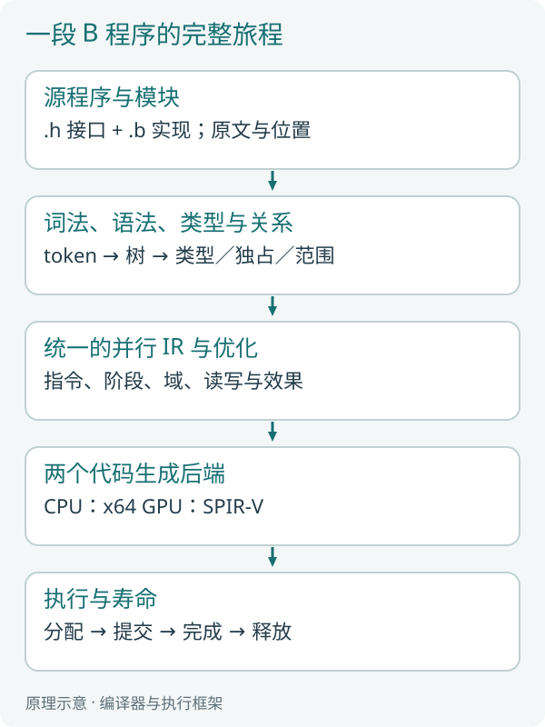
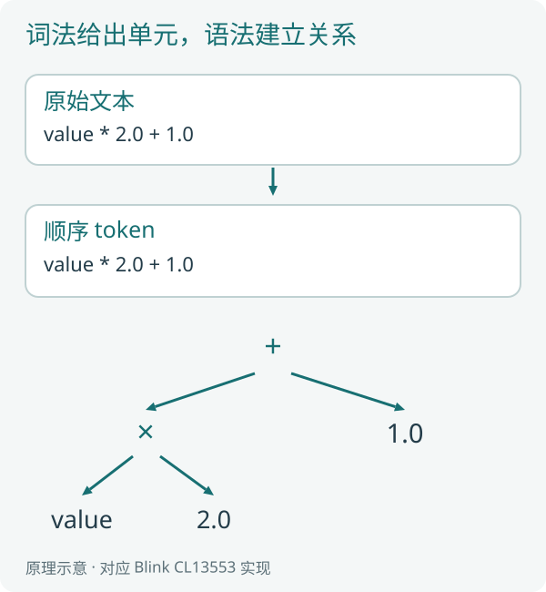
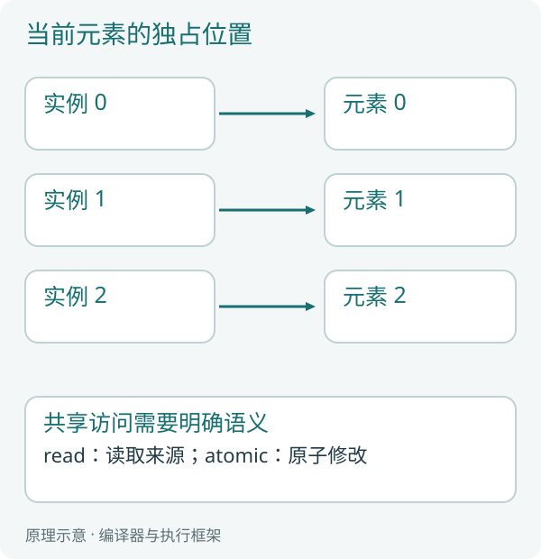
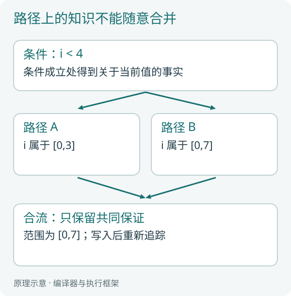
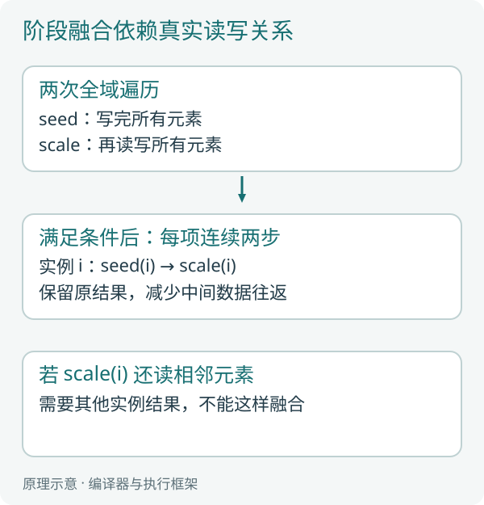
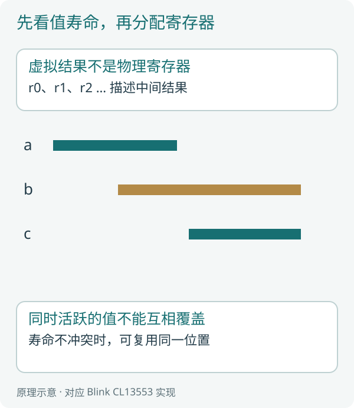
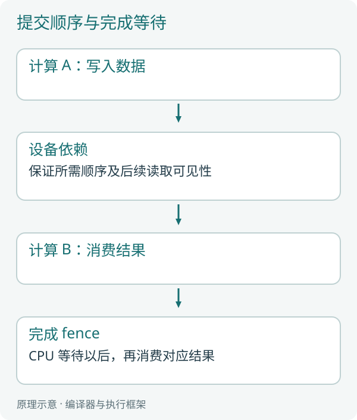
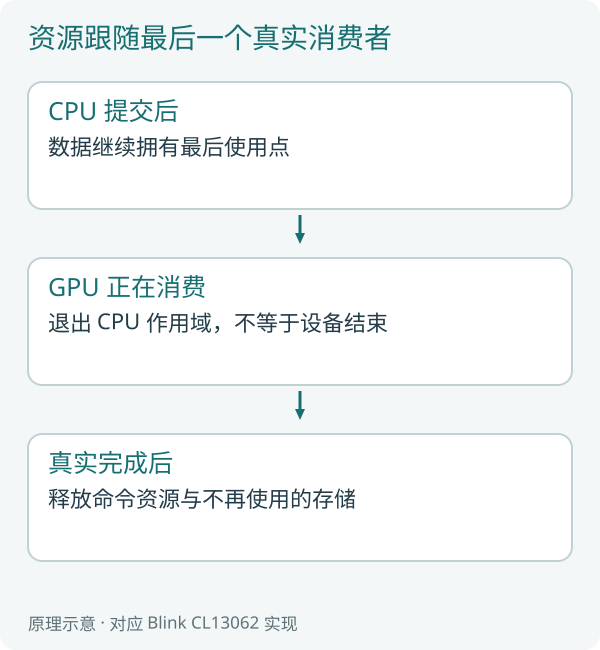
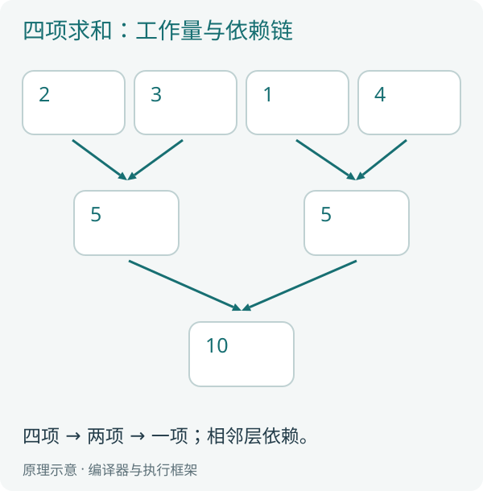
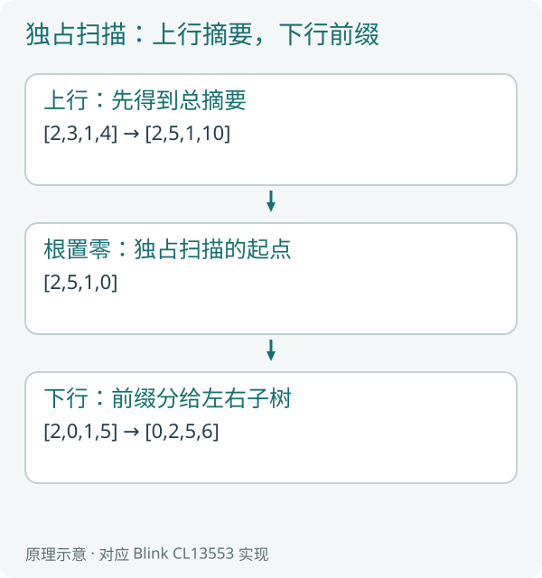

# B 语言源码分析

从一行算式到 CPU 与 GPU 的真实执行

## 写在前面

一门语言怎样把 `value = value * 2.0 + 1.0` 变成处理器真正执行的工作？

这件事并不是把几个英文单词换成机器指令。编译器先要认出句子的结构，分清数字和数据，判断每一处读取、写入是否成立，再把计算整理成适合不同处理器的形式。计算开始以后，还要有人准备内存、安排执行，并在最后一个使用者结束后释放资源。

本书沿着这条完整路径阅读 Blink 的实现。Blink 简称 B 语言，B 也寓意 Base。开源工程在 https://github.com/sgua83/Blink 。读者最好已经写过少量 B 程序；熟悉 C/C++ 会有帮助，不要求预先学过编译原理、汇编、Rust 或 Vulkan。

遇到必要知识，我们先用能手算的例子说明，再进入源码。例如，先看乘法为什么应先于加法组成语法树，再看解析函数；先理解“两个值还要同时用，所以不能占同一个寄存器”，再看寄存器分配；先区分“工作已提交”和“工作已完成”，再看 GPU 资源释放。

本文沿当前Blink源码阅读；现行文件和节选行号见compiler/源码版本索引.json。源码、构建、原生执行和性能分别判断，历史结果保存在P4双台账。

当前实现包括自研前端、并行中间表示、Windows x64／SPIR-V 后端及 CPU／Vulkan 执行框架，也能把普通 CPU 应用编译为目标文件，再由独立链接器生成可执行程序。普通 CPU 原生调用、递归与有限独立模块已有实现；完整模块／资源契约、其他目标调用、一般异步应用、基础库与跨平台能力仍分别开放。



*图 0-1：前端回答“这段程序是什么意思”，后端回答“怎样表达给处理器”，执行框架回答“怎样使它真实运行”。箭头经过的每个对象都将在正文展开。*

## 阅读路线

第一部分从一个小程序开始，补齐内存、Rust 阅读方法、词法、语法和类型知识。第二部分讲独占访问、范围事实、中间表示、控制流与优化。第三部分进入 CPU 指令、调用约定、寄存器、线程和 SIMD。第四部分进入 GPU 执行模型、SPIR-V、Vulkan、分页、同步与资源寿命。最后通过归约、扫描、筛选、排序和块内协作，看清高级并行操作怎样落到两种硬件上，再阅读 DLL 与完整源码结构。

各章末尾的“自己走一遍”用于检查是否理解，并附解释。它们是阅读练习，不是需要安装或执行的额外测试工具。

## 第一章 从四个数走完整条路径

### 1.1 先认识要追踪的计算

我们使用工程已有的 `sample/lessons/map.b`。这里的 map 表示逐元素计算；`lessons.map` 是教学模块名，不是标准库函数。先读最短的 `scale`：

源码节选：`sample/lessons/map.b:9`。

```b
void scale(inout dataset<f32> values) on compute {
    parallel (value in values) {
        value = value * 2.0 + 1.0;
    }
}
```

输入为 `[1.0,2.0,3.0,4.0]`，每个元素先乘二再加一，得到 `[3.0,5.0,7.0,9.0]`。四个结果互不依赖。计算第三项时，不需要等待第一项算完，也不需要知道第一项的结果。

对应的 C 写法可以是下面这样。变量名和计算保持一致，差别集中在循环表达上。

```c
for (unsigned i = 0; i < count; ++i) {
    float value = values[i];
    value = value * 2.0f + 1.0f;
    values[i] = value;
}
```

C 循环描述一个接一个访问下标的过程，成熟 C/C++ 编译器在条件允许时也能自动向量化。B 的 `parallel` 直接声明每个实例拥有当前元素；具体分成几个 CPU 范围、怎样组成 SIMD 批次，或怎样安排 GPU 工作组，由后面的实现决定。不能把这种语义差别简化为“C 总是串行，B 总是更快”。

### 1.2 同一个例子为什么还有 seed 和 demo

源码节选：`sample/lessons/map.b:1`。

```b
module lessons.map;

void seed(write dataset<f32> values) on compute {
    parallel (value in values) {
        value = f32(index() + 1);
    }
}
```

`seed` 把元素设为从一开始的数字，`index()` 是从零开始的当前位置。第零项写入一，第一项写入二。

源码节选：`sample/lessons/map.b:15`。

```b
void demo(inout dataset<f32> values) on compute {
    seed(values);
    scale(values);
}
```

`demo` 先产生数据，再完成变换。因此不需要额外编写输入文件，就能得到这四个结果。源码有两个逐元素阶段，优化器可能把它们合成一个实际阶段。我们将在第十一章解释合并的条件。

### 1.3 下载、构建与观察

当前源码工具链在 Windows x64 上使用 Rust 和 Microsoft C++ 链接工具构建。安装 Rust stable 与 Visual Studio 的 C++ 桌面开发工具后，在 x64 Developer PowerShell 中执行：

```powershell
git clone https://github.com/sgua83/Blink.git
cd Blink
cargo build --workspace --release
```

Rust 在这里编译的是 Blink 编译器和执行框架，B 算法仍由 Blink 自己的后端生成代码。GPU 执行还需要支持相应 Vulkan 能力的显卡与驱动。

先检查，再导出 CPU/GPU 代码：

```powershell
.\target\release\blc.exe check sample\lessons\map.b sample demo
.\target\release\blc.exe build sample\lessons\map.b Saved\MapCode sample demo
```

这里的 `build` 输出可供研究的阶段代码与布局，尚不是应用 `.exe`。在这本源码分析书里，我们正要观察这些中间产物，因此会使用这一命令。

若要执行这个计算模块，使用现有模块运行器：

```powershell
.\target\release\blrun.exe cpu sample\lessons\map.b demo sample Saved\MapCpu :4
.\target\release\blrun.exe gpu sample\lessons\map.b demo sample Saved\MapGpu :4
```

`:4` 申请四个初始为零的元素；`demo` 自己填入初值。结果保存在相应目录的 `values.bldata`。这属于当前执行工具的数据协议，不是 B 独立应用的最终使用方式。附录提供不加命令别名的直接读取方法。

正文节选对应当前源码，位置见现行源码索引；修订和原生运行历史只在P4双台账记录。


上面的阶段、布局和设备名来自工具输出；两行 values 从实际 BLDATA 读取后排成可读文本。启动和准备成本没有混入四元素算式的性能结论。


### 1.4 从输入文字到输出数字

整条路径可以先压缩成一句话：读取 `.h/.b`，得到单词，组成语法树，检查类型与访问，建立并行阶段，做合法优化，生成 CPU 指令或 SPIR-V，再由执行框架准备资源并运行。

在这个过程中，“程序”至少有三种形态：编辑器里的文字、编译器内存中的结构、处理器消费的代码。它们描述同一件事，却不能彼此混淆。语法树不是机器码，机器码字节也不自动等于可执行文件。

**自己走一遍。** 若第二项结果不对，应先怀疑语法分析器吗？不应直接跳到某一层。先确认实际输入，再看编译出的操作与布局，最后核对 CPU/GPU 各自的结果。每一层都有自己的输入和输出，问题要沿着真实差异定位。

## 第二章 内存：数字怎样占据一段地址

### 2.1 先分清值、位和地址

值是一件事，保存值的位又是一件事。`u32` 的一和 `f32` 的一都占四字节，编码不同。`f32` 的 `1.0` 通常对应十六进制 `3f800000`，不能把这四字节当作无符号整数一使用。转换类型可能改变编码；逐位解释则保留编码，改变理解方式。

地址告诉我们数据在哪里。假设第一个 `f32` 的地址为一千，元素间隔为四字节，第四个元素位于 `1000 + 3×4 = 1012`。源码中的通用记录也是这个规律，只是间隔不一定等于单个字段的大小。

```text
元素地址 = 数据起点 + 元素下标 × stride
字段地址 = 元素地址 + 字段偏移
```

这里的 `stride` 是相邻完整记录的间隔，字段偏移则描述字段在一条记录中的位置。理解这两个数，后面就能读懂 CPU 地址计算、GPU 分页、C ABI 和 view。

### 2.2 对齐为什么会产生空白

处理器和接口通常要求某些数据从适当的地址开始。对齐为十六意味着起点是十六的整数倍。一个 `float3` 有三个四字节分量，内容共十二字节；在此版本的 B 布局中，它的对齐是十六。单独作为数组元素时，记录间隔因而是十六，而非十二。

源码节选：`crates/blanguage/src/ir.rs:264`。

```rust
    pub fn vector(s: Scalar, n: usize) -> Self {
        if n == 1 {
            return Self::scalar(s);
        }
        Self {
            name: match s {
                Scalar::F32 => format!("float{n}"),
                Scalar::U32 => format!("uint{n}"),
                Scalar::I32 => format!("int{n}"),
                Scalar::Bool => format!("bool{n}"),
                _ => format!("{}x{n}", s.name()),
            },
            arguments: Vec::new(),
            values: Vec::new(),
            size: n as u32 * s.size(),
            align: s.align() * if n == 2 { 2 } else { 4 },
            components: (0..n).map(|i| (s, i as u32 * s.size())).collect(),
            fields: Vec::new(),
            view: None,
            array: None,
            enumeration: false,
            result: false,
            variants: Vec::new(),
            dataset: None, cleanup: None,
        }
    }
```

不要从“内容十二字节”推出“任何地方都连续十二字节”。记录中的字段、矩阵的行、整个 dataset 的 stride 都要按编译器布局处理。C++ 或 Rust 的同名类型也未必具有相同布局。


*图 2-1：字段内容、对齐空白、完整记录间隔是三个不同概念。编译器给出统一布局，两个后端和执行框架共同消费。*

### 2.3 源码中的 Ty 保存了什么

源码节选：`crates/blanguage/src/ir.rs:94`。

```rust
#[derive(Clone, Debug, PartialEq, Eq)]
pub struct Ty {
    pub name: String,
    pub arguments: Vec<Ty>,
    pub values: Vec<u32>,
    pub size: u32,
    pub align: u32,
    pub components: Vec<(Scalar, u32)>,
    pub fields: Vec<(String, u32, Box<Ty>)>,
    pub view: Option<Box<Ty>>,
    pub array: Option<Box<Ty>>,
    pub enumeration: bool,
    pub result: bool,
    pub variants: Vec<Variant>,
    pub dataset: Option<Box<Ty>>,
    pub cleanup: Option<String>,
}
```

`size` 是类型内容占用，`align` 是对齐，`components` 把值分解为标量及偏移，`fields` 保留记录字段。`view` 与 `array` 说明它是否还包含引用式只读资源或内联数组。

这样，一个 `float3` 在前端仍有完整类型，在后端却可拆成三个 `f32` 分量。语言向量不保证每一处都会使用一条硬件向量指令；是否批量执行，还取决于计算、访问和后端计划。

### 2.4 Dataset 是布局的实际承载者

源码节选：`crates/blcompute/src/lib.rs:79`。

```rust
pub struct Dataset {
    pub(crate) ty: Ty,
    pub(crate) stride: u32,
    pub(crate) count: u32,
    pub(crate) words: Vec<u32>,
    pub(crate) views: views::Views<ReadDataset>,
}
```

`words` 是 CPU 上的存储，`count` 是记录数，`stride` 是相邻记录间隔。这里使用 `Vec<u32>` 保存四字节 word，是保存原始位模式的容器，并不表示其中的所有字段都是 `u32`。

**自己走一遍。** `stride=32`、字段偏移十二、下标三，字段距数组起点多远？`3×32+12=108` 字节。若把 stride 错当作字段大小四，读到的就会是另一条记录或另一个字段。

## 第三章 只学阅读源码所需的 Rust

### 3.1 结构体、枚举与 match

C 结构体保存字段，Rust 的 `struct` 也如此。Rust 的 `enum` 还可以让不同情况各自携带数据。例如中间指令 `Constant` 保存目标编号、标量类型和位模式；`Binary` 保存运算与两个输入。`match` 则逐种处理这些情况。

与“操作码加一堆随意字段”的写法相比，这种表示把哪些数据属于哪种情况直接写进类型。阅读时先看枚举有哪些分支，再寻找处理该分支的 `match`，就能沿着同一项能力贯穿前端和两个后端。

### 3.2 Option 和 Result 并不神秘

`Option<T>` 表示有或没有：`Some(value)` 保存内容，`None` 表示没有。阶段的 `prefix: Option<PrefixCount>` 表示阶段是否限制在某个有效前缀，不是把零当成“没有”。

`Result<T,E>` 表示成功或错误：`Ok(value)` 与 `Err(error)`。函数调用后面的 `?` 表示成功就取出结果，失败就把错误交还上层。它不是重新尝试，也不是忽略错误。

源码节选：`crates/blanguage/src/parser.rs:6`。

```rust
pub fn parse(source: Source) -> Result<Module> {
    let tokens = lexer::lex(&source)?;
    Parser {
        source,
        tokens,
        at: 0,
    }
    .module()
}
```

读这段代码时，先把 `lexer::lex(&source)?` 译成“对源码分词；失败时结束当前解析并传递错误”。随后创建 `Parser`，从 token 零开始解析模块。暂时不必逐个研究 Rust 的借用语法。

### 3.3 引用、所有权和作用域

`&T` 表示只读借用，`&mut T` 表示独占可变借用。把值移动给另一个对象以后，旧变量通常不能再直接使用它。对象退出作用域会执行 `Drop`，类似 C++ 的析构。

这使资源拥有者可用类型表达，但不会自动替我们理解 GPU：CPU 函数返回时，设备工作可能还在执行。正确实现必须让拥有者保留到真实完成点。后文会看到，这恰恰是执行框架最重要的工作之一。

`Rc<T>` 让同一线程中的多个对象共享一个资源的所有权，复制 Rc 主要增加引用计数，不复制整个 GPU 缓冲。`Arc<T>` 使用原子引用计数，适合跨线程共享所有权。编译器的源码与定义用到 Arc；这个版本的 Vulkan 对象大量使用 Rc，不应因看到“共享”就一律理解为多线程安全。

### 3.4 unsafe 表示哪一层责任

机器码入口、原始指针和 Vulkan API 会出现 `unsafe`。它表示调用者必须满足 Rust 类型系统没有完整表达的条件，例如地址有效、布局正确、对象寿命足够。它不意味着“这一段不用讲清楚”，反而提示我们追问这些条件由谁建立。

**自己走一遍。** `Rc<GpuDataset>` 被复制，显存内容会复制一份吗？不会。两个所有者引用同一实际对象。是否另有上传、读回或拷贝，要看执行路径，不能从 Rc 的 clone 推断。

## 第四章 模块装载：先把程序找齐

### 4.1 一个文件不等于整个程序

`map.h` 声明可公开使用的接口，`map.b` 给出实现。源码模式按实际需要读取接口与存在的实现，产物导入则消费对象中的公开接口。只解析当前文件，却不知道调用的函数来自哪里，无法完成可靠的类型、访问与阶段分析。

入口在 `crates/blanguage/src/lib.rs`。公开接口 `compile` 编译入口模块，`compile_entry` 选择具体入口，`check` 允许只检查函数库，不要求伪造一个算法入口。

源码节选：`crates/blanguage/src/lib.rs:126`。

```rust
pub fn compile(path: &Path, module_root: &Path) -> Result<Compilation> {
    compile_module(path, module_root, true, None, None)
}
/// 选择公开 program 的具体静态入口，例如 shade<13> 或 run<float3,17>。
pub fn compile_entry(path: &Path, module_root: &Path, entry: &str) -> Result<Compilation> {
    compile_module(
        path,
        module_root,
        true,
        Some((EntryKind::Domain, entry)),
        None,
    )
}
```

这些 API 接收文件路径与模块根目录。根目录用于把 `lessons.map` 这样的模块名映射到文件路径；它与 C 预处理器简单粘贴头文件的行为不同。

### 4.2 模块身份先进入同一来源表

A导入B、B又导入A可以形成合法函数闭包。模块装入与按值布局递归、常量求值环不是同一种关系，不能仅因import成环就拒绝整个模块。

源码节选：`crates/blanguage/src/lib.rs:449`。

```rust
    if let Some(name) = import
        && world.sources.contains_key(name)
    {
        return Ok(name.to_owned());
    }
```

来源表识别同一模块；接口和实际实现进入原声明集合后，递归导入复用该身份。已提供对象的模块只消费公开接口，不补读库.b。纯类型／常量／外部模块不需要空实现，普通函数仍须有匹配函数体。

### 4.3 名字怎样变成唯一对象

不同模块都可以有 `run`，因此内部使用 `模块::名称` 区分它们。`World` 保存已读源码、记录类型、函数和类型集合。解析函数名时，还要结合当前模块、明确导入和公开权限，不能从整个世界里随意找一个同名函数。

`.h/.b` 的签名也要一致：名称相同还不够，参数类型、权限、参数名、执行目标和接口条件等都属于接口约定。否则调用者相信的接口与真正实现会是两回事。

**自己走一遍。** A和B都导入C会复制一份C吗？不会，同一来源表保持模块身份。若记录按值包含自身，为什么仍须拒绝？那是无法形成有限布局的类型递归，归类型布局所有者处理。

源码捕获、编译上下文与产物各自有唯一所有者。Compiler及其clone共享活动CPU预算，独立实例／函数／阶段按真实依赖并行；build_graph固定本次B源码输入。入口映像与COFF保留完整输入身份，未变时直接复用最终产物，变化时重新执行必要编译。缓存命中不证明冷编译成本降低。

native_function::Module由Builder、CheckedFunction和模块编译入口按值交接，application::Context只持有编译期Frame寄存器及映像描述。真实Frame、设备与完成仍归blcompute；函数模块不是CPU应用上下文的附属状态。

### 4.4 统一函数怎样落到不同执行范围

源语言以返回类型、名称和参数定义函数。第一章的 `void seed`、`void scale` 与普通值函数共用定义与名称解析；`parallel` 显式表达数据域，`on cpu／gpu／compute` 声明可用目标。`execution.rs` 沿实际函数体和调用闭包推导 Invocation、Domain、Host 参与要求，它们是编译事实，不是用户另写的函数类别或运行时许可。

`never` 函数结果表示没有正常返回边；真实退出或持续执行沿原控制流交付，不生成普通值、不宣称输出初始化或设备完成。当前支持函数结果及其调用路径，一般数据类型组合仍未实现。

CPU 主流程的普通调用沿当前 CPU 位置执行；`target(cpu, f(...))` 与 `target(gpu, f(...))` 选择本次实际位置。GPU 同步调用只等待本次真实提交，结果仍在 GPU，CPU 读取前显式 download。普通 CPU 调用通过 Call、调用帧与真实参数／返回 ABI 组织，元素与协作函数仍按其参与范围专门化。内部 Program、Stage 和 ExecutionPlan 继续表示算法产物及执行关系。

独立模块把公开接口和已生成代码交给调用者；向量位置借用传递实际分量地址，记录和数组保留声明布局，C 连续布局要求进入明确合同。这里已有有限实现，完整参与／资源阶段契约和版本演化仍待完成。

## 第五章 词法：把一行字符切成能辨认的单元

### 5.1 为什么不能直接按空格切开

`value=value*2.0+1.0;` 没有空格，依然是完整语句。`<=` 是一个比较符，不能先吃掉 `<` 再把 `=` 留成另一项。小数点、范围 `..`、名字里的下划线、行注释与块注释也各有意义。

词法分析逐段读取字符，产生 token。这个版本的 Token 保存两项：文本与位置。

源码节选：`crates/blanguage/src/lexer.rs:3`。

```rust
#[derive(Clone, Debug)]
pub struct Token {
    pub text: String,
    pub span: Span,
}
```

这里没有先把每个关键字编成独立枚举；解析器会比较 token 文本。这是当前实现的选择，不是所有编译器必须采用的做法。

### 5.2 一个扫描位置贯穿整个循环

`at` 是当前字节位置，`start` 是本次 token 的起点。空白和注释被跳过，普通标识符、数字、多字符运算符和单字符符号分别识别。最终切出 `[start,at)` 的原文。

源码节选：`crates/blanguage/src/lexer.rs:85`。

```rust
        } else if let Some(op) = [
            "<<=", ">>=", "::", "..", "+=", "-=", "*=", "/=", "%=", "&=", "|=", "^=", "==", "!=",
            "<=", ">=", "&&", "||", "<<", ">>",
        ]
        .iter()
        .find(|op| bytes[at..].starts_with(op.as_bytes()))
        {
            at += op.len();
```

多字符运算符优先于单字符符号，正是为了保留 `<=` 和 `<<` 等整体。数字扫描允许指数写法的正负号，却不会把普通的加法号全部吞进数字。

对 `value*2.0+1.0`，逻辑上得到 `value`、`*`、`2.0`、`+`、`1.0`。词法层只确认形状，不负责判断 `value` 是否已声明、是否浮点数或能不能写入。

### 5.3 Span 是诊断通向原文的线

源码节选：`crates/blanguage/src/ast.rs:3`。

```rust
#[derive(Clone, Copy, Debug, Default)]
pub struct Span {
    pub start: usize,
    pub end: usize,
}
```

Span 的 start/end 是字节范围。错误显示时，再从源码求行号和字符列。因此中文注释的 UTF-8 字节数与人眼看到的字数不能直接混用。

本版标识符使用 ASCII，中文可写在注释里；lexer 已支持外部链接所需的双引号字符串，通用文本值与字符串库仍未完成。讲解实现时，应从 lexer 的实际分支得出结论，而非凭语言愿景补出一个不存在的 token。

**自己走一遍。** `a<=b` 应得到三个 token 还是四个？三个：`a`、`<=`、`b`。`a < = b` 则不能因为外观相似就自动当成同一运算。

## 第六章 语法：算式为什么是一棵树

### 6.1 先用括号画出结构

`value * 2.0 + 1.0` 的结构是 `(value * 2.0) + 1.0`。根是加法，左边是乘法，乘法的左右两边才是 value 和常量二。若误组成 `value * (2.0 + 1.0)`，输入二时会从正确的五变成六。

语法树把这种关系保存下来。树中节点回答“做什么”，子节点回答“对什么做”。它比原始字符串更适合检查、重写和代码生成。



*图 6-1：词法得到顺序单元，语法建立嵌套关系。树上的位置表示运算优先级，不表示硬件线程。*

### 6.2 解析器怎样知道在哪里

源码节选：`crates/blanguage/src/parser.rs:31`。

```rust
struct Parser {
    source: Source,
    tokens: Vec<Token>,
    at: usize,
}
impl Parser {
    fn peek(&self) -> &str {
        &self.tokens[self.at].text
    }
    fn span(&self) -> Span {
        self.tokens[self.at].span
    }
    fn take(&mut self, text: &str) -> bool {
        if self.peek() == text {
            self.at += 1;
            true
        } else {
            false
        }
    }
```

`peek` 查看下一项，`take` 在匹配时向前移动，`expect` 则要求必须匹配，否则产生错误。读长解析函数时，始终记着“at 当前指向哪一个 token”，通常比盯着所有分支更容易理解。

### 6.3 优先级不是靠先写哪一行代码猜出来的

本版表达式使用带最低优先级参数的 `expr`。先解析一个基本表达式，再不断查看后续运算符。只有运算符优先级达到当前要求，才把它接入树中；右侧递归使用相应门槛，从而保持乘法先于加法等关系。

源码节选：`crates/blanguage/src/parser.rs:997`。

```rust
            let prec = match self.peek() {
                "||" => 1,
                "&&" => 2,
                "|" => 3,
                "^" => 4,
                "&" => 5,
                "==" | "!=" => 6,
                "<" | ">" | "<=" | ">=" => 7,
                "<<" | ">>" => 8,
                "+" | "-" => 9,
                "*" | "/" | "%" => 10,
                _ => 0,
            };
            if prec == 0 || prec < min {
                break;
            }
            let op = self.peek().to_owned();
            self.at += 1;
            let rhs = self.expr(prec + 1)?;
            lhs = Expr {
                kind: ExprKind::Binary(op, Box::new(lhs), Box::new(rhs)),
                span,
            };
        }
        Ok(lhs)
    }
```

第一次阅读无需背下所有优先级数值。抓住两点：数值大小服务于结合次序，树形结构才是解析结果。括号则显式开启一个完整子表达式，读到右括号后再回到外层。

### 6.4 语句树保留了并行结构

普通算式之外，AST 还保存条件、循环、函数调用、parallel、阶段边界和集合操作的源形式。语法层知道这是并行语句，却还没有证明独占写入、有效下标或函数权限。结构合法和语义合法是两件事。

`array<array<u32,4>,3>` 中连续的 `>>` 在类型上下文是两个闭合尖括号；表达式中的 `>>` 则是右移。解析器的 `type_close` 专门区分这两个位置。同样的字符在不同语法位置可以承担不同意义。

**自己走一遍。** `2 + 3 * 4` 的根是加法，右子树是乘法，结果十四。若代码生成器收到错误的树，后端再正确也只会忠实计算错误的结构。

## 第七章 类型与布局：不只检查能不能相加

### 7.1 名字到类型，还要经过解析

源文件里的 `float3`、用户记录和泛型参数先以 TypeName 保存。随后 `World` 结合模块和泛型实例，把它变成具有大小、对齐、分量和字段的 Ty。

这一步不仅拒绝不相容的加法，也决定一个字段究竟位于哪一字节。没有统一布局，CPU 后端、GPU 后端和调用方会对同一内存各有解释。

### 7.2 标量与记录怎样统一

源码节选：`crates/blanguage/src/ir.rs:247`。

```rust
    pub fn scalar(s: Scalar) -> Self {
        Self {
            name: s.name().into(),
            arguments: Vec::new(),
            values: Vec::new(),
            size: s.size(),
            align: s.align(),
            components: vec![(s, 0)],
            fields: Vec::new(),
            view: None,
            array: None,
            enumeration: false,
            result: false,
            variants: Vec::new(),
            dataset: None, cleanup: None,
        }
    }
```

Scalar明确描述各数值类型的实际大小与对齐：窄整数为一／二字节，u32／i32／f32／bool为四字节，u64／i64／f64为八字节。B普通bool不是C++的一字节bool。逻辑分量和物理存储字不能混为一谈。一个记录被展开为多个带字节偏移的标量，字段保留名义结构。这样，通用代码生成可以逐分量处理，而不是为每个用户记录再写一套后端。

设记录包含 `float3 position` 和 `f32 energy`：position 的三个分量在偏移零、四、八；后续字段和最终 stride 按类型布局计算。不能把语言规则照搬成任意外部平台 C 结构体的默认布局，跨语言时使用生成接口更明确。

### 7.3 泛型：在编译期换成具体形状

“同一个函数能处理不同类型”有两种很不同的实现：运行时判断类型，或者编译前形成具体实例。Blink 当前主要采用后者。

源码节选：`crates/blanguage/src/generics.rs:50`。

```rust
    let replacements: BTreeMap<_, _> = function
        .types
        .iter()
        .zip(arguments)
        .map(|(p, t)| (p.name.clone(), t))
        .collect();
    let value_map: BTreeMap<_, _> = function
        .values
        .iter()
        .zip(values)
        .map(|(p, v)| (p.name.clone(), *v))
        .collect();
```

`replacements` 把类型参数映射到具体类型；`value_map` 把静态值参数映射到具体整数。随后替换函数签名、正文与条件，再进入原来的检查和代码生成路径。

例如一个宽度为四的固定数组与宽度为八的固定数组，存储、循环形状或协作工作量可能不同。把宽度在编译期确定，后端就能计算实际布局；代价是可能产生多个实例，编译量与代码体积也会增加。

### 7.4 泛型实例化不等于任意语言能力已经齐备

本版支持有限类型集合、具体类型和值参数、开放 u32 const 的具体实例等能力。一般关联类型、动态长度数组或所有符号约束不能因此推定为已完成。读 `generics.rs`、`value_parameters.rs`、`type_sets.rs` 时，应分别辨认“允许哪些实参”“怎样替换”“何时检查”。

**自己走一遍。** 把一个静态宽度从四改成八，需要修改 GPU 内存分配器里的固定字段偏移吗？不应如此。具体类型重新给出布局，后端与执行框架消费它，避免维护第二份权威布局。

## 第八章 并行的根基：每个实例到底拥有哪一个位置

### 8.1 数据竞争是什么

假设两个线程同时执行 `total = total + 1`。它们可能都先读到零，再各自写回一，最终只加了一次。问题不在加法本身，而在多个执行者同时读写同一位置，并且缺少足够的同步语义。

逐元素变换可以从更简单的所有权开始：实例零只改元素零，实例一只改元素一。它们对不同地址写入，既无需为每个元素加锁，也不依赖操作系统恰好按顺序调度。

### 8.2 read、write、inout 和 atomic 表达不同关系

源码节选：`crates/blanguage/src/ast.rs:54`。

```rust
#[derive(Clone, Copy, Debug, PartialEq, Eq)]
pub enum Access {
    Value,
    Read,
    Write,
    InOut,
    Atomic,
}
impl Access {
    pub fn reads(self) -> bool {
        matches!(self, Self::Read | Self::InOut | Self::Atomic)
    }
    pub fn writes(self) -> bool {
        matches!(self, Self::Write | Self::InOut | Self::Atomic)
    }
}
```

`read` 允许读取而不修改，`write` 表达输出，`inout` 读取并更新当前独占内容，`atomic` 允许通过原子操作共享访问。权限进入检查和依赖分析，不只是供文档阅读的注释。

原子操作能让某次访问不可分割，但不会自动消除算法顺序依赖；独占访问则从一开始避免多个实例争用同一输出位置。选择哪一种，取决于真实数据关系。



*图 8-1：普通并行写沿当前元素的身份分开。读取其他元素需要合法只读来源；共享修改必须具有相应原子语义。*

### 8.3 检查器同时问两个问题

源码节选：`crates/blanguage/src/check.rs:3728`。

```rust
        let binding = view.binding;
        let Some(i) = self.expr(index)? else {
            return Ok(None);
        };
        self.require_same(&Ty::scalar(Scalar::U32), &i.ty, index.span)?;
        let current = i.regs[0] == self.global_index;
        let same_shape = self.program.buffers[binding].count.is_some()
            && self.program.buffers[binding].count == self.program.buffers[self.domain].count;
        if !self.index_in(
            &i,
            IndexDomain::Data(binding),
            self.program.buffers[binding].count.unwrap_or(0),
        ) && !(current && (binding == self.domain || same_shape))
        {
            return self.fail(
                index.span,
                "B137",
                "索引有效性无法静态证明；使用有界游标、同域 index()、有效长度条件或形状约束",
            );
        }
        if matches!(self.view_access[&binding], Access::Write | Access::InOut) {
            if self
                .appends
                .iter()
                .any(|(output, count)| *output == binding || count.binding == binding)
            {
                return self.fail(
                    index.span,
                    "B221",
                    "append 的共享输出／计数不能在同一阶段借为普通独占元素",
                );
            }
            self.element_domains.insert(binding);
        }
        Ok(Some(self.dataset_element(
            &view, i.regs[0], self.view_access[&binding].writes() && current,
        )))
    }
```

第一问是下标是否有效：是否属于该数据集允许的域。第二问是是否有权写：即使数字没有越界，也不表示当前实例拥有那个位置。字段借用仍指向同一个原缓冲：检查器按声明字段路径取得元素类型和实际字节位置，容量与记录步幅保持。CPU／GPU元素阶段的函数转借、下标和只读游标沿同一位置映射访问，不复制整列数据；同阶段共享读取与独占写入在原位置降低时交接实际区域，动态数组、向量和嵌套字段保留全部合法候选位置；写参数的初始化义务与真实数据位置分别保持。判定直接消费同一份区域，不在IR丢失关系后再扫描重建；真实重叠与原范围约束保持。普通CPU原生read／write／inout dataset参数把原句柄、长度、真实步幅和字段偏移一起交接，所以同一个已编译函数能按权限读写不同父记录中的同型字段。DataPayload保存实际布局，DataReference只记原类型中的字段路径；初始化、借用和最后消费者仍沿原资源判断。连续view仍要求真实元素连续，不能把一列跨记录的字段误当成连续数组。CPU整域read／write／inout入口可以借用同一字段：整域参数只传根句柄和字段偏移，长度与物理步长由原Frame取得，原父记录类型与所有权保持。普通CPU函数按真实载荷访问需要消费原借用布局，独占借用按实际字段区域判断，write和条件输出只更新所选字段的原初始化位置。整域输出的逻辑字段偏移叠加实际投影偏移，写入只交付真实保证的字段初始化；兄弟字段不因此获得初始化。同根不同字段可以分别read／write／inout借用；普通调用与自动parallel消费同一份字段区域检查，整域入口不重复按根句柄拦截。Frame沿原绑定列表核对所有前置同根参数的真实区域，普通可写重叠仍拒绝，同一根只交接一份存储。有效域只属于原根中的实际数据区域，字段偏移与范围随计数来源交接；相邻字段或同起点更大的父记录不能取得该关系。写入按原来源与字段分量撤回内容事实，未写兄弟位置的范围、非零和索引关系保持；已复制值仍是自己的快照。整域只做一次失效，普通CPU借用共用原操作，不另建事实表。运行期普通CPU载荷地址也交接真实写入范围：原行号乘物理步幅，加字段及动态数组偏移，得到64位字节位置；每个实际写入标量按自己的字节宽度交接。Frame只撤回与这些字节重叠的四字节计数来源，未写兄弟字段保持原有效域；零写入字节表示读取。共同入口返回原根地址，不新增关系表、区域拥有者或另一条失效路径。atomic和GPU整域字段投影仍按各自缺口推进。

`values[index()+1]` 在某些长度下可能合法，但多个实例的访问可能交错，且不再是当前独占元素。编译器不会因为下标仍在范围内，就自动授予普通并行写权限。这正是“范围证明”和“所有权证明”不能混为一谈的原因。

### 8.4 跨函数也不能丢掉位置身份

源码节选：`crates/blanguage/src/check/ownership.rs:22`。

```rust
#[derive(Clone, PartialEq, Eq, PartialOrd, Ord)]
pub(super) enum Position {
    Initialized,
    Local(usize),
    Element(usize, u32),
    Parameter(usize, usize),
    ApplicationElement(usize, ApplicationIndex, u32),
    Indexed(std::sync::Arc<[Position]>, ApplicationIndex),
    Conditional(std::sync::Arc<owned_presence::Presence>,std::sync::Arc<Position>,std::sync::Arc<Position>),
    Both(std::sync::Arc<Position>,std::sync::Arc<Position>),
}
```

普通函数接收 read／write／inout 参数时，检查器传递实际位置及字段投影，而不是只记录“它是个 float3”。元素阶段的 read 与 CPU 使用同一只读位置规则，命名位置不复制成输入快照；多个只读借用可以重合，独占借用不能与重叠只读位置同时交接。整个记录与其中一个字段可能重叠，不同字段则可能互不重叠。`Position` 与 Place 的比较帮助保持这个事实。

**自己走一遍。** 两个变量类型相同，是否证明它们互不重叠？不能。类型说明如何解释数据，身份与偏移才说明是否指向同一处内容。

## 第九章 范围事实：编译器怎样理解 if 的保护作用

### 9.1 条件不只是要生成的跳转

看到 `if (i < length(data))`，人知道条件成立的分支中 i 小于该长度。编译器也需要保存这种知识，才能判断 `data[i]` 是否有效。

同样，整数除法要知道除数不为零。这里的知识不是无限强的数学证明器，而是沿当前路径维护的有限事实。

源码节选：`crates/blanguage/src/check/bounds.rs:21`。

```rust
enum Fact {
    Equal(ValueIdentity, ValueIdentity),
    Index(ValueIdentity, IndexDomain),
    Minimum(ValueIdentity, Scalar, Bits),
    Maximum(ValueIdentity, Scalar, Bits),
    NonZero(ValueIdentity),
    Boolean(ValueIdentity, bool),
    Below(ValueIdentity, ValueIdentity, bool, Scalar),
    Outside(ValueIdentity,IndexDomain),
    Zero(ValueIdentity),
    NotEqual(ValueIdentity, ValueIdentity),
}
type Facts = BTreeSet<Fact>;
```

`Fact` 包含相等、索引域、最小值、最大值和非零。同文件的 `Proof` 按分量保存来源、条件、IntegerRanges、非零和索引域。整数范围可由多个有序区间组成，能够表达回绕后的不连续集合；float3 的三个分量也可能持有不同事实。

### 9.2 为什么事实跟随值，而不是永远跟随变量名

设 `i=2`，在 `i<4` 的分支中又执行 `i=9`。先前比较的是旧值二，不是后来写入的九。若把“i 小于四”永久挂在变量名上，就会错误允许新的数组访问。

本版使用值身份和来源快照，并在写入、投影和路径合流时更新事实。index() 和当前游标的 ordinal 重复求值仍指向同一个实际索引寄存器，生成值时直接消费当前路径已知的范围、相等和非零事实；不必另写局部变量才能连接条件与访问。当前路径退出或游标进入另一次迭代时，仍按原作用域撤回相应事实。这个细节比“给变量加一个安全标签”复杂，却是理解真实编译器分析的关键。

### 9.3 两条路径汇合，什么知识还能保留

若一条分支知道 `i∈[0,3]`，另一条知道 `i∈[0,7]`，两条路汇合以后只能共同保证 `[0,7]`。如果只有一条路径知道除数非零，汇合后也不能无条件保留非零。

源码节选：`crates/blanguage/src/check/bounds.rs:659`。

```rust
        self.nonzero = (0..width)
            .map(|i| self.nonzero.get(i) == Some(&true) && other.nonzero.get(i) == Some(&true))
            .collect();
        self.ranges = (0..width)
            .map(|i| self.range_set(i).union(&other.range_set(i)))
            .collect();
        self.domains = (0..width)
            .map(|i| {
                self.domains(i)
                    .intersection(&other.domains(i))
                    .copied()
                    .collect()
            })
            .collect();
```

这里对非零取共同条件，对范围取能容纳两条路径的区间。源码中的集合交集同样只保留两侧共同成立的域关系。合流不是把每条路径的最好结论全部相加。



*图 9-1：条件内的知识属于该路径和实际值；合流时留下共同事实。重新赋值会产生新的内容身份。*

### 9.4 拒绝编译不一定等于程序必然错误

一个复杂算式可能数学上安全，却超出当前分析能力。B137 表示检查器无法静态证明所需的索引关系，不等于它已经找到某次真实越界；反过来，编译成功也不保证业务公式正确或程序必然结束。

**自己走一遍。** “编译器知道 i 小于 A 的长度”是否自动允许访问 B[i]？只有还能建立 A、B 的相应长度或域关系时才可以。两个数据集都叫数组，不构成证明。

## 第十章 中间表示：把语言意思和硬件细节分开

### 10.1 为什么需要 IR

若解析完源代码就直接写 x64，GPU 后端便得重新实现一遍类型与并行分析。若直接变成 GPU 风格线程代码，CPU 又会继承不适合自己的细节。

中间表示 IR 保存已经明确的计算：数据布局、阶段、域、读取、写入、标量操作与控制流。前端交付同一份意思，两个后端分别选择硬件表达。

### 10.2 虚拟寄存器只是中间结果编号

手算一项变换可以写成：

```text
r0 = 读取当前 value
r1 = 常量 2.0
r2 = r0 × r1
r3 = 常量 1.0
r4 = r2 + r3
把 r4 写回当前 value
```

这是解释用的简化 IR，不是导出文件的逐字内容。r0 等编号让每个结果有明确来源，却还没有决定占用 RAX、XMM0 或栈上的哪一处。把虚拟编号当成物理寄存器，后面就会觉得“怎么会有几百个寄存器”。

源码节选：`crates/blanguage/src/ir.rs:844`。

```rust
    Constant(Reg, Scalar, Bits),
    Index(Reg),
    Uniform(Reg, u32),
    LoadLocal(Reg, usize),
    StoreLocal(usize, Reg),
```

源码节选：`crates/blanguage/src/ir.rs:863`。

```rust
    Load {
        dst: Reg,
        binding: usize,
        index: Reg,
        word: u32,
    },
    Store {
        binding: usize,
        index: Reg,
        word: u32,
        value: Reg,
    },
    Unary {
        dst: Reg,
        op: UnaryOp,
        a: Reg,
    },
    Binary {
        dst: Reg,
        op: BinaryOp,
        a: Reg,
        b: Reg,
    },
```

`Constant` 保存位模式，Load/Store 保存实际绑定、下标及 word，Binary 用枚举表达运算。字段已在前端展开，所以一个记录操作可能对应多个标量结果。

### 10.3 Stage 保存执行关系

源码节选：`crates/blanguage/src/ir.rs:1058`。

```rust
#[derive(Clone, Debug)]
pub struct Stage {
    pub domain: usize,
    pub prefix: Option<PrefixCount>,
    pub selection: Option<Selection>,
    pub operation: Operation,
    pub boundary_before: bool,
    pub registers: Vec<Scalar>,
    // Key is the first logical component after this declaration; padding has no slot.
    pub locals: BTreeMap<usize, Ty>,
    pub code: Vec<Inst>,
    pub reads: Vec<usize>,
    pub writes: Vec<usize>,
    pub cross_access: Vec<usize>,
    pub tiles: Vec<Tile>,
}
```

`domain` 指向遍历的数据域；`prefix` 与 `selection` 限制实际工作；`operation` 区分普通逐元素、归约、扫描等；`reads/writes/cross_access` 描述依赖，`boundary_before` 保留显式阶段边界。

程序还保留源阶段数量和优化后阶段列表。这让我们能观察“源码有两步，执行只需一步”，而不是在应用外再维护一份阶段表。

### 10.4 一次检查怎样完成

`check::compile_program` 先把参数分类为数据集、纹理、加速结构或统一值，求出布局，建立名字到资源的对应。随后展开程序调用，建立阶段，记录源阶段数，最后运行优化。

源码节选：`crates/blanguage/src/check.rs:389`。

```rust
    program.prefix_requirements = prefix::relations(&program, &env, d, ContractKind::Requires)?;
    program.prefix_guarantees = prefix::relations(&program, &env, d, ContractKind::Ensures)?;
    let mut facts = prefix::Facts::new(&program.prefix_requirements);
    let mut calls = Vec::new();
    expand_program(
        world,
        d,
        &mut env,
        &mut program,
        &mut Vec::new(),
        &mut false,
        &mut facts,
        &mut calls,
    )?;
    program.source_stages = program.stages.len();
    Ok(ExpandedDomain { program, calls, outputs: facts.outputs })
}
```

统一值是整次执行共同使用的参数，不是每个元素各有一份的输出数组。它在 CPU 端作为参数字访问，在 GPU 端进入相应程序参数布局。两者使用同一份 offset，而非各自猜测。

**自己走一遍。** 改名 `value` 是否必然改变机器指令？不会。名字主要用于解析和诊断，真正运算由 IR 里的来源、类型和操作表达。

## 第十一章 优化：先理解哪些变化不改变意思

### 11.1 两个独立遍历为什么能合并

`seed` 写当前元素，`scale` 立刻使用同一元素。只要不存在跨元素读取、协作或明确阶段边界，就能让实例零连续做自己的两步，再让其他实例做各自两步，不必先写完整中间数组再重新遍历。

普通串行版本原本是两轮循环：

```text
第一轮：对所有 i，values[i] = i + 1
第二轮：对所有 i，values[i] = values[i] × 2 + 1
```

合并以后，仍按每个 i 得到相同值：

```text
对每个 i：
    value = i + 1
    values[i] = value × 2 + 1
```

这首先是减少数据往返与阶段开销，而不是增加更多线程。

源码节选：`crates/blanguage/src/optimize.rs:12`。

```rust
        if let Some(previous) = stages.last_mut() {
            if matches!(previous.operation, Operation::Map)
                && matches!(stage.operation, Operation::Map)
                && previous.subgroup_operations().is_empty()
                && stage.subgroup_operations().is_empty()
                && !previous.has_external_effects()
                && !stage.has_external_effects()
                && !previous.has_tile_scope()
                && !stage.has_tile_scope()
                && previous.domain == stage.domain
                && previous.prefix == stage.prefix
                && previous.selection == stage.selection
                && !stage.boundary_before
                && !cross_dependency(previous, &stage)
                && !cross_dependency(&stage, previous)
            {
                let base = previous.registers.len();
                let local = previous.locals.last_key_value().map_or(0, |(end, _)| *end);
                map(&mut stage.code, &|r| r + base, &|s| s + local);
                previous.registers.extend(stage.registers);
                previous.locals.extend(stage.locals.into_iter().map(|(end, ty)| (end + local, ty)));
                previous.code.extend(stage.code);
                previous.reads.extend(stage.reads);
                previous.writes.extend(stage.writes);
                previous.cross_access.extend(stage.cross_access);
                previous.reads.sort_unstable();
                previous.reads.dedup();
                previous.writes.sort_unstable();
                previous.writes.dedup();
                previous.cross_access.sort_unstable();
                previous.cross_access.dedup();
                continue;
            }
        }
```

源码明确检查 Map、相同域、相同前缀与筛选条件、没有要求保留的边界、没有跨元素依赖，也排除当前不能这样融合的 subgroup/tile 情况。不能只看到两个 parallel 就无条件合并。



*图 11-1：同一元素的前后计算可组成一条流水；若第二阶段需要其他元素的完整结果，就必须保留相应阶段关系。*

### 11.2 跨元素依赖为什么改变结论

假设第二阶段读 `values[i-1]`。如果实例 i 的后半步先执行，而实例 i-1 的前半步还没完成，就会读到旧内容。阶段融合必须关心读取来自哪里，不只关心数组名字是否相同。

源码节选：`crates/blanguage/src/optimize.rs:257`。

```rust
fn cross_dependency(a: &Stage, b: &Stage) -> bool {
    a.cross_access.iter().any(|r| {
        (a.writes.contains(r) && (b.reads.contains(r) || b.writes.contains(r)))
            || (a.reads.contains(r) && b.writes.contains(r))
    })
```

这段代码把跨元素访问与读写集合结合起来。阶段的关系信息在这里成为优化依据，因此前端漏记一次读取可能不是“少一条日志”，而会导致错误重排。

### 11.3 不再使用的计算怎样删除

若 `a=2+3` 的结果从不用于输出、控制流或其他可见效果，计算它没有必要。死代码消除从仍需保留的结果与效果反向寻找输入，把没有消费者的纯计算删去。

但写输出、原子更新、append 等效果不能因为返回值无人使用就删除。分支条件也可能控制一次真实写入。`dce` 不仅看赋值左边是否有人读，还要认识每种指令的效果。

`value_flow.rs` 处理局部值传播，`selection.rs` 在可安全表达时简化选择，`invariant.rs` 处理集合计算中可外提的统一部分。这里没有“只要更短就合法”的规则，必须保持源语言的求值与可见效果。

### 11.4 选择表达式不是总能两边都先算

`condition ? a/b : 0` 只有选中除法时才应求除法，未选分支可能包含无效访问或不允许提前执行的计算。编译器保留必要控制流，再只对确实安全的操作简化为选择；这与第九章的路径事实相连。

**自己走一遍。** “阶段数下降”是否证明整次程序更快？不直接证明。它说明执行结构改变；最终还要看机器码、寄存器压力、访问以及实际测量。

## 第十二章 控制流：条件、循环和返回怎样留下来

### 12.1 顺序指令之外还需要道路

对直线算式，可以从头逐项执行。对 if，需要根据条件走不同道路；对循环，需要回到先前位置；对函数 return，需要离开当前函数的展开范围。

IR 用结构化的 If 和 Loop 保存这些关系：

源码节选：`crates/blanguage/src/ir.rs:906`。

```rust
    If {
        condition: Reg,
        yes: Vec<Inst>,
        no: Vec<Inst>,
    },
    Loop {
        condition: Vec<Inst>,
        test: Reg,
        body: Vec<Inst>,
    },
    Break,
    Continue,
    // 当前静态展开函数的退出域；Exit 只离开最近的 Scope，不结束 invocation。
    Scope(Vec<Inst>),
    Exit,
```

子指令列表使“这段代码在哪个条件内”仍然清楚。后端再把它变成目标所需的分支、标签与合流结构。

### 12.2 源变量反复赋值与结果编号不冲突

`x=x+1` 中的新值与旧值不是同一个结果。IR 的虚拟结果可以各有编号，同时使用局部槽表达可变位置。当前实现包含 LoadLocal/StoreLocal 与结构化控制流，不能直接称为已经完成完整 SSA。

SSA 的基本思想是每个结果只定义一次，合流时明确来自哪条路径。理解它有助于读 SPIR-V 和值传播，但不能把课本上一套标准 SSA 算法当成本仓库已经全部实现的事实。

### 12.3 return 不能误杀整个并行实例

普通函数会静态展开进调用者。被调用函数内部 return，只应结束那次函数调用；若把它直接编成整个并行实例退出，调用者后续写结果就会丢失。

因此 IR 还有 Scope/Exit 的局部退出域。CPU 生成器维护退出目标，SPIR-V 的 returns 模块维护对应结构。它们把“退出最近展开函数”与“结束 计算域当前实例”区分开来。

**自己走一遍。** 一个函数返回以后，调用它的函数是否也应直接结束？通常不应。看清当前退出属于哪一层，才能读懂嵌套分支和函数展开。

## 第十三章 CPU 后端之前：认识指令、寄存器和调用约定

### 13.1 CPU 不认识变量名

CPU 取得指令，读取寄存器或内存，做运算，再把结果放回相应位置。`value` 这个名字不会让处理器自动找到数组。生成器必须把它落实为数据表、记录下标、stride、字段偏移和实际地址。

寄存器是处理器直接使用的小量存储。通用寄存器处理地址、整数和控制信息，XMM 寄存器用于相应标量或 SIMD 运算。内存容量大得多，但地址计算与访问需要成本。编译器因此尽量让仍会使用的中间值留在寄存器。

机器指令由字节编码，例如函数返回指令具有特定编码。汇编是这些编码的可读名称，PE 可执行文件则还要包含操作系统装载所需的结构。生成原生指令不等于已经生成完整应用文件。

### 13.2 函数双方必须对“参数放哪里”达成一致

若调用方把第一个参数放在 RCX，生成函数却从 RDX 读取，指针再正确也会用错。这套约定就是调用约定，属于 ABI 的一部分。

本版 Windows x64 范围入口的四个参数依次是数据绑定表、参数 word、结束下标、开始下标。Microsoft x64 ABI 使用 RCX、RDX、R8、R9 传递这四个整数／指针参数。这里的顺序在两边必须完全相同。每个BufferAddress槽为十六字节：偏移零保存原地址，偏移八保存实际记录stride；字段投影从原地址加字段偏移开始，相邻记录仍按父布局跨步。标量与SSE2批次、扫描／排序及范围摘要消费同一布局，工作区替换时同时交接自己的真实步长，不另建逐行指针或列副本。

源码节选：`crates/blcompute/src/cpu.rs:32`。

```rust
type Entry = unsafe extern "C" fn(*const BufferAddress, *const u32, u32, u32);
```

读者可以把它理解为一个 C 函数类型，只是参数中的原始指针由执行框架组织。归约等入口还可能有额外结果参数，不能把所有范围函数都按同一个签名强转。

Microsoft 的 [x64 调用约定](https://learn.microsoft.com/en-us/cpp/build/x64-calling-convention?view=msvc-170) 说明参数寄存器、栈与保存规则。这里解释的是 Windows x64，不能据此宣称相同字节序列也符合 Linux x64 的调用约定。

### 13.3 栈帧保存临时内容和需要恢复的寄存器

栈是一段按调用组织的内存。生成函数进入时保存需要保持的寄存器，为局部槽与溢出值留出空间；退出时恢复它们，并返回调用者。代码还必须遵守栈对齐和调用其他函数时的约定。

源码节选：`crates/blanguage/src/native.rs:126`。

```rust
    fn leave(&mut self, frame: u32) {
        self.preserve_registers(true);
        if frame > 0 {
            self.bytes(&[0x48, 0x81, 0xc4]);
            self.u32(frame);
        }
        self.bytes(&[0x5b, 0x41, 0x5f, 0x41, 0x5e, 0x41, 0x5d, 0x41, 0x5c, 0xc3]);
    }
```

`leave` 恢复寄存器与栈指针，最后的字节包括返回指令。看懂用途比背下每个十六进制编码更有价值；若要修改编码，必须回到目标指令集与 ABI 逐项核对。

**自己走一遍。** 一个入口能在本机通过函数指针运行，为什么仍不能直接双击 `.x64`？裸代码没有普通应用的装载格式、启动入口与链接信息，且依赖执行框架传入的数据和参数。

## 第十四章 寄存器分配与 x64 生成

### 14.1 值的寿命决定能否共用位置

计算 `a=b+c; d=a*e; f=d+g` 时，a 在得到 d 后可能不再使用；d 在得到 f 后也可能不再使用。若两个值从不需要同时保留，就可以复用同一个物理位置。

反过来，`d=a+e` 同时需要 a 和 e，它们不能在执行加法之前互相覆盖。活跃性分析就是反向问：“这一点之后，还有谁需要这个值？”

### 14.2 干涉图可以先当作座位冲突图

把每个值画成一个点，同时活跃的两个值连线。相连的点不能使用同一寄存器；不相连的点则有机会共用。把有限寄存器分给这些点，类似给冲突图着色。算法还要考虑不同寄存器类别、调用保存规则和使用频率。

源码节选：`crates/blanguage/src/native/allocation.rs:5`。

```rust
#[derive(Clone, Copy, Debug, PartialEq, Eq, PartialOrd, Ord)]
pub(super) enum Location {
    Immediate(Bits),
    Gpr(u8),
    Xmm(u8),
    Stack(u32),
}
```

位置分为通用寄存器、XMM 和栈。放不下的值进入栈槽，这叫溢出；同样不同时使用的溢出值仍可复用栈空间。

源码节选：`crates/blanguage/src/native/allocation.rs:51`。

```rust
    fn edge(&mut self, a: usize, b: usize) {
        if a != b && !self.addressable.contains(&a) && !self.addressable.contains(&b) {
            self.edges[a].insert(b);
            self.edges[b].insert(a);
        }
    }
    fn together(&mut self, live: &BTreeSet<PrivateSlot>) {
        let allocated: Vec<_> = live
            .iter()
            .map(|slot| self.id(*slot))
            .filter(|id| !self.addressable.contains(id))
            .collect();
        for (i, &a) in allocated.iter().enumerate() {
            for &b in &allocated[..i] {
                self.edge(a, b);
            }
        }
    }
```

`edge` 记录冲突，`together` 将同一时刻活跃的值关联起来。实际实现还处理条件、循环、调用和可寻址局部，不能把这两段短代码当作完整分配器。



*图 14-1：虚拟编号很多，物理寄存器有限。只有寿命不冲突、类别和调用规则也允许的值，才可以复用位置。*

### 14.3 Emitter 把结果写成真实字节

源码节选：`crates/blanguage/src/native.rs:140`。

```rust
    fn jump(&mut self, condition: Option<u8>) -> usize {
        if let Some(c) = condition {
            self.bytes(&[0x0f, c]);
        } else {
            self.bytes(&[0xe9]);
        }
        let at = self.code.len();
        self.u32(0);
        at
    }
    fn patch(&mut self, at: usize, target: usize) {
        let relative = (target as i64 - (at + 4) as i64) as i32;
        self.code[at..at + 4].copy_from_slice(&relative.to_le_bytes());
    }
```

一个前向跳转生成时，目标代码可能尚未出现。生成器先写占位位移，记住位置；目标出现后，`patch` 按“目标地址减去该跳转后续位置”补入相对位移。它不是运行时搜索标签。

算术、加载、存储和转换也都进入 Emitter。`operands.rs` 选择可直接使用的操作数，`integer.rs` 处理整数专门降低，`texture.rs` 将 CPU 纹理访问连接到对应实现。不能只读 `emit` 入口就认为已读完全部指令生成。

### 14.4 重定位解决外部地址

Sin、Cos 等运算可能调用执行框架提供的原生辅助函数。生成时保存重定位位置与辅助函数类别，装载代码时再填入本进程中的真实地址。机器码字节与这张重定位清单共同构成 NativeCode。

源码节选：`crates/blanguage/src/native.rs:72`。

```rust
#[derive(Clone, Debug)]
pub struct NativeCode {
    pub bytes: Vec<u8>,
    pub relocations: Vec<Relocation>,
    pub stack_bytes: u32,
}
```

这也解释了为什么单独复制裸指令字节不一定就能运行：其中的调用地址、参数表与寿命仍有上下文。

**自己走一遍。** 更多融合是否总能降低寄存器占用？不一定。融合可能延长值的同时活跃区间，导致溢出。减少阶段与减少寄存器压力有时需要权衡。

## 第十五章 CPU 执行：范围并行与 SIMD 是两层事情

### 15.1 先把工作分成范围

一百万个元素不意味着创建一百万个操作系统线程。运行时把连续元素组成范围，每个工作者领取一段，用本机范围函数处理。

源码节选：`crates/blcompute/src/cpu.rs:63`。

```rust
    loop {
        let begin = work.next.fetch_add(work.grain, Ordering::Relaxed);
        if begin >= work.count {
            break;
        }
        let end = (begin + work.grain).min(work.count);
```

`fetch_add(grain)` 原子地领取下一个起点，末尾用 min 保证最后范围不超过 count。线程数与领取顺序会变化，但每个范围中的当前元素仍有自己的独占位置。

这里的 Relaxed 只用于领取不重叠的编号。它不是宣称所有数据访问都无需顺序约束；任务发布、工作完成与存储寿命由线程池调用和相应拥有者负责。不能把一个原子变量的内存序泛化为整个算法的同步规范。

### 15.2 SIMD 让一个核心同时处理多个元素

多个线程使用多个核心；SIMD 则让一个核心的一条适当指令对多个分量工作。两者可以叠加：每个工作者领取连续范围，范围内再以四个元素组成 SSE2 批次。

native/packet.rs为能够表达的直线计算及批次内统一的结构化分支／循环建立四元素计划，逐元素分歧和tile协作仍使用原生标量范围。主循环先处理完整批次，余下元素由同一程序语义的标量部分完成。一个长度为十的范围，可以先做两批四，再处理剩下二。

源码节选：`crates/blanguage/src/native.rs:667`。

```rust
    let stage = &lowered;
    let mut graph = allocation::Graph::new(stage);
    let allocation = Allocation::new(stage, &graph);
    let packet = packet::Plan::new(program, stage).map(|plan| {
        let allocation = PacketAllocation::new(stage, &mut graph, &plan.address_only);
        (plan, allocation)
    });
    drop(graph);
    let mut frame_layout = Frame::new(
        &allocation,
        packet.as_ref().map(|(_, allocation)| allocation),
    );
```

这里同时建立普通分配与可用的 packet 计划。复杂控制流、部分协作或无法这样降低的操作有其实际实现范围，书中不能把所有 B 指令都描述为已经四路 SIMD。


*图 15-1：范围负责把工作交给多个工作者，SIMD 负责范围内的批量运算，尾部仍保持相同计算含义。图中的两个范围和四元素批次用于说明，不是固定线程数。*

### 15.3 机器码怎样变成可调用函数

源码节选：`crates/blcompute/src/cpu.rs:240`。

```rust
        let address = unsafe { VirtualAlloc(std::ptr::null_mut(), code.bytes.len(), 0x3000, 0x04) };
        if address.is_null() {
            return Err(std::io::Error::last_os_error().into());
        }
        let out = Self {
            address,
            _libraries: libraries.into_values().collect(),
        };
        unsafe {
            std::ptr::copy_nonoverlapping(code.bytes.as_ptr(), address.cast(), code.bytes.len());
            let mut old = 0;
            if VirtualProtect(address, code.bytes.len(), 0x20, &mut old) == 0 {
                return Err(std::io::Error::last_os_error().into());
            }
            if FlushInstructionCache(GetCurrentProcess(), address, code.bytes.len()) == 0 {
                return Err(std::io::Error::last_os_error().into());
            }
        }
        Ok(out)
    }
```

执行框架分配可写内存，复制指令、处理必要重定位，再把页面改成可执行并刷新指令缓存。CPU 随后通过匹配 ABI 的入口调用这些指令，而不是由 Rust 对每一条 B 指令逐项解释。

可写和可执行内存、页面权限与函数签名属于这段代码必须满足的真实平台要求。它们与“变量是否乘二”处在不同层次。

### 15.4 如何理解性能

并行效率常受调度成本、内存带宽、缓存命中、寄存器压力和算法规模共同影响。小到四个元素时，创建或准备执行的成本会淹没算术，不能用它衡量吞吐。大规模逐元素任务又可能先达到内存带宽上限，此时再加核心也不会按倍数增长。

本书的四元素运行只用于源码追踪；需要性能比较时，应使用第一本书已提供的 Release、大规模同算法对照，同时分清编译、准备、内核执行与数据传输。源码结构能解释测量，不能代替测量。

**自己走一遍。** 一条 SIMD 指令处理四项，是否一定比标量快四倍？不是。加载、存储、依赖、尾部、转换与实际指令吞吐仍会限制速度。

## 第十六章 GPU 之前：线程、工作组、subgroup 和分歧

### 16.1 一个 parallel 实例如何找到自己的元素

GPU 把大量实例组织成工作组。每个实例有本组编号和组内编号，组合后得到逻辑上的全局位置。二维、三维调度还需按布局展开，不能永远假定只存在 X 维。

为了直观，先看一维示意：组宽四，组二的组内一对应 `2×4+1=9`。这只是公式示意；本版很多集合管线实际使用六十四线程工作组，具体宽度由对应操作与程序要求决定。

### 16.2 尾部实例为什么还要判断是否有效

要处理十项而组宽四，需要三个组，共十二个实例。最后两个位置没有真实元素，不能直接读取。普通 map 的无效实例可以不做正文；有协作屏障时，则还要考虑全组参与条件，不能让一部分实例提前退出，使其他实例永远等不到它们。


*图 16-1：工作组组织逻辑实例，不承诺所有组同时驻留。尾部、共享内存与协作条件都必须在生成代码中落实。*

### 16.3 工作组与 subgroup 不是一个东西

工作组是程序声明的协作范围。subgroup 是设备在组内安排的一批执行通道，可支持 ballot、广播和归约等操作。不能把工作组宽度、subgroup 宽度或某张显卡的常见 wave 宽度当作同一个常数。

多个通道根据不同条件走不同路径，称为分歧。它不表示程序自动错误，却可能使硬件分批执行不同路径；需要 subgroup 协作时，还必须满足相应的参与和能力约定。

### 16.4 内存层次影响算法结构

每个实例有自己的值，组内有可共享的存储，所有组再通过设备全局存储交换数据。组内共享不能直接当作所有工作组共同可见的数组；跨组数据依赖一般要经过全局存储和恰当的后续命令依赖。

因此归约和扫描通常有多个设备阶段：组内先解决局部问题，再处理各组摘要，最后把摘要传播回去。这不是 API 给算法增加的无意义步骤，而是硬件协作范围在算法中的体现。

**自己走一遍。** 两个工作组都在运行，能否用本组 barrier 等待另一组？不能。组内屏障不提供全局会合；假定所有组同时驻留还可能造成等待无法推进。

## 第十七章 SPIR-V：直接生成 GPU 能接受的程序

### 17.1 SPIR-V 位于哪里

SPIR-V 是标准二进制中间语言。它仍由驱动处理成设备执行形式，不是某一种 GPU 的最终机器指令。Blink 自己把 IR 写成 SPIR-V，不先生成 GLSL/HLSL 再调用另一编译器。

标准规定模块、类型、结果编号、存储类别、控制流与能力。详见 [Khronos SPIR-V 规范](https://registry.khronos.org/SPIR-V/specs/unified1/SPIRV.html)。理解“它是有类型和结构的程序”，比把 `.spv` 当作一团不透明字节更有帮助。

### 17.2 一条指令怎样装进 word

源码节选：`crates/blanguage/src/spirv.rs:43`。

```rust
fn op(out: &mut Vec<u32>, code: u16, args: &[u32]) {
    out.push(((args.len() as u32 + 1) << 16) | code as u32);
    out.extend_from_slice(args);
}
```

每个 word 是三十二位。首 word 的高十六位保存本条指令总 word 数，低十六位保存操作码，其余 word 保存操作数。若有三个操作数，总长度是四，首 word 就由 `(4<<16)|opcode` 组成。

例如一个浮点加法在概念上要说明结果类型、结果编号和两个输入编号。后端从 IR 的类型与结果关系生成这些编号，不能把 CPU 的 XMM 编号直接塞进 SPIR-V。

以本实现用到的 OpFAdd 为例，操作码是一百二十九，操作数是“结果类型、结果编号、输入 A、输入 B”，共四个，所以整条指令占五个 word，首 word 为 `0x00050081`。下面的 `%` 名称只是便于阅读的符号，文件里实际存放整数编号：

```text
word 0：5 << 16 | 129
word 1：f32 的类型编号
word 2：新结果的编号
word 3：输入 A 的编号
word 4：输入 B 的编号
```

这五项把“浮点加法”完整连接起来。若类型编号错了，即使操作码正确，指令仍然不是有效的同一项计算。

### 17.3 为什么生成器维护多个输出区

模块中的类型、常量、装饰和函数体有各自的位置。Emitter 使用 `types`、`constants`、`defs`、`decorations` 和 `body` 等集合，逐步建立结果，再按格式组成模块。

相同类型和常量可以复用对应编号；不同结果需要各自编号。分支要有正确的块、标签与合流关系，不只是把一串算术操作按顺序拼起来。

### 17.4 一个语言阶段可能需要多个 GPU pass

源码节选：`crates/blanguage/src/spirv.rs:21`。

```rust
pub enum Pass {
    Main,
    ReductionTail,
    ScanTail,
    ScanAdd,
    ScanRootAdd,
    CompactScatter,
    SelectionArguments,
    SelectionScan,
    SelectionScatter,
    SortHistogram(u32),
    SortScatter(u32),
    SortKey(usize),
    SortScan,
    SortGather,
    DispatchArguments(PrefixCount),
}
```

Pass 包含主执行、归约尾部、扫描补加、筛选散布和排序各步骤。语言给用户一个完整集合操作，后端则依据算法生成多份相互配合的 SPIR-V。这与 CPU 的范围内核和尾部处理是同一思想：保留统一语言含义，分别选择硬件实现。

**自己走一遍。** 生成 `.spv` 成功是否就说明数据已经算过？没有。它只说明相应代码已生成；还要创建设备资源、管线与命令，提交并实际完成。

## 第十八章 Vulkan 执行：从代码到真正提交

### 18.1 四个对象先分开

设备代表可执行工作的 GPU 与队列。缓冲保存数据。计算管线连接 SPIR-V 与必要布局。命令缓冲记录“绑定什么、调度多少、哪些访问需要依赖”。这些对象各有寿命，不能把所有句柄都当作无归属整数。

描述符告诉程序如何找到实际资源；程序参数说明本次长度、分区起点及统一值。编译时的 binding 零最终必须对应这次绑定的实际缓冲，而非另一个恰好大小相同的对象。

### 18.2 编译程序和执行一次是两回事

同一份已编译 GPU 程序可以消费多次不同数据，不必每次重新创建管线。一次执行需要的临时扫描空间、描述符和命令则属于这次执行。把两类资源混在一起，会导致重复创建或寿命不清。

`GpuProgram` 持有编译结果与管线；提交路径建立本次数据关系与命令，最后返回 Submission。

源码节选：`crates/blcompute/src/vulkan/mod.rs:1837`。

```rust
    pub fn submit(
        &self,
        data: impl Into<Bindings<DomainBindings<GpuDataset>>>,
        values: &[Value],
    ) -> Result<Submission> {
        self.submit_steps(data, values, NonZeroU32::MIN)
    }
```

`submit` 接收拥有的数据绑定。返回不是最终结果数组，而是尚可能在设备中运行的提交对象。

### 18.3 源码阶段怎样变成命令

`submit_owned` 遍历 IR 阶段，根据 Operation 选择 map、扫描、筛选、排序或归约的记录函数。静态域从已知容量安排调度，有效前缀域则使用设备中的计数与间接参数。

命令通常包括绑定管线、绑定资源、写入本次参数、发起 dispatch，以及前后操作所需的内存依赖。CPU 不再替每个像素或粒子执行 B 算式，只负责准备这份设备工作。

### 18.4 同一个 API 不代表所有设备能力都一样

普通计算、subgroup、硬件求交和窗口呈现有不同能力需求。框架按程序需要申请能力；没有窗口的计算任务不应被迫拥有交换链。读 `Device::for_programs`、能力收集与设备创建时，要看申请来自哪个实际消费者。

**自己走一遍。** 把同一份 SPIR-V 用在另一设备上，为什么仍可能失败？设备必须支持程序要求的能力、布局和资源限制，标准代码格式不等于所有硬件功能相同。

## 第十九章 GPU 数据：分页、传输与只读 view

### 19.1 一份逻辑数组可以分成多块物理存储

当数据很大，单块分配会受到真实设备资源和分配条件约束。Blink 保留一份逻辑记录域，将数据存放到多个物理页，用页表保存各页的设备地址。

源码节选：`crates/blanguage/src/spirv.rs:40`。

```rust
/// GPU 存储页的最大字节数；每页只容纳完整记录，页表使用 64 位设备地址。
pub const PAGE_BYTES: u32 = 256 * 1024 * 1024;
```

当前页上限是 256 MiB，这是实现参数，不是语言规定“数组只能这么大”。每页只容纳完整记录。若 stride 为四十字节，页容量取整除；不能让一条记录前半在这一页、后半在下一页，却仍按单页地址读取。

```text
每页记录数 = floor(页字节上限 / stride)
页号 = 元素下标 / 每页记录数
页内下标 = 元素下标 % 每页记录数
字段地址 = 页表[页号] + 页内下标 × stride + 字段偏移
```


*图 19-1：逻辑下标连续，物理页不必连续。页表与数据页由同一实际存储所有者持有，地址计算来自统一类型布局。*

### 19.2 上传和下载是实际的数据移动

CPU 内存与 GPU 设备存储不是把同一地址重新命名就能互换。上传准备数据并通过传输命令写入设备；下载把实际设备结果带回可供 CPU 访问的存储，还要等待相应完成与可见性。

因此程序只需继续在 GPU 消费结果时，保持驻留往往更合理；只有需要 CPU 数值、保存文件或其他真实消费者时才读回。少做一次传输，与把计算本身优化一倍，是不同类型的收益。

### 19.3 view 保存的是来源关系

一个记录可以引用某份冻结的只读数据，用于共享模型、材质或几何。view 不是把整份被引用数据嵌入每条记录，也不能把 CPU 地址原样当成设备地址。

前端知道字段类型与访问权限，传输框架遍历真实来源关系，为目标侧构造相应地址信息，并让来源存储继续活着。嵌套 view 的传输因此是闭合资源图的处理，不只是一段裸字节复制。

源码节选：`crates/blcompute/src/vulkan/mod.rs:1601`。

```rust
#[derive(Clone)]
pub struct GpuProgram {
    compiled: Rc<Compiled>,
    partition_elements: NonZeroU32,
}
#[derive(Clone)]
pub struct GpuTemplate {
    code: GpuProgram,
}
pub struct Bindings<D = Vec<GpuDataset>> {
```

`ReadDataset` 在这里共享冻结来源。当前版本通过 view 消费的路径与后来可能补齐的直接 read 绑定能力应分别看待，不因数据只读就假定所有绑定入口都已经支持。

**自己走一遍。** 冻结以后原数据是否从此无人拥有？不是。可写所有权转成只读共享，实际消费者通过引用关系继续持有它；最后一个消费者结束以后才具备释放条件。

## 第二十章 同步：先后顺序、可见性与完成信号

### 20.1 顺序正确，还要保证看到正确内容

第一段计算写数组，第二段读取它。我们需要第二段在所需写入之后执行，并能看到这些写入。仅把两条 dispatch 按顺序记录，不足以代替所有内存依赖。

同步中至少分清三个问题：哪些执行必须先后发生，哪些写入要对后续读取可见，以及 CPU 在什么时候能确认设备工作结束。它们不是同一个开关。

### 20.2 RAW、WAR、WAW 可以先用中文理解

先写后读：读者要消费前一段的新值。先读后写：写者不能过早覆盖前一读者仍需的数据。先写后写：后一次覆盖要遵守约定顺序。只有实际涉及同一资源、同一相关访问时才建立相应依赖。

IR 的 reads/writes 是这类关系的重要来源，执行框架再结合传输与计算访问生成 Vulkan 依赖。Khronos 的 [同步示例](https://docs.vulkan.org/guide/latest/synchronization_examples.html) 区分执行依赖和内存可见性；本书把原则对应到当前项目所用 API，不把其他版本示例原样当作 Blink 源码。

### 20.3 barrier 与 fence 分别回答什么

命令中的 barrier 处理相应设备访问之间的依赖；fence 让 CPU 查询或等待一次提交是否结束。fence 不是每个元素使用的锁，也不替代程序内部的所有数据依赖。



*图 20-1：A 写、B 读之间需要正确的设备依赖；CPU 取回结果需要真实完成。GPU 组内 barrier 只负责自己的协作范围，与这两者也不同。*

### 20.4 为什么不在每一步之间等待 CPU

若所有中间结果都先读回 CPU 再上传，设备流水会不断断开。`submit_after` 与 `submit_join` 接续实际所有权和前序提交，使后续工作继续消费设备结果。

源码节选：`crates/blcompute/src/vulkan/mod.rs:1867`。

```rust
    /// 同队列直接衔接，order 索引前项所有数据以及 additional 中依次追加的数据。
    pub fn submit_after(
        &self,
        previous: Submission,
        order: &[usize],
        additional: impl Into<Bindings<DomainBindings<GpuDataset>>>,
        values: &[Value],
    ) -> Result<Submission> {
        self.submit_join([previous], order, additional, values)
    }
```

本版主要是同一设备队列上的衔接，不等于多队列、多个 GPU 或所有分支都真正同时执行。接口表达可交接的关系，实际硬件并发还取决于实现与设备安排。

**自己走一遍。** CPU 收到 submit 返回值后能否立即把所有输入显存释放？不能。返回表示提交路径建立，不表示 GPU 已经不再访问它们。

## 第二十一章 资源寿命：Drop 为什么还不够

### 21.1 CPU 变量消失与 GPU 使用结束不是同一时刻

```text
CPU：提交 A → 创建 B → 旧变量退出作用域
GPU：     A 仍在执行 → B 才开始读取
```

如果旧变量析构时立刻释放设备内存，GPU 会继续访问已经失去所有者的地址。解决办法必须围绕真实最后使用点，不能只围绕 CPU 帧号或经验上“应该已经结束”。

### 21.2 物理存储和最后使用点一起保存

源码节选：`crates/blcompute/src/vulkan/mod.rs:1006`。

```rust
pub struct GpuDataset {
    storage: ManuallyDrop<DatasetStorage>,
    last_use: Option<Rc<Execution>>,
}
enum DatasetStorage {
    Owned(GpuStorage),
    Read(ReadDataset),
}
/// 不透明物理存储；可读借用不允许交换存储与它的执行寿命。
#[doc(hidden)]
pub struct GpuStorage {
    // allocation 是只读页表；数据页与它一起随唯一存储转移。
    allocation: Allocation,
    pages: Vec<Allocation>,
    ty: Ty,
    stride: u32,
    count: u32,
    producer: Usage,
    views: Views<ReadDataset>,
    instances: Option<ray::InstanceInput>,
}
```

`GpuDataset` 保存实际 GpuStorage 和可选 last_use。GpuStorage 持有页表、数据页、类型、容量、只读来源及相关实例资源。它们不是多份数组副本，而是同一物理存储的组成。

源码节选：`crates/blcompute/src/vulkan/mod.rs:1036`。

```rust
impl Drop for GpuDataset {
    fn drop(&mut self) {
        // Rust 唯一析构入口移交一次物理存储；外层不再重复释放页和依赖。
        let storage = unsafe { ManuallyDrop::take(&mut self.storage) };
        if let Some(execution) = &self.last_use {
            execution.discard(storage);
        } else {
            drop(storage);
        }
    }
}
```

析构把存储交给最后执行点处理；没有未决使用时直接释放。`ManuallyDrop` 在这里让唯一析构入口显式移交一次存储，避免外层再自动释放同一内容。理解这份所有权转移后，才适合修改 unsafe 部分。

### 21.3 Completion 记录设备事实

源码节选：`crates/blcompute/src/vulkan/execution.rs:27`。

```rust
pub(super) struct Completion {
    pub inner: Rc<Inner>,
    pub fence: Cell<VkFence>,
    pub submitted: Cell<bool>,
    pub sequence: Cell<u64>,
    result: Cell<Option<i32>>,
}
```

Completion 持有 fence 与提交状态。`wait` 调用 Vulkan 等待并保留真实结果，Execution 在完成后释放该次命令资源和不再使用的存储。共享多个引用不会制造多个设备完成事实，它们指向同一个完成点。

### 21.4 wait 以后交还什么

源码节选：`crates/blcompute/src/vulkan/mod.rs:2697`。

```rust
    pub fn wait(mut self) -> Result<Completed> {
        let timings = GpuCompletion {
            execution: self.execution,
            queries: self.queries,
        }
        .wait()?;
        for dataset in &mut self.bindings.datasets {
            dataset.last_use = None;
        }
        Ok(Completed {
            bindings: self.bindings,
            accelerations: self.accelerations,
            timings,
        })
    }
}
```

Submission 的 wait 先等待真实执行，取得时间查询结果，再交还 Completed。数据的未决使用标记在这里清除。后续可以继续交接设备数据，也可以读回 CPU，不强迫每次等待都下载全部结果。



*图 21-1：资源沿真实消费者保留。共享和分支共享执行事实，物理存储在最后相关使用结束以后释放。*

**自己走一遍。** 只看到引用计数归零，能否证明 GPU 已结束？不能。还要看计数所拥有的对象是否承接实际未完成提交；本实现正通过 last_use、Execution 和 Completion 建立这个关系。

## 第二十二章 归约：从顺序累加到一棵合并树

### 22.1 先看八个数的工作量

顺序求和把八项一个接一个累加，主要链长随项数增长。并行树先合并相邻对，再合并各对的结果，最后得到总和：八项、四项、两项、一项。

总工作量仍然与项数同阶；变化的是可以同时进行的部分，以及最深依赖链。不是因为加法忽然免费，而是把一条长链分成能并行的短链。

用四项 `[2,3,1,4]` 手算：第一层可以同时得到 `2+3=5` 和 `1+4=5`，第二层再得 `5+5=10`。三次加法分成两层，而非沿一个累计值连续等待三次。真实 GPU 实现用六十四路树；示意树说明并行原理，不保证浮点组合顺序与任何串行循环一致。



*图 22-2：工作量和依赖深度是两个不同指标。增加并行硬件能缩短可并行部分，无法消除最后一层对前一层结果的依赖。*


*图 22-1：归约产生摘要；扫描产生每项之前的摘要；筛选借助扫描给保留项分配互不冲突的位置。*

### 22.2 GPU 先合并组内，再合并组间

`spirv/reduce.rs` 让组内线程先装入自己的值或单位元，沿共享存储的树合并。末尾不足一组的无效项放入单位元，例如加法的零，避免改变结果。

浮点 min/max 还要处理实际有效长度和比较语义，不能只塞入一个哨兵就假定 NaN、正负零等所有情况都正确。源码中的有效项选择正是这类细节；手算普通加法时可以先用零理解尾部。

源码节选：`crates/blanguage/src/spirv/reduce.rs:111`。

```rust
        self.scan_barrier();
        for width in [32, 16, 8, 4, 2, 1] {
            let width = self.constant(Scalar::U32, width);
            let selected = self.id();
            self.emit(176, &[b, selected, local, width]);
            let run = self.id();
            let end = self.id();
            self.emit(247, &[end, 0]);
            self.emit(250, &[selected, run, end]);
            self.emit(248, &[run]);
            let other = self.id();
            self.emit(128, &[u, other, local, width]);
```

执行框架把各组摘要继续交给下一轮归约，而非读回 CPU 自己累加。

源码节选：`crates/blcompute/src/vulkan/mod.rs:2420`。

```rust
                                let mut length = count;
                                let mut pass = 0;
                                loop {
                                    let groups = length.div_ceil(64).max(1);
                                    if pass > 0 {
                                        commands.barrier(0x800, 0x800, 0x40, 0x60);
                                    }
```

实际行数在每层减少，组数按向上取整计算。只有一个组时写最终目标，否则写当前执行拥有的临时摘要。这里的多 pass 来自算法层次。

### 22.3 结合律、顺序与浮点误差

整数无溢出的数学加法具有结合律；固定宽度整数则还要按语言的实际溢出语义理解。浮点数由于舍入，`(a+b)+c` 与 `a+(b+c)` 可能不同，所以树形浮点求和不能许诺与串行逐项求和逐位一致。

自定义归约也要说明组合规则、单位元与顺序要求。矩阵乘法、字符串拼接等可能不满足交换律，但满足适当结合条件时仍能按顺序组合。不能把“可结合”与“可以任意重排元素”画等号。

### 22.4 CPU 使用范围摘要

CPU 对各领取范围生成原生计算，得到部分结果，再按该操作要求合并摘要。它与 GPU 共享语言含义，却无需模仿 GPU 的每个六十四线程 barrier。阅读 `native/reduce.rs`、`custom_reduce.rs` 与 `cpu.rs`，要跟踪摘要的布局和顺序。

**自己走一遍。** 求最小值时，尾部空位填零可以吗？一般不可以。若所有真实值都为正，零会错误成为最小值。必须使用该运算与类型定义的单位元及边界语义。

## 第二十三章 扫描、筛选与有效前缀

### 23.1 扫描比求和多保存了什么

输入 `[2,3,1,4]` 的独占加法扫描是 `[0,2,5,6]`。第 i 项保存它之前所有项的和，不包含自己。总和为十，但扫描保存的是每个位置之前的累计关系。

顺序代码维护一个 running 值即可；并行实现先形成组内树，再让各组获得之前各组的摘要，最后把组前缀加回本组结果。本版 GPU 使用 work-efficient Blelloch 扫描，CPU 使用对应范围摘要与补加。

先看四项扫描的两次树遍历。上行先求局部摘要：`[2,3,1,4] → [2,5,1,10]`。此时根保存总和十，但我们要的是每一项之前的和。把根改成单位元零，得到 `[2,5,1,0]`。

下行时，左子树收到父节点原有前缀，右子树收到“父节点前缀＋左子树总和”。根层处理后是 `[2,0,1,5]`；两个底层对子再同时处理，得到 `[0,2,5,6]`。这就把一个总摘要展开为每个位置自己的前缀。



*图 23-1：上行计算摘要，下行传播前缀。图中数组状态只是说明四项算法，实际代码还要处理多分量、尾部、组间摘要与设备存储。*

四项时，上行和下行各有三次树节点处理。对大规模数据，处理量仍随项数线性增长，树的深度随规模的对数增长。这是 work-efficient 的含义；它不声称小输入也必然值得启动 GPU。

源码节选：`crates/blanguage/src/spirv/scan.rs:33`。

```rust
    pub(super) fn scan_barrier(&mut self) {
        let scope = self.constant(Scalar::U32, 2);
        let semantics = self.constant(Scalar::U32, 0x108);
        self.emit(224, &[scope, scope, semantics]);
    }
```

这个 barrier 是组内共享树的同步。跨组递归由外层设备命令组织，它不能被一个组内 barrier 替代。

### 23.2 稳定筛选怎样避免争抢输出下标

假设保留标记是 `[1,0,1,1]`，独占扫描得到 `[0,1,1,2]`。保留项使用自己的扫描结果作为输出位置：原第零、二、三项分别写到零、一、二。

这样既保持输入顺序，也为每个保留项产生唯一位置。无需让所有线程每写一项都争抢同一个全局计数器。这是扫描从数学操作变成存储分配方法的例子。

### 23.3 容量与有效长度为什么要分开

输出缓冲能容纳一百万条，不表示本次真的写了一百万条。筛选以后可能只有二十万条有效记录。后续程序应消费有效前缀，尾部容量仍存在，却不是算法结果。

IR 的 PrefixCount 与 PrefixRelation 将数据和计数的对应保存下来。DomainBindings 继续持有这些关系。一个任意 u32 数字并不能自动证明另一缓冲的前多少条有效。

### 23.4 GPU 已知的数量不必马上告诉 CPU

设备筛选产生 Count，后续间接调度从该 Count 生成工作组数量。若每次都先把 Count 读回 CPU 再下发下一阶段，就打断了本可留在设备中的数据关系。

`vulkan/prefix.rs` 组织这些参数与层级工作，`bindings.rs` 保留实际资源身份和前缀关系。修改 Count 或重新映射绑定时，要更新相应关系，不能让旧关系继续替新内容背书。

### 23.5 where 与 compact 不相同

`where` 选择原位置，正文仍拥有原记录身份；`compact` 把保留项稳定移动到新的连续前缀。后者的输出下标一般不再等于原下标。当前 GPU where 可使用私有原索引辅助，CPU 则在原范围收集选中位置，语言层仍保留原位置含义。

**自己走一遍。** 一百万容量的缓冲在本次筛选后 Count 为零，后续是否可以把全部容量当作有效输入？不可以。容量满足存储，Count 及其关系表达本次有效结果，两者职责不同。

## 第二十四章 稳定排序：为什么先搬索引，最后才搬记录

### 24.1 稳定性不只关乎“排好大小”

有三个记录，键分别为二、一、二；两个键为二的记录在输入中先后出现。稳定排序要求输出中仍保持它们的原相对顺序。只比较最终键是否递增，无法判断这一点。

本版 GPU 使用四位一轮的 LSD 基数排序，每轮有十六个桶。先统计各桶数量，再计算桶起点和局部位次，最后稳定散布。处理三十二位键需要按各四位组逐轮推进。

### 24.2 每轮只搬小的键和原序号

若一条记录很大，每轮排序都搬全部字段会增加大量内存流量。实现中间主要重排八字节的“键与原始序号”，等完整顺序确定后，再 gather 一次完整记录。

源码节选：`crates/blanguage/src/spirv/sort.rs:66`。

```rust
            e.sort_store(s.target, e.index, 8, 0, key);
            e.sort_store(s.target, e.index, 8, 4, original);
```

对于多个字段的字典序键，先处理低优先级，再稳定处理高优先级；每次装入下一键时通过当前原序号读取原记录。这使已有排序结果保留下来，而不额外复制一份完整键记录。

### 24.3 有符号数与浮点数怎样成为可排序编码

无符号整数的编码顺序直接对应大小。带符号整数要处理符号位，浮点数还要分别处理正负编码。此版本以位映射形成所定义的全序，原字段内容不修改。

源码节选：`crates/blanguage/src/spirv/sort.rs:36`。

```rust
            let scalar = s.keys[key_index].1;
            let unit = match scalar.size() { 1 => Scalar::U8, 2 => Scalar::U16, _ => Scalar::U32 };
            let at = e.address_scalar(unit, s.source, original, e.program.buffers[s.source].stride, s.keys[key_index].0);
            let key = e.load_raw(Scalar::U32, unit, &[at], true);
            let bias = scalar.order_bias() as u32;
            let key = if scalar.is_float() {
                let high = if scalar == Scalar::F64 {
                    e.load_raw_buffer(Scalar::U32, s.source, original, e.program.buffers[s.source].stride, s.keys[key_index].0 + 4)
                } else { key };
                let shift = e.constant(Scalar::U32, 31);
                let negative = e.sort_binary(194, high, shift);
                let zero = e.constant(Scalar::U32, 0);
                let inverse = e.sort_binary(130, zero, negative);
                let mask = if scalar == Scalar::F32 {
                    let sign = e.constant(Scalar::U32, 0x8000_0000);
                    e.sort_binary(197, inverse, sign)
                } else { inverse };
                e.sort_binary(198, key, mask)
            } else if bias != 0 {
                let sign = e.constant(Scalar::U32, bias);
                e.sort_binary(198, key, sign)
            } else {
                key
            };
```

这不等于随意用浮点 `<` 就能得到相同顺序：正负零、NaN 编码等在这里有明确处理方式。阅读排序结果时，应先看接口承诺的键顺序，而不是只凭平常数值比较猜测。

### 24.4 稳定逻辑次序不能依赖硬件偶然安排

subgroup 的 lane 与 LocalInvocationIndex 未必能按某张显卡的习惯直接等同。实现合成算法所需的逻辑序号，声明必要 subgroup 能力，保证散布的稳定含义。把碰巧在一台机器成立的映射写进算法，会破坏跨设备正确性。

CPU 排序则使用自己的原生范围与合并路径，位于 `native/sort.rs` 和 `cpu/sort.rs`。两个后端的代码形态可以不同，稳定性、键解释和记录布局必须服从同一语言操作。

**自己走一遍。** 数据量很大时，只优化比较指令是否足够？未必。排序常受读写、直方图、散布、摘要扫描及中间记录大小影响，减少不必要搬运同样重要。

## 第二十五章 块内协作、原子与有界输出

### 25.1 tile 先提供一份明确的输入快照

邻域或小块算法经常需要同一组读取一块数据。若直接让每个实例随意共享写，很难推断谁看到了哪一步。tile 将输入形状、有效长度和读取关系明确表达；publish 再交付阶段中生成的不可变中间值。

前端位于 `check/tile.rs` 和 `check/subgroup.rs`，共享布局和操作由 IR 保存；CPU 的 `native/tile.rs` 与 GPU 的 `spirv/tile.rs` 分别落实。CPU 不会为了模仿每个 GPU lane 再创建一个系统线程，它可以在一个范围内顺序模拟相应块内步骤，保持同样的语言结果。

### 25.2 barrier 不是随意插入的一次暂停

若一半实例进入包含 barrier 的分支，另一半不进入，协作可能无法完成。语言检查因此必须知道块内协作发生在什么执行结构中，普通函数不能偷偷藏一个要求所有实例会合的屏障。

静态根块、输入快照、发布和实际最后读取位置共同决定共享存储的安排。后端可以复用不再被消费的共享 word，但不能因为进入了下一行代码就覆盖上一阶段仍会读取的内容。

### 25.3 原子操作也有不同含义

atomic add 解决单次更新的不可分割性。acquire/release 等内存序还涉及相关访问何时可被观察，它们不是“更快／更慢”的随意等级。dataset 的跨实例原子与 tile 内部原子由同一操作表达，但实际作用域与存储类别不同。

CPU dataset 原子需要真实跨线程原子指令；一个范围独占的 tile 私有存储则有自己的执行方式。GPU 根据目标选择 Device 或 Workgroup 范围。后端要落实语义，而不是把所有原子都机械翻译成同一个调用。

### 25.4 append 为什么返回是否接纳

输出容量有限，不能让全局计数无限增长后再假定每条记录都写入成功。封闭的 append 先在容量内预留唯一位置，再完整写入记录，并用 bool 告诉调用者是否接纳。

CPU 使用容量比较与原子比较交换等原生操作；GPU 将实际活动 subgroup 的预留合并，减少争用。阶段完成后才交付有效前缀，预留计数本身不能被当作同阶段所有记录都已写完的发布信号。

这里的容量、所有权和发布属于数据协议的核心。具体返回顺序与跨后端成功调用者未必一致，因此不能把 append 误写成稳定 compact。

**自己走一遍。** 得到一个唯一输出下标，是否已经证明该位置的记录写完并对所有消费者可见？没有。预留、写入、发布与消费是不同步骤。

## 第二十六章 DLL 与跨语言调用：边界怎样保持清楚

### 26.1 C、C++ 和 Rust 为什么能调用同一份 B

跨语言调用需要稳定约定：函数叫什么，参数怎样传递，数据怎样布局，错误怎样返回，谁分配和释放。C ABI 是当前 DLL 的共同边界，不把普通 Rust Vec 或 C++ 对象的内部结构直接当跨语言协议。

`blc -c <module.b> --program <入口> -o <算法.obj>` 编译算法目标文件，`bllink <算法.obj> -o <算法.dll>` 链接 DLL 及配套 C／C++、Rust 接口。普通应用使用同一编译命令选择 main，再链接为 exe。编译与链接是两个正式阶段，C++ 包装和 Rust 切片、Result、Drop 消费同一接口与布局。

### 26.2 DLL 内究竟装了什么

源码节选：`crates/blanguage/src/dll/mod.rs:257`。

```rust
/// 编译算法 DLL 的机器码、CPU/GPU 映像、执行框架静态库与 C/Rust 接口。
pub fn compile_object(program: &ExecutableProgram, prefix: &str) -> Result<crate::object::Object> {
    crate::Compiler::available()?.compile_dll(program, prefix)
}
impl crate::Compiler {
    pub fn compile_dll(&self, program: &ExecutableProgram, prefix: &str) -> Result<crate::object::Object> {
        self.execute(|worker| compile_in(worker, program, prefix).map_err(|error| error.to_string()))
            .map_err(|error| std::io::Error::other(error.to_string()).into())
    }
}
pub(crate) fn compile_in(worker: &crate::compiler::Worker, program: &ExecutableProgram, prefix: &str) -> Result<crate::object::Object> {
    let prefix = identifier(prefix)?;
    let (header, binding, source) = generate(program, &prefix, worker)?;
    let exports = ["create", "run", "destroy"]
        .into_iter()
        .map(|n| format!("{prefix}_{n}"))
        .collect();
    let archive = crate::object::compile_archive(&source, exports, &["blanguage", "blcompute"], worker)?;
    Ok(crate::object::Object {
        name: program.name().into(),
        kind: crate::object::Kind::Library {
            prefix,
            header,
            binding,
        },
        sections: Vec::new(),
        symbols: Vec::new(),
        archive: Some(archive),
    })
}
```

编译阶段已经生成 CPU 机器码、SPIR-V 与 ProgramImage；执行布局只交付绑定、访问、集合和实际设备需求。编译算法对象时，既有执行框架和 C ABI 被编成静态目标库。目标文件不携带等待运行时生成代码的值 IR；链接器只消费目标文件与静态代码，不调用 Cargo／rustc，也不重读 B 实现。

DLL 的 create 装载已生成的 CPU 代码或建立 GPU 管线，仍可能有装载与驱动准备成本；消费者不需要 B 源码或 Rust 工具链。编译、链接、装载、数据传输与一次算法执行的成本应分别记录。

### 26.3 错误与寿命不能跨边界含糊处理

宿主数组在调用期间保持有效，可写区间不能与其他借用冲突。当前 DLL 的 run 同步完成本次工作，复制结果后返回，handle 由配套 destroy 释放。不能在函数返回后继续偷偷借用宿主栈上的数组。

同样，C++ 异常或 Rust 内部错误不应未经约定穿过 C ABI。具体导出、错误文本和安全包装见 `blcompute/ffi.rs`、`dll/header.h.in`、`binding.rs.in` 与 `library.rs.in`。阅读这组文件时，应把每个创建与销毁函数配成对。

### 26.4 反向调用与独立应用是另两项能力

B 的普通 CPU 应用已能通过明确的 `extern "C"` 声明调用 Windows x64 DLL，并能独立编译、链接和启动。它使用 C 导出、普通值与明确位置借用，不把 C++ 类、Rust 对象或任意资源布局直接当作跨语言 ABI。普通 B 模块调用、算法 DLL 与系统库互操作分别承担各自接口和生命周期职责。

**自己走一遍。** 为什么生成头文件比手写一个“看起来一样”的结构更可靠？它取自同一编译布局，避免 bool 宽度、向量对齐和字段偏移在两个工程里各自猜测。

## 第二十七章 纹理、求交与显示：通用执行框架的边缘在哪里

### 27.1 纹理不只是二维数组下标

纹理读取包括维度、层级、格式、采样与过滤。CPU 和 GPU 使用相应实现，语言端通过明确资源接口表达需求。`texture.rs` 处理数据与层级，Vulkan 纹理模块负责实际图像、视图与上传寿命，后端负责把相关 IR 变成各自的读取。

看纹理源码时先辨认：源像素数据属于谁，上传何时完成，采样器与视图何时销毁，B 程序实际请求的是 fetch 还是采样。它们影响结果与成本，不能都概括成“查一张表”。

### 27.2 硬件求交是通用能力，材质算法属于引擎

BLAS 描述底层几何加速结构，TLAS 组织实例。Vulkan ray 模块创建与拥有实际结构，B 的 RayQuery IR 表达查询及所需结果。只有消费真实顶点或变换时，相关读取才有对应需求。

通用框架负责结构与物理资源寿命；BLEngine 的材质、光照和光传输算法留在引擎。这样，语言工程不会因为第一个消费者是引擎，就把某种材质或场景状态写进通用编译器。

### 27.3 窗口呈现也有自己的资源关系

`vulkan/present.rs` 管理交换链、图像与呈现状态；它不拥有编辑器排版或文档。计算程序无需窗口时，普通设备不必创建交换链。理解实际消费者，是阅读这些平台模块的入口。

这一章提供源码位置和职责定位。完整 BVH 数学、光传输与引擎场景组织另见《BLEngine 源码分析》，本书集中在语言如何表达并执行这些能力。

**自己走一遍。** 某个 B 计算函数 能查询三角形，是否说明语言工程应拥有完整场景树？不说明。通用查询资源与应用场景语义是不同职责。

## 第二十八章 把完整路径重新连起来

### 28.1 再看最初的一行代码

`value = value * 2.0 + 1.0` 进入 lexer 后成为 token；parser 按优先级组成树；World 提供 value 的来源与类型；检查器把当前位置落实为独占元素，并建立对应指令与阶段。

优化器利用同域和访问关系融合 seed/scale，传播可复用的局部结果，删除无消费者的纯计算。CPU 后端分配寄存器、生成范围函数和可用 SIMD 批次，线程池领取范围；GPU 后端生成结构化 SPIR-V，Vulkan 绑定实际页表、参数与管线，记录并提交工作。

最后，CPU 在真实完成后获得结果，GPU 资源沿最后使用点释放。整个过程里，类型布局和资源身份始终从各自的真实所有者传向消费者，没有让每层再猜一份答案。

### 28.2 修改一种能力，应该沿哪些文件阅读

若要扩展一种算术，先确定源语义、类型与边界，再找表达式检查、IR 运算、优化可见效果、CPU/SPIR-V 降低及必要运行设施。不是看到 GPU 缺一个 opcode，就先在 shader 拼一段特殊代码。

若要增加集合操作，还要确定域、输出容量、计数、稳定性、顺序和临时数据寿命。若要增加平台，则不仅是增加几条指令，还包括 ABI、启动、代码装载、线程、内存、文件和链接。

这些是阅读与设计问题，不是在每次修改后增加一套固定审核系统。验证应复用正式编译和实际原生执行，记录真实输入、输出与必要测量。

### 28.3 编译成功、执行正确和性能优秀分别证明什么

编译成功说明当前前端与后端接受并生成相应结果。原生执行的数值核对说明特定输入下得到了已观察结果。性能记录说明某个构建、设备和规模的成本。任一项都不能单独替代其他两项。

一张图展示 dispatch，不证明所有设备都支持；某次 CPU/GPU 结果相同，不证明浮点算法对所有输入逐位等价；一项阶段优化，也不能直接冒充完整应用加速。

### 28.4 下一次读源码，可以从这里开始

先选一段真实程序，写清输入、输出和允许的关系；沿 `compile_entry → load → lexer/parser → check → optimize → native/spirv → cpu/vulkan` 前进。每一层都问：它拿到什么，补充了什么知识，交出去什么对象，这个对象由谁拥有、何时结束。

当这些问题都能回答，目录就不再是一堆文件名。你看到的是一个能解释自己如何工作的系统：语言表达计算，编译器保留含义，后端选择实现，执行框架让资源与真实工作共同完成生命周期。

## 附录 A 构建产物和运行结果的读取

### A.1 从干净构建得到工具

工程根目录执行 `cargo build --workspace --release`，生成 `target/release/blc.exe`、`bllink.exe`和`blrun.exe`。实际程序以本次正式构建为准，不需要复制历史研发目录。

### A.2 读取四个浮点结果

BLDATA 包含文件头和记录载荷，不是文本。若只想查看第一章生成的四项值，可在项目根目录执行下面这条 Python 命令。它是查看二进制的工具命令，不是 B 应用的打印语法。

```powershell
python -c "import struct; from pathlib import Path; p=Path('Saved/MapCpu/values.bldata'); print(struct.unpack('<4f',p.read_bytes()[24:]))"
```

```text
(3.0, 5.0, 7.0, 9.0)
```

文件头结构以 `Dataset::read_data/write_data` 为准。不要让某个临时脚本对格式的猜测成为第二份正式布局。

### A.3 编译导出文件读什么

`.x64` 是 CPU 原生阶段字节，配套重定位说明辅助函数地址的装载位置；`.spv` 是对应 GPU pass，布局文件说明绑定、类型和参数。不同操作会生成不同数量的 pass。不要按“源函数一个，文件一定一个”推断。


| 文件 | 字节数 |
|---|---|
| `lessons_map_demo.0.reloc` | 0 |
| `lessons_map_demo.0.spv` | 1856 |
| `lessons_map_demo.0.x64` | 364 |
| `lessons_map_demo.layout` | 261 |

## 附录 B 按职责查找源码

下表是阅读索引，路径相对于工程根目录。当前源码文件与节选位置见 `compiler/源码版本索引.json`。

| 源码位置 | 主要阅读问题 |
|---|---|
| `crates/blanguage/src/main.rs` | 命令行怎样选择检查、代码导出与目标文件编译 |
| `lib.rs` | 怎样装载模块、核对接口、选择具体入口并形成 Compilation |
| `lexer.rs`、`parser.rs`、`ast.rs` | 原文怎样变成 token、树与可定位诊断 |
| `generics.rs`、`value_parameters.rs`、`type_sets.rs` | 具体类型、静态值与类型集合怎样形成实例 |
| `check.rs` | 参数、资源、函数、表达式与 parallel 怎样形成 IR |
| `check/ownership.rs`、`view.rs` | 位置身份、字段借用与只读来源怎样传递 |
| `check/bounds.rs`、`flow.rs`、`returns.rs` | 条件、写入和合流怎样影响事实与控制流 |
| `check/prefix.rs`、各集合操作文件 | 有效域、容量、类型与输出关系怎样检查 |
| `check/tile.rs`、`subgroup.rs`、`atomic.rs`、`append.rs` | 协作、共享与接纳怎样保持语言含义 |
| `ir.rs`、`ir/*` | 布局、指令、阶段、集合操作和能力怎样共同表示 |
| `optimize.rs`、`optimize/*` | 哪些阶段可以融合，哪些值与效果必须保留 |
| `native.rs`、`native/operands.rs`、`integer.rs` | 怎样选操作数、编码指令和处理跳转 |
| `native/allocation.rs`、`packet/*` | 活跃性、寄存器、栈槽与四元素 SIMD 怎样落实 |
| `native/reduce.rs`、`scan.rs`、`compact.rs`、`sort.rs` | CPU 集合内核与范围摘要怎样生成 |
| `spirv.rs`、`spirv/*` | 类型、结果编号、控制流、协作与多 pass 怎样编码 |
| `dll/mod.rs`、`source.rs`、`*.in` | 已生成代码怎样形成算法对象，三种语言接口怎样生成 |
| `crates/blcompute/src/lib.rs`、`bindings.rs` | 数据、参数与有效域关系怎样由实际对象持有 |
| `cpu.rs`、`cpu/sort.rs` | 机器码怎样装载，范围任务与集合尾部怎样执行 |
| `views.rs`、`texture.rs` | 只读引用图与纹理内容怎样组织 |
| `vulkan/mod.rs`、`raw.rs` | 设备、资源、管线、绑定与实际 API 声明在哪里 |
| `vulkan/execution.rs` | 完成点、命令资源和未决存储何时释放 |
| `vulkan/transfer.rs` | 物理传输与只读来源怎样闭合 |
| `vulkan/prefix.rs`、各集合操作文件 | 设备计数、间接参数与临时摘要怎样衔接 |
| `vulkan/texture.rs`、`ray.rs`、`present.rs` | 图像、加速结构和交换链怎样分别拥有资源 |
| `ffi.rs` | DLL 边界的数据转换、执行、错误与释放 |
| `main.rs` | 现有 blrun 怎样准备输入、运行并写 BLDATA |

## 附录 C 底层知识与对应章节

| 知识 | 从哪里开始 | 对应源码 |
|---|---|---|
| 字节、位模式、地址、对齐 | 第二章 | `ir::Ty`、Dataset、页寻址 |
| 所有权、引用计数、析构 | 第三章、第二十一章 | Rc、GpuDataset、Execution |
| 深度优先装载与依赖环 | 第四章 | `lib::load` |
| token、语法树、运算优先级 | 第五、六章 | lexer、parser |
| 静态实例化与数据布局 | 第七章 | generics、Ty |
| 数据竞争、独占位置 | 第八章 | ownership、Place |
| 路径事实、区间、合流 | 第九章 | bounds、flow |
| IR、控制流与 SSA 思想 | 第十至十二章 | Inst、Stage、局部槽 |
| ABI、栈、寄存器和重定位 | 第十三、十四章 | native、allocation、Executable |
| 多核、SIMD、带宽与调度 | 第十五章 | execute_ranges、packet |
| 组、subgroup、分歧与共享内存 | 第十六章 | tile、subgroup、SPIR-V |
| 二进制指令格式与结果编号 | 第十七章 | `spirv::op`、Emitter |
| 管线、描述符、命令和队列 | 第十八章 | GpuProgram、submit_owned |
| 分页、传输与引用图 | 第十九章 | GpuStorage、transfer、view |
| 执行依赖、可见性、fence | 第二十、二十一章 | barrier、Completion |
| 结合律、树、前缀与稳定性 | 第二十二至二十四章 | reduce、scan、compact、sort |
| 原子、发布与有界接纳 | 第二十五章 | atomic、append、tile |
| C ABI、库与宿主边界 | 第二十六章 | dll、ffi |

## 附录 D 版本与进一步阅读

正文按当前语言规则与正式工具入口编写；软件版本见工程根VERSION，具体运行与交付历史保存在P4双台账。

- [Blink 开源工程](https://github.com/sgua83/Blink)：源码、学习资料与正式 PDF。
- [语言规则](../Docs/BLanguage.md)：语法、类型、访问和集合操作的正式说明。
- [架构说明](../Docs/Architecture.md)：编译器与执行框架的职责和所有权。
- [问题与实现状态](../Docs/Issues.md)：现有能力、原生运行记录与未完成事项。
- [Microsoft x64 调用约定](https://learn.microsoft.com/en-us/cpp/build/x64-calling-convention?view=msvc-170)：参数、寄存器与栈规则。
- [Khronos SPIR-V 规范](https://registry.khronos.org/SPIR-V/specs/unified1/SPIRV.html)：二进制格式、类型、控制流和执行环境。
- [Khronos Vulkan 同步示例](https://docs.vulkan.org/guide/latest/synchronization_examples.html)：执行依赖与内存可见性的典型关系。
- [Rust Arc](https://doc.rust-lang.org/std/sync/struct.Arc.html)：原子引用计数与共享所有权；实际单线程 GPU 对象所用 Rc 需区别理解。
