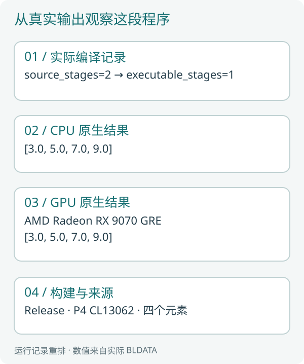

# B 语言源码分析

从一行算式到 CPU 与 GPU 的真实执行

## 写在前面

一门语言怎样把 `value = value * 2.0 + 1.0` 变成处理器真正执行的工作？

这件事并不是把几个英文单词换成机器指令。编译器先要认出句子的结构，分清数字和数据，判断每一处读取、写入是否成立，再把计算整理成适合不同处理器的形式。计算开始以后，还要有人准备内存、安排执行，并在最后一个使用者结束后释放资源。

本书沿着这条完整路径阅读 Blink 的实现。Blink 是一门原生并行编程语言，简称 B 语言，B 也寓意 Base。开源工程在 https://github.com/sgua83/Blink 。读者最好已经写过少量 B 程序；熟悉 C/C++ 会有帮助，不要求预先学过编译原理、汇编、Rust 或 Vulkan。

遇到必要知识，我们先用能手算的例子说明，再进入源码。例如，先看乘法为什么应先于加法组成语法树，再看解析函数；先理解“两个值还要同时用，所以不能占同一个寄存器”，再看寄存器分配；先区分“工作已提交”和“工作已完成”，再看 GPU 资源释放。

本书按当前研发源码说明已实现行为，源码节选随MD正文同步，仅为排版去除共同缩进。每份实际源码的SHA256、节选行范围与节选字节身份记录在 `compiler/源码版本索引.json`。手算、伪代码与示意图用于解释；历史运行图另注明当时的输入和日期。

当前实现包括自研前端、并行中间表示、Windows x64／SPIR-V 后端及 CPU／Vulkan 执行框架，也能把普通 CPU 应用编译为目标文件，再由独立链接器生成可执行程序。普通 CPU 原生调用、递归与有限独立模块已有实现；完整模块／资源契约、其他目标调用、一般异步应用、基础库与跨平台能力仍分别开放。


*图 0-1：前端回答“这段程序是什么意思”，后端回答“怎样表达给处理器”，执行框架回答“怎样使它真实运行”。箭头经过的每个对象都将在正文展开。*

## 阅读路线

第一部分从一个小程序开始，补齐内存、Rust 阅读方法、词法、语法和类型知识。第二部分讲独占访问、范围事实、中间表示、控制流与优化。第三部分进入 CPU 指令、调用约定、寄存器、线程和 SIMD。第四部分进入 GPU 执行模型、SPIR-V、Vulkan、分页、同步与资源寿命。最后通过归约、扫描、筛选、排序和块内协作，看清高级并行操作怎样落到两种硬件上，再阅读 DLL 与完整源码结构。

各章末尾的“自己走一遍”用于检查是否理解，并附解释。它们是阅读练习，不是需要安装或执行的额外测试工具。

## 第一章 从四个数走完整条路径

### 1.1 先认识要追踪的计算

我们使用工程已有的 `sample/lessons/map.b`。这里的 map 表示逐元素计算；`lessons.map` 是教学模块名，不是标准库函数。先读最短的 `scale`：

源码节选：`sample/lessons/map.b:9`。

```c
void scale(inout dataset<f32> values) on compute {
    parallel (value in values) {
        value = value * 2.0 + 1.0;
    }
}
```

输入为 `[1.0,2.0,3.0,4.0]`，每个元素先乘二再加一，得到 `[3.0,5.0,7.0,9.0]`。四个结果互不依赖。计算第三项时，不需要等待第一项算完，也不需要知道第一项的结果。

对应的 C 写法可以是下面这样。变量名和计算保持一致，差别集中在循环表达上。

```c
for (unsigned i = 0; i < count; ++i) {
    float value = values[i];
    value = value * 2.0f + 1.0f;
    values[i] = value;
}
```

C 循环描述一个接一个访问下标的过程，成熟 C/C++ 编译器在条件允许时也能自动向量化。B 的 `parallel` 直接声明每个实例拥有当前元素；具体分成几个 CPU 范围、怎样组成 SIMD 批次，或怎样安排 GPU 工作组，由后面的实现决定。不能把这种语义差别简化为“C 总是串行，B 总是更快”。

### 1.2 同一个例子为什么还有 seed 和 demo

源码节选：`sample/lessons/map.b:1`。

```c
module lessons.map;

void seed(write dataset<f32> values) on compute {
    parallel (value in values) {
        value = f32(index() + 1);
    }
}
```

`seed` 把元素设为从一开始的数字，`index()` 是从零开始的当前位置。第零项写入一，第一项写入二。

源码节选：`sample/lessons/map.b:15`。

```c
void demo(inout dataset<f32> values) on compute {
    seed(values);
    scale(values);
}
```

`demo` 先产生数据，再完成变换。因此不需要额外编写输入文件，就能得到这四个结果。源码有两个逐元素阶段，优化器可能把它们合成一个实际阶段。我们将在第十一章解释合并的条件。

### 1.3 下载、构建与观察

先下载并双击安装 [Windows x64 正式版 v0.14.169.59](https://github.com/sgua83/Blink/releases/tag/v0.14.169.59) 的 `Blink-Setup-windows-x64.exe`，作为可独立取得的稳定 Blink 种子。默认编译器构建直接读取 `%ProgramFiles%/Blink` 内的 `VERSION`、`bin/bc.exe` 与 `bin/blink.exe`；稳定种子要在执行 Cargo 之前安装好。

当前源码工具链还需要 Git、Rust stable 的 MSVC 工具链，以及 Visual Studio 的 C++ 桌面开发工具（x64 C++ 工具与 Windows SDK）。新开 x64 Developer PowerShell，先核对实际种子，再下载并构建源码：

```powershell
& "$env:ProgramFiles/Blink/bin/bc.exe" --version
& "$env:ProgramFiles/Blink/bin/blink.exe" --version
git clone https://github.com/sgua83/Blink.git
cd Blink
cargo build --workspace --release
```

源码构建先用独立稳定种子编译 B 语言模块，再与 Rust 部分链接；生成物放在工程的 `target`。这是编译器自身的构建过程，与读者用 `bc` 编译普通 B 语言应用是两层事情。第五章会继续解释稳定种子的作用。

先检查，再导出 CPU/GPU 代码：

```powershell
.\target\release\bc.exe check sample\lessons\map.b sample demo
.\target\release\bc.exe build sample\lessons\map.b Saved\MapCode sample demo
```

这里的 `build` 输出可供研究的阶段代码与布局，尚不是应用 `.exe`。在这本源码分析书里，我们正要观察这些中间产物，因此会使用这一命令。

常规使用先看完整 B 应用 `sample/applications/map_cpu.b`：main 自行分配四条记录，直接写出输入初始化、parallel 变换和输出；没有导入 lessons 或调用 demo。完整 `.h` 与 `.b` 如下；模块名、入口和计算均可见：

`sample/applications/map_cpu.h`：

```c
module applications.map_cpu;

u32 main() on cpu;
```

`sample/applications/map_cpu.b`：

```c
module applications.map_cpu;

u32 main() on cpu {
    dataset<f32> values = dataset<f32>(4);

    parallel (value in values) { value = f32(index() + 1); }

    parallel (value in values) { value = value * 2.0 + 1.0; }

    for (value in values) { if (!println(value)) { return 1; } }
    return 0;
}
```

GPU 版 `map_gpu.b` 在同一文件完整定义 scale_values，并在 main 明确 upload、target(gpu, ...)、download；CPU 无需 target 包装。两份源码以正式工具0.14.169.59运行均输出3、5、7、9。用 bc -c 编译、blink 独立链接后，直接运行 EXE，无设备参数：

```powershell
& "$env:ProgramFiles/Blink/bin/bc.exe" -c sample/applications/map_cpu.b -o target/book-apps/map_cpu.obj -I sample
& "$env:ProgramFiles/Blink/bin/blink.exe" target/book-apps/map_cpu.obj -o target/book-apps/map_cpu.exe
.\target\book-apps\map_cpu.exe
```

设备能力 on compute 与本次目标 target 不同，当前没有 target(auto, ...) 或隐式迁移。上述基础应用已用正式版0.14.169.59实际运行；本书源码分析固定在前述快照，与正式发行工具的身份分别说明。

下面仅保留一个后端隔离测试：不引入应用 main，分别检查同一编译器模块在 CPU 与 GPU 上的生成／绑定／执行，便于源码分析和逐字节结果对照。它不是常规程序入口：

```powershell
.\target\release\brun.exe cpu sample\lessons\map.b demo sample Saved\MapCpu :4
.\target\release\brun.exe gpu sample\lessons\map.b demo sample Saved\MapGpu :4
```

brun先接收精确的`cpu`／`gpu`后端，其他值直接交回参数错误；接受后才编译模块和读取输入。`:4` 申请四个初始为零的元素；`demo` 自己填入初值。结果保存在相应目录的 `values.bldata`。这只属于后端隔离测试的数据协议；正常 B 应用直接运行 EXE，并由代码选择设备。附录提供不加命令别名的直接读取方法。

正文节选对应当前源码，位置见现行源码索引；修订和原生运行历史只在P4双台账记录。




*历史运行图：CL13553 的阶段、布局与四元素结果；命令和产物按原始版本解释。*

上图的阶段、布局和设备名来自工具输出；两行 values 从实际 BLDATA 读取后排成可读文本。启动和准备成本没有混入四元素算式的性能结论。


### 1.4 从输入文字到输出数字

整条路径可以先压缩成一句话：读取 `.h/.b`，得到单词，组成语法树，检查类型与访问，建立并行阶段，做合法优化，生成 CPU 指令或 SPIR-V，再由执行框架准备资源并运行。

在这个过程中，“程序”至少有三种形态：编辑器里的文字、编译器内存中的结构、处理器消费的代码。它们描述同一件事，却不能彼此混淆。语法树不是机器码，机器码字节也不自动等于可执行文件。

**自己走一遍。** 若第二项结果不对，应先怀疑语法分析器吗？不应直接跳到某一层。先确认实际输入，再看编译出的操作与布局，最后核对 CPU/GPU 各自的结果。每一层都有自己的输入和输出，问题要沿着真实差异定位。

## 第二章 内存：数字怎样占据一段地址

### 2.1 先分清值、位和地址

值是一件事，保存值的位又是一件事。`u32` 的一和 `f32` 的一都占四字节，编码不同。`f32` 的 `1.0` 通常对应十六进制 `3f800000`，不能把这四字节当作无符号整数一使用。转换类型可能改变编码；逐位解释则保留编码，改变理解方式。

地址告诉我们数据在哪里。假设第一个 `f32` 的地址为一千，元素间隔为四字节，第四个元素位于 `1000 + 3×4 = 1012`。源码中的通用记录也是这个规律，只是间隔不一定等于单个字段的大小。

```text
元素地址 = 数据起点 + 元素下标 × stride
字段地址 = 元素地址 + 字段偏移
```

这里的 `stride` 是相邻完整记录的间隔，字段偏移则描述字段在一条记录中的位置。理解这两个数，后面就能读懂 CPU 地址计算、GPU 分页、C ABI 和 view。

### 2.2 对齐为什么会产生空白

处理器和接口通常要求某些数据从适当的地址开始。对齐为十六意味着起点是十六的整数倍。一个 `float3` 有三个四字节分量，内容共十二字节；在此版本的 B 布局中，它的对齐是十六。单独作为数组元素时，记录间隔因而是十六，而非十二。

源码节选：`crates/blanguage/src/ir.rs:384`。

```rust
pub fn vector(s: Scalar, n: usize) -> Self {
    if n == 1 {
        return Self::scalar(s);
    }
    #[cfg(feature = "compiler")]
    let (size, align) = {
        let layout = unsafe { vector_layout(s.size(), s.align(), n as u64) };
        (layout.size as u32, layout.alignment)
    };
    #[cfg(not(feature = "compiler"))]
    let (size, align) = (n as u32 * s.size(), s.align() * if n == 2 { 2 } else { 4 });
    Self {
        name: match s {
            Scalar::F32 => format!("float{n}"),
            Scalar::U32 => format!("uint{n}"),
            Scalar::I32 => format!("int{n}"),
            Scalar::Bool => format!("bool{n}"),
            _ => format!("{}x{n}", s.name()),
        },
        arguments: Vec::new(),
        values: Vec::new(),
        size,
        align,
        components: (0..n).map(|i| (s, i as u32 * s.size())).collect(),
        fields: Vec::new(),
        view: None,
        array: None,
        enumeration: false,
        result: false,
        variants: Vec::new(),
        dataset: None, cleanup: None, function: None,
    }
}
```

编译角色把实际标量字节宽度、对齐与分量数交给B的vector_layout，读取布局描述后构造原Ty。关闭compiler的运行角色保留既定ABI计算，不因构造运行期类型而依赖源前端或种子。布局描述和最终类型分别由原生产者持有。

不要从“内容十二字节”推出“任何地方都连续十二字节”。记录中的字段、矩阵的行、整个 dataset 的 stride 都要按编译器布局处理。C++ 或 Rust 的同名类型也未必具有相同布局。


*图 2-1：字段内容、对齐空白、完整记录间隔是三个不同概念。编译器给出统一布局，两个后端和执行框架共同消费。*

### 2.3 源码中的 Ty 保存了什么

源码节选：`crates/blanguage/src/ir.rs:178`。

```rust
#[derive(Clone, Debug, PartialEq, Eq)]
pub struct Ty {
    pub name: String,
    pub arguments: Vec<Ty>,
    pub values: Vec<u32>,
    pub size: u32,
    pub align: u32,
    pub components: Vec<(Scalar, u32)>,
    pub fields: Vec<(String, u32, Box<Ty>)>,
    pub view: Option<Box<Ty>>,
    pub array: Option<Box<Ty>>,
    pub enumeration: bool,
    pub result: bool,
    pub variants: Vec<Variant>,
    pub dataset: Option<Box<crate::ast::TypeName>>,
    pub cleanup: Option<String>,
    pub function: Option<Box<CFunctionType>>,
}
impl Ty {
```

`size` 是类型内容占用，`align` 是对齐，`components` 把值分解为标量及偏移，`fields` 保留记录字段。`view` 与 `array` 说明它是否还包含引用式只读资源或内联数组。

这样，一个 `float3` 在前端仍有完整类型，在后端却可拆成三个 `f32` 分量。语言向量不保证每一处都会使用一条硬件向量指令；是否批量执行，还取决于计算、访问和后端计划。

### 2.4 Dataset 是布局的实际承载者

源码节选：`crates/blcompute/src/lib.rs:89`。

```rust
pub struct Dataset {
    pub(crate) ty: Ty,
    pub(crate) stride: u32,
    pub(crate) count: u32,
    pub(crate) words: Vec<u32>,
    pub(crate) views: views::Views<ReadDataset>,
}
```

`words` 是 CPU 上的存储，`count` 是记录数，`stride` 是相邻记录间隔。这里使用 `Vec<u32>` 保存四字节 word，是保存原始位模式的容器，并不表示其中的所有字段都是 `u32`。

**自己走一遍。** `stride=32`、字段偏移十二、下标三，字段距数组起点多远？`3×32+12=108` 字节。若把 stride 错当作字段大小四，读到的就会是另一条记录或另一个字段。

## 第三章 只学阅读源码所需的 Rust

### 3.1 结构体、枚举与 match

C 结构体保存字段，Rust 的 `struct` 也如此。Rust 的 `enum` 还可以让不同情况各自携带数据。例如中间指令 `Constant` 保存目标编号、标量类型和位模式；`Binary` 保存运算与两个输入。`match` 则逐种处理这些情况。

与“操作码加一堆随意字段”的写法相比，这种表示把哪些数据属于哪种情况直接写进类型。阅读时先看枚举有哪些分支，再寻找处理该分支的 `match`，就能沿着同一项能力贯穿前端和两个后端。

### 3.2 Option 和 Result 并不神秘

`Option<T>` 表示有或没有：`Some(value)` 保存内容，`None` 表示没有。阶段的 `prefix: Option<PrefixCount>` 表示阶段是否限制在某个有效前缀，不是把零当成“没有”。

`Result<T,E>` 表示成功或错误：`Ok(value)` 与 `Err(error)`。函数调用后面的 `?` 表示成功就取出结果，失败就把错误交还上层。它不是重新尝试，也不是忽略错误。

源码节选：`crates/blanguage/src/parser.rs:7`。

```rust
pub fn parse(source:Source)->Result<syntax::Module>{
    let mut host=ParseHost::new(source)?;
    let module=host.invoke(|input,state|unsafe{b_module(input,state)})?;
    Ok(syntax::Module{source:host.source,root:host.storage.finish(module.offset)})
}
```

ParseHost先分词并准备同一B存储，invoke把完整模块解析交给B。这里的两个 `?` 分别交回准备或解析的真实错误；成功时封存实际根和原Source。暂时不必逐个研究Rust借用语法。

### 3.3 引用、所有权和作用域

`&T` 表示只读借用，`&mut T` 表示独占可变借用。把值移动给另一个对象以后，旧变量通常不能再直接使用它。对象退出作用域会执行 `Drop`，类似 C++ 的析构。

这使资源拥有者可用类型表达，但不会自动替我们理解 GPU：CPU 函数返回时，设备工作可能还在执行。正确实现必须让拥有者保留到真实完成点。后文会看到，这恰恰是执行框架最重要的工作之一。

`Rc<T>` 让同一线程中的多个对象共享一个资源的所有权，复制 Rc 主要增加引用计数，不复制整个 GPU 缓冲。`Arc<T>` 使用原子引用计数，适合跨线程共享所有权。编译器的源码与定义用到 Arc；这个版本的 Vulkan 对象大量使用 Rc，不应因看到“共享”就一律理解为多线程安全。

### 3.4 unsafe 表示哪一层责任

机器码入口、原始指针和 Vulkan API 会出现 `unsafe`。它表示调用者必须满足 Rust 类型系统没有完整表达的条件，例如地址有效、布局正确、对象寿命足够。它不意味着“这一段不用讲清楚”，反而提示我们追问这些条件由谁建立。

**自己走一遍。** `Rc<GpuDataset>` 被复制，显存内容会复制一份吗？不会。两个所有者引用同一实际对象。是否另有上传、读回或拷贝，要看执行路径，不能从 Rc 的 clone 推断。

## 第四章 模块装载：先把程序找齐

### 4.1 一个文件不等于整个程序

`map.h` 声明可公开使用的接口，`map.b` 给出实现。源码模式按实际需要读取接口与存在的实现，产物导入则消费对象中的公开接口。只解析当前文件，却不知道调用的函数来自哪里，无法完成可靠的类型、访问与阶段分析。

公开入口由 `crates/blanguage/src/lib.rs` 导出，源码装入实现位于 `crates/blanguage/src/frontend.rs`。公开接口 `compile` 编译入口模块，`compile_entry` 选择具体入口，`check` 允许只检查函数库，不要求伪造一个算法入口。

源码节选：`crates/blanguage/src/frontend.rs:148`。

```rust

pub fn compile(path: &Path, module_root: &Path) -> Result<Compilation> {
    compile_module(path, module_root, true, None, &[])
}
/// 选择公开 program 的具体静态入口，例如 shade<13> 或 run<float3,17>。
pub fn compile_entry(path: &Path, module_root: &Path, entry: &str) -> Result<Compilation> {
    compile_module(
        path,
        module_root,
        true,
        Some((EntryKind::Domain, entry)),
        &[],
    )
}
/// 使用实际已编译模块的公开接口和合同编译；代码绑定仍由对应链接／装入消费者完成。
pub fn compile_with_modules(
    path: &Path, module_root: &Path, dependencies: &[object::Object],
) -> Result<Compilation> {
    compile_module(path, module_root, true, None, dependencies)
}
/// 指定域入口消费已编译模块接口，不读取提供者的实现源码。
pub fn compile_entry_with_modules(
    path: &Path, module_root: &Path, entry: &str, dependencies: &[object::Object],
) -> Result<Compilation> {
    compile_module(path, module_root, true, Some((EntryKind::Domain, entry)), dependencies)
}
```

这些 API 接收文件路径与模块根目录。根目录用于把 `lessons.map` 这样的模块名映射到文件路径；它与 C 预处理器简单粘贴头文件的行为不同。 Windows模块名的点分隔映射、根路径组合与.h／.b后缀由`blink.windows.path_core`中的B算法形成，构建图按声明次序展开提供者，每个单元只持有一份列表，父单元借读，准备结束后随原单元移交给源码捕获和编译。实际导入仍从本次入口出发，已选编译接口的传递源码也沿同一路径入口捕获。宿主只持有实际OsStr编码、同步借出的组件和输出缓冲，接回PathBuf后沿原File打开；普通B路径接口复用同一算法，结果和临时dataset仍归原Frame。核心不持有路径或地址，不另建Frame、文件打开或释放链。已打开文件的B字节捕获、源文本及模块图各沿原所有者交接。

### 4.2 模块身份先进入同一来源表

A 导入 B、B 又导入 A 可以形成合法的函数引用。装载器先确认模块身份，再检查声明、类型和实现；导入成环与无法形成有限布局的按值递归不是同一种问题。

源码节选：`crates/blanguage/src/frontend.rs:589`。

```rust
if let Some(name) = import
    && world.sources.contains_key(name)
{
    return Ok(name.to_owned());
}
let compiled = imported.and_then(|imports| import.and_then(|name| imports.modules.get(name)));
```

同一模块再次出现时，来源表让装载器复用它。`.h` 提供公开接口，实际 `.b` 提供实现；已编译对象则从自己的公开接口和合同参与编译，不需要调用方取得库的实现源码。

### 4.3 名字怎样变成唯一对象

不同模块都可以有 `run`，所以名字解析必须同时考虑所属模块、导入和可见性。当前 `bootstrap/names.b` 完成名称候选的查找与歧义判断；Rust 装载器使用这个结果，继续核对真实声明和接口。

名称相同还不足以证明接口一致：参数类型、访问权限、执行目标和接口条件也要匹配。调用者相信的约定必须由实际实现承担。

**自己走一遍。** A 和 B 都导入 C，会产生两个 C 吗？模块身份让它们引用同一个来源。若一个记录按值包含自身，仍会因无法形成有限布局而被拒绝。

### 4.4 统一函数怎样落到不同执行范围

普通值计算和整域计算都使用返回类型、函数名与参数定义。`parallel` 表达数据域，`on cpu`、`on gpu`、`on compute` 声明函数可用的目标。编译器沿函数体和调用关系判断这次调用需要哪些参与者，源码不再另设 `program` 声明类别。

CPU 主流程可以直接使用 `parallel`，也可以普通调用其他 CPU 函数。`target(gpu, f(...))` 明确选择设备；同步调用完成后，结果仍在 GPU，CPU 读取前需要 `download`。普通 CPU 调用保留真实调用帧，元素和协作函数按各自参与范围编译。

内部的 `Program`、`Stage` 和 `ExecutionPlan` 分别保存编译产物、计算阶段及执行关系。它们是实现对象，与源码采用哪一种函数写法分开理解。

### 4.5 静态库目录怎样保持原输入

库文件的成员正文留在同一不可变输入中，B目录只保存原成员／符号范围和一次抽取状态。普通文件读取后直接进入该输入；嵌入运行支持的归档与实际链接消费者共享它。SDK 编译先借用成员的原 B 节视图，读取公开接口、参与要求和合同。实际链接抽取所需成员，完整对象恢复代码、重定位、归档资源和栈材料。UTF-8名称解释和COFF对象仍由原Rust接收者负责，目录插入、查询、同名首项及最后释放由B完成。

源码节选：`crates/blanguage/src/bootstrap/archive.b:355`。

```b
extern "C" ArchiveSelection library_take(address library,address name,u64 length) on cpu {
    LibraryDirectory value=directory_at(library);ArchiveSymbol key=ArchiveSymbol(name,length,0u64);
    u64 symbol=directory_symbol_position(value,key);
    if(symbol==value.symbol_count||compare_names(directory_symbol(value,symbol),key)!=i32(0)){return ArchiveSelection(0,0u64);}
    u64 offset=directory_symbol(value,symbol).member;
    u64 first=0u64;u64 end=value.member_count;
    while(first<end){
        u64 middle=first+(end-first)/2u64;
        if(u64(directory_member(value,middle).member.offset)<offset){first=middle+1u64;}else{end=middle;}
    }
    if(first==value.member_count||u64(directory_member(value,first).member.offset)!=offset){return ArchiveSelection(2,0u64);}
    LibraryMember selected=directory_member(value,first);
    if(selected.taken!=0){return ArchiveSelection(0,0u64);}
    selected.taken=1;directory_member_put(value,first,selected);return ArchiveSelection(1,first);
}
```

查找先定位符号，再定位实际成员。成员第一次交出时修改自己的taken，之后返回未选中；不存在的符号与目录指向不存在的成员继续表达不同结果。Library先结束B目录，原输入在最后引用结束后释放。归档写出队列引用原输入和成员范围，新生成成员保留自己的字节，不为每个已有成员复制正文。

前端导入现行接口时仍读取库内全部模块，独立链接时才按未解析符号选成员。因此未使用的损坏成员可以不影响本次链接，却仍可使前端全成员导入失败；两种路径按实际消费者分别理解。

### 4.6 链接怎样只保留真实消费者

bc 和 blink 从进程取得原 OsString，共用 B 的 bootstrap.cli。bc 由 B 解析命令、资源参数、编译选项与路径索引，Rust 依原顺序初始化编译器、加载导入并生成产物。blink 由 B 解析产物、预算、输入顺序和输出索引，Rust 依索引交接原路径，链接和归档读取已有Object和Library。需要MSVC时，链接器复用模块加载的B路径算法，组合安装器、工具集、SDK及暂存文件路径。bootstrap.native_select选择唯一应用或算法入口，沿真实符号、合同、重定位和关联节形成存活闭包；算法DLL保留本身全部入口节，原始CPU SDK则从明确的符号合同出发。定义和待处理节只有本次B选择拥有一份。

源码节选：`crates/blanguage/src/bootstrap/native_select.b:114`。

```b
extern "C" SelectResult choose(SelectView input,SelectParams params,address context,
    cfn<SelectReply,address,u64,BindingBytes> extract,cfn<SelectReply,address,u64> native_archive,
    cfn<SelectReply,address,SelectResource> resources,cfn<BindingBytes,address,BindingBytes> slot) on cpu
    requires nonzero(extract) requires nonzero(native_archive) requires nonzero(resources) requires nonzero(slot) {
    SelectState state=SelectState(input,BindingForest(input.nodes,0u64,0u64,0u64),0u64,0u64,0u64,0u64,0u64);
    if(params.native_mode==0u64){u64 count=0u64;u64 i=0u64;while(i<input.object_count){if(object_at(input,i).kind!=0u64){state.entry=i;count+=1u64;}i+=1u64;}
        if(count!=1u64){return result(1u64,empty(),empty(),0u64);}}
    u64 o=0u64;while(o<state.view.object_count){SelectResult defined=define(state,ordered(o,state.entry));if(defined.error!=0u64){return defined;}o+=1u64;}
    if(params.native_mode==0u64){SelectObject entry=object_at(state.view,state.entry);
        if(entry.kind==2u64){entry.selected=1u64;object_put(state.view,state.entry,entry);u64 i=entry.section_start;while(i<entry.section_start+entry.section_count){enqueue(state,i);i+=1u64;}}
        else{include(state,state.entry,0u64);}
    }else{u64 i=0u64;while(i<params.root_count){SelectRoot root=root_at(params,i);SelectTarget target=resolve(state,root.name,root.contract,context,extract);if(target.result.error!=0u64){return target.result;}include(state,target.object,target.section);i+=1u64;}}
```

定义核对与根选择之后，B继续消费同一队列，按原库顺序请求缺失成员并扩展资源需求。成员抽取、共享原生归档、槽名字存活和B资源绑定生产分别由原拥有者同步交接；这些接点不执行Rust选择算法。描述数组增长后交回当前视图，B跨交接保留索引。最后B交出节、符号、重定位、导出和栈的保留及映射，Rust移动自有对象或为真实借用对象生成最终映像，输入和代码保持到最后消费者。普通文件I/O、对象恢复和宿主链接进程仍有各自职责，局部选择接管不等于完整自举。

## 第五章 词法：把一行字符切成能辨认的单元

### 5.1 为什么不能直接按空格切开

`value=value*2.0+1.0;`没有空格，依然是完整语句。`<=`是一个比较符，不能先吃掉`<`再把`=`留成另一项。小数点、范围`..`、名字里的下划线、行注释与块注释各有意义。

Token只保存原文的字节范围。文字只属于Source，解析器通过同一范围借用切片；不为每个token分配、复制和释放一份String。

源码节选：`crates/blanguage/src/lexer.rs:3`。

```rust
#[repr(transparent)]
#[derive(Clone, Copy, Debug)]
pub struct Token {
    pub span: Span,
}
impl Token {
    pub fn text<'a>(&self, source: &'a Source) -> &'a str {
        &source.text[self.span.start..self.span.end]
    }
}
```

这里没有把每个关键字编成独立枚举；解析器仍比较原文。B解析器在实际构造处将需长期持有的名称和数字文字交入同一模块的自有字节；源范围仍指向原不可变Source快照，不为每次读取复制文字。

### 5.2 一个扫描位置贯穿整个B循环

扫描由`src/bootstrap/lexer.b`实现。`at`是当前字节位置，`start`是本次token起点；B直接读取借入的UTF-8字节。空白和注释被跳过，标识符、数字、引号字符串与运算符各按现有语言规则识别。最终输出`[start,at)`，不复制原文；引号内容的具体含义由原语法消费者决定。

源码节选：`crates/blanguage/src/bootstrap/lexer.b:81`。

```b
} else if (at + 2u64 < length && byte_at(source,at+2u64) == 61
    && (c == 60 || c == 62) && byte_at(source,at+1u64) == c) {
    at += 3u64;
} else if (at + 1u64 < length && double_operator(c,byte_at(source,at+1u64))) {
    at += 2u64;
} else if (single_operator(c)) { at += 1u64; }
else { return ScanResult(0u64,start,start+1u64,2); }
```

三个字符的移位赋值先于双字符、单字符运算符，保持最长匹配。数字允许指数里的正负号，不把普通加法全部吞入。`value*2.0+1.0`得到`value`、`*`、`2.0`、`+`、`1.0`；词法层不判断value的类型或可写性。

### 5.3 Span、输出存储与诊断属于谁

源码节选：`crates/blanguage/src/ast.rs:3`。

```rust
#[repr(C)]
#[derive(Clone, Copy, Debug, Default)]
pub struct Span {
    pub start: usize,
    pub end: usize,
}
```

Span的start/end是字节范围；诊断再从原Source计算行号和字符列，不能把中文UTF-8字节数当成人眼字数。`repr(C)`让这两个64位位置按B／Rust共同的C布局交接；Token是同一Span的透明包装。

源码节选：`crates/blanguage/src/bootstrap/lexer.h:1`。

```b
module bootstrap.lexer;
struct TokenSpan { u64 start; u64 end; };
struct ScanResult { u64 count; u64 start; u64 end; u32 error; };
extern "C" ScanResult scan(address source, u64 length, address tokens) on cpu;
```

Rust入口拥有Vec，按源码n字节最多n个非空token加EOF的数学上界提供输出空间。同步调用只借出源码、长度和原输出地址；B写Span并返回数量，成功后Rust才设置Vec长度。B不分配、不保留地址，错误交回B001至B004的原字节位置，Diagnostic仍沿原Source显示。最后消费者和释放仍由原Rust所有者负责，没有第二份token表或资源释放链。

标识符使用 ASCII 并区分大小写；中文可以出现在字符串字面量和注释中。普通字符串字面量产生 UTF-8 字节数组，长度按字节计算，不自动补结尾 NUL。转义在解析阶段检查，动态文本处理再由实际容器和库接口承担。类型里的 `>>` 可以关闭两层泛型，表达式里的 `>>` 仍表示右移。

### 5.4 稳定种子怎样参与正式构建

编译器的一部分已经用 B 语言实现，构建它需要先有一份能够编译这些模块的 Blink 工具。这份独立、已安装的发行版就是稳定种子；不能把尚未构建成功的新工具当成自己的唯一前提。

`build.rs` 用选定的上一代SDK编译B模块，再把实际原生对象与Rust部分链接。当前词法、表达式／类型／泛型／契约、语句／控制／并行构造、源节点存储、名称解析及部分布局和对象处理由B承担，模块声明及完整entry／type_query也由B完成；普通文字解码与字节节点构造也由B直接完成。原生后端的共用指令、地址生成、SSE2数值与载荷访存，以及共享和CPU私有tile的原子机器序列由B直接写入原代码缓冲。CPU稳定筛选的范围计数和散写也由B发射；原执行框架交接真实范围前缀与绑定步长，原Emitter记录寄存器保存及展开。CPU稳定排序同样由B生成键初始化、桶计数、散写与记录回收，回收与筛选共用原完整记录复制。CPU有界追加由B发射容量比较、锁CMPXCHG预留和真假返回；原Emitter按实际步长和字段布局发射记录写入，回填容量失败分支。Load／Store／Gather复用原寻址和lane组合；原子发射复用机器编码和标量搬运，保留真实锁语义、旧值及64位tile的高低字流。Rust仍拥有原IR访问计划、实际分配、地址计算结果与代码缓冲。调用参与范围的源码分析及domain／host闭包也由B直接读取同一语法存储完成；原World继续拥有真实名称查询、编译输入登记和定义，结果交回同一Definition.execution。类型与访问检查、其他控制与IR、其余后端职责和执行框架继续各自职责，局部接管不等于完整自举。

正常源码构建默认使用安装目录中的种子，显式代际构建可以通过 `BLINK_BOOTSTRAP_SDK` 选择另一份独立 SDK。供已有应用消费的源码 SDK 与编译器自身的源码生产使用各自明确的构建输入。

## 第六章 语法：算式为什么是一棵树

### 6.1 先用括号画出结构

`value * 2.0 + 1.0` 的结构是 `(value * 2.0) + 1.0`。根是加法，左边是乘法，乘法的左右两边才是 value 和常量二。若误组成 `value * (2.0 + 1.0)`，输入二时会从正确的五变成六。

语法树把这种关系保存下来。树中节点回答“做什么”，子节点回答“对什么做”。它比原始字符串更适合检查、重写和代码生成。


*图 6-1：词法得到顺序单元，语法建立嵌套关系。树上的位置表示运算优先级，不表示硬件线程。*

### 6.2 解析器怎样知道在哪里

源码节选：`crates/blanguage/src/parser.rs:26`。

```rust
struct ParseHost{source:Source,tokens:Vec<Token>,storage:syntax::Builder}
```

ParseHost持有Source、Token缓冲和未封存存储。B独立维护本次ParseState.at，完成模块、entry或type_query并消费原EOF，返回同一存储的类型化根；Rust封存后交给只读消费者，不再继续模块游标或重造节点。

源码节选：`crates/blanguage/src/bootstrap/parser.h:7`。

```b
struct ParseInputs {address source;address tokens;u64 count;address storage;};
struct ParseState {u64 at;ParseError error;};
```

### 6.3 优先级不是靠先写哪一行代码猜出来的

B的read_expression消费最低优先级minimum：先解析基本表达式，再查看后续运算符。只有达到当前门槛的运算符才接入树中；右侧递归使用相应门槛，保持乘法先于加法等关系。read_expression_ref把完成节点写入同一源存储，返回ExprRef，不交回一份Rust草稿。

源码节选：`crates/blanguage/src/bootstrap/parser.b:234`。

```b
u32 operator_precedence(read ParseInputs input,u64 cursor) on cpu {
    u64 at=cursor;
    if(token_is(input,at,124,124)){return 1;}
    if(token_is(input,at,38,38)){return 2;}
    if(token_is(input,at,124,0)){return 3;}
    if(token_is(input,at,94,0)){return 4;}
    if(token_is(input,at,38,0)){return 5;}
    if(token_is(input,at,61,61)||token_is(input,at,33,61)){return 6;}
    if(token_is(input,at,60,0)||token_is(input,at,62,0)||token_is(input,at,60,61)||token_is(input,at,62,61)){return 7;}
    if(token_is(input,at,60,60)||token_is(input,at,62,62)){return 8;}
    if(token_is(input,at,43,0)||token_is(input,at,45,0)){return 9;}
    if(token_is(input,at,42,0)||token_is(input,at,47,0)||token_is(input,at,37,0)){return 10;}
    return 0;
}
```

优先级查询返回原运算符层级，正文解析只接入达到当前门槛的运算；右侧递归使用更高门槛，完成子树直接写入原存储。

源码节选：`crates/blanguage/src/bootstrap/parser.b:922`。

```b
        u32 precedence=operator_precedence(input,state.at);if(precedence==0||precedence<minimum){break;}
        Text operation=current_text(input,state.at);state.at+=1u64;
        ExprRef right=read_expression_ref(input,state,precedence+1,type_argument);
        if(state.error.kind!=0){break;}
        left=ExprNode(ExprKind::Binary(BinaryExpr(operation,publish_expression(input,state,left),right)),span);
    }
    return left;
}
```

第一次阅读无需背下所有优先级数值。抓住两点：数值大小服务于结合次序，树形结构才是解析结果。括号则显式开启一个完整子表达式，读到右括号后再回到外层。

### 6.4 语句树保留了并行结构

普通算式之外，AST 还保存条件、循环、函数调用、parallel、阶段边界和集合操作的源形式。这些语句及其正文由B解析，直接形成原存储中的StmtRef、有序Slice和分支／并行节点；语法层保留结构及Span，尚不证明独占写入、有效下标或函数权限，也不启动执行资源。结构合法和语义合法是两件事。

`array<array<u32,4>,3>` 中连续的 `>>` 在类型上下文是两个闭合尖括号；表达式中的 `>>` 则是右移。B解析器的close_type专门区分这两个位置。同样的字符在不同语法位置可以承担不同意义。

**自己走一遍。** `2 + 3 * 4` 的根是加法，右子树是乘法，结果十四。若代码生成器收到错误的树，后端再正确也只会忠实计算错误的结构。

### 6.5 泛型尖括号怎样与移位区别

`array<array<u32,2>,3>`包含嵌套类型，连续的`>>`可结束两层泛型；`value<N+(x>>2)>`中的右移处在值表达式括号内，不能关闭外层泛型。前瞻只寻找结束之后的token游标；表达式、类型和子项由B解析器完整构造，模块外层与完整入口也由B按原语法边界完成。

`bootstrap/parser.b`直接借用原Source字节和词法已写入的同一TokenSpan数组。B维护尖括号、圆括号与方括号深度，沿原接受规则返回结束游标或无结果。函数不改变Parser当前at，也不分配或保留Token；输入及其释放仍属于原调用者。

源码节选：`crates/blanguage/src/bootstrap/parser.b:23`。

```b
extern "C" AngleEnd angle_end(address source,address tokens,u64 count,u64 at) on cpu {
    if(at>=count){return AngleEnd(0u64,0);}
    TokenSpan start=span_at(tokens,at);
    if(start.end-start.start!=1u64||byte_at(source,start.start)!=60){return AngleEnd(0u64,0);}
    i64 depth=i64(0);u64 parentheses=0u64;u64 brackets=0u64;u64 index=at;
    while(index<count){
        TokenSpan token=span_at(tokens,index);u64 length=token.end-token.start;
        u32 first=0;u32 second=0;
        if(length>0u64){first=byte_at(source,token.start);}
        if(length>1u64){second=byte_at(source,token.start+1u64);}
        if(parentheses!=0u64||brackets!=0u64){
            if(length==1u64){
                if(first==40){parentheses+=1u64;}
                else if(first==41){if(parentheses==0u64){return AngleEnd(0u64,0);}parentheses-=1u64;}
                else if(first==91){brackets+=1u64;}
                else if(first==93){if(brackets==0u64){return AngleEnd(0u64,0);}brackets-=1u64;}
            }
            index+=1u64;continue;
        }
        if(length==1u64&&first==40){parentheses=1u64;index+=1u64;continue;}
        if(length==1u64&&first==91){brackets=1u64;index+=1u64;continue;}
        if(length==1u64&&first==60){depth+=i64(1);}
        else if(length==1u64&&first==62){depth-=i64(1);}
        else if(length==2u64&&first==62&&second==62){depth-=i64(2);}
        else if(!accepted(length,first,second)){return AngleEnd(0u64,0);}
        if(depth==i64(0)){return AngleEnd(index+1u64,1);}
        if(depth<i64(0)){return AngleEnd(0u64,0);}
        index+=1u64;
    }
    return AngleEnd(0u64,0);
}
```

C ABI结果AngleEnd用end和present表达可选位置，B的类型与表达式解析读取该前瞻结果。消费 `>>` 的一个字符后，解析器会推进原 `Span` 起点，后续前瞻读取剩余范围。

词法扫描、前瞻、链接字符串解码、表达式／类型／泛型／契约、语句与模块声明，以及三个完整解析入口由B实现。普通文字解码同样由B完成；检查／IR／后端仍按真实职责区分，局部解析接管不等于完整编译器自举。

### 6.6 链接字符串怎样直接进入唯一输出

`extern "C"`、DLL库名和`as`后的符号名使用链接字符串。它们接受非空、非NUL的ASCII，反斜线和双引号需要转义；普通Unicode文本值沿另一条字面量规则处理。

B的read_link_string消费原双引号Token，借用Source中的内文，以内文长度分配本次临时输出上界。decode_link_string一次解释转义，实际成功字节直接交入同一B源存储，再释放临时缓冲；不复制整个Token或另存一份长期String。

成功长度、不支持的转义、非ASCII／NUL及空结果继续沿原ParseError／Span交给Rust诊断B263，源存储和临时清理的真实错误也各自交回。缓冲只活到这次同步交接结束，最终名字和模块节点仍归原B存储；没有逐字符回调或第二释放链。

B直接完成模块const／枚举生成节点、函数／struct／typeset及有序子项，独立entry／type_query消费实际EOF；普通Unicode文字由同一B解析器直接构造字节与长度节点。完整编译器自举仍未完成。

### 6.7 普通文本怎样成为固定字节数组

普通文字解析直接读取原Source中的有效UTF-8字节。未转义内容保持原字节，转义在本次B解析中产生对应字节；每个字节直接形成同一存储中的明确u8构造，实际数量形成array的长度。空文字产生零长数组，不补NUL。生成的字节数节点可以与整段文字及外层成员表达式共享诊断Span；形状求值沿同一Source中实际节点偏移和本次绑定判定身份，不能按Span把不同节点当作递归。原临时子项列表在交入存储后释放，后续消费者共享封存存储，没有另一份解码String或Rust构造树。

源码节选：`crates/blanguage/src/bootstrap/parser.b:740`。

```b
ExprNode ordinary_literal(read ParseInputs input,inout ParseState state,Span span) on cpu {
    ExprNode result=ExprNode(ExprKind::Name(empty_text()),span);
    TemporaryValues values=temporary_values();
    Text byte_name=literal_text(input,state,"u8");
    TypeRef byte_type=publish_type(input,state,named_type(byte_name));
    u64 at=span.start+1u64;u64 end=span.end-1u64;
    while(at<end&&state.error.kind==0){
        u32 value=byte_at(input.source,at);at+=1u64;
        if(value!=92){literal_byte(input,state,values,byte_type,span,value);}
        else if(at==end){parse_fail(state.error,385,4,span);}
        else{
```

Unicode转义先按原诊断次序取得十六进制标量，再消费标准库的共同标量验证和UTF-8纯值位布局。普通UTF-8编码入口及整段转换使用同一位布局；其dataset和Frame仍由原Unicode函数与调用者持有。build.rs先从同一项目library根生成该纯值对象，解析模块通过原--import消费，实际对象随其余引导模块一并静态链接到工具。

源码节选：`library/blink/unicode_scalar.b:2`。

```b
bool is_scalar(u32 value) on cpu {
    return value<=0x10ffff&&(value<0xd800||value>0xdfff);
}
```

非法转义、缺少花括号和非标量继续沿原B385与整个文字Span交回；实际存储与清理错误保留各自来源。C ABI／PE链接字符串继续使用上一节的严格ASCII合同。

### 6.8 源节点、文字与最后消费者

解析器把源节点写入 B 语言模块拥有的存储，节点之间使用类型化索引相连。存储扩容可能移动地址，索引仍能标识原节点；构造完成后，读取者共享只读视图和源码快照。

源码节选：`crates/blanguage/src/bootstrap/ast_storage.h:1`。

```b
module bootstrap.ast_storage;
struct Span {u64 start;u64 end;};
struct Slice {u64 offset;u64 count;};
struct Text {u32 kind;Span range;};
struct Optional<T> {u32 present;T value;};
struct TypeRef {u64 offset;};
struct ShapeRef {u64 offset;};
struct ArgumentRef {u64 offset;};
```

源码节选：`crates/blanguage/src/bootstrap/ast_storage.b:72`。

```b
StorageIndex append<T>(address storage,read T value) on cpu {
    StorageIndex slot=prepare(unsafe_position<Store>(storage).heap,
        unsafe_position<Store>(storage).nodes,size_of<T>(),align_of<T>());
    if(slot.error.kind!=0){return slot;}
    unsafe_position<T>(at(unsafe_position<Store>(storage).nodes.data,slot.offset))=value;
    unsafe_position<Store>(storage).nodes.length=slot.offset+size_of<T>();
    return slot;
```

B 存储模块负责分配、增长和释放。Rust 句柄共享同一份只读源存储，最后一个实际节点、列表或声明消费者结束后，才调用释放入口。`Arc` 在这里管理共享句柄的寿命，不复制另一棵语法树。

源码节选：`crates/blanguage/src/bootstrap/ast_storage.b:103`。

```b
extern "C" StorageError destroy(address storage) on cpu {
    Store store=unsafe_position<Store>(storage);StorageError error=success();
    if(store.nodes.capacity!=0u64){
        if(HeapFree(store.heap,0,store.nodes.data)==0){error=StorageError(3,GetLastError());}
    }
    if(store.text.capacity!=0u64){
        if(HeapFree(store.heap,0,store.text.data)==0){if(error.kind==0){error=StorageError(3,GetLastError());}}
    }
    if(HeapFree(store.heap,0,storage)==0){if(error.kind==0){error=StorageError(3,GetLastError());}}
    return error;
}
```

源码节选：`crates/blanguage/src/syntax.rs:18`。

```rust
struct Owner {raw:NonNull<c_void>,source:Option<Arc<str>>}
// An Owner enters Arc only when its unique builder is consumed. All later
// access is read-only; its source snapshot and B allocations outlive every view.
unsafe impl Send for Owner {}
unsafe impl Sync for Owner {}
impl Owner {
    fn view(&self)->wire::StorageView {unsafe{wire::view(self.raw.as_ptr())}}
    fn row<T:Copy>(&self,offset:u64)->T {unsafe {
        self.view().nodes.cast::<u8>().add(offset as usize).cast::<T>().read()
    }}
    fn array<T>(&self,range:wire::Slice)->&[T] {
        if range.count==0 {return &[];}
        unsafe {std::slice::from_raw_parts(self.view().nodes.cast::<u8>().add(range.offset as usize).cast::<T>(),range.count as usize)}
```

源树保存名称、数值拼写、正文与 `Span`。泛型实例引用同一份源定义，但各自持有类型绑定、常量结果和 IR。这样既能共享只读源码，又不会把不同实例的分析状态混在一起。

## 第七章 类型与布局：不只检查能不能相加

### 7.1 名字到类型，还要经过解析

源文件里的 `float3`、用户记录和泛型参数先以 TypeName 保存。随后 `World` 结合模块和泛型实例，把它变成具有大小、对齐、分量和字段的 Ty。

这一步不仅拒绝不相容的加法，也决定一个字段究竟位于哪一字节。没有统一布局，CPU 后端、GPU 后端和调用方会对同一内存各有解释。

### 7.2 标量与记录怎样统一

源码节选：`crates/blanguage/src/ir.rs:367`。

```rust
pub fn scalar(s: Scalar) -> Self {
    Self {
        name: s.name().into(),
        arguments: Vec::new(),
        values: Vec::new(),
        size: s.size(),
        align: s.align(),
        components: vec![(s, 0)],
        fields: Vec::new(),
        view: None,
        array: None,
        enumeration: false,
        result: false,
        variants: Vec::new(),
        dataset: None, cleanup: None, function: None,
    }
}
```

Scalar明确描述各数值类型的实际大小与对齐：窄整数为一／二字节，u32／i32／f32／bool为四字节，u64／i64／f64为八字节。B普通bool不是C++的一字节bool。逻辑分量和物理存储字不能混为一谈。一个记录被展开为多个带字节偏移的标量，字段保留名义结构。这样，通用代码生成可以逐分量处理，而不是为每个用户记录再写一套后端。

设记录包含 `float3 position` 和 `f32 energy`：position 的三个分量在偏移零、四、八；后续字段和最终 stride 按类型布局计算。不能把语言规则照搬成任意外部平台 C 结构体的默认布局，跨语言时使用生成接口更明确。

### 7.3 泛型：共享源定义，按绑定形成具体实例

“同一个函数能处理不同类型”有两种很不同的实现：运行时判断类型，或者编译前形成具体实例。Blink 当前主要采用后者。

源码节选：`crates/blanguage/src/generics.rs:67`。

```rust
#[derive(Default)]
pub(crate) struct Bindings {
    pub types:BTreeMap<String,TypeName>,
    pub values:BTreeMap<String,u32>,
}

// A bound call reads the original instance; it does not rewrite its source node.
pub(crate) enum TypeCall<'a> { Builtin(&'a str), Construct(&'a TypeName) }
impl Bindings {
    pub(crate) fn type_call(&self,name:&str)->Option<TypeCall<'_>> {
        let actual=self.types.get(name)?;
        Some(if actual.arguments.is_empty()&&crate::builtin_types::Builtin::recognize(&actual.name).is_scalar() {
            TypeCall::Builtin(&actual.name)
        }else{TypeCall::Construct(actual)})
    }
```

Bindings.types把类型形参映射到实际类型，Bindings.values保存const整数实参。type_call沿原内置类型身份识别标量，不为这次分类构造完整Ty。实参解析时同时取得具体类型的规范名和绑定用的语义类型。实例名由B直接使用这些规范名和const值生成，后续参数与合同沿Bindings读取类型。实例按这些绑定读取同一份源定义，形成自己的类型、合同和 IR，而不是为每一组实参重写一棵语法树。

实际推导先判断形参是否出现在封存语法中。B签名模块沿同一类型节点递归读取名称和类型实参，并读取直接命名const及dataset／texture数组的静态形状；这些查询只返回bool。

源码节选：`crates/blanguage/src/bootstrap/signatures.b:294`。

```b
bool type_contains_name(StorageView store, u64 offset, NameBytes name) on cpu {
    TypeNode type = read_node<TypeNode>(store, offset);
    if (compare_name(text_bytes(store, type.name), name) == i32(0)) { return true; }
    u64 index = 0u64;
    while (index < type.arguments.count) {
        ArgumentNode argument = read_node<ArgumentNode>(store, child_at(store, type.arguments, index));
        match (argument) {
            ArgumentNode::Type(child) {
                if (type_contains_name(store, child.offset, name)) { return true; }
            }
            ArgumentNode::Value(shape) {}
        }
        index += 1u64;
    }
    return false;
}
```

Type和Argument的原拥有者同步借出源存储、节点偏移和名称字节，并保持到查询返回。实际Ty、const值和冲突诊断仍由原推导器形成；只读语法查询与实际实例求解各有明确职责。

实际绑定确定后，B还沿同一封存语法检查类型、函数签名、正文及表达式的静态用法。借用的描述只含名称、类型／const类别及实际类型是否已有资源包装；原Bindings继续持有完整类型和值。

源码节选：`crates/blanguage/src/bootstrap/static_uses.b:55`。

```b
result<void,UseError> type_uses(UseContext context, TypeRef reference, Span span) on cpu {
    TypeNode ty = node<TypeNode>(context, reference.offset);
    try(argument_uses(context, ty.arguments, span));
    u32 bound = binding(context, ty.name, 1);
    if (bound != 0 && ty.arguments.count != 0u64) { return Err(UseError(1, span)); }
    if (bound == 2 && (ty.dataset != 0 || ty.view != 0 || ty.tile != 0)) {
        return Err(UseError(2, span));
    }
    if (ty.count.present != 0) { try(shape_uses(context, ty.count.value)); }
    return Ok();
}
```

B按原次序返回首个错误和源范围，Rust交接原诊断，并继续实际类型绑定、值求解和IR。类型根已完成静态扫描时，内部下探直接消费这些子项；独立实参仍按原逐项检查和求解次序处理。

有限类型集合和 const 取值可以形成多个具体组合。当前 B 模块遍历这些组合，检查器按每一组实际绑定解释源定义；开放形参则等到实际调用给出实参。源码共享与实例独立分析是两层关系。

例如一个宽度为四的固定数组与宽度为八的固定数组，存储、循环形状或协作工作量可能不同。把宽度在编译期确定，后端就能计算实际布局；代价是可能产生多个实例，编译量与代码体积也会增加。

### 7.4 泛型实例化不等于任意语言能力已经齐备

本版支持有限类型集合、具体类型和值参数、开放 u32 const 的具体实例等能力。一般关联类型或全部符号约束不能因此推定为已完成。函数和记录的泛型形参由 `bootstrap/signatures.b` 从同一源存储读取，按原顺序检查保留名、同名和空值域，再由 `generics.rs` 生成声明诊断。`type_sets.rs` 继续交接实际类型集合，具体类型和值绑定沿原实例消费。

**自己走一遍。** 把一个静态宽度从四改成八，需要修改 GPU 内存分配器里的固定字段偏移吗？不应如此。具体类型重新给出布局，后端与执行框架消费它，避免维护第二份权威布局。

## 第八章 并行的根基：每个实例到底拥有哪一个位置

### 8.1 数据竞争是什么

假设两个线程同时执行 `total = total + 1`。它们可能都先读到零，再各自写回一，最终只加了一次。问题不在加法本身，而在多个执行者同时读写同一位置，并且缺少足够的同步语义。

逐元素变换可以从更简单的所有权开始：实例零只改元素零，实例一只改元素一。它们对不同地址写入，既无需为每个元素加锁，也不依赖操作系统恰好按顺序调度。

### 8.2 read、write、inout 和 atomic 表达不同关系

源码节选：`crates/blanguage/src/ast.rs:55`。

```rust
#[derive(Clone, Copy, Debug, PartialEq, Eq, PartialOrd, Ord)]
#[repr(u32)]
pub enum Access {
    Value,
    Read,
    Write,
    InOut,
    Atomic,
}
impl Access {
    pub fn reads(self) -> bool {
        matches!(self, Self::Read | Self::InOut | Self::Atomic)
    }
    pub fn writes(self) -> bool {
        matches!(self, Self::Write | Self::InOut | Self::Atomic)
    }
}
```

`read` 允许读取而不修改，`write` 表达输出，`inout` 读取并更新当前独占内容，`atomic` 允许通过原子操作共享访问。权限进入检查和依赖分析，不只是供文档阅读的注释。

原子操作能让某次访问不可分割，但不会自动消除算法顺序依赖；独占访问则从一开始避免多个实例争用同一输出位置。选择哪一种，取决于真实数据关系。


*图 8-1：普通并行写沿当前元素的身份分开。读取其他元素需要合法只读来源；共享修改必须具有相应原子语义。*

### 8.3 检查器同时问两个问题

源码节选：`crates/blanguage/src/check.rs:4578`。

```rust
    let binding = view.binding;
    let Some(i) = self.expr(index)? else {
        return Ok(None);
    };
    self.require_same(&Ty::scalar(Scalar::U32), &i.ty, index.span())?;
    let current = i.regs[0] == self.global_index;
    let same_shape = self.program.same_length(binding, self.domain);
    if !self.index_in(
        &i,
        IndexDomain::Data(binding),
        self.program.buffers[binding].count.unwrap_or(0),
        None,
    ) && !(current && (binding == self.domain || same_shape))
    {
        return self.fail(
            index.span(),
            "B137",
            "索引有效性无法静态证明；使用有界游标、同域 index()、有效长度条件或形状约束",
        );
    }
    if matches!(view.access, Access::Write | Access::InOut) {
        if self
            .appends
            .iter()
            .any(|(output, count)| *output == binding || count.binding == binding)
        {
            return self.fail(
                index.span(),
                "B221",
                "append 的共享输出／计数不能在同一阶段借为普通独占元素",
            );
        }
        self.element_domains.insert(binding);
    }
    Ok(Some(self.dataset_element(
        &view, i.regs[0], view.access.writes() && (view.whole || current),
    )))
}
```

第一问是下标是否有效：是否属于该数据集允许的域。第二问是是否有权写：即使数字没有越界，也不表示当前实例拥有那个位置。

`values[index()+1]` 在某些长度下可能合法，但多个实例的访问可能交错，且不再是当前独占元素。编译器不会因为下标仍在范围内，就自动授予普通并行写权限。这正是“范围证明”和“所有权证明”不能混为一谈的原因。

### 8.4 跨函数也不能丢掉位置身份

源码节选：`crates/blanguage/src/check/ownership.rs:22`。

```rust
#[derive(Clone, PartialEq, Eq, PartialOrd, Ord)]
pub(super) enum Position {
    Initialized,
    Local(usize),
    Borrowed(Arc<view::Borrow>,address::Layout,u32),
    Initialization(Arc<address::InitializationEffect>),
    Element(usize, u32),
    ViewElement([ValueIdentity; 3], Reg, ElementStride, u32),
    TileElement(usize, Reg, u32),
    Parameter(usize, usize),
    ApplicationElement(usize, ApplicationIndex, u32),
    ApplicationInput(view::LoopInput, Option<ApplicationIndex>, u32),
    Indexed(std::sync::Arc<[Position]>, ApplicationIndex),
    Conditional(std::sync::Arc<owned_presence::Presence>,std::sync::Arc<Position>,std::sync::Arc<Position>),
    Both(std::sync::Arc<Position>,std::sync::Arc<Position>),
}
```

普通函数接收 write/inout 参数时，检查器传递实际位置及字段投影，而不是只记录“它是个 float3”。整个记录与其中一个字段同时独占借用，可能重叠；不同字段则可能互不重叠。`Position` 与 Place 的比较帮助保持这个事实。

### 8.5 地址字段保存的值与它所在的位置

一条记录里的parent字段有自己的存储位置，其中保存的地址又指向另一条记录。读取parent后继续沿链访问，需要交接后一个地址的布局、权限、初始化和寿命；只保留承载parent的那条记录，会漏掉真实消费者，也会使优化器误删后续结点的初始化。

原实现由`check/view_contracts.rs`和`check/view_contracts/relation.rs`共同持有这份编译期关系。把循环入口记为X，它的来源是入口head与“从X读取parent”共同形成的有限方程。节点引用回边，每轮只求绑定值。读点同时保留此前实际写入的顺序与条件，字段的字位置和载荷分量由原类型一次配对。私有快照留在本函数查询范围内，已完成读取取得的公共来源进入剩余关系。

普通调用用本次实参与原调用前快照求解同一关系；自调用的后续访问带着实际进入条件，直接转交的递归结果复用入口关系。源码调用、没有提供者源码的obj／lib，以及填入原生IR的MemoryEffect使用同一来源。公开编码只包含从结果与访问根可达的方程，不把被调函数的私有循环槽或局部地址交给调用者。真正逃出的局部地址、错误布局、未初始化和只读写入仍由原检查拒绝；编译期来源关系不持有运行期存储，也不增加另一条释放链。

**自己走一遍。** 两个变量类型相同，是否证明它们互不重叠？不能。类型说明如何解释数据，身份与偏移才说明是否指向同一处内容。

## 第九章 范围事实：编译器怎样理解 if 的保护作用

### 9.1 条件不只是要生成的跳转

看到 `if (i < length(data))`，人知道条件成立的分支中 i 小于该长度。编译器也需要保存这种知识，才能判断 `data[i]` 是否有效。

同样，整数除法要知道除数不为零。这里的知识不是无限强的数学证明器，而是沿当前路径维护的有限事实。

源码节选：`crates/blanguage/src/check/bounds.rs:24`。

```rust
enum Fact {
    Equal(ValueIdentity, ValueIdentity),
    Index(ValueIdentity, IndexDomain),
    Minimum(ValueIdentity, Scalar, Bits),
    Maximum(ValueIdentity, Scalar, Bits),
    NonZero(ValueIdentity),
    Boolean(ValueIdentity, bool),
    Below(ValueIdentity, ValueIdentity, bool, Scalar),
    Outside(ValueIdentity,IndexDomain),
    Zero(ValueIdentity),
    NotEqual(ValueIdentity, ValueIdentity),
    Predicate(ScalarPredicate, bool),
}
```

`Fact` 包含相等、索引域、最小值、最大值和非零。同文件的 `Proof` 按分量保存来源、条件、IntegerRanges、非零和索引域。整数范围可由多个有序区间组成，能够表达回绕后的不连续集合；float3 的三个分量也可能持有不同事实。

### 9.2 为什么事实跟随值，而不是永远跟随变量名

设 `i=2`，在 `i<4` 的分支中又执行 `i=9`。先前比较的是旧值二，不是后来写入的九。若把“i 小于四”永久挂在变量名上，就会错误允许新的数组访问。

本版使用值身份和来源快照，并在写入、投影和路径合流时更新事实。这个细节比“给变量加一个安全标签”复杂，却是理解真实编译器分析的关键。

### 9.3 两条路径汇合，什么知识还能保留

若一条分支知道 `i∈[0,3]`，另一条知道 `i∈[0,7]`，两条路汇合以后只能共同保证 `[0,7]`。如果只有一条路径知道除数非零，汇合后也不能无条件保留非零。

源码节选：`crates/blanguage/src/check/bounds.rs:1288`。

```rust
self.nonzero = (0..width)
    .map(|i| self.nonzero.get(i) == Some(&true) && other.nonzero.get(i) == Some(&true) || self.domains(i).iter().any(|domain|matches!(domain,IndexDomain::KnownBits(_,_,value)if *value!=0)))
    .collect();
self.ranges = (0..width)
    .map(|i| self.range_set(i).union(&other.range_set(i)))
    .collect();
```

这里对非零取共同条件，对范围取能容纳两条路径的区间。源码中的集合交集同样只保留两侧共同成立的域关系。合流不是把每条路径的最好结论全部相加。

借用来源合流时，编译器还要保留这个来源在哪些路径成立。如果两个路径都是“经过同一次读取，再分别满足 A 或 B”，`Clause::either` 只挂接一次共同读取前提，然后保留 A、B 的析取。原字段写入和旧值仍按各自条件参与合流。

把借用交给字段初始化和访问检查时，先判断每个来源在当前路径上是否可行。可行的来源只再检查一次反侧，字段共用同一次来源遍历。来源对某一字段的位置不一致时，该字段仍携带原借用关系，交给下游按真实位置解释。

返回来源、存值和初始化先于访问收敛。 来源与初始化求解每轮借用同一份旧状态，轮末只交接实际变化，已闭合函数继续持有原合同。函数自身的读写和权限要求从这些固定事实产生一次。调用访问收敛以该组本地访问为起点，每轮只推进被调用函数向上传递的访问。 写到地址里的存值由内容读取求解，访问检查只读该次写入的位置、权限及成立条件。仅供任务持有冲突使用的访问在本次调用有相应任务持有位置时才进入投影。 实际调用沿成立路径交接访问和位置，最终检查直接消费该路径，输出访问才形成原完整真假条件。 同一函数的一次访问遍历共用借用读取求值器，嵌套循环仍按自己的绑定求值。 共同事实环境持有等价代表，按新增等式和计算关系更新，由整数与矛盾查询共同读取。当轮分支复用原环境的别名成员，存在实际新增的等价关系时按该分支的成员计算。 写入保证收缩阶段复用本函数一次投影的正常退出路径，只在实际仍有候选位置时继续求保证。 访问传播按原调用顺序合入已闭合被调函数的一次投影，仍在求解的合同按当轮输入传播。 最终内存效果回放复用同一函数已闭合借用的读取结果，当前标量代入后，由实际位置来源及读写路径交出效果。 当次快照检查读完条件和写值后，IR只接收有序的别名、访问方式及外部访问。 普通函数接收本轮新求得的接口和尚需交接的输出标量，并应用自己的内存效果。范围阶段共用原求解和验证，直接取得本范围的内存效果。已闭合依赖只在求解中作为输入。 来源边绑定和单根值代入直接读取实际成立路径及其值身份；临时补集只在未能绑定的计算索引排除事实可能触发数值交接时生成。通用双根条件保有各自实际数值前提。

同一个内存事件在有读值快照时才需要推导实际写入的数值。普通读写效果交给 IR 的是别名和访问模式。已有完整初始化结论的位置直接使用，仍待初始化的字段继续从调用前的位置事实取得依据。


*图 9-1：条件内的知识属于该路径和实际值；合流时留下共同事实。重新赋值会产生新的内容身份。*

### 9.4 拒绝编译不一定等于程序必然错误

一个复杂算式可能数学上安全，却超出当前分析能力。B137 表示检查器无法静态证明所需的索引关系，不等于它已经找到某次真实越界；反过来，编译成功也不保证业务公式正确或程序必然结束。

**自己走一遍。** “编译器知道 i 小于 A 的长度”是否自动允许访问 B[i]？只有还能建立 A、B 的相应长度或域关系时才可以。两个数据集都叫数组，不构成证明。

## 第十章 中间表示：把语言意思和硬件细节分开

### 10.1 为什么需要 IR

若解析完源代码就直接写 x64，GPU 后端便得重新实现一遍类型与并行分析。若直接变成 GPU 风格线程代码，CPU 又会继承不适合自己的细节。

中间表示 IR 保存已经明确的计算：数据布局、阶段、域、读取、写入、标量操作与控制流。前端交付同一份意思，两个后端分别选择硬件表达。

### 10.2 虚拟寄存器只是中间结果编号

手算一项变换可以写成：

```text
r0 = 读取当前 value
r1 = 常量 2.0
r2 = r0 × r1
r3 = 常量 1.0
r4 = r2 + r3
把 r4 写回当前 value
```

这是解释用的简化 IR，不是导出文件的逐字内容。r0 等编号让每个结果有明确来源，却还没有决定占用 RAX、XMM0 或栈上的哪一处。把虚拟编号当成物理寄存器，后面就会觉得“怎么会有几百个寄存器”。

源码节选：`crates/blanguage/src/ir.rs:1118`。

```rust
Constant(Reg, Scalar, Bits),
FunctionAddress(Reg, CallTarget),
PositionAddress { dst: Reg, address: CallReference },
/// Actual CPU BufferAddress stride; metadata only, never a payload read.
BufferStride(Reg, usize),
Index(Reg),
Uniform(Reg, u32),
LoadLocal(Reg, usize),
StoreLocal(usize, Reg),
```

源码节选：`crates/blanguage/src/ir.rs:1141`。

```rust
Load {
    dst: Reg,
    binding: usize,
    index: Reg,
    word: u32,
},
Store {
    binding: usize,
    index: Reg,
    word: u32,
    value: Reg,
},
Unary {
    dst: Reg,
    op: UnaryOp,
    a: Reg,
},
Binary {
    dst: Reg,
    op: BinaryOp,
    a: Reg,
    b: Reg,
},
```

`Constant` 保存位模式，Load/Store 保存实际绑定、下标及 word，Binary 用枚举表达运算。字段已在前端展开，所以一个记录操作可能对应多个标量结果。

### 10.3 Stage 保存执行关系

源码节选：`crates/blanguage/src/ir.rs:1348`。

```rust
#[derive(Clone, Debug)]
pub struct Stage {
    pub domain: usize,
    pub prefix: Option<PrefixCount>,
    pub selection: Option<Selection>,
    pub operation: Operation,
    #[cfg(feature = "compiler")]
    pub(crate) operation_source: Option<std::sync::Arc<SourceSite>>,
    #[cfg(feature = "compiler")]
    pub(crate) generated_origin: Option<std::sync::Arc<GeneratedOrigin>>,
    pub boundary_before: bool,
    pub registers: Vec<Scalar>,
    // Key is the first logical component after this declaration; padding has no slot.
    pub locals: BTreeMap<usize, Ty>,
    pub code: Vec<Inst>,
    pub reads: Vec<usize>,
    pub writes: Vec<usize>,
    pub write_regions: BTreeMap<usize, BTreeSet<(u32, u32)>>,
    pub prefix_guarantees: Vec<PrefixRelation>,
    pub element_guarantees: Vec<ElementFact>,
    pub cross_access: Vec<usize>,
    pub tiles: Vec<Tile>,
}
```

`domain` 指向遍历的数据域；`prefix` 与 `selection` 限制实际工作；`operation` 区分普通逐元素、归约、扫描等；`reads/writes/cross_access` 描述依赖，`boundary_before` 保留显式阶段边界。

程序还保留源阶段数量和优化后阶段列表。这让我们能观察“源码有两步，执行只需一步”，而不是在应用外再维护一份阶段表。

### 10.4 一次检查怎样完成

`check::compile_program` 先把参数分类为数据集、纹理、加速结构或统一值，求出布局，建立名字到资源的对应。随后展开程序调用，建立阶段，记录源阶段数，最后运行优化。写入预分析沿同一词法声明或实际绑定查询参数。纹理借用只为泛型推导交接资源数组的固定长度，真正的采样继续消费原资源绑定。

源码节选：`crates/blanguage/src/check.rs:553`。

```rust
    program.length_requirements = contracts::root_lengths(&env, d, input.contracts().into_iter())?;
    program.prefix_requirements = prefix::relations(&program, &env, d, input.contracts().into_iter(), ContractKind::Requires)?;
    program.prefix_guarantees = prefix::relations(&program, &env, d, input.contracts().into_iter(), ContractKind::Ensures)?;
    program.element_requirements = prefix::element_requirements(world, &program.buffers, &env, input.owner(), input.contracts().into_iter())?;
    program.element_requirements.extend_from_slice(element_inputs);
    program.element_requirements.sort();
    program.element_requirements.dedup();
    let mut facts = prefix::Facts::new(&program.prefix_requirements);
    facts.assume_elements(&program);
    let mut calls = Vec::new();
    let path=input.syntax_context().1.domain_path.clone();
    let mut scopes = BTreeMap::new();
    match input {
        DomainInput::Declaration(instance)=>expand_program(
            world,instance,&mut env,&mut program,&mut Vec::new(),&mut false,&mut facts,&mut calls,path,functions,&mut scopes)?,
        DomainInput::Parallel{statement,..}=>{
            expand_stages(world,input,std::iter::once(statement.clone()),&mut env,&mut program,
                &mut Vec::new(),&mut false,&mut facts,&mut calls,&path,functions,&mut scopes)?;
        }
    }
    program.source_stages = program.stages.len();
    program.element_guarantees = program.element_outputs(facts.element_facts(&program));
    Ok(ExpandedDomain { program, scopes, calls, outputs: facts.outputs, elements: facts.elements })
}
```

统一值是整次执行共同使用的参数，不是每个元素各有一份的输出数组。它在 CPU 端作为参数字访问，在 GPU 端进入相应程序参数布局。两者使用同一份 offset，而非各自猜测。

**自己走一遍。** 改名 `value` 是否必然改变机器指令？不会。名字主要用于解析和诊断，真正运算由 IR 里的来源、类型和操作表达。

## 第十一章 优化：先理解哪些变化不改变意思

### 11.1 两个独立遍历为什么能合并

`seed` 写当前元素，`scale` 立刻使用同一元素。只要不存在跨元素读取、协作或明确阶段边界，就能让实例零连续做自己的两步，再让其他实例做各自两步，不必先写完整中间数组再重新遍历。

普通串行版本原本是两轮循环：

```text
第一轮：对所有 i，values[i] = i + 1
第二轮：对所有 i，values[i] = values[i] × 2 + 1
```

合并以后，仍按每个 i 得到相同值：

```text
对每个 i：
    value = i + 1
    values[i] = value × 2 + 1
```

这首先是减少数据往返与阶段开销，而不是增加更多线程。

源码节选：`crates/blanguage/src/optimize.rs:12`。

```rust
if let Some((previous, changed)) = stages.last_mut() {
    if matches!(previous.operation, Operation::Map)
        && matches!(stage.operation, Operation::Map)
        && previous.subgroup_operations().is_empty()
        && stage.subgroup_operations().is_empty()
        && !previous.has_external_effects()
        && !stage.has_external_effects()
        && !previous.has_tile_scope()
        && !stage.has_tile_scope()
        && previous.domain == stage.domain
        && previous.prefix == stage.prefix
        && previous.selection == stage.selection
        && !stage.boundary_before
        && !cross_dependency(previous, &stage)
        && !cross_dependency(&stage, previous)
    {
        let following = OperationOrigin {
            source_site: stage.operation_source.clone(),
            generated_origin: stage.generated_origin.take(),
        };
        if let Some(GenerationAnchor::StageFusion { stages }) = previous.generated_origin.as_mut()
            .and_then(std::sync::Arc::get_mut).and_then(|origin| origin.trigger.as_mut())
        {
            stages.push(following);
        } else {
            let retained = OperationOrigin {
                source_site: previous.operation_source.clone(),
                generated_origin: previous.generated_origin.take(),
            };
            previous.generated_origin = Some(std::sync::Arc::new(GeneratedOrigin {
                reason: GenerationReason::StageFusion,
                trigger: Some(GenerationAnchor::StageFusion { stages: vec![retained, following] }),
            }));
        }
        let base = previous.registers.len();
        let local = previous.locals.last_key_value().map_or(0, |(end, _)| *end);
        map(&mut stage.code, &|r| r + base, &|s| s + local);
        previous.registers.extend(stage.registers);
        previous.locals.extend(stage.locals.into_iter().map(|(end, ty)| (end + local, ty)));
        previous.code.extend(stage.code);
        previous.reads.extend(stage.reads);
        previous.writes.extend(stage.writes);
        previous.prefix_guarantees.retain(|relation| !stage.write_regions.get(&relation.count.binding).is_some_and(|written|
            written.iter().any(|&(start,end)| start < relation.count.word + 4 && relation.count.word < end)));
        previous.prefix_guarantees.extend(stage.prefix_guarantees);
        previous.element_guarantees.retain(|fact| {
            let (binding, offset, bytes) = match fact {
                ElementFact::Range(range) => (range.binding, range.offset, range.scalar.size()),
                ElementFact::Index { binding, offset, .. } => (*binding, *offset, 4),
            };
            !stage.write_regions.get(&binding).is_some_and(|written| written.iter().any(|&(start,end)|
                u64::from(offset) < u64::from(end) && u64::from(start) < u64::from(offset) + u64::from(bytes)))
        });
        previous.element_guarantees.extend(stage.element_guarantees);
        for (binding, written) in stage.write_regions {
            previous.write_regions.entry(binding).or_default().extend(written);
        }
        previous.cross_access.extend(stage.cross_access);
        previous.reads.sort_unstable();
        previous.reads.dedup();
        previous.writes.sort_unstable();
        previous.writes.dedup();
        previous.cross_access.sort_unstable();
        previous.cross_access.dedup();
        *changed = true;
        continue;
    }
```

源码明确检查 Map、相同域、相同前缀与筛选条件、没有要求保留的边界、没有跨元素依赖，也排除当前不能这样融合的 subgroup/tile 情况。不能只看到两个 parallel 就无条件合并。


*图 11-1：同一元素的前后计算可组成一条流水；若第二阶段需要其他元素的完整结果，就必须保留相应阶段关系。*

### 11.2 跨元素依赖为什么改变结论

假设第二阶段读 `values[i-1]`。如果实例 i 的后半步先执行，而实例 i-1 的前半步还没完成，就会读到旧内容。阶段融合必须关心读取来自哪里，不只关心数组名字是否相同。

源码节选：`crates/blanguage/src/optimize.rs:315`。

```rust
fn cross_dependency(a: &Stage, b: &Stage) -> bool {
    a.cross_access.iter().any(|r| {
        (a.writes.contains(r) && (b.reads.contains(r) || b.writes.contains(r)))
            || (a.reads.contains(r) && b.writes.contains(r))
    })
```

这段代码把跨元素访问与读写集合结合起来。阶段的关系信息在这里成为优化依据，因此前端漏记一次读取可能不是“少一条日志”，而会导致错误重排。

### 11.3 不再使用的计算怎样删除

若 `a=2+3` 的结果从不用于输出、控制流或其他可见效果，计算它没有必要。死代码消除从仍需保留的结果与效果反向寻找输入，把没有消费者的纯计算删去。

但写输出、原子更新、append 等效果不能因为返回值无人使用就删除。分支条件也可能控制一次真实写入。`dce` 不仅看赋值左边是否有人读，还要认识每种指令的效果。

`value_flow.rs` 处理局部值传播，`selection.rs` 在可安全表达时简化选择，`invariant.rs` 处理集合计算中可外提的统一部分。这里没有“只要更短就合法”的规则，必须保持源语言的求值与可见效果。

### 11.4 选择表达式不是总能两边都先算

`condition ? a/b : 0` 只有选中除法时才应求除法，未选分支可能包含无效访问或不允许提前执行的计算。编译器保留必要控制流，再只对确实安全的操作简化为选择；这与第九章的路径事实相连。

**自己走一遍。** “阶段数下降”是否证明整次程序更快？不直接证明。它说明执行结构改变；最终还要看机器码、寄存器压力、访问以及实际测量。

## 第十二章 控制流：条件、循环和返回怎样留下来

### 12.1 顺序指令之外还需要道路

对直线算式，可以从头逐项执行。对 if，需要根据条件走不同道路；对循环，需要回到先前位置；对函数 return，需要离开当前函数的展开范围。

IR 用结构化的 If 和 Loop 保存这些关系：

源码节选：`crates/blanguage/src/ir.rs:1184`。

```rust
If {
    condition: Reg,
    yes: Vec<Inst>,
    no: Vec<Inst>,
},
Loop {
    condition: Vec<Inst>,
    test: Reg,
    body: Vec<Inst>,
},
Break,
Continue,
// 当前静态展开函数的退出域；Exit 只离开最近的 Scope，不结束 invocation。
Scope(Vec<Inst>),
Exit,
```

子指令列表使“这段代码在哪个条件内”仍然清楚。后端再把它变成目标所需的分支、标签与合流结构。

### 12.2 源变量反复赋值与结果编号不冲突

`x=x+1` 中的新值与旧值不是同一个结果。IR 的虚拟结果可以各有编号，同时使用局部槽表达可变位置。当前实现包含 LoadLocal/StoreLocal 与结构化控制流，不能直接称为已经完成完整 SSA。

SSA 的基本思想是每个结果只定义一次，合流时明确来自哪条路径。理解它有助于读 SPIR-V 和值传播，但不能把课本上一套标准 SSA 算法当成本仓库已经全部实现的事实。

### 12.3 return 不能误杀整个并行实例

普通函数会静态展开进调用者。被调用函数内部 return，只应结束那次函数调用；若把它直接编成整个并行实例退出，调用者后续写结果就会丢失。

因此 IR 还有 Scope/Exit 的局部退出域。CPU 生成器维护退出目标，SPIR-V 的 returns 模块维护对应结构。它们把“退出最近展开函数”与“结束 计算域当前实例”区分开来。

**自己走一遍。** 一个函数返回以后，调用它的函数是否也应直接结束？通常不应。看清当前退出属于哪一层，才能读懂嵌套分支和函数展开。

## 第十三章 CPU 后端之前：认识指令、寄存器和调用约定

### 13.1 CPU 不认识变量名

CPU 取得指令，读取寄存器或内存，做运算，再把结果放回相应位置。`value` 这个名字不会让处理器自动找到数组。生成器必须把它落实为数据表、记录下标、stride、字段偏移和实际地址。

寄存器是处理器直接使用的小量存储。通用寄存器处理地址、整数和控制信息，XMM 寄存器用于相应标量或 SIMD 运算。内存容量大得多，但地址计算与访问需要成本。编译器因此尽量让仍会使用的中间值留在寄存器。

机器指令由字节编码，例如函数返回指令具有特定编码。汇编是这些编码的可读名称，PE 可执行文件则还要包含操作系统装载所需的结构。生成原生指令不等于已经生成完整应用文件。

### 13.2 函数双方必须对“参数放哪里”达成一致

若调用方把第一个参数放在 RCX，生成函数却从 RDX 读取，指针再正确也会用错。这套约定就是调用约定，属于 ABI 的一部分。

本版 Windows x64 范围入口的四个参数依次是数据指针表、参数 word、结束下标、开始下标。Microsoft x64 ABI 使用 RCX、RDX、R8、R9 传递这四个整数／指针参数。这里的顺序在两边必须完全相同。

源码节选：`crates/blanguage/src/native/image.rs:4`。

```rust
/// CPU范围入口的同一绑定表：原地址和实际记录步长。纹理槽只消费地址。
#[repr(C)]
#[derive(Clone, Copy, Debug)]
pub struct BufferAddress {
    pub address: *mut u32,
    pub stride: usize,
}
/// 同一CPU范围入口：空指针成功，非空是调用者唯一拥有的原资源错误；算法结果仅写入output。
/// buffers、uniforms及output由本次调用保持到入口完成；无算法结果时output不解引用。
pub type RangeEntry = unsafe extern "C" fn(
    *const BufferAddress, *const u32, u32, u32, *mut u32,
) -> *mut std::ffi::c_void;
```

读者可以把它理解为一个 C 函数类型，只是参数中的原始指针由执行框架组织。归约等入口还可能有额外结果参数，不能把所有范围函数都按同一个签名强转。

Microsoft 的 [x64 调用约定](https://learn.microsoft.com/en-us/cpp/build/x64-calling-convention?view=msvc-170) 说明参数寄存器、栈与保存规则。这里解释的是 Windows x64，不能据此宣称相同字节序列也符合 Linux x64 的调用约定。

### 13.3 栈帧保存临时内容和需要恢复的寄存器

栈是一段按调用组织的内存。生成函数进入时保存需要保持的寄存器，为局部槽与溢出值留出空间；退出时恢复它们，并返回调用者。代码还必须遵守栈对齐和调用其他函数时的约定。

源码节选：`crates/blanguage/src/native/codegen.rs:187`。

```rust
fn leave(&mut self, frame: u32) {
    self.bytes(&[0x31, 0xc0]);
    let exit=self.code.len();
    for at in std::mem::take(&mut self.exits[0]){self.patch(at,exit);}
    self.preserve_registers(true);
    if frame > 0 {
        self.bytes(&[0x48, 0x81, 0xc4]);
        self.u32(frame);
    }
    self.bytes(&[0x5b, 0x41, 0x5f, 0x41, 0x5e, 0x41, 0x5d, 0x41, 0x5c, 0xc3]);
}
```

`leave` 恢复寄存器与栈指针，最后的字节包括返回指令。看懂用途比背下每个十六进制编码更有价值；若要修改编码，必须回到目标指令集与 ABI 逐项核对。

**自己走一遍。** 一个入口能在本机通过函数指针运行，为什么仍不能直接双击 `.x64`？裸代码没有普通应用的装载格式、启动入口与链接信息，且依赖执行框架传入的数据和参数。

## 第十四章 寄存器分配与 x64 生成

### 14.1 值的寿命决定能否共用位置

计算 `a=b+c; d=a*e; f=d+g` 时，a 在得到 d 后可能不再使用；d 在得到 f 后也可能不再使用。若两个值从不需要同时保留，就可以复用同一个物理位置。

反过来，`d=a+e` 同时需要 a 和 e，它们不能在执行加法之前互相覆盖。活跃性分析就是反向问：“这一点之后，还有谁需要这个值？”

### 14.2 干涉图可以先当作座位冲突图

把每个值画成一个点，同时活跃的两个值连线。相连的点不能使用同一寄存器；不相连的点则有机会共用。把有限寄存器分给这些点，类似给冲突图着色。算法还要考虑不同寄存器类别、调用保存规则和使用频率。

源码节选：`crates/blanguage/src/native/allocation.rs:5`。

```rust
#[derive(Clone, Copy, Debug, PartialEq, Eq, PartialOrd, Ord)]
pub(super) enum Location {
    Immediate(Bits),
    Gpr(u8),
    Xmm(u8),
    Stack(u32),
}
```

位置分为通用寄存器、XMM 和栈。放不下的值进入栈槽，这叫溢出；同样不同时使用的溢出值仍可复用栈空间。

源码节选：`crates/blanguage/src/native/allocation.rs:64`。

```rust
fn edge(&mut self, a: usize, b: usize) {
    if a != b && !self.addressable.contains(&a) && !self.addressable.contains(&b) {
        self.edges[a].insert(b);
        self.edges[b].insert(a);
    }
}
fn together(&mut self, live: &BTreeSet<PrivateSlot>) {
    let allocated: Vec<_> = live
        .iter()
        .map(|slot| self.id(*slot))
        .filter(|id| !self.addressable.contains(id))
        .collect();
    for (i, &a) in allocated.iter().enumerate() {
        for &b in &allocated[..i] {
            self.edge(a, b);
        }
    }
}
```

`edge` 记录冲突，`together` 将同一时刻活跃的值关联起来。实际实现还处理条件、循环、调用和可寻址局部，不能把这两段短代码当作完整分配器。


*图 14-1：虚拟编号很多，物理寄存器有限。只有寿命不冲突、类别和调用规则也允许的值，才可以复用位置。*

### 14.3 Emitter 把结果写成真实字节

源码节选：`crates/blanguage/src/native/codegen.rs:204`。

```rust
fn jump(&mut self, condition: Option<u8>) -> usize {
    if let Some(c) = condition {
        self.bytes(&[0x0f, c]);
    } else {
        self.bytes(&[0xe9]);
    }
    let at = self.code.len();
    self.u32(0);
    at
}
fn patch(&mut self, at: usize, target: usize) {
    let field = &mut self.code[at..at + 4];
    unsafe { patch_relative(field.as_mut_ptr(), at as u64, target as u64); }
}
```

一个前向跳转生成时，目标代码可能尚未出现。Rust生成器先写占位位移并记住位置；目标出现后，patch把实际字段、字段位置和目标交给B的patch_relative，按“目标地址减去该跳转后续位置”写入四字节位移。它不是运行时搜索标签。

算术、加载、存储和转换也都进入 Emitter。`operands.rs` 选择可直接使用的操作数，`integer.rs` 处理整数专门降低，`texture.rs` 将 CPU 纹理访问连接到对应实现。不能只读 `emit` 入口就认为已读完全部指令生成。

### 14.4 重定位解决外部地址

Sin、Cos 等运算可能调用执行框架提供的原生辅助函数。生成时保存重定位位置与辅助函数类别，装载代码时再填入本进程中的真实地址。机器码字节与这张重定位清单共同构成 NativeCode。

源码节选：`crates/blanguage/src/native/image.rs:40`。

```rust
#[derive(Clone, Debug)]
pub struct NativeCode {
    pub bytes: Vec<u8>,
    pub relocations: Vec<Relocation>,
    pub stack_bytes: u32,
    pub calls: Vec<Option<usize>>,
    /// 主函数末端；不包括同映像的无帧探栈叶辅助与常量。
    pub function_end: usize,
    /// 发射器产生的Windows x64展开字节，与本映像一起交接。
    pub unwind: Vec<u8>,
    /// 仅compiler持有的尾部分区；执行编码不保留，主函数仍沿function_end。
    #[cfg(feature = "compiler")]
    pub tail_regions: Option<Vec<Region>>,
    /// 原尾部目标与实际rel32字段；执行编码不保留。
    #[cfg(feature = "compiler")]
    pub tail_references: Option<Vec<TailReference>>,
    /// The same owner holds emitted facts or source-free restored facts, never both.
    /// Execution encoding does not retain either representation.
    #[cfg(feature = "compiler")]
    pub sources: CodeSources,
}
/// Compiler-only source representations at the real persistence boundary.
#[cfg(feature = "compiler")]
```

这也解释了为什么单独复制裸指令字节不一定就能运行：其中的调用地址、参数表与寿命仍有上下文。

**自己走一遍。** 更多融合是否总能降低寄存器占用？不一定。融合可能延长值的同时活跃区间，导致溢出。减少阶段与减少寄存器压力有时需要权衡。

## 第十五章 CPU 执行：范围并行与 SIMD 是两层事情

### 15.1 先把工作分成范围

一百万个元素不意味着创建一百万个操作系统线程。运行时把连续元素组成范围，每个工作者领取一段，用本机范围函数处理。

源码节选：`crates/blcompute/src/cpu.rs:85`。

```rust
loop {
    let begin = work.next.fetch_add(work.grain, Ordering::Relaxed);
    if begin >= work.count {
        break;
    }
    let end = (begin + work.grain).min(work.count);
```

`fetch_add(grain)` 原子地领取下一个起点，末尾用 min 保证最后范围不超过 count。线程数与领取顺序会变化，但每个范围中的当前元素仍有自己的独占位置。

这里的 Relaxed 只用于领取不重叠的编号。它不是宣称所有数据访问都无需顺序约束；任务发布、工作完成与存储寿命由线程池调用和相应拥有者负责。不能把一个原子变量的内存序泛化为整个算法的同步规范。

### 15.2 SIMD 让一个核心同时处理多个元素

多个线程使用多个核心；SIMD 则让一个核心的一条适当指令对多个分量工作。两者可以叠加：每个工作者领取连续范围，范围内再以四个元素组成 SSE2 批次。

本版 `native/packet.rs` 为能够表达的直线计算建立四元素计划。主循环先处理完整批次，余下元素由同一程序语义的标量部分完成。一个长度为十的范围，可以先做两批四，再处理剩下二。

源码节选：`crates/blanguage/src/native/codegen.rs:668`。

```rust
let stage = &lowered;
let mut graph = allocation::Graph::new(stage);
let allocation = Allocation::new(stage, &graph);
let packet = packet::Plan::new(program, stage).map(|plan| {
    let allocation = PacketAllocation::new(stage, &mut graph, &plan.address_only);
    (plan, allocation)
});
drop(graph);
let mut frame_layout = Frame::new(
    &allocation,
    packet.as_ref().map(|(_, allocation)| allocation),
);
```

这里同时建立普通分配与可用的 packet 计划。复杂控制流、部分协作或无法这样降低的操作有其实际实现范围，书中不能把所有 B 指令都描述为已经四路 SIMD。


*图 15-1：范围负责把工作交给多个工作者，SIMD 负责范围内的批量运算，尾部仍保持相同计算含义。图中的两个范围和四元素批次用于说明，不是固定线程数。*

### 15.3 机器码怎样变成可调用函数

源码节选：`crates/blcompute/src/cpu.rs:336`。

```rust
let address = unsafe { VirtualAlloc(std::ptr::null_mut(), size, 0x3000, 0x04) };
if address.is_null() { return Err(std::io::Error::last_os_error().into()); }
let mut allocation = Self { address, functions: Vec::new(), _libraries: Vec::new() };
let table = unsafe { address.cast::<u8>().add(table_offset).cast::<RuntimeFunction>() };
let mut addresses = std::collections::BTreeMap::new();
for (index, (code, &(begin, unwind))) in codes.iter().zip(&layout).enumerate() {
    let entry = unsafe { address.cast::<u8>().add(begin as usize) };
    addresses.insert(*code as *const _ as usize, entry.cast::<c_void>());
    unsafe {
        std::ptr::copy_nonoverlapping(code.bytes.as_ptr(), entry, code.bytes.len());
        std::ptr::copy_nonoverlapping(code.unwind.as_ptr(), address.cast::<u8>().add(unwind as usize), code.unwind.len());
        std::ptr::write(table.add(index), RuntimeFunction { begin, end: begin + u32::try_from(code.function_end)?, unwind });
    }
}
let mut functions = image.functions().iter().map(|(name, code)|
```

执行框架分配内存，复制指令及展开数据并处理重定位，之后设置页面权限、刷新指令缓存并注册 Windows 函数展开表。入口、辅助代码和展开数据共同存活，最后一个执行消费者结束后再释放。CPU 通过匹配 ABI 的入口执行机器指令。

可写和可执行内存、页面权限与函数签名属于这段代码必须满足的真实平台要求。它们与“变量是否乘二”处在不同层次。

### 15.4 如何理解性能

并行效率常受调度成本、内存带宽、缓存命中、寄存器压力和算法规模共同影响。小到四个元素时，创建或准备执行的成本会淹没算术，不能用它衡量吞吐。大规模逐元素任务又可能先达到内存带宽上限，此时再加核心也不会按倍数增长。

本书的四元素运行只用于源码追踪；需要性能比较时，应使用第一本书已提供的 Release、大规模同算法对照，同时分清编译、准备、内核执行与数据传输。源码结构能解释测量，不能代替测量。

**自己走一遍。** 一条 SIMD 指令处理四项，是否一定比标量快四倍？不是。加载、存储、依赖、尾部、转换与实际指令吞吐仍会限制速度。

## 第十六章 GPU 之前：线程、工作组、subgroup 和分歧

### 16.1 一个 parallel 实例如何找到自己的元素

GPU 把大量实例组织成工作组。每个实例有本组编号和组内编号，组合后得到逻辑上的全局位置。二维、三维调度还需按布局展开，不能永远假定只存在 X 维。

为了直观，先看一维示意：组宽四，组二的组内一对应 `2×4+1=9`。这只是公式示意；本版很多集合管线实际使用六十四线程工作组，具体宽度由对应操作与程序要求决定。

### 16.2 尾部实例为什么还要判断是否有效

要处理十项而组宽四，需要三个组，共十二个实例。最后两个位置没有真实元素，不能直接读取。普通 map 的无效实例可以不做正文；有协作屏障时，则还要考虑全组参与条件，不能让一部分实例提前退出，使其他实例永远等不到它们。


*图 16-1：工作组组织逻辑实例，不承诺所有组同时驻留。尾部、共享内存与协作条件都必须在生成代码中落实。*

### 16.3 工作组与 subgroup 不是一个东西

工作组是程序声明的协作范围。subgroup 是设备在组内安排的一批执行通道。B 后端为这一层发射 ballot、交换、广播和归约，运行时按当次调用的实际参与集合执行。不能把工作组宽度、subgroup 宽度或某张显卡的常见 wave 宽度当作同一个常数。

多个通道根据不同条件走不同路径，称为分歧。它不表示程序自动错误，却可能使硬件分批执行不同路径；需要 subgroup 协作时，还必须满足相应的参与和能力约定。

### 16.4 内存层次影响算法结构

每个实例有自己的值，组内有可共享的存储，所有组再通过设备全局存储交换数据。组内共享不能直接当作所有工作组共同可见的数组；跨组数据依赖一般要经过全局存储和恰当的后续命令依赖。

因此归约和扫描通常有多个设备阶段：组内先解决局部问题，再处理各组摘要，最后把摘要传播回去。这不是 API 给算法增加的无意义步骤，而是硬件协作范围在算法中的体现。

**自己走一遍。** 两个工作组都在运行，能否用本组 barrier 等待另一组？不能。组内屏障不提供全局会合；假定所有组同时驻留还可能造成等待无法推进。

## 第十七章 SPIR-V：直接生成 GPU 能接受的程序

### 17.1 SPIR-V 位于哪里

SPIR-V 是标准二进制中间语言。它仍由驱动处理成设备执行形式，不是某一种 GPU 的最终机器指令。Blink 自己把 IR 写成 SPIR-V，不先生成 GLSL/HLSL 再调用另一编译器。

标准规定模块、类型、结果编号、存储类别、控制流与能力。详见 [Khronos SPIR-V 规范](https://registry.khronos.org/SPIR-V/specs/unified1/SPIRV.html)。理解“它是有类型和结构的程序”，比把 `.spv` 当作一团不透明字节更有帮助。

### 17.2 一条指令怎样装进 word

源码节选：`crates/blanguage/src/spirv/codegen.rs:58`。

```rust
fn op(out: &mut Vec<u32>, code: u16, args: &[u32]) {
    out.push(((args.len() as u32 + 1) << 16) | code as u32);
    out.extend_from_slice(args);
}
```

每个 word 是三十二位。首 word 的高十六位保存本条指令总 word 数，低十六位保存操作码，其余 word 保存操作数。若有三个操作数，总长度是四，首 word 就由 `(4<<16)|opcode` 组成。

例如一个浮点加法在概念上要说明结果类型、结果编号和两个输入编号。后端从 IR 的类型与结果关系生成这些编号，不能把 CPU 的 XMM 编号直接塞进 SPIR-V。

以本实现用到的 OpFAdd 为例，操作码是一百二十九，操作数是“结果类型、结果编号、输入 A、输入 B”，共四个，所以整条指令占五个 word，首 word 为 `0x00050081`。下面的 `%` 名称只是便于阅读的符号，文件里实际存放整数编号：

```text
word 0：5 << 16 | 129
word 1：f32 的类型编号
word 2：新结果的编号
word 3：输入 A 的编号
word 4：输入 B 的编号
```

这五项把“浮点加法”完整连接起来。若类型编号错了，即使操作码正确，指令仍然不是有效的同一项计算。

### 17.3 为什么生成器维护多个输出区

模块中的类型、常量、装饰和函数体各有位置。Emitter 持有 `types`、`constants`、`defs`、`decorations` 和 `body`，将实际编号和输出区交给 B 的 `bootstrap.spirv_envelope`。B 直接写出模块声明、普通标量指令及数据集和视图的分页地址。GPU 按实际记录步幅选页，再加上记录内的字段和数组字节偏移。B 按物理单元的宽度和对齐读写载荷，低位字排在前面。同一个 64 位标量的两字从一次选页得到的物理起点寻址。局部数组、归约和扫描共用相同的拆字和合字规则。以浮点取负和绝对值为例，B 把原值解释为同宽无符号位模式，翻转或清除最高符号位，再把结果解释回原浮点类型。由此保留 NaN 载荷和非正规数的其余位。

相同类型和常量可以复用对应编号，不同结果需要各自编号。Emitter 遍历原 IR 并交接真实标签和前驱。B 按子块的实际终止状态写出分支、循环和跳转指令。循环内提前返回时，合流指令消费对应前驱的退出值。

纹理采样也写入原函数体。Emitter 提供图像维度对应的类型、坐标、LOD 和绑定编号。B 写出描述符读取、采样指令和四个结果分量。数组下标按实际值选择描述符，并在索引、指针和采样图像上保留 NonUniform 装饰。GPU 的过滤由原采样器执行。CPU 自己降低采样，层数、尺寸和 texel 读取是这一 CPU 降低的中间步骤。原子指令也由 B 写入函数体。Emitter 先解出实际地址、作用域和内存语义，再交给 B 发射读取、存储或读改写。比较交换同时交接成功和失败的内存序。append 的计数器复用同一原子编码。B 发射从活动 subgroup 到容量预留、广播和接纳写入的控制，Emitter 沿成功位置交接原记录的实际字段。动态访问的局部数组在 Function 存储中有一份实际布局。同一数组的固定和动态访问都使用这份布局。B 用已经确定的固定单元编号发射固定访问，动态访问按单元宽度换算，8 位单元直接使用字节下标。光线查询由 B 写出初始化、遍历和结果合流。Emitter 按实际用到的字段提供顶点数组或矩阵类型，同形类型在同一着色器共享声明。原 GPU 加速结构由运行库管理，命中结果由本次查询给出。tile 的字段地址由实际共享平面、lane 和字节偏移确定。B 发射地址与窄字段读取，固定字段直接使用编译时取得的移位量。发布沿优化后保留的字段写入原共享存储。

### 17.4 一个语言阶段可能需要多个 GPU pass

源码节选：`crates/blanguage/src/spirv/codegen.rs:39`。

```rust
pub enum Pass {
    Main,
    ReductionTail,
    ScanTail,
    ScanAdd,
    ScanRootAdd,
    CompactScatter,
    SelectionArguments,
    SelectionScan,
    SelectionScatter,
    SortHistogram(u32),
    SortScatter(u32),
    SortKey(usize),
    SortScan,
    SortGather,
    DispatchArguments(PrefixCount),
}
```

Pass 包含主执行、归约尾部、扫描补加、筛选散布和排序各步骤。语言给用户一个完整集合操作，后端则依据算法生成多份相互配合的 SPIR-V。这与 CPU 的范围内核和尾部处理是同一思想：保留统一语言含义，分别选择硬件实现。

**自己走一遍。** 生成 `.spv` 成功是否就说明数据已经算过？没有。它只说明相应代码已生成；还要创建设备资源、管线与命令，提交并实际完成。

`trace_closest` 和 `trace_any` 的可选第六参数是本条射线的背面剔除选择。原 `RayQuery` 保留这个布尔操作数，`spirv/codegen.rs::ray` 在 SPIR-V 中选择对应的标志，再交给 `OpRayQueryInitializeKHR`。Vulkan 遍历在确定合规候选时消费该标志。

## 第十八章 Vulkan 执行：从代码到真正提交

### 18.1 四个对象先分开

设备代表可执行工作的 GPU 与队列。缓冲保存数据。计算管线连接 SPIR-V 与必要布局。命令缓冲记录“绑定什么、调度多少、哪些访问需要依赖”。这些对象各有寿命，不能把所有句柄都当作无归属整数。

描述符告诉程序如何找到实际资源；程序参数说明本次长度、分区起点及统一值。编译时的 binding 零最终必须对应这次绑定的实际缓冲，而非另一个恰好大小相同的对象。

### 18.2 编译程序和执行一次是两回事

同一份已编译 GPU 程序可以消费多次不同数据，不必每次重新创建管线。一次执行需要的临时扫描空间、描述符和命令则属于这次执行。把两类资源混在一起，会导致重复创建或寿命不清。

`GpuProgram` 持有编译结果与管线；提交路径建立本次数据关系与命令，最后返回 Submission。

源码节选：`crates/blcompute/src/vulkan/mod.rs:2112`。

```rust
pub fn submit(
    &self,
    data: impl Into<Bindings<DomainBindings<GpuDataset>>>,
    values: &[Value],
) -> Result<Submission> {
    self.submit_steps(data, values, NonZeroU32::MIN)
}
```

`submit` 接收拥有的数据绑定。返回不是最终结果数组，而是尚可能在设备中运行的提交对象。

### 18.3 源码阶段怎样变成命令

`submit_owned` 遍历 IR 阶段，根据 Operation 选择 map、扫描、筛选、排序或归约的记录函数。静态域从已知容量安排调度，有效前缀域则使用设备中的计数与间接参数。B 按同一物理页及记录偏移生成各层 X/Y/Z 和有效数量。排序复用首层组数，筛选复用实际启动的 X/Y。B 发射 u64 多维索引。行首按组宽对齐，因此从逻辑索引扣掉 X 轴组内位置就得到组首。集合用组首判定整个工作组是否保留，空域只保留写出单位元或计数所需的首组。

命令通常包括绑定管线、绑定资源、写入本次参数、发起 dispatch，以及前后操作所需的内存依赖。CPU 不再替每个像素或粒子执行 B 算式，只负责准备这份设备工作。

### 18.4 同一个 API 不代表所有设备能力都一样

普通计算、subgroup、硬件求交和窗口呈现有不同能力需求。框架按程序需要申请能力；没有窗口的计算任务不应被迫拥有交换链。读 `Device::for_programs`、能力收集与设备创建时，要看申请来自哪个实际消费者。

**自己走一遍。** 把同一份 SPIR-V 用在另一设备上，为什么仍可能失败？设备必须支持程序要求的能力、布局和资源限制，标准代码格式不等于所有硬件功能相同。

## 第十九章 GPU 数据：分页、传输与只读 view

### 19.1 一份逻辑数组可以分成多块物理存储

当数据很大，单块分配会受到真实设备资源和分配条件约束。Blink 保留一份逻辑记录域，将数据存放到多个物理页，用页表保存各页的设备地址。

源码节选：`crates/blanguage/src/spirv/image.rs:4`。

```rust
/// GPU 存储页的最大字节数；每页只容纳完整记录，页表使用 64 位设备地址。
pub const PAGE_BYTES: u32 = 256 * 1024 * 1024;
```

当前页上限是 256 MiB，这是实现参数，不是语言规定“数组只能这么大”。每页只容纳完整记录。若 stride 为四十字节，页容量取整除；不能让一条记录前半在这一页、后半在下一页，却仍按单页地址读取。

```text
每页记录数 = floor(页字节上限 / stride)
页号 = 元素下标 / 每页记录数
页内下标 = 元素下标 % 每页记录数
字段地址 = 页表[页号] + 页内下标 × stride + 字段偏移
```


*图 19-1：逻辑下标连续，物理页不必连续。页表与数据页由同一实际存储所有者持有，地址计算来自统一类型布局。*

### 19.2 上传和下载是实际的数据移动

CPU 内存与 GPU 设备存储不是把同一地址重新命名就能互换。上传准备数据并通过传输命令写入设备；下载把实际设备结果带回可供 CPU 访问的存储，还要等待相应完成与可见性。

因此程序只需继续在 GPU 消费结果时，保持驻留往往更合理；只有需要 CPU 数值、保存文件或其他真实消费者时才读回。少做一次传输，与把计算本身优化一倍，是不同类型的收益。

### 19.3 view 保存的是来源关系

一个记录可以引用某份冻结的只读数据，用于共享模型、材质或几何。view 不是把整份被引用数据嵌入每条记录，也不能把 CPU 地址原样当成设备地址。

前端知道字段类型与访问权限，传输框架遍历真实来源关系，为目标侧构造相应地址信息，并让来源存储继续活着。嵌套 view 的传输因此是闭合资源图的处理，不只是一段裸字节复制。

源码节选：`crates/blcompute/src/vulkan/mod.rs:1838`。

```rust
#[derive(Clone)]
pub struct GpuProgram {
    compiled: Rc<Compiled>,
    partition_elements: NonZeroU32,
    capture_timestamps: bool,
}
#[derive(Clone)]
pub struct GpuTemplate {
    code: GpuProgram,
}
pub struct Bindings<D = Vec<GpuDataset>> {
```

`ReadDataset` 在这里共享冻结来源。当前版本通过 view 消费的路径与后来可能补齐的直接 read 绑定能力应分别看待，不因数据只读就假定所有绑定入口都已经支持。

**自己走一遍。** 冻结以后原数据是否从此无人拥有？不是。可写所有权转成只读共享，实际消费者通过引用关系继续持有它；最后一个消费者结束以后才具备释放条件。

## 第二十章 同步：先后顺序、可见性与完成信号

### 20.1 顺序正确，还要保证看到正确内容

第一段计算写数组，第二段读取它。我们需要第二段在所需写入之后执行，并能看到这些写入。仅把两条 dispatch 按顺序记录，不足以代替所有内存依赖。

同步中至少分清三个问题：哪些执行必须先后发生，哪些写入要对后续读取可见，以及 CPU 在什么时候能确认设备工作结束。它们不是同一个开关。

### 20.2 RAW、WAR、WAW 可以先用中文理解

先写后读：读者要消费前一段的新值。先读后写：写者不能过早覆盖前一读者仍需的数据。先写后写：后一次覆盖要遵守约定顺序。只有实际涉及同一资源、同一相关访问时才建立相应依赖。

IR 的 reads/writes 是这类关系的重要来源，执行框架再结合传输与计算访问生成 Vulkan 依赖。Khronos 的 [同步示例](https://docs.vulkan.org/guide/latest/synchronization_examples.html) 区分执行依赖和内存可见性；本书把原则对应到当前项目所用 API，不把其他版本示例原样当作 Blink 源码。

### 20.3 barrier 与 fence 分别回答什么

命令中的 barrier 处理相应设备访问之间的依赖；fence 让 CPU 查询或等待一次提交是否结束。fence 不是每个元素使用的锁，也不替代程序内部的所有数据依赖。


*图 20-1：A 写、B 读之间需要正确的设备依赖；CPU 取回结果需要真实完成。GPU 组内 barrier 只负责自己的协作范围，与这两者也不同。*

### 20.4 为什么不在每一步之间等待 CPU

若所有中间结果都先读回 CPU 再上传，设备流水会不断断开。`submit_after` 与 `submit_join` 接续实际所有权和前序提交，使后续工作继续消费设备结果。

源码节选：`crates/blcompute/src/vulkan/mod.rs:2142`。

```rust
/// 同队列直接衔接，order 索引前项所有数据以及 additional 中依次追加的数据。
pub fn submit_after(
    &self,
    previous: Submission,
    order: &[usize],
    additional: impl Into<Bindings<DomainBindings<GpuDataset>>>,
    values: &[Value],
) -> Result<Submission> {
    self.submit_join([previous], order, additional, values)
}
```

本版主要是同一设备队列上的衔接，不等于多队列、多个 GPU 或所有分支都真正同时执行。接口表达可交接的关系，实际硬件并发还取决于实现与设备安排。

**自己走一遍。** CPU 收到 submit 返回值后能否立即把所有输入显存释放？不能。返回表示提交路径建立，不表示 GPU 已经不再访问它们。

## 第二十一章 资源寿命：Drop 为什么还不够

### 21.1 CPU 变量消失与 GPU 使用结束不是同一时刻

```text
CPU：提交 A → 创建 B → 旧变量退出作用域
GPU：     A 仍在执行 → B 才开始读取
```

如果旧变量析构时立刻释放设备内存，GPU 会继续访问已经失去所有者的地址。解决办法必须围绕真实最后使用点，不能只围绕 CPU 帧号或经验上“应该已经结束”。

### 21.2 物理存储和最后使用点一起保存

源码节选：`crates/blcompute/src/vulkan/mod.rs:1164`。

```rust
pub struct GpuDataset {
    storage: ManuallyDrop<DatasetStorage>,
    last_use: Option<Rc<Execution>>,
}
enum DatasetStorage {
    Owned(GpuStorage),
    Read(ReadDataset),
}
/// 不透明物理存储；可读借用不允许交换存储与它的执行寿命。
#[doc(hidden)]
pub struct GpuStorage {
    // allocation 持有16字节绑定头及原页数组；数据页随唯一存储转移。
    allocation: Allocation,
    pages: Vec<Allocation>,
    ty: Ty,
    stride: u32,
    count: u32,
    producer: Usage,
    views: Views<ReadDataset>,
    instances: Option<ray::InstanceInput>,
}
```

`GpuDataset` 保存实际 GpuStorage 和可选 last_use。GpuStorage 持有页表、数据页、类型、容量、只读来源及相关实例资源。它们不是多份数组副本，而是同一物理存储的组成。

源码节选：`crates/blcompute/src/vulkan/mod.rs:1194`。

```rust
impl Drop for GpuDataset {
    fn drop(&mut self) {
        // Rust 唯一析构入口移交一次物理存储；外层不再重复释放页和依赖。
        let storage = unsafe { ManuallyDrop::take(&mut self.storage) };
        if let Some(execution) = &self.last_use {
            execution.discard(storage);
        } else {
            drop(storage);
        }
    }
}
```

析构把存储交给最后执行点处理；没有未决使用时直接释放。`ManuallyDrop` 在这里让唯一析构入口显式移交一次存储，避免外层再自动释放同一内容。理解这份所有权转移后，才适合修改 unsafe 部分。

### 21.3 Completion 记录设备事实

源码节选：`crates/blcompute/src/vulkan/execution.rs:21`。

```rust
pub(super) struct Completion {
    pub inner: Rc<Inner>,
    pub fence: Cell<VkFence>,
    pub submitted: Cell<bool>,
    pub sequence: Cell<u64>,
    result: Cell<Option<i32>>,
}
```

Completion 持有 fence 与提交状态。`wait` 调用 Vulkan 等待并保留真实结果，Execution 在完成后释放该次命令资源和不再使用的存储。共享多个引用不会制造多个设备完成事实，它们指向同一个完成点。

### 21.4 wait 以后交还什么

源码节选：`crates/blcompute/src/vulkan/mod.rs:2999`。

```rust
        let timings = match result {
            Ok(timings) => timings,
            Err(error) => return Err((error, self)),
        };
        for dataset in &mut self.bindings.datasets {
            dataset.last_use = None;
        }
        Ok(Completed {
            bindings: self.bindings,
            accelerations: self.accelerations,
            timings,
        })
    }
}
```

Submission 的 wait 先等待真实执行，取得时间查询结果，再交还 Completed。数据的未决使用标记在这里清除。后续可以继续交接设备数据，也可以读回 CPU，不强迫每次等待都下载全部结果。


*图 21-1：资源沿真实消费者保留。共享和分支共享执行事实，物理存储在最后相关使用结束以后释放。*

**自己走一遍。** 只看到引用计数归零，能否证明 GPU 已结束？不能。还要看计数所拥有的对象是否承接实际未完成提交；本实现正通过 last_use、Execution 和 Completion 建立这个关系。

## 第二十二章 归约：从顺序累加到一棵合并树

### 22.1 先看八个数的工作量

顺序求和把八项一个接一个累加，主要链长随项数增长。并行树先合并相邻对，再合并各对的结果，最后得到总和：八项、四项、两项、一项。

总工作量仍然与项数同阶；变化的是可以同时进行的部分，以及最深依赖链。不是因为加法忽然免费，而是把一条长链分成能并行的短链。

用四项 `[2,3,1,4]` 手算：第一层可以同时得到 `2+3=5` 和 `1+4=5`，第二层再得 `5+5=10`。三次加法分成两层，而非沿一个累计值连续等待三次。真实 GPU 实现用六十四路树；示意树说明并行原理，不保证浮点组合顺序与任何串行循环一致。


*图 22-2：工作量和依赖深度是两个不同指标。增加并行硬件能缩短可并行部分，无法消除最后一层对前一层结果的依赖。*


*图 22-1：归约产生摘要；扫描产生每项之前的摘要；筛选借助扫描给保留项分配互不冲突的位置。*

### 22.2 GPU 先合并组内，再合并组间

`spirv/reduce.rs` 让组内线程先装入自己的值或单位元，沿共享存储的树合并。末尾不足一组的无效项放入单位元，例如加法的零，避免改变结果。

浮点 min/max 还要处理实际有效长度和比较语义，不能只塞入一个哨兵就假定 NaN、正负零等所有情况都正确。源码中的有效项选择正是这类细节；手算普通加法时可以先用零理解尾部。

源码节选：`crates/blanguage/src/spirv/reduce.rs:104`。

```rust
self.scan_barrier();
for width in [32, 16, 8, 4, 2, 1] {
    let width = self.constant(Scalar::U32, width);
    let selected = self.id();
    self.emit(176, &[b, selected, local, width]);
    let run = self.id();
    let end = self.id();
    self.emit(247, &[end, 0]);
    self.emit(250, &[selected, run, end]);
    self.emit(248, &[run]);
    let other = self.id();
    self.emit(128, &[u, other, local, width]);
```

执行框架把各组摘要继续交给下一轮归约，而非读回 CPU 自己累加。

源码节选：`crates/blcompute/src/vulkan/mod.rs:2717`。

```rust
let mut length = count;
let mut pass = 0;
loop {
    let groups = length.div_ceil(64).max(1);
    if pass > 0 {
        commands.barrier(0x800, 0x800, 0x40, 0x60);
    }
```

实际行数在每层减少，组数按向上取整计算。只有一个组时写最终目标，否则写当前执行拥有的临时摘要。这里的多 pass 来自算法层次。

### 22.3 结合律、顺序与浮点误差

整数无溢出的数学加法具有结合律；固定宽度整数则还要按语言的实际溢出语义理解。浮点数由于舍入，`(a+b)+c` 与 `a+(b+c)` 可能不同，所以树形浮点求和不能许诺与串行逐项求和逐位一致。

自定义归约也要说明组合规则、单位元与顺序要求。矩阵乘法、字符串拼接等可能不满足交换律，但满足适当结合条件时仍能按顺序组合。不能把“可结合”与“可以任意重排元素”画等号。

### 22.4 CPU 使用范围摘要

CPU 对各领取范围生成原生计算，得到部分结果，再按该操作要求合并摘要。它与 GPU 共享语言含义，却无需模仿 GPU 的每个六十四线程 barrier。阅读 `native/reduce.rs`、`custom_reduce.rs` 与 `cpu.rs`，要跟踪摘要的布局和顺序。

**自己走一遍。** 求最小值时，尾部空位填零可以吗？一般不可以。若所有真实值都为正，零会错误成为最小值。必须使用该运算与类型定义的单位元及边界语义。

## 第二十三章 扫描、筛选与有效前缀

### 23.1 扫描比求和多保存了什么

输入 `[2,3,1,4]` 的独占加法扫描是 `[0,2,5,6]`。第 i 项保存它之前所有项的和，不包含自己。总和为十，但扫描保存的是每个位置之前的累计关系。

顺序代码维护一个 running 值即可；并行实现先形成组内树，再让各组获得之前各组的摘要，最后把组前缀加回本组结果。本版 GPU 使用 work-efficient Blelloch 扫描，CPU 使用对应范围摘要与补加。

先看四项扫描的两次树遍历。上行先求局部摘要：`[2,3,1,4] → [2,5,1,10]`。此时根保存总和十，但我们要的是每一项之前的和。把根改成单位元零，得到 `[2,5,1,0]`。

下行时，左子树收到父节点原有前缀，右子树收到“父节点前缀＋左子树总和”。根层处理后是 `[2,0,1,5]`；两个底层对子再同时处理，得到 `[0,2,5,6]`。这就把一个总摘要展开为每个位置自己的前缀。


*图 23-1：上行计算摘要，下行传播前缀。图中数组状态只是说明四项算法，实际代码还要处理多分量、尾部、组间摘要与设备存储。*

四项时，上行和下行各有三次树节点处理。对大规模数据，处理量仍随项数线性增长，树的深度随规模的对数增长。这是 work-efficient 的含义；它不声称小输入也必然值得启动 GPU。

源码节选：`crates/blanguage/src/spirv/scan.rs:33`。

```rust
pub(super) fn scan_barrier(&mut self) {
    let scope = self.constant(Scalar::U32, 2);
    let semantics = self.constant(Scalar::U32, 0x108);
    self.emit(224, &[scope, scope, semantics]);
}
```

这个 barrier 是组内共享树的同步。跨组递归由外层设备命令组织，它不能被一个组内 barrier 替代。

### 23.2 稳定筛选怎样避免争抢输出下标

假设保留标记是 `[1,0,1,1]`，独占扫描得到 `[0,1,1,2]`。保留项使用自己的扫描结果作为输出位置：原第零、二、三项分别写到零、一、二。

这样既保持输入顺序，也为每个保留项产生唯一位置。无需让所有线程每写一项都争抢同一个全局计数器。这是扫描从数学操作变成存储分配方法的例子。

### 23.3 容量与有效长度为什么要分开

输出缓冲能容纳一百万条，不表示本次真的写了一百万条。筛选以后可能只有二十万条有效记录。后续程序应消费有效前缀，尾部容量仍存在，却不是算法结果。

IR 的 PrefixCount 与 PrefixRelation 将数据和计数的对应保存下来。DomainBindings 继续持有这些关系。一个任意 u32 数字并不能自动证明另一缓冲的前多少条有效。

### 23.4 GPU 已知的数量不必马上告诉 CPU

设备筛选产生 Count，后续间接调度从该 Count 生成工作组数量。若每次都先把 Count 读回 CPU 再下发下一阶段，就打断了本可留在设备中的数据关系。

`vulkan/prefix.rs` 组织这些参数与层级工作，`bindings.rs` 保留实际资源身份和前缀关系。修改 Count 或重新映射绑定时，要更新相应关系，不能让旧关系继续替新内容背书。

### 23.5 where 与 compact 不相同

`where` 选择原位置，正文仍拥有原记录身份；`compact` 把保留项稳定移动到新的连续前缀。后者的输出下标一般不再等于原下标。当前 GPU where 可使用私有原索引辅助，CPU 则在原范围收集选中位置，语言层仍保留原位置含义。

**自己走一遍。** 一百万容量的缓冲在本次筛选后 Count 为零，后续是否可以把全部容量当作有效输入？不可以。容量满足存储，Count 及其关系表达本次有效结果，两者职责不同。

## 第二十四章 稳定排序：为什么先搬索引，最后才搬记录

### 24.1 稳定性不只关乎“排好大小”

有三个记录，键分别为二、一、二；两个键为二的记录在输入中先后出现。稳定排序要求输出中仍保持它们的原相对顺序。只比较最终键是否递增，无法判断这一点。

本版 GPU 使用四位一轮的 LSD 基数排序，每轮有十六个桶。先统计各桶数量，再计算桶起点和局部位次，最后稳定散布。处理三十二位键需要按各四位组逐轮推进。

### 24.2 每轮只搬小的键和原序号

若一条记录很大，每轮排序都搬全部字段会增加大量内存流量。实现中间主要重排八字节的“键与原始序号”，等完整顺序确定后，再 gather 一次完整记录。GPU 的 gather 与 compact 共用 B 发射的记录复制。源和目标各解析一次实际记录起点，按原对齐复制全部字节，包括填充和浮点位模式。

源码节选：`crates/blanguage/src/spirv/sort.rs:69`。

```rust
e.sort_store(s.target, e.index, 0, key);
e.sort_store(s.target, e.index, 4, original);
```

对于多个字段的字典序键，先处理低优先级，再稳定处理高优先级；每次装入下一键时通过当前原序号读取原记录。这使已有排序结果保留下来，而不额外复制一份完整键记录。

### 24.3 有符号数与浮点数怎样成为可排序编码

无符号整数的编码顺序直接对应大小。带符号整数要处理符号位，浮点数还要分别处理正负编码。此版本以位映射形成所定义的全序，原字段内容不修改。

源码节选：`crates/blanguage/src/spirv/sort.rs:36`。

```rust
let scalar = s.keys[key_index].1;
let unit = Self::physical_unit(scalar);
let [at, high] = e.paged_pointers(
    unit, PageSource::Dataset(e.buffers[s.source]), original,
    s.keys[key_index].0, 0, scalar == Scalar::F64,
);
let key = e.load_raw(Scalar::U32, unit, &[at], true);
let bias = scalar.order_bias() as u32;
let key = if scalar.is_float() {
    let high = if scalar == Scalar::F64 {
        e.load_raw(Scalar::U32, Scalar::U32, &[high], true)
    } else { key };
    let shift = e.constant(Scalar::U32, 31);
    let negative = e.sort_binary(194, high, shift);
    let zero = e.constant(Scalar::U32, 0);
    let inverse = e.sort_binary(130, zero, negative);
    let mask = if scalar == Scalar::F32 {
        let sign = e.constant(Scalar::U32, 0x8000_0000);
        e.sort_binary(197, inverse, sign)
    } else { inverse };
    e.sort_binary(198, key, mask)
} else if bias != 0 {
    let sign = e.constant(Scalar::U32, bias);
    e.sort_binary(198, key, sign)
} else {
    key
};
```

这不等于随意用浮点 `<` 就能得到相同顺序：正负零、NaN 编码等在这里有明确处理方式。阅读排序结果时，应先看接口承诺的键顺序，而不是只凭平常数值比较猜测。

### 24.4 稳定逻辑次序不能依赖硬件偶然安排

subgroup 的 lane 与 LocalInvocationIndex 未必能按某张显卡的习惯直接等同。B 发射器用 subgroup 编号和 lane 合成逻辑序号，为每个四位子键生成直方图与散射。共享桶先计入当前 subgroup，再用前一 subgroup 的计数补足组内序号。活跃分支的键和原序号经 SSA 合流交接，散射读取和写入的两个字分别共用各自记录的页地址。把碰巧在一台机器成立的映射写进算法，会破坏跨设备正确性。

CPU 排序则使用自己的原生范围与合并路径，位于 `native/sort.rs` 和 `cpu/sort.rs`。两个后端的代码形态可以不同，稳定性、键解释和记录布局必须服从同一语言操作。

**自己走一遍。** 数据量很大时，只优化比较指令是否足够？未必。排序常受读写、直方图、散布、摘要扫描及中间记录大小影响，减少不必要搬运同样重要。

## 第二十五章 块内协作、原子与有界输出

### 25.1 tile 先提供一份明确的输入快照

邻域或小块算法经常需要同一组读取一块数据。若直接让每个实例随意共享写，很难推断谁看到了哪一步。tile 将输入形状、有效长度和读取关系明确表达；publish 再交付阶段中生成的不可变中间值。

前端位于 `check/tile.rs` 和 `check/subgroup.rs`，共享布局和操作由 IR 保存；CPU 的 `native/tile.rs` 与 GPU 的 `spirv/tile.rs` 分别落实。CPU 不会为了模仿每个 GPU lane 再创建一个系统线程，它可以在一个范围内顺序模拟相应块内步骤，保持同样的语言结果。

### 25.2 barrier 不是随意插入的一次暂停

若一半实例进入包含 barrier 的分支，另一半不进入，协作可能无法完成。语言检查因此必须知道块内协作发生在什么执行结构中，普通函数不能偷偷藏一个要求所有实例会合的屏障。

静态根块、输入快照、发布和实际最后读取位置共同决定共享存储的安排。后端可以复用不再被消费的共享 word，但不能因为进入了下一行代码就覆盖上一阶段仍会读取的内容。

### 25.3 原子操作也有不同含义

atomic add 解决单次更新的不可分割性。acquire/release 等内存序还涉及相关访问何时可被观察，它们不是“更快／更慢”的随意等级。dataset 的跨实例原子与 tile 内部原子由同一操作表达，但实际作用域与存储类别不同。

CPU dataset 原子需要真实跨线程原子指令；一个范围独占的 tile 私有存储则有自己的执行方式。GPU 根据目标选择 Device 或 Workgroup 范围。后端要落实语义，而不是把所有原子都机械翻译成同一个调用。

### 25.4 append 为什么返回是否接纳

输出容量有限，不能让全局计数无限增长后再假定每条记录都写入成功。封闭的 append 先在容量内预留唯一位置，再完整写入记录，并用 bool 告诉调用者是否接纳。

CPU 使用容量比较与原子比较交换等原生操作。GPU 由一个活动 lane 读取容量并为整个活动 subgroup 预留，原子循环在头部判断余量。各接纳 lane 按广播范围中的活动 rank 写入自己的记录。阶段完成后才交付有效前缀，预留计数本身不能被当作同阶段所有记录都已写完的发布信号。

这里的容量、所有权和发布属于数据协议的核心。具体返回顺序与跨后端成功调用者未必一致，因此不能把 append 误写成稳定 compact。

**自己走一遍。** 得到一个唯一输出下标，是否已经证明该位置的记录写完并对所有消费者可见？没有。预留、写入、发布与消费是不同步骤。

## 第二十六章 DLL 与跨语言调用：边界怎样保持清楚

### 26.1 C、C++ 和 Rust 为什么能调用同一份 B

跨语言调用需要稳定约定：函数叫什么，参数怎样传递，数据怎样布局，错误怎样返回，谁分配和释放。C ABI 是当前 DLL 的共同边界，不把普通 Rust Vec 或 C++ 对象的内部结构直接当跨语言协议。

`blc -c <module.b> --program <入口> -o <算法.obj>` 编译算法目标文件，`bllink <算法.obj> -o <算法.dll>` 链接 DLL 及配套 C／C++、Rust 接口。普通应用使用同一编译命令选择 main，再链接为 exe。编译与链接是两个正式阶段，C++ 包装和 Rust 切片、Result、Drop 消费同一接口与布局。

### 26.2 DLL 内究竟装了什么

源码节选：`crates/blanguage/src/dll/mod.rs:269`。

```rust
pub(crate) fn compile_in(worker: &crate::compiler::Worker, program: &ExecutableProgram, prefix: &str) -> Result<crate::object::Object> {
    let prefix = identifier(prefix)?;
    let (header, binding, source, functions, resources) = generate(program, &prefix, worker)?;
    let mut imports = program.imports.clone();
    imports.extend(program.resources.iter().flat_map(|resources| &resources.programs)
        .flat_map(|(_, program)| program.imports.clone()));
    let (sections, positions, stack) = crate::object::module_code(functions, &imports, &prefix)?;
    let symbols = positions.into_iter().map(|(name, (section, value))| crate::object::Symbol {
        name, section, value, contract: Vec::new(), function: true,
    }).collect();
    let mut exports: Vec<String> = ["create", "run", "destroy"]
        .into_iter()
        .map(|n| format!("{prefix}_{n}"))
        .collect();
    if let Some(resource) = &resources { exports.push(format!("{}_resources", resource.prefix)); }
    let mut archive = crate::object::compile_archive(&source, exports, &["blanguage", "blcompute"], worker)?;
    archive.resources = resources;
    Ok(crate::object::Object {
        name: program.name().into(),
        kind: crate::object::Kind::Library {
            prefix,
            header,
            binding,
        },
        sections, stack,
        symbols,
        imports,
        archive: Some(archive),
    })
}
```

编译阶段已经生成 CPU 机器码、SPIR-V 与 ProgramImage；执行布局只交付绑定、访问、集合和实际设备需求。编译算法对象时，既有执行框架和 C ABI 被编成静态目标库。目标文件不携带等待运行时生成代码的值 IR；链接器只消费目标文件与静态代码，不调用 Cargo／rustc，也不重读 B 实现。

DLL 的 create 装载已生成的 CPU 代码或建立 GPU 管线，仍可能有装载与驱动准备成本；消费者不需要 B 源码或 Rust 工具链。编译、链接、装载、数据传输与一次算法执行的成本应分别记录。

### 26.3 错误与寿命不能跨边界含糊处理

宿主数组在调用期间保持有效，可写区间不能与其他借用冲突。当前 DLL 的 run 同步完成本次工作，复制结果后返回，handle 由配套 destroy 释放。不能在函数返回后继续偷偷借用宿主栈上的数组。

同样，C++ 异常或 Rust 内部错误不应未经约定穿过 C ABI。具体导出、错误文本和安全包装见 `blcompute/ffi.rs`、`dll/header.h.in`、`binding.rs.in` 与 `library.rs.in`。阅读这组文件时，应把每个创建与销毁函数配成对。

### 26.4 反向调用与独立应用是另两项能力

从 Rust 调用 B 语言程序、从 B 语言调用外部 C ABI，以及把 B 语言应用链接成 EXE，是相关但不同的路径。当前独立 `blink` 链接器消费已编译目标与原生库，生成 EXE 或 DLL；链接阶段不重新编译 B 源码。

B 语言可通过 `extern "C"` 声明外部接口，并用有明确签名的 `cfn` 值和 `c_function` 交接函数地址。签名帮助核对参数与结果，外部代码、回调及数据的真实寿命仍要由相应所有者保持。资源函数、普通调用和 C ABI 的具体范围见[原生集成文档](../Open/Docs/NativeInterop.md)。

## 第二十七章 纹理、求交与显示：通用执行框架的边缘在哪里

### 27.1 纹理不只是二维数组下标

纹理读取包括维度、层级、格式、采样与过滤。CPU 和 GPU 使用相应实现，语言端通过明确资源接口表达需求。`texture.rs` 处理数据与层级，Vulkan 纹理模块负责实际图像、视图与上传寿命，后端负责把相关 IR 变成各自的读取。

看纹理源码时先辨认：源像素数据属于谁，上传何时完成，采样器与视图何时销毁，B 程序实际请求的是 fetch 还是采样。它们影响结果与成本，不能都概括成“查一张表”。

### 27.2 硬件求交是通用能力，材质算法属于引擎

BLAS 描述底层几何加速结构，TLAS 组织实例。Vulkan ray 模块创建与拥有实际结构，B 的 RayQuery IR 表达查询及所需结果。只有消费真实顶点或变换时，相关读取才有对应需求。

通用框架负责结构与物理资源寿命；BLEngine 的材质、光照和光传输算法留在引擎。这样，语言工程不会因为第一个消费者是引擎，就把某种材质或场景状态写进通用编译器。

### 27.3 窗口呈现也有自己的资源关系

`vulkan/present.rs` 管理交换链、图像与呈现状态；它不拥有编辑器排版或文档。计算程序无需窗口时，普通设备不必创建交换链。理解实际消费者，是阅读这些平台模块的入口。

这一章提供源码位置和职责定位。完整 BVH 数学、光传输与引擎场景组织另见《BLEngine 源码分析》，本书集中在语言如何表达并执行这些能力。

**自己走一遍。** 某个 B 计算函数 能查询三角形，是否说明语言工程应拥有完整场景树？不说明。通用查询资源与应用场景语义是不同职责。

## 第二十八章 把完整路径重新连起来

#### 28.1 再看最初的一行代码

`value = value * 2.0 + 1.0` 进入 lexer 后成为 token；parser 按优先级组成树；World 提供 value 的来源与类型；检查器把当前位置落实为独占元素，并建立对应指令与阶段。

优化器利用同域和访问关系融合 seed/scale，传播可复用的局部结果，删除无消费者的纯计算。CPU 后端分配寄存器、生成范围函数和可用 SIMD 批次，线程池领取范围；GPU 后端生成结构化 SPIR-V，Vulkan 绑定实际页表、参数与管线，记录并提交工作。

最后，CPU 在真实完成后获得结果，GPU 资源沿最后使用点释放。整个过程里，类型布局和资源身份始终从各自的真实所有者传向消费者，没有让每层再猜一份答案。

### 28.2 修改一种能力，应该沿哪些文件阅读

若要扩展一种算术，先确定源语义、类型与边界，再找表达式检查、IR 运算、优化可见效果、CPU/SPIR-V 降低及必要运行设施。不是看到 GPU 缺一个 opcode，就先在 shader 拼一段特殊代码。

若要增加集合操作，还要确定域、输出容量、计数、稳定性、顺序和临时数据寿命。若要增加平台，则不仅是增加几条指令，还包括 ABI、启动、代码装载、线程、内存、文件和链接。

这些是阅读与设计问题，不是在每次修改后增加一套固定审核系统。验证应复用正式编译和实际原生执行，记录真实输入、输出与必要测量。

### 28.3 编译成功、执行正确和性能优秀分别证明什么

编译成功说明当前前端与后端接受并生成相应结果。原生执行的数值核对说明特定输入下得到了已观察结果。性能记录说明某个构建、设备和规模的成本。任一项都不能单独替代其他两项。

一张图展示 dispatch，不证明所有设备都支持；某次 CPU/GPU 结果相同，不证明浮点算法对所有输入逐位等价；一项阶段优化，也不能直接冒充完整应用加速。

### 28.4 下一次读源码，可以从这里开始

先选一段真实程序，写清输入、输出和允许的关系；沿 `compile_entry → load → lexer/parser → check → optimize → native/spirv → cpu/vulkan` 前进。每一层都问：它拿到什么，补充了什么知识，交出去什么对象，这个对象由谁拥有、何时结束。

当这些问题都能回答，目录就不再是一堆文件名。你看到的是一个能解释自己如何工作的系统：语言表达计算，编译器保留含义，后端选择实现，执行框架让资源与真实工作共同完成生命周期。

## 附录 A 构建产物和运行结果的读取

### A.1 从干净构建得到工具

工程根目录执行 `cargo build --workspace --release`，生成 `target/release/bc.exe` 和 `brun.exe`。下述历史运行记录来自 2026-10-27 的 Blink CL13553 独立 Release 构建，编译输入取自已提交源码。普通读者直接使用工程正式目录即可，不需要复制本书研发目录。

### A.2 读取四个浮点结果

BLDATA 包含文件头和记录载荷，不是文本。若只想查看第一章生成的四项值，可在项目根目录执行下面这条 Python 命令。它是查看二进制的工具命令，不是 B 应用的打印语法。

```powershell
python -c "import struct; from pathlib import Path; p=Path('Saved/MapCpu/values.bldata'); print(struct.unpack('<4f',p.read_bytes()[24:]))"
```

```text
(3.0, 5.0, 7.0, 9.0)
```

文件头结构以 `Dataset::read_data/write_data` 为准。不要让某个临时脚本对格式的猜测成为第二份正式布局。

### A.3 编译导出文件读什么

`.x64` 是 CPU 原生阶段字节，配套重定位说明辅助函数地址的装载位置；`.spv` 是对应 GPU pass，布局文件说明绑定、类型和参数。不同操作会生成不同数量的 pass。不要按“源函数一个，文件一定一个”推断。

2026-10-27、CL13553 的一次导出记录如下；字节数属于该次产物，当前生成结果应直接查看实际文件：

| 文件 | 字节数 |
|---|---|
| `lessons_map_demo.0.reloc` | 0 |
| `lessons_map_demo.0.spv` | 1856 |
| `lessons_map_demo.0.x64` | 364 |
| `lessons_map_demo.layout` | 261 |

## 附录 B 按职责查找源码

下表是阅读索引，路径相对于工程根目录。完整精确文件列表和哈希另存于 `compiler/源码版本索引.json`。

| 源码位置 | 主要阅读问题 |
|---|---|
| `crates/blanguage/src/main.rs` | 命令行怎样选择检查、代码导出与目标文件编译 |
| `lib.rs`、`frontend.rs` | 公开接口、模块装载、接口核对与 Compilation |
| `lexer.rs`、`parser.rs`、`ast.rs` | 原文怎样变成 token、树与可定位诊断 |
| `bootstrap/signatures.b`、`generics.rs`、`type_sets.rs` | 泛型声明校验及具体类型、静态值与类型集合怎样形成实例 |
| `check.rs` | 参数、资源、函数、表达式与 parallel 怎样形成 IR |
| `check/ownership.rs`、`view.rs` | 位置身份、字段借用与只读来源怎样传递 |
| `check/bounds.rs`、`flow.rs`、`returns.rs` | 条件、写入和合流怎样影响事实与控制流 |
| `check/prefix.rs`、各集合操作文件 | 有效域、容量、类型与输出关系怎样检查 |
| `check/tile.rs`、`subgroup.rs`、`atomic.rs`、`append.rs` | 协作、共享与接纳怎样保持语言含义 |
| `ir.rs`、`ir/*` | 布局、指令、阶段、集合操作和能力怎样共同表示 |
| `optimize.rs`、`optimize/*` | 哪些阶段可以融合，哪些值与效果必须保留 |
| `native/mod.rs`、`native/operands.rs`、`integer.rs` | 怎样选操作数、编码指令和处理跳转 |
| `native/allocation.rs`、`packet/*` | 活跃性、寄存器、栈槽与四元素 SIMD 怎样落实 |
| `native/reduce.rs`、`scan.rs`、`compact.rs`、`sort.rs` | CPU 集合内核与范围摘要怎样生成 |
| `spirv/mod.rs`、`spirv/*` | 类型、结果编号、控制流、协作与多 pass 怎样编码 |
| `dll/mod.rs`、`source.rs`、`*.in` | 已生成代码怎样形成算法对象，三种语言接口怎样生成 |
| `crates/blcompute/src/lib.rs`、`bindings.rs` | 数据、参数与有效域关系怎样由实际对象持有 |
| `cpu.rs`、`cpu/sort.rs` | 机器码怎样装载，范围任务与集合尾部怎样执行 |
| `views.rs`、`texture.rs` | 只读引用图与纹理内容怎样组织 |
| `vulkan/mod.rs`、`raw.rs` | 设备、资源、管线、绑定与实际 API 声明在哪里 |
| `vulkan/execution.rs` | 完成点、命令资源和未决存储何时释放 |
| `vulkan/transfer.rs` | 物理传输与只读来源怎样闭合 |
| `vulkan/prefix.rs`、各集合操作文件 | 设备计数、间接参数与临时摘要怎样衔接 |
| `vulkan/texture.rs`、`ray.rs`、`present.rs` | 图像、加速结构和交换链怎样分别拥有资源 |
| `ffi.rs` | DLL 边界的数据转换、执行、错误与释放 |
| `main.rs` | brun 怎样准备输入、运行并写 BLDATA |

## 附录 C 底层知识与对应章节

| 知识 | 从哪里开始 | 对应源码 |
|---|---|---|
| 字节、位模式、地址、对齐 | 第二章 | `ir::Ty`、Dataset、页寻址 |
| 所有权、引用计数、析构 | 第三章、第二十一章 | Rc、GpuDataset、Execution |
| 深度优先装载与依赖环 | 第四章 | `frontend::load` |
| token、语法树、运算优先级 | 第五、六章 | lexer、parser |
| 静态实例化与数据布局 | 第七章 | generics、Ty |
| 数据竞争、独占位置 | 第八章 | ownership、Place |
| 路径事实、区间、合流 | 第九章 | bounds、flow |
| IR、控制流与 SSA 思想 | 第十至十二章 | Inst、Stage、局部槽 |
| ABI、栈、寄存器和重定位 | 第十三、十四章 | native、allocation、Executable |
| 多核、SIMD、带宽与调度 | 第十五章 | execute_ranges、packet |
| 组、subgroup、分歧与共享内存 | 第十六章 | tile、subgroup、SPIR-V |
| 二进制指令格式与结果编号 | 第十七章 | `spirv::op`、Emitter |
| 管线、描述符、命令和队列 | 第十八章 | GpuProgram、submit_owned |
| 分页、传输与引用图 | 第十九章 | GpuStorage、transfer、view |
| 执行依赖、可见性、fence | 第二十、二十一章 | barrier、Completion |
| 结合律、树、前缀与稳定性 | 第二十二至二十四章 | reduce、scan、compact、sort |
| 原子、发布与有界接纳 | 第二十五章 | atomic、append、tile |
| C ABI、库与宿主边界 | 第二十六章 | dll、ffi |

## 附录 D 版本与进一步阅读

本版代码说明与索引按 Blink P4 CL19111 固定；历史运行图来自 2026-10-27 的 CL13553。页大小、工作组宽度、向量化范围和平台支持均按本版具体实现解释，不作为永久语言限制。

- [Blink 开源工程](https://github.com/sgua83/Blink)：源码、学习资料与正式 PDF。
- [语言规则](../Open/Docs/BLanguage.md)：语法、类型、访问和集合操作的正式说明。
- [工具与能力说明](../Open/Docs/GettingStarted.md)：应用、构建和当前能力范围。
- [Microsoft x64 调用约定](https://learn.microsoft.com/en-us/cpp/build/x64-calling-convention?view=msvc-170)：参数、寄存器与栈规则。
- [Khronos SPIR-V 规范](https://registry.khronos.org/SPIR-V/specs/unified1/SPIRV.html)：二进制格式、类型、控制流和执行环境。
- [Khronos Vulkan 同步示例](https://docs.vulkan.org/guide/latest/synchronization_examples.html)：执行依赖与内存可见性的典型关系。
- [Rust Arc](https://doc.rust-lang.org/std/sync/struct.Arc.html)：原子引用计数与共享所有权；实际单线程 GPU 对象所用 Rc 需区别理解。
