# B 语言编程

原生并行，统一 CPU 与 GPU 编程

## 写在前面

让电脑计算一加二，运行后直接看到三，这是本书的起点。

这是一本从零开始的语言入门书。不要求先会 C、C++ 或 Rust。每遇到一种新写法，我们先说它要解决什么问题，再读代码，最后编译、链接、运行，看看真正显示的结果。

Blink 简称 B 语言，B 也寓意 Base。它希望成为 AI 超算时代的基础语言。它把并行计算写进语言本身，让应用明确组织 CPU 与 GPU 上的数据和计算。

本书从头到尾使用可以直接运行的 B 应用。前半部分学习普通值、函数和顺序处理，后半部分由应用自己创建数据，组织 CPU／GPU 并行计算，再把结果显示在终端。每一步都从明确的数据和简单的规则出发。

全部源码随 [Blink 开源工程](https://github.com/sgua83/Blink) 提供，位于 `sample/beginner`。中文版手机版和标准版 PDF 位于 `sample/pdf`。

### 怎样使用本书

命令都在下载后的 Blink 项目根目录执行。每个动手例子给出完整的 B 实现、正式编译命令、运行命令和真实结果。命令末尾的反引号表示下一行仍属于同一条命令。

`.h` 列出公开接口，`.b` 写具体做法。先照着第一例把两个文件编译成功；之后再逐步理解名字、类型和函数。修改 B 源码以后，重新编译、链接，再运行生成的 exe。

本版二十一个应用均使用本次编译、链接分离实现的 **Release 工具**，分别编译为 obj、链接为 exe，再直接运行。运行地点为 Windows x64；GPU 示例使用 AMD Radeon RX 9070 GRE。完整命令、工具与源码哈希、标准输出和退出码见 [运行记录](beginner/运行记录.md)。运行图根据真实命令和终端输出重排，原理图说明计算过程。

## 第一章 先把 Blink 准备好

### 1.1 安装构建工具

当前动手环境是 Windows x64。准备 Git for Windows、Rust stable 的 MSVC 工具链，以及 Visual Studio C++ 桌面开发工具和 Windows SDK。已有相应组件的 Visual Studio 也可以使用。

这些工具用来构建 Blink 自己的编译器。写本书中的 B 应用时，无需另写 Rust 或 C++ 文件。

从开始菜单打开 x64 Developer PowerShell，进入自己保存项目的文件夹：

```powershell
git clone https://github.com/sgua83/Blink.git
cd Blink
cargo build --workspace --release
```

第一条下载源码，第二条进入项目，第三条构建正式优化版本。第一次构建可能需要一些时间。完成后，编译器位于 `target/release/blc.exe`，链接器位于 `target/release/bllink.exe`。

### 1.2 认识三个目录

```text
Blink/
    sample/beginner/    本书的 B 源码
    target/release/     Blink 编译器和链接器
    target/             自己的 obj 和 exe
```

`sample` 和 `target` 都从项目根目录开始寻找。目录可以放在自己的数据盘上。用文本编辑器打开 `.b/.h`，保存为 UTF-8；注意文件名不要多出 `.txt`。

### 1.3 编译、链接、运行是三件事

写完源码后，先编译，再链接，最后运行。

编译器 `blc.exe` 读取 B 源码，检查写法，生成机器指令，保存为 `.obj` 目标文件。目标文件已经含有编译结果，但还不能当作应用启动。

链接器 `bllink.exe` 读取目标文件，安排代码和数据的位置，连接程序使用的系统函数，生成操作系统能启动的 `.exe`。它不再读取 B 源码，也不重新编译算法。

最后运行自己的 exe，才开始执行计算。下一章用三条命令走完这三步。改过源码以后，重新编译、链接，再运行新程序。

`cargo build --workspace --release` 用来构建 Blink 工具本身；日常编译、链接 B 应用使用刚得到的 blc 和 bllink。

## 第二章 第一个程序：直接显示 3

### 2.1 两个完整文件

`sample/beginner/start.h`：

```b
module beginner.start;

u32 main() on cpu;
```

`sample/beginner/start.b`：

```b
module beginner.start;

u32 main() on cpu {
    println(1 + 2);
    return 0;
}
```

先看最中间的一行：`println(1 + 2);`。括号里面先计算一加二，println 把得到的三显示在终端，然后换行。

`main` 是应用从哪里开始执行。`u32` 说明它最后交回一个整数，`on cpu` 说明这段应用入口在 CPU 上执行。`return 0;` 表示正常结束；这个零是进程退出码，不会因此多打印一个零。

### 2.2 编译、链接，再运行

编译、链接并运行：

```powershell
.\target\release\blc.exe -c `
    sample/beginner/start.b `
    -o target/start.obj
.\target\release\bllink.exe `
    target/start.obj `
    -o target/start.exe
.\target\start.exe
```

第一条运行编译器 blc，把 start.b 编译为 start.obj。第二条运行链接器 bllink，把 start.obj 链接为 start.exe。第三条才运行自己写的程序。两个工具的 exe 是构建工具，start.exe 是这份源码生成的应用。

实际终端输出：

```text
3
```

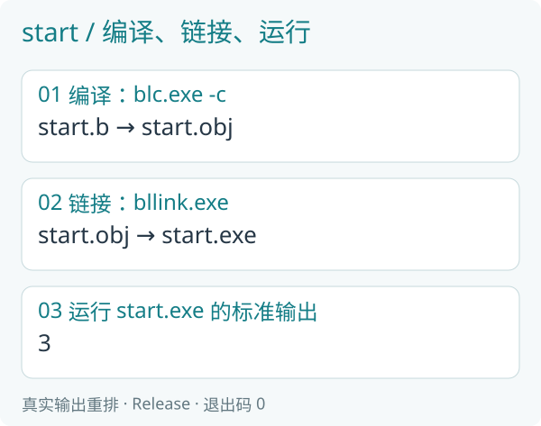

*运行记录：Release 编译器生成 obj，链接器生成 exe 后直接执行，正常退出码为零；图中输出取自该 exe 的标准输出。*

终端直接显示三。这里不需要准备输入数据文件，也不需要再读取输出文件。生成的 `target/start.exe` 可以直接启动；运行它不需要 B 源码、blc 或 blrun 留在旁边。

### 2.3 文件外面的几行分别是什么

`module beginner.start;` 给这组文件一个完整名字，两个文件写相同名字。`.h` 中的 `u32 main() on cpu;` 是声明，只列出入口。`.b` 中同一行后面跟大括号，括号里才是具体指令。

分号表示一条指令结束。大括号把相关指令放在一起。main 从上向下执行，遇到 return 结束。

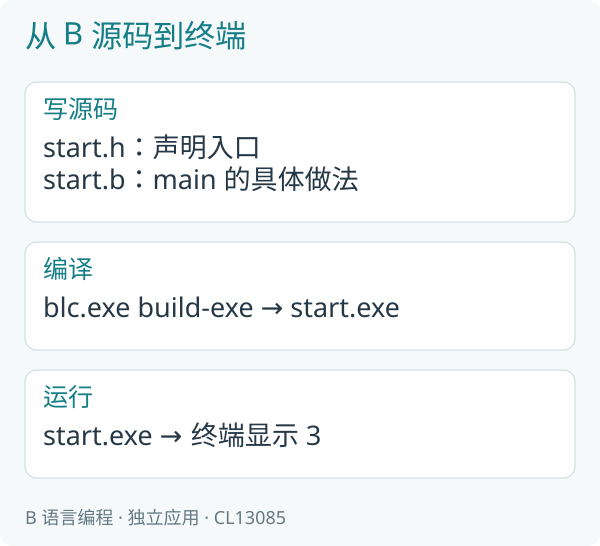

*图 2-1：先编译得到 obj，再链接得到 exe，最后由操作系统启动它。println 把计算结果直接送到终端。*

### 2.4 亲手改一次

把 `1 + 2` 改为 `4 + 5`，保存 `.b`，重新执行编译和链接命令，再运行 exe，终端应显示九。`.h` 不需要改变。

## 第三章 给数字起名字

### 3.1 把积分变化写清楚

原有十分，增加三分，再翻一倍。变量给中间结果起名字，便于理解每一步。

```b
module beginner.names;

u32 main() on cpu {
    u32 total = 10;
    let bonus = 3;
    total += bonus;
    total *= 2;
    println(total);
    return 0;
}
```

编译、链接并运行：

```powershell
.\target\release\blc.exe -c `
    sample/beginner/names.b `
    -o target/names.obj
.\target\release\bllink.exe `
    target/names.obj `
    -o target/names.exe
.\target\names.exe
```

实际终端输出：

```text
26
```

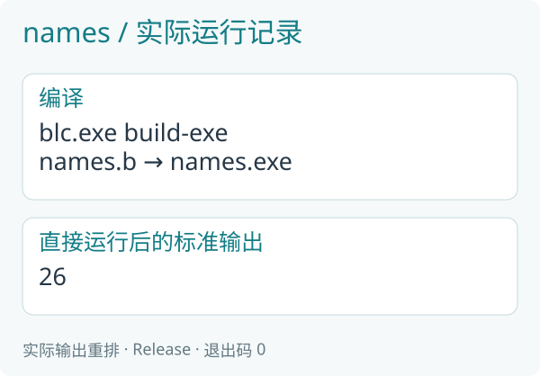

*运行记录：Release 编译器生成 obj，链接器生成 exe 后直接执行，正常退出码为零；图中输出取自该 exe 的标准输出。*

本章及后面的普通应用，`.h` 都采用第一例的形式：把 module 改为对应文件名，公开 `u32 main() on cpu;`。配套文件已经写好，可以直接打开阅读。

### 3.2 从左往右读声明

`u32 total = 10;` 表示用 total 保存一个整数，初值为十。`let bonus = 3;` 让编译器根据右边推断类型；这里的三是 u32。

let 不表示“以后永远不能改”。变量是否变化，要看后面的赋值。模块中固定的编译期值使用 const，第十二章再介绍。

### 3.3 赋值不是数学等式

`total = total + bonus;` 先读取旧值，相加，再把新值放回 total。写成 `total += bonus;` 含义相同。`*=、-=、/=` 分别表示相乘、相减、相除后放回原处。

| 执行到哪里 | total |
|---|---|
| 初值 | 10 |
| 加上 bonus | 13 |
| 乘二 | 26 |
| println | 显示 26，变量仍为 26 |

### 3.4 名字、注释与范围

名字可以使用英文字母、数字和下划线，不能以数字开头。total 和 Total 是两个名字。中文可以写在注释里：`// 增加积分`。注释解释做法，不参与计算。

变量通常只在声明它的那一对大括号内使用。先写入确定内容，再读取它；只声明 `u32 total;` 并没有提供一个可依赖的初值。

## 第四章 整数、小数和真假

### 4.1 先认识四种基本值

| 写法 | 保存什么 | 常见用途 |
|---|---|---|
| u32 | 不带负号的整数 | 数量、编号 |
| i32 | 可为负的整数 | 余额变化、偏移 |
| f32 | 带小数的数 | 距离、速度、温度 |
| bool | true 或 false | 一个条件是否成立 |

u32 的范围是零到 4294967295，i32 是 -2147483648 到 2147483647。超过范围的整数运算按当前三十二位规则处理，不能把它当成无限大的数学整数。f32 能表示很大和很小的数，但许多小数只能近似保存。

### 4.2 完整例子

```b
module beginner.types;

u32 main() on cpu {
    u32 count = 7 / 2;
    i32 change = -7 / 2;
    bool passed = 75 >= 60;
    f32 temperature = 21.5;
    println(count);
    println(change);
    println(passed);
    println(temperature);
    println(7.0 / 2.0);
    return 0;
}
```

编译、链接并运行：

```powershell
.\target\release\blc.exe -c `
    sample/beginner/types.b `
    -o target/types.obj
.\target\release\bllink.exe `
    target/types.obj `
    -o target/types.exe
.\target\types.exe
```

实际终端输出：

```text
3
-3
true
21.5
3.5
```

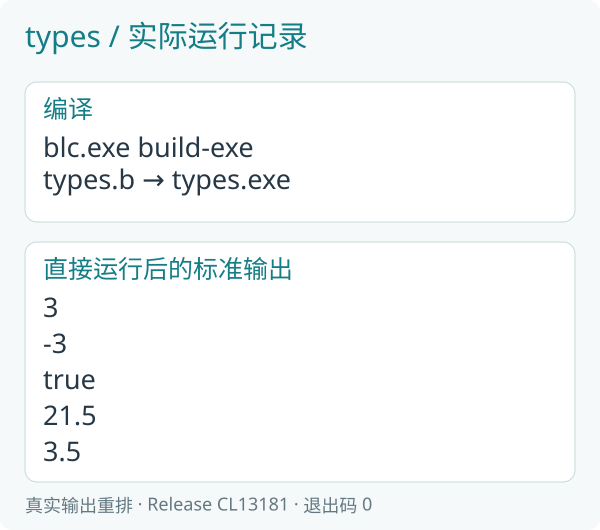

*运行记录：Release 编译器生成 obj，链接器生成 exe 后直接执行，正常退出码为零；图中输出取自该 exe 的标准输出。*

前两行是整数除法，分别得到三和负三；第三行说明七十五达到六十分。第四行直接显示温度 21.5，第五行显示小数除法的结果 3.5。

### 4.3 先转换，再相除

`7.0 / 2.0` 得到 f32 的 3.5。`7 / 2` 是整数除法，得到三；后来再转成 f32，只会得到 3.0。

```b
u32 count = 7;
f32 average = f32(count) / 2.0;
println(average);
```

这里先把七转成小数，再除以 2.0，average 得到 3.5，println 直接显示这个值。转换发生在除法之前，才不会先丢掉小数部分。

println 可以显示 u32、i32、f32 和 bool。f32 表示的是有限精度的小数；显示出更多数字不会让原来的近似值变成无限精度。后面的坐标计算也会直接显示分量。

### 4.4 常用运算符

| 写法 | 含义 | 例子 |
|---|---|---|
| +、-、*、/ | 加减乘除 | `3 * 4` 得到 12 |
| % | 整数余数 | `7 % 2` 得到 1 |
| ==、!= | 相等、不相等 | `3 == 3` 为 true |
| <、<=、>、>= | 大小比较 | `60 >= 60` 为 true |
| && | 两条件都成立 | `score >= 60 && score <= 100` |
| ! | 把真假反过来 | `!false` 为 true |

乘除先于加减；拿不准时用括号写清楚。单个等号用于赋值，两个等号用于判断相等。

&& 和 || 从左边开始判断。&& 左边为 false 时不再执行右边；|| 左边为 true 时不再执行右边。

## 第五章 遇到不同情况，做不同的事

### 5.1 用 if 写等级规则

九十分以上记三级，七十五分以上记二级，六十分以上记一级，其余记零级。

```b
module beginner.choice;

u32 main() on cpu {
    u32 score = 75;
    u32 level;
    if (score >= 90) {
        level = 3;
    } else if (score >= 75) {
        level = 2;
    } else if (score >= 60) {
        level = 1;
    } else {
        level = 0;
    }
    println(level);
    println(score >= 60);
    return 0;
}
```

编译、链接并运行：

```powershell
.\target\release\blc.exe -c `
    sample/beginner/choice.b `
    -o target/choice.obj
.\target\release\bllink.exe `
    target/choice.obj `
    -o target/choice.exe
.\target\choice.exe
```

实际终端输出：

```text
2
true
```

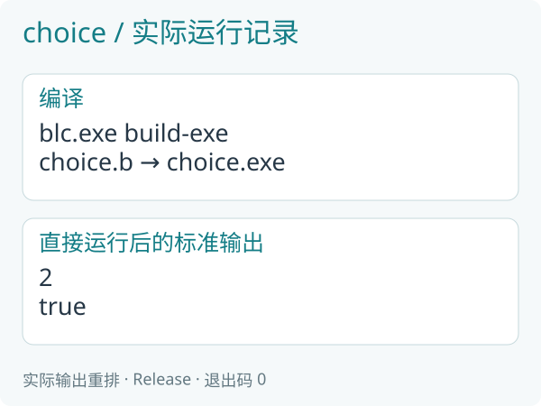

*运行记录：Release 编译器生成 obj，链接器生成 exe 后直接执行，正常退出码为零；图中输出取自该 exe 的标准输出。*

score 为七十五，第一项不成立，第二项成立，于是 level 取二。后面的 else if 不再继续选一遍。第一行输出等级二，第二行输出是否及格 true。

### 5.2 条件从上到下检查

如果把“六十分以上”放在第一项，七十五分会先被它选中，后面的二级就轮不到。先后次序来自规则本身。

`u32 level;` 在第一次读取之前，由各条分支确定写入。若有一条可能走到 println 的路径没有赋值，编译器会指出问题。应补齐真正的规则，而不是随意塞一个零掩盖遗漏。

### 5.3 很简单的二选一

```b
u32 bonus = score >= 60 ? 5 : 0;
```

条件成立取五，不成立取零。只选择其中一侧。分支里要做多件事时，继续使用普通 if 更清楚。

## 第六章 把同一件事重复几次

### 6.1 for 遍历一段范围

```b
u32 total = 0;
for (i in 1..6) {
    total += i;
}
```

`1..6` 从一开始，到六之前结束，依次是一、二、三、四、五。total 依次变为一、三、六、十、十五。

### 6.2 while 按条件继续

```b
u32 total = 0;
u32 i = 1;
while (i <= 5) {
    total += i;
    i += 1;
}
```

每次先判断，再进入正文。这里 i 每轮加一，最终条件不成立。忘记改变条件相关的值，可能让程序一直运行。

### 6.3 break 提前结束当前循环

遇到 break，离开这一层循环；它不结束整个 main。完整例子依次计算 for 求和、while 求和，以及遇到四就结束的求和：

```b
module beginner.loops;

u32 main() on cpu {
    u32 total = 0;
    for (i in 1..6) {
        total += i;
    }
    println(total);
    total = 0;
    u32 i = 1;
    while (i <= 5) {
        total += i;
        i += 1;
    }
    println(total);
    total = 0;
    for (j in 1..6) {
        if (j == 4) {
            break;
        }
        total += j;
    }
    println(total);
    return 0;
}
```

编译、链接并运行：

```powershell
.\target\release\blc.exe -c `
    sample/beginner/loops.b `
    -o target/loops.obj
.\target\release\bllink.exe `
    target/loops.obj `
    -o target/loops.exe
.\target\loops.exe
```

实际终端输出：

```text
15
15
6
```

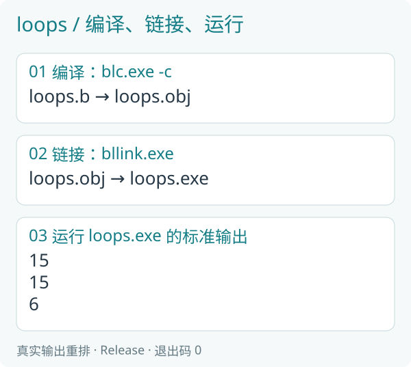

*运行记录：Release 编译器生成 obj，链接器生成 exe 后直接执行，正常退出码为零；图中输出取自该 exe 的标准输出。*

前两项都是十五；最后一项只加一、二、三，得到六。

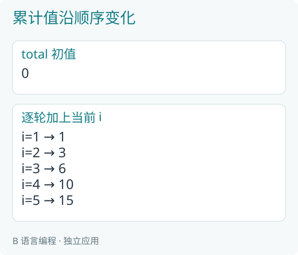

*图 6-1：每轮依赖上一轮的 total。之后学习并行时，会区分这种累计关系与互不依赖的逐项变换。*

## 第七章 给一段做法起名字

### 7.1 输入、返回值和调用

函数把一段做法单独命名。`add_bonus` 接收成绩与奖励分，交回新成绩；`level_of` 接收成绩，交回等级。

```b
module beginner.functions;

u32 add_bonus(u32 score, u32 bonus) on compute {
    return score + bonus;
}

u32 level_of(u32 score) on compute {
    if (score >= 90) { return 3; }
    if (score >= 75) { return 2; }
    if (score >= 60) { return 1; }
    return 0;
}

u32 main() on cpu {
    u32 score = add_bonus(70, 5);
    println(score);
    println(level_of(score));
    return 0;
}
```

编译、链接并运行：

```powershell
.\target\release\blc.exe -c `
    sample/beginner/functions.b `
    -o target/functions.obj
.\target\release\bllink.exe `
    target/functions.obj `
    -o target/functions.exe
.\target\functions.exe
```

实际终端输出：

```text
75
2
```

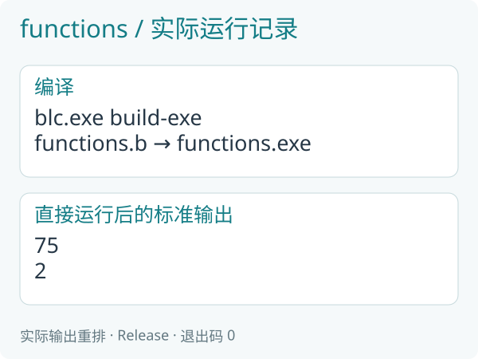

*运行记录：Release 编译器生成 obj，链接器生成 exe 后直接执行，正常退出码为零；图中输出取自该 exe 的标准输出。*

`add_bonus(70, 5)` 得到七十五，再交给 level_of 得到二。参数按声明顺序对应。函数中的 score 是这次调用收到的值，不因名字相同就自动改写 main 里的变量。

### 7.2 return 结束当前函数

level_of 一旦找到符合的等级，就 return。后续分支不会再执行。回到 main 后，main 继续执行它自己的下一条语句。

普通函数的 on compute 表示它的纯计算可用于相应 CPU/GPU 计算；main 的 on cpu 表明应用入口在 CPU。println 需要 CPU 输出能力，不能任意搬进 GPU 函数。

### 7.3 把表达式分成能看懂的步骤

```b
u32 adjusted = add_bonus(70, 5);
u32 level = level_of(adjusted);
println(level);
```

这与把调用嵌套起来的计算相同，但先看清中间结果，再决定是否缩成一行。简洁的目的是去掉多余工作，名字应帮助读者理解。

## 第八章 返回一个值，或修改一个位置

### 8.1 void 表示不交回普通结果

有的函数直接完成修改，不必再返回同一个数字。void 表示它没有普通返回值，inout 表示借来一个可读也可改的位置。

```b
module beginner.borrow;

void add_one(inout u32 value) on compute {
    value += 1;
}

void twice(u32 value, write u32 output) on compute {
    output = value * 2;
}

u32 main() on cpu {
    u32 value = 3;
    add_one(value);
    u32 output;
    twice(value, output);
    println(value);
    println(output);
    return 0;
}
```

编译、链接并运行：

```powershell
.\target\release\blc.exe -c `
    sample/beginner/borrow.b `
    -o target/borrow.obj
.\target\release\bllink.exe `
    target/borrow.obj `
    -o target/borrow.exe
.\target\borrow.exe
```

实际终端输出：

```text
4
8
```

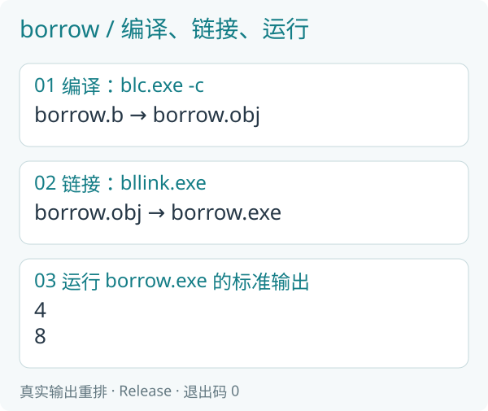

*运行记录：Release 编译器生成 obj，链接器生成 exe 后直接执行，正常退出码为零；图中输出取自该 exe 的标准输出。*

add_one 把 main 的 value 从三改成四。twice 读取四，把八写入 output。两行分别显示四、八。

### 8.2 write 与 inout

inout 会读取并更新原内容；write 负责填写输出，调用前不要求 output 已经有可读值。它们描述函数对这个实际位置做什么。

返回值适合“计算一个新值”；修改参数适合“把结果写到明确位置”。不要为了使用一种新语法，让所有普通加法都增加一个输出参数。

### 8.3 同一个位置不能被当成两份独占输出

同一次调用里，write/inout 的位置应互不重叠。一个完整记录与它的某个字段也可能重叠。先读懂位置关系，再使用借用；不必为简单函数手写指针。

## 第九章 把相关内容放在一起

### 9.1 一个学生有成绩，也有是否及格

Student 把这两项内容放成一个记录。`.h` 中写清字段与公开入口：

```b
module beginner.records;

struct Student {
    u32 score;
    bool passed;
};

u32 main() on cpu;
```

实现如下：

```b
module beginner.records;

u32 main() on cpu {
    Student student;
    student.score = 75;
    student.passed = student.score >= 60;
    println(student.score);
    println(student.passed);
    return 0;
}
```

编译、链接并运行：

```powershell
.\target\release\blc.exe -c `
    sample/beginner/records.b `
    -o target/records.obj
.\target\release\bllink.exe `
    target/records.obj `
    -o target/records.exe
.\target\records.exe
```

实际终端输出：

```text
75
true
```

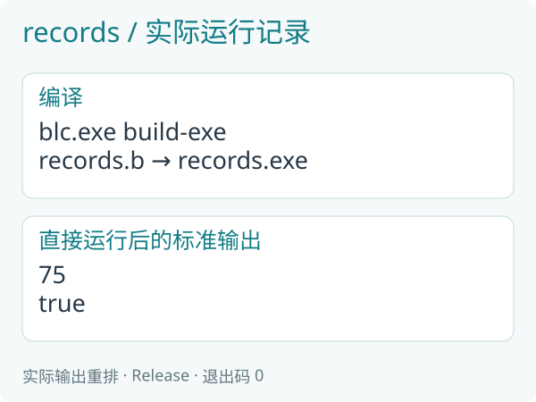

*运行记录：Release 编译器生成 obj，链接器生成 exe 后直接执行，正常退出码为零；图中输出取自该 exe 的标准输出。*

点号选择一项字段，`student.score` 是成绩，`student.passed` 是判断结果。每一项在读取前都应有确定内容。

### 9.2 结构体帮助表达一件完整的事

若把成绩与及格标志拆成两个无关变量，数据多起来以后容易弄错对应。记录让它们的关系留在类型中。

字段的名字应说明业务含义，不必在初学时研究内部字节偏移。与 C/C++ 或 Rust 交换记录时，再按照编译器生成的布局和接口处理。

## 第十章 几个同类的值，放进固定数组

### 10.1 先写清个数

`array<u32,4>` 表示四个 u32。这个个数是数组类型的一部分；`array<u32,4>(1,2,3,4)` 给四项初值。

```b
module beginner.arrays;

u32 main() on cpu {
    array<u32, 4> values = array<u32, 4>(1, 2, 3, 4);
    u32 total = 0;
    for (i in 0..values.length) {
        println(values[i]);
        total += values[i];
    }
    println(total);
    return 0;
}
```

编译、链接并运行：

```powershell
.\target\release\blc.exe -c `
    sample/beginner/arrays.b `
    -o target/arrays.obj
.\target\release\bllink.exe `
    target/arrays.obj `
    -o target/arrays.exe
.\target\arrays.exe
```

实际终端输出：

```text
1
2
3
4
10
```

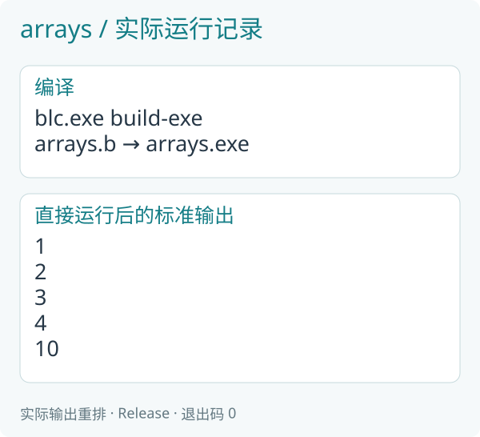

*运行记录：Release 编译器生成 obj，链接器生成 exe 后直接执行，正常退出码为零；图中输出取自该 exe 的标准输出。*

前四行分别显示数组元素，最后一行显示总和十。这里是一个独立 exe，数组由应用代码直接声明，不是命令行另外申请的数据集。

### 10.2 下标从零开始

四项的下标是零、一、二、三。`values[0]` 是第一项，`values[3]` 是最后一项，四不是有效下标。

`values.length` 给出个数。`0..values.length` 恰好遍历全部有效下标，不包含 length 本身。它同时把范围写给人和编译器看。

### 10.3 先理解固定，再认识动态

固定数组适合个数明确的小数据。第十五章会用 dataset 创建一份运行时给出长度的数据集合，并由应用自己组织并行计算。先掌握固定数组的下标与遍历，后面仍然会用到这些写法。

## 第十一章 用几个数表示坐标

### 11.1 float2 是两个小数一起使用

`float2(1.0,2.0)` 可以表示二维位置，x 是一，y 是二。速度 `float2(0.0,2.0)` 表示 x 不变、y 每单位时间增加二。经过半单位时间，新位置为 `(1.0,3.0)`。

### 11.2 按分量计算，矩阵表达变换

```b
float2 moved = position + speed * 0.5;
```

乘法先把速度两个分量都乘半，再分别加到 position。矩阵 `float2x2(0.0,-1.0,1.0,0.0)` 则把 `(x,y)` 变成 `(-y,x)`；`(1.0,2.0)` 旋转后是 `(-2.0,1.0)`。

### 11.3 编译并执行

```b
module beginner.vectors;

u32 main() on cpu {
    float2 position = float2(1.0, 2.0);
    float2 speed = float2(0.0, 2.0);
    float2 moved = position + speed * 0.5;
    println(moved.x);
    println(moved.y);
    float2x2 turn = float2x2(0.0, -1.0, 1.0, 0.0);
    float2 rotated = turn * position;
    println(rotated.x);
    println(rotated.y);
    return 0;
}
```

编译、链接并运行：

```powershell
.\target\release\blc.exe -c `
    sample/beginner/vectors.b `
    -o target/vectors.obj
.\target\release\bllink.exe `
    target/vectors.obj `
    -o target/vectors.exe
.\target\vectors.exe
```

实际终端输出：

```text
1
3
-2
1
```

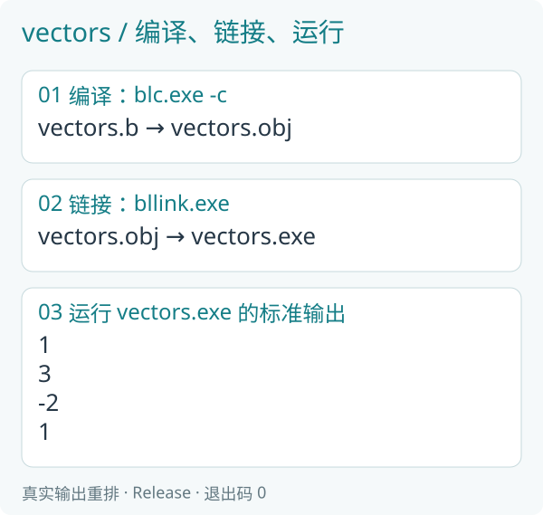

*运行记录：Release 编译器生成 obj，链接器生成 exe 后直接执行，正常退出码为零；图中输出取自该 exe 的标准输出。*

前两行是 moved 的 x、y：一、三。后两行是 rotated 的 x、y：负二、一。它们分别对应移动和旋转得到的两个坐标。

println 每次显示一个数，所以先写 moved.x，再写 moved.y。显示为 1 的这一项仍是 f32。小数部分为零时，显示可以省去小数点和后面的零。

沿移动过程手算：速度乘半得到 `(0.0,1.0)`，再加起点 `(1.0,2.0)`，得到 `(1.0,3.0)`。旋转使用原来的 position，把 x、y 换成 -y、x，所以得到 `(-2.0,1.0)`。代码显示的值与这两条计算过程一致。

## 第十二章 常量与分开的文件

### 12.1 共用规则放在一个地方

`math.h` 声明固定的 Base 和 add_base；`math.b` 给出函数实现：

```b
module beginner.math;

const u32 Base = 10;
u32 add_base(u32 value) on compute;
```

```b
module beginner.math;

u32 add_base(u32 value) on compute {
    return value + Base;
}
```

const 定义编译时确定的值。这里 Base 为十，add_base 把收到的值加十。它与循环中不断变化的 total 承担不同工作。

### 12.2 导入模块

`modules.h`：

```b
module beginner.modules;

import beginner.math;

u32 main() on cpu;
```

`modules.b`：

```b
module beginner.modules;

u32 main() on cpu {
    println(add_base(3));
    return 0;
}
```

编译、链接并运行：

```powershell
.\target\release\blc.exe -c `
    sample/beginner/modules.b `
    -o target/modules.obj `
    -I sample
.\target\release\bllink.exe `
    target/modules.obj `
    -o target/modules.exe
.\target\modules.exe
```

实际终端输出：

```text
13
```

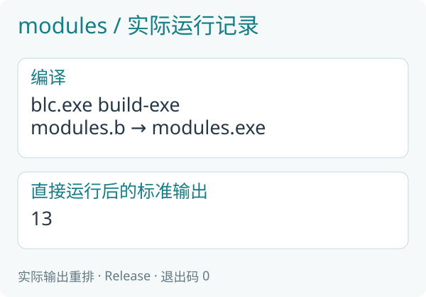

*运行记录：Release 编译器生成 obj，链接器生成 exe 后直接执行，正常退出码为零；图中输出取自该 exe 的标准输出。*

import 让本模块明确使用 beginner.math 的公开内容。这里的编译命令末尾增加 `sample`，告诉编译器从哪里寻找 `beginner/math.h/.b`；它是模块搜索根目录。第一例没有导入，无需这个参数。

### 12.3 改规则，不复制规则

把 Base 改为二十并重新编译、链接，结果会成为二十三。多个程序使用同一函数时，也在这个模块中维护共同做法，不必在各文件复制一份。

## 第十三章 同一份做法，换一种类型

### 13.1 先理解普通版本

```b
u32 twice(u32 value) on compute {
    return value * 2;
}
```

它把一个 u32 翻倍。若 i32 也做相同计算，可以用类型参数表示这一共同做法：

```b
module beginner.generic;

T twice<T: integer>(T value) on compute {
    return value * 2;
}

u32 main() on cpu {
    println(twice(3));
    println(twice(-2));
    return 0;
}
```

编译、链接并运行：

```powershell
.\target\release\blc.exe -c `
    sample/beginner/generic.b `
    -o target/generic.obj
.\target\release\bllink.exe `
    target/generic.obj `
    -o target/generic.exe
.\target\generic.exe
```

实际终端输出：

```text
6
-4
```

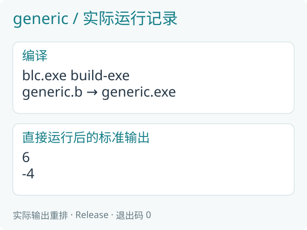

*运行记录：Release 编译器生成 obj，链接器生成 exe 后直接执行，正常退出码为零；图中输出取自该 exe 的标准输出。*

T 是暂时使用的类型名，integer 规定它来自允许的整数类型集合。本例传三时推断为 u32，传负二时推断为 i32，分别得到六和负四。

### 13.2 泛型不是省掉所有类型规则

输入类型确定以后，返回类型也是同一个 T。不能给任意不相容类型强行套用这个函数。

需要浮点版本时，已有 floating 类型集合可用于适合的算法。先能读懂“类型参数、允许集合、具体调用”这三件事，再学习更复杂的形式。

## 第十四章 完整应用：处理一组成绩

### 14.1 先把规则说清楚

四个成绩是四十五、六十、七十五、九十。每个加五分，最高一百分；六十分及格。显示原成绩、调整后成绩与是否及格，最后显示总和。

先手算：新成绩为五十、六十五、八十、九十五，总和二百九十。

### 14.2 完整文件

```b
module beginner.grades;

struct Result {
    u32 original;
    u32 adjusted;
    bool passed;
};

u32 main() on cpu;
```

```b
module beginner.grades;

u32 final_score(u32 score, u32 bonus) on compute {
    u32 adjusted = score + bonus;
    if (adjusted > 100) { return 100; }
    return adjusted;
}

u32 main() on cpu {
    array<u32, 4> originals = array<u32, 4>(45, 60, 75, 90);
    u32 total = 0;
    for (i in 0..originals.length) {
        Result result;
        result.original = originals[i];
        result.adjusted = final_score(result.original, 5);
        result.passed = result.adjusted >= 60;
        println(result.original);
        println(result.adjusted);
        println(result.passed);
        total += result.adjusted;
    }
    println(total);
    return 0;
}
```

final_score 只负责一人的调整。main 负责数组、循环、显示和求和。Result 把同一人的三项结果放在一起。

编译、链接并运行：

```powershell
.\target\release\blc.exe -c `
    sample/beginner/grades.b `
    -o target/grades.obj
.\target\release\bllink.exe `
    target/grades.obj `
    -o target/grades.exe
.\target\grades.exe
```

实际终端输出：

```text
45
50
false
60
65
true
75
80
true
90
95
true
290
```

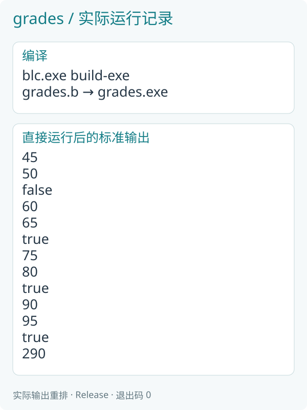

*运行记录：Release 编译器生成 obj，链接器生成 exe 后直接执行，正常退出码为零；图中输出取自该 exe 的标准输出。*

每三行是一人的原成绩、新成绩、及格标志；最后一行是总和。按记录整理如下，数值取自上面的实际终端输出：

| original | adjusted | passed |
|---|---|---|
| 45 | 50 | false |
| 60 | 65 | true |
| 75 | 80 | true |
| 90 | 95 | true |

### 14.3 现在已经能独立完成什么

这段程序只包含 B 源码。它有应用入口，保存自己的固定数据，调用函数，按规则修改记录，显示结果，再正常退出。

把奖励分改为十，重新编译、链接。新成绩应是五十五、七十、八十五、一百，总和三百一十。先预测，再运行，看每一步变化是否符合规则。

## 第十五章 从顺序程序走向并行数据

### 15.1 一排数据，由应用自己准备

上一章已经能处理四个人的成绩。现在先换成更容易手算的一排数字：准备四个位置，让第一个位置得到二，第二个得到四，后面依次是六和八。

第十章的 array 在类型里写明个数。dataset 则是一份由应用持有的数据集合，创建时给出长度：

```b
dataset<u32> numbers = dataset<u32>(4);
```

左边说明 numbers 保存 u32 元素，右边申请四个位置，初值都是零。numbers.length 是个数，numbers[0] 是第一个数。长度可以在运行时决定；这里先用四，方便逐项检查。

numbers 在当前作用域中只有一个所有者。离开它所在的作用域时，执行框架释放其存储，不需要自己写释放命令。后面把它交给 program，是暂时借它计算。

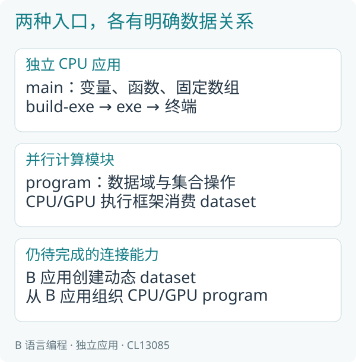

*图 15-1：main 准备数据、调用计算、显示结果；program 描述数据上的工作。两者都写在 B 源码里。*

### 15.2 先把顺序版本写出来

每个位置的计算相同：编号加一，再乘二。先用已经学过的 for。

`numbers_serial.h`：

```b
module beginner.numbers_serial;

u32 main() on cpu;
```

`numbers_serial.b`：

```b
module beginner.numbers_serial;

u32 main() on cpu {
    dataset<u32> numbers = dataset<u32>(4);
    for (i in 0..numbers.length) {
        u32 value = i + 1;
        numbers[i] = value * 2;
    }
    for (i in 0..numbers.length) {
        println(numbers[i]);
    }
    return 0;
}
```

第一个 for 计算，第二个 for 显示。i 是从零开始的编号；value 是编号加一后的数。

编译、链接并运行：

```powershell
.\target\release\blc.exe -c `
    sample/beginner/numbers_serial.b `
    -o target/numbers_serial.obj
.\target\release\bllink.exe `
    target/numbers_serial.obj `
    -o target/numbers_serial.exe
.\target\numbers_serial.exe
```

```text
2
4
6
8
```

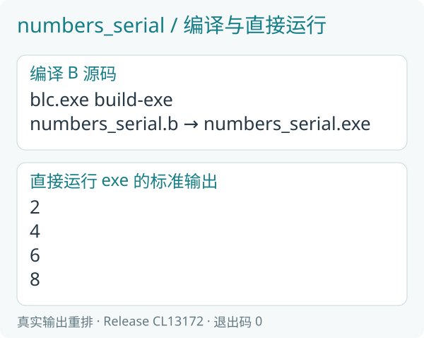

### 15.3 再写并行版本

算第二个位置不需要先得到第一个位置的结果。因此可以把“每个位置做什么”单独写成一个 program。

`numbers.h`：

```b
module beginner.numbers;

u32 main() on cpu;
program run(write dataset<u32> numbers) on compute;
```

`numbers.b`：

```b
module beginner.numbers;

u32 main() on cpu {
    dataset<u32> numbers = dataset<u32>(4);
    run_cpu(run(numbers));
    for (i in 0..numbers.length) {
        println(numbers[i]);
    }
    return 0;
}

program run(write dataset<u32> numbers) on compute {
    parallel (number in numbers) {
        u32 value = index() + 1;
        number = value * 2;
    }
}
```

main 仍然负责创建 numbers 和显示结果。原来的计算循环放进 run，使用 parallel 逐个描述元素的工作。run_cpu(run(numbers)) 表示在 CPU 上执行这次计算，完成后才继续显示。

对照计算部分：

| 顺序版本 | 并行版本 |
|---|---|
| i | index() |
| value = i + 1 | value = index() + 1 |
| numbers[i] = value * 2 | number = value * 2 |

number 直接表示当前可写的那个元素。value 仍是各自计算时使用的局部变量；每个元素都有自己的 value，彼此不会覆盖。

编译、链接并运行：

```powershell
.\target\release\blc.exe -c `
    sample/beginner/numbers.b `
    -o target/numbers.obj
.\target\release\bllink.exe `
    target/numbers.obj `
    -o target/numbers.exe
.\target\numbers.exe
```

```text
2
4
6
8
```

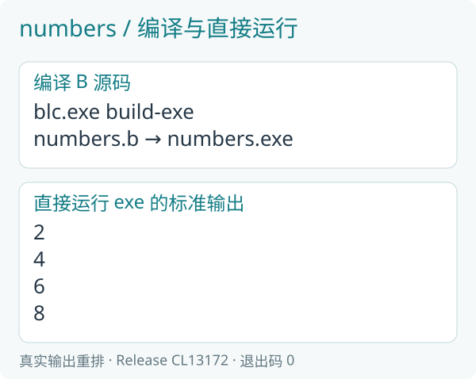

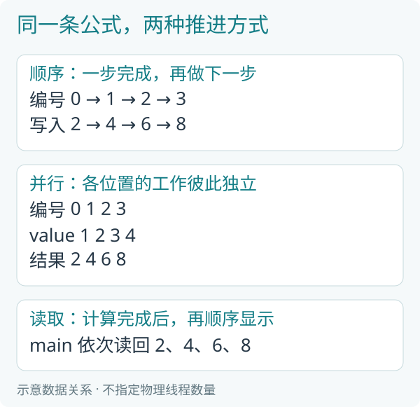

*图 15-2：顺序循环沿编号逐项推进；parallel 交出彼此独立的工作。结果位置相同，实际同时处理多少元素由设备与执行框架决定。*

### 15.4 为什么结果还能按顺序显示

并行工作可以按不同先后完成，但第零格始终写回第零格，第一格始终写回第一格。它们不需要争用同一个输出位置。

显示发生在计算完成之后，仍由 main 的 for 按编号进行。因此终端依次显示二、四、六、八。这里没有让并行参与者直接争着打印。

想处理六个数，把 main 中创建长度的四改成六，重新编译、链接即可。program 不需要修改，显示循环也会跟着 numbers.length 遍历，结果为二、四、六、八、十、十二。

### 15.5 编译后，目录里有什么

这些例子使用动态数据和计算执行框架。blc 先把应用和必要的执行框架编译进 obj；bllink 再生成 exe，并在同目录生成一个名称形如 blink_app_*.dll 的执行库。星号部分由链接器命名。

日常仍然直接运行 numbers.exe。把程序复制给另一台 Windows x64 电脑时，要把它对应的 DLL 一起放在同目录。运行不需要携带 B 源码、编译器或 Rust 工具链；构建这个源码 SDK 时需要的工具已在第一章准备。

不要只复制 exe 后丢掉它的执行库。第二章那样只计算普通值的程序可以只生成 exe，使用动态数据的本章则有上述配套文件。

### 15.6 先填数字，再改数字

再看一个有先后关系的计算：先生成一、二、三、四，再把每个数乘二加一。

`stages.h`：

```b
module beginner.stages;

u32 main() on cpu;
program seed(write dataset<u32> numbers) on compute;
program scale(inout dataset<u32> numbers) on compute;
program run(inout dataset<u32> numbers) on compute;
```

`stages.b`：

```b
module beginner.stages;

u32 main() on cpu {
    dataset<u32> numbers = dataset<u32>(4);
    run_cpu(run(numbers));
    for (i in 0..numbers.length) {
        println(numbers[i]);
    }
    return 0;
}

program seed(write dataset<u32> numbers) on compute {
    parallel (number in numbers) {
        number = index() + 1;
    }
}

program scale(inout dataset<u32> numbers) on compute {
    parallel (number in numbers) {
        number = number * 2 + 1;
    }
}

program run(inout dataset<u32> numbers) on compute {
    seed(numbers);
    scale(numbers);
}
```

seed 只负责填写起始值，参数写 write。scale 既要读取原值又要改写，参数写 inout。run 按顺序组合这两个步骤。

一个步骤内部，各元素独立计算；两个步骤之间，后一阶段需要前一阶段的结果。把这种先后关系写清楚，并行才有意义。

编译、链接并运行：

```powershell
.\target\release\blc.exe -c `
    sample/beginner/stages.b `
    -o target/stages.obj
.\target\release\bllink.exe `
    target/stages.obj `
    -o target/stages.exe
.\target\stages.exe
```

```text
3
5
7
9
```

例如第三格：seed 写入三，scale 读取三，算出三乘二加一，写回七。编译器可以在保持结果含义的前提下合并相邻的逐元素工作，减少中间读写；代码表达的先后关系不变。

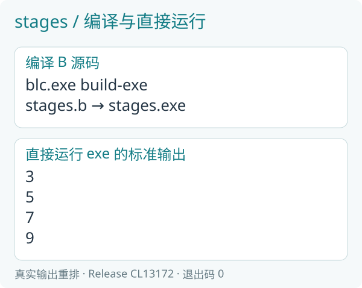

*运行图由正式版本的真实标准输出整理；终端结果直接来自应用。*

## 第十六章 一排数字一起求和

### 16.1 两个目标，先手算

这一章处理一、二、三、四，同时得到全部总和十，以及“每个位置前面各项的和”。

| 当前位置 | 当前数 | 前面各项之和 |
|---|---|---|
| 0 | 1 | 0 |
| 1 | 2 | 1 |
| 2 | 3 | 3 |
| 3 | 4 | 6 |

前面各项之和通常叫前缀和。本例不包括当前项，所以第一个位置是零，最后一个位置是前三项之和六。全部数字的总和叫归约结果。

### 16.2 先读顺序做法

假设 numbers、before 和 total 已经创建，并且 numbers 中保存一、二、三、四。顺序写法如下：

```b
u32 sum = 0;
for (i in 0..numbers.length) {
    before[i].value = sum;
    sum += numbers[i].value;
}
total[0].value = sum;
```

先把旧 sum 写到 before，再加入当前数。循环结束时，sum 才是全部总和。调换这两行顺序，就会得到包含当前项的另一种前缀和。

### 16.3 用集合操作表达同一目标

```b
scan_exclusive_sum(numbers.value,
                   before.value);
reduce_sum(numbers.value, total.value);
```

第一条得到前面各项之和，第二条得到全部总和。它们说明要什么结果，由编译器和执行框架组织具体步骤。

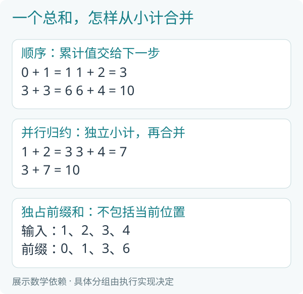

*图 16-1：顺序写法把累计值交给下一步；并行求和可先求各组小计，再合并。图中用四个数说明关系，不表示设备只有四个参与者。*

总和的合并方式不能直接照搬成每个位置的前缀和。扫描还要把前面各组的累计结果传到后面的组，才会得到零、一、三、六。

### 16.4 完整应用

当前集合操作用记录字段指出要计算的数字。Number 只有一个 value 字段，便于先把问题看清楚。

`totals.h`：

```b
module beginner.totals;

struct Number { u32 value; };
u32 main() on cpu;
program seed(write dataset<Number> numbers) on compute;
program summarize(read dataset<Number> numbers,
                  write dataset<Number> before,
                  write dataset<Number, 1> total) on compute;
program run(inout dataset<Number> numbers,
            write dataset<Number> before,
            write dataset<Number, 1> total) on compute;
```

`totals.b`：

```b
module beginner.totals;

u32 main() on cpu {
    dataset<Number> numbers = dataset<Number>(4);
    dataset<Number> before = dataset<Number>(4);
    dataset<Number, 1> total = dataset<Number>(1);
    run_cpu(run(numbers, before, total));
    for (i in 0..before.length) {
        println(before[i].value);
    }
    println(total[0].value);
    return 0;
}

program seed(write dataset<Number> numbers) on compute {
    parallel (number in numbers) {
        number.value = index() + 1;
    }
}

program summarize(read dataset<Number> numbers,
                  write dataset<Number> before,
                  write dataset<Number, 1> total) on compute {
    scan_exclusive_sum(numbers.value, before.value);
    reduce_sum(numbers.value, total.value);
}

program run(inout dataset<Number> numbers,
            write dataset<Number> before,
            write dataset<Number, 1> total) on compute {
    seed(numbers);
    summarize(numbers, before, total);
}
```

main 创建三份数据：numbers 保存输入，before 保存每个位置的前缀，total 只保存一个总和。dataset<Number, 1> 把“只有一条”也写进类型。

seed 填写输入；summarize 只读输入，填写两份结果；run 组织两步。计算完成后，main 读取 before 和 total，直接显示。

编译、链接并运行：

```powershell
.\target\release\blc.exe -c `
    sample/beginner/totals.b `
    -o target/totals.obj
.\target\release\bllink.exe `
    target/totals.obj `
    -o target/totals.exe
.\target\totals.exe
```

```text
0
1
3
6
10
```

前四行是 before，最后一行是总和。结果就保存在当前应用的 dataset 中，显示时直接访问这些字段。

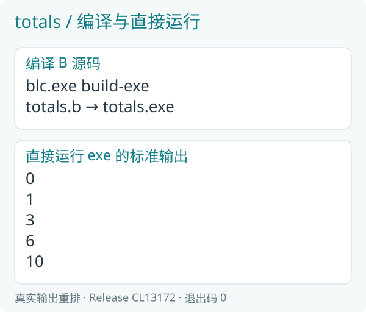

### 16.5 为什么不能大家随意加同一个变量

假设两份工作都读到 sum 为零，一份准备写一，另一份准备写二。后写入的值可能覆盖先写入的值，得到的不是三。

reduce_sum 表达“把全部数字按求和规则合并”，并没有让每个元素任意读写一个共享位置。先独立处理，再按明确规则汇总，是并行编程中很常用的思路。

## 第十七章 让同一个计算在 GPU 上运行

### 17.1 算法保留，执行位置写清楚

第十五章的 seed、scale、run 都写 on compute，允许在 CPU 或 GPU 上执行。现在继续使用原来的 stages 模块，另外写一个实际使用 GPU 的应用。

`stages_gpu.h`：

```b
module beginner.stages_gpu;

u32 main() on cpu;
```

`stages_gpu.b`：

```b
module beginner.stages_gpu;
import beginner.stages;

u32 main() on cpu {
    dataset<u32> numbers = dataset<u32>(4);
    upload(numbers);
    run_gpu(beginner.stages::run(numbers));
    download(numbers);
    for (i in 0..numbers.length) {
        println(numbers[i]);
    }
    return 0;
}
```

import 导入原来的计算。beginner.stages::run 指向那个模块的 run，所以 seed 和 scale 的算法一行也不用复制。

与 CPU 调用对照：

```b
// CPU：数据创建后就在 CPU 一侧。
run_cpu(run(numbers));

// GPU：先交给 GPU，执行后再交回 CPU。
upload(numbers);
run_gpu(beginner.stages::run(numbers));
download(numbers);
```

upload 将这份存储交给 GPU。run_gpu 提交计算。download 等待需要的 GPU 工作完成，把结果交回 CPU，后面的 for 才能读取并显示。

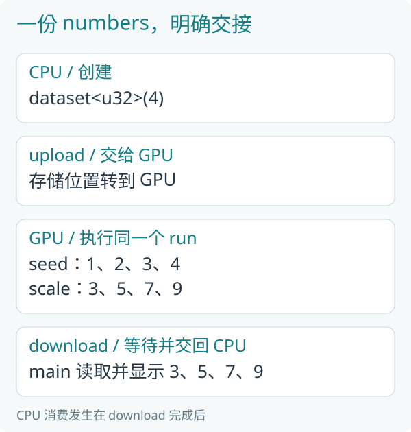

*图 17-1：同一份 numbers 的所有权与有效内容沿传输继续。GPU 内部仍先 seed、后 scale；CPU 在 download 完成后消费结果。*

### 17.2 编译与直接运行

```powershell
.\target\release\blc.exe -c `
    sample/beginner/stages_gpu.b `
    -o target/stages_gpu.obj `
    -I sample
.\target\release\bllink.exe `
    target/stages_gpu.obj `
    -o target/stages_gpu.exe
.\target\stages_gpu.exe
```

```text
3
5
7
9
```

命令末尾的 sample 是寻找 import 模块的根目录，第十二章已经用过。它是编译参数；运行生成的 exe 时不用再提供源码路径、数据长度或结果目录。

GPU 计算需要系统显卡驱动提供 Vulkan，编写本例无需安装 Vulkan SDK。部署时，exe 与编译器生成的对应 DLL 要放在一起。

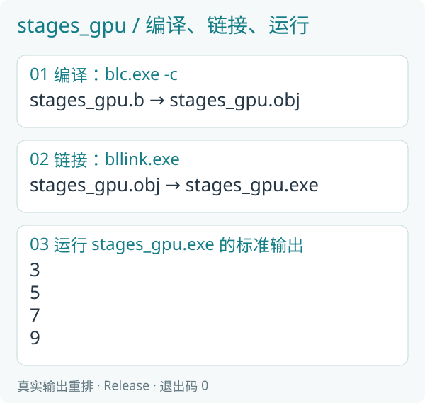

### 17.3 为什么 main 还是 on cpu

main 负责创建资源、发起计算、读取结果和标准输出。这些应用工作在 CPU 一侧进行。真正处理每个数字的是它调用的 GPU program。

| 声明 | 允许在哪里执行 |
|---|---|
| on compute | CPU 或 GPU，由调用位置选择 |
| on cpu | CPU |
| on gpu | GPU |

run_cpu 与 run_gpu 明确选择执行设备，传入数据要处在对应的存储位置。

### 17.4 几行代码背后的等待与释放

CPU 调用完成以后，后面的代码才能读取 CPU 结果。GPU 调用提交后，后续 GPU 步骤可以继续依赖同一份数据；需要 CPU 读取时，以 download 明确完成交接。

离开作用域会结束应用对资源的拥有。若 GPU 仍在使用，执行框架会保留物理存储到最后一次实际使用完成，不能因为 CPU 函数先返回就提前释放显存。

### 17.5 四个数能说明什么

四个数适合看清源码和核对结果，不能用于证明 GPU 更快。设备准备、数据传输和计算都需要时间，小输入可能主要花在准备工作上。

选择并行计算要看数据之间是否独立、规模是否足够大，以及传输成本能否由计算收益覆盖。本书先把语言写法学会；《并行编程的艺术》用一百万、一千万、一亿等规模进行真实 Release 效率对照，并说明每个计时范围。

## 第十八章 固定个数作为编译参数

### 18.1 把四作为一种明确约定

动态 dataset 的长度在创建时给出。某些算法还需要在编译时知道个数，例如固定大小的块、矩阵或一次固定形状的操作。这时可以把个数写成 const 参数。

`shape.h`：

```b
module beginner.shape;

u32 main() on cpu;
program run<const N: u32>(write dataset<u32, N> numbers) on compute;
```

`shape.b`：

```b
module beginner.shape;

u32 main() on cpu {
    dataset<u32, 4> numbers = dataset<u32>(4);
    run_cpu(run<4>(numbers));
    for (i in 0..numbers.length) {
        println(numbers[i]);
    }
    return 0;
}

program run<const N: u32>(write dataset<u32, N> numbers) on compute {
    parallel (number in numbers) {
        number = index() + 1;
    }
}
```

main 的 dataset<u32, 4> 声明固定四项。run<4>(numbers) 选择 N 等于四的计算实例。run 里面只写 N，一份做法就能用于不同的具体个数。

main 仍然是应用入口。尖括号写在 B 源码的调用处，命令行不需要再指定 program 的特殊入口。

### 18.2 编译并运行

```powershell
.\target\release\blc.exe -c `
    sample/beginner/shape.b `
    -o target/shape.obj
.\target\release\bllink.exe `
    target/shape.obj `
    -o target/shape.exe
.\target\shape.exe
```

```text
1
2
3
4
```

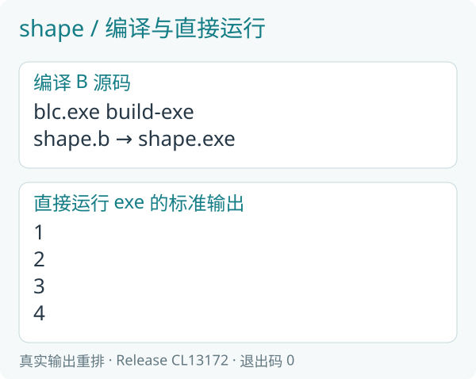

### 18.3 三处个数怎样对应

dataset<u32, 4> 是类型约定，dataset<u32>(4) 是实际申请个数，run<4> 是选择计算实例。这三处描述的是同一个固定形状，必须一致。

想改成六项，把这三处的四都改成六。显示循环仍沿 numbers.length，不需要手写六次 println。

只有算法确实需要固定形状时才引入这种写法。第十五章的普通逐元素计算只需要动态长度，保留 dataset<u32> 就足够。

## 第十九章 并行处理同一组成绩

### 19.1 规则与第十四章相同

准备四个成绩：四十五、六十、七十五、九十。每人加五分，最高记为一百分；达到六十分就及格。保存原成绩、新成绩和是否及格，最后求新成绩总和。

调整后应是五十、六十五、八十、九十五，总和二百九十。第一人不及格，其余三人及格。

第十四章的顺序应用叫 grades，这里的并行应用叫 scores。Result 的字段、final_score 的公式和及格规则都相同。

### 19.2 先看计算部分的对照

顺序版本对每个人计算后，继续更新 total：

```b
result.adjusted = final_score(result.original, 5);
result.passed = result.adjusted >= 60;
total += result.adjusted;
```

并行版本保持单人成绩计算，把汇总单独表达：

```b
parallel (result in results) {
    result.original = 45 + index() * 15;
    result.adjusted = final_score(result.original, bonus);
    result.passed = result.adjusted >= 60;
}
```

```b
reduce_sum(results.adjusted, total.value);
```

四个人各自计算自己的 Result，最后由求和操作汇总 adjusted。这里的 bonus 由 main 传入五。

### 19.3 完整 CPU 应用

`scores.h`：

```b
module beginner.scores;

struct Result {
    u32 original;
    u32 adjusted;
    bool passed;
};
struct Number { u32 value; };
u32 main() on cpu;
u32 final_score(u32 score, u32 bonus) on compute;
program fill(write dataset<Result> results, u32 bonus) on compute;
program sum(read dataset<Result> results,
            write dataset<Number, 1> total) on compute;
program run(inout dataset<Result> results,
            write dataset<Number, 1> total, u32 bonus) on compute;
```

`scores.b`：

```b
module beginner.scores;

u32 main() on cpu {
    dataset<Result> results = dataset<Result>(4);
    dataset<Number, 1> total = dataset<Number>(1);
    run_cpu(run(results, total, 5));
    for (i in 0..results.length) {
        println(results[i].original);
        println(results[i].adjusted);
        println(results[i].passed);
    }
    println(total[0].value);
    return 0;
}

u32 final_score(u32 score, u32 bonus) on compute {
    u32 adjusted = score + bonus;
    if (adjusted > 100) {
        return 100;
    }
    return adjusted;
}

program fill(write dataset<Result> results, u32 bonus) on compute {
    parallel (result in results) {
        result.original = 45 + index() * 15;
        result.adjusted = final_score(result.original, bonus);
        result.passed = result.adjusted >= 60;
    }
}

program sum(read dataset<Result> results,
            write dataset<Number, 1> total) on compute {
    reduce_sum(results.adjusted, total.value);
}

program run(inout dataset<Result> results,
            write dataset<Number, 1> total, u32 bonus) on compute {
    fill(results, bonus);
    sum(results, total);
}
```

main 创建四条 Result 和一条总和。fill 给每条成绩填写三个字段；sum 汇总结果；run 明确先填写、后求和。最后仍由 main 按顺序显示，便于逐行对照。

编译、链接并运行：

```powershell
.\target\release\blc.exe -c `
    sample/beginner/scores.b `
    -o target/scores.obj
.\target\release\bllink.exe `
    target/scores.obj `
    -o target/scores.exe
.\target\scores.exe
```

```text
45
50
false
60
65
true
75
80
true
90
95
true
290
```

每三行是一人的原成绩、新成绩、及格标志，最后一行是总和。与第十四章的完整输出相同。

| original | adjusted | passed |
|---|---|---|
| 45 | 50 | false |
| 60 | 65 | true |
| 75 | 80 | true |
| 90 | 95 | true |

### 19.4 同一算法的 GPU 应用

成绩规则仍放在 scores 模块。GPU 应用只负责创建数据、选择设备和消费结果。

`scores_gpu.h`：

```b
module beginner.scores_gpu;

u32 main() on cpu;
```

`scores_gpu.b`：

```b
module beginner.scores_gpu;
import beginner.scores;

u32 main() on cpu {
    dataset<Result> results = dataset<Result>(4);
    dataset<Number, 1> total = dataset<Number>(1);
    upload(results);
    upload(total);
    run_gpu(beginner.scores::run(results, total, 5));
    download(results);
    download(total);
    for (i in 0..results.length) {
        println(results[i].original);
        println(results[i].adjusted);
        println(results[i].passed);
    }
    println(total[0].value);
    return 0;
}
```

results 和 total 都交给 GPU，因为计算既要写成绩，也要写总和。两份结果交回 CPU 以后，显示代码与 CPU 应用一致。

编译、链接并运行：

```powershell
.\target\release\blc.exe -c `
    sample/beginner/scores_gpu.b `
    -o target/scores_gpu.obj `
    -I sample
.\target\release\bllink.exe `
    target/scores_gpu.obj `
    -o target/scores_gpu.exe
.\target\scores_gpu.exe
```

终端完整输出与上面的 CPU 应用相同，最后得到二百九十。

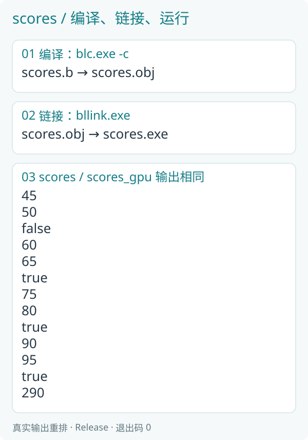

*实际标准输出按一人一行整理；每条完整记录和总和在 CPU、GPU 上一致。*

### 19.5 沿一条记录走到底

以第二个人为例：main 先创建存储；fill 根据编号一填写原成绩六十；final_score 得到六十五；比较得出 true；sum 把六十五计入总和；main 最后读取并显示这条记录。

CPU 与 GPU 的选择改变了执行位置和数据交接，成绩规则没有变化。处理完以后离开 main，应用创建的两份 dataset 按作用域释放。

把传入的奖励分改成十，重新编译、链接，调整后是五十五、七十、八十五、一百，总和三百一十。保留公式，改变参数，就能沿同一条数据路线理解新的结果。

## 第二十章 读懂错误，继续练习

### 20.1 先看第一个具体错误

检查错误给出的文件、行、列与说明。缺分号先补分号，括号不成对先找对应括号；不要因为后面也报错就一次重写全部代码。

命令找不到文件时，确认自己在 Blink 根目录。改过源码却看不到变化时，确认已经重新编译、链接刚才运行的 exe。

| 问题 | 先检查什么 |
|---|---|
| main 入口不匹配 | `.h/.b` 都公开无参数 u32/i32 main，显式 on cpu |
| 类型不一致 | 整数、小数之间是否需要明确转换 |
| 读取前没有内容 | 分支与各字段是否确实完成赋值 |
| 下标范围不明 | 固定下标或 `0..length` 是否表达了有效范围 |
| 模块找不到 | import、模块名与编译时搜索根目录 |
| println 拒绝参数 | 参数是否为 u32、i32、f32 或 bool 标量，调用是否在 CPU 上 |

### 20.2 容易混淆的几对写法

| 写法 | 分别做什么 |
|---|---|
| = 与 == | 写入新值；比较是否相等 |
| return 与 break | 结束当前函数；结束当前循环 |
| for 与 parallel | 明确的顺序重复；对数据域的独立工作 |
| array 与 dataset | 普通固定数组值；由应用拥有、可交给并行计算的数据集合 |
| let 与 const | 从初值推断局部类型；定义编译期值 |
| main 与 program | 普通应用入口；具有数据与执行目标的计算入口 |

### 20.3 输出、退出与错误

println 返回 bool：完整写出时为 true，写出失败时为 false。起步例子直接使用显示效果；需要把真实输出失败变成退出码时，可以写：

```b
if (!println(1 + 2)) {
    return 1;
}
return 0;
```

这段代码处理实际 I/O 结果，不会打印退出码。PowerShell 可在 exe 结束后通过 `$LASTEXITCODE` 查看退出码。

### 20.4 当前能力与后续学习

当前 Windows x64 独立应用支持普通函数、条件、顺序循环、记录、固定数组、向量和矩阵计算，支持应用拥有动态 dataset、调用 CPU／GPU program、显式传输和作用域释放。标准输出接受整数、小数和真假值。文本、键盘输入、文件、其他平台及更多资源类型仍在开发，完整状态以语言规范与问题列表为准。

C/C++ 与 Rust 可以继续作为同等正式的宿主，通过生成 DLL 或原生接口调用 B 计算。混合编程是项目可选择的整合方式，详见《Blink 和 Rust 混合编程》，不影响前面普通 B 应用的独立使用。

### 20.5 十个动手练习

1. 第一例显示八乘七的结果。
2. 积分初值二十，增加五，再减三。
3. 显示七除二的整数商，并解释 7.0/2.0 的值。
4. 依次显示一、四、九、十六。
5. 分别判断五十九、六十、六十一是否及格。
6. 用 for 和 while 各求一次一到五的和。
7. 给 Student 增加编号并显示。
8. 写一个 square 函数，显示七的平方。
9. 数组改为 `[2,4,6,8]`，显示总和。
10. 成绩奖励分改为十，预测每人记录与总和。

## 附录 A 数据、执行与部署

### A.1 两种借用，分别读懂

program 的 read 表示只读，write 表示填写，inout 表示读取后修改。第十六章的 summarize 只读 numbers，却能写 before 和 total；权限分别属于各份参数。

main 仍拥有它创建的 dataset。run_cpu 或 run_gpu 暂时借用这些资源完成程序，不会把同一份存储复制成第二个可写所有者。

### A.2 CPU 与 GPU 数据交接

dataset 创建后位于 CPU 一侧。CPU program 直接借用；GPU program 使用前写 upload，CPU 读取 GPU 结果前写 download。不要把“GPU 已提交”理解成“CPU 现在就能读结果”。

这些例子没有输入、输出数据文件参数。结果保存在应用自己的数据中，main 直接读取并显示；blrun 的文件读写工具继续可用于其他计算模块，不是本书应用的运行步骤。

### A.3 把程序交给别人

只使用普通值的起步应用可以只生成 exe。使用动态 dataset 或 program 的应用还会生成同目录的 blink_app_*.dll，部署时把对应文件一起复制。不要给 DLL 改名，exe 已记录它的实际名称。

使用 GPU 的电脑需要支持所需 Vulkan 能力的显卡驱动。当前这些独立应用的输出目标是 Windows x64，不把语言的发展目标写成所有平台已经可用。

## 附录 B 练习参考与源码索引

### B.1 前五题

前两题分别得到五十六、二十二。第三题整数商为三，小数除法得到 3.5，可直接用 println 显示。

第四题可使用顺序循环，循环中让 value 从一到四，显示 `value * value`。第五题比较 `score >= 60`，依次得到 false、true、true。

### B.2 后五题

第六题两种求和都得到十五。第七题在 `.h` 的 Student 中增加 `u32 id;`，使用前明确填写并显示它。第八题函数主体返回 `value * value`，七的平方为四十九。

第九题总和二十。第十题调整后成绩为五十五、七十、八十五、一百，总和三百一十。

### B.3 独立应用索引

| 文件 | 内容 |
|---|---|
| `start.h / start.b` | 第一个程序，直接显示 3 |
| `names.h / names.b` | 变量、let 和赋值 |
| `types.h / types.b` | 整数、负数、真假与小数输出 |
| `choice.h / choice.b` | if 与等级判断 |
| `loops.h / loops.b` | for、while 和 break |
| `functions.h / functions.b` | 函数与提前返回 |
| `borrow.h / borrow.b` | void、inout 和 write |
| `records.h / records.b` | 结构体与字段 |
| `arrays.h / arrays.b` | 固定数组和遍历 |
| `vectors.h / vectors.b` | 坐标与矩阵计算 |
| `modules.h / modules.b` | 导入公共函数 |
| `generic.h / generic.b` | 整数类型参数 |
| `grades.h / grades.b` | 完整成绩处理应用 |

### B.4 并行例子与下一步

并行应用包括 `numbers`、`stages`、`totals`、`shape` 和 `scores`，每个模块同时公开自己的 main 与计算 program。`numbers_serial` 提供简单的顺序对照；`stages_gpu` 和 `scores_gpu` 导入原计算模块，由自己的 main 明确组织 GPU 传输、执行与显示。各例都先由 blc 编译为 obj，再由 bllink 链接为 exe，最后直接运行。

下一步可以阅读《并行编程的艺术》，学习更大规模的数据关系与真实效率；阅读《Blink 和 Rust 混合编程》，学习把 B 算法接入项目；对实现感兴趣时，再阅读《B 语言源码分析》。
