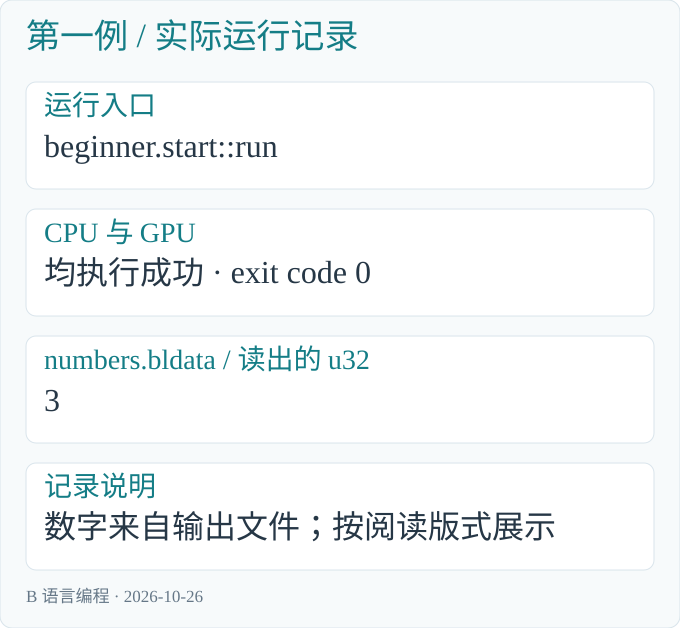
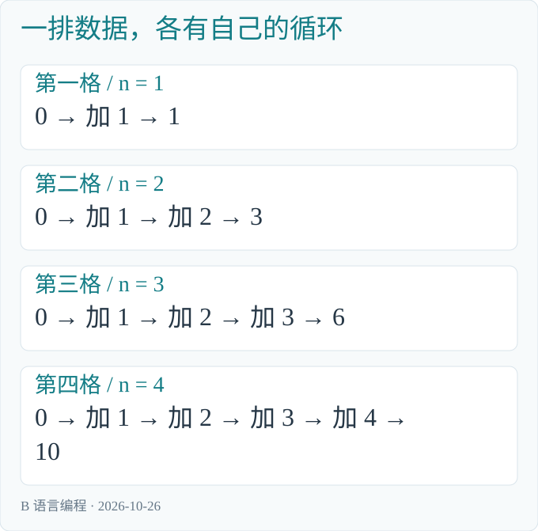

# B 语言编程

## 从第一个数字开始，学会 Blink

这是一本从零开始的语法入门书。你可以还不会 C、C++ 或 Rust；只要愿意把一小段代码输入电脑，看看结果，再改一改，就能开始。

Blink 语言简称 B 语言。本书从数字、名字和几条简单指令讲起，再逐步学习判断、重复、函数，以及怎样让一排数据各自计算。每遇到一种新写法，先看它要解决什么问题，再解释代码。

B 也寓意 Base。Blink 希望成为 AI 超算时代的基础语言。对初学者来说，起点很具体：先把一件小事写清楚，再让许多件小事有条理地一起完成。

本书可以独立阅读。它不要求先读《并行编程的艺术》，也不要求准备 BLEngine 工程。全部例子都在 Blink 源码仓库的 `sample/beginner` 目录中。

[Blink 开源项目与下载地址](https://github.com/sgua83/Blink)

### 怎样读这本书

第一次阅读时，按顺序读到第九章。你会认识程序的基本形状，也能自己改数字、写判断、写循环和调用函数。随后学习数组、向量、模块和多步计算。第十七章把这些知识连成一个完整小程序。

每章的代码都来自配套源码。命令在 Blink 项目根目录执行，直接写出所用的 exe 和 B 文件。行尾的反引号（`）表示命令在下一行继续；复制命令块的全部行即可执行。

书中的结果来自实际运行，[配套记录](beginner/运行记录.md)保存了命令、文件哈希和读数。blrun 将计算结果保存在数据文件中；结果框和图表把文件里的数字排出来，便于阅读。想在自己的电脑上读取数字，可以使用附录 A 给出的 PowerShell 命令。

版本：2026 年 10 月 26 日，基于 Blink v0.1 当前实现。正文以已经支持的写法为准，尚未提供的能力会在相应位置说明。

## 1　先把 Blink 准备好

### 1.1　我们需要什么

本书的动手环境是 Windows x64。先准备以下三样工具：

1. [Git for Windows](https://git-scm.com/install/windows)：用来下载 Blink 源码，选择 x64 安装包。
2. [Visual Studio C++ Build Tools](https://visualstudio.microsoft.com/visual-cpp-build-tools/)：安装时选择“使用 C++ 的桌面开发”，包含 x64 C++ 工具和 Windows SDK。已经安装这些组件的 Visual Studio 也可以使用。
3. [Rust](https://rust-lang.org/tools/install/)：下载 Windows x64 安装程序，使用 MSVC 工具链。

Rust 和 C++ 工具用来构建 Blink 自己的工具。安装好以后，日常示例直接运行 blrun.exe。你不需要先学习 Rust 或 C++，就能跟着本书编写 B 程序。

### 1.2　下载源码

从开始菜单打开 Visual Studio 的 Developer PowerShell，使用 x64 开发环境。先进入自己希望保存项目的文件夹，然后执行：

```powershell
git clone `
    https://github.com/sgua83/Blink.git
Set-Location Blink
```

第一条命令会下载项目，得到一个叫 Blink 的目录。第二条命令进入这个目录。后面的命令都在这里执行。

目录可以放在自己的数据盘上。命令中出现的 `sample`、`target`、`Saved`，都从这个项目目录开始寻找。

### 1.3　构建工具

```powershell
cargo build --workspace --release
```

这条命令把 Blink 的源码构建成可执行工具。第一次构建需要一些时间；成功后，可以在 `target/release` 目录中找到：

| 文件 | 用来做什么 |
|---|---|
| blrun.exe | 读取 B 源码，编译并运行 |
| blc.exe | 单独检查源码、导出代码，或生成 DLL |

本书主要使用 blrun.exe。`--release` 表示构建正式优化版本。以后只修改自己的 `.b` 和 `.h` 文件时，直接重新运行示例命令即可；blrun 会重新读取这些文件。

### 1.4　看一眼项目目录

```text
Blink/
    sample/
        beginner/     本书的例子
    target/
        release/      编译好的工具
    Saved/            运行后保存的结果
```

例子已经随源码下载。你可以先运行它们，也可以用文本编辑器打开文件，边看边改。自己新建文件时，使用 UTF-8 保存；在记事本中注意文件名应当是 start.b，避免多出一个 .txt。

## 2　第一个程序：算出 3

### 2.1　先看要做的事

让电脑计算 `1 + 2`，把结果放进一个格子。这个格子装的是一个整数。

完整例子由两个同名文件组成。`start.h` 写清程序叫什么、接收什么数据；`start.b` 写具体做法。

`sample/beginner/start.h`：

```c
module beginner.start;

program run(write dataset<u32> numbers) on compute;
```

`sample/beginner/start.b`：

```c
module beginner.start;

program run(write dataset<u32> numbers) on compute {
    parallel (number in numbers) {
        number = 1 + 2;
    }
}
```

先看中间最容易理解的一行：

```c
number = 1 + 2;
```

右边先算出 3，再放进左边的 number。行末的分号表示这条指令结束。

### 2.2　一条命令运行它

```powershell
.\target\release\blrun.exe cpu `
    sample/beginner/start.b run `
    sample Saved/Learn/start :1
```

这条命令的意思是：运行 blrun.exe，选择 CPU，打开 start.b，从 run 这段程序开始。`sample` 是寻找模块的根目录，`Saved/Learn/start` 是结果目录，`:1` 表示申请一个初始为零的格子。

运行结束后，结果目录中的 `numbers.bldata` 保存：

```text
3
```

命令行还会显示程序信息与运行时间。数字 3 存在结果文件中；附录 A.1 演示怎样读出它。先把“写入一条计算指令，再运行它”这个过程走通即可。



*运行记录：CPU 和 GPU 均成功执行；数字取自实际结果文件，按阅读版式展示。*

### 2.3　把外面的几层也读懂

`module beginner.start;` 给这组文件起一个完整名字。beginner 对应目录，start 对应文件名。同一组 `.h` 和 `.b` 写相同的模块名。

`program run(...)` 定义了一段可以从命令行启动的计算。run 是我们起的名字，命令里也要写 run。它不是必须采用的固定名字。

`dataset<u32> numbers` 表示一排装整数的格子，名字是 numbers。u32 的具体范围下一章会逐步说明；现在先把它理解成能装 0、1、2、3 这些数。

`write` 表示这段程序负责填写结果。`on compute` 表示这份计算可以交给 CPU 或 GPU 执行。

`parallel (number in numbers)` 表示对这排格子中的每一格，执行大括号里的做法。number 是当前这一格的名字。第一例只有一格，因此只需要填一次。

这些词共同交代了三件事：从哪里开始，数据在哪里，每一份数据要做什么。


*图 2-1　.h 列出清单，.b 给出做法，blrun 编译并执行，结果写入文件。*

### 2.4　亲手改一次

把 `.b` 中的 `1 + 2` 改为 `4 + 5`，保存后运行同一命令，结果应为 9；`.h` 不变。

## 3　给数字起名字

### 3.1　为什么要有变量

假设原来有 10 个积分，增加 3 个，再翻一倍。直接写 `(10 + 3) * 2` 可以算出结果；分开写，则能看清每一步。

`names.h` 仍然列出 run 和一排 u32 结果，只把模块名改为 beginner.names：

```c
module beginner.names;

program run(write dataset<u32> numbers) on compute;
```

`names.b`：

```c
module beginner.names;

program run(write dataset<u32> numbers) on compute {
    parallel (number in numbers) {
        u32 total = 10;
        let bonus = 3;
        total += bonus;
        total *= 2;
        number = total;
    }
}
```

运行：

```powershell
.\target\release\blrun.exe cpu `
    sample/beginner/names.b run `
    sample Saved/Learn/names :1
```

`numbers.bldata` 中的数字为 **26**。

### 3.2　从左往右读一行声明

```c
u32 total = 10;
```

u32 说明存什么样的数字，total 是名字，10 是开始时放进去的值。以后出现 total，指的就是这个变量当前保存的内容。

```c
let bonus = 3;
```

let 让编译器根据右边的值判断类型。这里的 3 是 u32，因此 bonus 也是 u32。let 本身不表示“永远不能改”；是否改写名字，要看后面的赋值语句。要定义模块中固定不变的值，可以使用第十二章的 const。

### 3.3　赋值不是数学等式

```c
total = total + bonus;
```

先取出原来的 total，与 bonus 相加，再把新结果放回 total。total 从 10 变为 13。

同一件事可以写短一些：

```c
total += bonus;
total *= 2;
```

第一行相加后放回原处，第二行相乘后放回原处。`-=` 和 `/=` 也有同样的读法。

| 执行到哪里 | total 的内容 |
|---|---|
| 刚声明 | 10 |
| 增加 bonus | 13 |
| 翻一倍 | 26 |

### 3.4　名字、注释与大括号

名字使用英文字母、数字和下划线，不能以数字开头。total、score、next_value 都是普通名字；Total 和 total 是两个不同名字。

注释是写给读代码的人看的说明：

```c
// 增加本次积分
total += bonus;

/* 接下来翻一倍 */
total *= 2;
```

中文可以写在注释中。代码里的括号、逗号和分号使用英文输入状态下的符号。

一对大括号包住一组指令。在大括号里面声明的局部名字，通常只在这层及其内部使用。缩进帮助人眼看清层次，真正划分范围的是大括号。

### 3.5　先写进去，再取出来

```c
u32 total;
total = 10;
```

这也能成立。第一行只准备一个位置，第二行才写入内容。第一行不会自动把 total 填成零，因此不要在赋值前读取它。

刚入门时，优先在声明变量时给初值。看到 `u32 total = 0;`，就能立刻知道后面的加法从哪里开始。

## 4　数字有几种写法

### 4.1　先记住四种

| 写法 | 保存什么 | 常见用途 |
|---|---|---|
| u32 | 从 0 开始的整数 | 数量、编号、循环计数 |
| i32 | 可以为负的整数 | 余额变化、整数偏移 |
| f32 | 带小数的数 | 距离、速度、比例 |
| bool | true 或 false | 某个条件是否成立 |

32 表示这些基本值使用 32 位。你暂时不必记住每一位怎样存储，先根据事情本身选择类型。

u32 的范围是 0 到 4294967295；i32 的范围是 -2147483648 到 2147483647。超过范围的整数运算会保留低 32 位，不能用它自动表示无限大的数。f32 能表示很大和很小的数，但小数常常只有近似值。

### 4.2　整数除法与小数除法

`types.h` 列出四个可运行入口：

```c
module beginner.types;

program integer(write dataset<u32> numbers) on compute;
program decimal(write dataset<f32> numbers) on compute;
program signed(write dataset<i32> numbers) on compute;
program flag(write dataset<bool> numbers) on compute;
```

`types.b` 的完整做法如下。四段程序都给一个格子填写结果：

```c
module beginner.types;

program integer(write dataset<u32> numbers) on compute {
    parallel (number in numbers) {
        number = 7 / 2;
    }
}

program decimal(write dataset<f32> numbers) on compute {
    parallel (number in numbers) {
        number = 7.0 / 2.0;
    }
}

program signed(write dataset<i32> numbers) on compute {
    parallel (number in numbers) {
        i32 balance = -7;
        number = balance / 2;
    }
}

program flag(write dataset<bool> numbers) on compute {
    parallel (number in numbers) {
        number = 7 > 2;
    }
}
```

先运行整数版本：

```powershell
.\target\release\blrun.exe cpu `
    sample/beginner/types.b integer `
    sample Saved/Learn/integer :1
```

结果是 **3**。7 除以 2，整数商为 3，小数部分不保留。

再运行小数版本：

```powershell
.\target\release\blrun.exe cpu `
    sample/beginner/types.b decimal `
    sample Saved/Learn/decimal :1
```

结果是 **3.5**。7.0 和 2.0 都是小数写法，因此进行 f32 除法。

### 4.3　负数和真假

```powershell
.\target\release\blrun.exe cpu `
    sample/beginner/types.b signed `
    sample Saved/Learn/signed :1
```

结果是 **-3**。整数 -7 除以 2，结果向零取整。

```powershell
.\target\release\blrun.exe cpu `
    sample/beginner/types.b flag `
    sample Saved/Learn/flag :1
```

结果为 **true**，因为 7 大于 2。bool 保存“是”或“否”，不把它当成积分或距离来计算。

### 4.4　常用运算符

| 写法 | 含义 | 例子 |
|---|---|---|
| +、-、*、/ | 加、减、乘、除 | `3 * 4` 为 12 |
| % | 整数除法的余数 | `7 % 2` 为 1 |
| ==、!= | 相等、不相等 | `3 == 3` 为 true |
| >、>=、<、<= | 大小比较 | `60 >= 60` 为 true |
| && | 两个条件都成立 | `score >= 60 && score <= 100` |
| ! | 把真假反过来 | `!false` 为 true |

乘除通常先于加减；不确定时用括号写清楚。`(1 + 2) * 3` 为 9，`1 + 2 * 3` 为 7。判断是否相等使用两个等号，单个等号用来赋值。

&& 和 || 都从左边开始判断。对于 &&，左边已经为 false 时，右边不再执行；对于 ||，左边已经为 true 时，右边不再执行。

### 4.5　需要时，明确转换

```c
u32 count = 7;
f32 average = f32(count) / 2.0;
```

f32(count) 先把整数 7 转成小数类型，再计算，average 得到 3.5。不要先做 `count / 2` 再转换；那样整数计算已经得到 3，后来转换只会得到 3.0。


## 5　从一个格子到一排数据

### 5.1　每格都有自己的编号

现在准备四格，想得到 `[2,4,6,8]`。做法是：当前格子的编号加一，再乘二。

`numbers.h`：

```c
module beginner.numbers;

program run(write dataset<u32> numbers) on compute;
```

`numbers.b`：

```c
module beginner.numbers;

program run(write dataset<u32> numbers) on compute {
    parallel (number in numbers) {
        u32 value = index() + 1;
        number = value * 2;
    }
}
```

运行：

```powershell
.\target\release\blrun.exe cpu `
    sample/beginner/numbers.b run `
    sample Saved/Learn/numbers :4
```

`numbers.bldata` 中保存 **[2,4,6,8]**。

index() 给出当前元素的编号。编号从 0 开始，所以四格的编号依次是 0、1、2、3。加一后得到 1、2、3、4，再乘二就是结果。


*图 5-1　每格按自己的编号计算，数字的位置保持不变。*

### 5.2　parallel 里面的变量属于谁

每一格执行同一段做法，但其中的 value 是各自的局部值。第一格的 value 是 1，第二格的是 2，彼此不会覆盖。

number 对应当前这一格，给 number 赋值会写回结果；value 是计算过程里临时起的名字。只修改 value，不会自动改变 number，最后需要明确写回。

把命令末尾的 `:4` 改成 `:6`，就会申请六格。程序不用修改，结果会成为 `[2,4,6,8,10,12]`。

### 5.3　结果顺序与执行先后

第一格的结果仍在第一格，第二格的结果仍在第二格。这个位置关系不要求它们按编号先后完成。

parallel 表达的是每份数据要做什么，以及这些工作可以分别进行。电脑实际同时处理多少份，要看执行设备与计算内容。

也因此，不要让一格去随意修改别人的结果。先掌握“各算各的、各写各的”，就能写出大量清楚的计算。

## 6　遇到不同情况，做不同的事

### 6.1　把判断写成 if

四个成绩是 45、60、75、90。我们给它们划分等级：90 及以上是 3，75 及以上是 2，60 及以上是 1，其他是 0。

`choice.h`：

```c
module beginner.choice;

program run(write dataset<u32> levels) on compute;
```

`choice.b`：

```c
module beginner.choice;

program run(write dataset<u32> levels) on compute {
    parallel (level in levels) {
        u32 score = 45 + index() * 15;
        if (score >= 90) {
            level = 3;
        } else if (score >= 75) {
            level = 2;
        } else if (score >= 60) {
            level = 1;
        } else {
            level = 0;
        }
    }
}
```

运行：

```powershell
.\target\release\blrun.exe cpu `
    sample/beginner/choice.b run `
    sample Saved/Learn/choice :4
```

`levels.bldata` 中保存 **[0,1,2,3]**。

### 6.2　条件从上往下检查

if 后的括号里必须是一个真假条件。条件成立，就执行它后面的大括号。

else if 表示前面不成立时，再检查这个条件；else 表示前面都不成立时，执行最后这份做法。整条 if/else if/else 链只选择其中一条路。

| score | 走哪一条路 | level |
|---|---|---|
| 45 | 所有条件都不成立 | 0 |
| 60 | 大于等于 60 | 1 |
| 75 | 大于等于 75 | 2 |
| 90 | 大于等于 90 | 3 |

先检查 90，再检查 75，最后检查 60。若把“60 及以上”放在最前面，90 也会先走这条路，后面的条件就没有机会决定等级。

### 6.3　保证每条路都有结果

本例使用 write，表示程序负责填写 level。45 分也必须得到一个明确等级，因此最后写了 else。

如果只写“及格时填 1”，没有说明不及格时填什么，那么输出可能没有完成。写判断时，可以顺着每条路走一遍，确认最后要用的值已经写好。

### 6.4　简单选择也可以写成一行

```c
u32 reward = score >= 60 ? 10 : 0;
```

从左往右读：score 是否至少为 60？是，就选 10；否，就选 0。条件后面的两个结果需要是相同类型。

这叫条件表达式，常用于两个简单值之间的选择。做法比较长时，继续使用 if/else，读起来更清楚。

## 7　把同一件事重复几次

### 7.1　for：按一段范围依次做

从 1 加到 n。n 为 4 时，需要计算 1+2+3+4，结果为 10。

关键部分是：

```c
u32 total = 0;
for (i in 1..n + 1) {
    total += i;
}
```

`1..n + 1` 从 1 开始，到 n+1 之前结束，因此最后一次的 i 是 n。范围包括左端，不包括右端。

当 n=4，i 依次是 1、2、3、4，total 依次变成 1、3、6、10。范围的终点在进入这次循环前确定；不要在循环里修改 n，并期待已经开始的范围跟着变化。

### 7.2　while：只要条件成立，就继续

同一个问题也可以写成：

```c
u32 i = 1;
u32 total = 0;
while (i <= n) {
    total += i;
    i += 1;
}
```

先检查 i 是否小于等于 n。成立就相加、再让 i 增加一，然后回去检查；不成立就结束循环。

`i += 1` 很重要。如果 i 始终不变，条件可能一直成立，程序就无法完成。while 让你决定什么时候结束，也要求你想清楚条件怎样发生变化。

### 7.3　break：提前结束当前循环

寻找第一个平方至少为 n 的正整数：

```c
u32 first = 0;
for (k in 1..10) {
    if (k * k >= n) {
        first = k;
        break;
    }
}
```

n=4 时，k=1 不够，k=2 正好满足。先保存 2，再通过 break 结束这个 for。break 只结束当前这层循环；外面的程序接着执行。

例子中的 n 只取 1 到 4，范围 1..10 足够覆盖这些输入。若改了问题的输入范围，也要重新考虑这段搜索范围。

### 7.4　完整源码与运行

`loops.h`：

```c
module beginner.loops;

program for_loop(write dataset<u32> numbers) on compute;
program while_loop(write dataset<u32> numbers) on compute;
program first_square(write dataset<u32> numbers) on compute;
```

`loops.b` 中的三段程序分别演示上述三种做法：

```c
module beginner.loops;

program for_loop(write dataset<u32> numbers) on compute {
    parallel (number in numbers) {
        u32 n = index() + 1;
        u32 total = 0;
        for (i in 1..n + 1) {
            total += i;
        }
        number = total;
    }
}

program while_loop(write dataset<u32> numbers) on compute {
    parallel (number in numbers) {
        u32 n = index() + 1;
        u32 i = 1;
        u32 total = 0;
        while (i <= n) {
            total += i;
            i += 1;
        }
        number = total;
    }
}

program first_square(write dataset<u32> numbers) on compute {
    parallel (number in numbers) {
        u32 n = index() + 1;
        u32 first = 0;
        for (k in 1..10) {
            if (k * k >= n) {
                first = k;
                break;
            }
        }
        number = first;
    }
}
```

先运行 for 版本：

```powershell
.\target\release\blrun.exe cpu `
    sample/beginner/loops.b for_loop `
    sample Saved/Learn/for :4
```

四格的 n 分别为 1、2、3、4，结果为 **[1,3,6,10]**。

运行 while 版本：

```powershell
.\target\release\blrun.exe cpu `
    sample/beginner/loops.b while_loop `
    sample Saved/Learn/while :4
```

结果同样为 **[1,3,6,10]**。

运行提前退出的搜索：

```powershell
.\target\release\blrun.exe cpu `
    sample/beginner/loops.b `
    first_square sample `
    Saved/Learn/first :4
```

结果为 **[1,2,2,2]**。

### 7.5　parallel 与 for 各管什么

外层 parallel 让四格各自计算。每格内部的 for 或 while 按自己的顺序推进：第一格加到 1，第四格加到 4。



*图 7-1　格子之间可以分别推进；每格内部的加法仍遵守循环先后。*

范围 for 的计数器由循环推进，正文不能自行改写它。当前 B 的自增写作 `i += 1`；本章用到的顺序循环和普通程序组合，足够表达这些计算。

## 8　把相关的内容放在一起

### 8.1　一名学生不止有一个数

现在既要保存成绩，又要保存是否及格。把这两项放在一起，可以声明一个 struct：

```c
struct Student {
    u32 score;
    bool passed;
};
```

Student 是新起的类型名。里面的 score 和 passed 是它的两个字段，也就是这份数据的两项内容。这里的结构体只负责组织数据。

### 8.2　用点号选中一项

```c
student.score = 75;
student.passed = student.score >= 60;
```

先把 score 写成 75，再读取它，判断是否及格。点号左边是具体这一名学生，右边是要访问的内容。

也可以按字段声明的顺序，一次构造完整值：

```c
Student student = Student(75, true);
```

构造时必须给出每个字段。复制整个 Student 值，会复制其中的成绩与真假值；单独修改某个字段，只改变那项内容。

### 8.3　一排学生

`records.h`：

```c
module beginner.records;

struct Student {
    u32 score;
    bool passed;
};
program run(write dataset<Student> students) on compute;
```

`records.b`：

```c
module beginner.records;

program run(write dataset<Student> students) on compute {
    parallel (student in students) {
        student.score = 45 + index() * 15;
        student.passed = student.score >= 60;
    }
}
```

运行：

```powershell
.\target\release\blrun.exe cpu `
    sample/beginner/records.b run `
    sample Saved/Learn/records :4
```

`students.bldata` 中的内容如下：

| score | passed |
|---|---|
| 45 | false |
| 60 | true |
| 75 | true |
| 90 | true |

dataset<Student> 表示一排学生记录。parallel 里的 student 是当前这一整条记录，可以修改自己的 score 和 passed。

使用 write 时，要把一条记录的各项结果都填好。填好 score 后可以读取它计算 passed；不能先读取尚未填入的字段。

## 9　把一段做法起个名字

### 9.1　函数接收什么，交回什么

“给成绩加上奖励分”在多处出现时，可以写成函数：

```c
u32 add_bonus(u32 score, u32 bonus)
    on compute {
    return score + bonus;
}
```

最前面的 u32 表示交回一个整数。add_bonus 是函数名，括号里列出需要的两个值。return 先计算后面的表达式，再把结果交回调用的地方。

```c
u32 adjusted = add_bonus(60, 5);
```

60 对应 score，5 对应 bonus，调用结果是 65，并被保存为 adjusted。参数按括号里的顺序对应。

### 9.2　返回值与修改原值

普通值参数可以理解成函数收到的一份值。调用 add_bonus(score,5)，不会自动把调用方的 score 改成新分数。

要保留新分数，可以明确写：

```c
score = add_bonus(score, 5);
```

右边的函数先完成，再把它交回的数字写到左边。这样一眼就能看出，score 在这行发生了变化。

### 9.3　return 可以提前结束函数

`functions.h`：

```c
module beginner.functions;

u32 add_bonus(u32 score, u32 bonus) on compute;
u32 level_of(u32 score) on compute;
program run(write dataset<u32> levels) on compute;
```

`functions.b`：

```c
module beginner.functions;

u32 add_bonus(u32 score, u32 bonus) on compute {
    return score + bonus;
}

u32 level_of(u32 score) on compute {
    if (score >= 90) {
        return 3;
    }
    if (score >= 75) {
        return 2;
    }
    if (score >= 60) {
        return 1;
    }
    return 0;
}

program run(write dataset<u32> levels) on compute {
    parallel (level in levels) {
        u32 score = 45 + index() * 15;
        level = level_of(add_bonus(score, 5));
    }
}
```

level_of 从高等级开始检查。一旦遇到 return，就交回当前等级，结束这次函数调用。最后一条 `return 0;` 负责所有未达到及格线的情况。

return 退出的是当前函数。外面的 parallel 还会继续完成它自己的工作；不要把 return 当成结束整排数据计算的命令。

运行完整入口：

```powershell
.\target\release\blrun.exe cpu `
    sample/beginner/functions.b run `
    sample Saved/Learn/functions :4
```

原成绩为 45、60、75、90，增加 5 分后为 50、65、80、95，等级仍是 **[0,1,2,3]**。

### 9.4　直接修改一个位置

有时候，我们就是希望函数修改调用方的某个变量。inout 表示“可以读取这里的原内容，也可以把新内容写回这里”：

```c
void add_one(inout u32 value)
    on compute {
    value += 1;
}
```

void 表示这次函数没有要通过 return 交回的数。它完成的事情，是把借给它的那个位置增加一。

```c
u32 value = 3;
add_one(value);
```

调用后 value 是 4。调用处不用再写 `value =`，因为函数直接修改了这个位置。

write 则表示“把这里作为输出位置来填写”，函数不能依赖它原来有什么内容：

```c
void twice(u32 value, write u32 output)
    on compute {
    output = value * 2;
}
```

### 9.5　把两种调用连起来

`borrow.h`：

```c
module beginner.borrow;

void add_one(inout u32 value) on compute;
void twice(u32 value, write u32 output) on compute;
program run(write dataset<u32> numbers) on compute;
```

`borrow.b`：

```c
module beginner.borrow;

void add_one(inout u32 value) on compute {
    value += 1;
}

void twice(u32 value, write u32 output) on compute {
    output = value * 2;
}

program run(write dataset<u32> numbers) on compute {
    parallel (number in numbers) {
        u32 value = index() + 1;
        add_one(value);
        twice(value, number);
    }
}
```

运行：

```powershell
.\target\release\blrun.exe cpu `
    sample/beginner/borrow.b run `
    sample Saved/Learn/borrow :4
```

四个值先从 1、2、3、4 各加一，再翻倍，结果为 **[4,6,8,10]**。

| 参数前的词 | 怎样理解 |
|---|---|
| 没有 read/write/inout 的普通值 | 把这个值交给函数计算 |
| inout | 读取并修改借来的位置 |
| write | 负责把借来的位置填写完整 |

一次调用不要把同一个位置同时当成两个可写参数。例如一个函数同时修改两个数，调用时应当交给它两个不重叠的位置。数据属于谁、谁在改动，保持清楚即可。

## 10　几个同类的值，放进固定数组

### 10.1　先把长度写出来

```c
array<u32, 3> values =
    array<u32, 3>(1, 2, 3);
```

array 表示数组。尖括号里先写元素类型，再写个数。这里准备三个 u32，内容依次为 1、2、3。

数组的元素编号也从 0 开始：values[0] 是 1，values[1] 是 2，values[2] 是 3。方括号用来选择具体一项。

```c
values[1] = 9;
```

这会把中间那项改成 9，数组成为 [1,9,3]。

### 10.2　用 length 取得个数

```c
for (i in 0..values.length) {
    total += values[i];
}
```

length 是数组长度 3。范围不包括右端，所以 i 只会取 0、1、2，正好覆盖每个元素。

编译器需要能看清下标处在合法范围内。这个 for 已经把范围写明白；如果数组只有三项，values[3] 就没有对应元素。

### 10.3　完整求和例子

`arrays.h`：

```c
module beginner.arrays;

program run(write dataset<u32> numbers) on compute;
```

`arrays.b`：

```c
module beginner.arrays;

program run(write dataset<u32> numbers) on compute {
    parallel (number in numbers) {
        array<u32, 3> values = array<u32, 3>(1, 2, 3);
        u32 total = 0;
        for (i in 0..values.length) {
            total += values[i];
        }
        number = total;
    }
}
```

运行：

```powershell
.\target\release\blrun.exe cpu `
    sample/beginner/arrays.b run `
    sample Saved/Learn/arrays :1
```

结果为 **6**。

### 10.4　array 和 dataset 放在不同位置

本例的 values 是当前这一格计算时使用的小数组。外层 numbers 则是一排要交给 program 的结果数据。把命令改成 `:4`，会有四格各自准备 [1,2,3] 并求和，结果为 [6,6,6,6]。

固定数组适合少量、长度明确的内容。处理一百万条独立记录时，通常把记录交给 dataset，再让 parallel 分别计算；不必给每个元素都复制一份超大的局部数组。

## 11　坐标、向量和简单矩阵

### 11.1　两个数一起表示一个位置

平面上的一个点有横坐标和纵坐标。float2 把两个 f32 放在一起：

```c
float2 position = float2(1.0, 2.0);
```

position.x 是 1.0，position.y 是 2.0。这一小组有方向含义的数字，通常叫向量。float3 有 x、y、z 三项，float4 还多一项 w。

### 11.2　加法和乘法按分量展开

```c
float2 speed = float2(0.0, 2.0);
float2 next = position + speed * 0.5;
```

半个时间单位里，横向增加 0，纵向增加 1。next 为 (1.0,3.0)。向量与一个普通小数相乘，会分别乘到每个分量；相同宽度的向量相加，也分别相加。

`uint2/3/4` 保存无符号整数分量，`int2/3/4` 保存有符号整数分量。

### 11.3　取出、组合和填写分量

```c
float3 point = float3(1.0, 2.0, 3.0);
float2 xy = point.xy;
point.xy = float2(4.0, 5.0);
```

point.xy 取出前两项；同样的写法也能给前两项赋值。最后 point 是 (4.0,5.0,3.0)。`point.yx` 则按 y、x 的顺序取出两项。

向量构造里的单个数字会填到各项，例如 float3(2.0) 表示 (2.0,2.0,2.0)。结构体和固定数组有自己的访问方式；不要把任意数据都理解成能用 .xy 取分量。

### 11.4　用一个小矩阵转动坐标

float2x2 表示两行、两列的数字。下面四个数按行填写：

```c
float2x2 turn = float2x2(
    0.0, -1.0,
    1.0,  0.0);
float2 next = turn * float2(1.0, 2.0);
```

第一行与原坐标相乘再相加，得到 `0×1 + (-1)×2 = -2`；第二行得到 `1×1 + 0×2 = 1`。next 是 (-2.0,1.0)，相当于把点绕原点转了九十度。

矩阵与向量相乘会组合各项计算，不是单纯把相同位置的两个数相乘。float2x2(1.0) 得到对角线为 1、其他位置为 0 的矩阵；它与向量相乘，会保持原坐标。

### 11.5　运行这两个例子

`vectors.h`：

```c
module beginner.vectors;

program move(write dataset<float2> points) on compute;
program rotate(write dataset<float2> points) on compute;
```

`vectors.b`：

```c
module beginner.vectors;

program move(write dataset<float2> points) on compute {
    parallel (point in points) {
        float2 position = float2(1.0, 2.0);
        float2 speed = float2(0.0, 2.0);
        point = position + speed * 0.5;
    }
}

program rotate(write dataset<float2> points) on compute {
    parallel (point in points) {
        float2x2 turn = float2x2(0.0, -1.0, 1.0, 0.0);
        point = turn * float2(1.0, 2.0);
    }
}
```

先运行移动：

```powershell
.\target\release\blrun.exe cpu `
    sample/beginner/vectors.b move `
    sample Saved/Learn/move :1
```

结果为 **(1.0,3.0)**。

再运行旋转：

```powershell
.\target\release\blrun.exe cpu `
    sample/beginner/vectors.b rotate `
    sample Saved/Learn/rotate :1
```

结果为 **(-2.0,1.0)**。

### 11.6　按需要认识几个现成函数

下面的示例使用 f32。当前 min/max 要求浮点数，处理整数大小可以先用 if 选择。数学函数也需要合适的输入，例如实数范围里的负数不能直接开普通平方根。

| 写法 | 做什么 |
|---|---|
| `sqrt(9.0)` | 开平方，得到 3.0 |
| `abs(-3.0)` | 取绝对值，得到 3.0 |
| `min(2.0,5.0)` | 取较小值 |
| `max(2.0,5.0)` | 取较大值 |
| `clamp(x,0.0,1.0)` | 把小数 x 限制在 0 到 1 之间 |


## 12　常量、参数和分开的文件

### 12.1　一个固定值，起一个固定名字

```c
const u32 Base = 10;
```

const 定义在模块中，表示构建程序时就能确定的值。Base 在这里固定为 10，运行时不能给它重新赋值。

公开常量直接定义在 `.h` 中，`.b` 可以使用它。不要在两个文件里把同一个常量各定义一次。以大写开头是本例的起名习惯，不是语言强制要求。

### 12.2　把共用做法放在一个模块里

`math.h`：

```c
module beginner.math;

const u32 Base = 10;
u32 add_base(u32 value) on compute;
```

`math.b`：

```c
module beginner.math;

u32 add_base(u32 value) on compute {
    return value + Base;
}
```

这两个文件组成 beginner.math 模块。它提供固定的 Base，以及给输入增加 Base 的函数 add_base。

想在别的模块里使用它，需要 import。`modules.h` 写出这个依赖：

```c
module beginner.modules;
import beginner.math;

program run(write dataset<u32> numbers, u32 extra) on compute;
```

`.h` 清单里给出 import 后，对应 `.b` 的做法可以调用这个已导入的函数：

```c
module beginner.modules;

program run(write dataset<u32> numbers, u32 extra) on compute {
    parallel (number in numbers) {
        number = add_base(index() + 1) + extra;
    }
}
```

beginner.math 对应根目录之下的 beginner/math.h 与 beginner/math.b。本书把模块根目录传为 sample，所以实际文件在 sample/beginner 中。

### 12.3　运行时传进来的数

run 的参数 extra 没有写在 const 里。它由每次运行命令提供，同一次调用中的各个元素都使用这个值。

```powershell
.\target\release\blrun.exe cpu `
    sample/beginner/modules.b run `
    sample Saved/Learn/modules :4 -- 5
```

`--` 之后的 5 对应 extra。四个编号先加一，再加固定 Base=10，最后加 extra=5，结果为 **[16,17,18,19]**。

把最后的 5 改为 2，结果就变成 [13,14,15,16]，不用改源码。`.h` 中如果有多个普通值参数，就按声明顺序提供。

### 12.4　read、write、inout 在清单中的含义

| 写法 | 这段程序可以做什么 |
|---|---|
| read dataset<T> | 共享读取这份数据 |
| write dataset<T> | 负责填写输出，不依赖旧内容 |
| inout dataset<T> | 读取已有内容，并修改允许修改的位置 |

这些词写在清单里，让调用方知道一份数据会怎样使用。它们不只是给人看的注释，编译器也会据此检查代码。

write 不表示“替我先清零”。命令里的 `:4` 会准备零值数据，但 write 程序仍需要自己把承诺的输出填完整。保持这两个意思清楚，换成其他输入来源时也容易理解。

## 13　把几步计算连起来

### 13.1　先填数字，再改数字

我们已经会生成 [1,2,3,4]，也会把每个数乘二加一。把这两件事分别起名，最后按顺序调用。

`stages.h`：

```c
module beginner.stages;

program seed(write dataset<u32> numbers) on compute;
program scale(inout dataset<u32> numbers) on compute;
program run(inout dataset<u32> numbers) on compute;
```

`stages.b`：

```c
module beginner.stages;

program seed(write dataset<u32> numbers) on compute {
    parallel (number in numbers) {
        number = index() + 1;
    }
}

program scale(inout dataset<u32> numbers) on compute {
    parallel (number in numbers) {
        number = number * 2 + 1;
    }
}

program run(inout dataset<u32> numbers) on compute {
    seed(numbers);
    scale(numbers);
}
```

seed 负责填写起始值，所以使用 write。scale 要读取原值再改写，所以使用 inout。run 组织这两步，也把同一份 numbers 交给它们。

### 13.2　一条命令完成两步

```powershell
.\target\release\blrun.exe cpu `
    sample/beginner/stages.b run `
    sample Saved/Learn/stages :4
```

结果为 **[3,5,7,9]**。


*图 13-1　先生成原值，后面的计算消费这些值。每步内部都可以展开独立工作。*

程序中的先后顺序表达真实依赖：scale 需要 seed 写出的数字，因此要放在后面。编译器可以优化具体执行方式，但计算仍要满足这个关系。

### 13.3　也可以分两次运行

先只运行 seed：

```powershell
.\target\release\blrun.exe cpu `
    sample/beginner/stages.b seed `
    sample Saved/Learn/seed :4
```

这时 numbers.bldata 中是 [1,2,3,4]。再把这份已有文件交给 scale：

```powershell
.\target\release\blrun.exe cpu `
    sample/beginner/stages.b scale `
    sample Saved/Learn/scaled `
    Saved/Learn/seed/numbers.bldata
```

结果为 [3,5,7,9]。原来写 `:4` 的地方，现在写输入文件路径；两者都在告诉执行器这份数据从哪里来。

一个已有应用也可以在内存中交付数据，调用 B 算法。C、C++ 和 Rust 的接入方式见《并行编程的艺术》第十四章；完成这本书的例子不需要这些宿主工程。

## 14　一排数字一起求和

### 14.1　把目标说清楚

这一章处理 [1,2,3,4]，同时得到两种结果：总和 10，以及每个位置前面的数加起来是多少。

| 当前位置 | 当前数 | 前面各项之和 |
|---|---|---|
| 0 | 1 | 0 |
| 1 | 2 | 1 |
| 2 | 3 | 3 |
| 3 | 4 | 6 |

总和叫归约结果；前面各项之和常叫前缀和。名字可以慢慢熟悉，先记住上面这张表。

### 14.2　两个现成操作

```c
scan_exclusive_sum(numbers.value,
                   before.value);
reduce_sum(numbers.value, total.value);
```

scan_exclusive_sum 把“当前位置之前的和”写到 before，因此第一项是 0。reduce_sum 把全部数字的总和写到 total。

当前这些集合操作通过记录字段选择要计算的数字。我们定义一个只有 value 的 Number 记录，再分别指出 numbers.value、before.value 和 total.value。

### 14.3　完整例子

`totals.h`：

```c
module beginner.totals;

struct Number { u32 value; };
program seed(write dataset<Number> numbers) on compute;
program summarize(read dataset<Number> numbers,
                  write dataset<Number> before,
                  write dataset<Number, 1> total) on compute;
program run(inout dataset<Number> numbers,
            write dataset<Number> before,
            write dataset<Number, 1> total) on compute;
```

`totals.b`：

```c
module beginner.totals;

program seed(write dataset<Number> numbers) on compute {
    parallel (number in numbers) {
        number.value = index() + 1;
    }
}

program summarize(read dataset<Number> numbers,
                  write dataset<Number> before,
                  write dataset<Number, 1> total) on compute {
    scan_exclusive_sum(numbers.value, before.value);
    reduce_sum(numbers.value, total.value);
}

program run(inout dataset<Number> numbers,
            write dataset<Number> before,
            write dataset<Number, 1> total) on compute {
    seed(numbers);
    summarize(numbers, before, total);
}
```

summarize 只读取 numbers，填写另外两份输出。run 先调用 seed 生成输入，再把它交给 summarize。`dataset<Number,1>` 明确说明 total 只有一条记录。

运行：

```powershell
.\target\release\blrun.exe cpu `
    sample/beginner/totals.b run `
    sample Saved/Learn/totals :4 :4 :1
```

三个容量按接口顺序对应 numbers、before、total。结果为：

```text
numbers.value = [1, 2, 3, 4]
before.value  = [0, 1, 3, 6]
total.value   = 10
```

### 14.4　为什么不让大家同时加同一个变量

如果每个元素都随意读取并改写一个共享 total，某次读取可能发生在别人写入之前，结果就难以确定。

reduce_sum 已经表达了真正想做的事：把这些数字按求和规则汇总。我们负责说明输入输出，编译器和执行框架负责组织具体工作。


## 15　同一段做法，换一种数字类型

### 15.1　先写一个普通函数

```c
f32 twice(f32 value) on compute {
    return value * 2.0;
}
```

这段函数把一个小数翻倍。若还想给 float2、float3 做同样的事，可以让类型用一个名字表示：

```c
T twice<T: floating>(T value)
    on compute {
    return value * 2.0;
}
```

T 是这里暂时使用的类型名。floating 告诉编译器：T 可以是 f32、float2、float3 或 float4。函数的输入与返回值使用同一个 T。

这种写法通常叫泛型。它让一份清楚的做法用于几种合适的数据类型。初学时，先能看懂这一种就够了。

### 15.2　调用时怎样确定 T

```c
f32 a = twice(3.0);
float2 b = twice(float2(1.0, 2.0));
```

第一行传入 f32，因此返回 f32 的 6.0。第二行传入 float2，因此返回 float2 的 (2.0,4.0)。

floating 并不包括所有类型。若需要整数版本，可以另写 u32 函数，或在理解当前支持的类型集合后选择 integer 等集合。

### 15.3　运行完整例子

`generic.h`：

```c
module beginner.generic;

T twice<T: floating>(T value) on compute;
program run(write dataset<f32> numbers) on compute;
```

`generic.b`：

```c
module beginner.generic;

T twice<T: floating>(T value) on compute {
    return value * 2.0;
}

program run(write dataset<f32> numbers) on compute {
    parallel (number in numbers) {
        number = twice(f32(index() + 1));
    }
}
```

```powershell
.\target\release\blrun.exe cpu `
    sample/beginner/generic.b run `
    sample Saved/Learn/generic :4
```

结果是四个小数 **[2.0,4.0,6.0,8.0]**。f32(index()+1) 在调用前明确把编号转成小数。

### 15.4　固定的个数也能作为参数

固定个数也可以由构建具体程序时的参数指定。`shape.h`：

```c
module beginner.shape;

program run<const N: u32>(write dataset<u32, N> numbers) on compute;
```

`shape.b`：

```c
module beginner.shape;

program run<const N: u32>(write dataset<u32, N> numbers) on compute {
    parallel (number in numbers) {
        number = index() + 1;
    }
}
```

这里的 N 是生成这个具体程序前需要确定的整数。dataset 的固定个数随着 N 确定。选择具体入口 `'run<4>'`，就指定了 N=4；引号让 PowerShell 原样传递尖括号。

```powershell
.\target\release\blrun.exe cpu `
    sample/beginner/shape.b 'run<4>' `
    sample Saved/Learn/shape :4
```

结果为 **[1,2,3,4]**。入口指定四个元素，命令也提供四条记录；这两处的个数需要相符。

当前的开放常量参数按具体实例检查，并不是任意类型和任意代码都已经支持。进一步使用前，参照项目中的语言规范，确认需要的类型和做法处在已实现范围内。

## 16　换到 GPU，写法有什么变化

### 16.1　先保持同一个计算

第十三章的 stages.b 已声明 on compute。选择 GPU 时，命令写成：

```powershell
.\target\release\blrun.exe gpu `
    sample/beginner/stages.b run `
    sample Saved/Learn/stages-gpu :4
```

结果仍为 **[3,5,7,9]**。CPU 与 GPU 分别使用自己的结果目录，便于对照。

运行 GPU 版本需要显卡驱动提供 Vulkan。Blink 使用同一份 B 源码生成对应代码；本例不需要另写 GPU 专用语言，也不需要安装 Vulkan SDK。

### 16.2　on 后面的三个选择

| 写法 | 允许在哪里执行 |
|---|---|
| on compute | CPU 或 GPU，由调用方选择 |
| on cpu | CPU |
| on gpu | GPU |

program 和它调用的函数都要满足目标要求。本书基础例子使用 on compute，便于把注意力放在共同语法上。

### 16.3　看懂运行时间

四个数字适合手算，却太少，无法体现大规模并行的吞吐。准备设备、编译代码和保存文件都需要时间。

命令行中的 compute_elapsed_ms 包含这次执行的后端准备和结果保存；GPU 路径还包括设备创建、上传和读回。GPU_program_ms 是设备程序的计时，两者范围不同。

学语法时先看结果是否符合预期。真正比较效率时，需要同样的工作量、正式优化版本，以及说清楚的计时范围。《并行编程的艺术》提供了从一百万到一亿规模的实际对照。

## 17　完整练习：处理一组成绩

### 17.1　先把规则写成人话

准备四个成绩：45、60、75、90。每个成绩加 5 分，最高记为 100 分；达到 60 分就记为及格。保留原成绩、调整后成绩和是否及格，最后求调整后成绩的总和。

先自己算一遍：调整后是 50、65、80、95，总和应为 290。第一人不及格，其余三人及格。

### 17.2　先列清单

`scores.h`：

```c
module beginner.scores;

struct Result {
    u32 original;
    u32 adjusted;
    bool passed;
};
struct Number { u32 value; };
u32 final_score(u32 score, u32 bonus) on compute;
program fill(write dataset<Result> results, u32 bonus) on compute;
program sum(read dataset<Result> results,
            write dataset<Number, 1> total) on compute;
program run(inout dataset<Result> results,
            write dataset<Number, 1> total, u32 bonus) on compute;
```

Result 保存一人的三项结果。Number 保存一个数，作为总和输出。final_score 负责计算单个成绩；fill 处理这一排记录；sum 求和；run 把步骤连起来。

bonus 是每次运行传入的奖励分。这里按题目传入 5，并申请四条结果；种子成绩也按这四人的规则生成。

### 17.3　再写具体做法

`scores.b`：

```c
module beginner.scores;

u32 final_score(u32 score, u32 bonus) on compute {
    u32 adjusted = score + bonus;
    if (adjusted > 100) {
        return 100;
    }
    return adjusted;
}

program fill(write dataset<Result> results, u32 bonus) on compute {
    parallel (result in results) {
        result.original = 45 + index() * 15;
        result.adjusted = final_score(result.original, bonus);
        result.passed = result.adjusted >= 60;
    }
}

program sum(read dataset<Result> results,
            write dataset<Number, 1> total) on compute {
    reduce_sum(results.adjusted, total.value);
}

program run(inout dataset<Result> results,
            write dataset<Number, 1> total, u32 bonus) on compute {
    fill(results, bonus);
    sum(results, total);
}
```

final_score 先计算 adjusted，超过 100 就提前交回 100，否则交回 adjusted。这是题目规定的满分规则。

fill 让每条记录完成自己的三项填写。它只需要知道当前编号与这次的 bonus，不依赖其他人的成绩。

sum 把所有 adjusted 相加。它只读取成绩，不再修改成绩。run 先填写、后求和，因此 sum 能读到已经完成的值。

### 17.4　运行并对照结果

```powershell
.\target\release\blrun.exe cpu `
    sample/beginner/scores.b run `
    sample Saved/Learn/scores :4 :1 -- 5
```

两个容量分别对应 results 的四条记录与 total 的一条记录，最后的 5 对应 bonus。

| original | adjusted | passed |
|---|---|---|
| 45 | 50 | false |
| 60 | 65 | true |
| 75 | 80 | true |
| 90 | 95 | true |

`total.bldata` 中的 value 为 **290**。


*运行记录：CPU/GPU 的四条完整记录与总和一致，按读取到的数字展示。*

GPU 版本只需选择 gpu，并指定独立目录：

```powershell
.\target\release\blrun.exe gpu `
    sample/beginner/scores.b run `
    sample Saved/Learn/scores-gpu `
    :4 :1 -- 5
```

### 17.5　沿着数据走一遍

一条记录进入 fill，先得到原成绩；普通函数算出新成绩；比较得到真假值。四条记录分别完成后，sum 汇总 adjusted，得到 290。

这里用到了数字类型、变量、函数、条件、结构体、并行元素和程序组合。每一种写法都有具体工作，不需要为了使用某个语法而额外制造一层程序。

可以试着把 bonus 改成 10。四个 adjusted 应成为 55、70、85、100，总和为 310。题目规则仍然清楚，变化只来自传入的参数。

## 18　读懂错误，继续练习

### 18.1　出错先看哪儿

先找错误里给出的文件、位置和说明。若第一个错误是缺少分号，先补这个分号，再重新运行。一个符号缺失，可能让后面的几行都被误读，不必一次修改所有报错位置。

命令打不开文件时，确认自己在 Blink 项目根目录。若从子目录运行，原本从根目录出发的 sample 路径就会指向别处。

### 18.2　常见的几种情况

普通变量的类型确定后，需要明确转换才能与另一种已定型的数字一起计算。小数转整数会去掉小数部分，数值还应处在目标类型的范围内。

| 看到的问题 | 先检查什么 |
|---|---|
| 代码行没有结束 | 行末分号，括号和大括号是否成对 |
| 类型不一致 | 整数与小数是否需要明确转换 |
| 输出还没有写好 | if 的各条路、结构体的各个字段是否都有赋值 |
| 只读数据被写入 | 参数是否声明为 read，实际是否需要改动 |
| 下标范围不明确 | 能否使用常量下标或 0..length 的循环 |
| 入口或模块找不到 | `.h/.b` 的 module 名、文件路径和命令中的入口名 |

遇到输出未完成，应该把真正缺少的计算写清楚。随手给每个字段补一个零，可能只是让错误消失，却没有完成题目想要的结果。

### 18.3　把几个容易混淆的地方分开

| 两种东西 | 分别表示什么 |
|---|---|
| = 与 == | 写入新值；判断两个值是否相等 |
| for 与 parallel | 当前计算里按顺序重复；把一排数据各自展开 |
| return 与 break | 结束当前函数；结束当前顺序循环 |
| array 与 dataset | 一个普通固定长度数组值；交给程序处理的数据集合 |
| let 与 const | 根据初值确定局部类型；定义模块中固定的编译期值 |
| write 与 :N | 程序的写入职责；执行器准备 N 条零值输入 |

### 18.4　当前 B 语言适合怎样入门

当前例子以数值和记录计算为主，提供 32 位数字、真假值、固定数组、向量、矩阵、函数和并行计算。完整语言仍在发展中。

这套语言目前没有供这些例子直接调用的字符串、打印、键盘输入和文件打开语法。blrun 负责准备输入与保存输出；应用也可以由 C/C++ 或 Rust 管理界面、文件和其他业务，再调用 B 的计算。

本书没有使用普通指针、递归、动态长度的局部数组或动态任务。看到其他语言有一种写法，不要直接假设 B 当前也已实现。完整范围以仓库中的语言规范与问题列表为准。

### 18.5　十个动手练习

1. 让第一例计算 8×7，保存为 56。
2. 修改积分例子：起始 20，增加 5，再减去 3。
3. 用小数计算 5÷2，并说明整数版本为什么不同。
4. 输出 [1,4,9,16]，每项是编号加一后的平方。
5. 把及格判断写成 bool，并处理 59、60、61 三个值。
6. 用 for 计算 1 到 5 的和，再用 while 写一次。
7. 给 Student 增加一个 u32 编号，并填写完整。
8. 写一个 square 函数，交回输入整数的平方。
9. 把三项数组改成四项 [2,4,6,8]，求和。
10. 把成绩例子的奖励分改为 10，预测每条记录与总和。

先在纸上或心里算出结果，再运行。若结果不同，沿着变量的变化逐步看；“得到一个数字”和“得到题目要求的数字”是两回事。

## 附录 A　运行与查看结果

### A.1　读出第一例的数字

先执行第 2.2 节的运行命令，再在同一个 Blink 根目录执行：

```powershell
$data = [IO.File]::ReadAllBytes(
    'Saved/Learn/start/numbers.bldata'
)
[BitConverter]::ToUInt32($data, 24)
```

输出为 3。前两行读取文件，最后一行从第 24 字节开始，把后面的四字节按 u32 解释。这是 PowerShell 的查看方法，不是 B 语法。

不需要为了学习变量和函数先掌握二进制文件。知道 blrun 把数字保存在哪里，并能用这段命令读出第一个数字，就能继续练习。

### A.2　读四个 u32

第五章的结果有四个整数，每个占四字节：

```powershell
$data = [IO.File]::ReadAllBytes(
    'Saved/Learn/numbers/numbers.bldata'
)
[BitConverter]::ToUInt32($data, 24)
[BitConverter]::ToUInt32($data, 28)
[BitConverter]::ToUInt32($data, 32)
[BitConverter]::ToUInt32($data, 36)
```

依次读出 2、4、6、8。若换成第四章的 f32 文件，用 ToSingle 读小数；i32 用 ToInt32。bool 在 B 的数据布局中占四字节，0 表示 false，1 表示 true。

Student 的每条记录有 score 和 passed，共八字节；Result 成绩记录有三个四字节字段，共十二字节。读取这些文件时，需要按对应记录的步长与字段位置取数，不能继续假设每条记录都只有四字节。

例如第十七章第一人的 original、adjusted、passed 分别在第 24、28、32 字节；第二人从第 36 字节开始。书中的运行记录按这些实际布局读取。

### A.3　文件里还保存了什么

BLDATA 文件前 24 字节保存文件标记、版本、记录数、记录步长和执行步数，后面才是记录。字段怎样排列由 `.h` 中的类型决定，具体以编译器导出的布局为准。

想单独检查源码，可以执行：

```powershell
.\target\release\blc.exe check `
    sample/beginner/start.b sample run
```

想观察导出的代码和布局，可以执行：

```powershell
.\target\release\blc.exe build `
    sample/beginner/start.b `
    Saved/Learn/compiled sample run
```

平常运行示例直接使用 blrun 即可。这两个命令用于单独检查与观察，不是每次运行前的必做步骤。

### A.4　小例子索引

| 文件与入口 | CPU 实测结果 |
|---|---|
| start.b / run | 3 |
| names.b / run | 26 |
| types.b / integer | 3 |
| types.b / decimal | 3.5 |
| types.b / signed | -3 |
| types.b / flag | true |
| numbers.b / run | [2,4,6,8] |
| choice.b / run | [0,1,2,3] |
| loops.b / for_loop | [1,3,6,10] |
| loops.b / while_loop | [1,3,6,10] |
| loops.b / first_square | [1,2,2,2] |
| records.b / run | 成绩 [45,60,75,90]；及格 [false,true,true,true] |
| functions.b / run | [0,1,2,3] |
| borrow.b / run | [4,6,8,10] |
| arrays.b / run | 6 |
| vectors.b / move | (1.0,3.0) |
| vectors.b / rotate | (-2.0,1.0) |
| modules.b / run | [16,17,18,19]，extra=5 |
| stages.b / run | [3,5,7,9] |
| totals.b / run | 输入 [1,2,3,4]；前缀 [0,1,3,6]；总和 10 |
| generic.b / run | [2.0,4.0,6.0,8.0] |
| shape.b / run<4> | [1,2,3,4] |
| scores.b / run | 调整后 [50,65,80,95]；总和 290，bonus=5 |

以上 23 个入口或参数组合均使用 Release 版工具在本机 CPU 和 AMD Radeon RX 9070 GRE GPU 上执行；本组有限输入的全部输出字节一致。其他浮点输入或不同计算分组仍可能产生舍入差异。


## 附录 B　练习参考与下一步

### B.1　前五题

第一题，把写入指令改为 `number = 8 * 7;`，结果为 56。

第二题：

```c
u32 total = 20;
total += 5;
total -= 3;
number = total;
```

结果为 22。

第三题，`5.0 / 2.0` 为 2.5；`5 / 2` 是整数计算，结果为 2。

第四题：

```c
u32 value = index() + 1;
number = value * value;
```

四个输出为 [1,4,9,16]。

第五题，比较表达式为 `score >= 60`。59 对应 false，60 和 61 对应 true。若要把它保存到输出数据中，记得让对应字段或 dataset 元素的类型为 bool。

### B.2　后五题

第六题：

```c
u32 total = 0;
for (i in 1..6) {
    total += i;
}
```

while 版本从 `i=1` 开始，条件为 `i<=5`，每次相加后执行 `i+=1`。两种结果均为 15。

第七题，在 Student 中增加 `u32 id;`，计算时写入 `student.id = index();`。四条记录的 id 为 0、1、2、3；同时保留原来的 score 和 passed 填写。

第八题：

```c
u32 square(u32 value) on compute {
    return value * value;
}
```

在 `.h` 中列出同名函数声明，并在 `.b` 中给出这份做法。square(5) 的返回值为 25。

第九题，把两处 array<u32,3> 都改成 array<u32,4>，构造时传入 2、4、6、8。循环仍使用 values.length，总和为 20。

第十题，奖励分传入 10，结果为 55、70、85、100，总和为 310，及格情况仍是 [false,true,true,true]。

### B.3　遇到较长的 B 代码时

先找到 program 清单，看它接收哪些数据、哪些只读、哪些会改写；再找到 `.b` 里的做法。遇到 parallel，先只跟踪一个元素；遇到函数调用，查看传入什么、返回什么或改写什么位置；遇到集合操作，再把视线放回整排数据。

看到 `where`、`prefix`、`tile`、`atomic` 等后续能力时，可以先根据上下文认识它们的用途，不必一次记住全部规则。它们分别涉及选择哪些元素、有效结果有多少、局部如何合作，以及如何明确共享修改。

### B.4　继续阅读

想进一步理解并行算法，阅读[《并行编程的艺术》](并行编程的艺术.md)。想由 Rust 管理数据和应用、由 B 承担计算，阅读[《Blink 和 Rust 混合编程》](Blink和Rust混合编程.md)。想理解这些计算怎样进入一个真实引擎，阅读[《BLEngine 源码分析》](BLEngine源码分析.md)。

语法以项目的[语言规范](../Docs/BLanguage.md)、编译器实现和 blrun 实际入口为依据；实现范围见[问题列表](../Docs/Issues.md)。安装说明参考各工具官方页面，查询日期为 2026 年 10 月 26 日。
