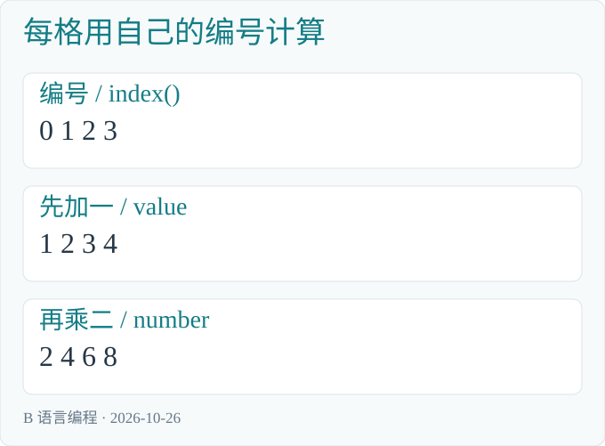
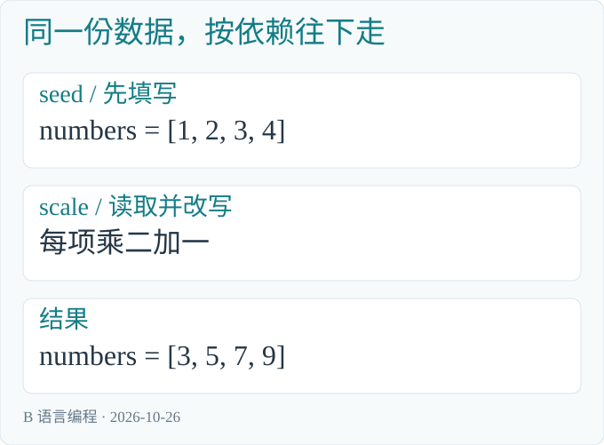
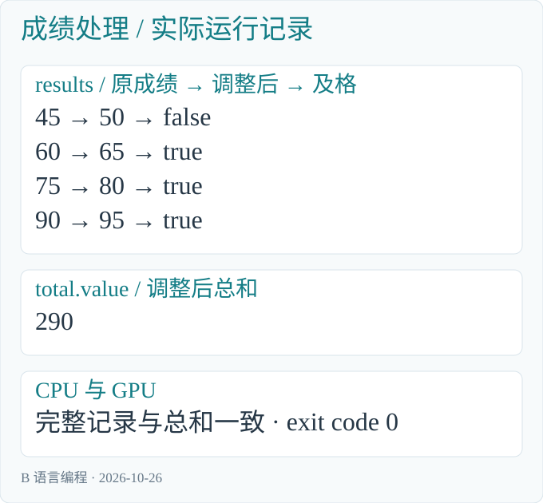

# B 语言编程

从第一个数字开始，学会 Blink

## 写在前面

让电脑计算一加二，运行后直接看到三，这是本书的起点。

这是一本从零开始的语言入门书。不要求先会 C、C++ 或 Rust。每遇到一种新写法，我们先说它要解决什么问题，再读代码，最后编译、运行，看看真正显示的结果。

Blink 简称 B 语言，B 也寓意 Base。它希望成为 AI 超算时代的基础语言。对初学者来说，这个目标可以从两件具体的事开始理解：把一件小事写清楚，再学会让许多份数据各自工作。

本书前十四章使用独立的 B 应用。编译器生成 Windows x64 可执行文件，直接运行 exe，在终端显示结果。后半部分学习并行数据与集合操作，使用当前已有的计算模块接口；两种入口怎样衔接、当前还缺少什么，会在进入并行部分时讲清楚。

全部源码随 [Blink 开源工程](https://github.com/sgua83/Blink) 提供，位于 `sample/beginner`。中文版手机版和标准版 PDF 位于 `sample/pdf`。

### 怎样使用本书

命令都在下载后的 Blink 项目根目录执行。每个动手例子给出完整的 B 实现、正式编译命令、运行命令和真实结果。命令末尾的反引号表示下一行仍属于同一条命令。

`.h` 列出公开接口，`.b` 写具体做法。先照着第一例把两个文件编译成功；之后再逐步理解名字、类型和函数。修改 B 源码以后，重新编译自己的 exe，再运行它。

本次独立应用示例使用 **Blink P4 CL13085 的 Release 编译器**实际构建与执行。原始输出和源码哈希见 [运行记录](beginner/运行记录.md)。运行图根据真实命令和终端输出重排，原理图说明计算过程。

## 第一章 先把 Blink 准备好

### 1.1 安装构建工具

当前动手环境是 Windows x64。准备 Git for Windows、Rust stable 的 MSVC 工具链，以及 Visual Studio C++ 桌面开发工具和 Windows SDK。已有相应组件的 Visual Studio 也可以使用。

这些工具用来构建 Blink 自己的编译器。写本书中的 B 应用时，无需另写 Rust 或 C++ 文件。

从开始菜单打开 x64 Developer PowerShell，进入自己保存项目的文件夹：

```powershell
git clone https://github.com/sgua83/Blink.git
cd Blink
cargo build --workspace --release
```

第一条下载源码，第二条进入项目，第三条构建正式优化版本。第一次构建可能需要一些时间。完成后，编译器位于 `target/release/blc.exe`。

### 1.2 认识三个目录

```text
Blink/
    sample/beginner/    本书的 B 源码
    target/release/     Blink 编译器
    target/             自己编译出的 exe
```

`sample` 和 `target` 都从项目根目录开始寻找。目录可以放在自己的数据盘上。用文本编辑器打开 `.b/.h`，保存为 UTF-8；注意文件名不要多出 `.txt`。

### 1.3 编译和运行分成两步

编译把 B 源码变成 exe；运行让这个 exe 执行计算。改过源码以后要重新编译，否则运行的仍是上一次的程序。

构建 Blink 工具使用 cargo 的 `--release`。编译自己的 B 应用使用 `blc.exe build-exe`，随后直接运行生成的 exe。

## 第二章 第一个程序：直接显示 3

### 2.1 两个完整文件

`sample/beginner/start.h`：

```b
module beginner.start;

u32 main() on cpu;
```

`sample/beginner/start.b`：

```b
module beginner.start;

u32 main() on cpu {
    println(1 + 2);
    return 0;
}
```

先看最中间的一行：`println(1 + 2);`。括号里面先计算一加二，println 把得到的三显示在终端，然后换行。

`main` 是应用从哪里开始执行。`u32` 说明它最后交回一个整数，`on cpu` 说明这段应用入口在 CPU 上执行。`return 0;` 表示正常结束；这个零是进程退出码，不会因此多打印一个零。

### 2.2 编译，再直接运行

编译并运行：

```powershell
.\target\release\blc.exe build-exe `
    sample/beginner/start.b target/start.exe
.\target\start.exe
```

实际终端输出：

```text
3
```


*运行记录：Release 编译器生成 exe 后直接执行，正常退出码为零；图中输出取自该 exe 的标准输出。*

终端直接显示三。这里不需要准备输入数据文件，也不需要再读取输出文件。生成的 `target/start.exe` 可以直接启动；运行它不需要 B 源码、blc 或 blrun 留在旁边。

### 2.3 文件外面的几行分别是什么

`module beginner.start;` 给这组文件一个完整名字，两个文件写相同名字。`.h` 中的 `u32 main() on cpu;` 是声明，只列出入口。`.b` 中同一行后面跟大括号，括号里才是具体指令。

分号表示一条指令结束。大括号把相关指令放在一起。main 从上向下执行，遇到 return 结束。


*图 2-1：先编译得到真正的 exe，再由操作系统启动它。println 把计算结果直接送到终端。*

### 2.4 亲手改一次

把 `1 + 2` 改为 `4 + 5`，保存 `.b`，重新执行编译命令，再运行 exe，终端应显示九。`.h` 不需要改变。

## 第三章 给数字起名字

### 3.1 把积分变化写清楚

原有十分，增加三分，再翻一倍。变量给中间结果起名字，便于理解每一步。

```b
module beginner.names;

u32 main() on cpu {
    u32 total = 10;
    let bonus = 3;
    total += bonus;
    total *= 2;
    println(total);
    return 0;
}
```

编译并运行：

```powershell
.\target\release\blc.exe build-exe `
    sample/beginner/names.b target/names.exe
.\target\names.exe
```

实际终端输出：

```text
26
```


*运行记录：Release 编译器生成 exe 后直接执行，正常退出码为零；图中输出取自该 exe 的标准输出。*

本章及后面的普通应用，`.h` 都采用第一例的形式：把 module 改为对应文件名，公开 `u32 main() on cpu;`。配套文件已经写好，可以直接打开阅读。

### 3.2 从左往右读声明

`u32 total = 10;` 表示用 total 保存一个整数，初值为十。`let bonus = 3;` 让编译器根据右边推断类型；这里的三是 u32。

let 不表示“以后永远不能改”。变量是否变化，要看后面的赋值。模块中固定的编译期值使用 const，第十二章再介绍。

### 3.3 赋值不是数学等式

`total = total + bonus;` 先读取旧值，相加，再把新值放回 total。写成 `total += bonus;` 含义相同。`*=、-=、/=` 分别表示相乘、相减、相除后放回原处。

| 执行到哪里 | total |
|---|---|
| 初值 | 10 |
| 加上 bonus | 13 |
| 乘二 | 26 |
| println | 显示 26，变量仍为 26 |

### 3.4 名字、注释与范围

名字可以使用英文字母、数字和下划线，不能以数字开头。total 和 Total 是两个名字。中文可以写在注释里：`// 增加积分`。注释解释做法，不参与计算。

变量通常只在声明它的那一对大括号内使用。先写入确定内容，再读取它；只声明 `u32 total;` 并没有提供一个可依赖的初值。

## 第四章 整数、小数和真假

### 4.1 先认识四种基本值

| 写法 | 保存什么 | 常见用途 |
|---|---|---|
| u32 | 不带负号的整数 | 数量、编号 |
| i32 | 可为负的整数 | 余额变化、偏移 |
| f32 | 带小数的数 | 距离、速度、温度 |
| bool | true 或 false | 一个条件是否成立 |

u32 的范围是零到 4294967295，i32 是 -2147483648 到 2147483647。超过范围的整数运算按当前三十二位规则处理，不能把它当成无限大的数学整数。f32 能表示很大和很小的数，但许多小数只能近似保存。

### 4.2 完整例子

```b
module beginner.types;

u32 main() on cpu {
    u32 count = 7 / 2;
    i32 change = -7 / 2;
    bool passed = 75 >= 60;
    f32 temperature = 21.5;
    println(count);
    println(change);
    println(passed);
    println(temperature > 18.0);
    return 0;
}
```

编译并运行：

```powershell
.\target\release\blc.exe build-exe `
    sample/beginner/types.b target/types.exe
.\target\types.exe
```

实际终端输出：

```text
3
-3
true
true
```


*运行记录：Release 编译器生成 exe 后直接执行，正常退出码为零；图中输出取自该 exe 的标准输出。*

四行依次说明：七除二的整数商是三；负七除二向零取整得到负三；七十五达到六十分；二十一点五度高于十八度。

### 4.3 小数运算和小数显示分开理解

`7.0 / 2.0` 得到 f32 的 3.5。`7 / 2` 是整数除法，得到三；后来再转成 f32，只会得到 3.0。

```b
u32 count = 7;
f32 average = f32(count) / 2.0;
```

这里先转换，再相除，average 得到 3.5。当前 println 可直接显示 u32、i32 和 bool，尚不能格式化 f32；因此本例显示的是温度判断的真假。f32 计算已经可用，不能把暂缺小数显示误解为不能计算小数。

### 4.4 常用运算符

| 写法 | 含义 | 例子 |
|---|---|---|
| +、-、*、/ | 加减乘除 | `3 * 4` 得到 12 |
| % | 整数余数 | `7 % 2` 得到 1 |
| ==、!= | 相等、不相等 | `3 == 3` 为 true |
| <、<=、>、>= | 大小比较 | `60 >= 60` 为 true |
| && | 两条件都成立 | `score >= 60 && score <= 100` |
| ! | 把真假反过来 | `!false` 为 true |

乘除先于加减；拿不准时用括号写清楚。单个等号用于赋值，两个等号用于判断相等。

&& 和 || 从左边开始判断。&& 左边为 false 时不再执行右边；|| 左边为 true 时不再执行右边。

## 第五章 遇到不同情况，做不同的事

### 5.1 用 if 写等级规则

九十分以上记三级，七十五分以上记二级，六十分以上记一级，其余记零级。

```b
module beginner.choice;

u32 main() on cpu {
    u32 score = 75;
    u32 level;
    if (score >= 90) {
        level = 3;
    } else if (score >= 75) {
        level = 2;
    } else if (score >= 60) {
        level = 1;
    } else {
        level = 0;
    }
    println(level);
    println(score >= 60);
    return 0;
}
```

编译并运行：

```powershell
.\target\release\blc.exe build-exe `
    sample/beginner/choice.b target/choice.exe
.\target\choice.exe
```

实际终端输出：

```text
2
true
```


*运行记录：Release 编译器生成 exe 后直接执行，正常退出码为零；图中输出取自该 exe 的标准输出。*

score 为七十五，第一项不成立，第二项成立，于是 level 取二。后面的 else if 不再继续选一遍。第一行输出等级二，第二行输出是否及格 true。

### 5.2 条件从上到下检查

如果把“六十分以上”放在第一项，七十五分会先被它选中，后面的二级就轮不到。先后次序来自规则本身。

`u32 level;` 在第一次读取之前，由各条分支确定写入。若有一条可能走到 println 的路径没有赋值，编译器会指出问题。应补齐真正的规则，而不是随意塞一个零掩盖遗漏。

### 5.3 很简单的二选一

```b
u32 bonus = score >= 60 ? 5 : 0;
```

条件成立取五，不成立取零。只选择其中一侧。分支里要做多件事时，继续使用普通 if 更清楚。

## 第六章 把同一件事重复几次

### 6.1 for 遍历一段范围

```b
u32 total = 0;
for (i in 1..6) {
    total += i;
}
```

`1..6` 从一开始，到六之前结束，依次是一、二、三、四、五。total 依次变为一、三、六、十、十五。

### 6.2 while 按条件继续

```b
u32 total = 0;
u32 i = 1;
while (i <= 5) {
    total += i;
    i += 1;
}
```

每次先判断，再进入正文。这里 i 每轮加一，最终条件不成立。忘记改变条件相关的值，可能让程序一直运行。

### 6.3 break 提前结束当前循环

遇到 break，离开这一层循环；它不结束整个 main。完整例子依次计算 for 求和、while 求和，以及遇到四就结束的求和：

```b
module beginner.loops;

u32 main() on cpu {
    u32 total = 0;
    for (i in 1..6) {
        total += i;
    }
    println(total);
    total = 0;
    u32 i = 1;
    while (i <= 5) {
        total += i;
        i += 1;
    }
    println(total);
    total = 0;
    for (j in 1..6) {
        if (j == 4) {
            break;
        }
        total += j;
    }
    println(total);
    return 0;
}
```

编译并运行：

```powershell
.\target\release\blc.exe build-exe `
    sample/beginner/loops.b target/loops.exe
.\target\loops.exe
```

实际终端输出：

```text
15
15
6
```


*运行记录：Release 编译器生成 exe 后直接执行，正常退出码为零；图中输出取自该 exe 的标准输出。*

前两项都是十五；最后一项只加一、二、三，得到六。


*图 6-1：每轮依赖上一轮的 total。之后学习并行时，会区分这种累计关系与互不依赖的逐项变换。*

## 第七章 给一段做法起名字

### 7.1 输入、返回值和调用

函数把一段做法单独命名。`add_bonus` 接收成绩与奖励分，交回新成绩；`level_of` 接收成绩，交回等级。

```b
module beginner.functions;

u32 add_bonus(u32 score, u32 bonus) on compute {
    return score + bonus;
}

u32 level_of(u32 score) on compute {
    if (score >= 90) { return 3; }
    if (score >= 75) { return 2; }
    if (score >= 60) { return 1; }
    return 0;
}

u32 main() on cpu {
    u32 score = add_bonus(70, 5);
    println(score);
    println(level_of(score));
    return 0;
}
```

编译并运行：

```powershell
.\target\release\blc.exe build-exe `
    sample/beginner/functions.b target/functions.exe
.\target\functions.exe
```

实际终端输出：

```text
75
2
```


*运行记录：Release 编译器生成 exe 后直接执行，正常退出码为零；图中输出取自该 exe 的标准输出。*

`add_bonus(70, 5)` 得到七十五，再交给 level_of 得到二。参数按声明顺序对应。函数中的 score 是这次调用收到的值，不因名字相同就自动改写 main 里的变量。

### 7.2 return 结束当前函数

level_of 一旦找到符合的等级，就 return。后续分支不会再执行。回到 main 后，main 继续执行它自己的下一条语句。

普通函数的 on compute 表示它的纯计算可用于相应 CPU/GPU 计算；main 的 on cpu 表明应用入口在 CPU。println 需要 CPU 输出能力，不能任意搬进 GPU 函数。

### 7.3 把表达式分成能看懂的步骤

```b
u32 adjusted = add_bonus(70, 5);
u32 level = level_of(adjusted);
println(level);
```

这与把调用嵌套起来的计算相同，但先看清中间结果，再决定是否缩成一行。简洁的目的是去掉多余工作，名字应帮助读者理解。

## 第八章 返回一个值，或修改一个位置

### 8.1 void 表示不交回普通结果

有的函数直接完成修改，不必再返回同一个数字。void 表示它没有普通返回值，inout 表示借来一个可读也可改的位置。

```b
module beginner.borrow;

void add_one(inout u32 value) on compute {
    value += 1;
}

void twice(u32 value, write u32 output) on compute {
    output = value * 2;
}

u32 main() on cpu {
    u32 value = 3;
    add_one(value);
    u32 output;
    twice(value, output);
    println(value);
    println(output);
    return 0;
}
```

编译并运行：

```powershell
.\target\release\blc.exe build-exe `
    sample/beginner/borrow.b target/borrow.exe
.\target\borrow.exe
```

实际终端输出：

```text
4
8
```


*运行记录：Release 编译器生成 exe 后直接执行，正常退出码为零；图中输出取自该 exe 的标准输出。*

add_one 把 main 的 value 从三改成四。twice 读取四，把八写入 output。两行分别显示四、八。

### 8.2 write 与 inout

inout 会读取并更新原内容；write 负责填写输出，调用前不要求 output 已经有可读值。它们描述函数对这个实际位置做什么。

返回值适合“计算一个新值”；修改参数适合“把结果写到明确位置”。不要为了使用一种新语法，让所有普通加法都增加一个输出参数。

### 8.3 同一个位置不能被当成两份独占输出

同一次调用里，write/inout 的位置应互不重叠。一个完整记录与它的某个字段也可能重叠。先读懂位置关系，再使用借用；不必为简单函数手写指针。

## 第九章 把相关内容放在一起

### 9.1 一个学生有成绩，也有是否及格

Student 把这两项内容放成一个记录。`.h` 中写清字段与公开入口：

```b
module beginner.records;

struct Student {
    u32 score;
    bool passed;
};

u32 main() on cpu;
```

实现如下：

```b
module beginner.records;

u32 main() on cpu {
    Student student;
    student.score = 75;
    student.passed = student.score >= 60;
    println(student.score);
    println(student.passed);
    return 0;
}
```

编译并运行：

```powershell
.\target\release\blc.exe build-exe `
    sample/beginner/records.b target/records.exe
.\target\records.exe
```

实际终端输出：

```text
75
true
```


*运行记录：Release 编译器生成 exe 后直接执行，正常退出码为零；图中输出取自该 exe 的标准输出。*

点号选择一项字段，`student.score` 是成绩，`student.passed` 是判断结果。每一项在读取前都应有确定内容。

### 9.2 结构体帮助表达一件完整的事

若把成绩与及格标志拆成两个无关变量，数据多起来以后容易弄错对应。记录让它们的关系留在类型中。

字段的名字应说明业务含义，不必在初学时研究内部字节偏移。与 C/C++ 或 Rust 交换记录时，再按照编译器生成的布局和接口处理。

## 第十章 几个同类的值，放进固定数组

### 10.1 先写清个数

`array<u32,4>` 表示四个 u32。这个个数是数组类型的一部分；`array<u32,4>(1,2,3,4)` 给四项初值。

```b
module beginner.arrays;

u32 main() on cpu {
    array<u32, 4> values = array<u32, 4>(1, 2, 3, 4);
    u32 total = 0;
    for (i in 0..values.length) {
        println(values[i]);
        total += values[i];
    }
    println(total);
    return 0;
}
```

编译并运行：

```powershell
.\target\release\blc.exe build-exe `
    sample/beginner/arrays.b target/arrays.exe
.\target\arrays.exe
```

实际终端输出：

```text
1
2
3
4
10
```


*运行记录：Release 编译器生成 exe 后直接执行，正常退出码为零；图中输出取自该 exe 的标准输出。*

前四行分别显示数组元素，最后一行显示总和十。这里是一个独立 exe，数组由应用代码直接声明，不是命令行另外申请的数据集。

### 10.2 下标从零开始

四项的下标是零、一、二、三。`values[0]` 是第一项，`values[3]` 是最后一项，四不是有效下标。

`values.length` 给出个数。`0..values.length` 恰好遍历全部有效下标，不包含 length 本身。它同时把范围写给人和编译器看。

### 10.3 先理解固定，再认识动态

固定数组适合本书的小数据。运行时才决定长度的动态数组，以及应用自己创建并行 dataset 的能力仍在开发；不要用一个很大的固定数组冒充已经支持所有动态存储需求。

## 第十一章 用几个数表示坐标

### 11.1 float2 是两个小数一起使用

`float2(1.0,2.0)` 可以表示二维位置，x 是一，y 是二。速度 `float2(0.0,2.0)` 表示 x 不变、y 每单位时间增加二。经过半单位时间，新位置为 `(1.0,3.0)`。

### 11.2 按分量计算，矩阵表达变换

```b
float2 moved = position + speed * 0.5;
```

乘法先把速度两个分量都乘半，再分别加到 position。矩阵 `float2x2(0.0,-1.0,1.0,0.0)` 则把 `(x,y)` 变成 `(-y,x)`；`(1.0,2.0)` 旋转后是 `(-2.0,1.0)`。

### 11.3 编译并执行

```b
module beginner.vectors;

u32 main() on cpu {
    float2 position = float2(1.0, 2.0);
    float2 speed = float2(0.0, 2.0);
    float2 moved = position + speed * 0.5;
    println(moved.x == 1.0);
    println(moved.y == 3.0);
    float2x2 turn = float2x2(0.0, -1.0, 1.0, 0.0);
    float2 rotated = turn * position;
    println(rotated.x == -2.0);
    println(rotated.y == 1.0);
    return 0;
}
```

编译并运行：

```powershell
.\target\release\blc.exe build-exe `
    sample/beginner/vectors.b target/vectors.exe
.\target\vectors.exe
```

实际终端输出：

```text
true
true
true
true
```


*运行记录：Release 编译器生成 exe 后直接执行，正常退出码为零；图中输出取自该 exe 的标准输出。*

四行 true 依次回答：移动后的 x 是否为一、y 是否为三，旋转后的 x 是否为负二、y 是否为一。这些数都能在本例中精确表达；一般小数算法不能一律用相等判断处理近似误差。

当前 stdout 尚不提供 f32 或整向量格式化。本例把坐标的具体数值写在推导中，并直接显示相应判断。后续能力补齐后，可直接显示坐标；计算写法无需因此改变。

## 第十二章 常量与分开的文件

### 12.1 共用规则放在一个地方

`math.h` 声明固定的 Base 和 add_base；`math.b` 给出函数实现：

```b
module beginner.math;

const u32 Base = 10;
u32 add_base(u32 value) on compute;
```

```b
module beginner.math;

u32 add_base(u32 value) on compute {
    return value + Base;
}
```

const 定义编译时确定的值。这里 Base 为十，add_base 把收到的值加十。它与循环中不断变化的 total 承担不同工作。

### 12.2 导入模块

`modules.h`：

```b
module beginner.modules;

import beginner.math;

u32 main() on cpu;
```

`modules.b`：

```b
module beginner.modules;

u32 main() on cpu {
    println(add_base(3));
    return 0;
}
```

编译并运行：

```powershell
.\target\release\blc.exe build-exe `
    sample/beginner/modules.b target/modules.exe sample
.\target\modules.exe
```

实际终端输出：

```text
13
```


*运行记录：Release 编译器生成 exe 后直接执行，正常退出码为零；图中输出取自该 exe 的标准输出。*

import 让本模块明确使用 beginner.math 的公开内容。这里的编译命令末尾增加 `sample`，告诉编译器从哪里寻找 `beginner/math.h/.b`；它是模块搜索根目录。第一例没有导入，无需这个参数。

### 12.3 改规则，不复制规则

把 Base 改为二十并重新编译，结果会成为二十三。多个程序使用同一函数时，也在这个模块中维护共同做法，不必在各文件复制一份。

## 第十三章 同一份做法，换一种类型

### 13.1 先理解普通版本

```b
u32 twice(u32 value) on compute {
    return value * 2;
}
```

它把一个 u32 翻倍。若 i32 也做相同计算，可以用类型参数表示这一共同做法：

```b
module beginner.generic;

T twice<T: integer>(T value) on compute {
    return value * 2;
}

u32 main() on cpu {
    println(twice(3));
    println(twice(-2));
    return 0;
}
```

编译并运行：

```powershell
.\target\release\blc.exe build-exe `
    sample/beginner/generic.b target/generic.exe
.\target\generic.exe
```

实际终端输出：

```text
6
-4
```


*运行记录：Release 编译器生成 exe 后直接执行，正常退出码为零；图中输出取自该 exe 的标准输出。*

T 是暂时使用的类型名，integer 规定它来自允许的整数类型集合。本例传三时推断为 u32，传负二时推断为 i32，分别得到六和负四。

### 13.2 泛型不是省掉所有类型规则

输入类型确定以后，返回类型也是同一个 T。不能给任意不相容类型强行套用这个函数。

需要浮点版本时，已有 floating 类型集合可用于适合的算法。先能读懂“类型参数、允许集合、具体调用”这三件事，再学习更复杂的形式。

## 第十四章 完整应用：处理一组成绩

### 14.1 先把规则说清楚

四个成绩是四十五、六十、七十五、九十。每个加五分，最高一百分；六十分及格。显示原成绩、调整后成绩与是否及格，最后显示总和。

先手算：新成绩为五十、六十五、八十、九十五，总和二百九十。

### 14.2 完整文件

```b
module beginner.grades;

struct Result {
    u32 original;
    u32 adjusted;
    bool passed;
};

u32 main() on cpu;
```

```b
module beginner.grades;

u32 final_score(u32 score, u32 bonus) on compute {
    u32 adjusted = score + bonus;
    if (adjusted > 100) { return 100; }
    return adjusted;
}

u32 main() on cpu {
    array<u32, 4> originals = array<u32, 4>(45, 60, 75, 90);
    u32 total = 0;
    for (i in 0..originals.length) {
        Result result;
        result.original = originals[i];
        result.adjusted = final_score(result.original, 5);
        result.passed = result.adjusted >= 60;
        println(result.original);
        println(result.adjusted);
        println(result.passed);
        total += result.adjusted;
    }
    println(total);
    return 0;
}
```

final_score 只负责一人的调整。main 负责数组、循环、显示和求和。Result 把同一人的三项结果放在一起。

编译并运行：

```powershell
.\target\release\blc.exe build-exe `
    sample/beginner/grades.b target/grades.exe
.\target\grades.exe
```

实际终端输出：

```text
45
50
false
60
65
true
75
80
true
90
95
true
290
```


*运行记录：Release 编译器生成 exe 后直接执行，正常退出码为零；图中输出取自该 exe 的标准输出。*

每三行是一人的原成绩、新成绩、及格标志；最后一行是总和。按记录整理如下，数值取自上面的实际终端输出：

| original | adjusted | passed |
|---|---|---|
| 45 | 50 | false |
| 60 | 65 | true |
| 75 | 80 | true |
| 90 | 95 | true |

### 14.3 现在已经能独立完成什么

这段程序只包含 B 源码。它有应用入口，保存自己的固定数据，调用函数，按规则修改记录，显示结果，再正常退出。

把奖励分改为十，重新编译。新成绩应是五十五、七十、八十五、一百，总和三百一十。先预测，再运行，看每一步变化是否符合规则。

## 第十五章 从顺序程序走向并行数据

### 15.1 先分清两种循环关系

上一章 total 每次都读取上一轮累计值，这一写法具有先后依赖。逐个成绩的调整却互不依赖：算第一个人的新成绩，不需要知道第二个人的新成绩。

并行计算首先来自这种数据关系，而不是把 for 改一个名字。顺序部分继续明确先后，独立部分才有机会一起执行。


*图 15-1：main 已能组织普通 CPU 逻辑；计算 program 表达一排数据的并行工作。由 B 应用自行创建动态 dataset、调用 CPU/GPU program 的连接能力仍在 C-011 中推进。*

### 15.2 当前并行例子怎样运行

目前可以独立编译 main，也可以编译和运行计算 program。后一种入口接收外部准备的数据集，现有 blrun 专门完成数据准备、CPU/GPU 执行和结果保存；它不负责运行前面的普通 exe。

以下几章使用这一已有计算模块工具来学习 parallel、阶段和集合操作。它是当前并行接口的真实用法；B 应用直接创建数据并调用 program 的能力尚未完成。学习前十四章无需使用它。


### 15.3 每格都有自己的编号

现在准备四格，想得到 `[2,4,6,8]`。做法是：当前格子的编号加一，再乘二。

`numbers.h`：

```c
module beginner.numbers;

program run(write dataset<u32> numbers) on compute;
```

`numbers.b`：

```c
module beginner.numbers;

program run(write dataset<u32> numbers) on compute {
    parallel (number in numbers) {
        u32 value = index() + 1;
        number = value * 2;
    }
}
```

运行：

```powershell
.\target\release\blrun.exe cpu `
    sample/beginner/numbers.b run `
    sample Saved/Learn/numbers :4
```

`numbers.bldata` 中保存 **[2,4,6,8]**。

index() 给出当前元素的编号。编号从 0 开始，所以四格的编号依次是 0、1、2、3。加一后得到 1、2、3、4，再乘二就是结果。



*图 5-1　每格按自己的编号计算，数字的位置保持不变。*

### 15.4 parallel 里面的变量属于谁

每一格执行同一段做法，但其中的 value 是各自的局部值。第一格的 value 是 1，第二格的是 2，彼此不会覆盖。

number 对应当前这一格，给 number 赋值会写回结果；value 是计算过程里临时起的名字。只修改 value，不会自动改变 number，最后需要明确写回。

把命令末尾的 `:4` 改成 `:6`，就会申请六格。程序不用修改，结果会成为 `[2,4,6,8,10,12]`。

### 15.5 结果顺序与执行先后

第一格的结果仍在第一格，第二格的结果仍在第二格。这个位置关系不要求它们按编号先后完成。

parallel 表达的是每份数据要做什么，以及这些工作可以分别进行。电脑实际同时处理多少份，要看执行设备与计算内容。

也因此，不要让一格去随意修改别人的结果。先掌握“各算各的、各写各的”，就能写出大量清楚的计算。


### 15.6 先填数字，再改数字

我们已经会生成 [1,2,3,4]，也会把每个数乘二加一。把这两件事分别起名，最后按顺序调用。

`stages.h`：

```c
module beginner.stages;

program seed(write dataset<u32> numbers) on compute;
program scale(inout dataset<u32> numbers) on compute;
program run(inout dataset<u32> numbers) on compute;
```

`stages.b`：

```c
module beginner.stages;

program seed(write dataset<u32> numbers) on compute {
    parallel (number in numbers) {
        number = index() + 1;
    }
}

program scale(inout dataset<u32> numbers) on compute {
    parallel (number in numbers) {
        number = number * 2 + 1;
    }
}

program run(inout dataset<u32> numbers) on compute {
    seed(numbers);
    scale(numbers);
}
```

seed 负责填写起始值，所以使用 write。scale 要读取原值再改写，所以使用 inout。run 组织这两步，也把同一份 numbers 交给它们。

### 15.7 一条命令完成两步

```powershell
.\target\release\blrun.exe cpu `
    sample/beginner/stages.b run `
    sample Saved/Learn/stages :4
```

结果为 **[3,5,7,9]**。



*图 13-1　先生成原值，后面的计算消费这些值。每步内部都可以展开独立工作。*

程序中的先后顺序表达真实依赖：scale 需要 seed 写出的数字，因此要放在后面。编译器可以优化具体执行方式，但计算仍要满足这个关系。

### 15.8 也可以分两次运行

先只运行 seed：

```powershell
.\target\release\blrun.exe cpu `
    sample/beginner/stages.b seed `
    sample Saved/Learn/seed :4
```

这时 numbers.bldata 中是 [1,2,3,4]。再把这份已有文件交给 scale：

```powershell
.\target\release\blrun.exe cpu `
    sample/beginner/stages.b scale `
    sample Saved/Learn/scaled `
    Saved/Learn/seed/numbers.bldata
```

结果为 [3,5,7,9]。原来写 `:4` 的地方，现在写输入文件路径；两者都在告诉执行器这份数据从哪里来。

一个已有应用也可以在内存中交付数据，调用 B 算法。C、C++ 和 Rust 的接入方式见《并行编程的艺术》第十四章；完成这本书的例子不需要这些宿主工程。


## 第十六章 一排数字一起求和

### 16.1 把目标说清楚

这一章处理 [1,2,3,4]，同时得到两种结果：总和 10，以及每个位置前面的数加起来是多少。

| 当前位置 | 当前数 | 前面各项之和 |
|---|---|---|
| 0 | 1 | 0 |
| 1 | 2 | 1 |
| 2 | 3 | 3 |
| 3 | 4 | 6 |

总和叫归约结果；前面各项之和常叫前缀和。名字可以慢慢熟悉，先记住上面这张表。

### 16.2 两个现成操作

```c
scan_exclusive_sum(numbers.value,
                   before.value);
reduce_sum(numbers.value, total.value);
```

scan_exclusive_sum 把“当前位置之前的和”写到 before，因此第一项是 0。reduce_sum 把全部数字的总和写到 total。

当前这些集合操作通过记录字段选择要计算的数字。我们定义一个只有 value 的 Number 记录，再分别指出 numbers.value、before.value 和 total.value。

### 16.3 完整例子

`totals.h`：

```c
module beginner.totals;

struct Number { u32 value; };
program seed(write dataset<Number> numbers) on compute;
program summarize(read dataset<Number> numbers,
                  write dataset<Number> before,
                  write dataset<Number, 1> total) on compute;
program run(inout dataset<Number> numbers,
            write dataset<Number> before,
            write dataset<Number, 1> total) on compute;
```

`totals.b`：

```c
module beginner.totals;

program seed(write dataset<Number> numbers) on compute {
    parallel (number in numbers) {
        number.value = index() + 1;
    }
}

program summarize(read dataset<Number> numbers,
                  write dataset<Number> before,
                  write dataset<Number, 1> total) on compute {
    scan_exclusive_sum(numbers.value, before.value);
    reduce_sum(numbers.value, total.value);
}

program run(inout dataset<Number> numbers,
            write dataset<Number> before,
            write dataset<Number, 1> total) on compute {
    seed(numbers);
    summarize(numbers, before, total);
}
```

summarize 只读取 numbers，填写另外两份输出。run 先调用 seed 生成输入，再把它交给 summarize。`dataset<Number,1>` 明确说明 total 只有一条记录。

运行：

```powershell
.\target\release\blrun.exe cpu `
    sample/beginner/totals.b run `
    sample Saved/Learn/totals :4 :4 :1
```

三个容量按接口顺序对应 numbers、before、total。结果为：

```text
numbers.value = [1, 2, 3, 4]
before.value  = [0, 1, 3, 6]
total.value   = 10
```

### 16.4 为什么不让大家同时加同一个变量

如果每个元素都随意读取并改写一个共享 total，某次读取可能发生在别人写入之前，结果就难以确定。

reduce_sum 已经表达了真正想做的事：把这些数字按求和规则汇总。我们负责说明输入输出，编译器和执行框架负责组织具体工作。


## 第十七章 换到 GPU 执行

### 17.1 先保持同一个计算

第十五章的 stages.b 已声明 on compute。选择 GPU 时，命令写成：

```powershell
.\target\release\blrun.exe gpu `
    sample/beginner/stages.b run `
    sample Saved/Learn/stages-gpu :4
```

结果仍为 **[3,5,7,9]**。CPU 与 GPU 分别使用自己的结果目录，便于对照。

运行 GPU 版本需要显卡驱动提供 Vulkan。Blink 使用同一份 B 源码生成对应代码；本例不需要另写 GPU 专用语言，也不需要安装 Vulkan SDK。

### 17.2 on 后面的三个选择

| 写法 | 允许在哪里执行 |
|---|---|
| on compute | CPU 或 GPU，由调用方选择 |
| on cpu | CPU |
| on gpu | GPU |

program 和它调用的函数都要满足目标要求。本书并行计算例子使用 on compute，便于把注意力放在共同语法上。

### 17.3 看懂运行时间

四个数字适合手算，却太少，无法体现大规模并行的吞吐。准备设备、编译代码和保存文件都需要时间。

命令行中的 compute_elapsed_ms 包含这次执行的后端准备和结果保存；GPU 路径还包括设备创建、上传和读回。GPU_program_ms 是设备程序的计时，两者范围不同。

学语法时先看结果是否符合预期。真正比较效率时，需要同样的工作量、正式优化版本，以及说清楚的计时范围。《并行编程的艺术》提供了从一百万到一亿规模的实际对照。


## 第十八章 固定个数作为编译参数

固定个数也可以由构建具体程序时的参数指定。`shape.h`：

```c
module beginner.shape;

program run<const N: u32>(write dataset<u32, N> numbers) on compute;
```

`shape.b`：

```c
module beginner.shape;

program run<const N: u32>(write dataset<u32, N> numbers) on compute {
    parallel (number in numbers) {
        number = index() + 1;
    }
}
```

这里的 N 是生成这个具体程序前需要确定的整数。dataset 的固定个数随着 N 确定。选择具体入口 `'run<4>'`，就指定了 N=4；引号让 PowerShell 原样传递尖括号。

```powershell
.\target\release\blrun.exe cpu `
    sample/beginner/shape.b 'run<4>' `
    sample Saved/Learn/shape :4
```

结果为 **[1,2,3,4]**。入口指定四个元素，命令也提供四条记录；这两处的个数需要相符。

当前的开放常量参数按具体实例检查，并不是任意类型和任意代码都已经支持。进一步使用前，参照项目中的语言规范，确认需要的类型和做法处在已实现范围内。


## 第十九章 并行处理同一组成绩

第十四章的 final_score 规则继续保留，字段名字也保持相同。现在每个 parallel 实例拥有一人的 Result，集合操作汇总所有 adjusted。应用入口与计算入口的组织不同，单人成绩的计算仍是同一件事。

### 19.1 先把规则写成人话

准备四个成绩：45、60、75、90。每个成绩加 5 分，最高记为 100 分；达到 60 分就记为及格。保留原成绩、调整后成绩和是否及格，最后求调整后成绩的总和。

先自己算一遍：调整后是 50、65、80、95，总和应为 290。第一人不及格，其余三人及格。

### 19.2 先列清单

`scores.h`：

```c
module beginner.scores;

struct Result {
    u32 original;
    u32 adjusted;
    bool passed;
};
struct Number { u32 value; };
u32 final_score(u32 score, u32 bonus) on compute;
program fill(write dataset<Result> results, u32 bonus) on compute;
program sum(read dataset<Result> results,
            write dataset<Number, 1> total) on compute;
program run(inout dataset<Result> results,
            write dataset<Number, 1> total, u32 bonus) on compute;
```

Result 保存一人的三项结果。Number 保存一个数，作为总和输出。final_score 负责计算单个成绩；fill 处理这一排记录；sum 求和；run 把步骤连起来。

bonus 是每次运行传入的奖励分。这里按题目传入 5，并申请四条结果；种子成绩也按这四人的规则生成。

### 19.3 再写具体做法

`scores.b`：

```c
module beginner.scores;

u32 final_score(u32 score, u32 bonus) on compute {
    u32 adjusted = score + bonus;
    if (adjusted > 100) {
        return 100;
    }
    return adjusted;
}

program fill(write dataset<Result> results, u32 bonus) on compute {
    parallel (result in results) {
        result.original = 45 + index() * 15;
        result.adjusted = final_score(result.original, bonus);
        result.passed = result.adjusted >= 60;
    }
}

program sum(read dataset<Result> results,
            write dataset<Number, 1> total) on compute {
    reduce_sum(results.adjusted, total.value);
}

program run(inout dataset<Result> results,
            write dataset<Number, 1> total, u32 bonus) on compute {
    fill(results, bonus);
    sum(results, total);
}
```

final_score 先计算 adjusted，超过 100 就提前交回 100，否则交回 adjusted。这是题目规定的满分规则。

fill 让每条记录完成自己的三项填写。它只需要知道当前编号与这次的 bonus，不依赖其他人的成绩。

sum 把所有 adjusted 相加。它只读取成绩，不再修改成绩。run 先填写、后求和，因此 sum 能读到已经完成的值。

### 19.4 运行并对照结果

```powershell
.\target\release\blrun.exe cpu `
    sample/beginner/scores.b run `
    sample Saved/Learn/scores :4 :1 -- 5
```

两个容量分别对应 results 的四条记录与 total 的一条记录，最后的 5 对应 bonus。

| original | adjusted | passed |
|---|---|---|
| 45 | 50 | false |
| 60 | 65 | true |
| 75 | 80 | true |
| 90 | 95 | true |

`total.bldata` 中的 value 为 **290**。



*运行记录：CPU/GPU 的四条完整记录与总和一致，按读取到的数字展示。*

GPU 版本只需选择 gpu，并指定独立目录：

```powershell
.\target\release\blrun.exe gpu `
    sample/beginner/scores.b run `
    sample Saved/Learn/scores-gpu `
    :4 :1 -- 5
```

### 19.5 沿着数据走一遍

一条记录进入 fill，先得到原成绩；普通函数算出新成绩；比较得到真假值。四条记录分别完成后，sum 汇总 adjusted，得到 290。

这里用到了数字类型、变量、函数、条件、结构体、并行元素和程序组合。每一种写法都有具体工作，不需要为了使用某个语法而额外制造一层程序。

可以试着把 bonus 改成 10。四个 adjusted 应成为 55、70、85、100，总和为 310。题目规则仍然清楚，变化只来自传入的参数。


## 第二十章 读懂错误，继续练习

### 20.1 先看第一个具体错误

检查错误给出的文件、行、列与说明。缺分号先补分号，括号不成对先找对应括号；不要因为后面也报错就一次重写全部代码。

命令找不到文件时，确认自己在 Blink 根目录。改过源码却看不到变化时，确认已经重新编译刚才运行的 exe。

| 问题 | 先检查什么 |
|---|---|
| main 入口不匹配 | `.h/.b` 都公开无参数 u32/i32 main，显式 on cpu |
| 类型不一致 | 整数、小数之间是否需要明确转换 |
| 读取前没有内容 | 分支与各字段是否确实完成赋值 |
| 下标范围不明 | 固定下标或 `0..length` 是否表达了有效范围 |
| 模块找不到 | import、模块名与编译时搜索根目录 |
| println 拒绝参数 | 当前只支持 u32、i32、bool，且属于 CPU 输出 |

### 20.2 容易混淆的几对写法

| 写法 | 分别做什么 |
|---|---|
| = 与 == | 写入新值；比较是否相等 |
| return 与 break | 结束当前函数；结束当前循环 |
| for 与 parallel | 明确的顺序重复；对数据域的独立工作 |
| array 与 dataset | 普通固定数组值；并行入口接收的数据集合 |
| let 与 const | 从初值推断局部类型；定义编译期值 |
| main 与 program | 普通应用入口；具有数据与执行目标的计算入口 |

### 20.3 输出、退出与错误

println 返回 bool：完整写出时为 true，写出失败时为 false。起步例子直接使用显示效果；需要把真实输出失败变成退出码时，可以写：

```b
if (!println(1 + 2)) {
    return 1;
}
return 0;
```

这段代码处理实际 I/O 结果，不会打印退出码。PowerShell 可在 exe 结束后通过 `$LASTEXITCODE` 查看退出码。

### 20.4 当前能力与后续学习

当前独立应用支持普通函数、条件、顺序循环、记录、固定数组、向量和矩阵计算，以及整数／真假标准输出。文本、f32 格式化、键盘输入、文件、动态数据和应用组织 GPU 仍有明确未完成部分。完整状态以语言规范与问题列表为准。

C/C++ 与 Rust 可以继续作为同等正式的宿主，通过生成 DLL 或原生接口调用 B 计算。混合编程是项目可选择的整合方式，详见《Blink 和 Rust 混合编程》，不影响前面普通 B 应用的独立使用。

### 20.5 十个动手练习

1. 第一例显示八乘七的结果。
2. 积分初值二十，增加五，再减三。
3. 显示七除二的整数商，并解释 7.0/2.0 的值。
4. 依次显示一、四、九、十六。
5. 分别判断五十九、六十、六十一是否及格。
6. 用 for 和 while 各求一次一到五的和。
7. 给 Student 增加编号并显示。
8. 写一个 square 函数，显示七的平方。
9. 数组改为 `[2,4,6,8]`，显示总和。
10. 成绩奖励分改为十，预测每人记录与总和。

## 附录 A 并行计算结果的读取

第一至十四章的结果直接显示在终端，无需读取数据文件。本附录只服务于后面采用 blrun 的计算模块。

### A.1 读取四个整数

第十五章 numbers 的结果位于 `Saved/Learn/numbers/numbers.bldata`。若安装了 Python，可直接查看它的四个 u32：

```powershell
python -c "import struct; from pathlib import Path; raw=Path('Saved/Learn/numbers/numbers.bldata').read_bytes(); print(struct.unpack('<4I',raw[24:]))"
```

```text
(2, 4, 6, 8)
```

这是一条读取二进制计算数据的工具命令，不是编译或运行普通应用的前置步骤。

### A.2 文件头与记录

当前 BLDATA 的前二十四字节是文件头，含格式标识、版本、记录数、记录间隔和执行步数。后面才是按编译布局保存的记录。四个 u32 的间隔为四字节；Result 等记录还包含多个字段与可能的对齐空白。

普通记录、向量与浮点数据应按各自布局读取，不要把全部内容都当作 u32。原始数据读写实现在 `crates/blcompute/src/lib.rs`。

## 附录 B 练习参考与源码索引

### B.1 前五题

前两题分别得到五十六、二十二。第三题整数商为三，小数除法得到 3.5；当前 println 尚不能直接格式化小数。

第四题可使用顺序循环，循环中让 value 从一到四，显示 `value * value`。第五题比较 `score >= 60`，依次得到 false、true、true。

### B.2 后五题

第六题两种求和都得到十五。第七题在 `.h` 的 Student 中增加 `u32 id;`，使用前明确填写并显示它。第八题函数主体返回 `value * value`，七的平方为四十九。

第九题总和二十。第十题调整后成绩为五十五、七十、八十五、一百，总和三百一十。

### B.3 独立应用索引

| 文件 | 内容 |
|---|---|
| `start.h / start.b` | 第一个程序，直接显示 3 |
| `names.h / names.b` | 变量、let 和赋值 |
| `types.h / types.b` | 整数、负数、真假与小数比较 |
| `choice.h / choice.b` | if 与等级判断 |
| `loops.h / loops.b` | for、while 和 break |
| `functions.h / functions.b` | 函数与提前返回 |
| `borrow.h / borrow.b` | void、inout 和 write |
| `records.h / records.b` | 结构体与字段 |
| `arrays.h / arrays.b` | 固定数组和遍历 |
| `vectors.h / vectors.b` | 坐标与矩阵计算 |
| `modules.h / modules.b` | 导入公共函数 |
| `generic.h / generic.b` | 整数类型参数 |
| `grades.h / grades.b` | 完整成绩处理应用 |

### B.4 并行例子与下一步

并行例子包括 `numbers`、`stages`、`totals`、`shape` 和 `scores`。它们的接口仍是 program，沿正式 blrun 或宿主 API 执行，不与已改为 main 的普通应用混用。

下一步可以阅读《并行编程的艺术》，学习更大规模的数据关系与真实效率；阅读《Blink 和 Rust 混合编程》，学习把 B 算法接入项目；对实现感兴趣时，再阅读《B 语言源码分析》。
