# 并行编程的艺术

## 用 Blink 语言，从 C/C++ 的熟悉世界走向并行思考

面向读者：会写 C 或 C++，希望真正理解并行算法的人。

版本：2026 年 10 月 25 日 · 基于 Blink v0.1 当前实现。

并行编程的关键，是看清哪些工作能够独立进行，哪些结果需要汇总，以及数据怎样从一个阶段流向下一个阶段。把这些关系表达清楚，程序就能展现出简洁而有秩序的美。

本书从可以手算的小例子开始，逐步建立并行思考的方法，再走进 BLEngine 的粒子更新、空间变换和材质计算。阅读这些真实代码时，我们关注算法的读写与依赖关系，所需的图形学概念会随例子介绍。

Blink（简称 B）是一门面向 CPU/GPU 的原生并行计算语言。它把工作域、数据访问和协作关系写进程序，让编译器据此组织原生执行。

B 也寓意 Base。Blink 希望像 C 语言为上一个计算时代所做的那样，成为 AI 超算时代的基础语言。这个愿景从最基本的表达出发：让独立工作自然展开，让必要协作清楚可见。

### 阅读路线

| 阶段 | 章节 | 你将获得什么 |
|---|---|---|
| 看懂 | 1-4 | 从循环、权限和集合运算建立直觉 |
| 会用 | 5-10 | 组织有效工作、局部协作与可组合算法 |
| 读真实代码 | 11-13 | 把同一套思想带入 BLEngine 的真实计算 |
| 动手巩固 | 14、附录 | 运行示例、解释结果、完成练习 |

配套教学源码位于 `sample/lessons`，各章列出编译与运行命令。BLEngine 摘录标明原文件，便于继续阅读完整实现；C/C++ 片段用于比较串行与并行的组织方式；性能示例另附完整、开启优化的 C++ 串行实现。


### 动手准备

本书的命令在 Windows PowerShell 中、Blink 项目根目录执行。编译器为 blc，执行器使用相邻 BLEngine 项目的通用 compute 命令。

先定义两个短路径，后续各章共用：

```powershell
$blc = '.\target\release\blc.exe'
$run = Join-Path '..\BLEngine' `
    'target\release\blengine.exe'
```

若本机尚无这些程序，先按附录 A 构建。`blc check` 检查源码，`blc build` 导出原生代码与布局；compute 读取模块并通过同一编译库执行。


## 1　第一种美：许多事情原本就能一起做

### 1.1　从一段你已经会写的循环开始

数组 `values` 里有四个数 `[1,2,3,4]`。把每个数乘二再加一，C 的写法很短：

```cpp
for (size_t i = 0; i < n; ++i) {
    values[i] = values[i] * 2.0f + 1.0f;
}
```

B 的计算正文同样简短：

```c
parallel (value in values) {
    value = value * 2.0 + 1.0;
}
```

`values` 是全部数字，`value` 表示当前元素的独占位置，相当于 C 的 `values[i]`，赋值会直接更新它。`parallel` 描述每个元素要做什么，允许各个实例独立推进。

两种写法的结果都是 `[3,5,7,9]`。每个数的更新只依赖自己的旧值，因此可以分别计算。串行循环中的先后顺序来自写法，问题本身并不需要它。

### 1.2　先看顺序，再看硬件


*图 1-1　同一公式的串行顺序与并行元素域。步骤表示逻辑依赖，不是实测耗时。*

按串行过程理解，处理器读取一个数，完成乘法、加法和写回，再推进到下一项。并行过程把四次互不依赖的读改写展开；每个实例内部仍先读值，再计算，最后写回。

这种一条输入对应一条输出的模式叫 map，即逐元素变换。


*图 1-2　逻辑元素、CPU 工作范围和 GPU 工作组属于不同层次。*

在当前 CPU 执行框架中，连续下标范围交给工作线程，一个线程处理许多元素。适合的直线计算还可以一次使用四个 SSE2 lane；这与多个 CPU 核心分工是两层并行。

在 GPU 上，元素实例映射到计算调用，再组成工作组。工作组分批调度到硬件；四个逻辑元素不保证在物理上恰好同一时刻执行，一百万个元素也不等于一百万个操作系统线程。

C/C++ 编译器也可能自动向量化简单循环；B 则通过工作域直接表达元素之间的独立性。

### 1.3　并发和并行，不必混为一谈

并发关注多件工作如何同时处于进行中，例如等待文件读取时处理另一个请求。并行关注多份计算是否能在多个执行资源上同时推进。

并发的多个任务可以在一个核心上轮流推进；并行的数组计算则利用多个执行资源分担工作。B 主要围绕数据并行展开，并用生产消费关系连接计算阶段。

### 1.4　先问三个问题

面对一个循环，先问：每次迭代读什么？写什么？是否需要另一次迭代刚写出的结果？

如果答案是“共享只读输入，修改自己的输出，不等待其他元素”，你已经找到了最适合并行的形状。先找到这个形状，再讨论核心数和线程数，会轻松得多。

### 1.5　编译、运行与结果

`:4` 申请四条全零记录；demo 先填入 `[1,2,3,4]`，再执行乘二加一。下面依次检查源码、导出代码，并在 CPU 与 GPU 上运行。

```powershell
$src = 'sample\lessons\map.b'
$entry = 'demo'

& $blc check $src sample $entry
& $blc build $src `
    Saved\BookCompiled\map `
    sample $entry
& $run compute cpu $src $entry sample `
    Saved\Book\map :4
& $run compute gpu $src $entry sample `
    Saved\Book\map-gpu :4
```

查看乘二加一的四个结果，可以直接用 PowerShell 读取。BLDATA 头部占 24 字节，具体记录布局见正文及附录 A：

```powershell
$data = [IO.File]::ReadAllBytes(
    'Saved/Book/map/values.bldata'
)
0..3 | ForEach-Object {
    [BitConverter]::ToSingle($data, 24 + 4 * $_)
}
```

两端的 `values.bldata` 都是 `[3,5,7,9]`，每条记录为一个 f32。完整实现见 `lessons/map.h` 与 `lessons/map.b`。


*运行记录：程序入口与实际执行输出节选，数值读取自 BLDATA 文件。*

### 1.6　让数据规模把优势展现出来

四个数适合手算。要比较效率，再把同一个乘二加一扩展到 16,777,216 个数，并连续执行 8 轮：公式、数据类型和每轮工作量保持相同，规模与连续计算让并行资源有了充分发挥的空间。

性能对照使用三个真实执行版本：开启 `/O2 /arch:AVX2` 优化的单线程 C++、B 原生 CPU 范围并行、B 原生 GPU。C++ 保留编译器自动向量化；B CPU 使用本机可用的工作线程。

三者先用相同初值预热两批，再测九批，每批均完成八轮，取单轮平均耗时的中位数。C++ 与 B CPU 计时从算法调用前到计算完成；B GPU 计时从提交前到设备实际完成后，包含命令组织、提交与等待。加速比为“C++ 串行时间 ÷ B 并行时间”。

代码生成、初始分配与数据准备放在计算计时之外。GPU 主对照要求代码和数据已经驻留设备，八轮通过现有 `submit_steps` 一次提交。它对应连续模拟、图像处理等数据留在 GPU 上继续计算的场景。重新上传、执行与读回的费用另行完整测量，不能从应用成本中省去。

先按附录 A.5 编译配套测量程序，再在 Blink 根目录执行：

```powershell
$work = 'Saved/BookPerformance'
$bench = "$work/target/release/bperf.exe"
& $bench map 16777216 9 8
```

C++ 串行为 **2.135 ms/轮**，B CPU 为 **1.095 ms/轮**，加速 **1.95 倍**；B GPU 驻留执行为 **0.626 ms/轮**，加速 **3.41 倍**。比较的仍是开头那一个公式。


*实测记录：map。每次变换都读取并更新同一批数字；三种执行得到的最终结果相同。*

### 1.7　把计算放到合适的位置

八轮计算在 C++ 串行上合计 17.084 ms，在 B CPU 上合计 8.758 ms，在 B GPU 驻留执行中合计 5.008 ms。范围并行分担了主存数组的工作；GPU 则在设备带宽和大量计算调用上展开同一批数据。

如果这批数据要重新从主存上传、完成八轮后再读回，GPU 合计耗时为 178.100 ms。对于这样简单的乘加，搬运远比公式昂贵；已经在主存的数据可以直接选择更快的 B CPU 版本，已经驻留 GPU 的数据则能继续利用设备计算。


*图 1-3　先比较同样的计算，再把真实的数据交付成本加回来。*

第一次创建设备、生成设备程序与上传初值，本机另测为 99.136 ms。原生执行命令处理四个数时，这类准备与输出费用会占据主要部分；它衡量的是那次完整启动，而非大规模计算的吞吐。

学习并行既要找到足够的独立工作，也要让工作待在合适的数据位置。后面的每个主要算法都将按相同办法给出实测对照。


## 2　第二种美：让读写各有归属

### 2.1　C/C++ 读者的语法桥梁

| 你熟悉的概念 | B 中的表达 | 需要注意的区别 |
|---|---|---|
| `float`、32 位整数 | `f32`、`u32`、`i32` | 不把 C 的 `int` 大小假设带进来 |
| 三个浮点分量 | `float3` | 原生向量值，不是系统线程组三个线程 |
| 结构体 | `struct Cell { f32 value; };` | 同样用于组织普通值 |
| 数组加长度 | `dataset<T>` | 还具有资源身份、访问模式与执行域 |
| 参数只读 | `read dataset<T>` | 语言显式限制共享修改 |
| 输出参数 | `write T` | 必须先写再读，不表示自动清零 |
| 修改已有值 | `inout T` | 借用独占位置，不是任意裸指针 |
| 普通函数 | `f32 f(f32 x)` | 当前静态内联，不支持递归 |
| 一组计算阶段的入口 | `program ...` | 可以包含并行域和集合操作 |
| 同一算法的 CPU/GPU 版本 | `on compute` | 表示两端可执行，设备由调用者明确选择 |

`.h` 描述模块的类型、签名、访问权限与执行目标，`.b` 提供实现。编译器通过模块声明定位二者，无需 C 式的 `#include` 预处理。

### 2.2　把计算放进一个入口

第一章的计算入口位于 `lessons/map.b`：

```c
program scale(inout dataset<f32> values) on compute {
    parallel (value in values) {
        value = value * 2.0 + 1.0;
    }
}
```

`dataset<f32>` 是一组 32 位浮点数；`inout` 允许读取并更新；`program` 声明计算入口。`on compute` 表示这份实现可生成 CPU 与 GPU 代码，执行时由调用者明确选择设备。

`demo` 先产生 `[1,2,3,4]`，再调用 `scale`。初始化与算法分开，便于直接观察第一次运行。模块声明和接口文件的作用见附录 A。

### 2.3　独占写为什么重要

下面是一个 C/C++ 并行化时常见的错误思路。`total` 是只有一条记录的结果数组；若让许多执行者同时运行这条语句，就会争写同一个 `total[0].value`：

```cpp
// Conceptual parallel body: this is a data race.
total[0].value += input[i].value;
```

许多执行者同时读取旧的 `total[0].value`，各自加上自己的数，最后互相覆盖。即使每次加法都很简单，整个“读取、计算、写回”也不是一个不可分割的动作。

B 的普通 `parallel` 为每个实例分配当前元素的独占写权限。共享位置的修改使用显式原子操作；集合求和则用归约表达。这样，独立更新与共享修改在源码中就有了清楚的区别。

访问权限约束读写冲突；公式、数值精度和业务规则仍由算法决定。


*图 2-1　争写会丢失更新；独占输出把写入责任分开。*

图中两个执行者都读到 0，各自计算后写回，导致一次更新被覆盖。归约会先形成独立摘要，再合并这些摘要，解决集合求和中的共享累加问题。

### 2.4　write、inout 和 read 的实际含义

把 write 理解为“我要生产新结果”，把 inout 理解为“我要读取并更新自己已有的值”，把 read 理解为“大家可以共同阅读”。

`write` 声明写入权限，初始化由算法或宿主负责。示例命令中的 `:4` 由执行器申请四条全零记录。

普通函数借用整份数组时，目前只支持 read 和 atomic 两种模式；修改单个独占位置则用 `inout T` 或 `write T`。program 可以在阶段组合中传递所需权限，不能把这和普通函数随意读取正在修改的整份 inout dataset 混在一起。

### 2.5　parallel 和 for，各自负责什么

`parallel (value in values)` 建立一群元素实例；`for (item in data)` 则是当前实例内部的有界顺序遍历。后者不会再创建一层并行任务。

例如每个输出都遍历同一份只读材料，逻辑上可以正确，但 N 个输出各读 N 份材料会产生 O(N²) 工作。并行执行不能把重复计算的代价抹去；学会并行也包括学会避免无用工作。

## 3　第三种美：许多结果可以汇成一个

### 3.1　把累加链变成一棵树

计算 `[3,1,4,2]` 的总和。为了让结果供后续阶段使用，`total` 用一条 `Count` 记录保存数值；输入也使用 `Count { u32 value; }`。

C 串行核心：

```cpp
total[0].value = 0;
for (size_t i = 0; i < n; ++i) {
    total[0].value += input[i].value;
}
```

B 并行核心：

```c
reduce_sum(input.value, total.value);
```

`input.value` 表示全部输入记录的 value 字段；`total.value` 是长度为一的结果字段。这里写的是集合意图，编译器负责展开集合算法。


*图 3-1　线性累加链与分层归约。上行中的同层摘要可以独立计算。*

串行累加每一步都使用上一步的结果。树形组织先算 `3+1=4` 与 `4+2=6`，再算 `4+6=10`；三个必要的二元合并被放到两层依赖中。n 个输入的平衡树有 O(log n) 层，但仍要完成 O(n) 工作。

### 3.2　源码是一句，执行有层次

配套源码 `lessons/scan.b` 提供完整入口：

```c
program sum(read dataset<Count> input,
            write dataset<Count, 1> total) on compute {
    reduce_sum(input.value, total.value);
}
```

CPU 先让各个范围独立求部分和，再合并范围摘要。GPU 先在工作组内用共享存储形成部分和；输入较大时，继续归约工作组摘要，直到得到一个结果。组内同步只协调本组，跨组的阶段由执行框架组织。

从这一句归约，编译器就能组织局部求和与逐层合并。归约意图、资源权限和阶段依赖共同决定 CPU 与 GPU 的执行结构。

### 3.3　先理解结合律

对理想整数加法，`(a+b)+c` 与 `a+(b+c)` 相同，因此可以改括号组成树。减法不满足这个性质，不能因为接口看起来像“合并两个数”就拿来任意树形归约。

结合律允许改变括号；交换律允许交换左右顺序。它们是两件事。后面会看到，即使不能交换顺序，也能构造优美的并行归约和扫描。

B 的 u32 加法按 32 位保留低位，溢出具有确定的模运算语义。但如果你要的是业务上不能溢出的计数，仍要选择合理规模，不能把取低位结果当作完整大整数。

### 3.4　浮点不是纸上的实数

f32 只有有限精度。不同分组可能改变舍入，例如很大的数和很小的数相加，小数可能消失；先让大数抵消再加小数，又可能保留它。

CPU 与 GPU 的归约分组可能不同，结果也可能存在舍入差异。评价浮点计算时，需要结合数据尺度、允许误差、特殊值和算法稳定性。

### 3.5　编译、运行与结果

```powershell
$src = 'sample\lessons\scan.b'
$entry = 'demo_sum'

& $blc check $src sample $entry
& $blc build $src `
    Saved\BookCompiled\reduce `
    sample $entry
& $run compute cpu $src $entry sample `
    Saved\Book\reduce :4 :1
& $run compute gpu $src $entry sample `
    Saved\Book\reduce-gpu :4 :1
```

读取总量：

```powershell
$data = [IO.File]::ReadAllBytes(
    'Saved/Book/reduce/total.bldata'
)
[BitConverter]::ToUInt32($data, 24)
```

demo_sum 产生 `[3,1,4,2]`，再求和。`total.bldata` 中唯一的 u32 结果为 10。这个入口与下一章的扫描共用输入生成程序。


*运行记录：程序入口与实际执行输出节选，数值读取自 BLDATA 文件。*

### 3.6　让大量摘要汇成吞吐

性能输入为 67,108,864 个元素，每批连续执行 8 轮，预热两批后测量九批。以下时间均为每轮耗时的中位数，沿用第 1.6 节的计时范围。

```powershell
& $bench reduce 67108864 9 8
```

C++ 串行为 **4.779 ms**，B CPU 为 **4.313 ms**，B GPU 驻留执行为 **1.241 ms**，相对串行加速 **3.85 倍**。

每个输入只做一次整数累加，优化后的串行版本已经很紧凑。把输入扩大到约 6711 万项后，GPU 的范围展开与分层合并获得了足够的工作量。初始数据循环为 [3,1,4,2]，总量为 167,772,160；三种版本的整数结果相同。


*实测记录：reduce。GPU 主时间包含命令组织、提交与实际完成等待；数据往返单列。*

## 4　第四种美：每个人都知道自己前面有多少

### 4.1　一个看起来无法并行的问题

四个任务分别要写出 `[3, 1, 4, 2]` 条结果。如何给它们分配不重叠的连续区间？

```text
任务需要：   3     1     4     2
起始位置：   0     3     4     8
拥有区间： [0,3) [3,4) [4,8) [8,10)
```

起始位置就是“当前任务之前的总和”。这叫独占前缀和，exclusive scan。独占表示不包含自己；若包含自己，结果是 `[3, 4, 8, 10]`。

你或许会觉得：第 i 项要等第 i-1 项，怎么并行？关键是可以先归纳区间摘要，再把前面区间的摘要传回来，不必让每一项都等待相邻的一项逐个完成。

### 4.2　用四个数看懂上下两趟

上行时，两两求和，得到左半区总量 4、右半区总量 6、全体总量 10。

下行时，整棵树从前缀 0 开始。左半区得到 0；右半区得到“原前缀 0 加左半区总量 4”，即 4。继续分发：左半区的两项得到 0 和 3，右半区的两项得到 4 和 8。

每一层的多个节点可以同时处理。扫描把线性累加改写为区间摘要与前缀传播，从而缩短依赖链。

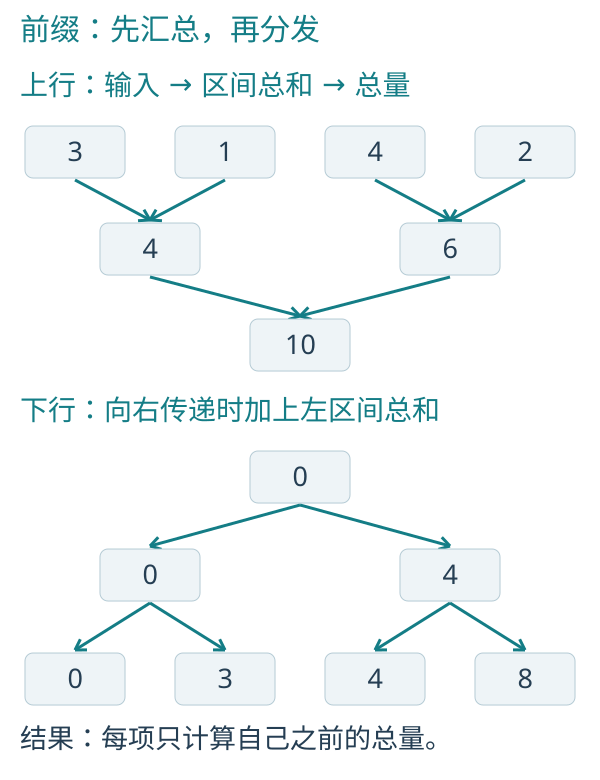

*图 4-1　扫描的上行摘要与下行前缀。右区间继承左区间总量。*

大输入的 CPU 实现可先对连续范围做局部扫描，求出范围总量；对这些摘要再扫描，最后把各范围之前的总量加回局部结果。GPU 在工作组内做树形上扫与下扫，再递归处理组摘要，并把前缀传回。

这些阶段确保读取的前缀已经就绪。若直接让所有项同时读取 `output[i-1]`，前一项可能尚未完成，就无法得到正确结果。

### 4.3　在 B 中，意图就是代码

C 串行核心：

```cpp
uint32_t before = 0;
for (size_t i = 0; i < n; ++i) {
    output[i].value = before;
    before += input[i].value;
}
```

先写 `output[i].value`，再加 `input[i].value`，所以结果不包含当前项。`before` 表示当前项之前的总和。

对应的 B 实现来自 `lessons/scan.b`：

```c
program offsets(read dataset<Count> input, write dataset<Count> output) on compute {
    scan_exclusive_sum(input.value, output.value);
}
```

`scan_exclusive_sum` 表达每个位置之前的总和。输出位置可以同时生产，前提是先形成并传播所需的区间摘要。

配套 demo 自动生成 `[3,1,4,2]`，输出 `[0,3,4,8]`，可以先手算，再运行核对。

这一个原语可以支撑变长数据打包、任务分区、筛选、基数排序等模式。原理上的“得到互不重叠区间”不表示普通 B 代码因此获得任意散写权限：当前安全散写由 compact、排序、append 等明确原语负责，不能拿一个普通扫描数值直接绕过访问规则。

### 4.4　你开始拥有一种新的解题方式

遇到“每个输入产生不同数量输出”的问题，可以先问：能否先求每个输入的产量，再做 scan，最后按区间生产？

具体实现应选择最贴切的结构：筛选可直接用 compact，重排可使用稳定排序，固定产量则可能只需独占输出。

### 4.5　编译、运行与结果

```powershell
$src = 'sample\lessons\scan.b'
$entry = 'demo'

& $blc check $src sample $entry
& $blc build $src `
    Saved\BookCompiled\scan `
    sample $entry
& $run compute cpu $src $entry sample `
    Saved\Book\scan :4 :4
& $run compute gpu $src $entry sample `
    Saved\Book\scan-gpu :4 :4
```

读取四个前缀：

```powershell
$data = [IO.File]::ReadAllBytes(
    'Saved/Book/scan/output.bldata'
)
0..3 | ForEach-Object {
    [BitConverter]::ToUInt32($data, 24 + 4 * $_)
}
```

`input.bldata` 是 `[3,1,4,2]`，`output.bldata` 是 `[0,3,4,8]`。注意末项是 8，不是包含自身的 10。

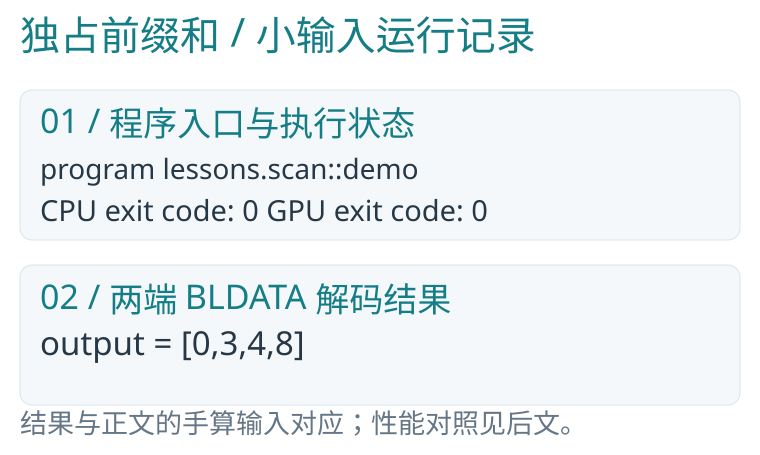

*运行记录：程序入口与实际执行输出节选，数值读取自 BLDATA 文件。*

### 4.6　把长依赖链改写后的收益

性能输入为 8,388,608 个元素，每批连续执行 8 轮，预热两批后测量九批。以下时间均为每轮耗时的中位数，沿用第 1.6 节的计时范围。

```powershell
& $bench scan 8388608 9 8
```

C++ 串行为 **2.206 ms**，B CPU 为 **1.253 ms**，B GPU 驻留执行为 **1.719 ms**，相对串行加速 **1.28 倍**。

输入循环为 [3,1,4,2]，三种版本的全部前缀相同。串行循环带着一个累加器向前推进；并行扫描先产生范围摘要，再传播前缀。树形组织增加了辅助工作，却能缩短长序列的关键依赖。


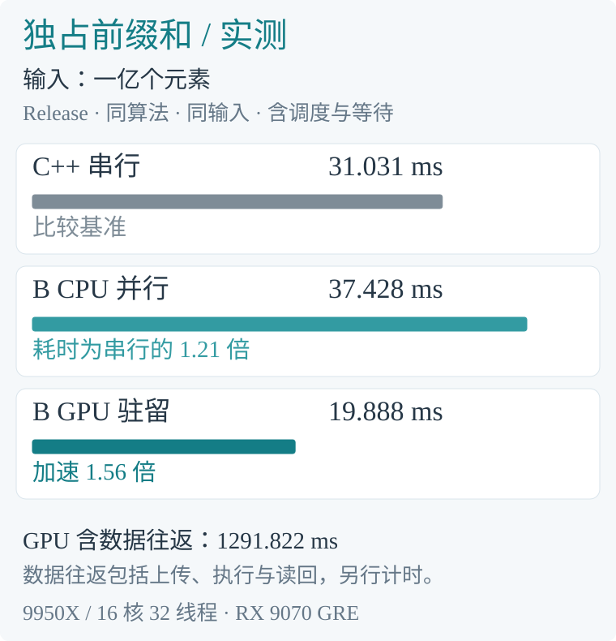

*实测记录：scan。GPU 主时间包含命令组织、提交与实际完成等待；数据往返单列。*

## 5　第五种美：让有效工作自己形成队伍

### 5.1　容量不等于工作量

一个数组能放一百万条记录，这次筛选后只剩两千条。如果后续还对一百万条容量逐个启动并判断“我是不是有效”，你描述的是存储大小，不是真正要完成的工作。

B 的 compact 稳定筛选完整记录，并产生有效数量；prefix 让下一个阶段直接消费这个有效范围。

先看串行筛选：`input` 是输入，`selected` 是筛选结果，`count[0].value` 是已写入的条数。这里假设结果容量能容纳全部输入。

```cpp
count[0].value = 0;
for (size_t i = 0; i < n; ++i) {
    if (input[i].keep) {
        selected[count[0].value] = input[i];
        count[0].value += 1;
    }
}
```

对应的 B 实现来自 `lessons/pipeline.b`：

```c
program select(read dataset<Item> input, write dataset<Item> selected,
               write dataset<Count, 1> count) on compute
    ensures prefix(selected, count.value) {
    compact(input, input.keep, selected, count.value);
}
```

串行版维护一个移动的写入位置；`compact` 先确定每个保留项的位置，再完成稳定搬运，产生有效数量。

若 id 依次为 0 到 7，keep 仅在偶数 id 上为 true，结果就是 `[0,2,4,6]`，`count.value` 为 4。稳定表示保留下来的记录仍保持原先相对顺序。

### 5.2　怎样让并行写入仍然保持顺序

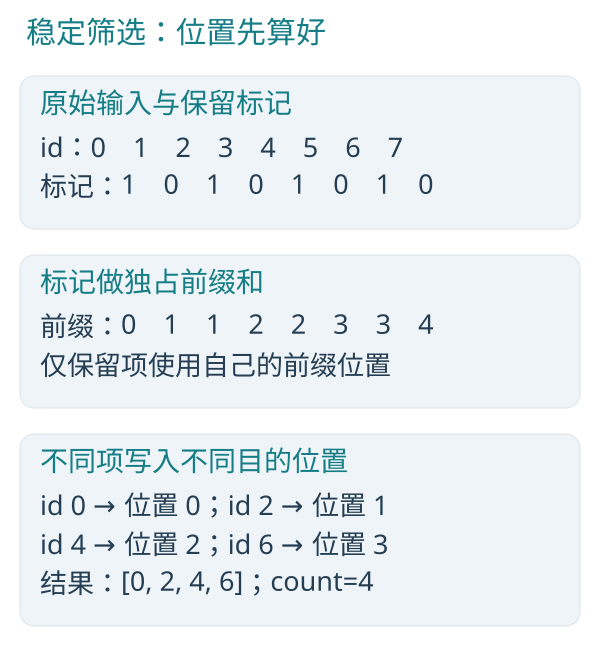

*图 5-1　保留标记的前缀和，为每条保留记录分配唯一的稳定位置。*

把 true 记作 1、false 记作 0，对标记扫描。每个保留项的前缀恰好等于“前面已有多少保留项”。因此它们得到不同的输出位置，来源顺序也被保留。最终标记总和就是 count。

当前 GPU compact 使用谓词扫描和稳定写回，摘要留在设备。CPU 可以按范围先计数，再扫描范围计数，最后让各范围从自己的起点稳定复制。两端保持相同结果，不要求采用相同的物理步骤。

这里展示的是 compact 原语内部的定位方法；普通用户代码不会因为算出一个数，就自动获得任意散写权限。

### 5.3　一个数字还不够，关系才完整

`count.value=4` 本身无法说明是哪一个数组的哪四条记录。B 的 prefix 关系把“这个输出”和“这个数量”联系起来。

`ensures prefix(selected,count.value)` 说明生产者交付这种关系；消费者用 `requires prefix(...)` 说明它需要这种关系。它们由编译器检查，不是随意写上的运行时承诺。

```c
program order(read dataset<Item> selected, read dataset<Count, 1> count,
              write dataset<Item> ordered) on compute
    requires prefix(selected, count.value)
    ensures prefix(ordered, count.value) {
    stable_sort_by_key(prefix(selected, count.value).key, ordered);
}
```

串行 C++ 可以先复制有效记录，再调用稳定排序：

```cpp
for (size_t i = 0; i < count[0].value; ++i) {
    ordered[i] = selected[i];
}
std::stable_sort(ordered, ordered + count[0].value,
    [](const Item& a, const Item& b) {
        return a.key < b.key;
    });
```

这段代码只排序前面真正产生的记录，并把同一个有效数量传给新的输出。相同 key 保持原相对顺序。

### 5.4　为什么这比“先读回数量”更有吸引力

一种常见 CPU/GPU 流水是：GPU 筛选，CPU 等待，读回 count，CPU 决定下一次启动规模，再把后续工作交给 GPU。

B 的有效域可以让计数留在设备上，由现有执行框架生成间接启动参数。算法继续写下一步计算，不必为每个阶段复制一份宿主计数。设备数据、阶段依赖和真实资源所有者仍然存在；消除的是不必要的中途来回。

输出缓冲区仍需容纳最坏情况下的全部输入。prefix 缩小的是后续工作域，已经分配的存储容量保持不变。

### 5.5　稳定和无序，各有位置

compact 要稳定保留来源顺序。另一个原语 append 关注有界接纳完整记录，可以允许不同执行者以不同次序成功加入输出。

只关心结果集合时，可以考虑无序接纳；需要保留来源顺序时，应选择稳定筛选。顺序要求来自结果的用途。

### 5.6　运行稳定筛选及其消费者

```powershell
$src = 'sample\lessons\pipeline.b'
$entry = 'demo'

& $blc check $src sample $entry
& $blc build $src `
    Saved\BookCompiled\pipeline `
    sample $entry
& $run compute cpu $src $entry sample `
    Saved\Book\pipeline :8 :8 :8 :1 :8 :1
& $run compute gpu $src $entry sample `
    Saved\Book\pipeline-gpu :8 :8 :8 :1 :8 :1
```

读取排序结果的前四个 id：

```powershell
$data = [IO.File]::ReadAllBytes(
    'Saved/Book/pipeline/ordered.bldata'
)
0..3 | ForEach-Object {
    [BitConverter]::ToUInt32($data, 24 + 16 * $_)
}
```

这个完整入口包含筛选及其后续消费者。先观察 `count.bldata` 为 4，`selected.bldata` 的有效 id 为 `[0,2,4,6]`；下一章继续读取同一次运行的排序与统计结果。

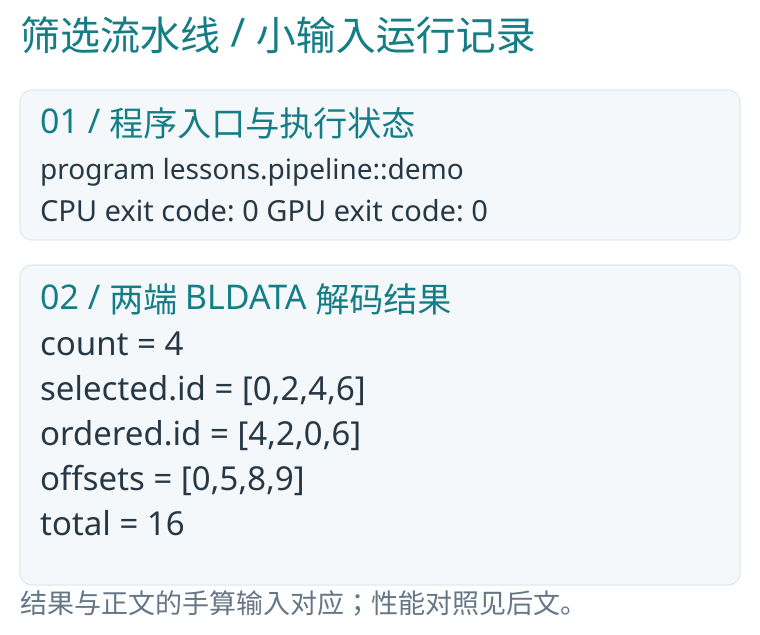

*运行记录：程序入口与实际执行输出节选，数值读取自 BLDATA 文件。*

### 5.7　稳定筛选的效率

性能输入为 16,777,216 个元素，每批连续执行 8 轮，预热两批后测量九批。以下时间均为每轮耗时的中位数，沿用第 1.6 节的计时范围。

```powershell
& $bench compact 16777216 9 8
```

C++ 串行为 **11.439 ms**，B CPU 为 **14.326 ms**，B GPU 驻留执行为 **3.752 ms**，相对串行加速 **3.05 倍**。

本节只测 select 稳定筛选，保留偶数 id，产生 8,388,608 条有效结果。完整流水线在下一章计时。串行版本一次遍历紧凑写回；并行筛选需要局部计数、前缀与分散写入，在这个规模上 GPU 的并行吞吐超过了额外工作。

当前 B CPU 为 14.326 ms，尚慢于本例的串行版本；同一套稳定语义在 GPU 上实现了 3.05 倍加速。算法形状、后端实现和硬件适配要一起考虑。

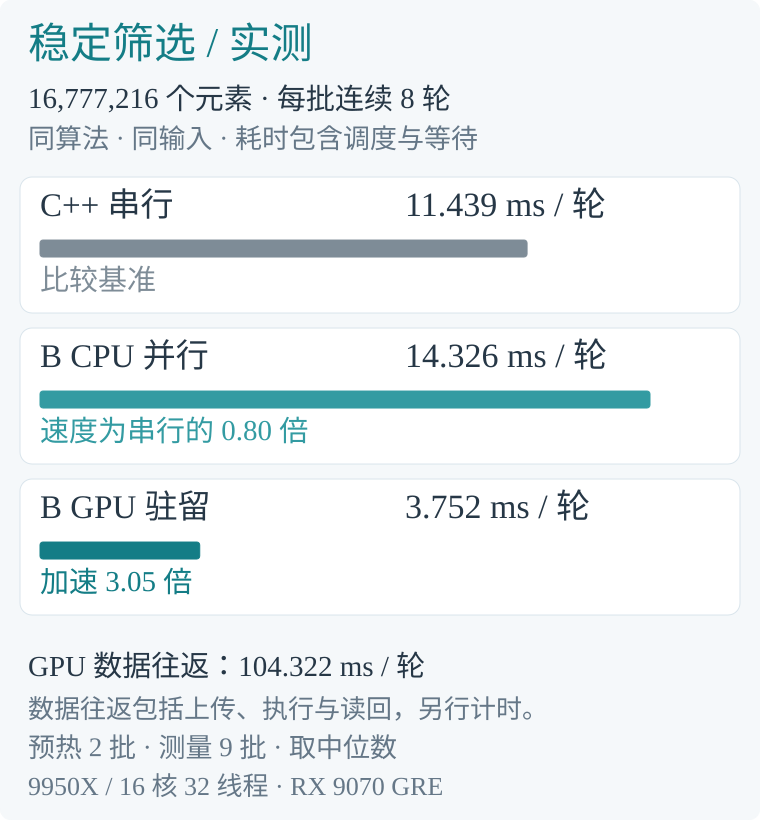

*实测记录：compact。GPU 主时间包含命令组织、提交与实际完成等待；数据往返单列。*

## 6　第六种美：几种简单结构，组成一条完整流水线

### 6.1　把问题说完整

有一批 Item，每条包含 id、key、units、keep。我们希望：保留 keep 为 true 的记录，按 key 稳定排序，为每条记录计算工作区起点，最后求总工作量。

```text
所有记录
    |
 compact          形成有效队伍
    |
 stable sort      按 key 编排，保留同键顺序
    |
    +---- scan    每条记录之前已有多少工作
    |
    +---- reduce  这批工作总共有多少
```

这里的分叉表示数据消费关系，不承诺当前执行器在硬件上让两条分支同时运行。Blink 当前仍以单队列 GPU 为主。

### 6.2　看见组合，而不是看见线程管理

`lessons/pipeline.b` 的上层 program 如下：

```c
program run(read dataset<Item> input, inout dataset<Item> selected,
            inout dataset<Item> ordered, inout dataset<Count, 1> count,
            write dataset<Offset> offsets, write dataset<Count, 1> total) on compute
    ensures prefix(ordered, count.value)
    ensures prefix(offsets, count.value) {
    select(input, selected, count);
    order(selected, count, ordered);
    summarize(ordered, count, offsets, total);
}
```

而最后一个阶段只做两件事：

```c
program summarize(read dataset<Item> ordered, read dataset<Count, 1> count,
                  write dataset<Offset> offsets,
                  write dataset<Count, 1> total) on compute
    requires prefix(ordered, count.value)
    ensures prefix(offsets, count.value) {
    scan_exclusive_sum(prefix(ordered, count.value).units, offsets.value);
    reduce_sum(prefix(ordered, count.value).units, total.value);
}
```

每个模块说清输入、输出和有效关系，上层只负责组合。你既能读懂数据去哪了，也能看清哪个阶段必须等待哪个结果。

`selected` 保存筛选结果，`ordered` 保存排序结果；count 限定有效条数，offsets 保存每条记录的起点。不同的中间结果对应不同阶段的真实职责。

串行统计的核心是同一个累加器：

```cpp
total[0].value = 0;
for (size_t i = 0; i < count[0].value; ++i) {
    offsets[i].value = total[0].value;
    total[0].value += ordered[i].units;
}
```

串行循环一次遍历就能得到起点与总量。B 用 scan 和 reduce 分别表达这两种集合关系，实际遍历次数与执行成本取决于后端实现。

### 6.3　八条记录，手算整条流水

demo 的输入规则是：`id=i`，`key=(i*7+2)%3`，`units=i+1`，偶数 id 保留。

| 位置 | 输入 id | key | units | keep |
|---|---|---|---|---|
| 0 | 0 | 2 | 1 | true |
| 1 | 1 | 0 | 2 | false |
| 2 | 2 | 1 | 3 | true |
| 3 | 3 | 2 | 4 | false |
| 4 | 4 | 0 | 5 | true |
| 5 | 5 | 1 | 6 | false |
| 6 | 6 | 2 | 7 | true |
| 7 | 7 | 0 | 8 | false |

compact 后的 id 为 `[0,2,4,6]`；稳定排序后变成 `[4,2,0,6]`。两个 key=2 的记录仍是 id=0 在 id=6 前面。

此时 units 是 `[5,3,1,7]`，独占扫描为 `[0,5,8,9]`，总和为 16。你能在纸上解释每个数，就已经理解了这条并行流水线的语义。

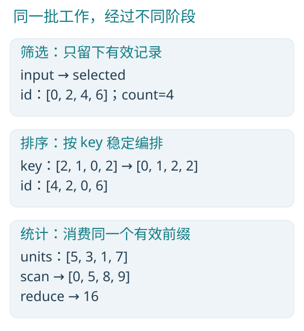

*图 6-1　筛选、排序与统计的具体中间结果。*

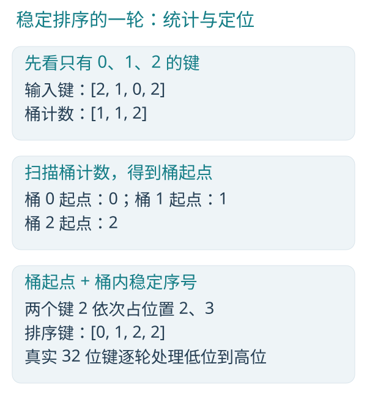

*图 6-2　用三种键理解稳定定位。图中是单轮原理示意。*

稳定基数排序把键分成若干位段处理。每轮统计各桶数量，扫描得到桶起点，再把同桶内的稳定序号加上去。当前 B 后端对 32 位键按每轮 4 位、共 8 轮组织；临时搬运键和来源序号，最后再 gather 完整记录。图中的三个桶只用于解释定位，不是当前后端恰好只用三个桶。

流水线的阶段边界来自依赖：排序需要有效记录，统计需要排序结果。GPU count 可以留在设备生成间接启动规模，避免每一步都读回 CPU；真实设备内存与执行依赖仍由框架持有。

### 6.4　与传统 C/C++ 实现比较什么

手工组织这条流水线，需要安排工作分区、局部计数、前缀合并、稳定写回和阶段等待。GPU 实现还涉及设备缓冲与内核依赖。

C++ 并行库能够封装许多调度细节。B 进一步把集合操作、访问权限、有效域和阶段组合纳入语言，使编译器能沿着同一套关系生成 CPU/GPU 代码。

简洁的表达便于阅读和维护；执行效率还需结合输入规模与实际运行分析。

### 6.5　运行整条流水线

使用上一章给出的 pipeline 编译与执行命令即可。结果依次为：selected 的有效 id `[0,2,4,6]`，ordered 的有效 id `[4,2,0,6]`，offsets `[0,5,8,9]`，total 为 16。

小输入的命令与结果见第 5.6 节。检查文件时，ordered 与 offsets 的容量仍是 8，只读取 count 指定的前 4 条；容量尾部没有参与本次计算。

### 6.6　整条流水线一起计时

性能输入为 4,194,304 个元素，每批连续执行 8 轮，预热两批后测量九批。以下时间均为每轮耗时的中位数，沿用第 1.6 节的计时范围。

```powershell
& $bench pipeline 4194304 9 8
```

C++ 串行为 **34.277 ms**，B CPU 为 **19.620 ms**，B GPU 驻留执行为 **6.798 ms**，相对串行加速 **5.04 倍**。

初始 4,194,304 条记录筛选后留下 2,097,152 条。C++ 对照同样完成稳定筛选、std::stable_sort、前缀与总量；没有拿一个局部步骤去比较整条链。B GPU 的主时间覆盖全部阶段及其依赖，并把有效数量留在设备上供后续阶段消费。


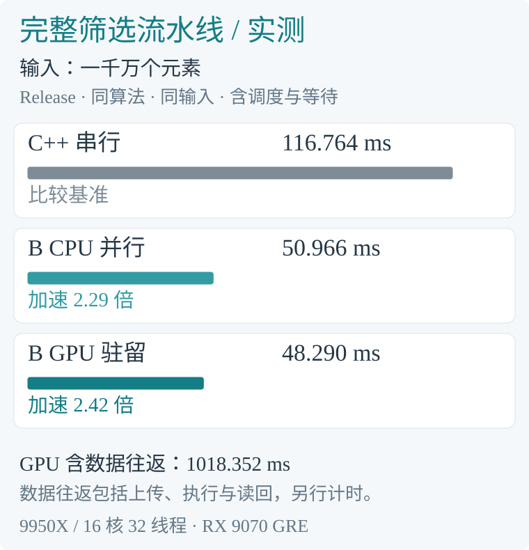

*实测记录：pipeline。GPU 主时间包含命令组织、提交与实际完成等待；数据往返单列。*

## 7　第七种美：大合唱里面，还能组成小乐队

### 7.1　为什么要分块

有时每个元素不再完全独立，它需要知道附近同一块数据的总和、均值或前缀。若每个元素都重新遍历整块，同一份工作会重复许多次；若所有元素都向全局共享变量写，又会引入争用。

tile 描述一个按逻辑元素顺序划分的小协作块。它的宽度是算法选择的静态参数；尾块只公开实际有效长度。

输入 `[1,2,3,4,5,6]` 按宽度 4 分成 `[1,2,3,4]` 和 `[5,6]` 两块，尾块的有效长度为 2。

### 7.2　先拍快照，再各自更新

先看一个块的 C 串行计算。`base` 是块起点，`length` 是实际长度，等于 Width 与剩余元素数中较小的一个；对各块依次执行这段计算，就是完整的串行处理：

```cpp
float total = 0;
for (size_t lane = 0; lane < length; ++lane) {
    total += cells[base + lane].value;
}
float before = 0;
for (size_t lane = 0; lane < length; ++lane) {
    size_t i = base + lane;
    cells[i].total = total;
    cells[i].before = before;
    cells[i].centered = cells[i].value - total / length;
    before += cells[i].value;
}
```

先得到整块总量，再填写每项结果；最后一块使用实际长度。

摘自教学源码 `lessons/tiles.b` 的 analyze 正文：

```c
parallel (cell in cells) {
    let values = tile_input(cells.value, Width);
    f32 total = tile_reduce_sum(values);
    f32 before = tile_scan_exclusive_sum(values);
    f32 centered = cooperate center(values, cell.value);
    cell.total = total;
    cell.before = before;
    cell.centered = centered;
}
```

`tile_input` 读取阶段入口时的块内只读快照。即使后面更新原 dataset，协作者读到的仍是这个版本，避免一个人读旧值、另一个人已经读到新值。

这里 `cells` 是完整记录集，`values` 是当前块的只读数值快照。每条 Cell 保存 value、total、before、centered，分别对应原值、块内总量、块内前缀与去中心结果。

第一块的 total 都是 10，before 是 `[0,1,3,6]`，减去均值后的 centered 是 `[-1.5,-0.5,0.5,1.5]`。第二块 total 是 11，before 是 `[0,5]`，centered 是 `[-0.5,0.5]`。

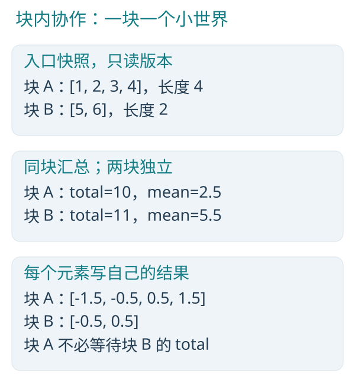

*图 7-1　块内需要合作，块间可以独立。尾块均值使用真实长度。*

CPU 在原生范围内按块保存所需输入，再完成各个协作阶段；范围边界按逻辑块对齐。GPU 把一个逻辑 tile 对应到工作组，共享载入后通过块内屏障让所需数据可见，再做集合运算。尾部没有有效数据的调用不读取虚构元素，但仍须参加统一的块内同步。

这解释了快照的价值：先读哪一版被写进语义，不让线程到达的偶然先后决定读到旧值还是新值。

### 7.3　发布计算结果，不必先写回全局数组

串行版先产生整块新值，再汇总，最后写结果。以下是当前块 `[base, base+length)` 的核心，块划分与上节相同：

```cpp
float total = 0;
for (size_t lane = 0; lane < length; ++lane) {
    size_t i = base + lane;
    cells[i].value *= factor;
    total += cells[i].value;
}
for (size_t lane = 0; lane < length; ++lane) {
    size_t i = base + lane;
    cells[i].total = total;
    cells[i].centered = cells[i].value - total / length;
}
```

另一个 program 的核心是：

```c
parallel (cell in cells) {
    let transformed = tile_publish(cell.value * factor, Width);
    f32 total = tile_reduce_sum(transformed);
    cell.value = transformed[transformed.lane];
    cell.total = total;
    cell.centered = cell.value - total / f32(transformed.length);
}
```

先让每个元素算出自己的变换值，再把这一批值发布给同块协作者。编译器处理发布和同步，不需要算法先申请一个全局中间 dataset，再启动第二个 program 才能读到结果。

GPU 在同一个内核内完成静态发布与后续集合；CPU 则在原生范围内按块执行，发布过程直接融入块内计算。

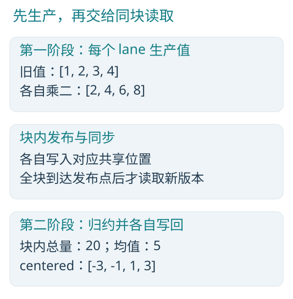

*图 7-2　发布点区分生产与消费，不能在其他 lane 尚未写入时读取新版本。*

### 7.4　理解三种协作范围

| 范围 | 表达什么 | 不能拿来冒充什么 |
|---|---|---|
| dataset / prefix | 全体或有效前缀工作域 | 不是一个硬件 subgroup |
| tile | 算法选择的逻辑块 | 不是全局同步范围 |
| subgroup | GPU 实际活动协作集合 | 不保证与逻辑记录顺序一一对应 |

`tile.lane` 是块内逻辑位置；`index()` 是当前全局元素序号；GPU subgroup 的 lane 则属于硬件协作集合。它们叫法相似，职责不同。

本书优先用 tile 建立可跨 CPU/GPU 的协作直觉。subgroup 是更贴近 GPU 的工具，B 已支持值归约、投票、选举等操作，但不能把 subgroup 计数当作全局唯一输出位置。

### 7.5　局部合作，也要尊重阶段

当前 tile 发布、集合与 cooperate 调用位于 parallel 或 cooperative 的根块，不支持在动态循环或分支里随意插入协作阶段。不要把“本次分支刚好全员进入”当作通用同步依据。

块内阶段不能让别的块也完成；全域依赖要在 program 阶段表达。局部越清晰，全局越容易组合。

### 7.6　编译、运行与结果

```powershell
$src = 'sample\lessons\tiles.b'
$entry = 'demo<4>'

& $blc check $src sample $entry
& $blc build $src `
    Saved\BookCompiled\tiles `
    sample $entry
& $run compute cpu $src $entry sample `
    Saved\Book\tiles :6
& $run compute gpu $src $entry sample `
    Saved\Book\tiles-gpu :6
```

读取六个 centered 字段：

```powershell
$data = [IO.File]::ReadAllBytes(
    'Saved/Book/tiles/cells.bldata'
)
0..5 | ForEach-Object {
    [BitConverter]::ToSingle($data, 36 + 16 * $_)
}
```

`cells.bldata` 中六条记录各有 value、total、before、centered 四个 f32 字段。第一块总量为 10，第二块为 11；前缀与去中心结果见第 7.2 节。

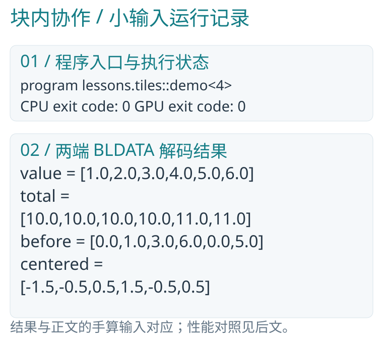

*运行记录：程序入口与实际执行输出节选，数值读取自 BLDATA 文件。*

### 7.7　把小块协作铺满大数组

性能输入为 4,194,304 个元素，每批连续执行 8 轮，预热两批后测量九批。以下时间均为每轮耗时的中位数，沿用第 1.6 节的计时范围。

```powershell
& $bench tiles 4194304 9 8
```

C++ 串行为 **2.746 ms**，B CPU 为 **1.504 ms**，B GPU 驻留执行为 **0.629 ms**，相对串行加速 **4.36 倍**。

性能输入循环为 1 到 17，块宽选择 32。C++ 对照按块先求总量，再一次生成前缀与去中心结果，避免每个元素重复求和。B 的完整 analyze 同时包含快照、块内总量、前缀以及 cooperative center，计时覆盖这些工作。


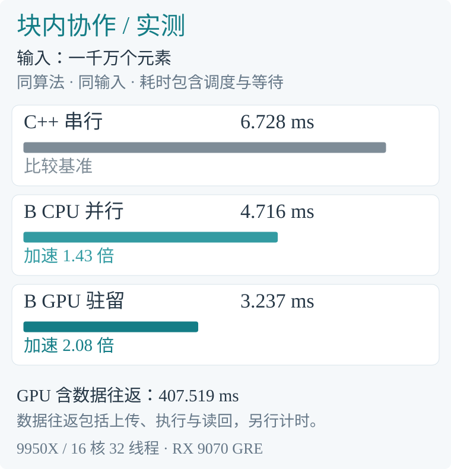

*实测记录：tiles。GPU 主时间包含命令组织、提交与实际完成等待；数据往返单列。*


### 7.8　运行发布后协作

```powershell
$src = 'sample\lessons\tiles.b'
$entry = 'demo_publish<4>'

& $blc check $src sample $entry
& $blc build $src `
    Saved\BookCompiled\publish `
    sample $entry
& $run compute cpu $src $entry sample `
    Saved\Book\publish :6 -- 2
& $run compute gpu $src $entry sample `
    Saved\Book\publish-gpu :6 -- 2
```

读取六个 centered 字段：

```powershell
$data = [IO.File]::ReadAllBytes(
    'Saved/Book/publish/cells.bldata'
)
0..5 | ForEach-Object {
    [BitConverter]::ToSingle($data, 36 + 16 * $_)
}
```

乘二后数值为 `[2,4,6,8,10,12]`；块总量依次为 `[20,20,20,20,22,22]`，去中心结果为 `[-3,-1,1,3,-1,1]`。before 没有被 publish 改写，仍保留初始化值。

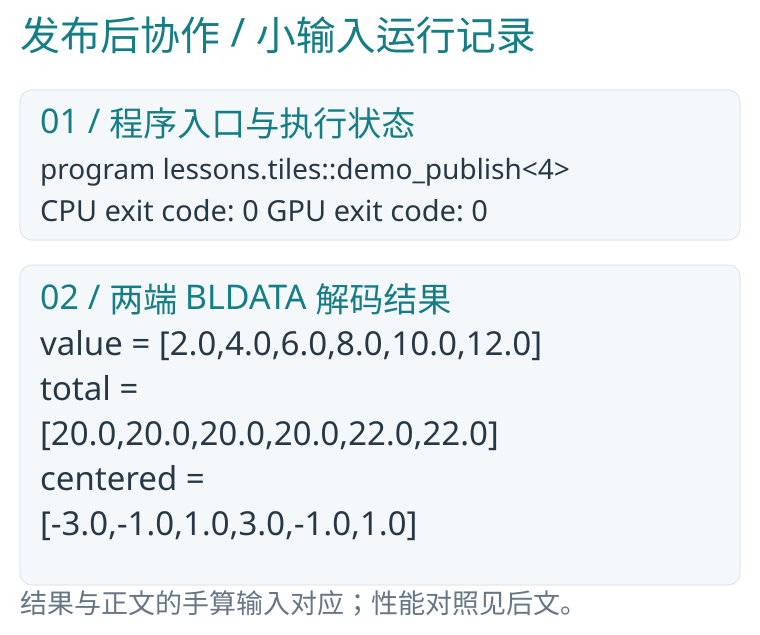

*运行记录：程序入口与实际执行输出节选，数值读取自 BLDATA 文件。*

### 7.9　发布与协作的整体成本

性能输入为 4,194,304 个元素，每批连续执行 8 轮，预热两批后测量九批。以下时间均为每轮耗时的中位数，沿用第 1.6 节的计时范围。

```powershell
& $bench publish 4194304 9 8
```

C++ 串行为 **2.931 ms**，B CPU 为 **1.356 ms**，B GPU 驻留执行为 **0.637 ms**，相对串行加速 **4.60 倍**。

块宽为 32，factor=2。C++ 对照在块内变换、求和并写出去中心结果；B 将发布点与后续协作保留在块内执行。三种实现最终的 value、total、centered 相同，测量包含发布所需的同步。


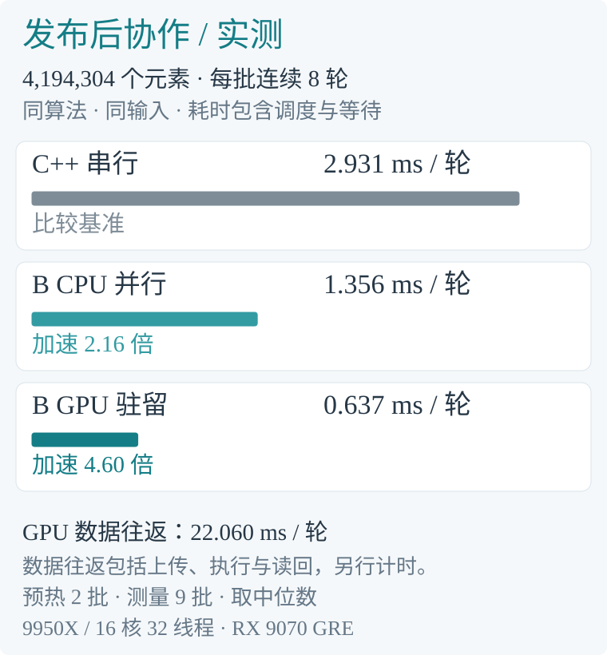

*实测记录：publish。GPU 主时间包含命令组织、提交与实际完成等待；数据往返单列。*

## 8　第八种美：抽象可以留下思想，消去搬运

### 8.1　把协作写进函数接口

在上章中，center 是一个协作函数：

```c
cooperative f32 center(tile<f32> values, f32 value) on compute {
    f32 total = tile_reduce_sum(values);
    return value - total / f32(values.length);
}
```

C++ 串行函数可以用普通循环表达同一公式：

```cpp
float center(const float* values, size_t length, float value) {
    float total = 0;
    for (size_t i = 0; i < length; ++i) {
        total += values[i];
    }
    return value - total / length;
}
```

这个 C++ 函数每次调用都会求和，连续处理整块时应复用 total，如上一章所示。B 的 cooperative 函数由同块参与者共同完成归约，调用时静态展开到块内计算。

调用处的 `cooperate center(...)` 明确标出块内协作，让所需的同步关系在接口上可见。

`values` 提供块内只读输入，`value` 是当前元素的普通数值。函数返回当前元素减去块均值的结果。

tile 参数借用原来的块与数据来源，不复制一份输入数组。函数继承调用者的块宽度，可以服务不同块大小。

### 8.2　普通函数、协作函数、program

普通函数封装逐元素数值与显式借用；cooperative 函数封装块内协作；program 组织元素域与全域阶段。选对层次，比把所有事情写进一个大函数更重要。

编译器把静态调用展开到共同 IR，再生成原生计算。函数封装保留职责划分，展开后的数据与控制流则为融合和消除多余存取提供条件。

### 8.3　用 const 确定算法形状

`analyze<const Width:u32>` 的 Width 在编译实例化时确定。`analyze<4>` 和 `analyze<17>` 可以共用源码，却具有各自确定的逻辑块形状。

与之相对，`factor` 是运行时传入的统一数值。Width 决定块的形状，factor 决定这次计算采用的乘数。

B 还支持受约束的数值类型泛型。例如 floating 包含 f32 与 float2/3/4。它不是完整 C++ 模板系统；开放接口约束、关联类型与完整符号泛型分析仍未实现。开放 const 声明依赖具体值的正文，在实际实例化时才完整检查。

### 8.4　抽象值得保留的理由

如果一个函数准确表达“块内去中心”“位置积分”“有序变换组合”，它就把可复用的思想从调度细节中提取出来。编译器还能看见这些思想背后的数据与阶段，才有机会一起优化。

好的抽象保留算法的意图，也保留必要的阶段关系。

### 8.5　运行协作函数

本章的 center 已在 `lessons/tiles.b` 的 analyze 中调用。使用第 7.6 节的 check、build 和两端执行命令；center 的返回值写入 centered 字段。它与外层 analyze 共用执行入口。第 7.7 节的性能测量已包含这次函数协作：C++ 为 2.746 ms，B CPU 为 1.504 ms，B GPU 为 0.629 ms。函数封装保留在源码中，实际加速来自展开后的同一份块内计算。

## 9　第九种美：先找可组合的规律，再寻找并行性

### 9.1　有先后依赖的变换链

假设依次应用四次变换，每次都是 `x = 2*x + 1`。初看，后一次必须等待前一次，似乎没有办法并行。

换一个表示：一个变换由 `(scale,bias)` 描述，表示 `x -> scale*x+bias`。先做 a，再做 b，可以得到一个合并变换：

```text
combined.scale = b.scale * a.scale
combined.bias  = b.scale * a.bias + b.bias
```

我们不急着把初始 x 送过每一步，而是先组合“这些步骤整体代表什么”。函数组合满足结合律，因此可以用树合并。

串行 C++ 核心在输入顺序上反复组合，compose 使用上面的同一公式：

```cpp
Affine combined = {1, 0};
for (size_t i = 0; i < n; ++i) {
    before[i].value = combined;
    combined = compose(combined, input[i].value);
}
total[0].value = combined;
```

### 9.2　B 里的完整算法核心

源码：`lessons/algebra.b`。Affine 有 u32 的 scale 和 bias 两个字段，Transform 用 value 字段保存它。

```c
Affine identity() on compute { return Affine(1, 0); }

Affine compose(Affine a, Affine b) on compute {
    return Affine(b.scale * a.scale, b.scale * a.bias + b.bias);
}

program chain(read dataset<Transform> input,
              write dataset<Transform> before,
              write dataset<Transform, 1> total) on compute {
    scan_exclusive(input.value, before.value, identity, compose);
    reduce(input.value, total.value, identity, compose);
}
```

identity 是空区间的摘要，表示 `x -> x`；compose 按先 a 后 b 的顺序连接两个摘要。scan 将每一步之前的组合写入 `before`，reduce 将全部步骤的组合写入 `total`。

四次 `(2,1)` 的独占扫描为 `(1,0)、(2,1)、(4,3)、(8,7)`，最后总变换为 `(16,15)`。初始 x=3 时，最终结果就是 16*3+15=63，与逐次执行完全对应。

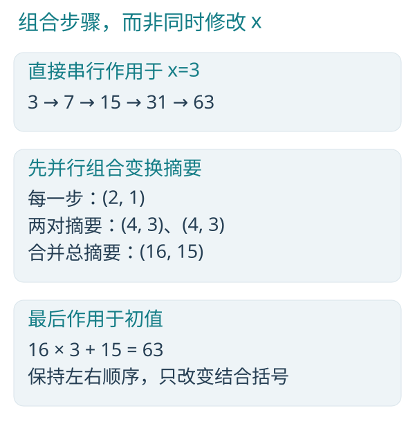

*图 9-1　把有依赖的操作链变成可组合摘要，再把摘要作用于初值。*

真正并行的是摘要构造与有序合并，不是让四个执行者同时改同一个 x。扫描仍按前缀传播算法产生每一步之前的摘要；归约产生整个区间的摘要。CPU 与 GPU 可以采用不同分区，但不能交换左右输入的逻辑顺序。

### 9.3　顺序可以保留，括号可以改变

先做“加一”再做“乘二”，与先乘二再加一不同。因此这里不能交换输入顺序。B 的有序自定义归约和扫描允许改变结合括号，保留逻辑输入的左右顺序。

当前示例使用 u32 模 2^32 运算，组合规律在这个语义下仍成立。换成 f32，浮点舍入又会成为需要单独考虑的问题。编译器检查类型、权限和接口，不替你证明任意 compose 都满足结合律与单位元要求。

### 9.4　并行算法的创造力在哪里

关键的转折是为依赖找到摘要。摘要能够组合，长链就有了树的形状。

状态机摘要、矩阵连乘、区间统计等问题中也可能出现这种结构，但不是所有递推都能轻易找到小而可结合的摘要。如果摘要比原问题还大，或者合并代价过高，转换也可能没有实际收益。

### 9.5　编译、运行与结果

```powershell
$src = 'sample\lessons\algebra.b'
$entry = 'demo'

& $blc check $src sample $entry
& $blc build $src `
    Saved\BookCompiled\algebra `
    sample $entry
& $run compute cpu $src $entry sample `
    Saved\Book\algebra :4 :4 :1
& $run compute gpu $src $entry sample `
    Saved\Book\algebra-gpu :4 :4 :1
```

依次读取总变换的 scale 与 bias：

```powershell
$data = [IO.File]::ReadAllBytes(
    'Saved/Book/algebra/total.bldata'
)
0..1 | ForEach-Object {
    [BitConverter]::ToUInt32($data, 24 + 4 * $_)
}
```

before 的四个变换为 `(1,0)、(2,1)、(4,3)、(8,7)`；total 为 `(16,15)`。两端结果相同。

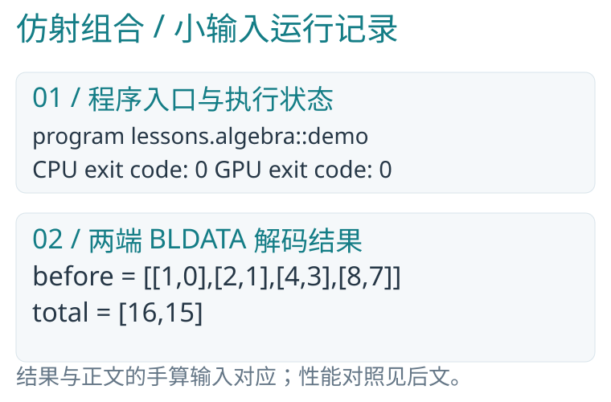

*运行记录：程序入口与实际执行输出节选，数值读取自 BLDATA 文件。*

### 9.6　让可组合的摘要承担长序列

性能输入为 16,777,216 个元素，每批连续执行 8 轮，预热两批后测量九批。以下时间均为每轮耗时的中位数，沿用第 1.6 节的计时范围。

```powershell
& $bench algebra 16777216 9 8
```

C++ 串行为 **12.348 ms**，B CPU 为 **14.033 ms**，B GPU 驻留执行为 **3.725 ms**，相对串行加速 **3.31 倍**。

C++ 对照一次遍历同时生成所有前缀和总变换；B 同样输出这两种结果。性能数据选择 scale=1、bias 循环 1 到 7，使长序列保持在清楚的数值范围内；编译执行的仍是本章完整 Affine 组合操作。所有整数前缀与总变换相同。

当前 B CPU 为 14.033 ms，串行版本为 12.348 ms；并行算法的辅助遍历在这一端尚未换来收益。GPU 上的同一组扫描与归约则缩短到 3.725 ms。

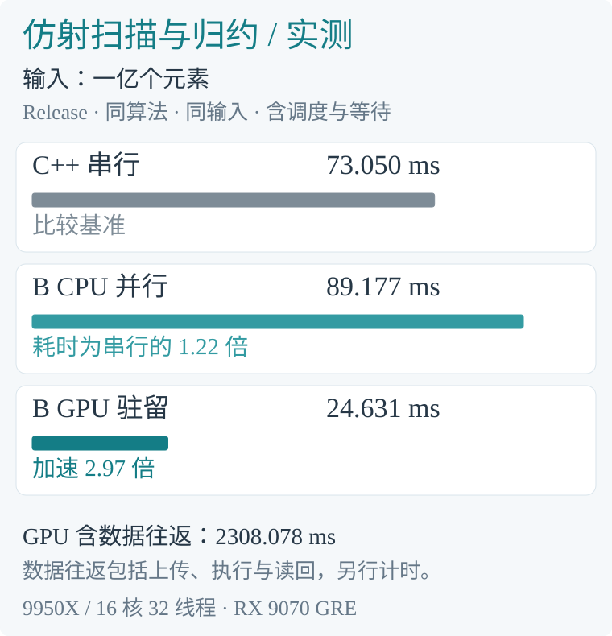

*实测记录：algebra。GPU 主时间包含命令组织、提交与实际完成等待；数据往返单列。*

## 10　把美落到性能：工作量、依赖、搬运和争用

### 10.1　四个比线程数更有用的问题

总共需要多少计算？最长依赖链有多长？数据要搬运几次？多少执行者在争抢同一个位置？

map 通常容易扩展，但可能很快耗尽内存带宽；reduce 缩短依赖链，却引入合并；scan 多做一些摘要与传播，换来可并行分配的结构；tile 让局部数据更接近协作者，但也占用共享存储和同步预算。

不要因为一个版本使用了更多“并行原语”，就先认定它更好。先看问题结构，再看实测。

### 10.2　一小段串行工作，会限制整体收益

假设程序有 10% 的时间无法并行，其余 90% 可以理想分摊给 P 个执行资源。忽略所有额外成本，理想加速比是：

```text
speedup(P) = 1 / (0.10 + 0.90 / P)
```

按 Amdahl 定律，P=8 时的理想加速比约为 4.71；即使 P 无限增大，也不超过 10。实际运行还要承担调度、同步和数据搬运的成本。

因此，不必要的 CPU 等待、每一步读回设备计数、重复资源准备，可能比某个乘法是否更快更值得处理。优化要沿着完整消费链看。

### 10.3　什么时候需要原子

如果许多元素真的需要修改同一个 u32/i32 位置，B 用 atomic dataset 与显式 atomic 操作表达。例如直方图中，多个样本会落进同一个桶。

C++ 的共享计数可用 `std::atomic<uint32_t>` 表示。计数桶已声明为原子字段时，核心操作为：

```cpp
bins[k].count.fetch_add(1, std::memory_order_relaxed);
```

B 的桶通过 atomic dataset 借用，操作核心是：

```c
atomic_add(bins[k].count, 1, relaxed);
```

原子加保证这一个位置的修改不可被相互覆盖；relaxed 不自动发布其他位置的数据，也不是全域屏障。release/acquire 只有满足实际同步关系时才建立相应可见性，不能让任意跨工作组自旋算法获得推进保证。

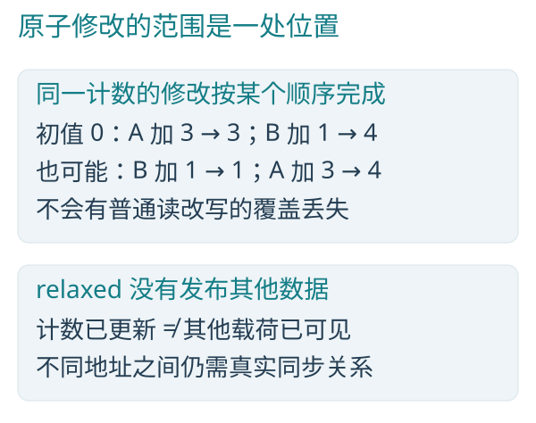

*图 10-1　原子操作串行化同一位置的修改，但不自动发布其他数据。*

纯求和通常先选 reduce。需要真实共享更新时再选 atomic。把所有元素挤到一个热桶，原子操作会遇到争用；改成合理的局部汇总再合并可能改善它，但要由具体数据分布与算法决定。

### 10.4　同步不是一个万能按钮

| 手段 | 它解决什么 | 它没有解决什么 |
|---|---|---|
| 普通元素独占写 | 多个实例不抢同一普通输出 | 不决定业务公式 |
| 原子操作 | 明确共享位置的不可分割修改 | 不保证其他数据都已完成 |
| tile 发布 / 块屏障 | 当前逻辑块内阶段协作 | 不等待所有块 |
| program 依赖 / phase | 全域阶段的先后关系 | 不保证两个后端浮点逐位一致 |
| 原生完成点 | 设备消费者确实完成 | 不等于提交调用已返回 |

GPU 提交返回时，设备可能还在工作。资源应活到最后一个真实消费者完成，不能以 CPU 函数结束、帧结束或发出命令代替设备完成。

### 10.5　让计时回答真实的问题

一份有用的对照至少要说明四件事：同一算法要完成哪些结果、输入有多大、代码和数据起初在哪里、计时到什么地方结束。本书各章的主对照采用相同输入与轮数，CPU 计时到算法完成，GPU 计时到设备实际完成。

`GPU_program_ms` 只记录设备程序跨度；`compute_elapsed_ms` 还包含当前 CLI 中的设备准备、传输与输出。第 1 章的实测将这些费用分开，并用包含提交与等待的 GPU 墙钟时间计算主加速比。

规模有两种作用。首先，足够多的元素才能摊薄固定开销。其次，当单轮很轻而算法需要连续推进时，把数据保持驻留并批量提交，才能避免每一步都经过宿主准备与数据往返。CPU 版本也必须完成同样的轮数，不能省去串行一方的工作或给它加入延迟。

并行收益还取决于总工作量。稳定筛选、扫描和自定义归约可能需要摘要、前缀或额外遍历；串行的一趟直接循环仍是强有力的基准。观察实测中 CPU 与 GPU 的差别，可以判断是该扩大工作域、保留数据驻留，还是应继续改善当前后端。

### 10.6　把加速比放回完整应用

材质采样与 GGX 的单轮串行为 202.687 ms，GPU 驻留执行为 2.234 ms，加速 90.73 倍。重新上传全部点数据、执行八轮并读回，平均每轮为 156.528 ms，仍短于串行版本，但收益已经明显缩小。

8K 采样转换为 4K 显示输出，串行为 180.949 ms，GPU 驻留为 1.684 ms；同样计入每批数据往返后，平均每轮为 31.897 ms。这里每个输出还要完成均值、色调映射、gamma 与颜色打包，计算更充足，因此能更好地摊薄搬运。

乘二加一则不同：公式很轻，主存数据可直接交给 B CPU 范围并行；若它属于已经驻留 GPU 的计算链，再接上 GPU map 更合适。衡量并行的价值，要从可展开的工作出发，并沿真实的数据消费关系把收益留下来。

## 11　走进真实代码之一：一群粒子的运动

### 11.1　先认出熟悉的独立结构

现在打开 BLEngine `Programs/simulation/bodies.b`。不必理解整个引擎，只看一个粒子如何更新：

```c
void integrate_body<T: floating, const Power: u32 in {1, 2, 3}>(inout BLBody<T, Power> body, f32 dt, f32 strength) on compute {
    body.velocity += central_acceleration<Power>(body.position, strength) * dt;
    body.position += body.velocity * dt;
}
```

inout 借用的是当前粒子的独占位置。先改速度，再用新速度改位置，是这个积分方法内部真实存在的先后关系。不同粒子之间并没有因此产生依赖。

若按 C++ 的串行方式遍历，核心可以写成下面这样。假设相同的单粒子函数已经实现，这里只比较遍历：

```cpp
for (size_t i = 0; i < n; ++i) {
    auto& body = bodies[i];
    integrate_body(body, dt, strength);
}
```

B 的外层入口声明并行粒子域：

```c
program integrate<B: BLSimulatedBody>(inout dataset<B> bodies, f32 dt, f32 strength) on compute {
    parallel (body in bodies) {
        integrate_body(body, dt, strength);
    }
}
```

这仍然是 map：独立元素的计算由一次线性变换扩展成单粒子积分。

### 11.2　统一公式，静态选择模型

中心加速度来自 `Programs/math/field.b`：

```c
T central_acceleration<T: floating, const Power: u32 in {1, 2, 3}>(T position, f32 strength) {
    // 有限半径中心势：0.25 是力场的软化长度平方，属于算法参数。
    f32 radius_squared = dot(position, position) + 0.25;
    return -position * (strength / (Power == 1 ? sqrt(radius_squared) : Power == 2 ? radius_squared : radius_squared * sqrt(radius_squared)));
}
```

先从接口理解公式：T 表示浮点标量或向量，Power 选择力场模型，strength 是统一参数，position 是当前粒子的位置。

一份算法可以覆盖不同向量维度与力场模型，并生成 CPU/GPU 代码。Power 在编译实例化时确定，因此模型选择在生成代码时就已明确。

### 11.3　把功能分开写，让编译器保留全貌

同一文件中，能量计算与阶段组合如下：

```c
void measure_energy<T: floating>(write f32 target, T velocity) on compute {
    target = 0.5 * dot(velocity, velocity);
}

program energy<B: BLSimulatedBody>(inout dataset<B> bodies) on compute {
    parallel (body in bodies) {
        measure_energy(body.energy, body.velocity);
    }
}
```

```c
program step<B: BLSimulatedBody>(inout dataset<B> bodies, f32 dt, f32 strength) on compute {
    integrate(bodies, dt, strength);
    energy(bodies);
}
```

integrate 和 energy 具有同一元素域，且这里的能量只读取自己刚更新的速度。满足现有依赖条件时，编译器可以融合相邻 map，少一次全局中间读写。

`measure_energy` 只借用当前粒子的 energy 字段，并读取当前速度；它不引入跨粒子依赖。

积分与能量计算各有清楚的职责，编译器也能看见它们的数据联系。模块化因而可以与融合优化共存。

显式 `phase;` 会保留阶段边界。它应表达真实需要的全域阶段，不要在每个函数后机械插入，以免抹掉本来可以融合的关系。

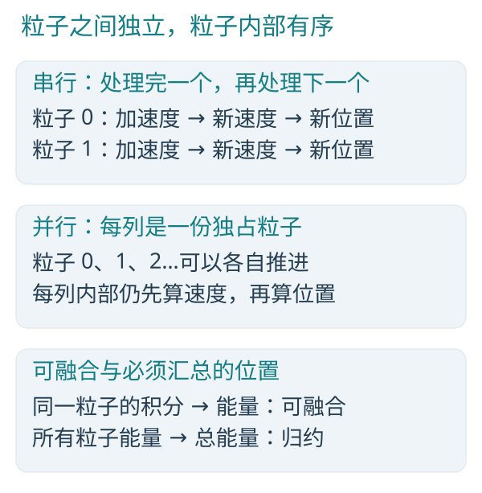

*图 11-1　粒子内部的顺序、粒子之间的并行与全体归约是三个层次。*

串行 C++ 若直接逐粒子完成积分与能量，核心如下：

```cpp
for (size_t i = 0; i < n; ++i) {
    integrate_body(bodies[i], dt, strength);
    measure_energy(bodies[i].energy, bodies[i].velocity);
}
```

总能量还需要汇总所有粒子的能量。它将引入下一节的全域归约，成为这条计算链中新的依赖层次。

### 11.4　再接上一个集合

摘自 `Programs/simulation/statistics.b`：

```c
program step_and_total(inout dataset<BLBody<float3, 3>> bodies, write dataset<BLTotal, 1> total, f32 dt, f32 strength) on compute {
    step(bodies, dt, strength);
    total_energy(bodies, total);
}
```

前面的更新是逐元素阶段，最后的总能量是集合阶段。它们可以组成一个 program，却不能把全体求和假装成每个粒子的独立计算。

C/C++ 读者可以把它理解为“先表达整条依赖链，再让执行器兑现”。手工线程版需要安排范围与合并；手写 CPU/GPU 双版本通常还要维护两套计算实现。B 把共同算法留在 `.b`，目标选择和真实资源执行交给框架。

### 11.5　收益与边界

这段实现展示了数据并行、独占借用、普通函数封装、静态泛型、阶段组合和归约。它不表示任意物理模拟都能逐粒子独立更新。若新算法要求读取其他粒子正在变化的状态，就必须重新组织快照、只读输入或集合依赖，不能照抄这个并行域当作已经正确。

### 11.6　四百多万粒子的真实更新

性能输入为 4,194,304 个元素，每批连续执行 8 轮，预热两批后测量九批。以下时间均为每轮耗时的中位数，沿用第 1.6 节的计时范围。

```powershell
& $bench bodies 4194304 9 8
```

C++ 串行为 **14.593 ms**，B CPU 为 **3.751 ms**，B GPU 驻留执行为 **1.013 ms**，相对串行加速 **14.41 倍**。

这里直接调用 BLEngine 的 step<BLBody<float3,3>>，每一轮都完成中心力场、速度、位置和能量更新。C++ 使用相同初值、f32 公式与时间步长。积分和能量的模块化写法都保留在 B 源码中；测量比较的是它们实际生成并执行后的整体结果。


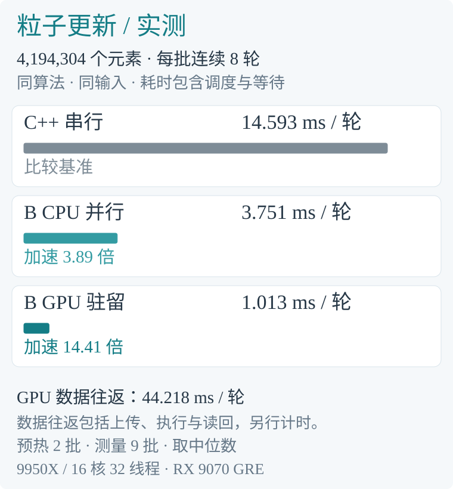

*实测记录：bodies。GPU 主时间包含命令组织、提交与实际完成等待；数据往返单列。*

### 11.7　接上总能量之后

性能输入为 4,194,304 个元素，每批连续执行 8 轮，预热两批后测量九批。以下时间均为每轮耗时的中位数，沿用第 1.6 节的计时范围。

```powershell
& $bench body_total 4194304 9 8
```

C++ 串行为 **17.430 ms**，B CPU 为 **6.363 ms**，B GPU 驻留执行为 **1.896 ms**，相对串行加速 **9.19 倍**。

这个对照进一步直接调用引擎 step_and_total。计时包含粒子更新和全局能量归约，GPU 无需在中间把能量字段读回给宿主求和。C++ 串行对照也完整完成更新与求和。

最后一批的总能量，C++ f32 线性累加为 1223.3463，B CPU 为 1224.0052，B GPU 为 1224.0063。将同一批粒子的 f32 能量以 f64 累加，参考值为 1224.006358。第 3.4 节所讲的分组与舍入在这里真实出现：串行顺序并不自动意味着更准确，树形与分块归约也要结合数值要求评价。

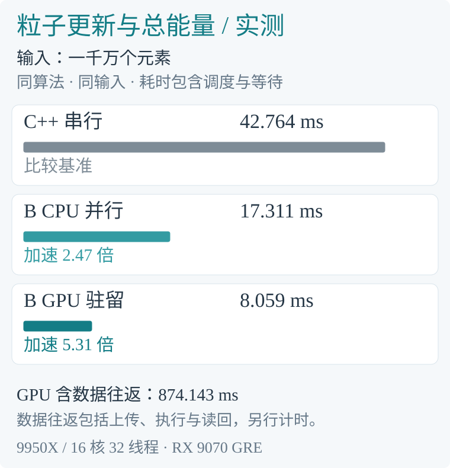

*实测记录：body_total。GPU 主时间包含命令组织、提交与实际完成等待；数据往返单列。*

## 12　走进真实代码之二：读很多地方，只写自己的结果

### 12.1　并行不要求只读自己的输入

独占输出是关键约束之一；共享只读输入可以被许多实例共同使用。这个结构叫 gather，直观地说，就是“我到各处读材料，回到自己的位置写成品”。

先看采样均值的 C 串行核心。后续色调映射和颜色打包仍是当前输出的局部计算：

```cpp
for (size_t i = 0; i < display_count; ++i) {
    size_t internal_width = W * 2;
    size_t sample_base = (i / W) * (internal_width * 2) + (i % W) * 2;
    float3 radiance = (pixels[sample_base].radiance
        + pixels[sample_base + 1].radiance
        + pixels[sample_base + internal_width].radiance
        + pixels[sample_base + internal_width + 1].radiance) * 0.25f;
    // Map radiance and write display[i].bgra.
}
```

这里是局部计算片段，float3 和后续映射函数由工程提供。

BLEngine `Programs/render/resolve.b` 让每个显示像素读取四个内部采样，再生产自己的颜色。下面把当前通用实现的 S=2 采样循环展开，便于同串行版本逐行对照；完整的尺寸参数与循环保留在原模块中：

```c
parallel (pixel in display) {
        u32 internal_width = W * 2;
        u32 sample_base = (index() / W) * (internal_width * 2) + (index() % W) * 2;
        float3 radiance = (pixels[sample_base].radiance + pixels[sample_base + 1].radiance
            + pixels[sample_base + internal_width].radiance + pixels[sample_base + (internal_width + 1)].radiance) * 0.25;
        float3 mapped = pow(max(radiance / (radiance + 1.0), float3(0.0)), 0.454545454545);
        u32 red = u32(clamp(mapped.r * 255.0 + 0.5, 0.0, 255.0));
        u32 green = u32(clamp(mapped.g * 255.0 + 0.5, 0.0, 255.0));
        u32 blue = u32(clamp(mapped.b * 255.0 + 0.5, 0.0, 255.0));
        pixel.bgra = (red << 16) | (green << 8) | blue | 0xff000000;
    }
```

无需先学渲染。只看关系：pixels 只读，display 可写，每个实例把结果写进自己的 pixel。即使两个显示结果读取了相同输入，只要输入确实只读，也不会造成写冲突。

这里容易混淆的是 `pixels` 和 `pixel`：原实现中 `pixels` 是内部采样输入，`display` 是显示输出；`parallel (pixel in display)` 中的 `pixel` 对应串行遍历的 `display[i]`，不是输入 `pixels[i]`。`index()` 对应当前输出的下标 `i`，据此算出相同的 `sample_base` 并读取输入。

这里内部采样到输出的具体比例属于当前消费者，不是 B 语言的规定。这个算法的可读性来自“输入集合、当前输出、显式寻址与数学”，而不是某个固定屏幕尺寸。

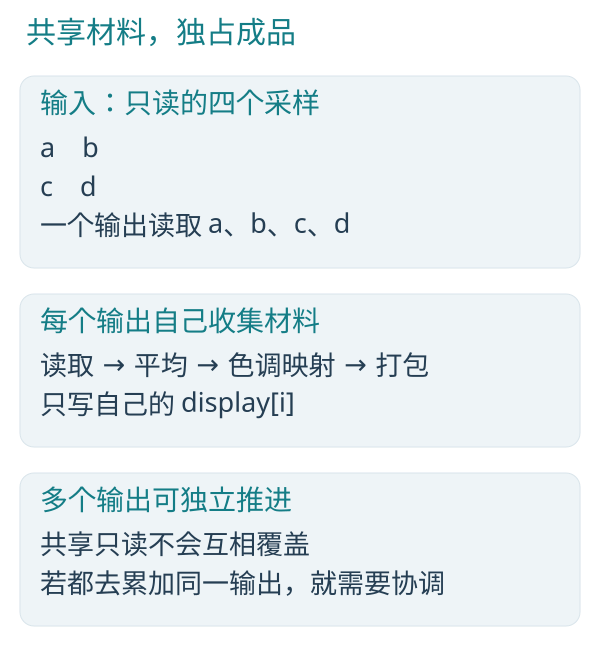

*图 12-1　每个输出收集只读输入，独占写入自己的最终颜色。*

串行版本按 i 逐个完成全部颜色步骤；并行版本把这条局部计算链复制到各输出实例。一次输出内部的采样地址、均值、映射和打包仍有先后关系，输出之间则不互相等待。GPU 中相邻实例同时读取相邻采样还可能改善访存，但具体收益依赖布局与硬件。

### 12.2　把完整显示转换交给 GPU

性能输入为 8,294,400 个元素，每批连续执行 8 轮，预热两批后测量九批。以下时间均为每轮耗时的中位数，沿用第 1.6 节的计时范围。

```powershell
& $bench resolve 8294400 9 8
```

C++ 串行为 **180.949 ms**，B GPU 驻留执行为 **1.684 ms**，相对串行加速 **107.45 倍**。

该实测直接调用当前 resolve<3840,2160,2,8294400,33177600>，读取 33,177,600 份内部采样，输出 8,294,400 个显示像素。C++ 对照包含同样的全部颜色计算，最终 BGRA 整数逐项相同。这个正式 B 入口为 on gpu，因此本表只比较 C++ 串行与 B GPU。


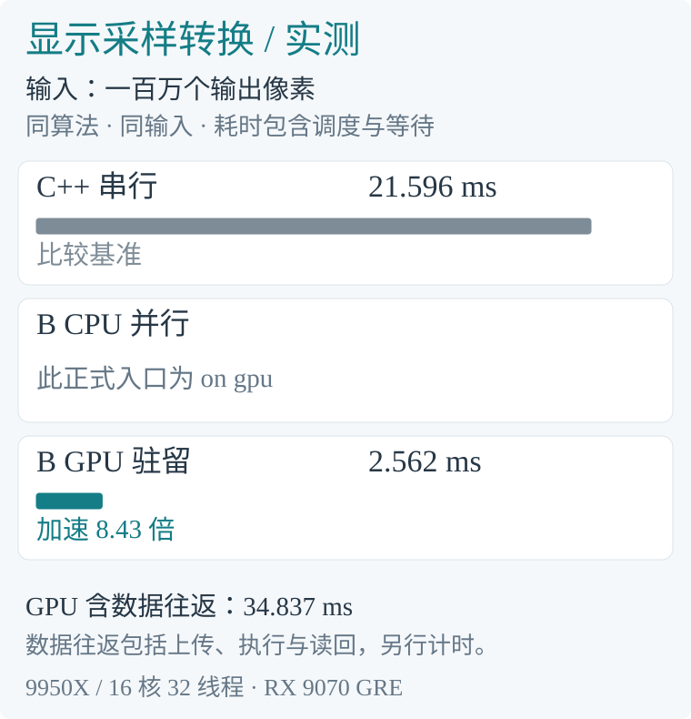

*实测记录：resolve。GPU 主时间包含命令组织、提交与实际完成等待；数据往返单列。*

### 12.3　为什么输出驱动常常更容易并行

同一个问题可以有两种组织方式：每个输入去修改它影响的输出，或者每个输出自己收集需要的输入。第一种可能让许多输入争写一个输出；第二种常能让每个结果保持独占。

gather 可能增加重复读取，scatter 在某些稀疏结构中更合适。选择时要兼顾访问模式与写入责任：由结果的拥有者完成计算，需要共享修改时再引入协调。

### 12.4　空间变换仍然是同一种形状

BLEngine `Programs/scene/transforms.b`：

```c
program prepare(read dataset<BLAffine> transforms, write dataset<BLNormalMatrix> normals) on compute {
    parallel (normal in normals) {
        BLAffine transform = unsafe_read(transforms, index());
        normal.basis = normal_basis(transform.matrix);
    }
}
```

normal_basis 从仿射矩阵取出线性部分，计算它的逆转置。不懂矩阵推导也能读出并行结构：每份输入变换生产一份输出矩阵，当前 normal 独占自己的输出。公式换了，所有权形状没有换。

串行 C++ 核心：

```cpp
for (size_t i = 0; i < n; ++i) {
    BLAffine transform = transforms[i];
    normals[i].basis = normal_basis(transform.matrix);
}
```

这里假设工程提供同名数学类型与函数。每个结果只依赖一份只读变换；并行化只展开结果集合，不改变单个矩阵的计算依赖。

`unsafe_read` 表明这里的跨资源编号需要由资产或绑定方保证有效。只读权限约束修改行为，下标范围则需要独立保证；两者各有责任。

### 12.5　同一份矩阵算法的大规模执行

性能输入为 4,194,304 个元素，每批连续执行 8 轮，预热两批后测量九批。以下时间均为每轮耗时的中位数，沿用第 1.6 节的计时范围。

```powershell
& $bench transforms 4194304 9 8
```

C++ 串行为 **15.138 ms**，B CPU 为 **11.301 ms**，B GPU 驻留执行为 **2.061 ms**，相对串行加速 **7.34 倍**。

输入包含非对角项且保持可逆，C++ 和 B 都为每份仿射变换生成法线矩阵。三种实现的最大绝对差约为 `6e-8`。这里每份输出的公式更多，独立实例也更多，GPU 因而能把同一个“只读输入、独占输出”的形状变成可观的吞吐。


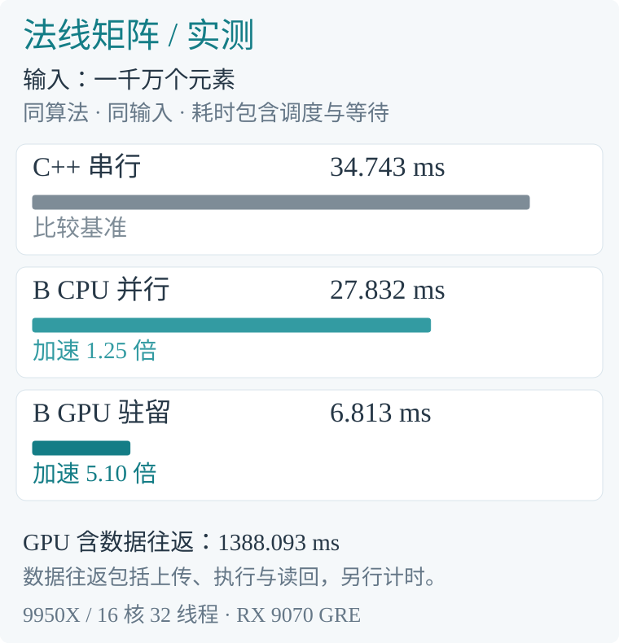

*实测记录：transforms。GPU 主时间包含命令组织、提交与实际完成等待；数据往返单列。*

### 12.6　从指针图走向有所有者的只读视图

真实几何不是只有一张平面数组。实例会引用三角形、法线与纹理坐标。`Programs/render/trace.h` 中的实例声明为：

```c
struct BLInstance {
    view<BLTriangle> triangles;
    view<BLNormal> normals;
    view<BLTextureTriangle> texcoords;
    float4 tint;
};
```

`view<T>` 是有元素类型、长度和真实子资源所有权的不可变视图。它与“把一个整数当地址”不同；CPU/GPU 间传输也要处理闭合资源图与目标地址，而不是把 CPU 指针字节上传后就当设备指针使用。

下面的真实函数按三角形索引读取三个法线，再做插值：

```c
float3 surface_normal(BLInstance instance, u32 primitive, float2 barycentric) on compute {
    BLTriangle triangle = unsafe_read(instance.triangles, primitive);
    float3 n0 = unsafe_read(instance.normals, triangle.normal_indices[0]).normal;
    float3 n1 = unsafe_read(instance.normals, triangle.normal_indices[1]).normal;
    float3 n2 = unsafe_read(instance.normals, triangle.normal_indices[2]).normal;
    f32 u = barycentric.x;
    f32 v = barycentric.y;
    return normalize(n0 * (1.0 - u - v) + n1 * u + n2 * v);
}
```

这是一个可以放进大量元素实例中的只读计算。视图让数据的共享结构保留，不要求每个实例复制完整几何。外部编号仍由其真实边界负责，读取共享与合法寻址是两项需要分别理解的事实。

## 13　走进真实代码之三：从一个公式到整条计算链

### 13.1　普通数学函数，并不需要懂线程

BLEngine `Programs/material/surface.b` 的 ggx_surface 是一个普通值函数，输入法线、观察方向、光线、颜色等普通值，输出 float3。

它的开头是：

```c
    f32 nl = dot(normal, light);
    f32 nv = dot(normal, view);
    if (nl <= 0.0 || nv <= 0.0) { return float3(0.0); }
```

`return` 只结束当前实例中的这次函数调用。没有直接光照贡献的点返回零，其他点继续各自的计算。

数学函数专注于输入与公式，外层并行域负责把它应用到一组元素。

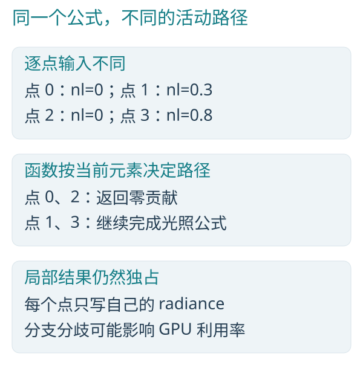

*图 13-1　相同函数可在不同元素上经过不同路径。*

串行版本逐点判断并计算；并行版本允许多个点处于不同路径。GPU 的同一硬件协作集合若出现分歧，可能分次执行各条活动路径，因此“元素独立”不等于“分支没有成本”。B 保留普通控制流，使公式可以按含义组织；性能仍取决于实际活动分布与生成代码。

### 13.2　材质计算为什么适合表达成 map

先按 C++ 串行遍历同一批 `points`。假设同名材质函数已经实现，这里只展示遍历和调用：

```cpp
for (size_t i = 0; i < n; ++i) {
    auto& point = points[i];
    point.radiance = textured_ggx(albedo, point.uv, point.lod, point.normal,
        point.view, point.light, point.tint, point.roughness, point.ior);
}
```

对应的 B 入口摘自 `Programs/material/textured.b`：

```c
program shade(inout dataset<BLShadingPoint> points, read texture2d albedo) on compute {
    parallel (point in points) {
        point.radiance = textured_ggx(albedo, point.uv, point.lod, point.normal,
            point.view, point.light, point.tint, point.roughness, point.ior);
    }
}
```

只读纹理供全体共享；每个 point 拥有自己的方向、纹理坐标、材质参数和输出辐射值。纹理采样和光照公式被封装在普通函数中，外层只声明并行域。

串行遍历逐点完成纹理采样与光照；并行域允许不同点独立推进。单点内部仍先采样，再由样本与参数计算 radiance。

这就是第一章的逐元素变换，只是单个元素的计算从乘加扩展成了材质求值。

`textured_ggx` 继续把采样与普通光照函数组合：

```c
float3 textured_ggx(read texture2d albedo, float2 uv, f32 lod, float3 normal, float3 view, float3 light, float3 tint, f32 roughness, f32 ior) on compute {
    float4 sample = texture_sample(albedo, uv, lod);
    return ggx_surface(normal, view, light, sample.xyz * tint, roughness, ior);
}
```

`on compute` 允许这份实现生成 CPU/GPU 代码；执行时再绑定实际纹理与设备资源。

### 13.3　让公式在数百万个点上展开

性能输入为 4,194,304 个元素，每批连续执行 8 轮，预热两批后测量九批。以下时间均为每轮耗时的中位数，沿用第 1.6 节的计时范围。

```powershell
& $bench shade 4194304 9 8
```

C++ 串行为 **202.687 ms**，B CPU 为 **16.312 ms**，B GPU 驻留执行为 **2.234 ms**，相对串行加速 **90.73 倍**。

本次直接调用引擎 material.textured::shade，绑定真实 256×256 浮点纹理，输入使用变化的 UV 与粗糙度。C++ 同样执行双线性采样和完整 GGX 公式。两端相对 C++ 输出的最大绝对差分别约为 CPU `3e-8`、GPU `3.3e-7`。

一个点上的采样、分支与公式仍按依赖顺序完成；数百万个点之间的独立工作，使这些普通数学函数得以充分展开。

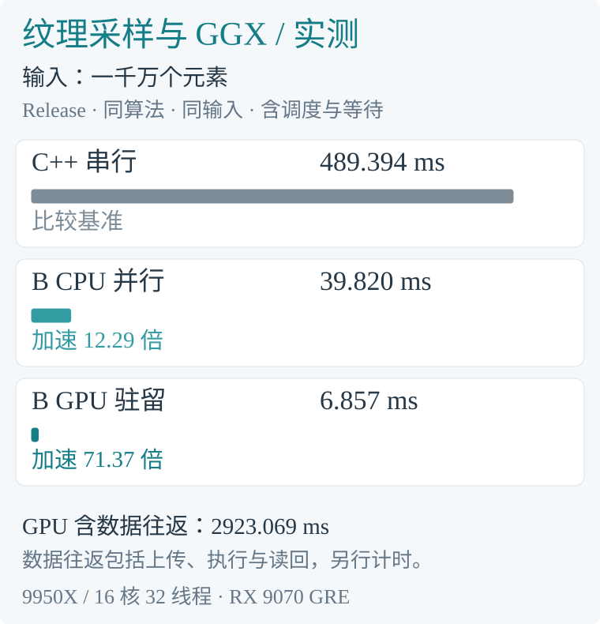

*实测记录：shade。GPU 主时间包含命令组织、提交与实际完成等待；数据往返单列。*

### 13.4　把算法与数据关系放在一起

单个数值函数通常不难编写，难点在于把大量函数、资源和计算阶段连接起来。B 用同一语言表达公式、借用、并行域和阶段组合，使这些关系始终对编译器可见。

例如，一条材质计算链既包含纹理读取，也包含普通公式和结果写入。将它们保留在共同的计算模型中，有助于复用算法、分析依赖，并为不同目标生成代码。

### 13.5　完整阶段组合，也可以很短

`Programs/render/frame.b` 在完整资源签名之后，正文只有：

```c
trace<N,W,H,S>(pixels,instances,overlays,surfaces,normal_matrices,cameras,lights,lighting,scene,overlay_scene,albedos,floor_present,ground_z,ground,overlay_start);
    resolve<W,H,S,DC,IC>(pixels,display);
```

这是函数体内的两条原文，不是可独立编译的模块。trace 生产内部 pixels，resolve 读取它并生产 display。具体资源类型和权限在 `.h` 接口上表达，编译器保留真实生产消费依赖。

这条链包含两个层次：阶段内部的大量元素实例，以及阶段之间的生产消费依赖。像素、粒子与筛选记录虽然来自不同领域，却可以用相同的依赖语言来理解。


*图 13-2　阶段内并行与阶段间依赖共同构成程序；提交不等于设备完成。*

完整帧还包含求交、光照、资源访问和呈现；其总耗时需要在真实完整运行中测量。本章的性能数字对应已独立测量的材质与显示转换阶段。

手工 C/C++ 设备方案通常要由宿主明确安排 trace、可见性依赖和 resolve，再等待真正的设备完成。B 的 program 从资源读写关系保留生产消费顺序，执行框架据此组织设备依赖。普通函数封装不必产生宿主等待；真实的跨阶段数据依赖也不能因函数体很短就被省略。

### 13.6　为什么这代表一种值得期待的语言方向

当并行只是库调用外面的附加层，算法与调度之间常隔着许多手工约定。当语言直接表达工作域、访问方式、集合与协作，编译器就有更多完整信息去选择范围、融合阶段、管理临时数据和生成不同目标代码。

同一份源码既描述算法，也呈现数据关系。算法声明必要的依赖，编译器组织计算，执行框架负责物理资源与生命周期。

C/C++ 继续是重要工具。学习 B 的价值，在于训练一种更能利用并行硬件的表达习惯：先看哪些工作独立，再看怎样摘要和组合，最后才看线程落在哪。即使将来回到其他语言，这套思考也会留下来。

## 14　把书合上之后，你能自己做什么

### 14.1　一套可以反复使用的解题步骤

先写清结果是什么，再决定谁拥有每份结果；找出可以独立展开的元素域；把真实依赖表示为阶段；遇到汇总尝试 reduce，遇到区间与前序摘要尝试 scan，遇到可变工作量考虑 compact 与 prefix；局部交流使用 tile，真实共享修改明确使用 atomic。

然后检查算法是否增加了多余工作、数据往返或争用，最后用真实输入与合适的计时范围观察。不要先选一个很酷的并行原语，再勉强把问题塞进去。

### 14.2　练习：先回答，再运行

1. map 的乘数改为 3、加数改为 -1，输入 `[1,2,3,4]`，结果是什么？为什么不需要元素间同步？
2. 对 `[3,1,4,2]` 分别做 reduce、独占 scan 和包含自身的前缀和，它们各输出什么？
3. pipeline 中 id=0 与 id=6 具有相同 key。为什么必须保持其原相对次序？如果业务不要求稳定性，哪些语义可以重新选择？
4. tiles 使用宽度 4、输入六个值时，最后两项的均值为什么是 5.5，而不是 2.75？
5. 若将粒子积分改成“每个粒子读取其他粒子的新位置”，为什么原来的独立 map 推理失效？
6. 一个输出要读取四个相邻输入，是否因此就需要原子操作？什么时候才需要？
7. compose 为什么能并行而不能交换顺序？用“先加一再乘二”和“先乘二再加一”各算一次验证。
8. 第 1 章 B GPU 驻留执行比串行快 3.41 倍，为什么重新上传与读回后仍应考虑 B CPU？怎样用同一套计时重新比较？

### 14.3　参考思路

第一题是 `[2,5,8,11]`，每个元素只读写自己。第二题分别是总量 10、`[0,3,4,8]` 与 `[3,4,8,10]`。

第三题，稳定排序的约定要求同键记录保留来源顺序；是否需要这个约定由真实消费者决定。第四题尾块只有两条有效元素，和为 11，除数为 2。第五题出现跨元素时序依赖，需要重新定义所读状态的版本与阶段，不能假装没有依赖。

第六题，共享只读材料不会造成写冲突；多个执行者需要同时修改同一个位置，才涉及相应共享写机制。第七题，合成函数可以改变结合括号，不能交换输入次序。第八题要把数据位置和计时范围补齐：主存输入可以直接用 B CPU；已经驻留 GPU 的输入可以接上 GPU 计算。若需要上传和读回，就在三种版本完成同样工作后比较完整交付耗时。

### 14.4　入门之后，去读哪些真实文件

按 bodies/statistics、transforms/resolve、textured/frame 的顺序阅读，依次练习识别独立更新与集合、共享只读与独占输出、普通函数与阶段组合。当你能用“谁生产、谁消费、谁能写、在哪里协作”解释程序时，就跨过了并行入门最重要的一道门。

## 附录 A　运行配套示例

### A.1　目录与前提

本机 Blink 在 `B:\BLanguage`，独立 P4 主线为 `//BLanguage/main`；BLEngine 在相邻的 `B:\BLEngine`。其他机器使用自己的真实工作区位置，不需要把 B 盘写死到语言源码。

`sample/lessons` 保留五组教学模块：map、scan、pipeline、tiles、algebra。每组 `.h` 是接口，`.b` 是实现；demo 是自动生成小输入再执行算法的学习入口，核心算法也有独立 program。

`module lessons.map;` 指定教学模块的名称，对应 `lessons/map.h` 与 `lessons/map.b`。逐元素计算由关键字 `parallel` 表达；正文展示计算核心，完整模块包含接口与实现。

编译器使用 Windows x64 MSVC Rust 工具链。若尚无构建产物，在 Blink 根运行 `cargo build --workspace --release`；若要使用现有通用执行器，则在相邻 BLEngine 根运行 `cargo build --release`。这是构建两个现有项目，不要求搭建窗口或加载场景。

各章的命令均在 Blink 根目录执行，输出放在 Saved。编译器导出 `.x64`、`.spv` 及布局文件；compute 命令通过同一编译库执行模块，不产生可双击的 demo.exe。

### A.2　示例命令索引

- 逐元素变换：`lessons/map.b` 的 demo，第 1.5 节。
- 求和归约：`lessons/scan.b` 的 demo_sum，第 3.5 节。
- 独占扫描：`lessons/scan.b` 的 demo，第 4.5 节。
- 筛选、排序与统计：`lessons/pipeline.b` 的 demo，第 5.6 节与第 6 章。
- 分块分析：`lessons/tiles.b` 的 demo<4>，第 7.6 节；其中包含 center 协作函数。
- 发布后协作：同一模块的 demo_publish<4>，第 7.7 节。
- 有序变换组合：`lessons/algebra.b` 的 demo，第 9.5 节。

`:N` 显式申请 N 条全零记录，dataset 实参按接口顺序绑定。`--` 后是普通值参数。write 与 inout 数据输出为以参数名命名的 `.bldata`；read 数据不重复输出。

### A.3　不必猜输出字节

BLDATA v1 是小端文件：前八字节为 `BLDATA\0\0`，再依次是四个 u32，分别为版本、记录数、记录步长、执行步数；第 24 字节开始是完整记录。具体字段偏移以编译器布局为准，不能把任意 C++ struct 的 sizeof 当成 B 的 ABI。

例如 map 的四个 f32 紧接在 24 字节头部之后，每个占 4 字节；scan 的 Count 也占 4 字节，按 u32 读取。pipeline 的 Item 占 16 字节，id 位于记录起点；tiles 的 Cell 占 16 字节，centered 位于记录内偏移 12。各章的 PowerShell 命令正是按这些实际布局读取数值。

pipeline 的 count 表示有效长度，ordered 与 offsets 的容量仍然是 8；只读前 4 条结果。尾部这次是零，来自初始分配内容，不是 compact 或排序承诺的“无效标记”。

### A.4　真实粒子算法的现有命令

在 BLEngine 根目录运行：

```powershell
.\target\release\blengine.exe simulate cpu 4099 8 `
    ..\BLanguage\Saved\Book\engine-bodies-cpu.bldata

.\target\release\blengine.exe simulate gpu 4099 8 `
    ..\BLanguage\Saved\Book\engine-bodies-gpu.bldata
```

该命令执行引擎的 bodies/statistics program，完成多步更新与总能量计算。CPU 与 GPU 结果的舍入差异按第 3.4 节的方法评价。

### A.5　复现性能对照

配套工具位于 sample/performance。使用 Windows x64 的 Visual Studio 开发者 PowerShell，确认 cl、lib 与 cargo 可用；从 Blink 根目录编译：

```powershell
$work = "$PWD/Saved/BookPerformance"
$env:CARGO_TARGET_DIR = "$work/target"
cargo build --release `
    --manifest-path `
    sample/performance/Cargo.toml
$bench = "$work/target/release/bperf.exe"
& $bench map 16777216 9 8
```

这会编译 C++ 串行对照以及调用现有 B 执行框架的宿主程序。参数依次为案例、元素数、测量批数、每批轮数；书中各节给出具体调用。引擎案例直接读取相邻 BLEngine/Programs。工具输出每轮墙钟毫秒、GPU 设备时间、数据往返时间、加速比和计时区间外的结果差异。

C++ 串行代码在 serial.cpp；Rust 仅负责已有编译器、数据集与设备 API 的绑定和计时。核心 B 算法仍是 lessons 以及 BLEngine 的正式实现，完整命令和各案例的种子数据见 performance/README.md。

本书测量采用 AMD Ryzen 9 9950X（16 核、32 逻辑处理器）、AMD Radeon RX 9070 GRE、MSVC 14.44 与 Rust 1.95.0。Release 构建使用优化后的 C++ 单线程作为基准；数据初始化、前端编译和文件输出均在计算计时之外。其他机器的具体数字会改变，应同时观察工作量与数据交付成本。

## 附录 B　实现范围与运行记录

### B.1　哪些已经存在，哪些仍在研发

本书使用的 map、全域归约与扫描、稳定 compact、有效前缀、u32 稳定键排序、tile 输入与发布、块内集合、cooperative 函数、开放 u32 const 具体入口及普通记录自定义扫描/归约，在当前项目已有实现。

CPU 当前具有范围并行，以及部分直线 map 的四元素 SSE2；复杂控制流、tile 协作等不能统称为完整 SIMD 优化。GPU 当前以单设备、单队列为主，不能从 program 的逻辑分叉推断硬件多队列并行。

任意递归、通用动态任务、动态块内发布与屏障、非原子任意共享写、64 位/浮点原子、完整开放泛型等，不在当前已完成能力范围。完整、最新细节见 `Docs/BLanguage.md` 与 `Docs/Issues.md`。不支持的程序应明确报错，不应被想象成已经换了一种算法执行。

### B.2　示例运行记录

小输入负责帮助手算和核对结果；各章性能图来自配套程序的大规模实测。两种输入共用相应算法，分别回答“结果如何形成”与“并行怎样提高效率”。

2026-10-25，在本机 CPU 与 AMD Radeon RX 9070 GRE GPU 上，通过现有编译器与 BLEngine compute 入口执行，并解码实际输出：

| 内容 | 输入 | 观察到的结果 |
|---|---|---|
| map demo | 4 个 f32，乘二加一 | `[3,5,7,9]` |
| reduce demo_sum | `[3,1,4,2]` | `10` |
| scan demo | `[3,1,4,2]` | `[0,3,4,8]` |
| pipeline demo | 8 条 | count=4，id=`[4,2,0,6]`，offsets=`[0,5,8,9]`，total=16 |
| tiles demo<4> | 6 条 | 首块 total=10，尾块 total=11；均值与前缀如正文 |
| publish demo<4> | 6 条，factor=2 | 两块 total=20、22 |
| algebra demo | 四次 `(2,1)` | 前缀与总变换如正文 |

表中小输入的 CPU 与 GPU 结果相同。浮点数在其他输入与不同归约分组下仍可能产生舍入差异。

另对 65,539 条 pipeline 及宽度 17、259 条 tiles 的实际结果作了核对，覆盖多块与非整块结尾。原始数据与日志保存在 `Saved/BookRuns`。这些记录说明对应输入的行为，不作为吞吐性能结论。

引擎算法的本次直接执行覆盖粒子更新、总能量、空间变换、材质求值与显示转换，相应结果和耗时见正文。trace 与完整 frame 用于阅读阶段结构，它们的整帧性能需要在完整应用中另行测量。

### B.3　性能实测汇总

下表统一采用每批 8 轮、预热 2 批、测量 9 批的每轮耗时中位数。B GPU 列包含提交与完成等待，代码和数据已驻留；一次性准备与数据往返费用在各章记录图及配套输出中单列。

| 算法 | 元素数 | C++ 串行 ms | B CPU ms | B GPU ms | GPU 加速比 |
|---|---|---|---|---|---|
| 逐元素变换 | 16,777,216 | 2.135 | 1.095 | 0.626 | 3.41 倍 |
| 求和归约 | 67,108,864 | 4.779 | 4.313 | 1.241 | 3.85 倍 |
| 独占前缀和 | 8,388,608 | 2.206 | 1.253 | 1.719 | 1.28 倍 |
| 稳定筛选 | 16,777,216 | 11.439 | 14.326 | 3.752 | 3.05 倍 |
| 完整筛选流水线 | 4,194,304 | 34.277 | 19.620 | 6.798 | 5.04 倍 |
| 块内协作 | 4,194,304 | 2.746 | 1.504 | 0.629 | 4.36 倍 |
| 发布后协作 | 4,194,304 | 2.931 | 1.356 | 0.637 | 4.60 倍 |
| 仿射扫描与归约 | 16,777,216 | 12.348 | 14.033 | 3.725 | 3.31 倍 |
| 粒子更新 | 4,194,304 | 14.593 | 3.751 | 1.013 | 14.41 倍 |
| 粒子更新与总能量 | 4,194,304 | 17.430 | 6.363 | 1.896 | 9.19 倍 |
| 8K 采样转 4K 输出 | 8,294,400 | 180.949 | GPU 专属入口 | 1.684 | 107.45 倍 |
| 法线矩阵 | 4,194,304 | 15.138 | 11.301 | 2.061 | 7.34 倍 |
| 纹理采样与 GGX | 4,194,304 | 202.687 | 16.312 | 2.234 | 90.73 倍 |

基础整数结果逐项一致；map 与块内示例的最终浮点结果一致。真实粒子、法线矩阵与材质的浮点差异在对应章节列出。总能量的加法分组改变舍入，因此同时报告 f64 参考，而不是把不同的累加顺序当成逐位一致。

这些结果表示本机上对应输入与实现的速度。C++ 并行库和 GPU 框架也能使用多核与设备；本书展示的是 B 如何把必要的工作域、集合与协作关系直接交给编译器，并通过实际执行获得收益。

### B.4　来源与进一步阅读

语言事实以本项目 `Docs/BLanguage.md`、`Docs/Architecture.md`、`Docs/Issues.md` 及 `crates/blanguage`、`crates/blcompute` 实现为依据。执行命令以 BLEngine `src/main.rs` 的真实入口为依据。

BLEngine 摘录来自 `Programs/simulation/bodies.*`、`Programs/simulation/statistics.*`、`Programs/math/field.*`、`Programs/scene/transforms.*`、`Programs/render/resolve.*`、`Programs/render/trace.*`、`Programs/material/surface.*`、`Programs/material/textured.*` 和 `Programs/render/frame.*`。各处仅摘读说明语言思想所需部分，完整接口与资源绑定保留在原项目。

前缀扫描可进一步阅读 Guy E. Blelloch 的 [Prefix Sums and Their Applications](https://www.cs.cmu.edu/~guyb/papers/Ble93.pdf)，将其中的树形上扫与下扫，同第 4 章的摘要与传播过程对照。

摘录版本与 SHA-256 见 [BLEngine 摘录来源](BLEngine摘录来源.md)。原项目后续演进以正式源码为准。
