# 并行编程的艺术

## 用 Blink 语言，从 C/C++ 的熟悉世界走向并行思考

面向读者：会写 C 或 C++，希望真正理解并行算法的人。

正文按当前语言规则与正式工具入口编写；软件版本见工程根VERSION，具体运行与交付历史保存在P4双台账。

并行编程的关键，是看清哪些工作能够独立进行，哪些结果需要汇总，以及数据怎样从一个阶段流向下一个阶段。把这些关系表达清楚，程序就能展现出简洁而有秩序的美。

本书从可以手算的小例子开始，逐步建立并行思考的方法，再走进 BLEngine 的粒子更新、空间变换和材质计算。阅读这些真实代码时，我们关注算法的读写与依赖关系，所需的图形学概念会随例子介绍。

Blink（简称 B）是一门面向 CPU/GPU 的原生并行计算语言。它把工作域、数据访问和协作关系写进程序，让编译器据此组织原生执行。

Blink 的源码、配套示例与本书 PDF 均在开源仓库中：

[https://github.com/sgua83/Blink](https://github.com/sgua83/Blink)

B 也寓意 Base。Blink 希望像 C 语言为上一个计算时代所做的那样，成为 AI 超算时代的基础语言。这个愿景从最基本的表达出发：让独立工作自然展开，让必要协作清楚可见。

### 阅读路线

| 阶段 | 章节 | 你将获得什么 |
|---|---|---|
| 看懂 | 1-4 | 从循环、权限和集合运算建立直觉 |
| 会用 | 5-10 | 组织有效工作、局部协作与可组合算法 |
| 读真实代码 | 11-13 | 把同一套思想带入 BLEngine 的真实计算 |
| 接入项目 | 14 | 在 C、C++ 和 Rust 中调用 B 算法 |
| 动手巩固 | 15、附录 | 运行示例、解释结果、完成练习 |

BLEngine 当前尚未开源，第11–13章的五项引擎性能对照需要授权引擎工作区；随 Blink 公开的 sample/hybrid 教学模块可独立运行，但不能替换原引擎测量。普通并行教材的八种算法可仅用本仓库复测，完整前提见附录A.5。

配套教学源码位于 `sample/lessons`，各章列出运行命令与结果。BLEngine 摘录标明原文件，便于继续阅读完整实现；C/C++ 片段用于比较串行与并行的组织方式；性能示例另附完整、开启优化的 C++ 串行实现。


### 从下载 Blink 开始

本书的动手环境是 Windows x64。先下载并双击安装 [Windows x64 正式版 v0.14.1.1](https://github.com/sgua83/Blink/releases/tag/v0.14.1.1) 的 `Blink-Setup-windows-x64.exe`。安装器将稳定工具及源码 SDK 放入 `%ProgramFiles%/Blink` 并配置 PATH，新开终端可用 `bc` 与 `blink`；这份已安装正式版也作为源码构建所需的稳定种子。

再准备三样工具：

1. [Git for Windows](https://git-scm.com/install/windows)，用来下载 Blink 源码。
2. [Rust stable](https://rust-lang.org/tools/install)，安装时选择 Windows 的 MSVC 工具链。
3. [Visual Studio C++ Build Tools](https://visualstudio.microsoft.com/visual-cpp-build-tools/)，选择“使用 C++ 的桌面开发”，包含 x64 C++ 工具与 Windows SDK。已有这些组件的 Visual Studio 也可直接使用。

安装后，从开始菜单打开 Visual Studio 的“Developer PowerShell”，选择 x64 开发环境。

Rust 与 C++ 工具用于构建编译器、执行框架及配套性能对照。B 程序的 CPU 代码和 SPIR-V 由 Blink 自己生成。CPU 入门不需要显卡；执行 GPU 版本时，显卡驱动须提供 Vulkan 支持，无需另装 Vulkan SDK。

在希望保存项目的位置执行下面的命令。行尾的反引号（`）是 PowerShell 续行符，表示命令在下一行继续；复制完整命令块即可执行。

```powershell
git clone `
    https://github.com/sgua83/Blink.git
Set-Location Blink
```

完成安装与克隆后，即可继续第一章。本书当前配套源码随 main 更新；基础应用已用正式版 0.14.1.1 实际编译与运行。教学算法在 `sample/lessons`，完整应用入口在 `sample/applications`。

若要研究并从源码构建研发工具，在上面稳定种子、Rust MSVC 和 Windows 构建工具均就绪后执行以下可选步骤。默认编译器构建直接读取 `%ProgramFiles%/Blink` 的 `VERSION`、`bin/bc.exe` 与 `bin/blink.exe`，先检查这份实际输入，再运行 Cargo：

```powershell
& "$env:ProgramFiles/Blink/bin/bc.exe" --version
& "$env:ProgramFiles/Blink/bin/blink.exe" --version
cargo build --workspace --release
```

源码构建的工具输出在 `target/release`；已安装的稳定种子仍保留在安装目录，供构建期间使用。

后续命令都在 Blink 项目根目录执行。第一章编译一个有 main 的 B 应用，把四个数乘二加一并直接打印。CPU／GPU 由 B 源码中的 target 选择；当前没有自动设备选择或隐式迁移，不能把 on compute 理解为自动调度。

单独检查源码与导出代码的方法见附录 A.6；引擎案例的复现条件见附录 A.4。

## 1　第一种美：许多事情原本就能一起做

### 1.1　从一段你已经会写的循环开始

数组 `values` 里有四个数 `[1,2,3,4]`。把每个数乘二再加一，C 的写法很短：

```cpp
for (size_t i = 0; i < n; ++i) {
    values[i] = values[i] * 2.0f + 1.0f;
}
```

B 的计算正文同样简短：

```c
parallel (value in values) {
    value = value * 2.0 + 1.0;
}
```

`values` 是全部数字，`value` 表示当前元素的独占位置，相当于 C 的 `values[i]`，赋值会直接更新它。`parallel` 描述每个元素要做什么，允许各个实例独立推进。

两种写法的结果都是 `[3,5,7,9]`。每个数的更新只依赖自己的旧值，因此可以分别计算。串行循环中的先后顺序来自写法，问题本身并不需要它。

### 1.2　先看顺序，再看硬件

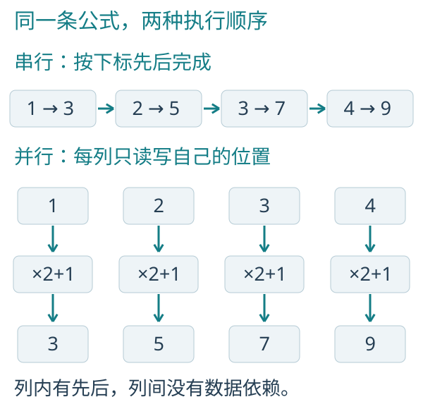

*图 1-1　同一公式的串行顺序与并行元素域。步骤表示逻辑依赖，不是实测耗时。*

按串行过程理解，处理器读取一个数，完成乘法、加法和写回，再推进到下一项。并行过程把四次互不依赖的读改写展开；每个实例内部仍先读值，再计算，最后写回。

这种一条输入对应一条输出的模式叫 map，即逐元素变换。

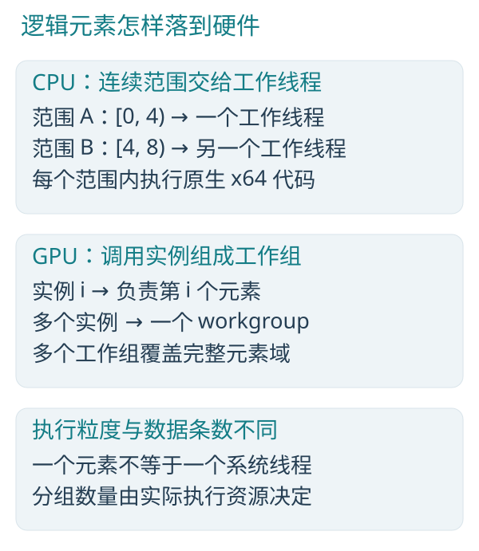

*图 1-2　逻辑元素、CPU 工作范围和 GPU 工作组属于不同层次。*

在当前 CPU 执行框架中，连续下标范围交给工作线程，一个线程处理许多元素。适合的直线计算还可以一次使用四个 SSE2 lane；这与多个 CPU 核心分工是两层并行。

在 GPU 上，元素实例映射到计算调用，再组成工作组。工作组分批调度到硬件；四个逻辑元素不保证在物理上恰好同一时刻执行，一百万个元素也不等于一百万个操作系统线程。

C/C++ 编译器也可能自动向量化简单循环；B 则通过工作域直接表达元素之间的独立性。

### 1.3　并发和并行，不必混为一谈

并发关注多件工作如何同时处于进行中，例如等待文件读取时处理另一个请求。并行关注多份计算是否能在多个执行资源上同时推进。

并发的多个任务可以在一个核心上轮流推进；并行的数组计算则利用多个执行资源分担工作。B 主要围绕数据并行展开，并用生产消费关系连接计算阶段。

### 1.4　先问三个问题

面对一个循环，先问：每次迭代读什么？写什么？是否需要另一次迭代刚写出的结果？

如果答案是“共享只读输入，修改自己的输出，不等待其他元素”，你已经找到了最适合并行的形状。先找到这个形状，再讨论核心数和线程数，会轻松得多。

### 1.5　运行与结果

逐元素变换在 CPU main 中直接写 parallel；输入、乘二加一与输出全部可见。 GPU 版只保留设备边界所需的同文件计算函数，并显式展示传输；不导入自定义教学包装。

**CPU 完整源码**

`sample/applications/map_cpu.h`：

```c
module applications.map_cpu;

u32 main() on cpu;
```

`sample/applications/map_cpu.b`：

```c
module applications.map_cpu;

u32 main() on cpu {
    dataset<f32> values = dataset<f32>(4);

    parallel (value in values) { value = f32(index() + 1); }

    parallel (value in values) { value = value * 2.0 + 1.0; }

    for (value in values) { if (!println(value)) { return 1; } }
    return 0;
}
```

```powershell
& "$env:ProgramFiles/Blink/bin/bc.exe" -c sample/applications/map_cpu.b -o target/book-apps/map_cpu.obj -I sample
& "$env:ProgramFiles/Blink/bin/blink.exe" target/book-apps/map_cpu.obj -o target/book-apps/map_cpu.exe
.\target\book-apps\map_cpu.exe
```

**GPU 完整源码**

`sample/applications/map_gpu.h`：

```c
module applications.map_gpu;

u32 main() on cpu;
```

`sample/applications/map_gpu.b`：

```c
module applications.map_gpu;

void scale_values(inout dataset<f32> values) on compute {
    parallel (value in values) { value = value * 2.0 + 1.0; }
}

u32 main() on cpu {
    dataset<f32> values = dataset<f32>(4);

    parallel (value in values) { value = f32(index() + 1); }

    upload(values);
    target(gpu, scale_values(values));
    download(values);

    for (value in values) { if (!println(value)) { return 1; } }
    return 0;
}
```

```powershell
& "$env:ProgramFiles/Blink/bin/bc.exe" -c sample/applications/map_gpu.b -o target/book-apps/map_gpu.obj -I sample
& "$env:ProgramFiles/Blink/bin/blink.exe" target/book-apps/map_gpu.obj -o target/book-apps/map_gpu.exe
.\target\book-apps\map_gpu.exe
```

两份应用输出相同的四个数。CPU 版在 main 直接写 parallel；GPU 版在同文件完整展示 scale_values，`on compute` 声明两端可用，`target(gpu, ...)` 选择本次 GPU 执行。CPU 主流程负责分配与输出，GPU 数据在读取前显式下载。部署时把 EXE 与链接器生成的 `blink_app_*.dll` 一起复制，运行无需 B 源码、编译器或模块运行器；GPU 仍需要前文所述 Vulkan 能力。

以上应用以正式工具 0.14.1.1 编译、链接并执行。部署时带上链接器生成的配套 DLL；GPU 仍需满足程序要求的 Vulkan 能力。

### 1.6　让数据规模把优势展现出来

四个数适合手算。要比较效率，把同一个乘二加一扩展到一亿个数。串行与并行都只完成一次数组变换，公式、数据类型与工作量保持相同；足够大的数据规模让并行资源有了发挥的空间。

本书的性能对照统一使用 Release 正式构建。Blink 编译器、CPU/GPU 执行框架和测量程序都开启 Rust 发布优化；第十四章的算法 DLL 也由 Release 构建生成。调试版只用于排查问题，其耗时不进入本书的效率对照。

性能对照使用三个真实执行版本：开启 `/O2 /arch:AVX2` 优化的单线程 C++、B 原生 CPU 范围并行、B 原生 GPU。C++ 保留编译器自动向量化；B CPU 使用本机可用的工作线程。

为减小偶然波动，程序先预热，再重复测量并取中位数；每次测量只执行一次算法。C++ 与 B CPU 从算法调用前计时到计算完成；B GPU 从提交前计时到设备实际完成，包含命令组织、提交与等待。加速比为“C++ 串行时间 ÷ B 并行时间”。

代码生成、初始分配与数据准备放在计算计时之外。GPU 主对照中，代码和数据已经驻留设备；一次提交完成一次算法。重新上传、执行与读回的完整费用另行测量，便于根据数据所在位置选择执行方式。

先按附录 A.5 编译配套测量程序，再在 Blink 根目录执行：

```powershell
.\target\release\bperf.exe `
    map 100000000
```


### 1.7　把计算放到合适的位置


*图 1-3　先比较同样的计算，再把真实的数据交付成本加回来。*


## 2　第二种美：让读写各有归属

### 2.1　C/C++ 读者的语法桥梁

| 你熟悉的概念 | B 中的表达 | 需要注意的区别 |
|---|---|---|
| `float`、32 位整数 | `f32`、`u32`、`i32` | 不把 C 的 `int` 大小假设带进来 |
| 三个浮点分量 | `float3` | 原生向量值，不是系统线程组三个线程 |
| 结构体 | `struct Cell { f32 value; };` | 同样用于组织普通值 |
| 数组加长度 | `dataset<T>` | 还具有资源身份、访问模式与执行域 |
| 参数只读 | `read dataset<T>` | 语言显式限制共享修改 |
| 输出参数 | `write T` | 必须先写再读，不表示自动清零 |
| 修改已有值 | `inout T` | 借用独占位置，不是任意裸指针 |
| 普通函数 | `f32 f(f32 x)` | CPU 应用已有原生调用与递归；并行元素与协作调用按参与范围专门化 |
| 一组计算阶段的入口 | `计算函数 ...` | 可以包含并行域和集合操作 |
| 同一算法的 CPU/GPU 版本 | `on compute` | 表示两端可执行，设备由调用者明确选择 |

`.h` 描述模块的类型、签名、访问权限与执行目标，`.b` 提供实现。编译器通过模块声明定位二者，无需 C 式的 `#include` 预处理。

### 2.2　把计算放进一个入口

第一章的计算入口位于 `lessons/map.b`：

```c
void scale(inout dataset<f32> values) on compute {
    parallel (value in values) {
        value = value * 2.0 + 1.0;
    }
}
```

`dataset<f32>` 是一组 32 位浮点数；`inout` 允许读取并更新；`计算函数` 声明计算入口。`on compute` 表示这份实现可生成 CPU 与 GPU 代码，执行时由调用者明确选择设备。

第1.5节的完整应用直接展示输入初始化与变换；这里的 `scale` 是可复用计算函数本身，输入由调用者提供。模块声明和接口文件的作用见附录 A。

### 2.3　独占写为什么重要

下面是一个 C/C++ 并行化时常见的错误思路。`total` 是只有一条记录的结果数组；若让许多执行者同时运行这条语句，就会争写同一个 `total[0].value`：

```cpp
// Conceptual parallel body: this is a data race.
total[0].value += input[i].value;
```

许多执行者同时读取旧的 `total[0].value`，各自加上自己的数，最后互相覆盖。即使每次加法都很简单，整个“读取、计算、写回”也不是一个不可分割的动作。

B 的普通 `parallel` 为每个实例分配当前元素的独占写权限。共享位置的修改使用显式原子操作；集合求和则用归约表达。这样，独立更新与共享修改在源码中就有了清楚的区别。

访问权限约束读写冲突；公式、数值精度和业务规则仍由算法决定。

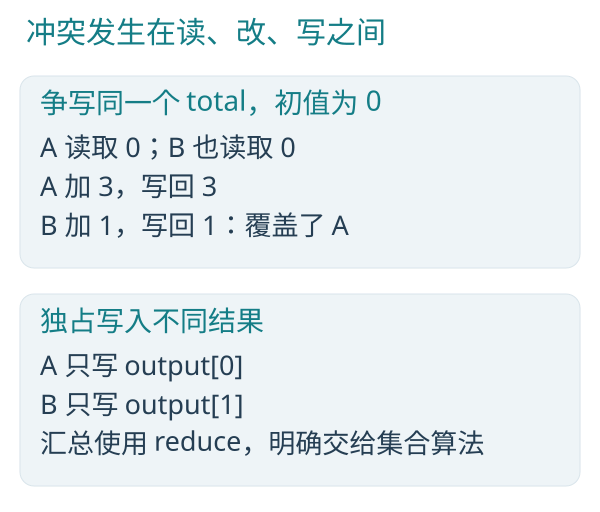

*图 2-1　争写会丢失更新；独占输出把写入责任分开。*

图中两个执行者都读到 0，各自计算后写回，导致一次更新被覆盖。归约会先形成独立摘要，再合并这些摘要，解决集合求和中的共享累加问题。

### 2.4　write、inout 和 read 的实际含义

把 write 理解为“我要生产新结果”，把 inout 理解为“我要读取并更新自己已有的值”，把 read 理解为“大家可以共同阅读”。

`write` 声明写入权限，初始化由算法或宿主负责。示例 main 中的 `dataset<f32>(4)` 申请四条全零记录。

普通函数借用整份数组时，目前只支持 read 和 atomic 两种模式；修改单个独占位置则用 `inout T` 或 `write T`。计算函数 可以在阶段组合中传递所需权限，不能把这和普通函数随意读取正在修改的整份 inout dataset 混在一起。

### 2.5　parallel 和 for，各自负责什么

`parallel (value in values)` 建立一群元素实例；`for (item in data)` 则是当前实例内部的有界顺序遍历。后者不会再创建一层并行任务。

若 N 个输出各自遍历 N 项材料，就会产生 O(N²) 的工作。并行不会消除重复计算，应先消除无用工作。

## 3　第三种美：许多结果可以汇成一个

### 3.1　把累加链变成一棵树

计算 `[3,1,4,2]` 的总和。为了让结果供后续阶段使用，`total` 用一条 `Count` 记录保存数值；输入也使用 `Count { u32 value; }`。

C 串行核心：

```cpp
total[0].value = 0;
for (size_t i = 0; i < n; ++i) {
    total[0].value += input[i].value;
}
```

B 并行核心：

```c
reduce_sum(input.value, total.value);
```

`input.value` 表示全部输入记录的 value 字段；`total.value` 是长度为一的结果字段。这里写的是集合意图，编译器负责展开集合算法。

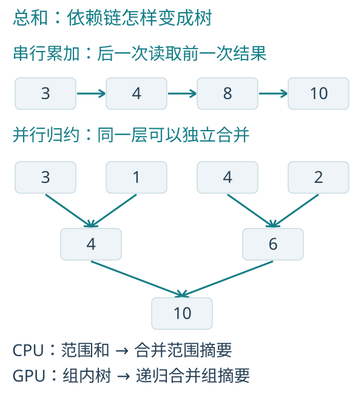

*图 3-1　线性累加链与分层归约。上行中的同层摘要可以独立计算。*

串行累加每一步都使用上一步的结果。树形组织先算 `3+1=4` 与 `4+2=6`，再算 `4+6=10`；三个必要的二元合并被放到两层依赖中。n 个输入的平衡树有 O(log n) 层，但仍要完成 O(n) 工作。

### 3.2　源码是一句，执行有层次

配套源码 `lessons/scan.b` 提供完整入口：

```c
void sum(read dataset<Count> input,
            write dataset<Count, 1> total) on compute {
    reduce_sum(input.value, total.value);
}
```

CPU 先让各个范围独立求部分和，再合并范围摘要。GPU 先在工作组内用共享存储形成部分和；输入较大时，继续归约工作组摘要，直到得到一个结果。组内同步只协调本组，跨组的阶段由执行框架组织。

从这一句归约，编译器就能组织局部求和与逐层合并。归约意图、资源权限和阶段依赖共同决定 CPU 与 GPU 的执行结构。

### 3.3　先理解结合律

对理想整数加法，`(a+b)+c` 与 `a+(b+c)` 相同，因此可以改括号组成树。减法不满足这个性质，不能因为接口看起来像“合并两个数”就拿来任意树形归约。

结合律允许改变括号；交换律允许交换左右顺序。它们是两件事。后面会看到，即使不能交换顺序，也能构造优美的并行归约和扫描。

B 的 u32 加法按 32 位保留低位，溢出具有确定的模运算语义。但如果你要的是业务上不能溢出的计数，仍要选择合理规模，不能把取低位结果当作完整大整数。

### 3.4　浮点不是纸上的实数

f32 只有有限精度。不同分组可能改变舍入，例如很大的数和很小的数相加，小数可能消失；先让大数抵消再加小数，又可能保留它。

GPU程序中的实际浮点运算会提出f32／f64保留次正规数、有符号零、无穷与NaN的模式需求。编译器把各阶段的实际需求合并到原程序设备合同，随BLRI47执行映像交给装入者；所选设备必须具备要求的能力，数值语义不随缺失能力改变。默认入口在创建逻辑设备前，根据同一程序合同匹配真实特性、计算队列及必要扩展，保留独显优先次序、同类沿驱动顺序，不按集成／离散类别排除候选；显式选定的目标保持自己的身份。推送常量容量在创建前以程序已有uniform_bytes匹配真实设备属性，多程序取最大值；后续装入仍核对已确定设备的容量。同一创建遍历还按原纹理布局的实际数组元素合计该程序描述符数，多程序取最大值，消费候选已有stage／set的sampler和sampled image容量；装入在自身调用内只计算一次纹理总数。GPU设备创建借用实际将装入映像的ExecutionPlan，默认、显式物理设备与呈现入口共用该交接。阶段workgroup_width及发射后的shared_bytes分别按各阶段、各独立程序取最大值，直接匹配候选已有maxComputeWorkGroupInvocations／maxComputeWorkGroupSize[0]及maxComputeSharedMemorySize；不相加独立程序的宽度或共享存储。后续装入继续核对已确定设备的实际容量。同一创建遍历复用每个程序的texture_count，将实际普通及辅助storage binding数量与纹理数组元素总数求和，再按独立程序取最大组合数，直接匹配候选已有maxPerStageResources。combined image sampler每个数组元素计一项，AS不进入该项；不能将不同程序各自最大的storage与texture数量拼成不存在的布局。同一程序遍历只求一次普通buffers＋auxiliary_buffers的storage描述符数量，供该程序组合总数及独立storage最大值共用；多程序取最大storage数，在创建前同时匹配候选已有maxPerStageDescriptorStorageBuffers与maxDescriptorSetStorageBuffers。装入已有设备时在原入口一次求storage数，核对同样两项容量，并供组合资源总数复用。AS绑定数直接来自各程序accelerations，多程序取最大值；原AS物理属性并入创建前已有subgroup／float／sorting查询链，同次匹配maxPerStageDescriptorAccelerationStructures和maxDescriptorSetAccelerationStructures，再把同一属性移交原RayDevice。装入沿该设备已有属性核对相同两项容量，不再另查一次AS属性；没有改变原AS构建、完成和资源释放。

CPU 与 GPU 的归约分组可能不同，结果也可能存在舍入差异。评价浮点计算时，需要结合数据尺度、允许误差、特殊值和算法稳定性。

### 3.5　运行与结果

输入由 main 初始化为 [3,1,4,2]；归约需要 on compute 函数，正文在同一文件完整展示，CPU 普通调用即可。 GPU 版只保留设备边界所需的同文件计算函数，并显式展示传输；不导入自定义教学包装。

**CPU 完整源码**

`sample/applications/reduce_cpu.h`：

```c
module applications.reduce_cpu;

u32 main() on cpu;
```

`sample/applications/reduce_cpu.b`：

```c
module applications.reduce_cpu;

struct Count { u32 value; };

void sum_values(read dataset<Count> input, write dataset<Count, 1> total) on compute {
    reduce_sum(input.value, total.value);
}

u32 main() on cpu {
    dataset<Count> input = dataset<Count>(4);
    dataset<Count, 1> total = dataset<Count>(1);

    parallel (item in input) {
        let k = index() % 4;
        item.value = k == 0 ? 3 : (k == 1 ? 1 : (k == 2 ? 4 : 2));
    }

    sum_values(input, total);

    if (!println(total[0].value)) { return 1; }
    return 0;
}
```

```powershell
& "$env:ProgramFiles/Blink/bin/bc.exe" -c sample/applications/reduce_cpu.b -o target/book-apps/reduce_cpu.obj -I sample
& "$env:ProgramFiles/Blink/bin/blink.exe" target/book-apps/reduce_cpu.obj -o target/book-apps/reduce_cpu.exe
.\target\book-apps\reduce_cpu.exe
```

**GPU 完整源码**

`sample/applications/reduce_gpu.h`：

```c
module applications.reduce_gpu;

u32 main() on cpu;
```

`sample/applications/reduce_gpu.b`：

```c
module applications.reduce_gpu;

struct Count { u32 value; };

void sum_values(read dataset<Count> input, write dataset<Count, 1> total) on compute {
    reduce_sum(input.value, total.value);
}

u32 main() on cpu {
    dataset<Count> input = dataset<Count>(4);
    dataset<Count, 1> total = dataset<Count>(1);

    parallel (item in input) {
        let k = index() % 4;
        item.value = k == 0 ? 3 : (k == 1 ? 1 : (k == 2 ? 4 : 2));
    }

    upload(input);
    upload(total);
    target(gpu, sum_values(input, total));
    download(total);

    if (!println(total[0].value)) { return 1; }
    return 0;
}
```

```powershell
& "$env:ProgramFiles/Blink/bin/bc.exe" -c sample/applications/reduce_gpu.b -o target/book-apps/reduce_gpu.obj -I sample
& "$env:ProgramFiles/Blink/bin/blink.exe" target/book-apps/reduce_gpu.obj -o target/book-apps/reduce_gpu.exe
.\target\book-apps\reduce_gpu.exe
```

以上应用以正式工具 0.14.1.1 编译、链接并执行。部署时带上链接器生成的配套 DLL；GPU 仍需满足程序要求的 Vulkan 能力。

### 3.6　让大量摘要汇成吞吐

性能输入为一千万个元素。下面比较完成一次算法的用时，计时范围与第 1.6 节相同。

```powershell
.\target\release\bperf.exe `
    reduce 10000000
```


每个输入只做一次整数累加，优化后的串行版本已经很紧凑。B CPU 将一千万项分成范围并行求和，再合并摘要；GPU 的提交与等待开销在这种轻计算中占比更大。初始数据循环为 [3,1,4,2]，总和为两千五百万；三种版本的整数结果相同。


## 4　第四种美：每个人都知道自己前面有多少

### 4.1　一个看起来无法并行的问题

四个任务分别要写出 `[3, 1, 4, 2]` 条结果。如何给它们分配不重叠的连续区间？

```text
任务需要：   3     1     4     2
起始位置：   0     3     4     8
拥有区间： [0,3) [3,4) [4,8) [8,10)
```

起始位置就是“当前任务之前的总和”。这叫独占前缀和，exclusive scan。独占表示不包含自己；若包含自己，结果是 `[3, 4, 8, 10]`。

你或许会觉得：第 i 项要等第 i-1 项，怎么并行？关键是可以先归纳区间摘要，再把前面区间的摘要传回来，不必让每一项都等待相邻的一项逐个完成。

### 4.2　用四个数看懂上下两趟

上行时，两两求和，得到左半区总量 4、右半区总量 6、全体总量 10。

下行时，整棵树从前缀 0 开始。左半区得到 0；右半区得到“原前缀 0 加左半区总量 4”，即 4。继续分发：左半区的两项得到 0 和 3，右半区的两项得到 4 和 8。

每一层的多个节点可以同时处理。扫描把线性累加改写为区间摘要与前缀传播，从而缩短依赖链。

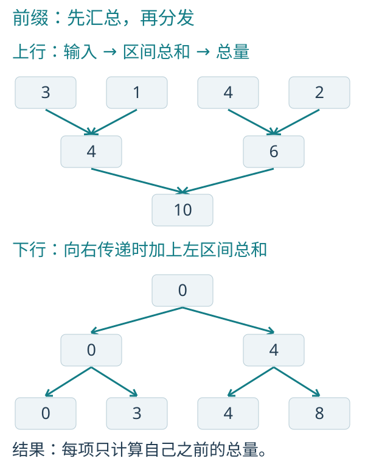

*图 4-1　扫描的上行摘要与下行前缀。右区间继承左区间总量。*

大输入的 CPU 实现可先对连续范围做局部扫描，求出范围总量；对这些摘要再扫描，最后把各范围之前的总量加回局部结果。GPU 在工作组内做树形上扫与下扫，再递归处理组摘要，并把前缀传回。

这些阶段确保读取的前缀已经就绪。若直接让所有项同时读取 `output[i-1]`，前一项可能尚未完成，就无法得到正确结果。

### 4.3　在 B 中，意图就是代码

C 串行核心：

```cpp
uint32_t before = 0;
for (size_t i = 0; i < n; ++i) {
    output[i].value = before;
    before += input[i].value;
}
```

先写 `output[i].value`，再加 `input[i].value`，所以结果不包含当前项。`before` 表示当前项之前的总和。

对应的 B 实现来自 `lessons/scan.b`：

```c
void offsets(read dataset<Count> input, write dataset<Count> output) on compute {
    scan_exclusive_sum(input.value, output.value);
}
```

`scan_exclusive_sum` 表达每个位置之前的总和。输出位置可以同时生产，前提是先形成并传播所需的区间摘要。

第4.5节完整展示初始化 `[3,1,4,2]` 与扫描，输出 `[0,3,4,8]`，可以先手算，再运行核对。

这一个原语可以支撑变长数据打包、任务分区、筛选、基数排序等模式。原理上的“得到互不重叠区间”不表示普通 B 代码因此获得任意散写权限：当前安全散写由 compact、排序、append 等明确原语负责，不能拿一个普通扫描数值直接绕过访问规则。

### 4.4　你开始拥有一种新的解题方式

遇到“每个输入产生不同数量输出”的问题，可以先问：能否先求每个输入的产量，再做 scan，最后按区间生产？

具体实现应选择最贴切的结构：筛选可直接用 compact，重排可使用稳定排序，固定产量则可能只需独占输出。

### 4.5　运行与结果

main 初始化 [3,1,4,2]，exclusive_offsets 完整展示独占扫描，结果为 [0,3,4,8]。 GPU 版只保留设备边界所需的同文件计算函数，并显式展示传输；不导入自定义教学包装。

**CPU 完整源码**

`sample/applications/scan_cpu.h`：

```c
module applications.scan_cpu;

u32 main() on cpu;
```

`sample/applications/scan_cpu.b`：

```c
module applications.scan_cpu;

struct Count { u32 value; };

void exclusive_offsets(read dataset<Count> input, write dataset<Count> output) on compute {
    scan_exclusive_sum(input.value, output.value);
}

u32 main() on cpu {
    dataset<Count> input = dataset<Count>(4);
    dataset<Count> output = dataset<Count>(4);

    parallel (item in input) {
        let k = index() % 4;
        item.value = k == 0 ? 3 : (k == 1 ? 1 : (k == 2 ? 4 : 2));
    }

    exclusive_offsets(input, output);

    for (row in output) { if (!println(row.value)) { return 1; } }
    return 0;
}
```

```powershell
& "$env:ProgramFiles/Blink/bin/bc.exe" -c sample/applications/scan_cpu.b -o target/book-apps/scan_cpu.obj -I sample
& "$env:ProgramFiles/Blink/bin/blink.exe" target/book-apps/scan_cpu.obj -o target/book-apps/scan_cpu.exe
.\target\book-apps\scan_cpu.exe
```

**GPU 完整源码**

`sample/applications/scan_gpu.h`：

```c
module applications.scan_gpu;

u32 main() on cpu;
```

`sample/applications/scan_gpu.b`：

```c
module applications.scan_gpu;

struct Count { u32 value; };

void exclusive_offsets(read dataset<Count> input, write dataset<Count> output) on compute {
    scan_exclusive_sum(input.value, output.value);
}

u32 main() on cpu {
    dataset<Count> input = dataset<Count>(4);
    dataset<Count> output = dataset<Count>(4);

    parallel (item in input) {
        let k = index() % 4;
        item.value = k == 0 ? 3 : (k == 1 ? 1 : (k == 2 ? 4 : 2));
    }

    upload(input);
    upload(output);
    target(gpu, exclusive_offsets(input, output));
    download(output);

    for (row in output) { if (!println(row.value)) { return 1; } }
    return 0;
}
```

```powershell
& "$env:ProgramFiles/Blink/bin/bc.exe" -c sample/applications/scan_gpu.b -o target/book-apps/scan_gpu.obj -I sample
& "$env:ProgramFiles/Blink/bin/blink.exe" target/book-apps/scan_gpu.obj -o target/book-apps/scan_gpu.exe
.\target\book-apps\scan_gpu.exe
```

输入是 `[3,1,4,2]`，最后一个独占前缀为 8，不是包含自身的 10。

以上应用以正式工具 0.14.1.1 编译、链接并执行。部署时带上链接器生成的配套 DLL；GPU 仍需满足程序要求的 Vulkan 能力。

### 4.6　把长依赖链改写后的收益

性能输入为一亿个元素。下面比较完成一次算法的用时，计时范围与第 1.6 节相同。

```powershell
.\target\release\bperf.exe `
    scan 100000000
```


输入循环为 [3,1,4,2]，三种版本的全部前缀相同。串行循环带着一个累加器向前推进；并行扫描先产生范围摘要，再传播前缀。树形组织增加了辅助工作，却能缩短长序列的关键依赖。


## 5　第五种美：让有效工作自己形成队伍

### 5.1　容量不等于工作量

一个数组能放一百万条记录，这次筛选后只剩两千条。如果后续还对一百万条容量逐个启动并判断“我是不是有效”，你描述的是存储大小，不是真正要完成的工作。

B 的 compact 稳定筛选完整记录，并产生有效数量；prefix 让下一个阶段直接消费这个有效范围。

先看串行筛选：`input` 是输入，`selected` 是筛选结果，`count[0].value` 是已写入的条数。这里假设结果容量能容纳全部输入。

```cpp
count[0].value = 0;
for (size_t i = 0; i < n; ++i) {
    if (input[i].keep) {
        selected[count[0].value] = input[i];
        count[0].value += 1;
    }
}
```

对应的 B 实现来自 `lessons/pipeline.b`：

```c
void select(read dataset<Item> input, write dataset<Item> selected,
               write dataset<Count, 1> count) on compute
    ensures prefix(selected, count.value) {
    compact(input, input.keep, selected, count.value);
}
```

串行版维护一个移动的写入位置；`compact` 先确定每个保留项的位置，再完成稳定搬运，产生有效数量。

若 id 依次为 0 到 7，keep 仅在偶数 id 上为 true，结果就是 `[0,2,4,6]`，`count.value` 为 4。稳定表示保留下来的记录仍保持原先相对顺序。

### 5.2　怎样让并行写入仍然保持顺序

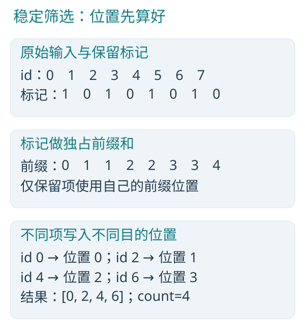

*图 5-1　保留标记的前缀和，为每条保留记录分配唯一的稳定位置。*

把 true 记作 1、false 记作 0，对标记扫描。每个保留项的前缀恰好等于“前面已有多少保留项”。因此它们得到不同的输出位置，来源顺序也被保留。最终标记总和就是 count。

当前 GPU compact 使用谓词扫描和稳定写回，摘要留在设备。CPU 可以按范围先计数，再扫描范围计数，最后让各范围从自己的起点稳定复制。两端保持相同结果，不要求采用相同的物理步骤。

这里展示的是 compact 原语内部的定位方法；普通用户代码不会因为算出一个数，就自动获得任意散写权限。

### 5.3　一个数字还不够，关系才完整

`count.value=4` 本身无法说明是哪一个数组的哪四条记录。B 的 prefix 关系把“这个输出”和“这个数量”联系起来。

`ensures prefix(selected,count.value)` 说明生产者交付这种关系；消费者用 `requires prefix(...)` 说明它需要这种关系。它们由编译器检查，不是随意写上的运行时承诺。

```c
void order(read dataset<Item> selected, read dataset<Count, 1> count,
              write dataset<Item> ordered) on compute
    requires prefix(selected, count.value)
    ensures prefix(ordered, count.value) {
    stable_sort_by_key(prefix(selected, count.value).key, ordered);
}
```

串行 C++ 可以先复制有效记录，再调用稳定排序：

```cpp
for (size_t i = 0; i < count[0].value; ++i) {
    ordered[i] = selected[i];
}
std::stable_sort(ordered, ordered + count[0].value,
    [](const Item& a, const Item& b) {
        return a.key < b.key;
    });
```

这段代码只排序前面真正产生的记录，并把同一个有效数量传给新的输出。相同 key 保持原相对顺序。

### 5.4　为什么这比“先读回数量”更有吸引力

一种常见 CPU/GPU 流水是：GPU 筛选，CPU 等待，读回 count，CPU 决定下一次启动规模，再把后续工作交给 GPU。

B 的有效域可以让计数留在设备上，由现有执行框架生成间接启动参数。算法继续写下一步计算，不必为每个阶段复制一份宿主计数。设备数据、阶段依赖和真实资源所有者仍然存在；消除的是不必要的中途来回。

输出缓冲区仍需容纳最坏情况下的全部输入。prefix 缩小的是后续工作域，已经分配的存储容量保持不变。

### 5.5　稳定和无序，各有位置

compact 要稳定保留来源顺序。另一个原语 append 关注有界接纳完整记录，可以允许不同执行者以不同次序成功加入输出。

只关心结果集合时，可以考虑无序接纳；需要保留来源顺序时，应选择稳定筛选。顺序要求来自结果的用途。

### 5.6　运行稳定筛选及其消费者

main 初始化八条记录；同文件 select_sort_and_sum 直接写出筛选、排序、扫描和归约四步，输出数量4与总量16。 GPU 版只保留设备边界所需的同文件计算函数，并显式展示传输；不导入自定义教学包装。

**CPU 完整源码**

`sample/applications/pipeline_cpu.h`：

```c
module applications.pipeline_cpu;

u32 main() on cpu;
```

`sample/applications/pipeline_cpu.b`：

```c
module applications.pipeline_cpu;

struct Item { u32 id; u32 key; u32 units; bool keep; };
struct Count { u32 value; };
struct Offset { u32 value; };

void select_sort_and_sum(read dataset<Item> input, inout dataset<Item> selected,
                         inout dataset<Item> ordered, inout dataset<Count, 1> count,
                         write dataset<Offset> offsets, write dataset<Count, 1> total) on compute
    ensures prefix(ordered, count.value)
    ensures prefix(offsets, count.value) {
    compact(input, input.keep, selected, count.value);
    stable_sort_by_key(prefix(selected, count.value).key, ordered);
    scan_exclusive_sum(prefix(ordered, count.value).units, offsets.value);
    reduce_sum(prefix(ordered, count.value).units, total.value);
}

u32 main() on cpu {
    dataset<Item> input = dataset<Item>(8);
    dataset<Item> selected = dataset<Item>(8);
    dataset<Item> ordered = dataset<Item>(8);
    dataset<Count, 1> count = dataset<Count>(1);
    dataset<Offset> offsets = dataset<Offset>(8);
    dataset<Count, 1> total = dataset<Count>(1);

    parallel (item in input) {
        item.id = index();
        item.key = (index() * 7 + 2) % 3;
        item.units = index() + 1;
        item.keep = index() % 2 == 0;
    }

    select_sort_and_sum(input, selected, ordered, count, offsets, total);

    if (!println(count[0].value) || !println(total[0].value)) { return 1; }
    return 0;
}
```

```powershell
& "$env:ProgramFiles/Blink/bin/bc.exe" -c sample/applications/pipeline_cpu.b -o target/book-apps/pipeline_cpu.obj -I sample
& "$env:ProgramFiles/Blink/bin/blink.exe" target/book-apps/pipeline_cpu.obj -o target/book-apps/pipeline_cpu.exe
.\target\book-apps\pipeline_cpu.exe
```

**GPU 完整源码**

`sample/applications/pipeline_gpu.h`：

```c
module applications.pipeline_gpu;

u32 main() on cpu;
```

`sample/applications/pipeline_gpu.b`：

```c
module applications.pipeline_gpu;

struct Item { u32 id; u32 key; u32 units; bool keep; };
struct Count { u32 value; };
struct Offset { u32 value; };

void select_sort_and_sum(read dataset<Item> input, inout dataset<Item> selected,
                         inout dataset<Item> ordered, inout dataset<Count, 1> count,
                         write dataset<Offset> offsets, write dataset<Count, 1> total) on compute
    ensures prefix(ordered, count.value)
    ensures prefix(offsets, count.value) {
    compact(input, input.keep, selected, count.value);
    stable_sort_by_key(prefix(selected, count.value).key, ordered);
    scan_exclusive_sum(prefix(ordered, count.value).units, offsets.value);
    reduce_sum(prefix(ordered, count.value).units, total.value);
}

u32 main() on cpu {
    dataset<Item> input = dataset<Item>(8);
    dataset<Item> selected = dataset<Item>(8);
    dataset<Item> ordered = dataset<Item>(8);
    dataset<Count, 1> count = dataset<Count>(1);
    dataset<Offset> offsets = dataset<Offset>(8);
    dataset<Count, 1> total = dataset<Count>(1);

    parallel (item in input) {
        item.id = index();
        item.key = (index() * 7 + 2) % 3;
        item.units = index() + 1;
        item.keep = index() % 2 == 0;
    }

    upload(input);
    upload(selected);
    upload(ordered);
    upload(count);
    upload(offsets);
    upload(total);
    target(gpu, select_sort_and_sum(input, selected, ordered, count, offsets, total));
    download(count);
    download(total);

    if (!println(count[0].value) || !println(total[0].value)) { return 1; }
    return 0;
}
```

```powershell
& "$env:ProgramFiles/Blink/bin/bc.exe" -c sample/applications/pipeline_gpu.b -o target/book-apps/pipeline_gpu.obj -I sample
& "$env:ProgramFiles/Blink/bin/blink.exe" target/book-apps/pipeline_gpu.obj -o target/book-apps/pipeline_gpu.exe
.\target\book-apps\pipeline_gpu.exe
```

应用先打印有效数量 `4`，再打印 units 总和 `16`。筛选保留的 id 为 `[0,2,4,6]`；排序与偏移仍由同一次计算生成，下一章继续分析这些中间值。

以上应用以正式工具 0.14.1.1 编译、链接并执行。部署时带上链接器生成的配套 DLL；GPU 仍需满足程序要求的 Vulkan 能力。

### 5.7　稳定筛选的效率

性能输入为一亿个元素。下面比较完成一次算法的用时，计时范围与第 1.6 节相同。

```powershell
.\target\release\bperf.exe `
    compact 100000000
```


本节只测 select 稳定筛选，保留偶数 id，产生五千万条有效结果。完整流水线在下一章计时。串行版本一次遍历紧凑写回；并行筛选需要局部计数、前缀与分散写入，在这个规模上 GPU 的并行吞吐超过了额外工作。


## 6　第六种美：几种简单结构，组成一条完整流水线

### 6.1　把问题说完整

有一批 Item，每条包含 id、key、units、keep。我们希望：保留 keep 为 true 的记录，按 key 稳定排序，为每条记录计算工作区起点，最后求总工作量。

```text
所有记录
    |
 compact          形成有效队伍
    |
 stable sort      按 key 编排，保留同键顺序
    |
    +---- scan    每条记录之前已有多少工作
    |
    +---- reduce  这批工作总共有多少
```

这里的分叉表示数据消费关系，不承诺当前执行器在硬件上让两条分支同时运行。Blink 当前仍以单队列 GPU 为主。

### 6.2　看见组合，而不是看见线程管理

`lessons/pipeline.b` 的上层 计算函数 如下：

```c
void run(read dataset<Item> input, inout dataset<Item> selected,
            inout dataset<Item> ordered, inout dataset<Count, 1> count,
            write dataset<Offset> offsets, write dataset<Count, 1> total) on compute
    ensures prefix(ordered, count.value)
    ensures prefix(offsets, count.value) {
    select(input, selected, count);
    order(selected, count, ordered);
    summarize(ordered, count, offsets, total);
}
```

而最后一个阶段只做两件事：

```c
void summarize(read dataset<Item> ordered, read dataset<Count, 1> count,
                  write dataset<Offset> offsets,
                  write dataset<Count, 1> total) on compute
    requires prefix(ordered, count.value)
    ensures prefix(offsets, count.value) {
    scan_exclusive_sum(prefix(ordered, count.value).units, offsets.value);
    reduce_sum(prefix(ordered, count.value).units, total.value);
}
```

每个模块说清输入、输出和有效关系，上层只负责组合。你既能读懂数据去哪了，也能看清哪个阶段必须等待哪个结果。

`selected` 保存筛选结果，`ordered` 保存排序结果；count 限定有效条数，offsets 保存每条记录的起点。不同的中间结果对应不同阶段的真实职责。

串行统计的核心是同一个累加器：

```cpp
total[0].value = 0;
for (size_t i = 0; i < count[0].value; ++i) {
    offsets[i].value = total[0].value;
    total[0].value += ordered[i].units;
}
```

串行循环一次遍历就能得到起点与总量。B 用 scan 和 reduce 分别表达这两种集合关系，实际遍历次数与执行成本取决于后端实现。

### 6.3　八条记录，手算整条流水

完整应用在 main 中写出的输入规则是：`id=i`，`key=(i*7+2)%3`，`units=i+1`，偶数 id 保留。

| 位置 | 输入 id | key | units | keep |
|---|---|---|---|---|
| 0 | 0 | 2 | 1 | true |
| 1 | 1 | 0 | 2 | false |
| 2 | 2 | 1 | 3 | true |
| 3 | 3 | 2 | 4 | false |
| 4 | 4 | 0 | 5 | true |
| 5 | 5 | 1 | 6 | false |
| 6 | 6 | 2 | 7 | true |
| 7 | 7 | 0 | 8 | false |

compact 后的 id 为 `[0,2,4,6]`；稳定排序后变成 `[4,2,0,6]`。两个 key=2 的记录仍是 id=0 在 id=6 前面。

此时 units 是 `[5,3,1,7]`，独占扫描为 `[0,5,8,9]`，总和为 16。你能在纸上解释每个数，就已经理解了这条并行流水线的语义。

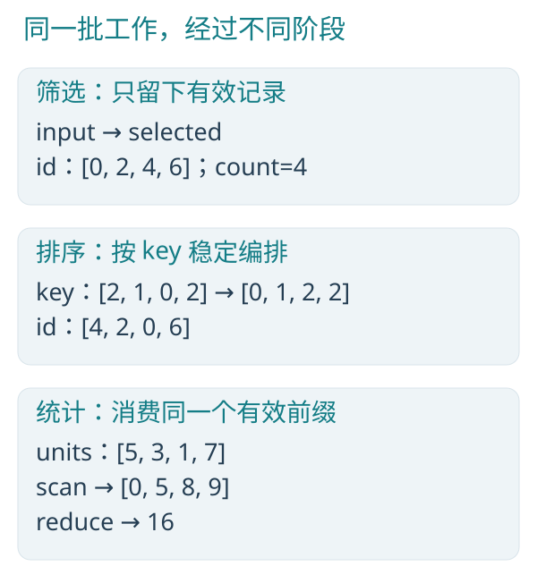

*图 6-1　筛选、排序与统计的具体中间结果。*

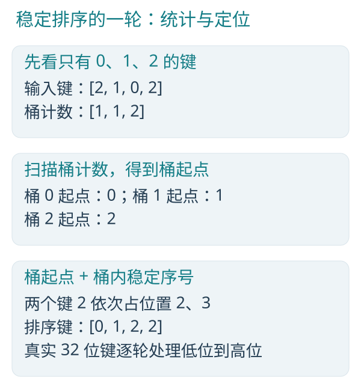

*图 6-2　用三种键理解稳定定位。图中是单轮原理示意。*

稳定基数排序把键分成若干位段处理。每轮统计各桶数量，扫描得到桶起点，再把同桶内的稳定序号加上去。当前 B 后端对 32 位键按每轮 4 位、共 8 轮组织；临时搬运键和来源序号，最后再 gather 完整记录。图中的三个桶只用于解释定位，不是当前后端恰好只用三个桶。

流水线的阶段边界来自依赖：排序需要有效记录，统计需要排序结果。GPU count 可以留在设备生成间接启动规模，避免每一步都读回 CPU；真实设备内存与执行依赖仍由框架持有。

### 6.4　与传统 C/C++ 实现比较什么

手工组织这条流水线，需要安排工作分区、局部计数、前缀合并、稳定写回和阶段等待。GPU 实现还涉及设备缓冲与内核依赖。

C++ 并行库能够封装许多调度细节。B 进一步把集合操作、访问权限、有效域和阶段组合纳入语言，使编译器能沿着同一套关系生成 CPU/GPU 代码。

简洁的表达便于阅读和维护；执行效率还需结合输入规模与实际运行分析。

### 6.5　运行整条流水线

使用上一章给出的 pipeline 运行命令即可。结果依次为：selected 的有效 id `[0,2,4,6]`，ordered 的有效 id `[4,2,0,6]`，offsets `[0,5,8,9]`，total 为 16。

小输入的命令与结果见第 5.6 节。检查文件时，ordered 与 offsets 的容量仍是 8，只读取 count 指定的前 4 条；容量尾部没有参与本次计算。

### 6.6　整条流水线一起计时

性能输入为一千万个元素。下面比较完成一次算法的用时，计时范围与第 1.6 节相同。

```powershell
.\target\release\bperf.exe `
    pipeline 10000000
```


初始一千万条记录筛选后留下五百万条。C++ 对照同样完成稳定筛选、std::stable_sort、前缀与总量；没有拿一个局部步骤去比较整条链。B GPU 的主时间覆盖全部阶段及其依赖，并把有效数量留在设备上供后续阶段消费。


## 7　第七种美：大合唱里面，还能组成小乐队

### 7.1　为什么要分块

有时每个元素不再完全独立，它需要知道附近同一块数据的总和、均值或前缀。若每个元素都重新遍历整块，同一份工作会重复许多次；若所有元素都向全局共享变量写，又会引入争用。

tile 描述一个按逻辑元素顺序划分的小协作块。它的宽度是算法选择的静态参数；尾块只公开实际有效长度。

输入 `[1,2,3,4,5,6]` 按宽度 4 分成 `[1,2,3,4]` 和 `[5,6]` 两块，尾块的有效长度为 2。

### 7.2　先拍快照，再各自更新

先看一个块的 C 串行计算。`base` 是块起点，`length` 是实际长度，等于 Width 与剩余元素数中较小的一个；对各块依次执行这段计算，就是完整的串行处理：

```cpp
float total = 0;
for (size_t lane = 0; lane < length; ++lane) {
    total += cells[base + lane].value;
}
float before = 0;
for (size_t lane = 0; lane < length; ++lane) {
    size_t i = base + lane;
    cells[i].total = total;
    cells[i].before = before;
    cells[i].centered = cells[i].value - total / length;
    before += cells[i].value;
}
```

先得到整块总量，再填写每项结果；最后一块使用实际长度。

摘自教学源码 `lessons/tiles.b` 的 analyze 正文：

```c
parallel (cell in cells) {
    let values = tile_input(cells.value, Width);
    f32 total = tile_reduce_sum(values);
    f32 before = tile_scan_exclusive_sum(values);
    f32 centered = cooperate center(values, cell.value);
    cell.total = total;
    cell.before = before;
    cell.centered = centered;
}
```

`tile_input` 读取阶段入口时的块内只读快照。即使后面更新原 dataset，协作者读到的仍是这个版本，避免一个人读旧值、另一个人已经读到新值。

这里 `cells` 是完整记录集，`values` 是当前块的只读数值快照。每条 Cell 保存 value、total、before、centered，分别对应原值、块内总量、块内前缀与去中心结果。

第一块的 total 都是 10，before 是 `[0,1,3,6]`，减去均值后的 centered 是 `[-1.5,-0.5,0.5,1.5]`。第二块 total 是 11，before 是 `[0,5]`，centered 是 `[-0.5,0.5]`。

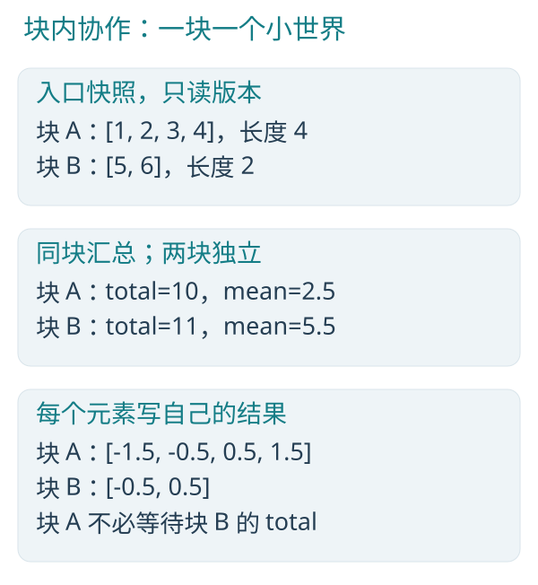

*图 7-1　块内需要合作，块间可以独立。尾块均值使用真实长度。*

CPU 在原生范围内按块保存所需输入，再完成各个协作阶段；范围边界按逻辑块对齐。GPU 把一个逻辑 tile 对应到工作组，共享载入后通过块内屏障让所需数据可见，再做集合运算。尾部没有有效数据的调用不读取虚构元素，但仍须参加统一的块内同步。

这解释了快照的价值：先读哪一版被写进语义，不让线程到达的偶然先后决定读到旧值还是新值。

### 7.3　发布计算结果，不必先写回全局数组

串行版先产生整块新值，再汇总，最后写结果。以下是当前块 `[base, base+length)` 的核心，块划分与上节相同：

```cpp
float total = 0;
for (size_t lane = 0; lane < length; ++lane) {
    size_t i = base + lane;
    cells[i].value *= factor;
    total += cells[i].value;
}
for (size_t lane = 0; lane < length; ++lane) {
    size_t i = base + lane;
    cells[i].total = total;
    cells[i].centered = cells[i].value - total / length;
}
```

另一个 计算函数 的核心是：

```c
parallel (cell in cells) {
    let transformed = tile_publish(cell.value * factor, Width);
    f32 total = tile_reduce_sum(transformed);
    cell.value = transformed[transformed.lane];
    cell.total = total;
    cell.centered = cell.value - total / f32(transformed.length);
}
```

先让每个元素算出自己的变换值，再把这一批值发布给同块协作者。编译器处理发布和同步，不需要算法先申请一个全局中间 dataset，再启动第二个 计算函数 才能读到结果。

GPU 在同一个内核内完成静态发布与后续集合；CPU 则在原生范围内按块执行，发布过程直接融入块内计算。

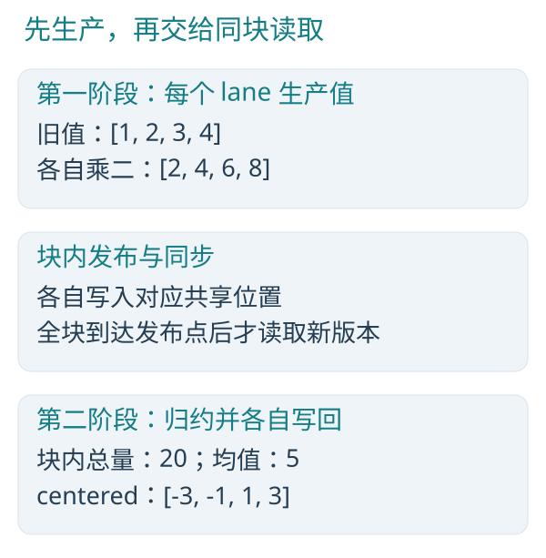

*图 7-2　发布点区分生产与消费，不能在其他 lane 尚未写入时读取新版本。*

### 7.4　理解三种协作范围

| 范围 | 表达什么 | 不能拿来冒充什么 |
|---|---|---|
| dataset / prefix | 全体或有效前缀工作域 | 不是一个硬件 subgroup |
| tile | 算法选择的逻辑块 | 不是全局同步范围 |
| subgroup | GPU 实际活动协作集合 | 不保证与逻辑记录顺序一一对应 |

`tile.lane` 是块内逻辑位置；`index()` 是当前全局元素序号；GPU subgroup 的 lane 则属于硬件协作集合。它们叫法相似，职责不同。

本书优先用 tile 建立可跨 CPU/GPU 的协作直觉。subgroup 是更贴近 GPU 的工具，B 已支持值归约、投票、选举等操作，但不能把 subgroup 计数当作全局唯一输出位置。

### 7.5　局部合作，也要尊重阶段

当前 tile 发布、集合与 cooperate 调用位于 parallel 或 cooperative 的根块，不支持在动态循环或分支里随意插入协作阶段。不要把“本次分支刚好全员进入”当作通用同步依据。

块内阶段不能让别的块也完成；全域依赖要在 计算函数 阶段表达。局部越清晰，全局越容易组合。

### 7.6　运行与结果

main 初始化六个值。块宽直接写为4；CPU main 中完整展示块内总量、前缀及调用同文件 center 协作函数的计算。 GPU 版只保留设备边界所需的同文件计算函数，并显式展示传输；不导入自定义教学包装。

**CPU 完整源码**

`sample/applications/tiles_cpu.h`：

```c
module applications.tiles_cpu;

u32 main() on cpu;
```

`sample/applications/tiles_cpu.b`：

```c
module applications.tiles_cpu;

struct Cell { f32 value; f32 total; f32 before; f32 centered; };

cooperative f32 center(tile<f32> values, f32 value) on compute {
    f32 total = tile_reduce_sum(values);
    return value - total / f32(values.length);
}

u32 main() on cpu {
    dataset<Cell> cells = dataset<Cell>(6);

    parallel (cell in cells) {
        cell.value = f32(index() + 1);
    }

    parallel (cell in cells) {
        let values = tile_input(cells.value, 4);
        f32 total = tile_reduce_sum(values);
        f32 before = tile_scan_exclusive_sum(values);
        f32 centered = cooperate center(values, cell.value);
        cell.total = total;
        cell.before = before;
        cell.centered = centered;
    }

    for (cell in cells) {
        if (!println(cell.value) || !println(cell.total) ||
            !println(cell.before) || !println(cell.centered)) { return 1; }
    }
    return 0;
}
```

```powershell
& "$env:ProgramFiles/Blink/bin/bc.exe" -c sample/applications/tiles_cpu.b -o target/book-apps/tiles_cpu.obj -I sample
& "$env:ProgramFiles/Blink/bin/blink.exe" target/book-apps/tiles_cpu.obj -o target/book-apps/tiles_cpu.exe
.\target\book-apps\tiles_cpu.exe
```

**GPU 完整源码**

`sample/applications/tiles_gpu.h`：

```c
module applications.tiles_gpu;

u32 main() on cpu;
```

`sample/applications/tiles_gpu.b`：

```c
module applications.tiles_gpu;

struct Cell { f32 value; f32 total; f32 before; f32 centered; };

cooperative f32 center(tile<f32> values, f32 value) on compute {
    f32 total = tile_reduce_sum(values);
    return value - total / f32(values.length);
}

void analyze_tiles(inout dataset<Cell> cells) on compute {
    parallel (cell in cells) {
        let values = tile_input(cells.value, 4);
        f32 total = tile_reduce_sum(values);
        f32 before = tile_scan_exclusive_sum(values);
        f32 centered = cooperate center(values, cell.value);
        cell.total = total;
        cell.before = before;
        cell.centered = centered;
    }
}

u32 main() on cpu {
    dataset<Cell> cells = dataset<Cell>(6);

    parallel (cell in cells) {
        cell.value = f32(index() + 1);
    }

    upload(cells);
    target(gpu, analyze_tiles(cells));
    download(cells);

    for (cell in cells) {
        if (!println(cell.value) || !println(cell.total) ||
            !println(cell.before) || !println(cell.centered)) { return 1; }
    }
    return 0;
}
```

```powershell
& "$env:ProgramFiles/Blink/bin/bc.exe" -c sample/applications/tiles_gpu.b -o target/book-apps/tiles_gpu.obj -I sample
& "$env:ProgramFiles/Blink/bin/blink.exe" target/book-apps/tiles_gpu.obj -o target/book-apps/tiles_gpu.exe
.\target\book-apps\tiles_gpu.exe
```

应用按每条记录的 value、total、before、centered 顺序逐行打印四个字段。第一块总量为 10，第二块为 11；前缀与去中心结果见第 7.2 节。

以上应用以正式工具 0.14.1.1 编译、链接并执行。部署时带上链接器生成的配套 DLL；GPU 仍需满足程序要求的 Vulkan 能力。

### 7.7　把小块协作铺满大数组

性能输入为一千万个元素。下面比较完成一次算法的用时，计时范围与第 1.6 节相同。

```powershell
.\target\release\bperf.exe `
    tiles 10000000
```


性能输入循环为 1 到 17，块宽选择 32。C++ 对照按块先求总量，再一次生成前缀与去中心结果，避免每个元素重复求和。B 的完整 analyze 同时包含快照、块内总量、前缀以及 cooperative center，计时覆盖这些工作。


### 7.8　运行发布后协作

main 初始化六条记录，源码直接展示乘二、tile_publish、块内总量和去中心计算，块宽为4。 GPU 版只保留设备边界所需的同文件计算函数，并显式展示传输；不导入自定义教学包装。

**CPU 完整源码**

`sample/applications/publish_cpu.h`：

```c
module applications.publish_cpu;

u32 main() on cpu;
```

`sample/applications/publish_cpu.b`：

```c
module applications.publish_cpu;

struct Cell { f32 value; f32 total; f32 before; f32 centered; };

u32 main() on cpu {
    dataset<Cell> cells = dataset<Cell>(6);

    parallel (cell in cells) {
        cell.value = f32(index() + 1);
    }

    parallel (cell in cells) {
        let transformed = tile_publish(cell.value * 2.0, 4);
        f32 total = tile_reduce_sum(transformed);
        cell.value = transformed[transformed.lane];
        cell.total = total;
        cell.centered = cell.value - total / f32(transformed.length);
    }

    for (cell in cells) {
        if (!println(cell.value) || !println(cell.total) ||
            !println(cell.centered)) { return 1; }
    }
    return 0;
}
```

```powershell
& "$env:ProgramFiles/Blink/bin/bc.exe" -c sample/applications/publish_cpu.b -o target/book-apps/publish_cpu.obj -I sample
& "$env:ProgramFiles/Blink/bin/blink.exe" target/book-apps/publish_cpu.obj -o target/book-apps/publish_cpu.exe
.\target\book-apps\publish_cpu.exe
```

**GPU 完整源码**

`sample/applications/publish_gpu.h`：

```c
module applications.publish_gpu;

u32 main() on cpu;
```

`sample/applications/publish_gpu.b`：

```c
module applications.publish_gpu;

struct Cell { f32 value; f32 total; f32 before; f32 centered; };

void publish_values(inout dataset<Cell> cells) on compute {
    parallel (cell in cells) {
        let transformed = tile_publish(cell.value * 2.0, 4);
        f32 total = tile_reduce_sum(transformed);
        cell.value = transformed[transformed.lane];
        cell.total = total;
        cell.centered = cell.value - total / f32(transformed.length);
    }
}

u32 main() on cpu {
    dataset<Cell> cells = dataset<Cell>(6);

    parallel (cell in cells) {
        cell.value = f32(index() + 1);
    }

    upload(cells);
    target(gpu, publish_values(cells));
    download(cells);

    for (cell in cells) {
        if (!println(cell.value) || !println(cell.total) ||
            !println(cell.centered)) { return 1; }
    }
    return 0;
}
```

```powershell
& "$env:ProgramFiles/Blink/bin/bc.exe" -c sample/applications/publish_gpu.b -o target/book-apps/publish_gpu.obj -I sample
& "$env:ProgramFiles/Blink/bin/blink.exe" target/book-apps/publish_gpu.obj -o target/book-apps/publish_gpu.exe
.\target\book-apps\publish_gpu.exe
```

应用按每条记录的 value、total、centered 打印三个字段。乘二后为 `[2,4,6,8,10,12]`；块总量为 `[20,20,20,20,22,22]`；去中心结果为 `[-3,-1,1,3,-1,1]`。before 未被 publish 改写，仍保留初始化值。

以上应用以正式工具 0.14.1.1 编译、链接并执行。部署时带上链接器生成的配套 DLL；GPU 仍需满足程序要求的 Vulkan 能力。

### 7.9　发布与协作的整体成本

性能输入为一千万个元素。下面比较完成一次算法的用时，计时范围与第 1.6 节相同。

```powershell
.\target\release\bperf.exe `
    publish 10000000
```


块宽为 32，factor=2。C++ 对照在块内变换、求和并写出去中心结果；B 将发布点与后续协作保留在块内执行。三种实现最终的 value、total、centered 相同，测量包含发布所需的同步。


## 8　第八种美：抽象可以留下思想，消去搬运

### 8.1　把协作写进函数接口

在上章中，center 是一个协作函数：

```c
cooperative f32 center(tile<f32> values, f32 value) on compute {
    f32 total = tile_reduce_sum(values);
    return value - total / f32(values.length);
}
```

C++ 串行函数可以用普通循环表达同一公式：

```cpp
float center(const float* values, size_t length, float value) {
    float total = 0;
    for (size_t i = 0; i < length; ++i) {
        total += values[i];
    }
    return value - total / length;
}
```

这个 C++ 函数每次调用都会求和，连续处理整块时应复用 total，如上一章所示。B 的 cooperative 函数由同块参与者共同完成归约，调用时静态展开到块内计算。

调用处的 `cooperate center(...)` 明确标出块内协作，让所需的同步关系在接口上可见。

`values` 提供块内只读输入，`value` 是当前元素的普通数值。函数返回当前元素减去块均值的结果。

tile 参数借用原来的块与数据来源，不复制一份输入数组。函数继承调用者的块宽度，可以服务不同块大小。

### 8.2　普通函数、协作函数、计算函数

普通函数封装逐元素数值与显式借用；cooperative 函数封装块内协作；计算函数 组织元素域与全域阶段。选对层次，比把所有事情写进一个大函数更重要。

编译器把静态调用展开到共同 IR，再生成原生计算。函数封装保留职责划分，展开后的数据与控制流则为融合和消除多余存取提供条件。

### 8.3　用 const 确定算法形状

`analyze<const Width:u32>` 的 Width 在编译实例化时确定。`analyze<4>` 和 `analyze<17>` 可以共用源码，却具有各自确定的逻辑块形状。

与之相对，`factor` 是运行时传入的统一数值。Width 决定块的形状，factor 决定这次计算采用的乘数。

B 还支持受约束的数值类型泛型。例如 floating包含f32、f64及float2/3/4。它不是完整 C++ 模板系统；开放接口约束、关联类型与完整符号泛型分析仍未实现。开放 const 声明依赖具体值的正文，在实际实例化时才完整检查。

### 8.4　抽象值得保留的理由

如果一个函数准确表达“块内去中心”“位置积分”“有序变换组合”，它就把可复用的思想从调度细节中提取出来。编译器还能看见这些思想背后的数据与阶段，才有机会一起优化。

好的抽象保留算法的意图，也保留必要的阶段关系。

### 8.5　运行协作函数

center在lessons/tiles.b的analyze中使用，与外层计算共用入口；封装能否消除及性能收益以当前生成代码和实际测量为准。

## 9　第九种美：先找可组合的规律，再寻找并行性

### 9.1　有先后依赖的变换链

假设依次应用四次变换，每次都是 `x = 2*x + 1`。初看，后一次必须等待前一次，似乎没有办法并行。

换一个表示：一个变换由 `(scale,bias)` 描述，表示 `x -> scale*x+bias`。先做 a，再做 b，可以得到一个合并变换：

```text
combined.scale = b.scale * a.scale
combined.bias  = b.scale * a.bias + b.bias
```

我们不急着把初始 x 送过每一步，而是先组合“这些步骤整体代表什么”。函数组合满足结合律，因此可以用树合并。

串行 C++ 核心在输入顺序上反复组合，compose 使用上面的同一公式：

```cpp
Affine combined = {1, 0};
for (size_t i = 0; i < n; ++i) {
    before[i].value = combined;
    combined = compose(combined, input[i].value);
}
total[0].value = combined;
```

### 9.2　B 里的完整算法核心

源码：`lessons/algebra.b`。Affine 有 u32 的 scale 和 bias 两个字段，Transform 用 value 字段保存它。

```c
Affine identity() on compute { return Affine(1, 0); }

Affine compose(Affine a, Affine b) on compute {
    return Affine(b.scale * a.scale, b.scale * a.bias + b.bias);
}

void chain(read dataset<Transform> input,
              write dataset<Transform> before,
              write dataset<Transform, 1> total) on compute {
    scan_exclusive(input.value, before.value, identity, compose);
    reduce(input.value, total.value, identity, compose);
}
```

identity 是空区间的摘要，表示 `x -> x`；compose 按先 a 后 b 的顺序连接两个摘要。scan 将每一步之前的组合写入 `before`，reduce 将全部步骤的组合写入 `total`。

四次 `(2,1)` 的独占扫描为 `(1,0)、(2,1)、(4,3)、(8,7)`，最后总变换为 `(16,15)`。初始 x=3 时，最终结果就是 16*3+15=63，与逐次执行完全对应。

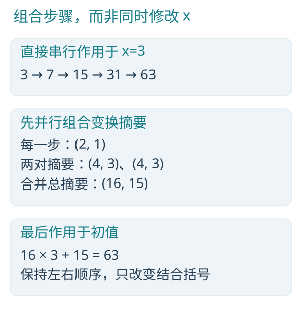

*图 9-1　把有依赖的操作链变成可组合摘要，再把摘要作用于初值。*

真正并行的是摘要构造与有序合并，不是让四个执行者同时改同一个 x。扫描仍按前缀传播算法产生每一步之前的摘要；归约产生整个区间的摘要。CPU 与 GPU 可以采用不同分区，但不能交换左右输入的逻辑顺序。

### 9.3　顺序可以保留，括号可以改变

先做“加一”再做“乘二”，与先乘二再加一不同。因此这里不能交换输入顺序。B 的有序自定义归约和扫描允许改变结合括号，保留逻辑输入的左右顺序。

当前示例使用 u32 模 2^32 运算，组合规律在这个语义下仍成立。换成 f32，浮点舍入又会成为需要单独考虑的问题。编译器检查类型、权限和接口，不替你证明任意 compose 都满足结合律与单位元要求。

### 9.4　并行算法的创造力在哪里

关键的转折是为依赖找到摘要。摘要能够组合，长链就有了树的形状。

状态机摘要、矩阵连乘、区间统计等问题中也可能出现这种结构，但不是所有递推都能轻易找到小而可结合的摘要。如果摘要比原问题还大，或者合并代价过高，转换也可能没有实际收益。

### 9.5　运行与结果

main 初始化四次 (2,1) 变换；identity、compose、扫描与归约均完整展示，普通 CPU 调用不需要 target 包装。 GPU 版只保留设备边界所需的同文件计算函数，并显式展示传输；不导入自定义教学包装。

**CPU 完整源码**

`sample/applications/algebra_cpu.h`：

```c
module applications.algebra_cpu;

u32 main() on cpu;
```

`sample/applications/algebra_cpu.b`：

```c
module applications.algebra_cpu;

struct Affine { u32 scale; u32 bias; };
struct Transform { Affine value; };

Affine identity() on compute { return Affine(1, 0); }

Affine compose(Affine a, Affine b) on compute {
    return Affine(b.scale * a.scale, b.scale * a.bias + b.bias);
}

void accumulate_transforms(read dataset<Transform> input,
                           write dataset<Transform> before,
                           write dataset<Transform, 1> total) on compute {
    scan_exclusive(input.value, before.value, identity, compose);
    reduce(input.value, total.value, identity, compose);
}

u32 main() on cpu {
    dataset<Transform> input = dataset<Transform>(4);
    dataset<Transform> before = dataset<Transform>(4);
    dataset<Transform, 1> total = dataset<Transform>(1);

    parallel (item in input) { item.value = Affine(2, 1); }

    accumulate_transforms(input, before, total);

    for (row in before) {
        if (!println(row.value.scale) || !println(row.value.bias)) { return 1; }
    }
    if (!println(total[0].value.scale) || !println(total[0].value.bias)) { return 1; }
    return 0;
}
```

```powershell
& "$env:ProgramFiles/Blink/bin/bc.exe" -c sample/applications/algebra_cpu.b -o target/book-apps/algebra_cpu.obj -I sample
& "$env:ProgramFiles/Blink/bin/blink.exe" target/book-apps/algebra_cpu.obj -o target/book-apps/algebra_cpu.exe
.\target\book-apps\algebra_cpu.exe
```

**GPU 完整源码**

`sample/applications/algebra_gpu.h`：

```c
module applications.algebra_gpu;

u32 main() on cpu;
```

`sample/applications/algebra_gpu.b`：

```c
module applications.algebra_gpu;

struct Affine { u32 scale; u32 bias; };
struct Transform { Affine value; };

Affine identity() on compute { return Affine(1, 0); }

Affine compose(Affine a, Affine b) on compute {
    return Affine(b.scale * a.scale, b.scale * a.bias + b.bias);
}

void accumulate_transforms(read dataset<Transform> input,
                           write dataset<Transform> before,
                           write dataset<Transform, 1> total) on compute {
    scan_exclusive(input.value, before.value, identity, compose);
    reduce(input.value, total.value, identity, compose);
}

u32 main() on cpu {
    dataset<Transform> input = dataset<Transform>(4);
    dataset<Transform> before = dataset<Transform>(4);
    dataset<Transform, 1> total = dataset<Transform>(1);

    parallel (item in input) { item.value = Affine(2, 1); }

    upload(input);
    upload(before);
    upload(total);
    target(gpu, accumulate_transforms(input, before, total));
    download(before);
    download(total);

    for (row in before) {
        if (!println(row.value.scale) || !println(row.value.bias)) { return 1; }
    }
    if (!println(total[0].value.scale) || !println(total[0].value.bias)) { return 1; }
    return 0;
}
```

```powershell
& "$env:ProgramFiles/Blink/bin/bc.exe" -c sample/applications/algebra_gpu.b -o target/book-apps/algebra_gpu.obj -I sample
& "$env:ProgramFiles/Blink/bin/blink.exe" target/book-apps/algebra_gpu.obj -o target/book-apps/algebra_gpu.exe
.\target\book-apps\algebra_gpu.exe
```

应用按 scale、bias 顺序打印每个前缀，再打印总变换。before 为 `(1,0)、(2,1)、(4,3)、(8,7)`，total 为 `(16,15)`；两端相同。

以上应用以正式工具 0.14.1.1 编译、链接并执行。部署时带上链接器生成的配套 DLL；GPU 仍需满足程序要求的 Vulkan 能力。

### 9.6　让可组合的摘要承担长序列

性能输入为一亿个元素。下面比较完成一次算法的用时，计时范围与第 1.6 节相同。

```powershell
.\target\release\bperf.exe `
    algebra 100000000
```


C++ 对照一次遍历同时生成所有前缀和总变换；B 同样输出这两种结果。性能数据选择 scale=1、bias 循环 1 到 7，使长序列保持在清楚的数值范围内；编译执行的仍是本章完整 Affine 组合操作。所有整数前缀与总变换相同。


## 10　把美落到性能：工作量、依赖、搬运和争用

### 10.1　四个比线程数更有用的问题

总共需要多少计算？最长依赖链有多长？数据要搬运几次？多少执行者在争抢同一个位置？

map 通常容易扩展，但可能很快耗尽内存带宽；reduce 缩短依赖链，却引入合并；scan 多做一些摘要与传播，换来可并行分配的结构；tile 让局部数据更接近协作者，但也占用共享存储和同步预算。

不要因为一个版本使用了更多“并行原语”，就先认定它更好。先看问题结构，再看实测。

### 10.2　一小段串行工作，会限制整体收益

假设程序有 10% 的时间无法并行，其余 90% 可以理想分摊给 P 个执行资源。忽略所有额外成本，理想加速比是：

```text
speedup(P) = 1 / (0.10 + 0.90 / P)
```

按 Amdahl 定律，P=8 时的理想加速比约为 4.71；即使 P 无限增大，也不超过 10。实际运行还要承担调度、同步和数据搬运的成本。

因此，不必要的 CPU 等待、每一步读回设备计数、重复资源准备，可能比某个乘法是否更快更值得处理。优化要沿着完整消费链看。

### 10.3　什么时候需要原子

如果许多元素真的需要修改同一个 u32/i32 位置，B 用 atomic dataset 与显式 atomic 操作表达。例如直方图中，多个样本会落进同一个桶。

C++ 的共享计数可用 `std::atomic<uint32_t>` 表示。计数桶已声明为原子字段时，核心操作为：

```cpp
bins[k].count.fetch_add(1, std::memory_order_relaxed);
```

B 的桶通过 atomic dataset 借用，操作核心是：

```c
atomic_add(bins[k].count, 1, relaxed);
```

原子加保证这一个位置的修改不可被相互覆盖；relaxed 不自动发布其他位置的数据，也不是全域屏障。release/acquire 只有满足实际同步关系时才建立相应可见性，不能让任意跨工作组自旋算法获得推进保证。

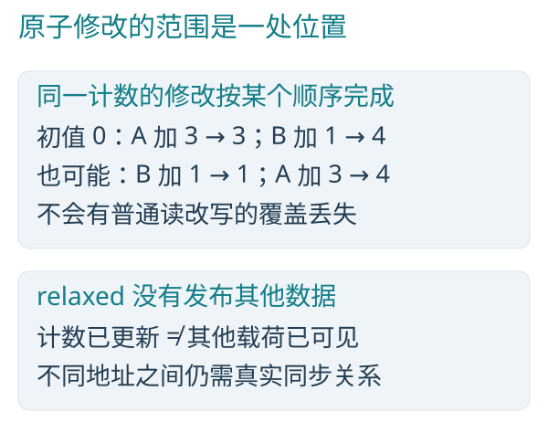

*图 10-1　原子操作串行化同一位置的修改，但不自动发布其他数据。*

纯求和通常先选 reduce。需要真实共享更新时再选 atomic。把所有元素挤到一个热桶，原子操作会遇到争用；改成合理的局部汇总再合并可能改善它，但要由具体数据分布与算法决定。

### 10.4　同步不是一个万能按钮

| 手段 | 它解决什么 | 它没有解决什么 |
|---|---|---|
| 普通元素独占写 | 多个实例不抢同一普通输出 | 不决定业务公式 |
| 原子操作 | 明确共享位置的不可分割修改 | 不保证其他数据都已完成 |
| tile 发布 / 块屏障 | 当前逻辑块内阶段协作 | 不等待所有块 |
| 计算函数 依赖 / phase | 全域阶段的先后关系 | 不保证两个后端浮点逐位一致 |
| 原生完成点 | 设备消费者确实完成 | 不等于提交调用已返回 |

GPU 提交返回时，设备可能还在工作。资源应活到最后一个真实消费者完成，不能以 CPU 函数结束、帧结束或发出命令代替设备完成。

### 10.5　让计时回答真实的问题

一份有用的对照至少要说明四件事：同一算法要完成哪些结果、输入有多大、代码和数据起初在哪里、计时到什么地方结束。本书各章的主对照采用相同输入，各执行一次完整算法，CPU 计时到算法完成，GPU 计时到设备实际完成。

仅在隔离后端的测试或测量时使用模块运行器；brun默认不采集GPU时间戳。需要观察设备程序跨度时，使用`brun --gpu-timestamps gpu ...`明确请求；未采集或没有执行阶段时输出`GPU_program_timestamps=not_collected`，不能当作耗时为零。有样本时的`GPU_program_ms`只记录设备程序跨度；`compute_elapsed_ms`还包含当前CLI中的设备准备、传输与输出。配套bperf在自己的计时程序中显式开启采集，普通计算不承担这项查询工作。第 1 章的实测将这些费用分开，并用包含提交与等待的 GPU 墙钟时间计算主加速比。

足够多的独立工作才能摊薄调度与提交的固定开销。一千万、一亿个元素为并行提供了宽广的工作域；算法本身仍然只执行一次。比较时必须让双方完成同样的工作，不能减少一方的结果，也不能给串行版本加入延迟。

并行收益还取决于总工作量。稳定筛选、扫描和自定义归约可能需要摘要、前缀或额外遍历；串行的一趟直接循环仍是强有力的基准。观察实测中 CPU 与 GPU 的差别，可以判断是该扩大工作域、保留数据驻留，还是应继续改善当前后端。

### 10.6　把加速比放回完整应用


## 11　走进真实代码之一：一群粒子的运动

### 11.1　先认出熟悉的独立结构

下文的 `FieldValue` 在 `math/field.h` 中定义为 `typeset FieldValue { f32; float2; float3; float4; };`，与本教材的四种 f32 维度、f32 强度及能量字段一致。它不限制语言的 f64 能力，也不把尚不合法的类型组合列进算法契约。

现在打开随书教学副本 `sample/hybrid/Programs/simulation/bodies.b`。它提炼自 BLEngine，有限类型约束以本教材副本为准；不必理解整个引擎，只看一个粒子如何更新：

```c
void integrate_body<T: FieldValue, const Power: u32 in {1, 2, 3}>(inout BLBody<T, Power> body, f32 dt, f32 strength) on compute {
    body.velocity += central_acceleration<Power>(body.position, strength) * dt;
    body.position += body.velocity * dt;
}
```

inout 借用的是当前粒子的独占位置。先改速度，再用新速度改位置，是这个积分方法内部真实存在的先后关系。不同粒子之间并没有因此产生依赖。

若按 C++ 的串行方式遍历，核心可以写成下面这样。假设相同的单粒子函数已经实现，这里只比较遍历：

```cpp
for (size_t i = 0; i < n; ++i) {
    auto& body = bodies[i];
    integrate_body(body, dt, strength);
}
```

B 的外层入口声明并行粒子域：

```c
void integrate<B: BLSimulatedBody>(inout dataset<B> bodies, f32 dt, f32 strength) on compute {
    parallel (body in bodies) {
        integrate_body(body, dt, strength);
    }
}
```

这仍然是 map：独立元素的计算由一次线性变换扩展成单粒子积分。

### 11.2　统一公式，静态选择模型

中心加速度来自 `Programs/math/field.b`：

```c
T central_acceleration<T: FieldValue, const Power: u32 in {1, 2, 3}>(T position, f32 strength) {
    // 有限半径中心势：0.25 是力场的软化长度平方，属于算法参数。
    f32 radius_squared = dot(position, position) + 0.25;
    return -position * (strength / (Power == 1 ? sqrt(radius_squared) : Power == 2 ? radius_squared : radius_squared * sqrt(radius_squared)));
}
```

先从接口理解公式：T 表示浮点标量或向量，Power 选择力场模型，strength 是统一参数，position 是当前粒子的位置。

一份算法可以覆盖不同向量维度与力场模型，并生成 CPU/GPU 代码。Power 在编译实例化时确定，因此模型选择在生成代码时就已明确。

### 11.3　把功能分开写，让编译器保留全貌

同一文件中，能量计算与阶段组合如下：

```c
void measure_energy<T: FieldValue>(write f32 target, T velocity) on compute {
    target = 0.5 * dot(velocity, velocity);
}

void energy<B: BLSimulatedBody>(inout dataset<B> bodies) on compute {
    parallel (body in bodies) {
        measure_energy(body.energy, body.velocity);
    }
}
```

```c
void step<B: BLSimulatedBody>(inout dataset<B> bodies, f32 dt, f32 strength) on compute {
    integrate(bodies, dt, strength);
    energy(bodies);
}
```

integrate 和 energy 具有同一元素域，且这里的能量只读取自己刚更新的速度。满足现有依赖条件时，编译器可以融合相邻 map，少一次全局中间读写。

`measure_energy` 只借用当前粒子的 energy 字段，并读取当前速度；它不引入跨粒子依赖。

积分与能量计算各有清楚的职责，编译器也能看见它们的数据联系。模块化因而可以与融合优化共存。

显式 `phase;` 会保留阶段边界。它应表达真实需要的全域阶段，不要在每个函数后机械插入，以免抹掉本来可以融合的关系。

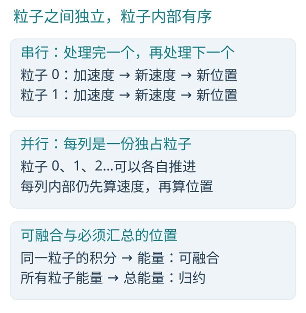

*图 11-1　粒子内部的顺序、粒子之间的并行与全体归约是三个层次。*

串行 C++ 若直接逐粒子完成积分与能量，核心如下：

```cpp
for (size_t i = 0; i < n; ++i) {
    integrate_body(bodies[i], dt, strength);
    measure_energy(bodies[i].energy, bodies[i].velocity);
}
```

总能量还需要汇总所有粒子的能量。它将引入下一节的全域归约，成为这条计算链中新的依赖层次。

### 11.4　再接上一个集合

摘自 `Programs/simulation/statistics.b`：

```c
void step_and_total(inout dataset<BLBody<float3, 3>> bodies, write dataset<BLTotal, 1> total, f32 dt, f32 strength) on compute {
    step(bodies, dt, strength);
    total_energy(bodies, total);
}
```

前面的更新是逐元素阶段，最后的总能量是集合阶段。它们可以组成一个 计算函数，却不能把全体求和假装成每个粒子的独立计算。

C/C++ 读者可以把它理解为“先表达整条依赖链，再让执行器兑现”。手工线程版需要安排范围与合并；手写 CPU/GPU 双版本通常还要维护两套计算实现。B 把共同算法留在 `.b`，目标选择和真实资源执行交给框架。

### 11.5　收益与边界

这段实现展示了数据并行、独占借用、普通函数封装、静态泛型、阶段组合和归约。它不表示任意物理模拟都能逐粒子独立更新。若新算法要求读取其他粒子正在变化的状态，就必须重新组织快照、只读输入或集合依赖，不能照抄这个并行域当作已经正确。

### 11.6　一千万个粒子的真实更新

性能输入为一千万个元素。下面比较完成一次算法的用时，计时范围与第 1.6 节相同。

```powershell
.\target\release\bperf.exe `
    bodies 10000000
```


这里直接调用 BLEngine 的 step<BLBody<float3,3>>，一次执行完成中心力场、速度、位置和能量更新。C++ 使用相同初值、f32 公式与时间步长。积分和能量的模块化写法都保留在 B 源码中；测量比较的是它们实际生成并执行后的整体结果。数值差异以本次构建的实际输出为准。


### 11.7　接上总能量之后

性能输入为一千万个元素。下面比较完成一次算法的用时，计时范围与第 1.6 节相同。

```powershell
.\target\release\bperf.exe `
    body_total 10000000
```


这个对照进一步直接调用引擎 step_and_total。计时包含粒子更新和全局能量归约，GPU 无需在中间把能量字段读回给宿主求和。C++ 串行对照也完整完成更新与求和。

总能量按实际加法顺序产生舍入差异。比较时同时记录逐项f32能量的f64累加参考，不能把串行顺序或树形分组自动视作更准确。


## 12　走进真实代码之二：读很多地方，只写自己的结果

### 12.1　并行不要求只读自己的输入

独占输出是关键约束之一；共享只读输入可以被许多实例共同使用。这个结构叫 gather，直观地说，就是“我到各处读材料，回到自己的位置写成品”。

先看采样均值的 C 串行核心。后续色调映射和颜色打包仍是当前输出的局部计算：

```cpp
for (size_t i = 0; i < display_count; ++i) {
    size_t internal_width = W * 2;
    size_t sample_base = (i / W) * (internal_width * 2) + (i % W) * 2;
    float3 radiance = (pixels[sample_base].radiance
        + pixels[sample_base + 1].radiance
        + pixels[sample_base + internal_width].radiance
        + pixels[sample_base + internal_width + 1].radiance) * 0.25f;
    // Map radiance and write display[i].bgra.
}
```

这里是局部计算片段，float3 和后续映射函数由工程提供。

BLEngine `Programs/render/resolve.b` 让每个显示像素读取四个内部采样，再生产自己的颜色。下面把当前通用实现的 S=2 采样循环展开，便于同串行版本逐行对照；完整的尺寸参数与循环保留在原模块中：

```c
parallel (pixel in display) {
        u32 internal_width = W * 2;
        u32 sample_base = (index() / W) * (internal_width * 2) + (index() % W) * 2;
        float3 radiance = (pixels[sample_base].radiance + pixels[sample_base + 1].radiance
            + pixels[sample_base + internal_width].radiance + pixels[sample_base + (internal_width + 1)].radiance) * 0.25;
        float3 mapped = pow(max(radiance / (radiance + 1.0), float3(0.0)), 0.454545454545);
        u32 red = u32(clamp(mapped.r * 255.0 + 0.5, 0.0, 255.0));
        u32 green = u32(clamp(mapped.g * 255.0 + 0.5, 0.0, 255.0));
        u32 blue = u32(clamp(mapped.b * 255.0 + 0.5, 0.0, 255.0));
        pixel.bgra = (red << 16) | (green << 8) | blue | 0xff000000;
    }
```

无需先学渲染。只看关系：pixels 只读，display 可写，每个实例把结果写进自己的 pixel。即使两个显示结果读取了相同输入，只要输入确实只读，也不会造成写冲突。

这里容易混淆的是 `pixels` 和 `pixel`：原实现中 `pixels` 是内部采样输入，`display` 是显示输出；`parallel (pixel in display)` 中的 `pixel` 对应串行遍历的 `display[i]`，不是输入 `pixels[i]`。`index()` 对应当前输出的下标 `i`，据此算出相同的 `sample_base` 并读取输入。

这里内部采样到输出的具体比例属于当前消费者，不是 B 语言的规定。这个算法的可读性来自“输入集合、当前输出、显式寻址与数学”，而不是某个固定屏幕尺寸。

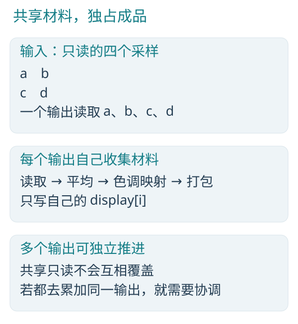

*图 12-1　每个输出收集只读输入，独占写入自己的最终颜色。*

串行版本按 i 逐个完成全部颜色步骤；并行版本把这条局部计算链复制到各输出实例。一次输出内部的采样地址、均值、映射和打包仍有先后关系，输出之间则不互相等待。GPU 中相邻实例同时读取相邻采样还可能改善访存，但具体收益依赖布局与硬件。

### 12.2　把完整显示转换交给 GPU

性能输入为一百万个输出像素。下面比较完成一次显示转换的用时，计时范围与第 1.6 节相同。

```powershell
.\target\release\bperf.exe `
    resolve
```


该实测直接调用引擎的通用 resolve 入口，尺寸选择 1000×1000 输出、2×2 内部采样：读取四百万份采样，输出一百万个显示像素。C++ 对照包含相同的全部颜色计算，最终 BGRA 整数逐项相同。这个正式 B 入口为 on gpu，因此这里只比较 C++ 串行与 B GPU。


### 12.3　为什么输出驱动常常更容易并行

同一个问题可以有两种组织方式：每个输入去修改它影响的输出，或者每个输出自己收集需要的输入。第一种可能让许多输入争写一个输出；第二种常能让每个结果保持独占。

gather 可能增加重复读取，scatter 在某些稀疏结构中更合适。选择时要兼顾访问模式与写入责任：由结果的拥有者完成计算，需要共享修改时再引入协调。

### 12.4　空间变换仍然是同一种形状

BLEngine `Programs/scene/transforms.b`：

```c
void prepare(read dataset<BLAffine> transforms, write dataset<BLNormalMatrix> normals) on compute {
    parallel (normal in normals) {
        BLAffine transform = unsafe_read(transforms, index());
        normal.basis = normal_basis(transform.matrix);
    }
}
```

normal_basis 从仿射矩阵取出线性部分，计算它的逆转置。不懂矩阵推导也能读出并行结构：每份输入变换生产一份输出矩阵，当前 normal 独占自己的输出。公式换了，所有权形状没有换。

串行 C++ 核心：

```cpp
for (size_t i = 0; i < n; ++i) {
    BLAffine transform = transforms[i];
    normals[i].basis = normal_basis(transform.matrix);
}
```

这里假设工程提供同名数学类型与函数。每个结果只依赖一份只读变换；并行化只展开结果集合，不改变单个矩阵的计算依赖。

`unsafe_read` 表明这里的跨资源编号需要由资产或绑定方保证有效。只读权限约束修改行为，下标范围则需要独立保证；两者各有责任。

### 12.5　同一份矩阵算法的大规模执行

性能输入为一千万个元素。下面比较完成一次算法的用时，计时范围与第 1.6 节相同。

```powershell
.\target\release\bperf.exe `
    transforms 10000000
```


输入包含非对角项且保持可逆，C++ 和 B 都为每份仿射变换生成法线矩阵。对照须逐项比较实际结果。这里每份输出的公式更多，独立实例也更多，GPU 因而能把同一个“只读输入、独占输出”的形状变成可观的吞吐。


### 12.6　有真实来源的只读视图

当前着色实例由Programs/render/instance.h声明，保存共享几何、法线、纹理坐标、材质及真实来源身份：

```b
struct BLShadingInstance {
    view<BLTriangle> triangles;
    view<BLNormal> normals;
    view<BLTextureTriangle> texcoords;
    view<BLMaterialSlot> materials;
    float4 tint;
    uint2 identity;uint2 geometry;
    uint2 attributes;uint2 uv_source;
    float3 bounds_min;float3 bounds_max;
    view<BLPosition> positions;
    view<BLIndexTriangle> indices;
};
```

view<T>是有元素类型、长度和真实来源的不可变视图；存储由实际资源所有者保持，CPU地址不能直接作为GPU地址上传。Programs/stella/surface.b通过原三角形索引读取三个法线并插值：

```b
float3 surface_normal(BLShadingInstance instance, u32 primitive, float2 barycentric) on compute {
    BLTriangle triangle = unsafe_read(instance.triangles, primitive);
    float3 n0 = unsafe_read(instance.normals, triangle.normal_indices[0]).normal;
    float3 n1 = unsafe_read(instance.normals, triangle.normal_indices[1]).normal;
    float3 n2 = unsafe_read(instance.normals, triangle.normal_indices[2]).normal;
    f32 u = barycentric.x;
    f32 v = barycentric.y;
    return normalize(n0 * (1.0 - u - v) + n1 * u + n2 * v);
}
```

共享只读不复制几何，也不替代外部索引有效性前提。当前CPU借用、自包含拥有聚合与宿主持久图分别遵守规范的来源及最后消费者规则。

## 13　走进真实代码之三：从一个公式到整条计算链

### 13.1　普通数学函数，并不需要懂线程

数值函数的结果也可以成为索引。B内部整数生产的有限浮点值，经原min／max、clamp及可表示的向零整数转换，由同一编译期范围事实交给索引消费者；不需要再给算法添加判界、取余或第二次clamp。NaN／无穷、未知资源输入、目标精度及真实后续写入仍按各自语义处理。范围能证明可访问，不说明桶划分的业务公式或全部设备误差已经正确。

字段值也有同一生产链：完整parallel把所有记录的level写为index()%2，后续同域游标可用该字段索引两个计数，即使phase保留全域边界。编译器把各元素共有的数值范围放进原模块合同，独立对象／归档及B应用仍可消费；真实写区撤回旧事实，其他字段保持。元素读取同时考虑共同范围和当前元素事实。普通B的resize在实际存储调整成功后，把结果模型已有共同数值交给后续独立CPU执行；take_last的剩余前缀经同一完成点交接。同长度／缩小保留未写元素的范围，动态是否增长由原长度条件在编译分析中合流；fill表达式仍求值。共同模型按原有限元素事实交接，递归dataset通过名义元素引用解析；实际深读沿原函数合同交接有限输入路径与分量；未改写入口子树整体返回时，沿同一Returned交接本次实参已有的元素模型及实际位置，普通函数组合和源码缺席obj／lib保持同义。尚未展开的入口与写后未知分别保持，已知载荷、释放前提和条件选择不展开为无限拥有树。两个嵌套拥有输入选支时，未采用方仍由原拥有链清理；元素存活查询只为实际静态F可能读取的借用保留清理关系，普通含view入口未展开本身不构成清理读取。复杂组合的条件合流查询成本仍见Issues C-027.30.6.2。父层与叶元素的实际索引沿原绑定传递，选中字段修复不改写兄弟元素；一般循环不变量仍按Issues具体缺口处理。共同模型只保留各候选独立成立的索引界，不能用空集合中并不存在的元素作见证；真实求值结果可消费本路径实际参数／局部数值及迭代索引的界，函数返回值与字面值一致，条件分支的Upper沿原Below事实查询。resize成功完成同时传递已证明数值上界的实际快照与界距，只保留数字，原目标之后变更或释放不会改写该保证；只读参数的填值复用原求值快照，模块包装与源码SDK原生代码共用同一字段描述及C入口。CPU遍历及GPU交接已闭合；独立读前推导精度和可信外部SDK／Frame入口已经实现；Stella原消费者仍见Issues C-021.1.4.5.2.4.3。GPU独立执行沿原DomainBindings交接同一字段合同：成功提交后的字段数值随原GpuDataset.last_use／Execution及真实依赖使用，后续GPU提交沿原队列接续，CPU读取沿原wait／download。纯区间和本次实际目标数量形成的Index保存在同一ElementRange；传输、冻结共享与绑定重排移动原关系，真实写、可写暴露、替换及释放撤回受影响字段。普通B显式target(gpu,...)及Frame字段投影使用同一合同，正常返回才交回完成；前提拒绝保持未开始的原状态，元数据查询不证明GPU已经完成。部分覆盖保留未写元素的实际可能值；整数原子共享更新沿旧共同值与所有可能写值合流，未知写撤回，不能把部分命中写成完整替换或初始化；CPU顺序遍历直接写一个字段时，编译器沿真实游标位置撤回相交字段，其他字段和独立数据保持原保证；没有运行期范围表或额外扫描。嵌套循环的Position写沿原元数据交接明确Frame字节范围；子下标未定或子根尚未发射时，原写摘要保留真实已知Frame的严格拥有后代范围，读取与CPU完成选择共用该范围。父及祖先描述不被后代写覆盖，实际描述改写、重绑定和真正未知写仍撤回旧事实；不增加Frame状态、装载缓存或根表。这不代表一般循环及不同动态元素的数值前提已经完成。整数字段读取保留实际选择条件，完整字节非零查询沿已有组件条件与当前路径求解；不同元素的写入按真实下标区分，实际相同或可能重叠位置的零值仍不取得非零许可。除法与返回值拆字使用同一查询。未来直接写的稳定采用条件由原Scope交给共同元素更新，元素选择与完整覆盖使用同一条件；没有被采用的写保持原数值事实，实际写和可变／未知条件仍按真实效果处理。条件仅在原编译分析期间存活，不增设运行时状态、恢复快照或另一个值模型。同一数值归纳沿原If真／假路径交接已提供的稳定关系，外层条件已经成立时，后继修复不混入本路径不可能执行的分支；原bool快照及已有整数等式使用同一职责。实际可变值、引用／外部写及跳过修复的continue仍按真实效果处理；原Scope对稳定u32的<、<=、>、>=沿同一input_snapshot交接实际Operand及Proof，由原Condition生成真／假顺序条件；常量使用原Minimum／Maximum，值间关系复用原Below及constrain_proofs，不生成寄存器或另一数值模型。数值If继续消费同一Clause；真正可变或未知来源仍保留可能分支。原顺序事实的矛盾查询直接消费实际方向与严格性：相反方向至少一侧严格时互斥，两侧均非严格仍允许相等；同一关系在原contradictory与cross_conflict处理，不向生产者补写冗余弱关系，也不新增求解器或值模型。原Proof的分支条件合流同时消费本分量已有Condition与nonzero事实：已有条件及其关系原样交接；没有Condition且该分量已确定非零时，以确定真条件参与同一分支合流；其余保持未知。两侧都没有条件时沿原共有数值事实合流，不额外形成条件图。实际写入继续由原所有者失效，不从入口或header恢复旧事实；循环未进入条件写分支时，原非零值的关系可继续沿返回合同交给实际调用者。未来写查询中的dataset.length按原描述符的长度分量取得只读u32数值快照，保留原Proof的已知或未知关系，不把内建元数据送入普通字段查找；它不提供可写位置，也不从元素共同模型补造具体读取的数值身份。原数值Scope只借用本轮已计算的LoopWrites；已有局部拥有者按实际槽保留未写分量的原Proof，已写分量、未提供未来写范围、非本地位置或未知外部写继续未知。普通不可变Value仍沿原数值事实交接，比较入口不再按整个根的可写标记拒绝，Bool与其他分量复用同一快照职责；不从旧Data.length或共同元素模型恢复数值，不生成额外读取、身份或状态。原数值If沿同一次LoopPlace::Element目标和当前Clause解释资源字段条件：实际容器、父选择及字段相对本目标的元素或祖先域确定，且原未来写不改其地址和真实字段字节时，使用已有ElementComponent／ElementParent形式名字；值和范围仍未知，该名字只在本次目标域内存活，不是共同DatasetContent的具体读取，也不生成Reg或运行状态。原资源域查询与真实Frame字节重叠由同一所有者复用；未知别名、地址或相关字节被写、外部写及无法确定的选择保持未知，不因Reg编号不同推断无别名。闭合普通调用的可写Memory沿原Origin的资源、元素下标、layout／words与Scalar字节，经原拥有者交接实际Frame或严格后代，与直接Position共用原存储投影；常量下标及声明布局保留字段字节，动态下标或未知布局仍是整个已知Frame，归属不明仍未知。逻辑位置的字节关系与源／寿命是否闭合分别消费：有实际下标的Resource／Dataset与被查询位置只含同一个原LoopInput名、无源或调用边时，原MemoryRegion使用相对字节判断实际覆盖，不再因整体pending把兄弟字段一并视为写入；不同输入、混合来源、未决调用、无下标view及外部未知地址保持原未知关系，生命周期与可用性检查保持原职责。范围for的原start／end输入在未来直接字段写摘要中交出原元素选择条件：不可写游标直接作为dataset下标时，原loop_write_projection沿同一次位置递归携带既有Condition，嵌套dataset按真实目标元素域推进，数组槽不增加元素域；原Write::Position.when由共同元素更新直接消费，未被该范围选中的父或叶元素保留原事实。范围界限使用原稳定输入快照，seek按原语义撤回下界；可变或未知界限、表达式下标、调用Memory与while局部仍按真实已知关系处理，不把入口初值当作全部迭代。该选择只在原编译分析期间存活，不改变对象编码、资源ABI或运行状态；变化父while的关联计数与额外父清理仍见Issues C-020.1.3.2.1.2.2.13.4.1.10.1。原数值归纳在同一次LoopContext查询内消费各候选已经交出的Shift、入口与真实guard必要范围；每轮确定向guard外推进且原前缀不发生u32回绕时，原摘要给出共同迭代上界，再约束同一拥有者的Proof。正文进入值与条件头／退出值分别按实际迭代位置交接，不把正文最后一次进入前的上界施加到退出后；break及真实回边继续由原循环状态处理。共同次数为零时，原while空循环出口保留条件本身的求值与副作用，正文不形成执行；不把未知写、无进展或可回绕的循环猜成有限循环。沿原候选摘要一次计算，不增加数值身份、持久计数器、Scope字段、图表、回边状态、AST遍历或第二模型，资源／字节／ABI保持原职责。未来while直接条件同样沿原数值所有者交接：Scope在本次while的原写查询中只收集一次Write，以同一临时集合交接；原numeric_loop_paths在已有表达式效果、分支、continue及真实嵌套影响中，额外交出指定真实下标读取点之前的NumericEffect。已证明该点与本次真条件仍是同一数值时，原必要谓词使用现有ElementIndex相对当前Data.elements表达，经原loop_write_projection按真实dataset层级交给Write::Position.when；已有实际Operand保留，不伪造SSA、物理槽或地址。原路径实际不经过该写时交出不可达条件；未知、实际改写或受嵌套重入影响的值不复用旧谓词。整圈数值查询继续消费原回边结果，读点查询不改变它；Scope写回调不承担执行顺序或回边分析。词法声明只借用原AST，随本次查询存活，不复制资源模型、执行图、拥有者或运行状态。带初始化的词法声明沿原Local借用显式类型（若有）、原初始化表达式及其后续源码切片，Scope不执行或复制源码。原numeric_loop_paths在真实while头取得声明到入口的NumericEffect；净零Shift保留原Proof，其余实际Shift由bounds::Proof的原u32数值范围所有者交出入口Proof，原ScalarRanges按类型及既有nonzero取可达值，integer_result_range／arithmetic_ranges交接加减的低32位及绕回两侧区间，不把循环回边的数学不绕回前提套到单次入口。该过程不创建Value、寄存器、SSA／物理槽或另一份数值状态；Assign／Reflect及未知前缀不借旧初值，条件求值的实际修改关系仍由原表达式效果处理。原iteration_bound／bounded_ranges继续消费必要条件及回边、continue或无回边的单次体，给出共同次数与相应体域，再按实际dataset层级投影原Write::Position.when；实际写点仍查询同一原数值遍历。条件块内／跨条件块的新鲜声明与嵌套重入沿原借用来源交接，不复用失效初值，不增加AST解释器、Scope状态表或运行状态。初始化后的赋值及其条件合流与祖先已拥有标量入口仍分别见Issues C-020.1.3.2.1.2.2.13.4.1.10.1.1.2.2.2、C-020.1.3.2.1.2.2.13.4.1.10.1.1.2.3；形式数值谓词不提供写引用的物理存储。原Scope::local_value_write按真实词法声明、普通非拥有值和原布局投影交接独立局部位置；直接赋值与write／inout调用共用该查询，记录字段、固定数组元素、地址及函数值按各自普通存储处理。普通B闭合调用中，直接Root::Parameter存储写在预分析时投影回对应的原Write::Position，由该原位置描述这份直接写；其他形式内容中的地址／借用、资源元素、外部及不能闭合的内存效果继续由原Memory交接。拥有结果及Element／NamedElement不被当成独立局部普通存储。实际调用仍使用本次求值取得的物理位置及同一合同，不生成未来SSA／物理槽、来源身份、状态表或第二执行器。不增加模型副本、位置身份、ABI、表或运行状态；未覆盖的逐次输入、借用dataset调用及额外父范围返回清理继续原Issues C-021.1.4.5.4.2／C-021.1.4.5.4.3.2／C-020.1.3.2.1.2.2.13.4.1.10，不把该字节精度写成所有循环或完整清理能力。不增加数值表、AST遍历或运行状态。直接赋值和嵌套循环共用原词法Scope已声明的局部分类，纯值计数器的更新不扩大为元素写；真实元素别名和资源写继续按原存储位置处理，不增加运行状态或另一份局部表。元素名与循环的数值下标分别交接，初始轮及继续边保留完整元素位置；把其中一个字段借给普通函数后，记录名仍表示原记录，离开循环后才结束该局部绑定。普通B函数的闭合合同若没有实际写或拥有消费，write／inout只授予权限，不单独破坏已有事实；真实写和未知调用仍撤回受影响事实。源码与独立obj／lib采用同一合同。闭合普通B的Memory给出已知资源／字段时，共同模型只撤回实际写分量，其他资源保持，源码缺席的obj／lib仍消费同一真实内存合同；失败清理的编译闭合不抹掉实际读取或写入，读取缓存的保守范围不扩大模型写范围。下标实参、字段列及拥有记录内dataset复用原位置和字节投影，循环来源待闭合不扩大为全局写；真正未知仍按未知处理，不生成运行时范围表。闭合普通B的引用及dataset调用沿同一实际Memory写区，非拥有参数权限不重复撤回整值事实；dataset指针的实际根、元素布局和字段字节在预分析与真实调用中一致，模块出口保留输入位置，私有Data不成为外部写区。实际按值dataset仍传递Frame句柄与长度；在原完整初始化检查后，实际Data、元素布局及字节位置同时交给原输入Proof，闭合Memory因此按真实资源撤回数值事实。这个位置是编译期存储关系，不把句柄改成原生地址，不增加机器参数、Frame字段、资源副本或释放者。同上下文的地址身份替换保留Local／Buffer的原固定位置；真正重绑的参数、资源、派生、外部及dataset根继续消费原实参映射并撤去旧形参位置。写区和初始化复用真实存储所有者，不跨模块发布局部槽，不改变机器参数、ABI或释放职责。dataset及拥有字段中的实际元素地址沿原InputSlot::Value引用Data.elements的对应分量，与普通值共享原LoopInput；资源句柄由Data槽交接；循环写预分析撤回旧数值事实时保留原LoopInput借用来源，独立拥有Data的循环源沿原Borrow.resources保留带成立条件的物理资源身份，借用Data及普通地址／view源继续交接实际位置与布局，不把元素内容或位置层当作拥有句柄。首次真实游标读取在原数值身份初始化接点同时取得已有共同来源，后续游标赋值保持本次精确来源，不合并已被覆盖的旧地址。循环出口可直接消费已闭合的Value来源；仍待求解的来源和资源存储版本继续原循环图。循环传地址后的真实写入会撤回相交位置的旧数值，写零后不能继续取得非零许可；原循环出口先将每条回边的原值别名交给同一出口值，再合流数值范围与原零次／重复分支；实际改变的值不成为相等身份，延后MemoryValue沿原Clause求解。普通for及其continue保持未写兄弟字段的事实；条件合流只为两侧均存在且不同的值身份建立输出名；缺少既有身份时不提前命名，实际读取沿原位置取得当前共同事实与借用来源，赋值继续交接其真实新值。复合continue保留实际指针写的原存储别名和后续真实读取。循环入口仍由原LoopWrites交接可能写的位置，尚未读取的地址不能由语法名称推断为不相交。间接影响的本地数值由原循环输入槽命名，入口与真实回边仍由同一LoopState持有，沿原Memory与这些生产者求解当前事实；同一数值效果消费本地存储分量与拥有dataset的长度赋值；resize及dataset构造的确定长度参数沿原独立赋值、分支和真实继续边合流，只保留入口与回边共同保证的数值界，数值界不恢复旧资源身份或冻结为类型count。对同一u32存储位置及循环中不变的常量，`x=c-x`沿原整数运算按回绕语义形成覆盖入口值与反向值的循环范围，原下标和非零消费者直接使用。同一反向与不变路径的顺序、分支及继续边沿同一数值效果合流。dataset绑定的元数据写直接交给原LoopWrites本地槽集合；自然出口按同一写槽选择实际重绑定的dataset，沿原LoopState把入口与真实继续边的长度和共同元素模型交给原Proof及Returned模型；根借用保留原LoopInput的来源，数值模型交接不再次合并根条件。元素归属消费原DataReference交接的实际根；仅有一个来源且就是当前Data根时，直接取得已确定的完整根作用域，多来源、别根和真实嵌套继续原查询。返回元素检查在原元素作用域投影已有拥有集合，不重复并入已由输出汇总或父层交入的当前根。普通调用先按各写访问自身条件合流，再在原Borrow返回处统一施加本次调用路径；各访问条件、未知与已知空写及实际存储版本继续分别保持。拥有状态、实际驻留及长度的uniform／constant事实仍按原数据职责合流，零次执行和break沿原条件处理，普通完整遍历继续由原完成生产者交付。非零使用消费闭合后的实际事实，写零撤回旧非零，未写分量保留当前不变量；break退出不作为下一轮生产者。条件沿现有规范编码比较，不因等价DAG的形状制造数值变更。完整借用与内存安全目标及剩余缺口仍见Issues C-036.5，不将局部能力视作完整保证。实际内存使用统一拥有延后数值事实，普通B调用、C调用与原生写入沿原Memory／MemoryValue求解；形成地址不提前登记InOut，已闭合写区只撤回相交字段，真实读写和最后资源消费者保持。循环局部新拥有输入的预分析缺口继续Issues C-021.1.4.5.4.3.2.5.2。输出值、初始化、拥有消费及最后释放仍沿原合同，快照不证明初始化；原机器参数和资源格式不因此改变。普通CPU循环结束后，原循环写集合把仍成立的共同字段范围交给同一Frame完成入口；原明确Frame、严格拥有后代范围、本地槽和真正未知存储共同选择潜在写的Frame绑定，CPU位置可来自明确cpu或原Inputs::uses中相同位置在当前路径已成立的Use::At要求。查询不增加或复制要求，不改变位置；没有已成立CPU事实的参数和GPU输入不当作CPU。闭合无写引用按原合同及返回来源形成只读地址，不引入额外完成。只处理原拥有者中可用的CPU存储，实际字段写仍即时撤回旧事实。break只表示控制流退出，不证明完整覆盖；已知旧值与新值共同满足的范围可以交接。return与错误退出不执行后续完成。完整普通数据游标从零覆盖且无本层seek时，原每条正常回边已有的共同数值现在交给同一Data.elements：静态区间和仍成立的u32数值上界共同保留，循环内局部数值身份不逃逸；空域仍按全称语义解释。当前游标的共同末值还须合入原IR中非当前下标写的最终可能值，不能用当轮末写抹去后来各轮对先前元素的修改；动态步长／偏移与普通引用调用按真实存储位置及闭合写效果解释，查询不增加IR、寄存器、存储表或运行保护。显式下标从零遍历到入口同长边界时，实际写右值的数值沿原Clause及原IR存储交到自然出口的同一共同模型；每条正常继续边都须覆盖该字段，其他下标的重叠写也计入跨轮最终可能值。原内存效果解释调用和别名写，未知效果不补造数值；不会生成逐元素检查、另一个数值表或额外执行。普通write／inout dataset形参的共同数值沿原ReturnExit／written交回调用者Data.elements，普通数值元素与拥有元素使用同一模型链；源码缺席的对象／归档及转发调用保留该输出。字段列按实际投影更新，未写兄弟字段保持；共同区间、非零和索引不等式不表示不同元素值相等；完整遍历在原出口绑定后仍有真实共同输入来源时，同一来源随数值模型保存，普通调用代入其实际数值与算术关系，迭代内局部身份不逃逸。U64借用地址与U32 Frame根在原模型中各保留真实宽度，公开dataset布局和机器参数保持。嵌套CPU循环对仍存活外层游标字段的纯覆盖，沿原条件IR、entry、真实继续边与自然出口交接；零次分支按入口事实求值，循环头读取的新值和回边值保持各自时点。完整遍历消费路径约束后的原Proof，原存储／干扰查询递归嵌套Loop，其他下标的真实写仍影响全体结果。私有字段完成调用只更新Frame元数据，不作为载荷写。条件通过地址写兄弟字段的数值精度仍见原Issues对应叶项。普通引用写在实际完整循环结束后，沿原LoopWrites及已成立的CPU驻留要求交给同一Frame；部分路径不制造全体完成。普通dataset调用正常返回后，已有written共同保证由真实调用者沿同一完成C入口交给原Frame；字段列的实际前缀偏移与字段相对偏移共同解释，Host借用保留动态offset，U64原始地址转借不取得Frame。静态模块包装与源码SDK交接同一字段描述、原已求值数值和实际偏移，公共C接口及BLCO82／BLRI47保持；只读效果不生成重复完成，失败不进入正常完成。普通CPU函数的requires prefix(data,count.field)沿原Count存储交接已生产前缀：固定形状1的可读u32计数字段持有实际数据及投影的静态事实，数值复制不继承；真实字段写／未知写撤回对应事实，兄弟字段保持。拥有移动、返回、条件与循环沿原Data模型交接，生成并行域携带实际字段区域，子区域不能提升为父资源。运行时继续消费同一DomainBindings，声明本身不产生关系。静态Data.elements与运行Frame接收仍分别表达；共同输入可为按值或read临时算术实参：完整写入count+3后，可由容量count+4或(count+3)+1的后续独立消费者使用。原完成入口直接消费共同模型中已求值的真实u32寄存器来源，逻辑元素槽不充当机器值，存储不重读。循环头读前事实仍见C-021.1.4.5.4.2。普通B引用的声明权限与Frame可写暴露分别交接：原函数合同已闭合为无实际写，且返回地址及保留原数值存储关系的地址位模式均无可写来源外泄时，引用沿原地址入口只形成读区，不撤回已有字段保证。判定直接查询原Contract.view_access与Returned.proof的views／addresses，包括聚合字段及原返回拥有树中的dataset元素载荷；不建立另一份效果、来源或运行状态。声明Access、原子权限、初始化／借用规则及机器Reference ABI不变。真实写、可写地址或位模式返回、尚未闭合及外部未知调用保留原可写暴露和Frame撤回；普通写后的真实完成继续沿原完成入口，不为只读调用追加完成。静态模型与独立原生输入收到的实际完成分别判断。未来读取缓存精度仍见Issues C-021.1.4.5.4.3.2.2；持久外部字段与同字段读前范围继续各自原编号。普通值resize复用原元素模型合流，不因类型普通就抛弃填充值与保留前缀。

实际元素读取若依赖尚未闭合的MemoryValue，由本次既有Dataset读取记录持有原元素Proof及同一次已求值下标／资源绑定；原uses顺序先解析此前Memory值，再投影本次实际选择，交接本次读取自己的数值身份。所有可能的元素模型共同合流，不能只保留待解候选。它不追加旧调用快照，不重走调用链；真实或未知相交写撤回不再共同成立的旧事实，读取前已捕获的普通SSA值保持独立。 实际赋值的可能写入数值沿原位置合同交接。可定位且同标量完整覆盖时，原共同数值更新合流旧值与全部可能写入值，只保留共同成立的范围、非零或Bool条件；原值与所有可能写入值均为false时，新读取仍可得false。可能写入不表示必写或最终确定值，不授予初始化、权限、借用或寿命，也不保留旧完整值身份。未知写、不能按同标量完整对应的写及部分字节写继续按原实际覆盖撤回受影响事实并保留仍有效的未写位。直接写、闭合调用、延后MemoryValue及无提供者源码的obj／lib使用同一合同与原数值更新，不增加快照、数值表、内存图或运行时状态。整数局部或dataset元素只被部分字节覆盖时，编译器按原Origin的实际写区撤去旧完整值身份、地址和条件，在同一Proof.domains保留未写整数位；重复覆盖、截断及扩宽沿实际类型位语义处理。直接写、闭合调用和延后Memory读取共用这一字节关系，共同元素模型仍合流未写元素及可能新值。完整覆盖与未知写不继承旧位事实，位事实不授予初始化、借用或资源寿命。当前按Windows x64布局实现，独立obj／lib以BLCO82交接；条件赋值沿同一Clause保存两侧关系，原共同事实查询保留共同整数位；后继部分写消费当时路径及此前已解快照，再撤去真实写字节。最终非零查询使用原数值上下文，obj／lib沿同一合同消费；整数转换沿原CommonRange保留来源类型、截断、扩展及目标类型；实际非零查询由同一scoped_proof读取原环境和本次路径中的来源位事实，按这条真实转换链投影到目标位宽。已知位与范围继续属于原Proof.domains，符号扩展沿实际符号位处理；目标可能为零或来源未知时不取得新的非零事实，不恢复旧值身份、地址、初始化或资源寿命。

普通B的非循环元素赋值在实际存储、初始化及原Data.elements更新后，将本次受影响的真实Frame资源交回原字段完成入口，只发布同一模型已成立的共同数值和必要长度快照。只改一个元素时继续消费原共同模型，不把局部值推广为全体；未写兄弟字段保持原语义。原for循环在正常出口批量交接，赋值入口不在迭代体逐次全域发布；此处自动交接的实际范围不代替其他循环内部／出口的完成能力。数值发布不恢复被计数字段改写撤回的Prefix，失败右值不进入实际store及写完成。后继CPU／GPU范围沿原资源关系消费，不在消费入口补写、不扫描载荷，不增加ABI字段、Frame或状态表。

可信外部字段沿原生SDK的unsafe DomainBindings::produced_element和unsafe Frame::complete_field交接；Frame的原blink_complete_field C签名、ElementInterval及u32严格界保持。前者按值消费ElementRange并并入同一原domains，后者从同一原Ty取得Scalar并同步借用数值数组。提供者须保证实际字节、完整初始化、字段布局、值域、真实完成／原执行依赖及寿命，声明不读取载荷、不完成写或等待；普通安全输入没有自动字段保证。写、可写地址、替换、取出裸数据和释放沿原失效。Stella原函数体及无源obj／lib的独立CPU／GPU路径已完成原生核对，记录归FixedIssues原.4.3.1；实际引擎跨轮采用仍见Issues C-021.1.4.5.2.4.3.2。

共同字段的逻辑索引在实际读取时，同时消费原目标声明形状、已有same_length长度Proof和当前路径上已成立的长度上界，形成同一个数值Proof；例如目标长度为二时，字段乘八加七可索引十六项表。未知长度不猜成常量，真实写分量先沿原memory_regions撤回，空集合的全称前提不创造机器值。该静态推导复用原data_index_proof／Proof::element_facts，不增加运行检查、元数据或公共ABI。同一次完整parallel写入同长度的其他普通可写dataset时，当前元素的数值模型沿原Place与Proof更新，不依赖源码命名的迭代缓冲；真实写字段由原Stage.element_guarantees和prefix::Facts交接。稳定排序只重排完整记录；完整等长输出沿同一Facts与Stage.element_guarantees接收源记录已有的共同数值和逻辑目标。前缀或更大输出保留未写尾部，输出共同事实因此合入原目标事实；未知尾部不取得源范围。该完成沿原模块合同和ExecutionPlan交给DomainBindings，不携带单元素值身份、路径或借用，也不增加运行检查。没有输入前提的独立排序入口不能从任意外部字节取得字段保证。输入tile在阶段正文前捕获；其读取按原输入绑定、捕获字段字节基址和所选分量消费同一阶段入口element_facts。普通dataset读取继续按原memory_regions撤回当前相交写；后续源写不改变已捕获字节，新源值也不为旧捕获签发保证。CheckedTile的原来源持有实际元素描述：输入及协作参数持原Ty，发布来源持本次已求值Value，类型直接从该来源取得，不再分离保存Ty，也不另存Proof缓存或事实表。不可变发布读取按实际字段／分量投影原Value，经既有capture及element_facts交出共同数值、已知位和逻辑数据目标；值身份与局部路径不跨元素，不表示不同lane的值相等。原子tile可能已被真实写入，读取不继承初始化值保证。后续局部改写不重新求值或改变已发布值；降低后仍只交原Tile／TilePublish及原公共执行／资源ABI。

同一已求值整数来源的加、减和常量乘法比较，由原Clause共有事实查询消费已有Computed整数式、Scalar、Below及数值上下界；本次查询内按同一来源消元，并把成立的整数界留在原Facts供实际索引及分支读取。u8／i8至u64／i64分别使用原机器整数的位宽、有序编码和零位置；只在当前来源范围内不发生回绕的每一步运算才作为数学整数等式展开。会回绕、不同来源或非仿射运算继续保留原机器值，不把它们拒绝为非法B程序。旧值快照与当前改写值分别命名，等价身份沿原事实交接；局部系数及查询中间材料在本次查询结束释放，不增加公共表达式格式、持久缓存、运行状态、范围钳制或新的条件图。分支入口的原required_in已推得的整数Minimum／Maximum／Zero／NonZero，相对本次输入环境新增的部分并入该分支原path，沿原路径合流交给后继读取；同一份查询结果继续精化原Value，不新增查询、逐Bool重扫、来源快照或持久状态。真实改写继续使用新值身份，已取出的旧值快照沿原身份解释。动态选择式在原分量槽合流读取形成实际结果寄存器后，复用原条件partition及两侧已有Proof::output_aliases，把真实继续侧的分量数值与结果身份关系并入同一path；后继条件沿该原路径取得被选值的范围。两侧来源或条件随后改写不改变已取出的选择结果，结果自身改写沿新值身份；常量选择及无继续值沿原控制流处理。不增加数值查询、寄存器、条件图、公开合同格式或运行时指令。整数按位&／|／^在原observe_integer_binary消费两份已求值Proof，按实际Scalar的已知零／一位形成结果KnownBits，交给原Proof.domains及同次path事实；没有已知位的部分保持未知。&只有两侧均为一的位才必为一，任一已知零位必为零；|消费任一已知一及两侧共同零位，^只消费两侧都已知的位。原非零消费者可使用确定位中的一，普通记录、向量分量、转换、合流及对象合同沿同一Proof交接；真实改写或截断撤去不再成立的位，数值事实不授予初始化、访问、借用或寿命。区间包络仍由原算术所有者交付，不枚举机器值、不新增范围或关系权威；移位已知位及非连续共同字段集合的剩余交接仍见Issues C-021.1.4.4.3.6.2.1.1.2／.3。整数商仍沿原Computed关系把商与除数的实际类型化范围反推给原被除数：无符号按floor，有符号按向零截断，零商包含两侧余数范围；动态除数只消费当前已知数值范围，正负部分分别取原像并合流。实际MIN除以负一产生原位宽低位结果，原像保留该MIN输入，不把回绕分支当不可达。所有原像均与原Scalar机器域及既有来源范围相交，只精化同一已求值来源，不改除法指令、常量折叠、非零除数许可或数据布局。公开条件投影在原Proof::at_call识别确要退出本次命名作用域的Below／Computed数值关系，在私有约束仍可取得时按原条件根去重，消费现有Clause共同事实查询，将成立的Minimum／Maximum沿原fact映射直接交到同一公开条件。完整绑定的普通调用继续原图翻译，不增加私有数值消元；原分支、析取及其余关系仍由原图交接，不把某个分支的范围冒充所有返回路径。Bool直接返回比较、取反及记录分量按同一实际结果解释，不要求业务先分支再返回常量；旧值快照、实际改写值与不同来源继续分别命名。私有算术身份与内部图不导出，不增加表达式格式、第二合同、持久状态、运行检查或数据拥有者。提供者本次编译出的同一合同可由源码、无提供者h／b的obj及标准lib消费；已丢失相关信息的旧对象须重编提供者，不能靠调用方猜回原实现。BLCO82／BLRI47及实际运算／资源完成保持。已发布整数值的非零位置由原生产点Value交到整数tile_reduce_sum：原整数观察事实同时保留当次已求值结果的纯数值界，发布Value沿既有条件引用原生产路径；消费点后续局部改写和源写不改变旧发布值。固定块宽的真实lane沿原Computed表达式交接全局index对块宽取模，与任意有界输入及普通块内索引许可分别解释。求和只查询同一发布分量的非零条件及真实坐标范围，对lane的常量模余数允许区间用整周期与尾段直接计算位置数上界；多个约束取已成立的共同上界，不枚举lane或扫描载荷。该数量与原有效长度和逐值数值包络共同形成数学整数总和界，再按原位宽解释模回绕，结果仍只归原Proof.ranges。记录投影和重排按实际分量取原条件；普通跨元素读取继续去掉局部身份及条件，不能把稀疏值广播后的所有位置当作原稀疏集合。未知坐标、未知参数宽度和未提供非零关系时保留原逐值求和范围，不伪造紧界；F32规则、归约指令与顺序、同步、资源和公共格式保持。查询临时材料随本次分析结束，不新增环境快照、发布Proof副本、计数表或持久状态。

机器整数移位在原算术结果Proof中交接KnownBits。左移按原Scalar位宽截断并保留实际补零位，无符号右移按逻辑补零；有符号右移只在原符号位已知时交接相应的高位填充值。位移量沿原shift_counts按同一机器位宽解释，零位移及位宽倍数不误作非零移位。每个允许位移闭区间以倍增的位交集计算其全部位移共同成立的位，多段再求共同位；计算量随位宽的对数变化，不逐输入数字或逐位移值枚举，也不新增数值阈值。

来源仍是同一已求值操作数的范围和已有位事实，结果只归原Proof／KnownBits；一次移位运算捕获一份原输入Proof供各分量消费，临时材料在原算术结束后释放。实际改写不沿旧身份取得新值保证，符号未知的填充位保持未知。源调用与无实现源码的obj／lib沿原公开数值合同交接这些位，BLCO82／BLRI47及原运行资源ABI保持；位事实推导本身不生成运行检查。CPU范围降低器的立即数及变量位移量均按同一Scalar位宽解释；窄变量在原count寄存器交出实际低位，32／64位沿原硬件语义，SPIR-V沿原位宽掩码。按位组合与移位在原KnownBits中共同交接；共同字段离散集合继续沿Issues C-021.1.4.4.3.6.2.1.1.3，移位位事实不自动成为整个字段的精确编码集合。受原窄位移缺陷影响的CPU计算映像须重新生成，公共格式与ABI不因此改版。

数值输入合同使用`requires range(value,lower,upper,...)`：每对端点表示同类型数值闭区间，区间取并集，多条前提分别满足，重叠／相邻区间沿原ScalarRanges合并；`range(value)`表示空集合。value可为普通B按值参数及记录字段／向量分量、普通CPU共同元素路径或整域`data[*].field`；整域沿原普通read／inout字段选择，不假定原子并发输入的共同值。端点使用现有数值字面量、可见模块const及其字段／纯一元二元运算，复用原Builder完整编译期求值，与所选分量标量类型精确匹配；不执行调用或载荷访问，窄整数及i32／i64等类型可由接口中的类型化const给出。浮点闭区间采用数值次序，正负零都属于含零区间，NaN不能作为端点且不属于任何浮点区间，倒置端点拒绝。空dataset全称满足前提，不产生元素、目标非空或访问许可。

普通调用在原Selection／Proof检查已有值集合是所声明集合的子集，callee在同一参数／共同元素模型假定该前提；完整写入及实际相交改写继续沿原事实生产和失效规则，不把输入声明当作输出保证。整域直接生成原ElementFact::Range，由原Program／ExecutionPlan和DomainBindings.require消费已有元数据；普通Vec字节、into_datasets后可改写存储或某批合法样本都不取得输入担保，不增加逐元素扫描、运行检查、资源、拥有表或第二合同。端点在原对象合同中保存类型化常量，无提供者h／b的独立obj／lib不回读实现求值；现行BLCO82增加Range声明编码，旧对象沿原格式边界拒绝并重编，BLRI47与原资源C ABI保持。外部C／cfn不因本项取得数值range前提。声明不自动生产合法编码或确定资源格式；真实编码生产、通用消费者核对及剩余数值能力分别见Issues C-021.1.4.4.3.6.2／.4.2／.4.3，正式引擎合同与SDK采用由真实消费者接入。

同一编码的允许区间集合可供原整数表达式的关联推导消费。已有两个f32上界在乘法处需要共同基值时，原Builder沿仍存活的Proof、参数环境和原Clause共同事实取得相同已求值来源；原IntegerQuery按原ValueIdentity／Computed／Operand工作栈遍历，每个共享表达式只入序一次。对源集合的每个已有闭区间，两侧使用同一片段，沿原arithmetic_ranges及Scalar的实际位宽、位运算和回绕解释原整数运算，再与已有数值界相交；全部片段都成立才交出严格小于关系，不枚举编码值、lane或运行载荷。

该关系在原FloatingBound合并处把非负仿射上界中的x按x≤d−1改写为原d上界，继续消费原转换、除法及四则运算误差和向外舍入；无符号整数到f32的Cast在非负加法处可形成针对自身来源的上界。实际B算法和机器指令不因推导插入检查或改变运算顺序。数值范围不证明不同元素或已改写快照相等，缺少同源事实时不取得这项新关联；相同类型、字段名或dataset归属不能替代值身份。查询中间材料随本次分析释放，不复制IR、另建表达式图、持久关系／范围缓存或运行拥有者。原Proof及公开数值合同交接已推出的范围，无提供者h／b的obj／lib沿原对象合同消费；BLCO82、BLRI47与资源ABI保持。真实编码的合法集合与格式由原提供者声明，编译推导不能从某批样本签发它们。

普通tile读取与整数tile_reduce_sum共享这一来源数值查询；求和逐分量消费整个允许输入集合的数值包络与当前有效长度的已知范围，在数学整数中形成总和界，再由原整数模区间算法解释真实位宽及有符号回绕。不能按互不相交输入片段分别假定所有元素取同一片段，也不把某一元素的身份、路径或借用传给总和。结果只在原Proof.ranges中交接，现有模块合同及原索引消费者直接使用；u32逐值在0至1且有效长度至多W时取得0至W；当同一已发布值的真实非零位置还给出数量上界K时，整数求和进一步与非零逐值贡献的总和界相交，不把普通输入的有界数值当作逐lane坐标。F32 tile_reduce_sum复用同一来源与Proof.ranges，将有限输入集合的包络及有效长度上界N交给原浮点区间所有者。原finite与集合输入共用finite_ranges及次正规数解释；最多N−1次非单位元加法的舍入因子(1+2^-23)^(N−1)按指数位以原有向端点乘法计算，覆盖实际线性／树形顺序及允许的次正规清零，不能直接用理想实数的输入界乘长度替代。单元素保留单位元范围，非负／非正输入保留真实符号；结果向外舍入并包含两种零的位模式。只有能建立所有中间加法有限时才交出有限结果区间，不能由最终相消推定中间不溢出；未知、NaN／无穷或无法建立中间有限性的输入保持未知，不限制合法程序或增加运行保护。F64求和、其他归约／exclusive扫描及尚无共同输入事实的协作参数继续按原Issues对应缺口推进。原IR、CPU／GPU归约顺序、指令、同步及Frame资源所有者保持；不增加运行检查、事实表、发布缓存、格式标签或ABI。分支、重叠及未知写继续沿原模型合流／撤回，prefix、稀疏选择和不同长度的部分覆盖不冒充全体保证；部分整数原子store／exchange、compare_exchange的desired及min／max候选，沿原写效果与未写元素可能保留的旧共同值求并；已知范围或相同逻辑目标可交接后继CPU／GPU，未知写或未闭合的其他RMW撤回。该摘要不作为atomic_load或RMW返回值的稳定读事实，不表示全体命中或完整初始化；原内存序、实际字节、完成和资源拥有者保持。

BLEngine `Programs/material/surface.b` 的 ggx_surface 是一个普通值函数，输入法线、观察方向、光线、颜色等普通值，输出 float3。

随 Blink 公开的教学副本 `sample/hybrid/Programs/material/surface.b` 完整实现如下；下节的纹理采样包装也会完整列出，因此普通函数调用没有隐藏核心公式：

```c
float3 ggx_surface(float3 normal, float3 view, float3 light, float3 base, f32 roughness, f32 ior) {
    f32 nl=dot(normal,light);
    f32 nv=dot(normal,view);
    if (nl<=0.0 || nv<=0.0) { return float3(0.0); }
    float3 half_vector=normalize(view+light);
    f32 nh=max(dot(normal,half_vector),0.0);
    f32 vh=max(dot(view,half_vector),0.0);
    f32 alpha=roughness*roughness;
    f32 a2=alpha*alpha;
    float3 tangent=cross(normal,half_vector);
    f32 denominator=dot(tangent,tangent)+a2*nh*nh;
    f32 distribution=a2/(3.14159265359*denominator*denominator);
    f32 gv=nl*sqrt(nv*nv*(1.0-a2)+a2);
    f32 gl=nv*sqrt(nl*nl*(1.0-a2)+a2);
    f32 f0=(ior-1.0)/(ior+1.0);
    f32 fresnel=f0*f0+(1.0-f0*f0)*pow(1.0-vh,5.0);
    f32 specular=distribution*fresnel*nl/(2.0*(gv+gl));
    return base*((1.0-fresnel)*nl/3.14159265359)+float3(specular);
}
```

`return` 只结束当前实例中的这次函数调用。没有直接光照贡献的点返回零，其他点继续各自的计算。

数学函数专注于输入与公式，外层并行域负责把它应用到一组元素。

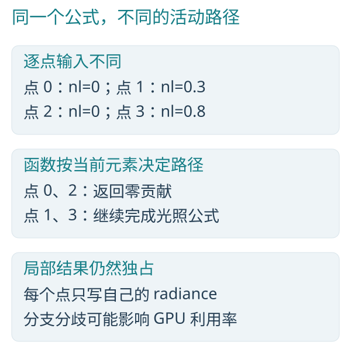

*图 13-1　相同函数可在不同元素上经过不同路径。*

串行版本逐点判断并计算；并行版本允许多个点处于不同路径。GPU 的同一硬件协作集合若出现分歧，可能分次执行各条活动路径，因此“元素独立”不等于“分支没有成本”。B 保留普通控制流，使公式可以按含义组织；性能仍取决于实际活动分布与生成代码。

### 13.2　材质计算为什么适合表达成 map

先按 C++ 串行遍历同一批 `points`。假设同名材质函数已经实现，这里只展示遍历和调用：

```cpp
for (size_t i = 0; i < n; ++i) {
    auto& point = points[i];
    point.radiance = textured_ggx(albedo, point.uv, point.lod, point.normal,
        point.view, point.light, point.tint, point.roughness, point.ior);
}
```

对应的 B 入口摘自 `Programs/material/textured.b`：

```c
void shade(inout dataset<BLShadingPoint> points, read texture2d albedo) on compute {
    parallel (point in points) {
        point.radiance = textured_ggx(albedo, point.uv, point.lod, point.normal,
            point.view, point.light, point.tint, point.roughness, point.ior);
    }
}
```

只读纹理供全体共享；每个 point 拥有自己的方向、纹理坐标、材质参数和输出辐射值。纹理采样和光照公式被封装在普通函数中，外层只声明并行域。

串行遍历逐点完成纹理采样与光照；并行域允许不同点独立推进。单点内部仍先采样，再由样本与参数计算 radiance。

这就是第一章的逐元素变换，只是单个元素的计算从乘加扩展成了材质求值。

`textured_ggx` 继续把采样与普通光照函数组合：

```c
float3 textured_ggx(read texture2d albedo, float2 uv, f32 lod, float3 normal, float3 view, float3 light, float3 tint, f32 roughness, f32 ior) on compute {
    float4 sample = texture_sample(albedo, uv, lod);
    return ggx_surface(normal, view, light, sample.xyz * tint, roughness, ior);
}
```

`on compute` 允许这份实现生成 CPU/GPU 代码；执行时再绑定实际纹理与设备资源。计算入口和源内函数展开也可使用 read texture3d 与 float3 坐标：CPU 复用同一降低器，二维四点、三维八点逐轴插值后混合 mip；GPU 消费真实维度的原生图像采样。资源继续由原绑定和最后消费者持有，不把体数据变成二维图集或宿主逐点回调。普通CPU纹理函数在obj／lib中借用同一实际描述，数组与选中资源转传不复制像素，原调用者保持到最后普通调用结束。含纹理整域Frame入口、GPU独立普通调用与NVIDIA三维小数LOD偏差仍未完成；这项语言能力不表示引擎 Filmic LUT 已采用或效果已经验收。

### 13.3　让公式在一千万个点上展开

性能输入为一千万个元素。下面比较完成一次算法的用时，计时范围与第 1.6 节相同。

```powershell
.\target\release\bperf.exe `
    shade 10000000
```


配套程序调用引擎 material.textured::shade，绑定真实 256×256 浮点纹理，输入使用变化的 UV 与粗糙度。C++ 同样执行双线性采样和完整 GGX 公式。CPU和GPU的误差分别按本次实际输出记录。

一个点上的采样、分支与公式仍按依赖顺序完成；一千万个点之间的独立工作，使这些普通数学函数得以充分展开。


### 13.4　把算法与数据关系放在一起

单个数值函数通常不难编写，难点在于把大量函数、资源和计算阶段连接起来。B 用同一语言表达公式、借用、并行域和阶段组合，使这些关系始终对编译器可见。

例如，一条材质计算链既包含纹理读取，也包含普通公式和结果写入。将它们保留在共同的计算模型中，有助于复用算法、分析依赖，并为不同目标生成代码。

### 13.5　整帧中的真实生产消费链

Programs/render/frame.b的frame在完整资源签名之后调用radiance和resolve：

```b
    radiance<N,W,H,S,DC,IC,Start,V,Shared,G>(pixels,display,instances,overlays,surfaces,cameras,lights,lighting,media,visible,distribution,candidates,candidate_round,cells,directions,guiding_cells,environment,emitters,mesh_lights,mesh_domains,
        parameters,scene,overlay_scene,textures);
    resolve<W,H,S,DC,IC>(pixels,display,overlays);
```

radiance组织Stella输运和内部像素生产，resolve消费像素及叠加输入，写入显示结果。完整资源、目标和const形状以frame.h为准；片段不是另一个可独立编译的模块。阶段内是元素并行，阶段间是实际生产消费依赖，提交返回与设备完成分别成立。

普通函数封装不制造宿主逐元素回调；真正的跨阶段读取不能因正文很短而省略依赖。完整帧、设备程序、读回与呈现分别测量，历史结果保存在台账。

### 13.6　为什么这代表一种值得期待的语言方向

当并行只是库调用外面的附加层，算法与调度之间常隔着许多手工约定。当语言直接表达工作域、访问方式、集合与协作，编译器就有更多完整信息去选择范围、融合阶段、管理临时数据和生成不同目标代码。

同一份源码既描述算法，也呈现数据关系。算法声明必要的依赖，编译器组织计算，执行框架负责物理资源与生命周期。

C/C++ 继续是重要工具。学习 B 的价值，在于训练一种更能利用并行硬件的表达习惯：先看哪些工作独立，再看怎样摘要和组合，最后才看线程落在哪。即使将来回到其他语言，这套思考也会留下来。

## 14　让并行算法走进 C、C++ 与 Rust 项目

### 14.1　一份算法，成为现有工程的计算部件

假设你已经有一个 C++ 图像工具，或者一个 Rust 数据处理服务。最自然的使用方式，是保留现有应用，把适合并行的计算写成 B 的 计算函数，通过函数调用得到结果。

Blink 的 bc 可以输出 Windows x64 DLL，并生成 C/C++ 头文件、导入库与 Rust 绑定。C++ 和 Rust 调用同一个 DLL；Rust 也保留直接使用 blanguage、blcompute 的原生入口。

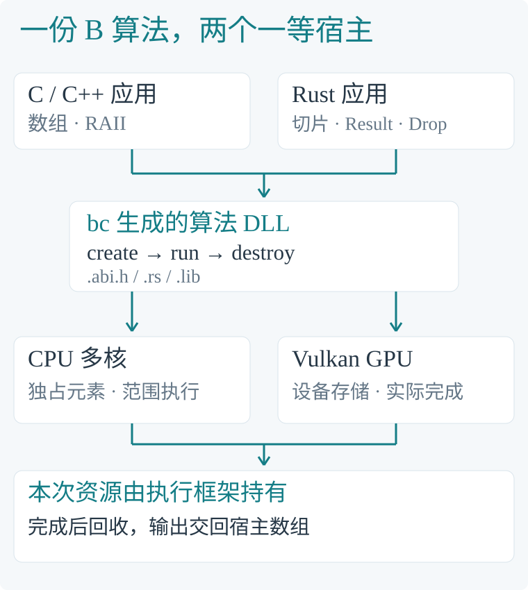

*图 14-1　B 负责算法与并行关系；宿主组织应用，执行框架拥有本次原生资源与完成等待。*

DLL 接口当前面向纯值数组和参数。它很适合图像、粒子、数值变换等可以明确交付输入与输出的算法。需要设备数据长期驻留、跨提交异步组合或图形资源所有权时，Rust 原生 API 继续提供这些能力。

### 14.2　把第一章的乘二加一编译成 DLL

我们仍使用第一章的 values，不增加算法复杂度。选择已有 map.b 中的 scale 入口，它接收宿主给出的数字：

```c
void scale(inout dataset<f32> values)
    on compute {
    parallel (value in values) {
        value = value * 2.0 + 1.0;
    }
}
```

在 Blink 根目录的 x64 Developer PowerShell 中执行：

```powershell
.\target\release\bc.exe -c `
    sample/lessons/map.b `
    -o target/interop/map.obj `
    -I sample --program scale
.\target\release\blink.exe `
    target/interop/map.obj -o target/interop/map.dll
```

链接完成后，交给宿主使用的四个文件是：map.dll 是运行库，map.lib 是链接时使用的导入库，map.abi.h 是 C/C++ 接口，map.rs 是 Rust 绑定。B 源码的 map.h 与生成的 map.abi.h 各有明确用途。

编译阶段完成前端检查、CPU 机器码与 SPIR-V 生成，并把必要执行框架编成静态目标代码；blink 只链接这些产物。消费者无需 B 源码或 Rust 工具链。构造 Program 时装载已生成的 CPU 代码或建立 GPU pipeline，之后可反复调用；create 不从值 IR 重新编译算法。

当前构建 DLL 需要本书前言中安装的 Rust/MSVC 工具链，以及构建 bc 的源码 SDK。消费已经生成的 DLL 的 C/C++ 项目只需头文件、导入库和运行库。

### 14.3　C++：保留熟悉的数组与对象寿命

C++ 的关键调用只有三行：

```cpp
float values[] = {1, 2, 3, 4};
blink_map::Program program(blink_map::Backend::Cpu);
program.run(values, 4);
```

values 仍是 C++ 数组；Program 的析构函数释放 DLL 创建的计算对象。完整源码在 sample/interop/map.cpp，使用编译器生成的 map.abi.h。

```powershell
cl /nologo /utf-8 /EHsc `
    /I target/interop `
    sample/interop/map.cpp `
    target/interop/map.lib `
    /Fo:target/interop/map-cpp.obj `
    /Fe:target/interop/map-cpp.exe
.\target\interop\map-cpp.exe
```

纯 C 使用同一头文件中的 map_create、map_run、map_destroy。完整写法在 map.c，包含错误处理与资源释放：

```powershell
cl /nologo /utf-8 /I target/interop `
    sample/interop/map.c `
    target/interop/map.lib `
    /Fo:target/interop/map-c.obj `
    /Fe:target/interop/map-c.exe
.\target\interop\map-c.exe
```

### 14.4　Rust：同一个 DLL，也有安全的调用方式

生成的 map.rs 封装了 extern C 边界，日常调用使用 Rust 的切片、Result 与 Drop：

```rust
let mut values = [1.0, 2.0, 3.0, 4.0];
let mut program =
    map::Program::new(map::Backend::Cpu)?;
program.run(&mut values)?;
```

可写数据通过独占切片借用；同一 Program 的运行需要可变借用。包装器的类型保持创建线程的所有权，Drop 交还 DLL handle。完整的 main 和模块引入方式在 sample/interop/map.rs。

```powershell
rustc --edition=2024 -C opt-level=3 `
    sample/interop/map.rs `
    -L native=target/interop `
    -o target/interop/map-rust.exe
.\target\interop\map-rust.exe
```


*图 14-2　输出摘录自三个原生宿主，按阅读版式重排；数组均由各自宿主创建。*

Rust 原生 API 也继续存在。以下是 native.rs 中 CPU 路径的核心，使用已有编译结果和数据类型：

```rust
let program = CpuProgram::new(program)?;
let mut data = vec![data];
program.run(&mut data, &[])?;
```

它没有 C ABI 转换。完整样例在 `native.rs` 中用 `let use_gpu = false;` 选择 CPU；需要 GPU 时在宿主源码改为 true，原 GPU 分支明确创建设备、上传、提交和下载。编译并运行普通宿主时无需设备参数：

```powershell
cargo run --release --manifest-path sample/interop/Cargo.toml
```

两种代码内选择均应输出 `[3.0, 5.0, 7.0, 9.0]`。DLL 是可交付的算法部件；原生 crate 让 Rust 消费者继续表达设备数据、提交依赖与资源寿命。

### 14.5　让一个像素的计算，展开为一百万个独立工作

四个数用来理解接口。观察应用中的效率，需要一个计算量足够的例子。

Mandelbrot 分形从复平面中的一个位置 c 出发，反复计算 z 的平方再加 c。每个像素对应一个位置；当 z 的长度超过 2 时，记录它用了多少次迭代。limit=256 是单个像素的最大迭代次数，决定计算的细致程度。

一张 1000×1000 图像正好有一百万像素。一个像素内部有递推依赖，不同像素之间彼此独立。

C++ 串行正文如下，完整版本位于 cpp.cpp：

```cpp
for (uint32_t i = 0;
     i < pixels.size(); ++i) {
    float cx = float(i % Width)
        / float(Width) * 3.5f - 2.5f;
    float cy = float(i / Width)
        / float(Height) * 2.0f - 1.0f;
    float x = 0.0f;
    float y = 0.0f;
    uint32_t iteration = 0;
    while (x * x + y * y <= 4.0f
           && iteration < limit) {
        float next_x = x * x - y * y + cx;
        y = 2.0f * x * y + cy;
        x = next_x;
        ++iteration;
    }
    pixels[i] = iteration;
}
```

B 的正文保留相同的变量与递推公式。Width、Height 在 fractal.h 中均为 1000，Count 为两者之积：

```c
void render(
    write dataset<u32, Count> pixels,
    u32 limit) on compute {
    parallel (pixel in pixels) {
        u32 i = index();
        f32 cx = f32(i % Width)
            / f32(Width) * 3.5 - 2.5;
        f32 cy = f32(i / Width)
            / f32(Height) * 2.0 - 1.0;
        f32 x = 0.0;
        f32 y = 0.0;
        u32 iteration = 0;
        while (x * x + y * y <= 4.0
               && iteration < limit) {
            f32 next_x = x * x - y * y + cx;
            y = 2.0 * x * y + cy;
            x = next_x;
            iteration += 1;
        }
        pixel = iteration;
    }
}
```

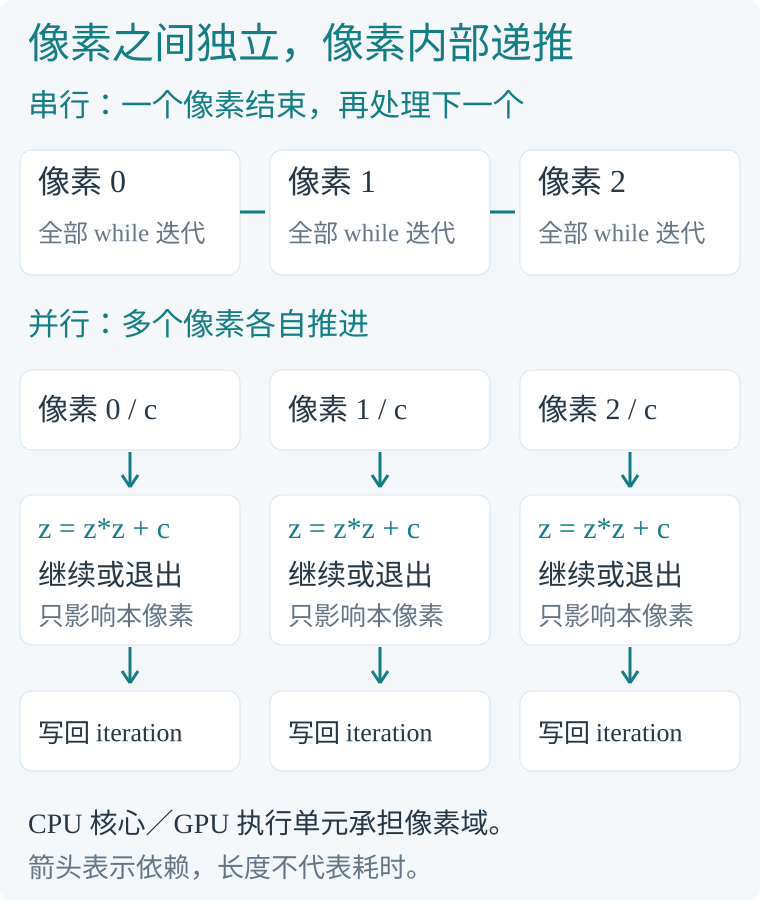

*图 14-3　pixel 对应 C++ 的 pixels[i]。外层工作域展开，内层 while 保持算法需要的先后关系。*

这种拆法把语言的价值落在熟悉的公式上：程序员表达一百万份独立工作，编译器和执行框架把它们交给 CPU 多核或 GPU。C++ 和 Rust 同样能组织并行；B 让这些工作域成为算法本身的一部分，并能作为库供现有应用调用。

### 14.6　在两个宿主中编译、运行与计时

先从同一份 B 源码生成算法库，再编译两个宿主：

```powershell
.\target\release\bc.exe -c `
    sample/interop/fractal.b `
    -o target/interop/fractal.obj `
    -I sample --program render
.\target\release\blink.exe `
    target/interop/fractal.obj `
    -o target/interop/fractal.dll

cl /nologo /utf-8 /std:c++17 `
    /O2 /arch:AVX2 /fp:precise /EHsc `
    /I target/interop `
    sample/interop/cpp.cpp `
    target/interop/fractal.lib `
    /Fo:target/interop/cpp.obj `
    /Fe:target/interop/cpp.exe

rustc --edition=2024 -C opt-level=3 `
    -C target-cpu=native `
    sample/interop/rust.rs `
    -L native=target/interop `
    --out-dir target/interop
```

每个宿主都有自己开启优化的串行对照，并选择同一个 DLL 的后端：

下面四次运行只属于性能对照驱动：参数用于让同一测量程序分别采集 CPU／GPU 数据，不是普通应用选择设备的接口。常规宿主的选择写在前两节的 Backend 或原生 API 代码中。

```powershell
.\target\interop\cpp.exe cpu
.\target\interop\cpp.exe gpu
.\target\interop\rust.exe cpu
.\target\interop\rust.exe gpu
```


具体性能数值属于对应构建与设备的观测，保存在P4台账；本次运行以配套程序实际输出为准。


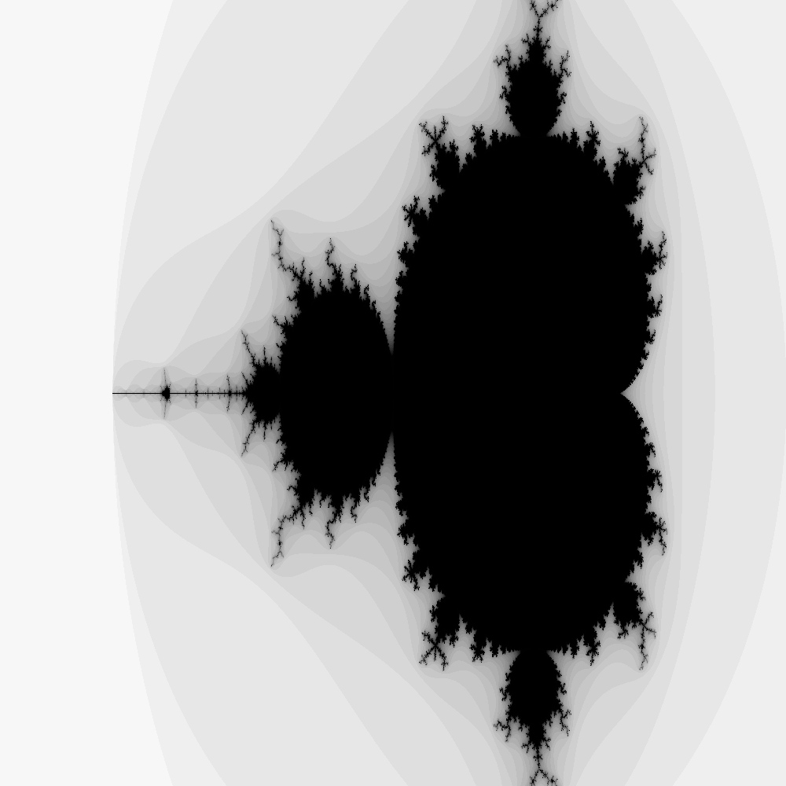

*图 14-5　C++ 宿主调用 B 后生成的灰度图。一百万个像素各自迭代，组合出完整轮廓。*

分形边界会放大浮点舍入差异，不能保证不同后端的迭代次数逐项相同；速度和输出差异须共同评估。

程序还分别输出 setup_ms 和 blink_call_ms。setup_ms 是构造计算对象时的一次性准备；对象复用后，blink_call_ms 才是每次算法调用的费用。若应用从冷启动只算一次，应将两者相加。GPU 的准备费用可能抵消这一次的计算收益；持续计算多张图时，同一个 Program 可以继续复用。

### 14.7　一次调用的底层过程，必须看完整

宿主的普通串行循环直接读写自己的数组。DLL 调用则跨过一个真实接口边界：宿主交付数据，执行框架准备本次存储，完成计算，再将输出交回。

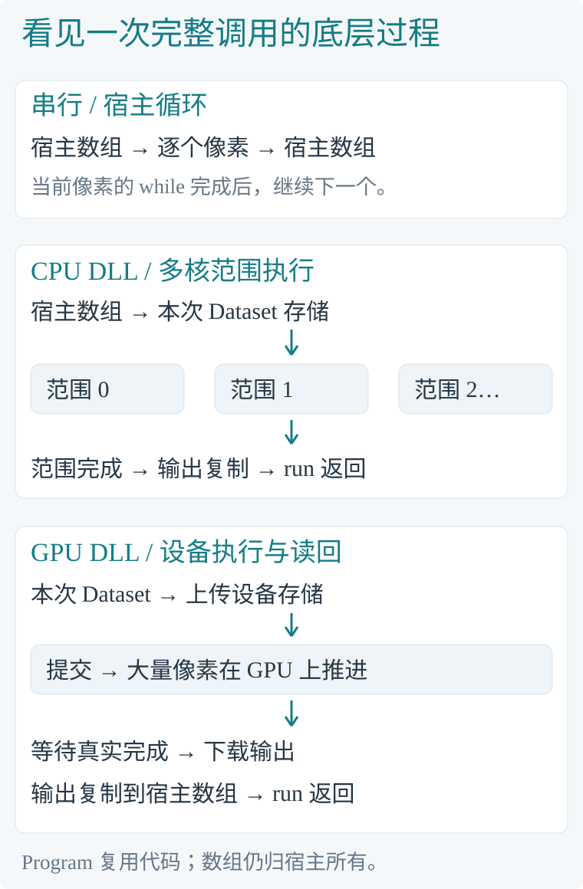

*图 14-6　箭头表示执行先后。每次 run 返回时，设备已经完成，输出已经位于宿主数组中；图中不表示时间比例。*

CPU 路径增加了接口与数据复制，也获得多个核心共同完成像素计算的机会。GPU 路径增加上传与读回，让大量像素在设备上同时推进。每个例子都应按真实调用粒度衡量收益：工作域、单项计算量、数据交付和对象复用，共同决定结果。

内存归属始终清楚。C/C++ 或 Rust 分配并释放数组；DLL 只在本次 run 期间使用它们。handle 由 DLL 创建、由 DLL 释放；C++ 析构与 Rust Drop 负责完成这一步。C ABI 不传递 C++ 对象、Rust Vec 或 String，也不会要求一个语言的分配器释放另一个语言的对象。

记录、向量、矩阵和固定数组使用生成的布局。布尔字段为 32 位的 0／1；头文件和 Rust 文件显式给出对齐与填充。按这些类型填充字段，就能让两个宿主读写同一份数据约定。

### 14.8　B 能否反过来调用 C++ 和 Rust

当前 B 的普通 CPU 应用支持明确的 extern "C" 声明，能够调用 Windows x64 DLL 的 C 导出；C++ 与 Rust 可以按该 ABI 提供函数。普通值、明确位置借用与连续布局合同各自检查，不把 C++ 类、模板或普通 Rust ABI 直接当作 B 接口。算法 DLL 则继续提供宿主调用 B 的入口。

现有应用可以由 C++ 或 Rust 串起完整流程：读取文件、调用已有库、准备输入，调用 B 算法，再把结果交给后续模块。C++ 和 Rust 自己的相互调用可使用双方的 C ABI；普通 Rust ABI 不作为跨语言稳定接口。GPU 内核也不能直接执行任意宿主 CPU 函数。

B 可以先承担一个清楚、可测量的计算部件，保留应用已有的界面、网络与业务逻辑。

## 15　把书合上之后，你能自己做什么

### 15.1　一套可以反复使用的解题步骤

先写清结果是什么，再决定谁拥有每份结果；找出可以独立展开的元素域；把真实依赖表示为阶段；遇到汇总尝试 reduce，遇到区间与前序摘要尝试 scan，遇到可变工作量考虑 compact 与 prefix；局部交流使用 tile，真实共享修改明确使用 atomic。

然后检查算法是否增加了多余工作、数据往返或争用，最后用真实输入与合适的计时范围观察。不要先选一个很酷的并行原语，再勉强把问题塞进去。

### 15.2　练习：先回答，再运行

1. map 的乘数改为 3、加数改为 -1，输入 `[1,2,3,4]`，结果是什么？为什么不需要元素间同步？
2. 对 `[3,1,4,2]` 分别做 reduce、独占 scan 和包含自身的前缀和，它们各输出什么？
3. pipeline 中 id=0 与 id=6 具有相同 key。为什么必须保持其原相对次序？如果业务不要求稳定性，哪些语义可以重新选择？
4. tiles 使用宽度 4、输入六个值时，最后两项的均值为什么是 5.5，而不是 2.75？
5. 若将粒子积分改成“每个粒子读取其他粒子的新位置”，为什么原来的独立 map 推理失效？
6. 一个输出要读取四个相邻输入，是否因此就需要原子操作？什么时候才需要？
7. compose 为什么能并行而不能交换顺序？用“先加一再乘二”和“先乘二再加一”各算一次验证。
8. 第 1 章 B GPU 驻留执行比串行快 4.23 倍，为什么重新上传与读回后仍应考虑 B CPU？怎样用同一套计时重新比较？

### 15.3　参考思路

第一题是 `[2,5,8,11]`，每个元素只读写自己。第二题分别是总量 10、`[0,3,4,8]` 与 `[3,4,8,10]`。

第三题，稳定排序的约定要求同键记录保留来源顺序；是否需要这个约定由真实消费者决定。第四题尾块只有两条有效元素，和为 11，除数为 2。第五题出现跨元素时序依赖，需要重新定义所读状态的版本与阶段，不能假装没有依赖。

第六题，共享只读材料不会造成写冲突；多个执行者需要同时修改同一个位置，才涉及相应共享写机制。第七题，合成函数可以改变结合括号，不能交换输入次序。第八题要把数据位置和计时范围补齐：主存输入可以直接用 B CPU；已经驻留 GPU 的输入可以接上 GPU 计算。若需要上传和读回，就在三种版本完成同样工作后比较完整交付耗时。

### 15.4　入门之后，去读哪些真实文件

按 bodies/statistics、transforms/resolve、textured/frame 的顺序阅读，依次练习识别独立更新与集合、共享只读与独占输出、普通函数与阶段组合。当你能用“谁生产、谁消费、谁能写、在哪里协作”解释程序时，就跨过了并行入门最重要的一道门。

## 附录 A　运行配套示例

### A.1　目录与前提

从 GitHub 下载后，Blink 位于刚克隆的 Blink 目录。以下命令都在这个项目根目录执行；前言给出了工具安装、下载与编译步骤。基础教学不需要 P4 或其他工程。

`sample/applications` 的七组 CPU／GPU 应用完整展示输入、核心计算与输出；各章运行节列出两份源码。CPU 主流程直接写可直接执行的 parallel，集合操作保留同文件完整 on compute 函数并普通调用。`sample/lessons` 的五组模块保留复用及编译器／性能对照用途；其中 seed／demo 的实际源码在相关源码讲解中完整列出，不作为隐藏初始化的常规应用入口。

`module lessons.map;` 指定教学模块的名称，对应 `lessons/map.h` 与 `lessons/map.b`。逐元素计算由关键字 `parallel` 表达；正文展示计算核心，完整模块包含接口与实现。

先按前言安装 Windows x64 正式发行及构建工具，再用 bc 编译、blink 独立链接，直接运行输出 EXE。源码工具或本书 Rust 宿主的构建还需要已安装的稳定 Blink 种子，默认编译器构建从 `%ProgramFiles%/Blink` 读取实际输入；先完成前言的版本检查。GPU 应用需要显卡驱动提供的 Vulkan；应用代码负责显式传输。

各章的命令均在 Blink 根目录执行，应用目标与 EXE 放在 target/book-apps。设备、数据大小和普通参数属于 main 或宿主源码。需要交付算法 DLL 时见第十四章；正常运行既不需要 brun，也不要求命令行指定设备。

### A.2　示例命令索引

- 逐元素变换：`applications/map_cpu.b`／`map_gpu.b`，第 1.5 节。
- 求和归约：`applications/reduce_cpu.b`／`reduce_gpu.b`，第 3.5 节。
- 独占扫描：`applications/scan_cpu.b`／`scan_gpu.b`，第 4.5 节。
- 筛选、排序与统计：`applications/pipeline_cpu.b`／`pipeline_gpu.b`，第 5.6 节与第 6 章。
- 分块分析：`applications/tiles_cpu.b`／`tiles_gpu.b`，第 7.6 节；其中包含 center 协作函数。
- 发布后协作：`applications/publish_cpu.b`／`publish_gpu.b`，第 7.8 节。
- 有序变换组合：`applications/algebra_cpu.b`／`algebra_gpu.b`，第 9.5 节。

每个算法配有 `<名称>_cpu.b` 与 `<名称>_gpu.b`，对应源码公开 main，程序自行分配 dataset、设置参数并打印结果。两者共享 lessons 中同一份计算算法；差异只在应用内明确的目标与传输。

### A.3　仅供后端隔离测试的 BLDATA 协议

BLDATA v1 是小端文件：前八字节为 `BLDATA\0\0`，再依次是四个 u32，分别为版本、记录数、记录步长、执行步数；第 24 字节开始是完整记录。具体字段偏移以编译器布局为准，不能把任意 C++ struct 的 sizeof 当成 B 的 ABI。

正常应用已经直接 println，不需要文件数据协议。本节只为隔离编译器／运行框架的后端测试保留模块运行器：它在不引入 main 的情况下绑定固定测试输入，并把结果保存为 BLDATA，便于逐字节对照。

```powershell
brun cpu sample/lessons/map.b demo sample Saved/Book/map :4
brun gpu sample/lessons/map.b demo sample Saved/Book/map-gpu :4
```

这两条是后端隔离测试命令，不是语言的常规编程方式。map 的四个 f32 在 24 字节头部之后，每个占 4 字节，测试后可以按四个位置读取：

```powershell
$data = [IO.File]::ReadAllBytes(
    'Saved/Book/map/values.bldata'
)
[BitConverter]::ToSingle($data, 24)
[BitConverter]::ToSingle($data, 28)
[BitConverter]::ToSingle($data, 32)
[BitConverter]::ToSingle($data, 36)
```

输出依次是 3、5、7、9。正文的运行记录图也按实际布局读取结果，再按阅读顺序展示。

其他记录按各自布局解释：scan 的 Count 占 4 字节，按 u32 读取。pipeline 的 Item 占 16 字节，id 位于记录起点；tiles 的 Cell 占 16 字节，centered 位于记录内偏移 12。

pipeline 的 count 表示有效长度，ordered 与 offsets 的容量仍然是 8；只读前 4 条结果。尾部这次是零，来自初始分配内容，不是 compact 或排序承诺的“无效标记”。

### A.4　真实引擎算法的源码位置

第 11–13 章摘录的是 BLEngine 的正式计算程序。阅读这些章节不需要先构建引擎；要执行对应的五项性能对照（bodies、body_total、transforms、shade、resolve），需有获授权的 BLEngine 源码并将 Programs 放在 Blink 目录旁的 BLEngine/Programs。BLEngine 当前尚未开源，仅下载 Blink 不能独立复现这些引擎测量；公开可运行的粒子、变换和GGX教学模块见 sample/hybrid，不能将它们冒充原性能入口或测量数字。配套宿主直接编译这些 B 模块，不需要引擎窗口或 BLEditor。

粒子更新入口是 simulation.bodies::step；粒子更新与总能量入口是 simulation.statistics::step_and_total。用附录 A.5 的 bperf 分别执行 bodies 与 body_total 案例，即可运行书中相同的数据与算法。

### A.5　复现性能对照

配套工具位于 sample/performance。先完成前言的稳定 Blink 种子安装及版本检查；宿主依赖默认编译器功能，同样会消费这份种子。使用 Windows x64 的 Visual Studio 开发者 PowerShell，确认 cl、lib 与 cargo 可用；从 Blink 根目录编译：

```powershell
cargo build --release `
    --manifest-path `
    sample/performance/Cargo.toml `
    --target-dir target
.\target\release\bperf.exe `
    map 100000000
```

这会编译 C++ 串行对照以及调用现有 B 执行框架的宿主程序。命令只需指定案例和元素数；省略元素数时采用书中规模。每次计时执行一次完整算法。引擎案例读取相邻 BLEngine/Programs，普通教学案例只读取当前仓库的 sample/lessons。工具输出墙钟毫秒、GPU 设备时间、数据往返时间、加速比和计时之外的结果差异。

C++ 串行代码在 serial.cpp；Rust 仅负责已有编译器、数据集与设备 API 的绑定和计时。核心 B 算法仍是 lessons 以及 BLEngine 的正式实现，完整命令和各案例的种子数据见 performance/README.md。

性能测量使用Release正式构建；构建、硬件、原始输出及测量边界在P4台账记录，运行配套程序得到本次观测。


### A.6　单独检查源码与导出代码

正常运行使用 bc -c 编译、blink 独立链接后直接执行 EXE。若只检查算法模块能否编译，可以单独执行 bc check：

```powershell
.\target\release\bc.exe check `
    sample/lessons/map.b sample demo
```

若想查看生成的代码及数据布局，可以执行 bc build：

```powershell
.\target\release\bc.exe build `
    sample/lessons/map.b `
    Saved/BookCompiled/map sample demo
```

这会将 CPU 的 `.x64`、GPU 的 `.spv` 及布局文件导出到指定目录。它用于观察编译结果，不是应用运行的前置步骤。要把算法编译成 C/C++ 或 Rust 可调用的 DLL，请参照第十四章。

## 附录 B　实现范围与运行记录

### B.1　哪些已经存在，哪些仍在研发

本书使用的 map、全域归约与扫描、稳定 compact、有效前缀、u32 稳定键排序、tile 输入与发布、块内集合、cooperative 函数、开放 u32 const 具体入口及普通记录自定义扫描/归约，在当前项目已有实现。

CPU 当前具有范围并行，以及直线map及批次内统一分支／循环的四元素SSE2；复杂控制流、tile 协作等不能统称为完整 SIMD 优化。GPU 当前以单设备、单队列为主，不能从 计算函数 的逻辑分叉推断硬件多队列并行。

普通CPU函数已支持自递归／互递归，dataset支持u32／i32／u64／i64显式原子。GPU普通函数递归、通用动态任务、动态块内发布／屏障、非原子任意共享写、64位tile／浮点原子及完整符号泛型分析仍未实现。完整、最新细节见 `Docs/BLanguage.md` 与 `Docs/Issues.md`。不支持的程序应明确报错，不应被想象成已经换了一种算法执行。

### B.2　示例输入与结果

小输入负责帮助手算和核对结果；配套程序用于取得当前构建的大规模测量。两种输入共用相应算法，分别回答“结果如何形成”与“并行怎样提高效率”。


| 内容 | 输入 | 按算法推导的结果 |
|---|---|---|
| map 应用 | 4 个 f32，乘二加一 | `[3,5,7,9]` |
| reduce 应用 | `[3,1,4,2]` | `10` |
| scan 应用 | `[3,1,4,2]` | `[0,3,4,8]` |
| pipeline 应用 | 8 条 | count=4，id=`[4,2,0,6]`，offsets=`[0,5,8,9]`，total=16 |
| tiles 应用 | 6 条 | 首块 total=10，尾块 total=11；均值与前缀如正文 |
| publish 应用 | 6 条，factor=2 | 两块 total=20、22 |
| algebra 应用 | 四次 `(2,1)` | 前缀与总变换如正文 |

表中给出手算所需的输入和预期结果；具体原生验证归台账记录。浮点数在其他输入与不同归约分组下仍可能产生舍入差异。


### B.3　性能测量范围

测量规模使用一百万、一千万和一亿，分别记录一次完整算法、设备驻留、准备和数据往返的实际边界。

每次测量记录实际构建、设备、规模与边界；CPU墙钟、GPU设备跨度和传输往返分别比较，数值以本次执行为准。

结果对照区分整数与浮点；总能量同时报告f64参考，不能把不同累加顺序当成逐位一致。


### B.4　来源与进一步阅读

语言事实以本项目 `Docs/BLanguage.md`、`Docs/Architecture.md`、`Docs/Issues.md` 及 `crates/blanguage`、`crates/blcompute` 实现为依据。常规应用以 `sample/applications` 的 main、target 与显式传输为依据；模块运行器仅用于本书明确标注的后端隔离测试；性能对照使用 `sample/performance`；C/C++ 与 Rust 的 DLL 接入使用 `sample/interop`，接口范围见 `Docs/NativeInterop.md`。

BLEngine 摘录来自 `Programs/simulation/bodies.*`、`Programs/simulation/statistics.*`、`Programs/math/field.*`、`Programs/scene/transforms.*`、`Programs/render/resolve.*`、`Programs/stella/surface.*`、`Programs/material/surface.*`、`Programs/material/textured.*` 和 `Programs/render/frame.*`。各处仅摘读说明语言思想所需部分，完整接口与资源绑定保留在原项目。可运行的混合教材副本另行维护，其四种 f32 维度约束与当前哈希见[随书教学来源](hybrid/BLEngine摘录来源.md)。

前缀扫描可进一步阅读 Guy E. Blelloch 的 [Prefix Sums and Their Applications](https://www.cs.cmu.edu/~guyb/papers/Ble93.pdf)，将其中的树形上扫与下扫，同第 4 章的摘要与传播过程对照。

摘录版本与 SHA-256 见 [BLEngine 摘录来源](BLEngine摘录来源.md)。原项目后续演进以正式源码为准。

跨语言边界可继续阅读 [Microsoft DLL 使用指南](https://learn.microsoft.com/en-us/cpp/build/walkthrough-creating-and-using-a-dynamic-link-library-cpp)、[Rust extern 块](https://doc.rust-lang.org/reference/items/external-blocks.html)和 [Rust 链接规则](https://doc.rust-lang.org/reference/linkage.html)。

## 函数与执行位置

计算函数统一使用返回类型与显式parallel，on声明能力，target选择本次位置。同步GPU返回后结果仍在GPU，CPU读取须显式download；内部Program与CLI的--program保留产物职责。

只读纹理可明确写成`read texture2d<rgba8_unorm> noise`，把存储格式要求交给原资源绑定入口。这个要求来自真实图像元数据，数组和普通函数继续传递原资源，不扫描像素。格式、采样值域和最终索引各有自己的事实来源；声明UNORM不等于已经证明整个散射算法的所有输入关系。原Proof在已知归一格式、坐标已证在[-1,1]且LOD已证在[-2^32,2^32]时交接保守[0,2]，四则、floor和整数转换继续消费该范围，不增加运行指令；其他合法输入仍可采样，范围保持未知。完整语义见语言规范的只读纹理资源章节。
